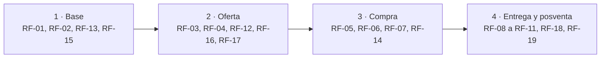
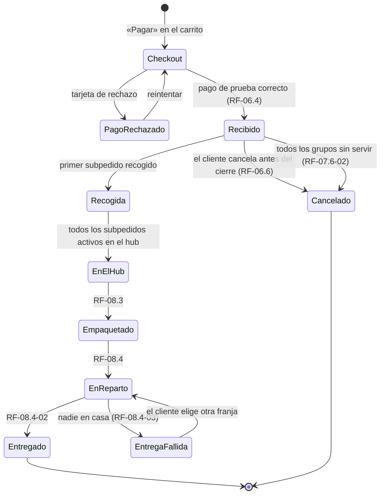
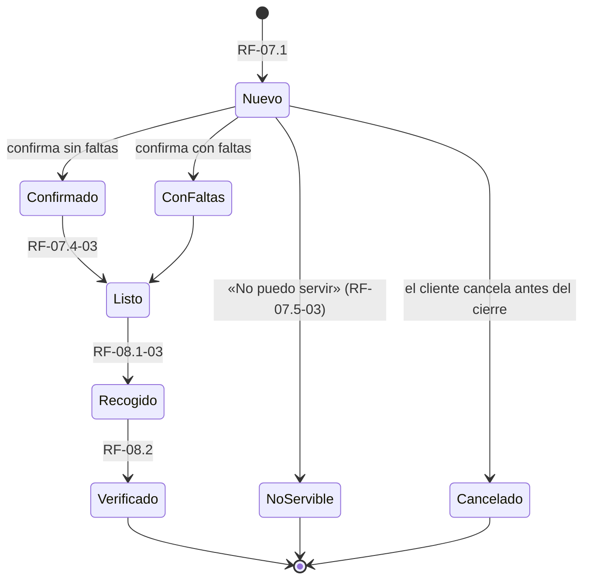

# FOOD4ALL · Documento de requisitos del Hito 2

v0.4 · 22/10/2026 · Sebastián Manuel Mateo Sánchez, Juan Antonio y Miguel

**Índice**

- [0. Control del documento](#0-control-del-documento)
- [1. Resumen ejecutivo](#1-resumen-ejecutivo)
- [2. Fuentes de información](#2-fuentes-de-información)
- [3. Problemas y necesidades identificados](#3-problemas-y-necesidades-identificados)
- [4. Personas y mapa de empatía](#4-personas-y-mapa-de-empatía)
- [5. Procesos principales y orden de construcción](#5-procesos-principales-y-orden-de-construcción)
- [6. Historias de usuario](#6-historias-de-usuario)
- [7. Requisitos funcionales](#7-requisitos-funcionales)
- [8. Requisitos no funcionales](#8-requisitos-no-funcionales)
- [9. Matriz de trazabilidad](#9-matriz-de-trazabilidad)
- [10. Hipótesis, riesgos y decisiones pendientes](#10-hipótesis-riesgos-y-decisiones-pendientes)
- [11. Organización en Asana, fuentes de verdad y glosario](#11-organización-en-asana-fuentes-de-verdad-y-glosario)
- [12. Product Backlog](#12-product-backlog)
- [Anexo A. Ejemplo: inicio de sesión en los tres proyectos](#anexo-a-ejemplo-inicio-de-sesión-en-los-tres-proyectos)
- [Anexo B. Benchmark de requisitos frente a la competencia](#anexo-b-benchmark-de-requisitos-frente-a-la-competencia)

---

## 0. Control del documento

Este documento es la Especificación de Requisitos de FOOD4ALL para el Hito 2. Une lo mejor de los tres grupos y lo ordena en cascada: cada bloque solo usa información de los bloques anteriores.

| Campo | Valor |
| --- | --- |
| Proyecto | FOOD4ALL · Marketplace Local (Grupo B) |
| Entrega | Hito 2 · Requisitos y criterios de aceptación · Sprint 2 (semanas 3–5) |
| Peso en la nota | 15 % |
| Fecha límite | 23/10/2026 |
| Versión | 0.4 (22/10/2026: correcciones de la valoración provisional del 21/10/2026) |
| Autores | Sebastián, Juan Antonio, Miguel |
| Revisor por bloque | Se indica en cada bloque (nadie revisa su propio bloque) |
| Catálogo completo | `FOOD4ALL_requisitos_benchmark.xlsx` (559 requisitos comparados con la competencia) |
| Documentos que lo acompañan | `FOOD4ALL_necesidades.md` (catálogo único de necesidades), `FOOD4ALL_estados_pedido.md` (estados del pedido y reembolso de prueba), `FOOD4ALL_matriz_trazabilidad.md` (matriz completa), `FOOD4ALL_correcciones_hito2.md` (qué se cambió y por qué) |
| En Asana | [Food4All] Hito 2 → [B1] a [B6] |

**Registro de versiones**

| Versión | Fecha | Qué cambia | Quién |
| --- | --- | --- | --- |
| 0.1 | 19/10/2026 | Primera especificación: fuentes, necesidades N-01 a N-08, 19 procesos, 556 requisitos y benchmark | Sebastián |
| 0.2 | 20/10/2026 | Volcado en Asana (B4 y B5) | Sebastián |
| 0.3 | 20/10/2026 | Guía para el equipo y reparto propuesto | Sebastián |
| 0.4 | 22/10/2026 | Catálogo único de necesidades N-<MÓDULO>-NN; regla prioridad/entrega; alcance y dependencias por requisito; máquina de estados del pedido y reembolso de prueba; 3 requisitos nuevos de faltas; fichas completas del MVP; plan de verificación de cada RNF; 6 historias nuevas con criterios Gherkin; matriz generada; glosario v2 | Sebastián (pendiente de revisión por Juan Antonio y Miguel) |

**Leyenda de estado** (se aplica a cada afirmación, necesidad y requisito):

| Estado | Significado |
| --- | --- |
| Decidido | Acordado por el equipo. Es una decisión de producto, no una necesidad validada |
| Hipótesis | Lo creemos, pero falta validarlo con datos o entrevistas |
| Pendiente | Decisión aún no tomada, o propuesta que el equipo debe aprobar en la criba |
| Obligación legal | Solo para necesidades: la impone una norma (F-03) |

**Convención de identificadores** (fijos: un ID nunca se reutiliza aunque se descarte el elemento):

| Prefijo | Elemento | Ejemplo |
| --- | --- | --- |
| F | Fuente de información | F-04 |
| N-<MÓDULO>-NN | Necesidad (catálogo único desde la v0.4) | N-CAR-01 |
| P | Persona o arquetipo | P1 |
| US | Historia de usuario | US-07 |
| RF / RNF | Requisito funcional / no funcional (proceso) | RF-12, RNF-03 |
| RF-xx.y | Subrequisito: una pantalla o un método | RF-01.2 |
| RF-xx.y-zz | Requisito atómico dentro del subrequisito | RF-01.2-08 |
| CA | Criterio de aceptación | RF-01.2.CA1 |
| H / D / R | Hipótesis / decisión pendiente / riesgo | H-03, D-01, R-02 |
| BF | Función de la competencia comparada | BF24 |
| E / V | Entrevista a estudiante / a vendedor | E3, V2 |

Cada relación se escribe con el ID y su nombre (por ejemplo, «N-CAR-01 Comprar a varios vendedores en un solo pedido»): un número suelto no basta.

**Qué tomamos de cada grupo:**

| Origen | Buena práctica incorporada |
| --- | --- |
| INDICONNECT | Base del documento, por indicación del profesor: subtareas que calcan los entregables (necesidades → historias → RF → RNF → matriz); criterios en Gherkin; citar las fuentes de elicitación |
| LearnCode | IDs, prioridad MoSCoW y columna Origen en cada requisito; RNF con métrica, umbral y verificación; «Hecho cuando» y revisor en cada tarea |
| Food4All | Estado decidido / hipótesis / pendiente; fuentes citadas con enlace; marco legal convertido en requisitos; comparativo de competencia |
| Profesor | Cada requisito es un «mini manual de usuario» que describe cada detalle; ninguna tarea se cierra con subtareas abiertas |

## 1. Resumen ejecutivo

FOOD4ALL permite a un estudiante que vive fuera de casa comprar a varios vendedores locales en un solo carrito, pagar una vez y recibirlo todo en una entrega consolidada. Este documento traduce ese objetivo, y lo investigado en el Hito 1, en requisitos verificables.

**Propósito.** Definir qué debe hacer el sistema y con qué calidad, de forma que cada requisito se pueda diseñar en el Sprint 3, modelar en el Sprint 4 y probar en el Sprint 5.

**Alcance de este hito.** Marketplace local con cuatro actores (cliente, vendedor, operador del hub y administrador): catálogo, carrito multi-vendedor, pago único simulado, subpedidos, logística consolidada, seguimiento, incidencias y asistente de IA simulado. Quedan fuera los precios reales, la comisión, la ubicación del hub y los pagos reales (bloque 10).

**Qué es evidencia y qué no.** Ninguna necesidad de usuario está todavía confirmada: las entrevistas F-07 y F-08 se registran el 23/10/2026. Hasta entonces, las necesidades son hipótesis apoyadas en documentación, o bien obligaciones legales. Las personas de B2 son arquetipos documentales, no usuarios observados. Los umbrales de los RNF indican si salen de una norma, de una referencia técnica, de una decisión o de una hipótesis, y se verificarán en el Sprint 5.

**Entregables exigidos en Asana** y dónde se cubren:

| Entregable de Asana | Bloque |
| --- | --- |
| Necesidades de vendedores locales y compradores | 2 y 3 |
| Al menos 2 personas o arquetipos + mapa de empatía | 4 |
| User stories con criterios de aceptación | 6 |
| Requisitos funcionales (catálogo, carrito, pagos, valoraciones) | 7 |
| Requisitos no funcionales | 8 |
| Matriz de trazabilidad inicial | 9 |

**Definición de terminado del documento** (estado a 22/10/2026):

| Criterio | Estado |
| --- | --- |
| Toda necesidad tiene fuente; todo requisito tiene necesidad de origen | Hecho (catálogo único; 0 requisitos sin necesidad) |
| Cada historia y cada requisito tienen al menos un criterio Dado / Cuando / Entonces comprobable | Hecho (19 historias, 559 requisitos) |
| Cada requisito Must tiene su ficha «mini manual» completa | Hecho para los 105 subrequisitos del MVP; pendiente de revisión |
| Cada afirmación está marcada como Decidido, Hipótesis o Pendiente | Hecho |
| La matriz no tiene huecos en las columnas del Sprint 2 | Hecho (`FOOD4ALL_matriz_trazabilidad.md`) |
| Cada bloque está revisado por alguien distinto de su autor | **Pendiente**: lo hacen las personas del equipo con un comentario en Asana |

## 2. Fuentes de información

Todo lo que viene después se apoya en estas fuentes: una necesidad sin fuente no entra en el documento. Las subtareas de investigación del Sprint 2 pasan a ser fuentes, no entregables.

| ID | Fuente | Qué aporta | Responsable | Estado |
| --- | --- | --- | --- | --- |
| F-01 | Mercado (Hito 1): MAPA 2025, EUROSTUDENT 8, cifras de US, UGR y UMA | Tamaño del mercado, hábitos de compra, segmento estimado de 38.500 estudiantes (estimación) | Miguel | Hecho |
| F-02 | Alcance (Hito 1) | Qué entra y qué no | Miguel | Hecho |
| F-03 | Marco legal (Hito 1) | Obligaciones que se convierten en requisitos (análisis orientativo) | Sebastián | Hecho |
| F-04 | Comparativo de 10 empresas del sector | Benchmark exploratorio: brecha del carrito multi-vendedor, pagos, incidencias. Fiabilidad baja: no cita fuentes | Juan Antonio | Hecho |
| F-05 | Investigación de entrega a clientes | Franjas, zonas, entrega fallida | Miguel | En curso |
| F-06 | Investigación de recogida a vendedores | Rutas, ventanas, paradas | Juan Antonio | En curso |
| F-07 | Entrevistas a estudiantes (mínimo 5), códigos E1, E2… | Contrastar las necesidades del cliente | Miguel | Se registran el 23/10/2026 |
| F-08 | Entrevistas a vendedores locales (mínimo 2–3), códigos V1, V2… | Contrastar las necesidades del vendedor | Juan Antonio | Se registran el 23/10/2026 |
| F-09 | Borrador de 211 requisitos (`FOOD4ALL_requisitos.md`, 09/10/2026) | Lista de partida para la criba. Histórico: no es evidencia | Sebastián | Hecho |
| F-10 | Benchmark de competidores (Anexo B y Excel) | Qué hace la competencia en cada requisito | Sebastián | Hecho |
| F-11 | Personas y mapas de empatía (B2) | Arquetipos documentales; no es evidencia independiente | Juan Antonio | Hecho (v2 con IDs corregidos) |
| F-12 | Estudios de food hubs citados en B2 (Wisconsin 2025, Manchester 2025, Red Tomato, Local Line, prensa de Market Wagon) | Problemas reales de recogida y consolidación | Juan Antonio | Hecho |

Por cada entrevista se guarda la fecha, el perfil anonimizado, las preguntas, las respuestas literales y las necesidades que menciona o contradice (plantilla en `FOOD4ALL_necesidades.md`, apartado 6). Cada cita se referencia por su código: E3 o V2.

## 3. Problemas y necesidades identificados

El catálogo único tiene 22 necesidades: 16 de usuario y 6 obligaciones legales. Sustituye a los N-01…N-08 de la v0.3 y a los N-01…N-20 del documento de personas, que usaban los mismos números con significados distintos. Las equivalencias, la regla de evidencia y el plan de contraste con las entrevistas están en `FOOD4ALL_necesidades.md`.

<!-- catalogo:inicio -->
| ID | Necesidad | Quién | Tipo | Estado | Fuentes | Requisitos (MVP) |
| --- | --- | --- | --- | --- | --- | --- |
| N-PLA-01 | Saber qué comprar y qué comer los próximos días, planificando en vez de improvisar | Estudiante (P1) | Usuario | Hipótesis | F-01, F-02 | 21 (12) |
| N-PLA-02 | Controlar cuánto gasta en comida y ajustarse a un presupuesto | Estudiante (P1) | Usuario | Hipótesis | F-01 | 19 (5) |
| N-CAR-01 | Comprar producto local de varios vendedores en un solo pedido y un solo pago, sin ir de tienda en tienda | Estudiante (P1) | Usuario | Hipótesis | F-04, F-10 | 162 (137) |
| N-ENT-01 | Recibir todo en una sola entrega, en una franja conocida | Estudiante (P1) | Usuario | Hipótesis | F-04, F-05 | 33 (27) |
| N-CAD-01 | Gestionar cantidades, conservación y caducidades para no tirar comida | Estudiante (P1) | Usuario | Hipótesis | F-01, F-03 | 8 (3) |
| N-IA-01 | Que el asistente simplifique la decisión sin obligarle a explicar demasiado | Estudiante (P1) | Usuario | Hipótesis | F-02 | 10 (10) |
| N-IA-02 | Saber cuándo habla con una IA y distinguir una recomendación de la publicidad | Estudiante (P1) | Obligación legal | Obligación legal | F-03 (Reglamento de IA 2024/1689; DSA 2022/2065) | 11 (9) |
| N-CAT-01 | Confiar en el origen, la calidad y la trazabilidad de lo que compra | Estudiante (P1) | Usuario | Hipótesis | F-03 (Reglamento 178/2002), F-04 | 36 (14) |
| N-CAT-02 | Conocer ingredientes y alérgenos antes de pagar | Estudiante (P1) | Obligación legal | Obligación legal | F-03 (Reglamento 1169/2011, art. 14) | 14 (14) |
| N-CAT-03 | Recibir información veraz: precio final, costes, condiciones y avisos, sin sorpresas | Estudiante (P1) | Obligación legal | Obligación legal | F-03 (RDL 1/2007; LSSI; P2B 2019/1150) | 35 (18) |
| N-CUE-01 | Que sus datos personales y de salud estén protegidos y solo se usen para lo que aceptó | Estudiante, vendedor (P1, P2) | Obligación legal | Obligación legal | F-03 (RGPD; LOPDGDD) | 61 (53) |
| N-INC-01 | Tener una solución rápida, atendida por personas, si algo llega mal | Estudiante (P1) | Usuario | Hipótesis | F-04 (fiabilidad baja: no cita fuentes) | 34 (17) |
| N-VEN-01 | Llegar a clientes nuevos y ganar visibilidad | Vendedor (P2) | Usuario | Hipótesis | F-01 (comercio tradicional 10,6 %) | 15 (10) |
| N-VEN-02 | Vender online sin montar una web propia ni gestionar envíos | Vendedor (P2) | Usuario | Hipótesis | F-01, F-04 | 16 (9) |
| N-VEN-03 | Reducir la merma del género que no vende a tiempo | Vendedor (P2) | Usuario | Hipótesis | F-03 (Ley 1/2025) | 1 (0) |
| N-VEN-04 | Saber qué preparar y para cuándo: pedido claro y franja de recogida | Vendedor (P2) | Usuario | Hipótesis | F-06, F-12 | 13 (12) |
| N-VEN-05 | Cobrar con transparencia: comisión y liquidación claras | Vendedor (P2) | Usuario | Hipótesis | F-12 (críticas a la tarifa de Market Wagon) | 11 (1) |
| N-VEN-06 | Conocer con claridad los requisitos y los pasos del alta | Vendedor (P2) | Usuario | Hipótesis | F-03 | 24 (22) |
| N-VEN-07 | Admitir solo vendedores con registro sanitario o con una exención justificada | Administrador (P3) | Obligación legal | Obligación legal | F-03 (RD 191/2011; RD 1086/2020) | 9 (9) |
| N-HUB-01 | Tener rutas y franjas de recogida fiables, con aviso de «pedido listo» | Operador (P3) | Usuario | Hipótesis | F-06, F-12 | 6 (3) |
| N-HUB-02 | Mantener la cadena de frío y separar frío y seco | Operador (P3) | Obligación legal | Obligación legal | F-03 (Reglamento 852/2004), F-12 | 4 (2) |
| N-HUB-03 | Verificar cada pedido y resolver las faltas antes de entregar | Operador (P3) | Usuario | Hipótesis | F-06, F-12 | 16 (13) |
<!-- catalogo:fin -->

**Regla de evidencia** (resumen). Una necesidad de usuario pasa a **Confirmada** si la mencionan 3 o más entrevistas independientes del perfil afectado, en respuesta a preguntas abiertas, con cita literal y sin un número igual o mayor que la contradiga. Con 1 o 2 entrevistas queda como **Indicio**. Las personas, el benchmark y los estudios ayudan a formular hipótesis, pero no confirman.

## 4. Personas y mapa de empatía

Las tres personas y sus mapas de empatía completos están en el entregable de B2 (Juan Antonio, `FOOD4ALL_personas_empatia_v2.md`, con los IDs del catálogo único). Son **arquetipos documentales**: se construyeron con la documentación del proyecto, datos de consumo y estudios de food hubs, no con casos individuales. Sus frases son representativas, no citas de entrevistas. Se contrastarán con F-07 y F-08.

| | P1 · Lucía, estudiante | P2 · Antonio, frutero de barrio | P3 · Rafa, operador del hub y repartidor |
| --- | --- | --- | --- |
| Perfil | 20 años, de Jaén, estudia en Granada y comparte piso; unos 40 € a la semana para comida (supuesto) | 54 años, tienda propia en un barrio de Málaga, sin web | 31 años, Sevilla; recoge, verifica, empaqueta y entrega |
| Objetivo | Comer bien varios días sin pasarse del presupuesto | Clientes nuevos y menos merma sin gestionar envíos | Rutas fiables y pedidos completos |
| Mayor miedo | Pagar más o recibir producto en mal estado | Perder margen por la comisión | Esperas y pedidos que no están listos |
| Necesidades | N-PLA-01, N-PLA-02, N-CAR-01, N-ENT-01, N-CAD-01, N-IA-01, N-CAT-01 | N-VEN-01 a N-VEN-06 | N-HUB-01, N-HUB-02, N-HUB-03 |
| Procesos que más le afectan | RF-04, RF-05, RF-06, RF-09, RF-12 | RF-02, RF-03, RF-07, RF-16, RF-17 | RF-07.4, RF-08 |

## 5. Procesos principales y orden de construcción

La app se divide en 19 procesos principales; cada uno es un requisito funcional con ID propio. Se construyen en cuatro fases: una fase usa lo que entrega la anterior, pero cada ficha se redacta sola porque escribe esa entrada como supuesto. Dentro de cada fase el orden es de arriba abajo. Un retraso en una ficha no bloquea a las demás: solo cambia su supuesto de entrada.

| 1 · Base | 2 · Oferta | 3 · Compra | 4 · Entrega y posventa |
| --- | --- | --- | --- |
| RF-01 Registro y roles | RF-03 Catálogo y fichas | **RF-05 Carrito multi-vendedor** | RF-08 Recogida, hub y entrega |
| RF-02 Alta de vendedor | RF-04 Búsqueda | **RF-06 Checkout y pago único** | RF-09 Seguimiento y avisos |
| RF-13 Administración | RF-12 Asistente de IA | **RF-07 Subpedidos por vendedor** | RF-10 Incidencias y reembolsos |
| RF-15 Web pública | RF-16 Panel del vendedor | RF-14 Suscripción | RF-11 Valoraciones |
| | RF-17 Condiciones y liquidación | | RF-18 Comunicación con vendedores |
| | | | RF-19 Soporte y contacto |

En negrita, el núcleo diferencial de FOOD4ALL: un carrito con varios vendedores, un solo pago y la división en subpedidos. Sus estados comunes están en `FOOD4ALL_estados_pedido.md`.



## 6. Historias de usuario

Cada historia nace de una o varias necesidades, pertenece a un proceso y lleva al menos dos criterios Gherkin comprobables. Hay una por proceso, salvo en RF-15 y RF-16, que comparten historia con el resto de su fase. La prioridad sigue MoSCoW referida al MVP: Must, Should, Could y Won't (esta vez no). Desde la v0.4, la prioridad de cada historia coincide con la de los requisitos de su proceso.

| ID | Proceso | Como… | quiero… | para… | Origen | Prioridad |
| --- | --- | --- | --- | --- | --- | --- |
| US-01 | RF-01 | estudiante | registrarme con mi correo y elegir mi zona | comprar a vendedores de mi ciudad | N-CAR-01, N-CUE-01 | Must |
| US-02 | RF-02 | vendedor | darme de alta con mis datos y mi registro sanitario | empezar a vender en FOOD4ALL | N-VEN-02, N-VEN-06, N-VEN-07 | Must |
| US-09 | RF-13 | administrador | aprobar o rechazar las solicitudes de vendedores | que solo vendan negocios con registro sanitario | N-VEN-07 | Must |
| US-14 | RF-15 | visitante | entender en menos de 30 segundos qué es FOOD4ALL y elegir si comprar o vender | decidir si me interesa sin leer de más | N-CAR-01, N-PLA-01 | Must |
| US-10 | RF-03 | vendedor | publicar productos con ficha completa (origen, alérgenos, conservación) | que el cliente compre con confianza | N-CAT-01, N-CAT-02, N-VEN-01 | Must |
| US-03 | RF-04 | estudiante | ver de quién es cada producto y sus alérgenos | comprar con confianza | N-CAT-01, N-CAT-02 | Must |
| US-15 | RF-16 | vendedor | ver en mi panel qué tengo que preparar y para cuándo | no perder ningún pedido | N-VEN-04 | Must |
| US-04 | RF-05 | estudiante | añadir productos de varios vendedores a un solo carrito | no hacer varios pedidos | N-CAR-01 | Must |
| US-05 | RF-06 | estudiante | pagar una sola vez todo el carrito | no repetir el pago con cada vendedor | N-CAR-01, N-CAT-02, N-CAT-03 | Must |
| US-11 | RF-07 | vendedor | ver y confirmar solo la parte del pedido que me corresponde, o avisar de una falta | prepararla a tiempo | N-VEN-04, N-HUB-03 | Must |
| US-12 | RF-08 | operador del hub | comprobar que cada subpedido recibido coincide con el pedido | entregar un único paquete completo | N-HUB-03, N-ENT-01, N-HUB-01, N-HUB-02 | Must |
| US-06 | RF-09 | estudiante | seguir mi pedido hasta la entrega | saber cuándo estar en casa | N-ENT-01 | Must |
| US-07 | RF-10 | estudiante | reclamar un producto en mal estado con una foto | recibir reembolso o sustitución | N-INC-01 | Must |
| US-08 | RF-12 | estudiante | pedir a la IA una cesta para mi presupuesto y mis días | no tener que planificar yo solo | N-PLA-01, N-PLA-02, N-IA-01, N-IA-02, N-CAD-01 | Should |
| US-13 | RF-11 | estudiante | valorar productos y vendedores | ayudar a otros a elegir | N-CAT-01 | Should |
| US-16 | RF-17 | vendedor | consultar mi liquidación con la comisión y los ajustes | saber cuánto cobro | N-VEN-05 | Should |
| US-17 | RF-19 | estudiante | contactar con una persona del equipo | resolver dudas que la web no responde | N-INC-01 | Should |
| US-18 | RF-18 | vendedor | recibir los avisos del equipo y escribirle desde mi panel | coordinarme sin llamadas | N-VEN-02 | Should |
| US-19 | RF-14 | estudiante | suscribirme para tener envío gratis y una cesta semanal propuesta | no planificar cada semana | N-PLA-01, N-PLA-02 | Could |

**Criterios de aceptación de cada historia** (Gherkin). Cada criterio indica entre paréntesis el requisito que lo detalla; los criterios de cada requisito atómico están en su ficha.

```gherkin
US-01 · Registrarme con mi correo y mi zona
Criterio 1 — Dado un visitante en /registro, cuando rellena nombre, un correo nuevo, una contraseña válida, la zona Granada y acepta las condiciones, entonces se crea su cuenta de cliente, entra con sesión y ve «Te hemos enviado un correo para confirmar tu cuenta.» (RF-01.4-11)
Criterio 2 — Dado un correo ya registrado, cuando intenta registrarse, entonces ve «Ya hay una cuenta con este correo. ¿Quieres entrar?» y no se crea otra cuenta (RF-01.4-03)
```

```gherkin
US-02 · Darme de alta como vendedor
Criterio 1 — Dado el formulario de alta completo con número RGSEAA, cuando lo envía, entonces ve «Solicitud recibida. Te escribiremos en un máximo de 5 días hábiles.» y la solicitud queda en Recibida (RF-02.2-09, RF-02.4-01)
Criterio 2 — Dado el formulario sin RGSEAA ni exención declarada, cuando lo envía, entonces la solicitud no se acepta y el campo muestra su error (RF-02.2-05)
```

```gherkin
US-09 · Aprobar o rechazar vendedores
Criterio 1 — Dada una solicitud En revisión con su justificante, cuando el admin pulsa «Verificar», entonces pasa a Verificada y el vendedor recibe el enlace para crear su contraseña (RF-02.4-02, RF-02.5-01)
Criterio 2 — Dado un rechazo sin motivo, cuando el admin guarda, entonces no se permite (RF-02.4-03)
```

```gherkin
US-14 · Entender FOOD4ALL en 30 segundos
Criterio 1 — Dados 5 estudiantes que ven la portada por primera vez, cuando se les pide que elijan qué harían, entonces al menos 4 eligen una de las tres acciones en menos de 30 s (RNF-04.1-01)
Criterio 2 — Dada la portada, cuando se revisa, entonces no hay opiniones, contadores ni cifras de usuarios (RF-15.2-06)
```

```gherkin
US-10 · Publicar productos con ficha completa
Criterio 1 — Dada una ficha sin alérgenos marcados, cuando el vendedor intenta publicarla, entonces «Publicar» está desactivado y la lista dice «Faltan alérgenos» (RF-03.3-01, RF-16.4-03)
Criterio 2 — Dada una ficha completa, cuando pulsa «Publicar», entonces el producto pasa a Publicado y aparece en el catálogo de su zona (RF-03.9-01)
```

```gherkin
US-03 · Ver de quién es cada producto y sus alérgenos
Criterio 1 — Dado un producto con gluten, cuando el cliente ve su tarjeta, entonces ve el vendedor, la ciudad, el origen y «Gluten» con icono y texto (RF-04.4-01, RF-03.3-02)
Criterio 2 — Dado el filtro «sin gluten», cuando filtra, entonces no aparece ningún producto con gluten ni con trazas (RF-04.3-01)
```

```gherkin
US-15 · Ver qué preparar y para cuándo
Criterio 1 — Dado un vendedor con 2 subpedidos sin confirmar, cuando entra en su panel, entonces ve «2 por confirmar» y el plazo de cada uno (RF-16.1-01, RF-16.1-02)
Criterio 2 — Dado un subpedido, cuando el vendedor lo abre, entonces ve productos, cantidades y franja de recogida, pero no el nombre ni la dirección del cliente (RF-07.2-02)
```

```gherkin
US-04 · Añadir productos de varios vendedores al carrito
Criterio 1 — Dado un carrito con un producto del vendedor A, cuando añado un producto del vendedor B, entonces el carrito muestra dos grupos, A y B, y un único total (RF-05.2-01, RF-05.2-04)
Criterio 2 — Dado un producto con stock 0, cuando intento añadirlo, entonces el botón está desactivado y se muestra «Agotado» (RF-04.4-04)
```

```gherkin
US-05 · Pagar una sola vez
Criterio 1 — Dado un carrito con productos de 3 vendedores, cuando paga con la tarjeta de prueba, entonces hay un solo pago de prueba y se crea un único pedido F4A-AAAA-NNNNN (RF-06.4-05, RF-06.5-03)
Criterio 2 — Dado un doble clic en «Pagar», cuando termina el proceso, entonces hay un solo pedido y un solo pago (RF-06.4-06)
Criterio 3 — Dada la tarjeta de prueba 4000 0000 0000 0002, cuando paga, entonces ve «El banco ha rechazado el pago» y no se crea el pedido (RF-06.4-03)
```

```gherkin
US-11 · Confirmar mi parte o avisar de una falta
Criterio 1 — Dado un subpedido de 4 tomates a 1 € con 2 disponibles, cuando el vendedor confirma la falta, entonces solo su subpedido muestra 2 servidas, el total simulado baja 2,00 € una vez y el pedido global se conserva (RF-07.3-05)
Criterio 2 — Dada una línea ya marcada como falta, cuando el vendedor reenvía la misma acción, entonces ve «La falta ya está registrada» y el total no cambia (RF-07.3-07)
```

```gherkin
US-12 · Verificar los subpedidos en el hub
Criterio 1 — Dado un subpedido recibido con una línea en mal estado, cuando el operador la verifica, entonces la línea se retira, se registra su reembolso de prueba y se avisa al admin (RF-08.2-02, RF-08.2-03)
Criterio 2 — Dado un pedido con todos sus subpedidos verificados, cuando se empaqueta, entonces frío y seco van en bultos separados con el mismo número de pedido (RF-08.3-01)
```

```gherkin
US-06 · Seguir mi pedido
Criterio 1 — Dado un pedido con 2 subpedidos en el hub y 1 en Recogida, cuando el cliente lo abre, entonces el estado global es Recogida (RF-09.1-02)
Criterio 2 — Dado un subpedido con una falta, cuando el cliente ve el detalle, entonces muestra «Falta 1 unidad · reembolso de prueba registrado» (RF-09.2-02)
```

```gherkin
US-07 · Reclamar un producto en mal estado
Criterio 1 — Dado un pedido entregado hace 20 h con un yogur en mal estado, cuando abre «Tengo un problema» sin foto, entonces ve «Añade una foto del producto» (RF-10.1-04)
Criterio 2 — Dado un fresco entregado hace 50 h, cuando pulsa «Tengo un problema», entonces ve «El plazo para frescos es de 48 horas» (RF-10.1-02)
```

```gherkin
US-08 · Pedir una cesta a la IA
Criterio 1 — Dado un cliente alérgico al gluten con 25 € y 4 días, cuando pide la cesta, entonces ningún producto contiene gluten ni trazas y el total no pasa de 25 € (RF-12.2-02, RF-12.2-03)
Criterio 2 — Dada una cesta generada, cuando el cliente no pulsa nada, entonces el carrito no cambia y la cesta muestra «Propuesta generada por IA. Revísala antes de comprar.» (RF-12.3-04, RF-12.4-01)
```

```gherkin
US-13 · Valorar productos y vendedores
Criterio 1 — Dado un pedido entregado ayer con 3 vendedores, cuando el cliente valora, entonces ve 3 bloques de estrellas (RF-11.1-02)
Criterio 2 — Dado un producto que no ha comprado, cuando intenta valorarlo, entonces no se permite (RF-11.1-04)
```

```gherkin
US-16 · Consultar mi liquidación
Criterio 1 — Dadas ventas entregadas de 100 €, una comisión del 15 % (valor de ejemplo, D-02) y una incidencia atribuida de 5 €, cuando se liquida la semana, entonces el vendedor ve 80 € a cobrar con el desglose (RF-17.2-01, RF-17.2-02)
Criterio 2 — Dada la comisión todavía sin decidir, cuando el vendedor abre su liquidación, entonces no ve ningún porcentaje (RF-02.1-04, RF-17.2-04)
```

```gherkin
US-17 · Contactar con una persona
Criterio 1 — Dado el formulario de contacto, cuando elige el motivo «pedido», entonces aparece el campo «Número de pedido» (RF-19.1-02)
Criterio 2 — Dado un mensaje enviado, cuando termina, entonces ve «Te respondemos en menos de 24 h laborables» (RF-19.1-01)
```

```gherkin
US-18 · Recibir avisos y escribir al equipo
Criterio 1 — Dado un aviso del admin a la zona de Málaga, cuando se envía, entonces solo lo ven en su panel los vendedores de Málaga (RF-18.1-01, RF-18.1-02)
Criterio 2 — Dado un mensaje del vendedor al equipo, cuando lo envía, entonces llega a la bandeja del admin (RF-18.1-03)
```

```gherkin
US-19 · Suscribirme
Criterio 1 — Dado un suscriptor, cuando paga un pedido, entonces el envío es 0 € (RF-14.1-02)
Criterio 2 — Dado «Cancelar suscripción», cuando confirma, entonces no hay más cobros y recibe la confirmación por correo (RF-14.1-04, RF-14.2-04)
```

**Revisión INVEST** (B5). Sirve para que el revisor marque cada historia; la columna «Riesgo» indica qué tiene que vigilar.

| Historia | Independiente | Negociable | Valiosa | Estimable | Pequeña (≤ 8 puntos) | Testeable | Riesgo |
| --- | --- | --- | --- | --- | --- | --- | --- |
| US-01, US-02, US-09, US-14, US-10, US-03, US-15, US-04 | Sí (cada una escribe sus entradas como supuesto) | Sí | Sí | Sí | Sí | Sí | — |
| US-05 | Sí | Sí | Sí | Sí | Sí (8) | Sí | Es la más grande del núcleo: si crece, se divide en pago y confirmación |
| US-11 | Sí | Sí | Sí | Sí | Sí | Sí | Depende de la máquina de estados común (`FOOD4ALL_estados_pedido.md`) |
| US-12 | Sí | Sí | Sí | Con supuesto (D-03, hub sin decidir) | Sí (8) | Sí | Si cambia el modelo de hub, se reestima |
| US-06, US-07 | Sí | Sí | Sí | Sí | Sí | Sí | US-07 depende de H-04 (plazos) |
| US-08 | Sí | Sí | Hipótesis (N-IA-01 sin validar) | Sí | Sí (8) | Sí | Valor por confirmar con las entrevistas |
| US-13, US-16, US-17, US-18 | Sí | Sí | Sí | US-16 con supuesto (D-02) | Sí | Sí | — |
| US-19 | Sí | Sí | Hipótesis | No hasta decidir precio y planes | Sí | Sí | Se reestima cuando se decida la suscripción |

## 7. Requisitos funcionales

Cada requisito funcional es un proceso principal de la app, con ID propio y una ficha autocontenida: una persona puede redactarlo entera sin esperar a nadie. El número indica el orden de construcción; lo que un proceso necesita de otro se escribe como supuesto, no como espera.

### 7.1 Catálogo de procesos

La prioridad y la entrega de cada proceso son las de su requisito más prioritario. La regla es: Must solo en MVP; el MVP solo lleva Must o Should; V2 lleva Should o Could; V3 solo Could. «MVP simulado» significa que entra en la demo, pero con un servicio simulado (pago, reembolso o IA).

| ID | Proceso principal | Actor | Necesidades | Historias | Prioridad | Responsable | Estado |
| --- | --- | --- | --- | --- | --- | --- | --- |
| RF-01 | Registro, inicio de sesión y roles | Cliente, vendedor | N-CAR-01, N-CUE-01 | US-01 | Must | | Pendiente |
| RF-02 | Alta y verificación de vendedor | Vendedor, admin | N-VEN-06, N-VEN-07, N-VEN-01, N-VEN-05 | US-02 | Must | | Pendiente |
| RF-03 | Gestión del catálogo y ficha de producto | Vendedor | N-CAT-01, N-VEN-02, N-CAT-02, N-CAT-03 | US-10 | Must | | Pendiente |
| RF-04 | Búsqueda y consulta del catálogo | Cliente | N-CAR-01, N-CAT-02, N-CAT-01 | US-03 | Must | | Pendiente |
| RF-05 | Carrito multi-vendedor | Cliente | N-CAR-01, N-ENT-01, N-PLA-02 | US-04 | Must | | Pendiente |
| RF-06 | Checkout y pago único simulado | Cliente | N-CAR-01, N-CAT-03, N-ENT-01, N-CAT-02 | US-05 | Must | | Pendiente |
| RF-07 | División en subpedidos y confirmación del vendedor | Vendedor | N-HUB-03, N-VEN-04, N-CAT-01 | US-11 | Must | | Pendiente |
| RF-08 | Recogida, consolidación en el hub y entrega | Operador, repartidor | N-ENT-01, N-HUB-01, N-HUB-02, N-HUB-03 | US-12 | Must | | Pendiente |
| RF-09 | Seguimiento del pedido y notificaciones | Cliente | N-ENT-01, N-CUE-01 | US-06 | Must | | Pendiente |
| RF-10 | Incidencias, reembolsos y sustituciones | Cliente, admin | N-INC-01 | US-07 | Must | | Pendiente |
| RF-11 | Valoraciones de productos y vendedores | Cliente | N-CAT-01, N-CAT-03 | US-13 | Should | | Pendiente |
| RF-12 | Asistente de IA para generar la cesta | Cliente | N-IA-01, N-IA-02, N-PLA-01, N-PLA-02 | US-08 | Should | | Pendiente |
| RF-13 | Panel de administración | Admin | N-CAT-01, N-CUE-01, N-VEN-07 | US-09 | Must | | Pendiente |
| RF-14 | Suscripción | Cliente | N-PLA-02 | US-19 | Could | | Pendiente |
| RF-15 | Web pública e información | Visitante | N-PLA-01, N-CAT-03, N-CAR-01, N-VEN-01 | US-14 | Must | | Pendiente |
| RF-16 | Panel del vendedor | Vendedor | N-VEN-04, N-VEN-05, N-VEN-02 | US-15 | Must | | Pendiente |
| RF-17 | Condiciones y liquidación del vendedor | Vendedor, admin | N-VEN-05, N-CAT-03 | US-16 | Should | | Pendiente |
| RF-18 | Comunicación con vendedores | Vendedor, admin | N-VEN-02 | US-18 | Should | | Pendiente |
| RF-19 | Soporte y contacto | Cliente, admin | N-INC-01 | US-17 | Should | | Pendiente |

Aquí se listan las necesidades principales de cada proceso; todas, con su recuento, están en la matriz. La columna Responsable se rellena al repartir; nadie lleva dos procesos seguidos, para que el trabajo avance en paralelo.

**Cambios de prioridad en la v0.4.** RF-09 y RF-10 pasan de Should a Must porque sus requisitos ya eran Must del MVP: sin seguimiento no se ve la consolidación y sin incidencias no se atiende un fresco en mal estado. RF-12 pasa a «Should · MVP simulado»: el asistente se enseña simulado en la demo, pero no es imprescindible. RF-18 pasa de Could a Should porque todos sus requisitos son Should·V2. RF-11 y RF-14 quedan fuera del MVP.

Los 19 procesos se desglosan en **559 requisitos atómicos**, cada uno comparado con la competencia, en `FOOD4ALL_requisitos_benchmark.xlsx` (resumen en el Anexo B). RF-14 a RF-19 salieron de ese desglose.

### 7.2 Ficha de cada subrequisito

Cada proceso se divide en subrequisitos, uno por pantalla o por método (RF-05.1, RF-05.2…), y cada uno es una subtarea en Asana con esta ficha como descripción. La regla: **un programador debe poder construirlo con solo leerlo, sin preguntar nada.** El Anexo A muestra el nivel de detalle exigido con el inicio de sesión.

Desde la v0.4, las fichas de los **105 subrequisitos del MVP** (90 RF y 15 RNF) tienen todos sus apartados escritos (fuente: `benchmark/fichas_*.js`). Las del resto (V2, V3 y excluidos) llevan los datos que se generan solos, más una nota de que se completan cuando entren en un sprint. Ninguna ficha del MVP dice ya «Por completar».

```text
RF-05.1 · <nombre del subrequisito>
Responsable: <nombre> · Revisor: <otro miembro> · Prioridad: Must · Entrega: MVP · Alcance: MVP · Estado: Pendiente

1. Descripción
   Qué hace y por qué existe, en 3 líneas.

2. Origen
   Necesidades con ID y nombre · Historias · Fuentes

3. Actores y roles
   Quién lo usa; qué ve cada rol y qué no.

4. Supuestos de entrada y salida (para trabajar sin depender de nadie)
   Supone que existe: … · Entrega a: …

5. Ubicación
   Página o ruta, zona exacta de la pantalla, cómo se llega y comportamiento en móvil.

6. Elementos de la pantalla
   Elemento, texto exacto, tipo, tamaño y orden.

7. Diseño
   Colores, tipografía, radios y estados (normal, foco, ratón encima, desactivado,
   cargando, error), con el token y el valor de la guía de diseño (docs/DISENO.md).

8. Flujo principal (paso a paso, como un manual de usuario)

9. Campos y validaciones
   Tabla: campo · tipo · obligatorio · validación · mensaje de error exacto.

10. Flujos alternativos y errores
    Cada error con su texto exacto y dónde aparece.

11. Reglas de negocio y seguridad
    Límites, caducidades y cálculos; cada uno marcado como Decidido, Hipótesis o Pendiente.

12. Accesibilidad
    Orden de tabulación, etiquetas, anuncios de error, zonas táctiles de 44 px.

13. Criterios de aceptación (Gherkin: uno por requisito atómico)
    RF-05.1-01 · Criterio: Dado… Cuando… Entonces…

14. Requisitos no funcionales que le aplican

15. Competencia
    Qué hacen los competidores (columnas del Excel) y si somos paridad,
    poco extendido, mejora o diferencial.

16. Fuera de alcance
```

**«Hecho cuando» de la ficha:** los 16 apartados están completos, cada regla tiene su criterio y el revisor lo ha aprobado en un comentario de la subtarea. El comentario de aprobación dice: elemento revisado, discrepancias encontradas, decisión tomada, cambio hecho y fecha. **«Hecho cuando» no es un criterio de aceptación:** es la definición de terminado de la ficha. Los criterios de aceptación son los del apartado 13.

## 8. Requisitos no funcionales

Cada requisito no funcional tiene ID propio, una métrica con umbral, el **origen de ese umbral** y una forma de verificarlo. Se agrupan por característica de calidad (ISO/IEC 25010) y cada uno indica a qué procesos afecta. El desglose atómico (74 requisitos) está en el Excel, y el plan de verificación de cada uno (entorno, muestra, método, evidencia y qué haría revisar el umbral), en su ficha. Las pruebas se ejecutan en el Sprint 5; en el Hito 2 solo se planifican.

| ID | Característica | El sistema deberá… | Métrica y umbral | Origen del umbral | Verificación | Origen | Procesos | Estado |
| --- | --- | --- | --- | --- | --- | --- | --- | --- |
| RNF-01 | Seguridad | Autorizar cada acción en el servidor según el rol | 0 accesos fuera de rol | Decisión del equipo; controles de OWASP | Pruebas de la matriz ruta × rol (Sprint 5) | F-03 | Todos | Decidido |
| RNF-02 | Privacidad | Pedir solo datos necesarios y consentimiento explícito para alergias | Datos de salud solo con consentimiento | Ley (RGPD arts. 5, 7 y 9) | Lista de comprobación RGPD | N-CUE-01, F-03 | RF-01, RF-12 | Decidido |
| RNF-03 | Eficiencia | Cargar catálogo y carrito con rapidez en móvil 4G | LCP ≤ 2,5 s | Referencia técnica (Core Web Vitals); que se cumpla en 4G es hipótesis | Lighthouse móvil, 4G simulada, mediana de 5 ejecuciones | N-CAR-01 | RF-04, RF-05 | Hipótesis |
| RNF-04 | Usabilidad | Permitir completar la primera compra sin ayuda | ≥ 4 de 5 usuarios en ≤ 5 min | Hipótesis pedagógica | Prueba moderada con 5 estudiantes ajenos al equipo + SUS | N-CAR-01 | RF-04 a RF-06 | Hipótesis |
| RNF-05 | Accesibilidad | Cumplir WCAG 2.2 nivel AA | Contraste ≥ 4,5:1; uso con teclado | Referencia técnica (W3C); Directiva 2019/882 a confirmar | axe + recorrido con teclado + lector de pantalla | F-03 | Todos | Decidido |
| RNF-06 | Compatibilidad | Funcionar en móvil y en ordenador | Desde 360 px (V2); 2 últimas versiones de 4 navegadores | Decisión del equipo | Playwright en Chromium, Firefox y WebKit | N-CAR-01 | Todos | Decidido |
| RNF-07 | Fiabilidad | No perder un pedido pagado aunque falle un subpedido | 100 % de pedidos conservados | Decisión del equipo (objetivo absoluto) | 20 pedidos con fallos inyectados | N-CAR-01 | RF-06, RF-07 | Decidido |
| RNF-08 | Transparencia | Indicar que la cesta la propone una IA y separar lo patrocinado | 100 % de propuestas etiquetadas | Ley (Reglamento de IA art. 50; DSA art. 26) | Lista de comprobación norma a norma | N-IA-02 | RF-04, RF-12 | Decidido |
| RNF-09 | Trazabilidad alimentaria | Registrar vendedor, lote o caducidad y fecha de cada producto entregado | 100 % de líneas con lote | Ley (Reglamento 178/2002 art. 18) | Auditoría de 10 pedidos de prueba | N-CAT-01, F-03 | RF-03, RF-08 | Decidido |
| RNF-10 | Mantenibilidad | Poder sustituir el motor de IA simulado por uno real sin tocar el resto | Solo cambia la configuración | Decisión del equipo | Revisión de diseño (Sprint 4) | F-02 | RF-12 | Decidido |
| RNF-11 | Sostenibilidad | Usar embalaje reutilizable y medir el desperdicio del hub | kg por semana y destino | Ley 1/2025 (medir); el valor es hipótesis | Registro semanal (V2) | N-CAD-01 | RF-08 | Hipótesis |

Cada RNF es una subtarea con sus subrequisitos (RNF-03.1, RNF-03.2…), igual que un RF. **Una muestra pequeña no es evidencia generalizable:** 20 peticiones para el p95 de la IA o 5 personas en una prueba de usabilidad sirven para detectar problemas, no para afirmar un porcentaje de la población. Las fichas lo dicen expresamente.

## 9. Matriz de trazabilidad

La matriz completa está en `FOOD4ALL_matriz_trazabilidad.md`. Se genera con `npm run asana` a partir del Excel, del catálogo de necesidades y de esta especificación, así que no se edita a mano. Tiene tres partes:

1. **Cobertura por necesidad:** cada necesidad con su estado, sus fuentes, los procesos y subrequisitos que la cubren, sus historias y cuántos requisitos tiene en el MVP.
2. **Una fila por subrequisito** (127): necesidades con nombre, fuente de esas necesidades, historia, prioridad, entrega, alcance, dependencias, criterios de aceptación y RNF. Las columnas Caso de uso (Hito 3), Clase (Hito 4) y Prueba (Hito 5) se dejan vacías para los próximos hitos.
3. **Controles:** necesidades sin cubrir, requisitos sin necesidad y procesos sin historia.

Resumen por proceso:

| Requisito | Fuente | Necesidades | Historia | RNF | Caso de uso (H3) | Clase (H4) | Prueba (H5) |
| --- | --- | --- | --- | --- | --- | --- | --- |
| RF-01 | F-01, F-03, F-10 | N-CAR-01, N-CUE-01 | US-01 | RNF-01, RNF-02 | | | |
| RF-02 | F-03, F-11 | N-VEN-06, N-VEN-07 | US-02 | RNF-01 | | | |
| RF-03 | F-03, F-04 | N-CAT-01, N-CAT-02, N-VEN-02 | US-10 | RNF-09 | | | |
| RF-04 | F-04, F-10 | N-CAR-01, N-CAT-02 | US-03 | RNF-03, RNF-08 | | | |
| RF-05 | F-04, F-10 | N-CAR-01, N-ENT-01 | US-04 | RNF-03, RNF-04 | | | |
| RF-06 | F-03, F-04 | N-CAR-01, N-CAT-03 | US-05 | RNF-07 | | | |
| RF-07 | F-04, F-06, F-12 | N-HUB-03, N-VEN-04 | US-11 | RNF-07 | | | |
| RF-08 | F-05, F-06, F-12 | N-ENT-01, N-HUB-01, N-HUB-02, N-HUB-03 | US-12 | RNF-09, RNF-11 | | | |
| RF-09 | F-05 | N-ENT-01 | US-06 | RNF-06 | | | |
| RF-10 | F-04 | N-INC-01 | US-07 | RNF-01 | | | |
| RF-11 | F-04 | N-CAT-01 | US-13 | RNF-05 | | | |
| RF-12 | F-01, F-03 | N-IA-01, N-IA-02, N-PLA-01 | US-08 | RNF-03, RNF-08, RNF-10 | | | |
| RF-13 | F-03 | N-VEN-07, N-CAT-01 | US-09 | RNF-01 | | | |
| RF-14 | F-10 | N-PLA-02 | US-19 | RNF-02 | | | |
| RF-15 | F-02, F-10 | N-PLA-01, N-CAR-01 | US-14 | RNF-04, RNF-05 | | | |
| RF-16 | F-06, F-10 | N-VEN-04 | US-15 | RNF-04 | | | |
| RF-17 | F-03, F-10 | N-VEN-05 | US-16 | RNF-08 | | | |
| RF-18 | F-10 | N-VEN-02 | US-18 | RNF-01 | | | |
| RF-19 | F-04, F-10 | N-INC-01 | US-17 | RNF-02 | | | |

**Reglas de control:** una necesidad que no aparece en ninguna fila no está cubierta; un requisito sin necesidad sobra o le falta la fuente. **Una relación escrita no demuestra que la fuente sea válida ni que el enlace sea correcto:** eso lo comprueba el revisor de cada bloque, con un comentario que deja constancia en Asana.

## 10. Hipótesis, riesgos y decisiones pendientes

Estos puntos abiertos afectan a los requisitos. Mientras sigan abiertos, cada ficha escribe la regla como Pendiente o Hipótesis con un valor provisional, para no bloquearse. La columna «Depende de» del Excel indica qué requisitos cambian con cada uno.

| ID | Tipo | Descripción | Procesos afectados | Valor provisional | Cómo se cierra |
| --- | --- | --- | --- | --- | --- |
| H-01 | Hipótesis | El estudiante acepta una compra mínima para varios días | RF-05, RF-07, RF-13 | 10–15 € | Entrevistas F-07 |
| H-02 | Hipótesis | El estudiante acepta esperar a una entrega consolidada en una franja | RF-06, RF-08, RF-09 | Franjas de 2 h en los próximos 7 días | Entrevistas F-07 |
| H-03 | Hipótesis | Comprar en FOOD4ALL ahorra frente al supermercado | RF-12, RF-15 | No se promete ahorro | Comparativa de precios |
| H-04 | Hipótesis | Plazos de incidencias aceptables: 48 h en frescos, 14 días en despensa y respuesta humana en 24 h laborables | RF-10, RF-13 | Esos valores | Entrevistas F-07 y capacidad del equipo |
| D-01 | Pendiente | Rol jurídico: intermediario, operador alimentario o mixto | RF-02, RF-08, RF-10, RNF-08, RNF-09 | Mixto | Decisión del equipo con el profesor y revisión profesional |
| D-02 | Pendiente | Porcentaje de comisión por venta | RF-02, RF-07, RF-13, RF-17 | Sin mostrar | Modelo de negocio |
| D-03 | Pendiente | Ubicación del hub, zonas y horas de cierre de cada franja | RF-06, RF-08, RF-13 | Una zona por ciudad; cierre la víspera a las 20:00 | Investigación F-05 y F-06 |
| D-04 | Pendiente | Plazo de confirmación del vendedor | RF-07, RF-16 | Hora de cierre + 12 h | Entrevistas F-08 |
| R-01 | Riesgo | Pocos vendedores por zona hacen inviable la consolidación | RF-08 | Mínimo de vendedores por zona | Entrevistas F-08 |
| R-02 | Riesgo | La IA propone un producto con un alérgeno declarado | RF-12 | Filtro obligatorio por alérgenos | Criterio de aceptación en RF-12.2-03 |
| R-03 | Riesgo | Presentar como validado lo que es hipótesis (personas documentales, benchmark) | Todos | Estado visible en cada necesidad y requisito | Regla de evidencia (bloque 3) |

## 11. Organización en Asana, fuentes de verdad y glosario

La tarea del Hito 2 sigue la estructura de INDICONNECT, que el profesor señaló como la mejor: un bloque por entregable y, dentro de los requisitos, una subtarea por proceso con sus subrequisitos y su ficha. Así cada persona abre su requisito y trabaja sola.

**Fuente de verdad de cada cosa** (si dos sitios no coinciden, manda el de esta tabla):

| Qué | Lo gobierna | En el repositorio |
| --- | --- | --- |
| Necesidades, fuentes y su estado | [B1] Conocer a los usuarios | `benchmark/necesidades.js` → `FOOD4ALL_necesidades.md` |
| Personas y mapas de empatía | [B2] Personas y empatía | `FOOD4ALL_personas_empatia_v2.md` |
| Normas convertidas en requisitos | [B3] Requisitos legales | Bloque 10 del contexto y RNF-02, RNF-08, RNF-09 |
| Procesos, subrequisitos, fichas y requisitos atómicos (RF y RNF) | [B4] Catálogo de requisitos, v0.4 | `benchmark/rf*.js`, `rnf.js`, `fichas_*.js` → Excel |
| Estados del pedido y reembolso de prueba | [B4] (contrato común de RF-06 a RF-10) | `FOOD4ALL_estados_pedido.md` |
| Historias, prioridad y backlog | [B5] User stories | Bloques 6 y 12 de esta especificación |
| Relaciones necesidad–fuente–requisito–historia–prueba | [B6] Trazabilidad | `FOOD4ALL_matriz_trazabilidad.md` (generada) |

Si cambias algo en Asana, cámbialo también en el repositorio y regenera (`npm run build` y `npm run asana`). Los IDs no se renumeran nunca: un elemento descartado conserva su ID con el estado «Excluido».

**Glosario v2**

| Término | Definición |
| --- | --- |
| Carrito multi-vendedor | Un solo carrito con productos de varios vendedores de la misma zona, agrupados por vendedor y con un único total |
| Pedido global | Lo que compra el cliente en un pago. Es la unidad que ve el cliente |
| Pedido consolidado | El pedido global cuando ya se ha reunido en el hub y sale en una sola entrega |
| Subpedido | La parte de un pedido global que corresponde a un vendedor (F4A-…-A, -B…). Es la unidad que ve el vendedor |
| Línea | Un producto y su cantidad dentro de un subpedido |
| Falta | Unidades de una línea que el vendedor no puede servir. Puede ser parcial o total |
| Sustituto | Producto que propone el vendedor en lugar de una falta; el cliente lo acepta o lo rechaza (V2) |
| Hub | Punto donde se reciben, verifican y empaquetan los subpedidos para una sola entrega |
| Entrega consolidada | Una única entrega al cliente con todo lo comprado a varios vendedores |
| Franja de entrega | Intervalo de 2 h en el que se entrega un pedido |
| Capacidad de franja | Número máximo de pedidos que admite una franja en una zona |
| Hora de cierre | Último momento para comprar, modificar o cancelar un pedido de una franja |
| Hora de corte de sustitutos | Inicio de la franja de recogida del vendedor; después, un sustituto sin respuesta se excluye (V2) |
| Plazo de confirmación | Tiempo que tiene el vendedor para confirmar o declarar faltas (hora de cierre + 12 h, propuesta) |
| Vendedor aprobado | Vendedor cuya solicitud está «Verificada» y que ha activado su cuenta |
| Lote | Identificador del lote o fecha de caducidad de un producto entregado, que permite la trazabilidad |
| Cesta IA | Propuesta de productos que genera el asistente; nunca entra en el carrito sin que el cliente lo confirme |
| Pago de prueba | Registro de un pago simulado: no se cobra dinero ni se guardan datos de tarjeta |
| Reembolso de prueba | Registro que resta del pago de prueba por una falta, una retirada, una cancelación o una incidencia. No es una transferencia |
| MVP / MVP simulado | Lo que entra en la demo. «Simulado» indica que usa un servicio de prueba (pago, reembolso o IA) |
| Alcance | MVP, MVP simulado, V2, V3 o Excluido |
| Obligación legal | Necesidad que impone una norma; no necesita entrevistas |
| Indicio / Confirmada | Estados de evidencia de una necesidad según las entrevistas (bloque 3) |
| Gherkin | Formato Dado / Cuando / Entonces para escribir criterios de aceptación comprobables |
| MoSCoW | Prioridad referida al MVP: Must (imprescindible), Should (importante), Could (deseable), Won't (esta vez no) |
| INVEST | Independiente, Negociable, Valiosa, Estimable, Pequeña y Testeable: lista para revisar historias |
| Benchmark | Comparación de cada requisito con lo que hacen los competidores |

## 12. Product Backlog

El backlog tiene 19 historias, una por proceso, ordenadas por prioridad y por la cascada de construcción. Las 14 primeras forman el MVP: 13 Must y una Should con IA simulada (US-08). Es el «Product Backlog actualizado con user stories priorizadas» que pide el Sprint Planning del Sprint 2.

| Orden | Historia | Como… quiero… para… | Proceso | Prioridad | Puntos | Entrega | Responsable | Estado |
| --- | --- | --- | --- | --- | --- | --- | --- | --- |
| 1 | US-01 | Como estudiante, quiero registrarme con mi correo y elegir mi zona, para comprar a vendedores de mi ciudad | RF-01 | Must | 3 | MVP | | Por hacer |
| 2 | US-02 | Como vendedor, quiero darme de alta con mis datos y mi registro sanitario, para empezar a vender | RF-02 | Must | 5 | MVP | | Por hacer |
| 3 | US-09 | Como administrador, quiero aprobar o rechazar las solicitudes de vendedores, para que solo vendan negocios con registro sanitario | RF-13 | Must | 3 | MVP | | Por hacer |
| 4 | US-14 | Como visitante, quiero entender en menos de 30 segundos qué es FOOD4ALL y elegir si comprar o vender, para decidir si me interesa sin leer de más | RF-15 | Must | 3 | MVP | | Por hacer |
| 5 | US-10 | Como vendedor, quiero publicar productos con ficha completa (origen, alérgenos, conservación), para que el cliente compre con confianza | RF-03 | Must | 5 | MVP | | Por hacer |
| 6 | US-03 | Como estudiante, quiero ver de quién es cada producto y sus alérgenos, para comprar con confianza | RF-04 | Must | 3 | MVP | | Por hacer |
| 7 | US-15 | Como vendedor, quiero ver en mi panel qué tengo que preparar y para cuándo, para no perder ningún pedido | RF-16 | Must | 5 | MVP | | Por hacer |
| 8 | US-04 | Como estudiante, quiero añadir productos de varios vendedores a un solo carrito, para no hacer varios pedidos | RF-05 | Must | 5 | MVP | | Por hacer |
| 9 | US-05 | Como estudiante, quiero pagar una sola vez todo el carrito, para no repetir el pago con cada vendedor | RF-06 | Must | 8 | MVP simulado | | Por hacer |
| 10 | US-11 | Como vendedor, quiero ver y confirmar solo la parte del pedido que me corresponde, o avisar de una falta, para prepararla a tiempo | RF-07 | Must | 5 | MVP | | Por hacer |
| 11 | US-12 | Como operador del hub, quiero comprobar que cada subpedido recibido coincide con el pedido, para entregar un único paquete completo | RF-08 | Must | 8 | MVP | | Por hacer |
| 12 | US-06 | Como estudiante, quiero seguir mi pedido hasta la entrega, para saber cuándo estar en casa | RF-09 | Must | 3 | MVP | | Por hacer |
| 13 | US-07 | Como estudiante, quiero reclamar un producto en mal estado con una foto, para recibir reembolso o sustitución | RF-10 | Must | 5 | MVP | | Por hacer |
| 14 | US-08 | Como estudiante, quiero pedir a la IA una cesta para mi presupuesto y mis días, para no tener que planificar yo solo | RF-12 | Should | 8 | MVP simulado | | Por hacer |
| 15 | US-13 | Como estudiante, quiero valorar productos y vendedores, para ayudar a otros a elegir | RF-11 | Should | 2 | Versión 2 | | Por hacer |
| 16 | US-16 | Como vendedor, quiero consultar mi liquidación con la comisión y los ajustes, para saber cuánto cobro | RF-17 | Should | 3 | Versión 2 | | Por hacer |
| 17 | US-17 | Como estudiante, quiero contactar con una persona del equipo, para resolver dudas que la web no responde | RF-19 | Should | 2 | Versión 2 | | Por hacer |
| 18 | US-18 | Como vendedor, quiero recibir los avisos del equipo y escribirle desde mi panel, para coordinarme sin llamadas | RF-18 | Should | 2 | Versión 2 | | Por hacer |
| 19 | US-19 | Como estudiante, quiero suscribirme para tener envío gratis y una cesta semanal propuesta, para no planificar cada semana | RF-14 | Could | 5 | Versión 3 | | Por hacer |

Los puntos son una estimación inicial de esfuerzo relativo (escala 1, 2, 3, 5, 8); se revisan en cada Sprint Planning. Los RNF no son elementos del backlog: entran como criterios de aceptación de las historias a las que afectan (bloque 8). **La prioridad MoSCoW es una propuesta** hasta que el equipo la confirme en la criba («Requisitos temporales → Criba de requisitos»); la propuesta de criba está en `FOOD4ALL_correcciones_hito2.md`.

**Sprint Backlog del Sprint 2** (lo que el equipo se compromete a entregar el 23/10):

| Tarea | Entregable | Responsable | Fecha | Estado |
| --- | --- | --- | --- | --- |
| T1 | Necesidades identificadas, personas y mapa de empatía | Juan Antonio (B2), Sebastián (B1) | 21/10/2026 | Hecho, salvo las entrevistas (23/10) |
| T2 | User stories con criterios de aceptación | Sebastián | 22/10/2026 | Hecho; falta la revisión INVEST de otro miembro |
| T3 | Fichas RF-01 a RF-19 | Por repartir | 22/10/2026 | Fichas del MVP escritas; falta la revisión |
| T4 | Fichas RNF-01 a RNF-11 | Por repartir | 22/10/2026 | Fichas y planes de verificación escritos; falta la revisión |
| T5 | Matriz de trazabilidad y documento final | Miguel | 23/10/2026 | Matriz generada; falta montar y adjuntar el documento |

---

## Anexo A. Ejemplo: inicio de sesión en los tres proyectos

### Cómo leer este ejemplo

Un requisito está completo cuando un programador puede construirlo sin preguntar nada: dónde va, qué se ve, qué se pulsa, qué textos salen, qué pasa si falla y con qué colores. Si una ficha mezcla dos pantallas o dos formas de hacer algo, se divide.

**Regla para dividir:** una ficha por pantalla o por método. El inicio de sesión de cada proyecto se divide en seis subrequisitos con el mismo esquema, así seis personas podrían trabajarlos a la vez:

| Sub-ID | Qué cubre |
| --- | --- |
| RF-01.1 | Punto de entrada: dónde está el botón y cómo es la pantalla de acceso |
| RF-01.2 | Inicio de sesión con cuenta propia (correo y contraseña) |
| RF-01.3 | Inicio de sesión con un proveedor externo (Google o GitHub) |
| RF-01.4 | Registro de una cuenta nueva |
| RF-01.5 | Recuperación de contraseña |
| RF-01.6 | Menú de usuario, sesión y cierre de sesión |

**Qué tiene cada subrequisito:** ubicación en la página, elementos de la pantalla (con textos exactos), diseño (colores, tamaños, tipografía o dónde mirarlo), flujo paso a paso, validaciones y mensajes de error, reglas de negocio y criterios de aceptación en Gherkin.

**Origen de los datos de diseño.** FOOD4ALL usa su guía `docs/DISENO.md` (repositorio al día, commit f40af45). INDICONNECT y LearnCode usan los colores y fuentes de sus landings publicadas, consultadas el 19/10/2026. Las cifras de seguridad (intentos, caducidades) son **propuestas** para que cada equipo las apruebe: se marcan como Pendiente hasta entonces.

> En FOOD4ALL (A.1, el Excel y Asana) el login está desglosado en más subrequisitos (RF-01.1 a RF-01.10, 83 requisitos atómicos), porque separa también verificación de correo, datos personales, preferencias y baja de la cuenta. Por eso en A.1 la recuperación de contraseña es RF-01.6 y el menú RF-01.7; INDICONNECT y LearnCode mantienen la tabla de arriba.

### A.1 FOOD4ALL

Clientes y vendedores entran por la misma pantalla `/entrar`, con correo y contraseña o con Google; el administrador sigue entrando por `/admin` y no se enlaza desde la web pública. Diseño: `docs/DISENO.md`, tokens de `frontend/src/styles/tokens.css`.

#### RF-01.1 · Punto de entrada y pantalla de acceso

**Ubicación.** Enlace «Entrar» en la cabecera verde, a la derecha de los tres botones («Quiero comprar», «Quiero vender», «Cómo funciona»), separado de ellos por 24 px. Va como enlace de texto, no como botón, para no romper la regla de «tres botones y ya». Lleva a la ruta `/entrar`.

**Pantalla `/entrar`:**

| Elemento | Detalle |
| --- | --- |
| Fondo | Crema `--bg` #F6F1E6; cabecera y pie normales de la web |
| Tarjeta | Centrada, 420 px de ancho, fondo `--surface` #FFFFFF, borde 1 px `--border` #DDD0B0, radio `--radius` 10 px, sin sombra, 32 px de relleno |
| Título | «Entra en FOOD4ALL», Fraunces 600, `h2`, color `--green` #2F5233 |
| Subtítulo | «Compra a varios vendedores locales con una sola cuenta.» Figtree 17 px, `--text-soft` #4A5340 |
| Botón Google | Primero, ancho completo, 48 px de alto, fondo blanco, borde 1 px #DDD0B0, logo oficial de Google a la izquierda, texto «Continuar con Google» en `--text` (RF-01.3) |
| Separador | Línea 1 px #DDD0B0 con «o con tu correo» centrado, 0.85rem |
| Formulario | Campos de RF-01.2 |
| Pie de la tarjeta | «¿No tienes cuenta? Crear cuenta» (enlace a `/registro`, RF-01.4). Debajo: «¿Vendes productos locales? Solicita el alta» (enlace a `/vender#alta`, RF-02) |

Si el usuario llega desde una acción que exige sesión (por ejemplo, pagar), la ruta guarda la página de origen (`/entrar?volver=/carrito`) y tras entrar vuelve a ella.

**Criterios:**

- RF-01.1.CA1 — Dado un visitante sin sesión, cuando mira la cabecera, entonces ve «Entrar» a la derecha de los tres botones y al pulsarlo llega a `/entrar`.
- RF-01.1.CA2 — Dado un visitante que pulsa «Pagar» sin sesión, cuando entra correctamente, entonces vuelve a `/carrito` con su carrito intacto.

#### RF-01.2 · Inicio de sesión con correo y contraseña

**Campos** (etiqueta visible encima, Figtree 600; campo de 48 px de alto, borde 1 px #DDD0B0, radio 10 px; al enfocar, borde 2 px `--green`):

| Campo | Tipo | Obligatorio | Validación | Mensaje si falla |
| --- | --- | --- | --- | --- |
| Correo electrónico | email, autocompletar `email` | Sí | Formato nombre@dominio | «Escribe un correo válido, por ejemplo nombre@correo.com» |
| Contraseña | password, autocompletar `current-password` | Sí | No vacía | «Escribe tu contraseña» |

**Controles:**

- Icono de ojo dentro del campo de contraseña para mostrarla u ocultarla (texto alternativo «Mostrar contraseña» / «Ocultar contraseña»).
- Casilla «Mantener la sesión iniciada», desmarcada por defecto.
- Enlace «¿Has olvidado tu contraseña?» alineado a la derecha, encima del botón (RF-01.6).
- Botón «Entrar»: ancho completo, 48 px, forma píldora `--radius-pill`, fondo naranja `--accent` #D9822B, texto `--on-accent` #23301F en Figtree 600. Mientras se comprueba, muestra «Entrando…» y se desactiva.

**Flujo:**

1. El usuario escribe correo y contraseña y pulsa «Entrar» o la tecla Intro.
2. El navegador valida el formato; si falla, el error sale debajo del campo en rojo #C0392B y el foco va a ese campo.
3. El servidor comprueba las credenciales.
4. Si son correctas, abre la sesión y redirige según el rol: cliente → `/comprar/cliente`; vendedor → `/vender/panel`; o a la página guardada en `volver`.
5. Si son incorrectas, muestra encima del formulario un aviso con fondo `--tint-tomato` #F6DCD3: «El correo o la contraseña no son correctos.» El mensaje nunca dice cuál de los dos falla.

**Reglas** (Pendiente: propuestas para aprobar):

- Tras 5 intentos fallidos seguidos con el mismo correo, la cuenta se bloquea 15 minutos y sale: «Has superado los intentos. Prueba de nuevo en 15 minutos o recupera tu contraseña.»
- Sin «Mantener la sesión», la sesión caduca a las 2 horas sin actividad; con ella, a los 30 días.
- Las contraseñas se guardan solo como hash (bcrypt); la comunicación va por HTTPS (RNF-01).
- Un vendedor cuya alta está «en revisión» puede entrar, pero solo ve el estado de su solicitud.

**Accesibilidad:** orden de tabulación Google → correo → contraseña → ojo → casilla → olvidada → Entrar; errores anunciados con `aria-live`; contraste mínimo 4,5:1 (RNF-05).

**Criterios:**

- RF-01.2.CA1 — Dado un cliente registrado, cuando escribe su correo y contraseña correctos y pulsa «Entrar», entonces llega a `/comprar/cliente` y la cabecera muestra su menú (RF-01.7).
- RF-01.2.CA2 — Dada una contraseña incorrecta, cuando pulsa «Entrar», entonces ve «El correo o la contraseña no son correctos.» y el campo contraseña se vacía.
- RF-01.2.CA3 — Dados 5 fallos seguidos, cuando lo intenta por sexta vez, aunque la contraseña sea correcta, entonces no entra y ve el aviso de bloqueo.

#### RF-01.3 · Inicio de sesión con Google

**Ubicación:** botón «Continuar con Google» de RF-01.1, también en `/registro`.

**Flujo:**

1. Al pulsarlo se abre la ventana de Google (OAuth 2.0); solo se piden nombre, correo y foto de perfil.
2. Si el correo ya tiene cuenta en FOOD4ALL, entra directamente con su rol.
3. Si es nuevo, se crea una cuenta de **cliente** y se muestra un paso extra con dos campos obligatorios: zona (desplegable Málaga, Sevilla, Granada) y la casilla de condiciones de RF-01.4. Sin aceptarlas no se crea la cuenta.
4. Si el usuario cierra la ventana de Google, vuelve a `/entrar` sin mensaje de error.

**Reglas:** con Google no se pueden crear cuentas de vendedor (pasan por RF-02). Si el correo de Google ya existe con contraseña, se pide una vez la contraseña para vincular ambas formas de acceso.

**Criterios:**

- RF-01.3.CA1 — Dado un correo de Google sin cuenta, cuando el usuario acepta en Google, entonces ve el paso de zona y condiciones y, al completarlo, entra como cliente.
- RF-01.3.CA2 — Dado que el usuario cierra la ventana de Google, cuando vuelve, entonces sigue en `/entrar` sin error.

#### RF-01.4 · Registro de cuenta de cliente

**Ubicación:** ruta `/registro`, misma tarjeta y estilo que `/entrar`, título «Crea tu cuenta».

| Campo | Tipo | Obligatorio | Validación | Mensaje si falla |
| --- | --- | --- | --- | --- |
| Nombre | texto | Sí | 2 a 40 caracteres | «Escribe tu nombre» |
| Correo electrónico | email | Sí | Formato válido y no registrado | «Ya hay una cuenta con este correo. ¿Quieres entrar?» (con enlace) |
| Contraseña | password, autocompletar `new-password` | Sí | Mínimo 8 caracteres, al menos una letra y un número | «Usa al menos 8 caracteres con letras y números» |
| Zona | desplegable | Sí | Málaga, Sevilla o Granada | «Elige tu zona» |
| Condiciones | casilla | Sí | Marcada | «Para crear la cuenta tienes que aceptar las condiciones» |
| Novedades por correo | casilla | No | Desmarcada por defecto | — |

Texto de la casilla obligatoria: «Acepto las Condiciones de uso y la Política de privacidad», con ambos títulos enlazados. Bajo la contraseña, una barra de 4 tramos indica su fortaleza. Botón «Crear cuenta» con el mismo estilo que «Entrar».

**Flujo:** al crear la cuenta se envía un correo de verificación con un enlace válido 24 horas. Sin verificar, el cliente puede navegar y llenar el carrito, pero al pagar ve: «Confirma tu correo para poder pagar. Reenviar correo».

**Reglas:** el registro no pide alergias ni datos de salud; eso va en Preferencias con consentimiento explícito (RNF-02).

**Criterios:**

- RF-01.4.CA1 — Dado un formulario sin la casilla de condiciones, cuando pulsa «Crear cuenta», entonces no se crea la cuenta y la casilla muestra su error.
- RF-01.4.CA2 — Dado un correo ya registrado, cuando intenta registrarse, entonces ve el aviso con el enlace a `/entrar`.
- RF-01.4.CA3 — Dado un cliente sin verificar, cuando pulsa «Pagar», entonces no puede pagar y ve el aviso para confirmar el correo.

#### RF-01.6 · Recuperación de contraseña

**Flujo:**

1. En `/entrar`, el usuario pulsa «¿Has olvidado tu contraseña?» y llega a `/recuperar`.
2. Ve el título «Recupera tu contraseña», un campo de correo y el botón naranja «Enviar enlace».
3. Al enviarlo, siempre sale el mismo mensaje, exista o no la cuenta: «Si hay una cuenta con ese correo, te hemos enviado un enlace. Revisa también la carpeta de spam.»
4. El correo trae un botón «Cambiar contraseña» con un enlace de un solo uso, válido 60 minutos.
5. El enlace abre `/recuperar/nueva`: campos «Nueva contraseña» y «Repite la contraseña» (mismas reglas que RF-01.4) y botón «Guardar contraseña».
6. Al guardar, se cierran todas las sesiones abiertas y se redirige a `/entrar` con un aviso verde #2F7D4B: «Contraseña cambiada. Ya puedes entrar.»

**Errores:** enlace caducado o usado → «Este enlace ya no sirve. Pide otro.» con botón a `/recuperar`. Contraseñas distintas → «Las contraseñas no coinciden». Máximo 3 peticiones por correo y hora.

**Criterios:**

- RF-01.6.CA1 — Dado un correo no registrado, cuando pide el enlace, entonces ve el mismo mensaje que con uno registrado.
- RF-01.6.CA2 — Dado un enlace de hace más de 60 minutos, cuando lo abre, entonces ve «Este enlace ya no sirve. Pide otro.»

#### RF-01.7 · Menú de usuario y cierre de sesión

**Ubicación:** con sesión iniciada, «Entrar» se sustituye en la cabecera por un círculo de 36 px con las iniciales del usuario (fondo `--saffron` #E3A82B, texto `--text`) y su nombre en crema a la derecha. Al pulsarlo se abre un menú desplegable bajo él: fondo blanco, borde 1 px #DDD0B0, radio 10 px, 240 px de ancho, opciones de 44 px de alto.

| Rol | Opciones del menú, en este orden |
| --- | --- |
| Cliente | Mis pedidos · Mi carrito · Preferencias · Mis datos · Cerrar sesión |
| Vendedor | Mi panel · Mis productos · Pedidos recibidos · Datos del negocio · Cerrar sesión |

«Cerrar sesión» va separado por una línea y en rojo #C0392B. El menú se cierra al pulsar fuera o con Escape.

**Cierre de sesión:** cierra la sesión en el servidor, lleva a la portada y muestra durante 4 s: «Has cerrado la sesión.» El carrito de un cliente se conserva en su cuenta, no en el navegador.

**Criterios:**

- RF-01.7.CA1 — Dado un vendedor con sesión, cuando abre su menú, entonces ve las cinco opciones de vendedor en el orden indicado.
- RF-01.7.CA2 — Dado un cliente con 3 productos en el carrito, cuando cierra sesión y vuelve a entrar, entonces su carrito sigue teniendo los 3 productos.

### A.2 INDICONNECT

El cliente puede ver el catálogo y llenar el carrito unificado sin cuenta; se le pide entrar solo al pagar, y su carrito de invitado se une al de su cuenta. El administrador de plataforma entra por `/admin`; el Sistema de Marca es un actor simulado y no inicia sesión. Diseño tomado de `css/styles.css` de su landing (tema claro; el oscuro usa los valores entre paréntesis).

| Token | Valor | Uso en el login |
| --- | --- | --- |
| `--bg` | #F6F7FB (#0E1026) | Fondo de la página |
| `--surface` | blanco (#171A38) | Panel del formulario |
| `--surface-2` | #ECEEF8 (#20244A) | Fondo del botón secundario y del menú al pasar el ratón |
| `--primary` / `--on-primary` | #3B34B0 / #FFFFFF | Botón principal y enlaces |
| `--accent` | #B53B0B | Contador del carrito |
| `--muted` | #4A4F73 | Textos de ayuda |
| `--border` | #B4B9D9 | Bordes de campos y panel |
| `--focus` | #3B34B0 | Anillo de foco de 2 px |
| `--b-bad-bg` / `--b-bad-fg` | #FEE2E2 / #7F1D1D | Avisos de error |
| `--b-ok-bg` / `--b-ok-fg` | #DCFCE7 / #14532D | Avisos de éxito |
| `--radius` / `--font` | 12 px / fuente del sistema (`system-ui`) | Radios y tipografía |

#### RF-01.1 · Punto de entrada y panel de acceso

**Ubicación.** En la cabecera, a la derecha y en este orden: icono de persona con el texto «Iniciar sesión» y, a su derecha, el icono del carrito unificado con su contador en `--accent`. En pantallas de menos de 768 px se ve solo el icono de persona (44 × 44 px). Al pulsarlo se abre un panel lateral desde la derecha (400 px de ancho; pantalla completa en móvil) que oscurece el resto de la página al 40 %; no cambia de página, para no perder lo que el cliente estaba viendo.

**Contenido del panel:**

| Elemento | Detalle |
| --- | --- |
| Cabecera del panel | «Inicia sesión», 24 px negrita, y botón «✕» para cerrar (texto alternativo «Cerrar») |
| Texto | «Una cuenta para comprar en todas las marcas.» en `--muted` |
| Botón Google | «Continuar con Google», ancho completo, 48 px, fondo `--surface`, borde 1 px `--border` (RF-01.3) |
| Separador | «o» centrado sobre una línea `--border` |
| Formulario | Campos de RF-01.2 |
| Pie | Botón secundario «Crear cuenta», ancho completo, fondo `--surface-2`, texto `--primary` (RF-01.4) |

El panel se cierra con ✕, con Escape o al pulsar fuera. Si se abre desde «Finalizar compra», encima del título aparece: «Inicia sesión para terminar tu compra. Tu carrito se guarda.»

**Criterios:**

- RF-01.1.CA1 — Dado un invitado con productos de Zara y Bershka en el carrito, cuando pulsa «Finalizar compra», entonces se abre el panel con el aviso y el carrito no cambia.
- RF-01.1.CA2 — Dado el panel abierto, cuando el usuario pulsa Escape, entonces el panel se cierra y el foco vuelve al botón «Iniciar sesión».

#### RF-01.2 · Inicio de sesión con correo y contraseña

| Campo | Tipo | Obligatorio | Validación | Mensaje si falla |
| --- | --- | --- | --- | --- |
| Correo electrónico | email, autocompletar `email` | Sí | Formato válido | «Introduce un correo válido» |
| Contraseña | password, autocompletar `current-password` | Sí | No vacía | «Introduce tu contraseña» |

Campos de 48 px, borde 1 px `--border`, radio 12 px, etiqueta encima; al enfocar, anillo 2 px `--focus`. Icono de ojo para mostrar la contraseña, casilla «Recordarme» (desmarcada) y enlace «¿Has olvidado tu contraseña?» (RF-01.5). Botón «Iniciar sesión»: ancho completo, 48 px, fondo `--primary`, texto `--on-primary`, radio 12 px; mientras comprueba, muestra un indicador de carga y se desactiva.

**Flujo:**

1. El cliente escribe sus datos y pulsa «Iniciar sesión».
2. Si son correctos, el panel se cierra, la cabecera muestra su nombre (RF-01.6) y aparece 3 s un aviso `--b-ok`: «Hola, <nombre>».
3. **Unión de carritos:** si el invitado tenía productos y su cuenta también, se suman; si un mismo producto, talla y color está en ambos, se queda la cantidad mayor. Se avisa: «Hemos unido tu carrito con el de tu cuenta.»
4. Si había pulsado «Finalizar compra», continúa directamente al checkout.
5. Si los datos fallan, aviso `--b-bad` encima del formulario: «Correo o contraseña incorrectos.»

**Reglas** (Pendiente: propuestas): bloqueo de 15 minutos tras 5 fallos; sesión de 30 días con «Recordarme» y de 2 horas sin él; contraseñas solo como hash; HTTPS.

**Criterios:**

- RF-01.2.CA1 — Dado un invitado con 2 productos y una cuenta con 1 producto distinto, cuando inicia sesión, entonces el carrito tiene 3 productos y ve el aviso de unión.
- RF-01.2.CA2 — Dados datos incorrectos, cuando pulsa «Iniciar sesión», entonces ve «Correo o contraseña incorrectos.» y el panel sigue abierto.

#### RF-01.3 · Inicio de sesión con Google

Botón «Continuar con Google» del panel y de «Crear cuenta». Abre Google (OAuth 2.0) pidiendo solo nombre y correo. Si el correo ya existe, entra; si es nuevo, crea una cuenta de cliente y muestra un paso para aceptar las condiciones (RF-01.4) antes de terminar. Después aplica la unión de carritos de RF-01.2. Si el usuario cancela en Google, vuelve al panel sin error.

- RF-01.3.CA1 — Dado un correo nuevo de Google, cuando acepta las condiciones, entonces queda con sesión de cliente y su carrito de invitado se conserva.

#### RF-01.4 · Registro de cuenta de cliente

Se abre en el mismo panel al pulsar «Crear cuenta», con título «Crea tu cuenta» y enlace «¿Ya tienes cuenta? Inicia sesión» para volver.

| Campo | Obligatorio | Validación | Mensaje si falla |
| --- | --- | --- | --- |
| Nombre | Sí | 2 a 40 caracteres | «Introduce tu nombre» |
| Apellidos | Sí | 2 a 60 caracteres | «Introduce tus apellidos» |
| Correo electrónico | Sí | Válido y no registrado | «Este correo ya tiene cuenta» con enlace a iniciar sesión |
| Contraseña | Sí | Mínimo 8 caracteres, una mayúscula y un número | «Mínimo 8 caracteres, con una mayúscula y un número» |
| Condiciones y privacidad | Sí | Casilla marcada | «Debes aceptar las condiciones para continuar» |
| Novedades de las marcas | No | Desmarcada | — |

La dirección de envío no se pide aquí, sino en el checkout. Al crear la cuenta se envía un correo de verificación; se puede comprar antes de verificar, pero los correos de seguimiento solo llegan a cuentas verificadas.

- RF-01.4.CA1 — Dada una contraseña sin mayúscula, cuando pulsa «Crear cuenta», entonces la cuenta no se crea y el campo muestra su mensaje.

#### RF-01.5 · Recuperación de contraseña

1. «¿Has olvidado tu contraseña?» cambia el panel a «Recupera tu contraseña» con un campo de correo y el botón «Enviar enlace».
2. Siempre responde: «Si el correo está registrado, recibirás un enlace en unos minutos.»
3. El enlace del correo es de un solo uso y caduca a los 60 minutos; abre `/restablecer` con «Nueva contraseña», «Repite la contraseña» y el botón «Guardar».
4. Al guardar, cierra las demás sesiones, inicia sesión y muestra un aviso `--b-ok`: «Contraseña actualizada».

Errores: enlace caducado → «El enlace ha caducado» con botón «Pedir otro»; contraseñas distintas → «No coinciden».

- RF-01.5.CA1 — Dado un enlace ya usado, cuando se abre otra vez, entonces muestra «El enlace ha caducado».

#### RF-01.6 · Menú de usuario y cierre de sesión

Con sesión, «Iniciar sesión» pasa a «Hola, <nombre>» con una flecha. Al pulsar se abre un menú bajo él: fondo `--surface`, borde 1 px `--border`, radio 12 px, 260 px de ancho, opciones de 44 px que al pasar el ratón toman `--surface-2`.

| Opción | Lleva a |
| --- | --- |
| Mis pedidos | Lista de pedidos globales; cada uno se despliega en sus subpedidos por marca con su estado |
| Mi carrito | Carrito unificado |
| Direcciones | Direcciones de envío guardadas |
| Mis datos | Nombre, correo, contraseña y preferencias de correo |
| Cerrar sesión | Separada por una línea, texto `--b-bad-fg` |

Al cerrar sesión vuelve a la portada; el carrito queda guardado en la cuenta y el carrito de invitado empieza vacío.

- RF-01.6.CA1 — Dado un cliente con un pedido de Zara y Pull&Bear, cuando abre «Mis pedidos», entonces ve un pedido con dos subpedidos, uno por marca.

### A.3 LearnCode

Hay que tener cuenta para practicar, porque el progreso y el nivel se guardan por usuario. Se entra con correo y contraseña o con GitHub, la cuenta habitual de quien programa. Respeta lo que el grupo ya decidió: roles estudiante, creador y administrador (RF-18), sesión de 24 horas (RNF-05) y solo correo, alias, nivel e intentos como datos personales (RNF-06). Diseño tomado de `global.css` de su landing.

| Token | Valor | Uso en el login |
| --- | --- | --- |
| `--color-bg` | #FFFFFF | Fondo de la tarjeta |
| `--color-surface` | #EEF2FF | Fondo de la página de acceso |
| `--color-surface-hover` | #E0E7FF | Opciones del menú al pasar el ratón |
| `--color-primary` / `--color-primary-deep` | #4338CA / #3730A3 | Botón principal / su estado al pasar el ratón |
| `--color-on-primary` | #FFFFFF | Texto sobre el botón principal |
| `--color-accent` | #F59E0B (ámbar) | Solo fondos (avatar); nunca texto sobre blanco: no llega a 4,5:1 |
| `--color-secondary-text` | #0F766E | Avisos de éxito |
| `--color-ink` / `--color-ink-soft` | #1E293B / #475569 | Texto / texto de ayuda |
| `--color-line` | #E2E8F0 | Bordes de campos y tarjeta |
| `--color-error` | #B91C1C | Errores |
| `--radius-m` / `--radius-s` | 12 px / 4 px | Tarjeta y botones / campos |
| `--font-sans` | Bricolage Grotesque | Toda la pantalla de acceso |

#### RF-01.1 · Punto de entrada y pantalla de acceso

**Ubicación.** En la cabecera, a la derecha del menú (Problema, Método, Perfiles, Lenguajes, Curva): enlace «Entrar» en texto `--color-primary` y botón «Empezar gratis» (relleno `--color-primary`, texto blanco, 44 px de alto, radio 12 px). «Entrar» lleva a `/entrar`; «Empezar gratis», a `/registro`. Si alguien sin sesión abre un reto, va a `/entrar?volver=<reto>`.

**Pantalla `/entrar`:** fondo `--color-surface`; tarjeta centrada de 440 px, fondo blanco, borde 1 px `--color-line`, radio 12 px, 32 px de relleno.

| Orden | Elemento | Detalle |
| --- | --- | --- |
| 1 | Logo | LearnCode, 32 px de alto, centrado |
| 2 | Título | «Vuelve a practicar», 28 px, peso 700, `--color-ink` |
| 3 | Botón GitHub | «Continuar con GitHub», ancho completo, 48 px, fondo #24292F (color de marca de GitHub), texto blanco, logo de GitHub (RF-01.3) |
| 4 | Separador | «o con tu correo» sobre línea `--color-line` |
| 5 | Formulario | Campos de RF-01.2 |
| 6 | Pie | «¿Primera vez? Crea tu cuenta» (enlace a `/registro`) |

- RF-01.1.CA1 — Dado un visitante sin sesión, cuando abre un reto, entonces llega a `/entrar` y, tras entrar, vuelve a ese reto.

#### RF-01.2 · Inicio de sesión con correo y contraseña

| Campo | Tipo | Obligatorio | Validación | Mensaje si falla |
| --- | --- | --- | --- | --- |
| Correo electrónico | email | Sí | Formato válido | «Introduce un correo válido» |
| Contraseña | password | Sí | No vacía | «Introduce tu contraseña» |

Campos de 48 px, borde 1 px `--color-line`, radio 4 px; al enfocar, borde 2 px `--color-primary`. Icono para mostrar la contraseña. Enlace «¿La has olvidado?» a la derecha de la etiqueta «Contraseña» (RF-01.5). Botón «Entrar»: ancho completo, 48 px, `--color-primary`, texto blanco, radio 12 px; al pasar el ratón, `--color-primary-deep`. No hay «Recordarme»: la sesión dura siempre 24 horas (RNF-05).

**Redirección tras entrar:**

| Situación | Destino |
| --- | --- |
| Estudiante que aún no ha elegido lenguaje | Elección de lenguaje y test de nivel (RF-06) |
| Estudiante con progreso | Panel de progreso (RF-12) |
| Creador | Mis retos (RF-16) |
| Administrador | Panel de administración |
| Venía de un reto | Ese reto |

Error de credenciales: aviso con borde izquierdo de 4 px `--color-error` y texto «Correo o contraseña incorrectos.»; bloqueo de 15 minutos tras 5 fallos (Pendiente: propuesta). Contraseñas solo con hash y comunicación cifrada (RNF-05).

- RF-01.2.CA1 — Dado un estudiante nuevo sin lenguaje elegido, cuando entra, entonces llega a la elección de lenguaje y no al panel.
- RF-01.2.CA2 — Dada una sesión abierta hace 24 horas, cuando el estudiante envía un reto, entonces se le pide entrar de nuevo y su código no se pierde.

#### RF-01.3 · Inicio de sesión con GitHub

Abre GitHub (OAuth) pidiendo solo el correo y el nombre de usuario, que se propone como alias. Si el correo ya existe, entra; si es nuevo, crea una cuenta de **estudiante** y muestra un paso para confirmar el alias y aceptar la política de privacidad (RF-18: sin aceptarla no se crea la cuenta). No se leen repositorios ni otros datos de GitHub (RNF-06).

- RF-01.3.CA1 — Dado un usuario nuevo de GitHub, cuando no acepta la política de privacidad, entonces no se crea la cuenta y vuelve a `/entrar`.

#### RF-01.4 · Registro de cuenta de estudiante

Ruta `/registro`, misma tarjeta, título «Empieza a programar». El registro público crea solo estudiantes; el rol de creador lo asigna el administrador desde su panel (Pendiente: confirmar con el grupo).

| Campo | Obligatorio | Validación | Mensaje si falla |
| --- | --- | --- | --- |
| Alias | Sí | 3 a 20 caracteres: letras, números y guion bajo; único | «Ese alias ya existe» / «Solo letras, números y _» |
| Correo electrónico | Sí | Válido y no registrado | «Este correo ya tiene cuenta» |
| Contraseña | Sí | Mínimo 8 caracteres con letras y números | «Mínimo 8 caracteres, con letras y números» |
| Política de privacidad | Sí | Casilla marcada | «Necesitamos que aceptes la política para crear la cuenta» |

No se pide nombre real, edad ni otros datos (RNF-06). Botón «Crear cuenta» con el estilo de «Entrar». Al crearla, entra directamente y va a la elección de lenguaje.

- RF-01.4.CA1 — Dado un alias ya usado, cuando pulsa «Crear cuenta», entonces ve «Ese alias ya existe» y no se crea la cuenta.

#### RF-01.5 · Recuperación de contraseña

1. «¿La has olvidado?» lleva a `/recuperar`: campo de correo y botón «Enviar enlace».
2. Respuesta única: «Si el correo está registrado, te llegará un enlace.»
3. Enlace de un solo uso, válido 60 minutos, a `/recuperar/nueva`: «Nueva contraseña», «Repite la contraseña» y «Guardar».
4. Al guardar, cierra todas las sesiones y lleva a `/entrar` con un aviso en `--color-secondary-text`: «Contraseña cambiada.»

Las cuentas creadas con GitHub sin contraseña reciben en su lugar: «Entras con GitHub. Usa el botón Continuar con GitHub.»

- RF-01.5.CA1 — Dado un enlace caducado, cuando se abre, entonces muestra «El enlace ha caducado» y un botón para pedir otro.

#### RF-01.6 · Menú de usuario y cierre de sesión

Con sesión, «Entrar» y «Empezar gratis» se sustituyen por la racha de días (icono de llama de trazo y el número de días) y un avatar circular de 36 px con la inicial del alias, fondo `--color-accent` y letra `--color-ink`. El menú se abre debajo: fondo blanco, borde `--color-line`, radio 12 px, 240 px, opciones de 44 px con `--color-surface-hover` al pasar el ratón.

| Rol | Opciones, en este orden |
| --- | --- |
| Estudiante | Mi progreso · Rutas · Historial de intentos · Perfil y datos · Cerrar sesión |
| Creador | Mis retos · Métricas de retos · Perfil y datos · Cerrar sesión |
| Administrador | Panel · Usuarios y roles · Perfil y datos · Cerrar sesión |

«Perfil y datos» incluye descargar mis datos y eliminar la cuenta (RF-19). «Cerrar sesión» va separada por una línea y en `--color-error`; lleva a la portada.

- RF-01.6.CA1 — Dado un estudiante, cuando abre su menú, entonces no ve «Mis retos» ni «Usuarios y roles».

---

## Anexo B. Benchmark de requisitos frente a la competencia

### Resultado

Los 559 requisitos de FOOD4ALL (485 funcionales y 74 no funcionales) se han comparado con 6 competidores a través de 90 funciones observables. El 20 % es estándar del mercado, el 61 % lo ofrecen solo uno o dos competidores y 18 son diferenciales o mejoras propias. El catálogo completo, filtrable por proceso, prioridad y posición, está en `FOOD4ALL_requisitos_benchmark.xlsx`; el generador está en la carpeta `benchmark/` (`npm install` y `npm run build` para regenerarlo).

| Posición | Requisitos | Qué significa |
| --- | --- | --- |
| Paridad | 111 | Lo ofrecen 3 o más competidores: imprescindible para competir |
| Poco extendido | 340 | Lo ofrecen 1 o 2: nos sitúa por encima de la media |
| Mejora | 8 | Otro lo tiene, pero FOOD4ALL lo hace mejor (motivo en el Excel) |
| Diferencial | 10 | Ningún competidor verificado lo ofrece |
| Sin evidencia | 5 | No se pudo comprobar en ninguno |
| Sin referente | 85 | Interno, legal o técnico: no se ve desde fuera |

**Cómo se ha medido.** Cada requisito se enlaza con una o varias funciones de los competidores. Los detalles de pantalla (colores, textos, validaciones) se comparan con la función de su subrequisito, y el Excel lo indica en la columna «Nivel de comparación». Solo cuenta como «lo tiene» o «no lo tiene» lo que aparece en una página abierta; lo demás queda como «no verificado».

| Prioridad | Requisitos | | Entrega | Requisitos |
| --- | --- | --- | --- | --- |
| Must | 298 | | MVP | 400 (38 de ellos con servicio simulado) |
| Should | 200 | | V2 | 129 |
| Could | 57 | | V3 | 26 |
| Won't | 4 | | Excluido | 4 |

Desde la v0.4 se cumple la regla de prioridad y entrega: Must solo en el MVP, y V3 solo Could. 47 requisitos cambiaron de prioridad o de entrega para cumplirla y 11 más para alinearse con su historia; el detalle está en `benchmark/cambios_v04.json`. Los 4 excluidos son del panel interno de la landing (RF-13.7 y RF-13.4-04), no del marketplace.

El estado de cada requisito: 106 Decidido (ya acordados en el proyecto), 11 Hipótesis y 442 Pendiente (propuestas para que el equipo las apruebe en la criba).

### Competidores comparados

Market Wagon y Glovo son los mejor documentados; Too Good To Go apenas se pudo verificar porque su web bloquea el acceso automático.

| Competidor | Modelo | Funciones verificadas (de 90) | Fuente principal |
| --- | --- | --- | --- |
| Market Wagon | Marketplace local multi-vendedor con entrega consolidada (EE. UU.); el referente más cercano | 41 | Condiciones de uso y orientación al vendedor |
| Glovo | Delivery inmediato multicategoría | 37 | Preguntas frecuentes y ficha de la app |
| Mercadona online | Supermercado online de marca única | 31 | Prensa (Xataka 2018, Genbeta 2025) |
| Open Food Network | Tiendas y hubs de productores locales | 29 | Guía oficial de usuario |
| Wetaca | Suscripción semanal de platos preparados | 25 | Preguntas frecuentes |
| Too Good To Go | Packs de excedentes con recogida en el local | 7 | Solo el comparativo interno F-04 |

Los datos de Mercadona salen de prensa porque su centro de ayuda bloqueó la consulta; los de 2018 pueden estar desactualizados.

### Diferenciales y mejoras

La ventaja de FOOD4ALL se concentra en tres frentes: alérgenos, presupuesto y control de calidad del pedido consolidado. Son los argumentos para defender el proyecto ante el profesor.

| Frente | Requisitos | Frente a quién |
| --- | --- | --- |
| Alérgenos de principio a fin: filtro «sin» alérgeno, filtro automático con las alergias del cliente, aviso en la tarjeta y confirmación antes de pagar | RF-04.3-01, RF-04.3-02, RF-04.9-03, RF-06.3-01, RF-06.3-02 | Solo Open Food Network muestra alérgenos en la ficha; ninguno verificado filtra ni avisa |
| Presupuesto del estudiante: el carrito compara con su presupuesto y la IA arma la cesta por presupuesto y días con varios vendedores | RF-05.5-01, RF-05.5-02, RF-12.1-02 | Wetaca sugiere menú propio, pero nadie compara con un presupuesto |
| Después de comprar: vida útil obligatoria en la ficha y aviso «Consume primero» | RF-03.2-03, RF-12.5-03 | Too Good To Go solo cuenta el impacto |
| Verificación en el hub línea a línea | RF-08.2-02 | Market Wagon declara que no revisa cada caja |
| Sustitutos aprobados por el propio cliente | RF-07.3-04 | Market Wagon solo exige aprobación de la plataforma |
| Registro sanitario comprobado en el alta del vendedor | RF-02.2-05 | Ninguno verificado lo comprueba |
| Compra mínima baja (10–15 €, hipótesis) | RF-05.4-02 | Mercadona exige 50 € |
| Peso variable con tope del 10 % | RF-03.5-03 | Mercadona ajusta sin tope publicado |
| Comisión publicada al vendedor | RF-02.1-04, RF-17.2-04 | Market Wagon no la publica |
| Atención humana en 24 h laborables | RF-10.2-01 | El delivery usa bots (según F-04) |

**Lo que es estándar y no puede faltar** (paridad): registro con correo, pago con tarjeta, elegir día de entrega, estados del pedido, entrega a domicilio, reclamaciones desde la web y preguntas frecuentes.

### Por verificar a mano

Estas comprobaciones necesitan una cuenta o la app y cambian la posición de varios requisitos. Cuando alguien las haga, se actualiza `benchmark/bench.js` y se regenera el Excel.

- [ ] Acceso con Google y con Apple en Glovo, Mercadona y Too Good To Go (BF02, BF03): hoy ningún competidor está verificado
- [ ] Too Good To Go: registro, filtros, alérgenos, valoraciones y reembolsos dentro de la app
- [ ] Mercadona: condiciones actuales en tienda.mercadona.es (sustituciones, alérgenos en la ficha, PayPal o Bizum)
- [ ] Glovo: si muestra alérgenos en supermercados y si permite valorar el pedido
- [ ] Wetaca: pedido mínimo, gastos de envío y alérgenos en la ficha de cada plato
- [ ] Market Wagon: preguntas frecuentes completas (la web solo carga con JavaScript)
- [ ] Revisar con el equipo las 442 propuestas en estado Pendiente y pasarlas a Decidido o descartarlas (criba)

### Fuentes

Consultadas el 19/10/2026. En el Excel, cada valor indica su fuente (S01…S10, F-04).

- S01 [Glovo · Preguntas frecuentes](https://glovoapp.com/docs/es/faq)
- S02 [Glovo · Ficha de la app en App Store](https://apps.apple.com/us/app/-/id951812684)
- S04 [Xataka · La compra en la tienda online de Mercadona (2018)](https://www.xataka.com/servicios/haciendo-la-compra-en-la-nueva-tienda-online-de-mercadona-esta-ha-sido-nuestra-experiencia)
- S05 [Genbeta · Mercadona sube el envío online (2025)](https://www.genbeta.com/actualidad/comprar-mercadona-internet-te-saldra-ahora-caro-compania-sube-precio-sus-envios-online)
- S06 [Wetaca · Preguntas frecuentes](https://wetaca.com/preguntas-frecuentes)
- S07 [Market Wagon · Conditions of Use](https://marketwagon.com/pages/conditions-of-use)
- S08 [Market Wagon · Vendor Orientation](https://admin.marketwagon.com/dev/introduction.php)
- S09 [Open Food Network · Comprar y hacer un pedido](https://guide.openfoodnetwork.org/shopping-with-open-food-network/shopping-and-placing-an-order)
- S10 [Open Food Network · Métodos de pago](https://guide.openfoodnetwork.org/basic-features/shopfront/payment-methods)
- F-04 Comparativo interno de 10 empresas (Juan Antonio, adjunto en Asana): fiabilidad baja porque no cita fuentes

No se pudieron abrir: [Too Good To Go · FAQ](https://toogoodtogo.com/en-ca/blog/faqs) (bloqueo), [Mercadona · Atención al cliente](https://info.mercadona.es/es/atencion-al-cliente/preguntas-frecuentes) (acceso denegado) y la FAQ de Market Wagon (solo carga con JavaScript).


---

## Anexo C. Catálogo único de necesidades

v0.4 · 22/10/2026 · Sebastián Manuel Mateo Sánchez · Revisión: pendiente (Juan Antonio o Miguel)

Este es el **único catálogo de necesidades** del proyecto. Lo gobierna el bloque [B1] de Asana y su fuente es `benchmark/necesidades.js`; la tabla del apartado 2 se regenera desde ahí con `npm run asana`.

**Por qué hay un catálogo nuevo.** La valoración provisional del Hito 2 (21/10/2026) detectó tres nomenclaturas incompatibles:

- La especificación v0.3 usaba N-01 a N-08, y con esos códigos estaban todas las fichas de B4.
- El documento de personas de B2 usaba N-01 a N-20, con significados distintos para los mismos números.
- B1 proponía la convención N-<MÓDULO>-NN, pero no tenía ninguna necesidad escrita.

Enlazar «N-02» con «N-02» parecía trazabilidad, pero unía cosas distintas. Ahora cada necesidad tiene un ID estable con su módulo y su nombre, y los códigos antiguos solo aparecen en la tabla de equivalencias del apartado 4. Los IDs no se reutilizan nunca.

### 1. Cómo se lee el estado (regla de evidencia)

La valoración señaló que la regla de B1, «confirmada si aparece en 2 o más fuentes», no basta: importan la independencia, la calidad y el contexto de las fuentes. Desde la v0.4, el estado se asigna así:

| Estado | Cuándo | Qué permite |
| --- | --- | --- |
| **Hipótesis** | Solo hay apoyo documental (mercado, competidores, personas documentales, estudios) | Diseñar requisitos marcados como hipótesis. No se presenta como validada |
| **Obligación legal** | La impone una norma (F-03) | El requisito es obligatorio aunque ningún usuario lo pida. Necesita revisión profesional (D-01), no entrevistas |
| **Indicio** | La mencionan 1 o 2 entrevistas, o todas si la muestra es menor de 3 | Mantener la prioridad y buscar más evidencia |
| **Confirmada** | Se cumplen las cuatro condiciones de abajo | Presentarla como necesidad contrastada en este contexto |
| **No confirmada** | Al menos tantas entrevistas la contradicen como la apoyan | Revisar los requisitos que dependen de ella (apartado 5) |

**Condiciones para «Confirmada»** (todas):

1. La mencionan **3 o más entrevistas** del perfil afectado (estudiantes, vendedores u operadores).
2. **La mencionan sin que se les sugiera:** en respuesta a una pregunta abierta, no al proponerles la solución.
3. **Son personas independientes:** no son del equipo ni de la asignatura, hay al menos 2 pisos o negocios distintos y no se entrevistaron en grupo.
4. **Hay cita literal** registrada con el código de la entrevista (E3, V2…) y **no hay** un número igual o mayor de entrevistas que la contradigan.

Con 5 estudiantes y 2–3 vendedores esto da para pasar de hipótesis a indicio o confirmación **en este grupo**, no para generalizar a todos los estudiantes de Málaga, Sevilla y Granada. Las personas de B2 (F-11) y el benchmark (F-04, F-10) ayudan a formular hipótesis, pero **no confirman** ninguna necesidad.

### 2. Catálogo

<!-- catalogo:inicio -->
| ID | Necesidad | Quién | Tipo | Estado | Fuentes | Requisitos (MVP) |
| --- | --- | --- | --- | --- | --- | --- |
| N-PLA-01 | Saber qué comprar y qué comer los próximos días, planificando en vez de improvisar | Estudiante (P1) | Usuario | Hipótesis | F-01, F-02 | 21 (12) |
| N-PLA-02 | Controlar cuánto gasta en comida y ajustarse a un presupuesto | Estudiante (P1) | Usuario | Hipótesis | F-01 | 19 (5) |
| N-CAR-01 | Comprar producto local de varios vendedores en un solo pedido y un solo pago, sin ir de tienda en tienda | Estudiante (P1) | Usuario | Hipótesis | F-04, F-10 | 162 (137) |
| N-ENT-01 | Recibir todo en una sola entrega, en una franja conocida | Estudiante (P1) | Usuario | Hipótesis | F-04, F-05 | 33 (27) |
| N-CAD-01 | Gestionar cantidades, conservación y caducidades para no tirar comida | Estudiante (P1) | Usuario | Hipótesis | F-01, F-03 | 8 (3) |
| N-IA-01 | Que el asistente simplifique la decisión sin obligarle a explicar demasiado | Estudiante (P1) | Usuario | Hipótesis | F-02 | 10 (10) |
| N-IA-02 | Saber cuándo habla con una IA y distinguir una recomendación de la publicidad | Estudiante (P1) | Obligación legal | Obligación legal | F-03 (Reglamento de IA 2024/1689; DSA 2022/2065) | 11 (9) |
| N-CAT-01 | Confiar en el origen, la calidad y la trazabilidad de lo que compra | Estudiante (P1) | Usuario | Hipótesis | F-03 (Reglamento 178/2002), F-04 | 36 (14) |
| N-CAT-02 | Conocer ingredientes y alérgenos antes de pagar | Estudiante (P1) | Obligación legal | Obligación legal | F-03 (Reglamento 1169/2011, art. 14) | 14 (14) |
| N-CAT-03 | Recibir información veraz: precio final, costes, condiciones y avisos, sin sorpresas | Estudiante (P1) | Obligación legal | Obligación legal | F-03 (RDL 1/2007; LSSI; P2B 2019/1150) | 35 (18) |
| N-CUE-01 | Que sus datos personales y de salud estén protegidos y solo se usen para lo que aceptó | Estudiante, vendedor (P1, P2) | Obligación legal | Obligación legal | F-03 (RGPD; LOPDGDD) | 61 (53) |
| N-INC-01 | Tener una solución rápida, atendida por personas, si algo llega mal | Estudiante (P1) | Usuario | Hipótesis | F-04 (fiabilidad baja: no cita fuentes) | 34 (17) |
| N-VEN-01 | Llegar a clientes nuevos y ganar visibilidad | Vendedor (P2) | Usuario | Hipótesis | F-01 (comercio tradicional 10,6 %) | 15 (10) |
| N-VEN-02 | Vender online sin montar una web propia ni gestionar envíos | Vendedor (P2) | Usuario | Hipótesis | F-01, F-04 | 16 (9) |
| N-VEN-03 | Reducir la merma del género que no vende a tiempo | Vendedor (P2) | Usuario | Hipótesis | F-03 (Ley 1/2025) | 1 (0) |
| N-VEN-04 | Saber qué preparar y para cuándo: pedido claro y franja de recogida | Vendedor (P2) | Usuario | Hipótesis | F-06, F-12 | 13 (12) |
| N-VEN-05 | Cobrar con transparencia: comisión y liquidación claras | Vendedor (P2) | Usuario | Hipótesis | F-12 (críticas a la tarifa de Market Wagon) | 11 (1) |
| N-VEN-06 | Conocer con claridad los requisitos y los pasos del alta | Vendedor (P2) | Usuario | Hipótesis | F-03 | 24 (22) |
| N-VEN-07 | Admitir solo vendedores con registro sanitario o con una exención justificada | Administrador (P3) | Obligación legal | Obligación legal | F-03 (RD 191/2011; RD 1086/2020) | 9 (9) |
| N-HUB-01 | Tener rutas y franjas de recogida fiables, con aviso de «pedido listo» | Operador (P3) | Usuario | Hipótesis | F-06, F-12 | 6 (3) |
| N-HUB-02 | Mantener la cadena de frío y separar frío y seco | Operador (P3) | Obligación legal | Obligación legal | F-03 (Reglamento 852/2004), F-12 | 4 (2) |
| N-HUB-03 | Verificar cada pedido y resolver las faltas antes de entregar | Operador (P3) | Usuario | Hipótesis | F-06, F-12 | 16 (13) |
<!-- catalogo:fin -->

Personas: **P1** Lucía, estudiante; **P2** Antonio, vendedor; **P3** Rafa, operador del hub y repartidor (B2, documento de personas v2).

### 3. Fuentes

| ID | Fuente | Tipo y fiabilidad |
| --- | --- | --- |
| F-01 | Mercado (Hito 1): MAPA 2025, EUROSTUDENT 8, cifras de US, UGR y UMA | Referencia externa |
| F-02 | Alcance (Hito 1) | Decisión del equipo |
| F-03 | Marco legal (Hito 1) | Norma (análisis orientativo, sin revisión profesional) |
| F-04 | Comparativo de 10 empresas (adjunto de Juan Antonio, 09/10/2026) | Benchmark exploratorio; fiabilidad baja porque no cita fuentes |
| F-05 | Investigación de entrega a clientes (Miguel) | En curso |
| F-06 | Investigación de recogida a vendedores (Juan Antonio) | En curso |
| F-07 | Entrevistas a estudiantes (mínimo 5), códigos E1, E2… | Pendiente: se suben el 23/10/2026 |
| F-08 | Entrevistas a vendedores (mínimo 2–3), códigos V1, V2… | Pendiente: se suben el 23/10/2026 |
| F-09 | Borrador de 211 requisitos (09/10/2026) | Histórico: lista de ideas, no evidencia |
| F-10 | Benchmark de 6 competidores (19/10/2026) | Referencia externa (páginas públicas) |
| F-11 | Personas y mapas de empatía (B2, 20/10/2026) | Síntesis documental del equipo; no es evidencia independiente |
| F-12 | Estudios de food hubs citados en B2: Santa González et al. 2025 (Wisconsin), Universidad de Manchester 2025, Red Tomato, Local Line y prensa sobre Market Wagon | Referencia externa |

### 4. Equivalencias con los códigos anteriores

**Documento de personas de B2 (v1, 20/10/2026) → catálogo único**

| B2 v1 | Necesidad | Ahora |
| --- | --- | --- |
| N-01 | Controlar cuánto gasta en comida | N-PLA-02 |
| N-02 | Ahorrar tiempo en comprar, comparar y desplazarse | N-CAR-01 |
| N-03 | Saber qué necesita comprar | N-PLA-01 |
| N-04 | Saber qué comer durante varios días | N-PLA-01 |
| N-05 | Planificar en vez de improvisar | N-PLA-01 |
| N-06 | Gestionar cantidades, conservación y caducidades | N-CAD-01 |
| N-07 | Evitar el desperdicio de comida | N-CAD-01 |
| N-08 | Acceder a producto local sin ir de tienda en tienda | N-CAR-01 |
| N-09 | Confiar en el origen, la calidad y la trazabilidad | N-CAT-01 |
| N-10 | Recibir todo en una sola entrega consolidada | N-ENT-01 |
| N-11 | Que el asistente simplifique y no exija explicar demasiado | N-IA-01 |
| N-12 | Llegar a clientes nuevos y ganar visibilidad | N-VEN-01 |
| N-13 | Vender sin montar una web propia ni gestionar envíos | N-VEN-02 |
| N-14 | Reducir la merma del género | N-VEN-03 |
| N-15 | Saber qué preparar y cuándo | N-VEN-04 |
| N-16 | Cobrar con transparencia | N-VEN-05 |
| N-17 | Conocer con claridad los requisitos de alta | N-VEN-06 |
| N-18 | Rutas y franjas de recogida fiables | N-HUB-01 |
| N-19 | Mantener la cadena de frío y separar productos | N-HUB-02 |
| N-20 | Verificar el pedido y resolver faltas | N-HUB-03 |

**Especificación v0.3 (fichas de B4 hasta el 22/10/2026) → catálogo único.** Cada código antiguo agrupaba cosas distintas, así que se repartió requisito a requisito. El detalle de los 556 requisitos está en `benchmark/cambios_v04.json`.

| v0.3 | Decía | Se repartió en (nº de requisitos) |
| --- | --- | --- |
| N-01 | No sabe planificar ni ajustarse al presupuesto | N-PLA-02 (19), N-PLA-01 (18), N-CAR-01 (14), N-IA-01 (10) |
| N-02 | Varios vendedores = varios pedidos, pagos y envíos | N-CAR-01 (148), N-ENT-01 (32), N-HUB-03 (10), N-HUB-01 (4) |
| N-03 | El comercio local necesita un canal online sin logística | N-VEN-06 (21), N-VEN-02 (16), N-VEN-01 (15), N-VEN-04 (13), N-VEN-05 (11), N-CAT-03 (2), N-HUB-01 (1) |
| N-04 | Conocer alérgenos antes de pagar | N-CAT-02 (14), N-CAT-01 (12), N-CAT-03 (1), N-VEN-06 (1) |
| N-05 | Solo vendedores con registro sanitario | N-CAT-01 (9), N-VEN-07 (9), N-CUE-01 (3), N-HUB-02 (2), N-VEN-06 (2), N-HUB-01 (1), N-CAT-03 (1) |
| N-06 | Solución rápida y humana ante producto en mal estado | N-INC-01 (34), N-CAT-01 (15), N-HUB-03 (3), N-ENT-01 (1) |
| N-07 | Saber que es IA y distinguir la publicidad (se usaba también para seguridad y privacidad) | N-CUE-01 (58), N-CAT-03 (31), N-IA-02 (11) |
| N-08 | Planificar cuándo consumir perecederos | N-CAD-01 (8), N-PLA-01 (3), N-HUB-02 (2), N-VEN-03 (1) |

**B1:** el ejemplo de la tarea «Resumen de hallazgos» (N-IA-01: ajustar la compra semanal a un presupuesto) es ahora **N-PLA-02**. N-IA-01 pasa a ser «que el asistente simplifique la decisión».

**Cambio de estado respecto a la v0.3.** N-02 y N-03 figuraban como «Decidido» porque se apoyaban en el benchmark y en datos de mercado. Una decisión de producto, como ofrecer un carrito multi-vendedor, sí está decidida. Pero que los usuarios **necesiten** ese carrito es una hipótesis hasta contrastarlo, así que N-CAR-01 y N-VEN-02 pasan a «Hipótesis».

### 5. Plan de contraste con las entrevistas (23/10/2026)

Para cada necesidad de usuario: con qué pregunta del guion de B1 se contrasta y **qué requisitos cambian si resulta falsa**. Es lo que la valoración propone preguntar en la defensa.

| Necesidad | Pregunta abierta (sin sugerir la solución) | Si no se confirma… |
| --- | --- | --- |
| N-PLA-01 Saber qué comprar y comer, planificar | «¿Cómo decides qué comprar? Cuéntame tu última compra» | RF-12 (asistente) baja de Should a Could, US-08 sale de V2 y el lema «Planifica tu comida» se revisa |
| N-PLA-02 Controlar el gasto | «¿Cuánto gastas a la semana en comida? ¿Cómo lo sabes?» | RF-05.5 (presupuesto en el carrito) y RF-12.6-03 pasan a Could; el asistente deja de pedir el presupuesto primero |
| N-CAR-01 Varios vendedores en una compra | «¿Dónde compras y cada cuánto? ¿Qué te cuesta de comprar en varios sitios?» | Afecta al núcleo (RF-05, RF-06, RF-07; US-04, US-05). No se borra: se reabre la decisión de producto con el profesor y se refuerza la validación de valor (apartado 11.6 del contexto) |
| N-ENT-01 Una sola entrega en una franja | «¿Cuándo podrías recibir un pedido? ¿Te importaría esperar 1 o 2 días?» | Falla H-02. Se revisan RF-06.2 (franjas) y RF-08, y se estudian ventanas más cortas o puntos de recogida (RF-08.4-05) |
| N-CAD-01 Caducidades y desperdicio | «¿Cuánta comida tiras? ¿Por qué?» | El aviso «Consume primero» (RF-12.5-03) y la vida útil obligatoria (RF-03.2-03) bajan de prioridad; el tipo de fecha sigue siendo obligatorio por ley |
| N-IA-01 Asistente sencillo | «Si una app te propusiera la compra, ¿qué le contarías y qué no?» | RF-12.1-03 (lenguaje natural) se descarta y el asistente se queda en opciones guiadas (RF-12.6) |
| N-CAT-01 Confiar en origen y calidad | «¿Qué necesitas saber de un producto o de quién lo vende para fiarte?» | El perfil del vendedor (RF-02.6) y el origen con distancia (RF-04.5-03) pasan a Could; la trazabilidad (RNF-09) sigue por ley |
| N-INC-01 Solución rápida y humana | «La última vez que algo te llegó mal, ¿qué pasó? ¿Qué esperabas?» | Se revisa el plazo de 24 h con una persona (RF-10.2-01, H-04) |
| N-VEN-01 Clientes nuevos y visibilidad | «¿Cómo te llegan clientes nuevos? ¿Has probado alguna plataforma?» | El perfil público (RF-02.6) y la comunidad (RF-15.6) bajan de prioridad |
| N-VEN-02 Vender online sin web ni envíos | «¿Vendes por internet? ¿Qué te frena?» | Afecta al lado vendedor (RF-02, RF-03, RF-16). Se reabre la propuesta de valor al vendedor |
| N-VEN-03 Reducir la merma | «¿Cuánto género se te estropea? ¿Qué haces con él?» | Hoy solo la cubre RF-04.9-02 «Aprovechamiento» (V2); si no se confirma, se descarta |
| N-VEN-04 Qué preparar y cuándo | «¿Cuánto tardas en preparar un pedido de un cliente? ¿Con cuánta antelación necesitas saberlo?» | Se revisa el plazo de confirmación de 12 h (RF-07.3-01) y la hoja de preparación (RF-07.2-03) |
| N-VEN-05 Cobrar con transparencia | «¿Cómo cobras de las plataformas o distribuidores con los que trabajas? ¿Qué te molesta?» | Se revisa RF-17 (liquidación, V2) y la decisión de comisión D-02 |
| N-VEN-06 Requisitos de alta claros | «¿Tienes registro sanitario? ¿Qué trámite te echaría para atrás?» | Se simplifica el alta (RF-02.2) y la guía de requisitos (RF-02.1) |
| N-HUB-01, N-HUB-02, N-HUB-03 (operador) | No hay entrevistas a operadores previstas; se apoyan en F-12 (estudio de Wisconsin). Si es posible, una entrevista opcional a un repartidor o a un food hub | Siguen como hipótesis documentales. La verificación en el hub (RF-08.2) se mantiene por N-CAT-01 y por obligación legal (N-HUB-02) |

Las necesidades de tipo **Obligación legal** (N-IA-02, N-CAT-02, N-CAT-03, N-CUE-01, N-VEN-07 y N-HUB-02) no dependen de las entrevistas. Si un entrevistado no las menciona, no cambian.

### 6. Cómo registrar una entrevista

Cada entrevista va como subtarea de «Historias de usuario» (instrucciones de Sebastián del 22/10/2026), con esta plantilla. No se guardan nombres, teléfonos ni nada que identifique a la persona (RGPD).

```text
E3 · Estudiante · 2026-10-23 · Granada
Perfil: 2.º curso, 20 años aprox., comparte piso con 2 personas, cocina 3 días por semana
Cómo se hizo: presencial / videollamada · duración · entrevistador

Pregunta 1: ¿Cómo decides qué comprar? Cuéntame tu última compra.
Respuesta 1 (literal): «…»
…

Necesidades que menciona sin que se le sugiera: N-PLA-02 («no sé cuánto me gasto hasta fin de mes»), N-CAD-01
Necesidades que contradice: N-ENT-01 («yo compro el día que lo necesito»)
Ideas nuevas (posible necesidad nueva): …
Conclusiones del entrevistador (separadas de lo que dijo): …
```

Después, en «Resumen de hallazgos y lista de necesidades» de B1 se rellena la tabla «Qué dijeron | Qué significa | N-ID | Fuente», se cuentan las menciones de cada necesidad y se cambia su estado con la regla del apartado 1. Hay que cambiarlo en `benchmark/necesidades.js` y regenerar con `npm run asana`. Una necesidad nueva recibe el siguiente número libre de su módulo (por ejemplo, N-CAR-02).


---

## Anexo D. Personas y mapas de empatía (B2, v2)

**Entregable del Hito 2 · Requisitos y criterios de aceptación** · Asignatura ISW, Universidad Europe

Equipo: Sebastián, Juan Antonio y Miguel · Responsable de este entregable: Juan Antonio · Fecha: 21 de octubre de 2026 · Se adjunta al documento de requisitos

**Versión 2 (22/10/2026).** Corrección de identificadores tras la valoración provisional del Hito 2. Las necesidades usan el catálogo único N-<MÓDULO>-NN (`FOOD4ALL_necesidades.md`) y los requisitos, los IDs vigentes de B4. Los textos de las personas y de los mapas no cambian. Cambios hechos por Sebastián; pendiente de revisión por Juan Antonio.

---

### 1. Objetivo y alcance

En la asignatura desarrollamos **FOOD4ALL, un sitio web de marketplace de alimentación local**: el usuario planifica su compra con ayuda de un asistente, añade al carrito productos de varios vendedores locales, paga una sola vez y recibe una entrega consolidada desde un hub. El sitio tiene una zona para comprar, una zona para vender (alta de vendedores y panel de pedidos) y un panel de administración \[1\]\[10\].

Este documento define **quiénes son los usuarios del sitio** mediante tres personas y sus mapas de empatía, y los traduce en necesidades identificadas (N-ID) y en requisitos con criterios de aceptación para el Hito 2.

**Contenido**

1. Objetivo y alcance.
2. Base de elaboración.
3. Tabla de necesidades (N-ID).
4. Personas: Lucía (estudiante), Antonio (vendedor) y Rafa (operador del hub).
5. Mapas de empatía de cada persona.
6. De los mapas al sitio web: requisitos y criterios de aceptación.
7. La recogida de productos de los vendedores.
8. Síntesis y próximos pasos.
9. Referencias.
10. Mapa de trazabilidad de las personas.

### 2. Base de elaboración

Las personas se han construido a partir de investigación documental, no de casos individuales:

- La documentación del proyecto: problemas del usuario, alternativas actuales, propuesta de valor, modelo logístico y páginas del sitio \[1\]\[10\].
- Datos de consumo y de estudiantes: Informe de Consumo Alimentario 2025 del MAPA \[2\] y EUROSTUDENT 8 \[3\].
- Casos reales de plataformas y food hubs comparables: Market Wagon \[5\], Open Food Network, La Colmena que dice Sí \[8\], Red Tomato \[7\], un estudio de campo en la Wisconsin Food Hub Cooperative \[4\] y un estudio de la Universidad de Manchester \[6\].

Los nombres, edades y ciudades de las personas son ficticios. Cada afirmación lleva entre corchetes la referencia de la sección 9 que la respalda.

> **Límite de este documento.** Son **arquetipos documentales**, no usuarios observados. Las «frases representativas» resumen la documentación; no son citas de entrevistas. Antes de presentarlas como validación hay que contrastarlas con las entrevistas de B1 (F-07 a estudiantes y F-08 a vendedores, que se registran el 23/10/2026). Mientras tanto, todas las necesidades de usuario de la tabla 3 están en estado **Hipótesis**.

---

### 3. Tabla de necesidades (N-ID)

| N-ID (catálogo único) | Necesidad | Persona | Estado | ID en la v1 |
| --- | --- | --- | --- | --- |
| N-PLA-02 | Controlar cuánto gasta en comida | Lucía | Hipótesis | N-01 |
| N-CAR-01 | Comprar a varios vendedores en un solo pedido y pago, sin ir de tienda en tienda (ahorrar tiempo, acceder a producto local) | Lucía | Hipótesis | N-02, N-08 |
| N-PLA-01 | Saber qué comprar y qué comer los próximos días, planificando en vez de improvisar | Lucía | Hipótesis | N-03, N-04, N-05 |
| N-CAD-01 | Gestionar cantidades, conservación y caducidades para no tirar comida | Lucía | Hipótesis | N-06, N-07 |
| N-CAT-01 | Confiar en el origen, la calidad y la trazabilidad | Lucía | Hipótesis | N-09 |
| N-ENT-01 | Recibir todo en una sola entrega consolidada | Lucía | Hipótesis | N-10 |
| N-IA-01 | Que el asistente simplifique y no exija explicar demasiado | Lucía | Hipótesis | N-11 |
| N-VEN-01 | Llegar a clientes nuevos y ganar visibilidad | Antonio | Hipótesis | N-12 |
| N-VEN-02 | Vender sin montar una web propia ni gestionar envíos | Antonio | Hipótesis | N-13 |
| N-VEN-03 | Reducir la merma del género | Antonio | Hipótesis | N-14 |
| N-VEN-04 | Saber qué preparar y cuándo (pedido claro y franja de recogida) | Antonio | Hipótesis | N-15 |
| N-VEN-05 | Cobrar con transparencia (comisión y liquidación) | Antonio | Hipótesis | N-16 |
| N-VEN-06 | Conocer con claridad los requisitos de alta (registro sanitario, fichas, alérgenos) | Antonio | Hipótesis | N-17 |
| N-HUB-01 | Rutas y franjas de recogida fiables | Rafa | Hipótesis | N-18 |
| N-HUB-02 | Mantener la cadena de frío y separar productos | Rafa | Obligación legal (Reglamento 852/2004) | N-19 |
| N-HUB-03 | Verificar el pedido y resolver faltas | Rafa | Hipótesis | N-20 |

Tres necesidades de la v1 (N-03, N-04 y N-05) eran la misma: saber qué comprar, qué comer y planificar. Se unen en N-PLA-01. Lo mismo ocurre con N-06 y N-07 (N-CAD-01) y con N-02 y N-08 (N-CAR-01). El catálogo único añade obligaciones legales que no salen de las personas (alérgenos antes de pagar, protección de datos, transparencia de la IA y registro sanitario); están en `FOOD4ALL_necesidades.md`.
---

### 4. Personas

#### Persona 1. Lucía, la estudiante que vive fuera de casa

| Campo | Descripción |
| --- | --- |
| Nombre, edad, ciudad y situación | Lucía, 20 años, de un pueblo de Jaén. Estudia en Granada y comparte piso con dos compañeras. Compra su propia comida con unos 40 € a la semana y tiene poco tiempo entre clases y prácticas \[1\]\[3\] |
| Objetivos | Ahorrar dinero y comer bien; saber qué comprar y qué comer los próximos días; no tirar comida; ahorrar tiempo \[1\] |
| Frustraciones | No sabe cuánto necesita ni cuánto le dura; improvisa; pierde tiempo yendo de tienda en tienda; tira producto que no consume a tiempo \[1\] |
| Cómo compra hoy | Supermercado cercano, comer fuera cuando no tiene tiempo, delivery de forma ocasional, recetas en redes y consejos de la familia. Controla el gasto con notas o a ojo \[1\]\[2\] |
| Qué espera de FOOD4ALL | Que el asistente le proponga una cesta según su presupuesto y sus días, con producto local de varios vendedores, un solo pago, una sola entrega y avisos de qué consumir primero \[1\] |
| Frase representativa | «Quiero comer bien con lo que tengo, pero no sé qué comprar ni cuánto me va a durar» |
| Necesidades (N-ID) | N-PLA-01, N-PLA-02, N-CAR-01, N-ENT-01, N-CAD-01, N-IA-01, N-CAT-01 |

#### Persona 2. Antonio, el frutero de barrio

| Campo | Descripción |
| --- | --- |
| Nombre, edad, ciudad y situación | Antonio, 54 años, frutero con tienda propia en un barrio de Málaga. Atiende el negocio con ayuda de un empleado, no tiene web y parte de su género se estropea antes de venderlo. El comercio tradicional ha bajado al 10,6 % de las compras de alimentación \[2\] |
| Objetivos | Llegar a clientes nuevos, ganar visibilidad, tener un canal de venta adicional y vender el género antes de que se estropee \[1\] |
| Frustraciones | Merma; falta de presencia online; poco tiempo para gestionar pedidos y envíos; incertidumbre sobre comisiones y pagos; trámites del alta (registro sanitario, fichas, alérgenos) \[1\]\[4\] |
| Cómo vende hoy | En el mostrador, a clientes habituales y de paso. Compra a mayoristas y productores locales |
| Qué espera de FOOD4ALL | Clientes nuevos; que FOOD4ALL recoja su parte del pedido y entregue; ver solo sus pedidos; una liquidación y una comisión claras \[1\]\[10\] |
| Frase representativa | «Si me traéis clientes y no tengo que preocuparme del reparto, me interesa; lo que quiero saber es cuánto me quedáis» |
| Necesidades (N-ID) | N-VEN-01, N-VEN-02, N-VEN-03, N-VEN-04, N-VEN-05, N-VEN-06 |

#### Persona 3 (opcional). Rafa, el operador del hub y repartidor

| Campo | Descripción |
| --- | --- |
| Nombre, edad, ciudad y situación | Rafa, 31 años, vive en Sevilla. Trabaja para FOOD4ALL o para un proveedor logístico: recoge el producto en cada vendedor, lo traslada al hub, lo verifica, lo empaqueta y lo entrega. Es el actor que diferencia al proyecto de la competencia \[1\] |
| Objetivos | Completar la ruta en las franjas acordadas; recoger pedidos completos; mantener la cadena de frío; entregar una sola vez por cliente \[1\] |
| Frustraciones | Esperas porque el vendedor no tiene el pedido listo; accesos difíciles y GPS que no coincide con la entrada real; cola para descargar en el hub; faltas de producto \[4\] |
| Cómo trabaja hoy | Siguiendo el modelo de los food hubs reales: ruta de recogida por zona, carga, control de temperatura, descarga y verificación en el hub \[4\]\[5\] |
| Qué espera de FOOD4ALL | Lista de paradas con franja, aviso de «pedido listo», protocolo de verificación y rutas agrupadas por zona y día |
| Frase representativa | «Lo que más tiempo me quita es llegar y que el pedido aún no esté preparado» |
| Necesidades (N-ID) | N-HUB-01, N-HUB-02, N-HUB-03 |

---

### 5. Mapas de empatía

#### 5.1 Mapa de Lucía (estudiante)

**Piensa y siente**

- Duda de qué comprar y de cuánto le va a durar. La inexperiencia con la gestión de la comida es el problema central del proyecto \[1\].
- Le preocupa que el dinero no le llegue y siente poco control sobre lo que gasta en comida \[1\].
- Se cansa de decidir cada pocos días qué va a comer \[1\].
- Le da rabia tirar comida que no ha consumido a tiempo \[1\].
- Siente curiosidad por una solución que le simplifique la vida, pero desconfía de que lo local sea más caro y de que una IA decida su compra \[1\].

**Ve**

- Ofertas y folletos de supermercados y promociones de aplicaciones de reparto \[1\].
- Recetas, vídeos y blogs de cocina en redes sociales \[1\].
- Lo que compran y cocinan sus compañeras de piso.
- Su nevera y su despensa: qué se acaba y qué está a punto de estropearse.
- Un entorno en el que el supermercado concentra el 68,2 % de las compras de alimentación y la compra en línea solo el 2 % \[2\].

**Oye**

- Consejos de su familia y amigos sobre qué comer y dónde comprar \[1\].
- Recomendaciones de compañeros sobre el supermercado más barato o la aplicación que usan.
- Publicidad de reparto que insiste en la inmediatez \[1\].
- El mensaje de FOOD4ALL: planifica tu comida, ahorra y come local \[1\].

**Dice y hace**

- Compra de forma improvisada y sin planificar la semana \[1\].
- Combina supermercado, comer fuera y, cuando le falta tiempo, delivery \[1\].
- Lleva el presupuesto con notas, hoja de cálculo o a ojo \[1\].
- Para conseguir producto local tendría que ir a varios sitios, así que normalmente renuncia a él \[1\].
- Comenta con sus amigas que quiere comer mejor gastando menos.

**Dolores**

- Precio: no controla cuánto gasta \[1\].
- Falta de tiempo para comprar, desplazarse y comparar \[1\].
- No saber qué comprar ni qué comer \[1\].
- Desperdicio por caducidad o mala conservación \[1\].
- Fragmentación: el producto local está repartido en varios comercios \[1\].
- Miedo al cambio de hábito: tendría que aceptar una entrega consolidada en lugar de resolver al momento \[1\].
- Desconfianza sobre origen, calidad y conservación cuando intervienen varios vendedores \[1\].

**Ganancias**

- Una compra pensada para varios días que respeta su presupuesto y sus preferencias \[1\].
- Producto local de calidad de varios vendedores con un solo carrito y un solo pago \[1\].
- Una entrega consolidada que le ahorra desplazamientos \[1\].
- Avisos de qué consumir primero y cómo aprovecharlo \[1\].
- Menos decisiones y sensación de control sobre lo que gasta y come \[1\].

#### 5.2 Mapa de Antonio (vendedor local)

**Piensa y siente**

- Le inquieta que el género se estropee antes de venderlo.
- Ve con interés llegar a clientes nuevos, pero no sabe si una plataforma le compensa \[1\].
- Siente inseguridad ante la comisión: el porcentaje, quién la asume y cuándo cobra \[1\].
- Está orgulloso de su producto y quiere que se vea su origen y su trabajo \[1\].
- Se siente lejos de lo digital: no tiene web y no sabe por dónde empezar.

**Ve**

- Su tienda, sus clientes habituales y el género que se acerca al límite.
- Un comercio tradicional que baja al 10,6 % de las compras mientras el supermercado domina \[2\].
- Conocidos o competidores que usan plataformas o ya venden en línea \[5\]\[8\].
- Un nuevo canal que se le propone sumar a lo que ya hace \[1\].

**Oye**

- A sus clientes pidiendo producto fresco, cercano y a buen precio \[1\].
- A otros comerciantes hablando de plataformas, comisiones y repartos. En plataformas comparables se critica la falta de transparencia de la tarifa y el viaje extra al hub \[5\].
- A mayoristas y proveedores sobre precios y disponibilidad.

**Dice y hace**

- Vende en tienda física y no gestiona una web.
- Decide cuánto género tener y qué hacer con lo que sobra: rebajarlo, regalarlo o tirarlo.
- Si entra en FOOD4ALL, completa el alta, aporta su registro sanitario, sube fichas con origen, alérgenos y tipo de fecha, prepara su parte del pedido con número y lote y la deja lista para la recogida \[1\]\[10\].
- Pregunta, ante cualquier plataforma, cuánto se queda y cuándo cobra.

**Dolores**

- Merma de producto.
- Sin presencia online ni forma de llegar a más clientes.
- Margen reducido en canales con varios intermediarios \[1\].
- Incertidumbre sobre comisión, pagos y quién soporta la logística \[1\].
- Carga administrativa del alta: registro sanitario, fichas completas, alérgenos y trazabilidad \[1\].
- Preparar pedidos para la recogida lleva horas y exige coordinarse con el transporte \[4\].

**Ganancias**

- Nuevos clientes, más alcance y más visibilidad \[1\].
- Un canal adicional: sigue vendiendo como siempre y FOOD4ALL suma pedidos \[10\].
- No gestiona envíos ni cobra al consumidor; ve solo su parte del pedido y cobra con una liquidación clara \[10\].
- Vender producto que de otro modo se habría estropeado.

#### 5.3 Mapa de Rafa (operador del hub)

**Piensa y siente**

- Siente presión por cumplir las franjas de recogida con varios vendedores y entregar todo junto \[1\].
- Le preocupa no dañar el producto ni romper la cadena de frío \[1\].
- Se frustra cuando el pedido no está listo o falta algo \[4\].

**Ve**

- Un GPS que no coincide con el acceso real, caminos estrechos y vendedores que aún están preparando el pedido \[4\].
- Cola para acceder al muelle de descarga del hub \[4\].
- Una lista de paradas con productos de varios pedidos, unos frescos y otros secos \[1\].

**Oye**

- A los vendedores avisando de retrasos o faltas.
- Al equipo del hub con cambios de ruta o de prioridad.
- A los clientes, en la entrega, preguntando por algún producto o por la hora.

**Dice y hace**

- Recoge, controla la temperatura, traslada, descarga en el hub, verifica contra el pedido, empaqueta y entrega \[1\].
- Espera en el vendedor hasta que el pedido está listo y ajusta la refrigeración durante la ruta \[4\].
- Decide qué hacer ante una falta: avisar, proponer un sustituto o retirar el producto \[10\].

**Dolores**

- Esperas en origen y en el hub, accesos difíciles y direcciones mal geolocalizadas \[4\].
- Poca comunicación con el vendedor sobre la hora a la que estará listo el pedido \[4\].
- Productos con necesidades distintas, frío y seco, en un mismo viaje \[1\].
- Condiciones laborales y reparto de costes por definir \[1\].

**Ganancias**

- Franjas de recogida fiables y aviso de «pedido preparado» \[4\].
- Rutas agrupadas por zona y día, con suficientes paradas por viaje \[6\].
- Una lista de verificación clara y un procedimiento sencillo para las faltas.

---

### 6. De los mapas al sitio web: requisitos y criterios de aceptación

#### 6.1 Qué hace cada persona en el sitio

| Persona | Zona del sitio | Recorrido principal |
| --- | --- | --- |
| Lucía | /comprar y /comprar/cliente | Entra, ve el mensaje de planificar y comer local, indica presupuesto y días al asistente, revisa la cesta con productos de varios vendedores, paga una vez, sigue el pedido y recibe recordatorios |
| Antonio | /vender y /vender/panel | Conoce el recorrido del vendedor, solicita el alta, sube su catálogo con fichas completas, ve su parte del pedido, confirma o avisa de una falta, la deja lista para la recogida y consulta su liquidación |
| Rafa | Vista de operación (panel interno) | Consulta su ruta de recogida con franjas y accesos, registra cantidad, estado y temperatura en cada parada y verifica el pedido en el hub |

#### 6.2 Requisitos funcionales con criterios de aceptación

Los identificadores de esta tabla eran propios del documento (RF-01 a RF-14) y **no coincidían con los de B4**: aquí RF-01 era el asistente, mientras que en B4 RF-01 es el registro y RF-12 el asistente. En la v2, la primera columna da el ID vigente de B4 y la segunda, el que tenía en la v1, solo como referencia.

| ID en B4 (vigente) | En la v1 | Requisito | N-ID | Criterio de aceptación |
| --- | --- | --- | --- | --- |
| RF-12.2, RF-12.3 | RF-01 | El asistente propone una cesta a partir del presupuesto, los días y las preferencias del usuario | N-PLA-01, N-PLA-02, N-IA-01 | Dado un presupuesto y un número de días, cuando el usuario los introduce, entonces el sitio muestra una cesta con productos de varios vendedores cuyo total no supera el presupuesto y que el usuario puede modificar (RF-12.2-02, RF-12.3-02) |
| RF-05.2 | RF-02 | El carrito admite productos de varios vendedores y agrupa las líneas por vendedor | N-CAR-01, N-ENT-01 | Dado un carrito con productos de dos o más vendedores, cuando el usuario lo abre, entonces ve las líneas agrupadas por vendedor y un único total (RF-05.2-01, RF-05.2-04) |
| RF-06.4, RF-06.5 | RF-03 | El checkout realiza una única compra para todos los vendedores | N-CAR-01, N-ENT-01 | Dado un carrito multivendedor, cuando el usuario confirma, entonces se registra un solo pedido con un solo pago y se informa de que la entrega será consolidada (RF-06.4-05, RF-05.2-05) |
| RF-04.5 | RF-04 | Cada ficha de producto muestra vendedor, origen, alérgenos, tipo de fecha y conservación | N-CAD-01, N-CAT-01, N-CAT-02 | Dado un producto del catálogo, cuando el usuario abre su ficha, entonces ve todos esos campos antes de pagar (RF-04.5-02) |
| RF-09.1, RF-09.2 | RF-05 | El usuario ve el estado de su pedido en cada fase | N-ENT-01, N-CAT-01 | Dado un pedido en curso, cuando el usuario abre el seguimiento, entonces ve el estado actual entre recibido, recogida en origen, en el hub, empaquetado, en reparto y entregado (RF-09.1-01, RF-09.2-01) |
| RF-12.5 (V2) | RF-06 | El sitio envía recordatorios de qué consumir primero | N-CAD-01 | Dado un pedido entregado con productos perecederos, cuando se acerca su límite de consumo, entonces el usuario recibe un aviso con el producto y una sugerencia para aprovecharlo (RF-12.5-03) |
| RF-02.2, RF-02.4 | RF-07 | El vendedor solicita el alta y consulta su estado | N-VEN-01, N-VEN-06 | Dado el formulario de alta, cuando el vendedor lo envía con los campos obligatorios, entonces ve el estado de su solicitud: recibida, en revisión, verificada o rechazada (RF-02.4-01) |
| RF-03.1, RF-03.2, RF-03.3 | RF-08 | El vendedor mantiene su catálogo con ficha completa | N-VEN-02, N-VEN-06 | Dado un vendedor verificado, cuando añade un producto, entonces el sitio exige origen, precio, unidad, ingredientes, alérgenos, tipo de fecha y conservación (RF-03.9-01) |
| RF-07.2, RF-07.3, RF-07.4, RF-16.2 | RF-09 | El vendedor ve solo su parte del pedido y puede confirmar, avisar de una falta o marcarla como lista | N-VEN-02, N-VEN-04 | Dado un pedido consolidado, cuando el vendedor abre su panel, entonces ve solo sus productos, cantidades, número de pedido y franja de recogida, y puede cambiar el estado (RF-07.2-02, RF-07.3-02, RF-07.4-03) |
| RF-07.3-03, RF-07.3-04 (V2) | RF-10 | Ante una falta se propone un sustituto y se notifica al cliente | N-VEN-03, N-HUB-03 | Dado un producto marcado como falta, cuando se registra, entonces el vendedor puede proponer un sustituto de su catálogo y el cliente puede aceptarlo o rechazarlo (en B4 lo propone el vendedor, no el sistema) |
| RF-17.2 (V2) | RF-11 | El vendedor consulta su liquidación y la comisión aplicada | N-VEN-05 | Dado un periodo de ventas, cuando el vendedor abre su liquidación, entonces ve ventas, comisión y total a cobrar (RF-17.2-02; la comisión depende de D-02) |
| RF-08.1 (MVP), RF-08.6 (V2) | RF-12 | El operador ve su ruta de recogida con franjas y datos de acceso | N-HUB-01 | Dada una ruta del día, cuando el operador la abre, entonces ve las paradas ordenadas con franja, dirección y notas de acceso (RF-08.1-01) |
| RF-08.1-03, RF-08.2-04 (V2), RF-07.4-02 | RF-13 | El operador registra cantidad, estado y temperatura en cada parada | N-HUB-02, N-HUB-03 | Dada una parada, cuando el operador registra la recogida, entonces se guardan cantidad, estado, temperatura, lote y hora (el registro de temperatura es V2) |
| RF-08.2 | RF-14 | El hub verifica el pedido consolidado antes de empaquetarlo | N-HUB-03 | Dado un pedido en el hub, cuando se verifica, entonces el sistema compara lo recogido con lo pedido y marca las diferencias (RF-08.2-02) |
---

### 7. La recogida de productos de los vendedores

La recogida es el punto donde se encuentran Antonio y Rafa y condiciona lo que Lucía recibe. Se ha investigado por separado en el documento **«FOOD4ALL · Investigación · Recogida de productos de los vendedores»**. Las conclusiones que afectan al sitio son:

- Los food hubs trabajan con **ciclos de pedido cerrados**: se cierra el pedido, el vendedor prepara, se recoge y se entrega en días fijos \[5\]\[9\].
- En el caso real de Wisconsin, los vendedores necesitan horas para preparar y las esperas son el principal problema de la recogida, por lo que conviene un aviso de «pedido listo» y franjas con margen \[4\].
- Market Wagon hace que el vendedor lleve su parte al hub; FOOD4ALL se diferencia al recoger en origen, lo que concentra el coste en la plataforma. Red Tomato dejó de hacerlo todo por su cuenta porque frenaba su crecimiento \[5\]\[7\].
- Compartir transporte reduce coste y emisiones, según el estudio de Manchester \[6\].
- En España, el transporte de alimentos exige cumplir higiene del transporte (Reglamento 852/2004), vehículos ATP para perecederos y reglas específicas para huevos y lácteos.

Estas conclusiones justifican, con los IDs de B4, los requisitos RF-07.2, RF-07.3, RF-07.4-03 («Listo para recoger»), RF-08.1 y RF-08.2. El hallazgo de las esperas en origen [4] es la base del plazo de confirmación del vendedor (D-04) y del aviso «pedido listo» (N-HUB-01).

---

### 8. Síntesis y próximos pasos

|  | Lucía (estudiante) | Antonio (vendedor) | Rafa (operador) |
| --- | --- | --- | --- |
| Rol | Compra | Vende | Recoge, consolida y entrega |
| Qué busca | Ahorrar y comer bien con poco esfuerzo | Más clientes y menos merma sin gestionar envíos | Rutas fiables y pedidos completos |
| Mayor miedo | Pagar más o recibir producto en mal estado | Perder margen por la comisión | Esperas y producto no listo |
| Mayor ganancia | Una compra planificada y una sola entrega | Un canal nuevo sin logística propia | Franjas fiables y aviso de «listo» |

Tres ideas se repiten en los mapas:

- **Falta de tiempo y de control.** Lucía no tiene tiempo para planificar, Antonio para ventas online y envíos, y Rafa necesita ventanas de tiempo fiables.
- **La confianza.** Lucía necesita fiarse del origen y de la cesta del asistente, Antonio de la comisión y del trato a su producto, y Rafa de que el pedido esté listo cuando llega.
- **La recogida en origen** une a vendedor y operador y condiciona la experiencia del cliente.

**Próximos pasos**

1. Hecho en la v2: los requisitos de la tabla 6.2 están incorporados en B4 con los IDs vigentes.
2. Convertir los criterios de aceptación en pruebas para el Hito 5 (columna «Prueba» de la matriz de trazabilidad).
3. Contrastar las personas con entrevistas a estudiantes y vendedores y ajustarlas si es necesario.
4. Diseñar las pantallas de cada recorrido en la zona de comprar, la de vender y el panel de operación.

---

### 9. Referencias

&#91;1\] Equipo FOOD4ALL. *FOOD4ALL, documento maestro del proyecto* (`food4all/prompts/2026-10-08-02-documento-maestro.md`) (secciones 4 a 7, 14 a 15, 20, 25, 34, 39 y 49). Documento interno, 2026.

&#91;2\] Ministerio de Agricultura, Pesca y Alimentación. *Informe de Consumo Alimentario 2025*. Nota de prensa de 30/07/2026. https://www.mapa.gob.es/es/alimentacion/temas/consumo-tendencias/panel-de-consumo-alimentario/ultimos-datos

&#91;3\] EUROSTUDENT 8 y Fundación CYD. *Resumen de resultados para España*. https://novaciencia.es/los-estudiantes-espanoles-dependen-mas-de-sus-familias-y-reciben-menos-apoyo-publico-que-los-europeos

&#91;4\] Santa González, R., White III, C. C., Miller, M., Lloyd, S. y Roberts-Turner, T. (2025). *From Farm to Food Hub: Analyzing Logistics in Cooperative Agricultural Systems*. IISE Annual Conference & Expo 2025. https://par.nsf.gov/servlets/purl/10640815

&#91;5\] Market Wagon. Cobertura de prensa: Edible Indy, *The Farmers Market Goes Online* (https://edibleindy.ediblecommunities.com/food-thought/farmers-market-goes-online); WSBT 22, *Get fresh produce delivered from local farmers right to your door* (https://wsbt.com/news/business/get-fresh-produce-delivered-from-local-farmers-right-to-your-door); y reseña de un competidor, Homegrown, *MarketWagon alternative* (https://findhomegrown.com/blog/marketwagon-alternative).

&#91;6\] University of Manchester (2025). *Cheaper, fresher, greener: new research promises lower prices for local food*. https://www.manchester.ac.uk/about/news/cheaper-fresher-greener/

&#91;7\] Red Tomato. *Food Hub Logistics*. https://redtomato.org/regional-supply-chain/logistics

&#91;8\] Genbeta. *La Colmena que dice Sí llega a España para conectar a agricultores con consumidores*. https://www.genbeta.com/web/la-comena-que-dice-si-llega-a-espana-para-conectar-a-agricultores-con-consumidores

&#91;9\] Local Line. *Vendor Pickup vs. Central Fulfillment*. https://www.localline.co/blog/food-hub-packing-workflows

&#91;10\] Equipo FOOD4ALL. *Sitio web de FOOD4ALL: zona de compra, zona de vendedores, panel de vendedor y administración* (código del proyecto, octubre de 2026).

---

### 10. Mapa de trazabilidad de las personas

De cada necesidad de las personas al proceso de B4, a la ficha (subrequisito) que más la cubre, a la historia y a un criterio de aceptación. La matriz completa, con todos los subrequisitos, está en `FOOD4ALL_matriz_trazabilidad.md`.

| Persona | Necesidad | Proceso (B4) | Ficha principal | Historia | Criterio de ejemplo |
| --- | --- | --- | --- | --- | --- |
| Lucía | N-PLA-01 Saber qué comprar y comer | RF-12, RF-15 | RF-12.2 Generación de la cesta | US-08 | RF-12.2-01 |
| Lucía | N-PLA-02 Controlar el gasto | RF-05, RF-12 | RF-05.5 Presupuesto | US-08 | RF-05.5-01 |
| Lucía | N-CAR-01 Varios vendedores, un pedido | RF-05, RF-06 | RF-05.2 Vista del carrito agrupada | US-04, US-05 | RF-05.2-01 |
| Lucía | N-ENT-01 Una sola entrega | RF-06, RF-08, RF-09 | RF-09.2 Pantalla de seguimiento | US-06, US-12 | RF-09.2-01 |
| Lucía | N-CAD-01 Caducidades y desperdicio | RF-03, RF-12 | RF-03.2 Información obligatoria | US-08 | RF-03.2-03 |
| Lucía | N-IA-01 Asistente sencillo | RF-12 | RF-12.6 Diseño del asistente | US-08 | RF-12.6-01 |
| Lucía | N-CAT-01 Confiar en origen y calidad | RF-03, RF-04 | RF-04.5 Ficha de producto | US-03, US-10 | RF-04.5-02 |
| Antonio | N-VEN-01 Clientes nuevos | RF-02, RF-15 | RF-02.6 Datos del negocio y perfil público | US-10 | RF-02.6-02 |
| Antonio | N-VEN-02 Vender sin web ni envíos | RF-03, RF-16 | RF-03.6 Stock y disponibilidad | US-02 | RF-03.6-01 |
| Antonio | N-VEN-03 Reducir la merma | RF-04 | RF-04.9 Etiquetas (V2) | — | RF-04.9-02 |
| Antonio | N-VEN-04 Qué preparar y cuándo | RF-07, RF-16 | RF-16.1 Inicio del panel | US-11, US-15 | RF-16.1-02 |
| Antonio | N-VEN-05 Cobrar con transparencia | RF-17 | RF-17.2 Liquidación (V2) | US-16 | RF-17.2-02 |
| Antonio | N-VEN-06 Requisitos de alta claros | RF-02 | RF-02.1 Página «Quiero vender» | US-02 | RF-02.1-03 |
| Rafa | N-HUB-01 Rutas y franjas fiables | RF-07, RF-08 | RF-08.1 Ruta de recogida | US-12 | RF-08.1-01 |
| Rafa | N-HUB-02 Cadena de frío | RF-08 | RF-08.3 Empaquetado consolidado | US-12 | RF-08.3-02 |
| Rafa | N-HUB-03 Verificar y resolver faltas | RF-07, RF-08 | RF-08.2 Recepción y verificación | US-11, US-12 | RF-08.2-02 |


---

## Anexo E. Estados del pedido, subpedido y reembolso de prueba

v0.4 · 22/10/2026 · Sebastián Manuel Mateo Sánchez · Revisión: pendiente (Juan Antonio o Miguel)

Este documento es el contrato común del núcleo de compra. Las fichas RF-06 (checkout y pago), RF-07 (subpedidos), RF-08 (hub y entrega), RF-09 (seguimiento), RF-10 (incidencias) y RNF-07 (fiabilidad) usan estos estados y reglas, y no pueden contradecirlos. Si una ficha necesita un estado nuevo, se añade aquí primero.

Responde a la valoración provisional del Hito 2 (21/10/2026), que pedía cerrar la máquina de estados común, definir el pago simulado junto con el reembolso y separar las etapas de una falta.

### 1. Tres ideas que lo ordenan todo

1. **Hay un único pago de prueba por pedido.** No se cobra dinero. El pago es un registro con su importe, y un **reembolso de prueba** es otro registro que resta de ese importe. Nunca hay una transferencia bancaria.
2. **El pedido global no se pierde nunca** una vez pagado (RNF-07). Lo que se cae es una línea o el grupo de un vendedor, y el pedido sigue con lo demás. Solo se cancela entero si lo cancela el cliente antes del cierre o si se quedan sin servir todos los grupos.
3. **Cada falta tiene su momento.** Lo que pasa antes de la recogida lo declara el vendedor (RF-07.3). Lo que se ve en el hub lo registra el operador (RF-08.2). Lo que se descubre tras la entrega es una incidencia del cliente (RF-10). Una misma línea no puede descontarse dos veces.

### 2. Momentos de referencia

| Momento | Qué es | Lo fija |
| --- | --- | --- |
| **Hora de cierre** | Último momento para comprar, modificar o cancelar un pedido de esa franja | Configuración de la franja (RF-13.6), visible en el checkout (RF-06.2-03) |
| **Plazo de confirmación** | Hora de cierre + 12 h. El vendedor debe confirmar o declarar faltas antes | RF-07.3-01 (Pendiente: propuesta) |
| **Hora de corte de sustitutos** (V2) | Inicio de la franja de recogida del vendedor. Hasta entonces el cliente puede aceptar un sustituto | RF-07.3-04 |
| **Recogida** | El operador registra la recogida en el vendedor | RF-08.1-03 |
| **Llegada al hub** | El operador registra la llegada | RF-08.2-01 |
| **Entrega** | El repartidor registra la entrega | RF-08.4-02 |
| **Plazo de incidencias** | 48 h tras la entrega para frescos y 14 días para despensa | RF-10.1-02 (Hipótesis, H-04) |

### 3. Pedido global (lo que ve el cliente)



| Estado | Visible para el cliente como | Entra cuando | Puede pasar a |
| --- | --- | --- | --- |
| Checkout | (no es un pedido todavía) | Pulsa «Pagar» | Pago rechazado, Recibido |
| Pago rechazado | «El banco ha rechazado el pago» | Tarjeta de prueba de rechazo | Checkout |
| **Recibido** | Recibido | Pago de prueba correcto; se crean los subpedidos (RF-07.1) | Recogida, Cancelado |
| **Recogida** | Recogida | El primer subpedido activo se recoge | En el hub |
| **En el hub** | En el hub | Todos los subpedidos activos han llegado al hub | Empaquetado |
| **Empaquetado** | Empaquetado | El hub cierra el paquete consolidado | En reparto |
| **En reparto** | En reparto | Se asigna a la ruta de su franja | Entregado, Entrega fallida |
| **Entregado** | Entregado | Entrega registrada | (final; se pueden abrir incidencias) |
| Entrega fallida | «No te encontramos. Elige otra franja» | Nadie en casa | En reparto |
| Cancelado | Cancelado | Lo cancela el cliente antes del cierre, o no queda ningún grupo | (final) |

**Regla de cálculo (RF-09.1-02):** el estado global es el del subpedido activo más atrasado hasta que todos llegan al hub. Los subpedidos cancelados o no servibles no cuentan. Los seis estados centrales están decididos; Pago rechazado, Entrega fallida y Cancelado son propuestas (Pendiente).

### 4. Subpedido (lo que ve cada vendedor)



| Estado | Quién lo cambia | Efecto en el pedido global |
| --- | --- | --- |
| Nuevo | Sistema | Ninguno |
| Confirmado | Vendedor | Ninguno |
| Con faltas | Vendedor | Recalcula el total y registra reembolsos de prueba por línea |
| No servible | Vendedor | Excluye el grupo, registra el reembolso de prueba de su importe y avisa al cliente (RF-07.6-01). Si era el último grupo, el pedido pasa a Cancelado (RF-07.6-02) |
| Listo | Vendedor | El operador lo ve en su ruta |
| Recogido | Operador | El pedido pasa a Recogida (si era el primero) |
| Verificado | Operador del hub | Cuando todos están verificados, el pedido puede empaquetarse |
| Cancelado | Sistema | Solo por cancelación del cliente antes del cierre |

Si el vendedor no confirma dentro del plazo, el subpedido sigue «Nuevo», el admin recibe una alerta y el cliente un aviso de posible retraso (RF-07.3-01, RF-07.5-02). No se cancela solo: lo decide el equipo.

### 5. Línea de pedido

| Estado | Cuándo | Importe que cuenta |
| --- | --- | --- |
| Pedida | Al crear el subpedido | Cantidad pedida × precio |
| Confirmada | El vendedor confirma la cantidad completa | Igual |
| Falta parcial | El vendedor solo puede servir *n* < pedida (RF-07.3-02) | *n* × precio; reembolso de prueba por la diferencia |
| Falta total | El vendedor no puede servir ninguna | 0; reembolso de prueba de la línea |
| Sustituto propuesto (V2) | El vendedor propone otro producto igual o más barato | Pendiente de respuesta del cliente |
| Sustituto aceptado (V2) | El cliente acepta antes de la hora de corte | Precio del sustituto; reembolso de prueba por la diferencia si es más barato |
| Excluida (V2) | Sustituto rechazado o sin respuesta («sin aceptación») | 0; reembolso de prueba de la línea |
| Retirada en el hub | El hub la retira por mal estado, caducidad o falta (RF-08.2-03) | 0; reembolso de prueba de la línea |
| Entregada | Llega al cliente | Importe final |

**Regla de no duplicar.** Cada reembolso de prueba lleva una clave «línea + motivo». Si llega otra vez la misma acción (doble clic, reintento o reenvío), se responde «La falta ya está registrada» y no se descuenta de nuevo (RF-07.3-07). Una línea con falta total o retirada no puede volver a reembolsarse por una incidencia (RF-10.2).

**Regla de etapa.** Hasta la recogida, la falta la declara el vendedor. Después, el vendedor ya no puede (RF-07.3-08) y la diferencia la registra el hub al verificar (RF-08.2-02). Tras la entrega, el cliente abre una incidencia (RF-10.1). Así son compatibles RF-07.3-05 («recalcular y reembolsar una falta») y RNF-07.1-02 («no perder el pedido aunque falle un subpedido»): la falta reduce el pedido, pero no lo anula.

### 6. Pago de prueba y reembolso de prueba

| Registro | Campos | Reglas |
| --- | --- | --- |
| **Pago de prueba** | Pedido, importe, fecha, resultado (aceptado o rechazado), clave de idempotencia del checkout | Uno solo por pedido (RF-06.4-05). Un segundo envío con la misma clave devuelve el mismo pedido (RF-06.4-06). No se guarda ningún dato de tarjeta |
| **Reembolso de prueba** | Pedido, línea o grupo, motivo, importe, fecha, autor (vendedor, operador, admin o sistema), clave «línea + motivo» | Nunca supera lo pagado por esa línea. La suma de reembolsos nunca supera el pago. Se muestra al cliente como «Reembolso de prueba: 2,00 €» |

**Total del pedido** = pago de prueba − suma de reembolsos de prueba. Es lo que muestran el seguimiento (RF-09.2) y «Mis pedidos» (RF-09.4).

**Motivos de reembolso:** falta (vendedor), sustituto sin aceptación (V2), grupo no servible, retirada en el hub, cancelación del cliente, incidencia aprobada y envío (si se cancelan todos los grupos).

**Con pagos reales (V3)** el registro de reembolso daría lugar a una devolución al medio de pago original en un máximo de 5 días hábiles (RF-10.2-02). Eso depende de una pasarela que hoy no existe y queda fuera del Hito 2.

### 7. Ejemplo completo (el recorrido que pide la defensa)

Lucía compra a dos vendedores: Antonio (4 tomates a 1 € = 4 €) y una panadería (pan, 2 €). El envío cuesta 3 € y el total es de 9 €. La franja es el jueves de 18 a 20 h, con cierre el martes a las 20:00.

1. **Pago.** Hay un pago de prueba de 9 €. Se crean el pedido F4A-2026-00001 en «Recibido» y los subpedidos -A (Antonio) y -B (panadería) en «Nuevo». Antonio ve solo sus 4 tomates, sin el nombre ni la dirección de Lucía.
2. **Falta.** El miércoles a las 7:00, antes de su plazo de las 8:00, Antonio indica que puede servir 2 tomates. La línea pasa a «Falta parcial» y el subpedido -A a «Con faltas». Se registra un reembolso de prueba de 2 € con motivo «falta», autor Antonio y la fecha. El total queda en 7 € y Lucía recibe el aviso en menos de 5 min.
3. **Reintento.** Antonio pulsa otra vez por error. Ve «La falta ya está registrada» y el total sigue en 7 €.
4. **Cancelación.** Ya no puede cancelar: el cierre fue el martes a las 20:00 y ve «El pedido ya se está preparando».
5. **Recogida y hub.** Los dos subpedidos se marcan «Listo», se recogen y llegan al hub. El hub verifica línea a línea, empaqueta en una bolsa de seco con «1/1» y lo envía en la franja.
6. **Qué ve cada uno.** Lucía ve «Recogida → En el hub → …» y en el detalle «Falta 2 unidades · reembolso de prueba registrado». Antonio ve su subpedido «Recogido». El operador ve la parada de Antonio con 1 bulto.

### 8. Qué queda abierto

- La hora de cierre por franja y el plazo de 12 h son propuestas (Pendiente). Dependen del hub y de las zonas (D-03).
- Los sustitutos (RF-07.3-03 y RF-07.3-04) quedan para V2.
- Quién asume el coste de una falta en la liquidación del vendedor depende de la comisión (D-02).
- Si FOOD4ALL es operador alimentario (D-01), la retirada en el hub tiene obligaciones de registro adicionales (RNF-09).


---

## Anexo F. Matriz de trazabilidad

v0.4 · 22/10/2026 · Generada con `benchmark/asana.js`: no se edita a mano. Fuentes: `necesidades.js`, el Excel de requisitos y la especificación (historias y RNF).

Responde a [B6] «Matriz de trazabilidad inicial». Columnas: necesidad, fuente, requisito, historia, prioridad y entrega, criterios de aceptación y RNF. Las de Caso de uso (Hito 3), Clase (Hito 4) y Prueba (Hito 5) quedan vacías para los próximos hitos.

**Cómo leerla.** Una relación escrita no prueba que la fuente sea válida ni que el enlace sea correcto: eso lo comprueba el revisor de cada bloque y lo deja en un comentario de Asana. El estado de cada necesidad dice qué tipo de evidencia tiene (`FOOD4ALL_necesidades.md`).

### 1. Cobertura por necesidad

| Necesidad | Estado | Fuentes | Procesos | Subrequisitos | Historias | Requisitos (MVP) | Observación |
| --- | --- | --- | --- | --- | --- | --- | --- |
| **N-PLA-01** Saber qué comprar y qué comer los próximos días, planificando en vez de improvisar | Hipótesis | F-01, F-02 | RF-04, RF-05, RF-06, RF-09, RF-12, RF-15 | 13 | US-08, US-14, US-19 | 21 (12) | — |
| **N-PLA-02** Controlar cuánto gasta en comida y ajustarse a un presupuesto | Hipótesis | F-01 | RF-01, RF-03, RF-04, RF-05, RF-06, RF-08, RF-12, RF-14, RF-15 | 13 | US-08, US-19 | 19 (5) | — |
| **N-CAR-01** Comprar producto local de varios vendedores en un solo pedido y un solo pago, sin ir de tienda en tienda | Hipótesis | F-04, F-10 | RF-01, RF-03, RF-04, RF-05, RF-06, RF-07, RF-12, RF-13, RF-15, RNF-03, RNF-04, RNF-05, RNF-06, RNF-07, RNF-10 | 44 | US-01, US-04, US-05, US-14 | 162 (137) | — |
| **N-ENT-01** Recibir todo en una sola entrega, en una franja conocida | Hipótesis | F-04, F-05 | RF-05, RF-06, RF-08, RF-09, RF-13, RF-15 | 16 | US-06, US-12 | 33 (27) | — |
| **N-CAD-01** Gestionar cantidades, conservación y caducidades para no tirar comida | Hipótesis | F-01, F-03 | RF-03, RF-08, RF-12, RNF-11 | 5 | US-08 | 8 (3) | — |
| **N-IA-01** Que el asistente simplifique la decisión sin obligarle a explicar demasiado | Hipótesis | F-02 | RF-12, RNF-03, RNF-10 | 5 | US-08 | 10 (10) | — |
| **N-IA-02** Saber cuándo habla con una IA y distinguir una recomendación de la publicidad | Obligación legal | F-03 (Reglamento de IA 2024/1689; DSA 2022/2065) | RF-04, RF-12, RNF-08 | 5 | US-08 | 11 (9) | — |
| **N-CAT-01** Confiar en el origen, la calidad y la trazabilidad de lo que compra | Hipótesis | F-03 (Reglamento 178/2002), F-04 | RF-03, RF-04, RF-07, RF-08, RF-11, RF-13, RF-16, RF-17, RNF-09 | 20 | US-03, US-10, US-13 | 36 (14) | — |
| **N-CAT-02** Conocer ingredientes y alérgenos antes de pagar | Obligación legal | F-03 (Reglamento 1169/2011, art. 14) | RF-01, RF-03, RF-04, RF-06, RF-08, RF-12 | 9 | US-03, US-05, US-10 | 14 (14) | — |
| **N-CAT-03** Recibir información veraz: precio final, costes, condiciones y avisos, sin sorpresas | Obligación legal | F-03 (RDL 1/2007; LSSI; P2B 2019/1150) | RF-03, RF-04, RF-05, RF-06, RF-08, RF-11, RF-13, RF-14, RF-15, RF-17, RNF-08 | 25 | US-05 | 35 (18) | — |
| **N-CUE-01** Que sus datos personales y de salud estén protegidos y solo se usen para lo que aceptó | Obligación legal | F-03 (RGPD; LOPDGDD) | RF-01, RF-02, RF-06, RF-07, RF-09, RF-13, RNF-01, RNF-02 | 22 | US-01 | 61 (53) | — |
| **N-INC-01** Tener una solución rápida, atendida por personas, si algo llega mal | Hipótesis | F-04 (fiabilidad baja: no cita fuentes) | RF-10, RF-13, RF-15, RF-19 | 9 | US-07, US-17 | 34 (17) | — |
| **N-VEN-01** Llegar a clientes nuevos y ganar visibilidad | Hipótesis | F-01 (comercio tradicional 10,6 %) | RF-02, RF-03, RF-04, RF-11, RF-12, RF-15, RF-18 | 11 | US-10 | 15 (10) | — |
| **N-VEN-02** Vender online sin montar una web propia ni gestionar envíos | Hipótesis | F-01, F-04 | RF-01, RF-03, RF-16, RF-18, RNF-04 | 8 | US-02, US-18 | 16 (9) | — |
| **N-VEN-03** Reducir la merma del género que no vende a tiempo | Hipótesis | F-03 (Ley 1/2025) | RF-04 | 1 | — | 1 (0) | Solo fuera del MVP; sin historia |
| **N-VEN-04** Saber qué preparar y para cuándo: pedido claro y franja de recogida | Hipótesis | F-06, F-12 | RF-07, RF-16 | 7 | US-11, US-15 | 13 (12) | — |
| **N-VEN-05** Cobrar con transparencia: comisión y liquidación claras | Hipótesis | F-12 (críticas a la tarifa de Market Wagon) | RF-02, RF-16, RF-17 | 5 | US-16 | 11 (1) | — |
| **N-VEN-06** Conocer con claridad los requisitos y los pasos del alta | Hipótesis | F-03 | RF-01, RF-02, RF-16 | 8 | US-02 | 24 (22) | — |
| **N-VEN-07** Admitir solo vendedores con registro sanitario o con una exención justificada | Obligación legal | F-03 (RD 191/2011; RD 1086/2020) | RF-01, RF-02, RF-13 | 6 | US-02, US-09 | 9 (9) | — |
| **N-HUB-01** Tener rutas y franjas de recogida fiables, con aviso de «pedido listo» | Hipótesis | F-06, F-12 | RF-07, RF-08 | 3 | US-12 | 6 (3) | — |
| **N-HUB-02** Mantener la cadena de frío y separar frío y seco | Obligación legal | F-03 (Reglamento 852/2004), F-12 | RF-08 | 4 | US-12 | 4 (2) | — |
| **N-HUB-03** Verificar cada pedido y resolver las faltas antes de entregar | Hipótesis | F-06, F-12 | RF-07, RF-08, RF-13 | 6 | US-11, US-12 | 16 (13) | — |

### 2. Matriz por subrequisito

| Requisito | Necesidades | Fuentes de la necesidad | Historia | Prioridad · Entrega | Alcance | Depende de | Criterios de aceptación | RNF | Caso de uso (H3) | Clase (H4) | Prueba (H5) |
| --- | --- | --- | --- | --- | --- | --- | --- | --- | --- | --- | --- |
| **RF-01.1** Punto de entrada y pantalla de acceso | N-CAR-01, N-CUE-01, N-VEN-06 | F-03, F-04, F-10 | US-01 | Must · MVP | MVP | — | RF-01.1-01 … RF-01.1-12 (12) | RNF-01, RNF-02, RNF-05, RNF-06 | | | |
| **RF-01.2** Inicio de sesión con correo y contraseña | N-CAR-01, N-CUE-01, N-VEN-07 | F-03, F-04, F-10 | US-01 | Must · MVP | MVP | — | RF-01.2-01 … RF-01.2-18 (18) | RNF-01, RNF-02, RNF-05, RNF-06 | | | |
| **RF-01.3** Inicio de sesión con Google | N-CAR-01, N-CUE-01, N-VEN-07 | F-03, F-04, F-10 | US-01 | Must · MVP | MVP | Servicio externo: Google | RF-01.3-01 … RF-01.3-09 (9) | RNF-01, RNF-02, RNF-05, RNF-06 | | | |
| **RF-01.4** Registro de cuenta de cliente | N-CAR-01, N-CUE-01 | F-03, F-04, F-10 | US-01 | Must · MVP | MVP | — | RF-01.4-01 … RF-01.4-11 (11) | RNF-01, RNF-02, RNF-05, RNF-06 | | | |
| **RF-01.5** Verificación del correo | N-CUE-01 | F-03 | US-01 | Must · MVP | MVP | Servicio externo: correo | RF-01.5-01 … RF-01.5-04 (4) | RNF-01, RNF-02, RNF-05, RNF-06 | | | |
| **RF-01.6** Recuperación de contraseña | N-CUE-01, N-CAR-01 | F-03, F-04, F-10 | US-01 | Must · MVP | MVP | Servicio externo: correo | RF-01.6-01 … RF-01.6-07 (7) | RNF-01, RNF-02, RNF-05, RNF-06 | | | |
| **RF-01.7** Menú de usuario y cierre de sesión | N-CAR-01, N-CUE-01, N-VEN-02 | F-01, F-03, F-04, F-10 | US-01 | Must · MVP | MVP | — | RF-01.7-01 … RF-01.7-08 (8) | RNF-01, RNF-02, RNF-05, RNF-06 | | | |
| **RF-01.8** Mis datos y direcciones | N-CAR-01, N-CUE-01 | F-03, F-04, F-10 | US-01 | Must · MVP | MVP | D-03 hub y zonas | RF-01.8-01 … RF-01.8-06 (6) | RNF-01, RNF-02, RNF-05, RNF-06 | | | |
| **RF-01.9** Preferencias, dieta y alergias | N-CAT-02, N-CUE-01, N-PLA-02 | F-01, F-03 | US-01 | Must · MVP | MVP | — | RF-01.9-01 … RF-01.9-04 (4) | RNF-01, RNF-02, RNF-05, RNF-06 | | | |
| **RF-01.10** Privacidad y baja de la cuenta | N-CUE-01 | F-03 | US-01 | Must · MVP | MVP | — | RF-01.10-01 … RF-01.10-04 (4) | RNF-01, RNF-02, RNF-05, RNF-06 | | | |
| **RF-02.1** Página «Quiero vender» | N-VEN-06, N-VEN-01, N-VEN-05 | F-01, F-03, F-12 | US-02 | Must · MVP | MVP | D-02 comisión | RF-02.1-01 … RF-02.1-05 (5) | RNF-01, RNF-05, RNF-06 | | | |
| **RF-02.2** Formulario de solicitud | N-VEN-06, N-VEN-07, N-CUE-01 | F-03 | US-02 | Must · MVP | MVP | D-03 hub y zonas; Servicio externo: correo | RF-02.2-01 … RF-02.2-10 (10) | RNF-01, RNF-05, RNF-06 | | | |
| **RF-02.3** Documentación | N-CUE-01, N-VEN-06, N-VEN-07 | F-03 | US-02 | Must · MVP | MVP | — | RF-02.3-01 … RF-02.3-03 (3) | RNF-01, RNF-05, RNF-06 | | | |
| **RF-02.4** Estados de la solicitud | N-VEN-06, N-VEN-07 | F-03 | US-02 | Must · MVP | MVP | Servicio externo: correo | RF-02.4-01 … RF-02.4-04 (4) | RNF-01, RNF-05, RNF-06 | | | |
| **RF-02.5** Activación y formación | N-VEN-06 | F-03 | US-02 | Must · MVP | MVP | — | RF-02.5-01 … RF-02.5-03 (3) | RNF-01, RNF-05, RNF-06 | | | |
| **RF-02.6** Datos del negocio y perfil público | N-VEN-01, N-VEN-05 | F-01, F-12 | US-02 | Should · MVP | MVP | — | RF-02.6-01 … RF-02.6-04 (4) | RNF-01, RNF-05, RNF-06 | | | |
| **RF-02.7** Diseño y comportamiento del formulario de alta | N-VEN-06 | F-03 | US-02 | Must · MVP | MVP | — | RF-02.7-01 … RF-02.7-06 (6) | RNF-01, RNF-05, RNF-06 | | | |
| **RF-13.1** Acceso | N-CUE-01 | F-03 | US-09 | Must · MVP | MVP | — | RF-13.1-01 … RF-13.1-03 (3) | RNF-01, RNF-05, RNF-06 | | | |
| **RF-13.2** Vendedores | N-VEN-07, N-CAT-01 | F-03, F-04 | US-09 | Must · MVP | MVP | — | RF-13.2-01 … RF-13.2-03 (3) | RNF-01, RNF-05, RNF-06 | | | |
| **RF-13.3** Catálogo, pedidos e incidencias | N-CAT-01, N-HUB-03, N-INC-01 | F-03, F-04, F-06, F-12 | US-09 | Must · MVP | MVP | H-04 plazos de incidencias | RF-13.3-01 … RF-13.3-03 (3) | RNF-01, RNF-05, RNF-06 | | | |
| **RF-13.4** Contenido, métricas y auditoría | N-CAT-01, N-CAR-01, N-CAT-03 | F-03, F-04, F-10 | US-09 | Should · V2 | V2 | — | RF-13.4-01 … RF-13.4-04 (4) | RNF-01, RNF-05, RNF-06 | | | |
| **RF-13.5** Usuarios y roles | N-CUE-01, N-CAT-01 | F-03, F-04 | US-09 | Must · MVP | MVP | — | RF-13.5-01 … RF-13.5-03 (3) | RNF-01, RNF-05, RNF-06 | | | |
| **RF-13.6** Configuración | N-ENT-01, N-CAT-01 | F-03, F-04, F-05 | US-09 | Must · MVP | MVP | D-03 hub y zonas; H-01 compra mínima | RF-13.6-01 … RF-13.6-03 (3) | RNF-01, RNF-05, RNF-06 | | | |
| **RF-13.7** Prompts del proyecto | N-CAR-01 | F-04, F-10 | US-09 | Won't · Excluido | Excluido | — | RF-13.7-01 … RF-13.7-03 (3) | RNF-01, RNF-05, RNF-06 | | | |
| **RF-15.1** Cabecera | N-CAR-01, N-PLA-01 | F-01, F-02, F-04, F-10 | US-14 | Must · MVP | MVP | — | RF-15.1-01 … RF-15.1-05 (5) | RNF-01, RNF-05, RNF-06 | | | |
| **RF-15.2** Portada | N-PLA-01, N-VEN-01, N-CAT-03, N-ENT-01 | F-01, F-02, F-03, F-04, F-05 | US-14 | Must · MVP | MVP | — | RF-15.2-01 … RF-15.2-06 (6) | RNF-01, RNF-05, RNF-06 | | | |
| **RF-15.3** Cómo funciona | N-PLA-01, N-ENT-01 | F-01, F-02, F-04, F-05 | US-14 | Must · MVP | MVP | — | RF-15.3-01 … RF-15.3-04 (4) | RNF-01, RNF-05, RNF-06 | | | |
| **RF-15.4** Quiénes somos y comparativa | N-CAR-01, N-CAT-03, N-ENT-01, N-PLA-01 | F-01, F-02, F-03, F-04, F-05, F-10 | US-14 | Must · MVP | MVP | — | RF-15.4-01 … RF-15.4-04 (4) | RNF-01, RNF-05, RNF-06 | | | |
| **RF-15.5** Preguntas frecuentes | N-INC-01 | F-04 | US-14 | Should · V2 | V2 | — | RF-15.5-01 … RF-15.5-04 (4) | RNF-01, RNF-05, RNF-06 | | | |
| **RF-15.6** Comunidad y redes | N-VEN-01, N-CAT-03, N-PLA-02 | F-01, F-03 | US-14 | Must · MVP | MVP | — | RF-15.6-01 … RF-15.6-04 (4) | RNF-01, RNF-05, RNF-06 | | | |
| **RF-15.7** Pie de página | N-CAT-03, N-CAR-01 | F-03, F-04, F-10 | US-14 | Must · MVP | MVP | — | RF-15.7-01 … RF-15.7-05 (5) | RNF-01, RNF-05, RNF-06 | | | |
| **RF-03.1** Alta de producto | N-CAT-01, N-VEN-02 | F-01, F-03, F-04 | US-10 | Must · MVP | MVP | — | RF-03.1-01 … RF-03.1-06 (6) | RNF-01, RNF-05, RNF-06, RNF-09 | | | |
| **RF-03.2** Información obligatoria | N-CAD-01, N-CAT-03, N-CAT-01, N-CAT-02, N-VEN-01 | F-01, F-03, F-04 | US-10 | Must · MVP | MVP | — | RF-03.2-01 … RF-03.2-07 (7) | RNF-01, RNF-05, RNF-06, RNF-09 | | | |
| **RF-03.3** Alérgenos | N-CAT-02 | F-03 | US-10 | Must · MVP | MVP | — | RF-03.3-01 … RF-03.3-03 (3) | RNF-01, RNF-05, RNF-06, RNF-09 | | | |
| **RF-03.4** Fotos | N-CAR-01, N-CAT-01 | F-03, F-04, F-10 | US-10 | Must · MVP | MVP | — | RF-03.4-01 … RF-03.4-04 (4) | RNF-01, RNF-05, RNF-06, RNF-09 | | | |
| **RF-03.5** Precio | N-PLA-02, N-CAT-03, N-VEN-02 | F-01, F-03, F-04 | US-10 | Must · MVP | MVP | — | RF-03.5-01 … RF-03.5-04 (4) | RNF-01, RNF-05, RNF-06, RNF-09 | | | |
| **RF-03.6** Stock y disponibilidad | N-VEN-02 | F-01, F-04 | US-10 | Must · MVP | MVP | — | RF-03.6-01 … RF-03.6-03 (3) | RNF-01, RNF-05, RNF-06, RNF-09 | | | |
| **RF-03.7** Edición, retirada y packs | N-VEN-02, N-PLA-02 | F-01, F-04 | US-10 | Must · MVP | MVP | — | RF-03.7-01 … RF-03.7-04 (4) | RNF-01, RNF-05, RNF-06, RNF-09 | | | |
| **RF-03.8** Promociones del vendedor | N-VEN-01 | F-01 | US-10 | Could · V2 | V2 | — | RF-03.8-01 … RF-03.8-02 (2) | RNF-01, RNF-05, RNF-06, RNF-09 | | | |
| **RF-03.9** Revisión antes de publicar | N-CAT-01, N-CAT-03 | F-03, F-04 | US-10 | Must · MVP | MVP | — | RF-03.9-01 … RF-03.9-03 (3) | RNF-01, RNF-05, RNF-06, RNF-09 | | | |
| **RF-04.1** Página de productos | N-CAR-01 | F-04, F-10 | US-03 | Must · MVP | MVP | — | RF-04.1-01 … RF-04.1-04 (4) | RNF-01, RNF-03, RNF-04, RNF-05, RNF-06, RNF-08 | | | |
| **RF-04.2** Buscador | N-CAR-01 | F-04, F-10 | US-03 | Must · MVP | MVP | — | RF-04.2-01 … RF-04.2-04 (4) | RNF-01, RNF-03, RNF-04, RNF-05, RNF-06, RNF-08 | | | |
| **RF-04.3** Filtros y orden | N-CAT-02, N-CAR-01, N-PLA-02 | F-01, F-03, F-04, F-10 | US-03 | Must · MVP | MVP | — | RF-04.3-01 … RF-04.3-04 (4) | RNF-01, RNF-03, RNF-04, RNF-05, RNF-06, RNF-08 | | | |
| **RF-04.4** Tarjeta de producto | N-CAR-01, N-CAT-01 | F-03, F-04, F-10 | US-03 | Must · MVP | MVP | — | RF-04.4-01 … RF-04.4-04 (4) | RNF-01, RNF-03, RNF-04, RNF-05, RNF-06, RNF-08 | | | |
| **RF-04.5** Ficha de producto | N-CAR-01, N-CAT-01, N-CAT-02, N-CAT-03, N-VEN-01 | F-01, F-03, F-04, F-10 | US-03 | Must · MVP | MVP | D-02 comisión | RF-04.5-01 … RF-04.5-05 (5) | RNF-01, RNF-03, RNF-04, RNF-05, RNF-06, RNF-08 | | | |
| **RF-04.6** Favoritos y habituales | N-PLA-01 | F-01, F-02 | US-03 | Should · V2 | V2 | — | RF-04.6-01 … RF-04.6-02 (2) | RNF-01, RNF-03, RNF-04, RNF-05, RNF-06, RNF-08 | | | |
| **RF-04.7** Zona y patrocinados | N-CAR-01, N-IA-02 | F-03, F-04, F-10 | US-03 | Must · MVP | MVP | — | RF-04.7-01 … RF-04.7-02 (2) | RNF-01, RNF-03, RNF-04, RNF-05, RNF-06, RNF-08 | | | |
| **RF-04.8** Catálogo en móvil y estados | N-CAR-01 | F-04, F-10 | US-03 | Must · MVP | MVP | — | RF-04.8-01 … RF-04.8-05 (5) | RNF-01, RNF-03, RNF-04, RNF-05, RNF-06, RNF-08 | | | |
| **RF-04.9** Etiquetas y avisos en la tarjeta | N-CAR-01, N-CAT-02, N-VEN-01, N-VEN-03 | F-01, F-03, F-04, F-10 | US-03 | Must · MVP | MVP | — | RF-04.9-01 … RF-04.9-04 (4) | RNF-01, RNF-03, RNF-04, RNF-05, RNF-06, RNF-08 | | | |
| **RF-12.1** Entrada | N-IA-01 | F-02 | US-08 | Should · MVP | MVP (con partes simuladas) | Servicio externo: motor de IA | RF-12.1-01 … RF-12.1-04 (4) | RNF-01, RNF-02, RNF-05, RNF-06, RNF-08, RNF-10 | | | |
| **RF-12.2** Generación de la cesta | N-PLA-01, N-CAR-01, N-CAT-02, N-PLA-02 | F-01, F-02, F-03, F-04, F-10 | US-08 | Should · MVP | MVP (con partes simuladas) | Servicio externo: motor de IA | RF-12.2-01 … RF-12.2-05 (5) | RNF-01, RNF-02, RNF-05, RNF-06, RNF-08, RNF-10 | | | |
| **RF-12.3** Explicación y ajuste | N-IA-01, N-IA-02 | F-02, F-03 | US-08 | Should · MVP | MVP (con partes simuladas) | Servicio externo: motor de IA | RF-12.3-01 … RF-12.3-04 (4) | RNF-01, RNF-02, RNF-05, RNF-06, RNF-08, RNF-10 | | | |
| **RF-12.4** Transparencia | N-IA-02 | F-03 | US-08 | Should · MVP | MVP (con partes simuladas) | Servicio externo: motor de IA | RF-12.4-01 … RF-12.4-04 (4) | RNF-01, RNF-02, RNF-05, RNF-06, RNF-08, RNF-10 | | | |
| **RF-12.5** Plan de comidas y después de comprar | N-PLA-01, N-CAD-01 | F-01, F-02, F-03 | US-08 | Should · V2 | V2 | Servicio externo: motor de IA | RF-12.5-01 … RF-12.5-04 (4) | RNF-01, RNF-02, RNF-05, RNF-06, RNF-08, RNF-10 | | | |
| **RF-12.6** Diseño del asistente | N-IA-01, N-IA-02, N-PLA-02 | F-01, F-02, F-03 | US-08 | Should · MVP | MVP (con partes simuladas) | Servicio externo: motor de IA | RF-12.6-01 … RF-12.6-05 (5) | RNF-01, RNF-02, RNF-05, RNF-06, RNF-08, RNF-10 | | | |
| **RF-12.7** Reglas de la propuesta | N-PLA-01, N-CAD-01, N-VEN-01 | F-01, F-02, F-03 | US-08 | Should · MVP | MVP (con partes simuladas) | Servicio externo: motor de IA | RF-12.7-01 … RF-12.7-04 (4) | RNF-01, RNF-02, RNF-05, RNF-06, RNF-08, RNF-10 | | | |
| **RF-16.1** Inicio del panel | N-VEN-04 | F-06, F-12 | US-15 | Must · MVP | MVP | — | RF-16.1-01 … RF-16.1-03 (3) | RNF-01, RNF-05, RNF-06 | | | |
| **RF-16.2** Pedidos del vendedor | N-VEN-04 | F-06, F-12 | US-15 | Must · MVP | MVP | — | RF-16.2-01 … RF-16.2-03 (3) | RNF-01, RNF-05, RNF-06 | | | |
| **RF-16.3** Ventas y estadísticas | N-VEN-05, N-CAT-01 | F-03, F-04, F-12 | US-15 | Should · V2 | V2 | — | RF-16.3-01 … RF-16.3-05 (5) | RNF-01, RNF-05, RNF-06 | | | |
| **RF-16.4** Productos en el panel | N-VEN-02, N-VEN-06 | F-01, F-03, F-04 | US-15 | Must · MVP | MVP | — | RF-16.4-01 … RF-16.4-04 (4) | RNF-01, RNF-05, RNF-06 | | | |
| **RF-16.5** Días de recogida | N-VEN-04 | F-06, F-12 | US-15 | Must · MVP | MVP | — | RF-16.5-01 … RF-16.5-02 (2) | RNF-01, RNF-05, RNF-06 | | | |
| **RF-17.1** Condiciones | N-CAT-01, N-CAT-03, N-VEN-05 | F-03, F-04, F-12 | US-16 | Should · V2 | V2 | D-02 comisión | RF-17.1-01 … RF-17.1-03 (3) | RNF-01, RNF-05, RNF-06 | | | |
| **RF-17.2** Liquidación | N-VEN-05, N-CAT-03 | F-03, F-12 | US-16 | Should · V2 | V2 | D-02 comisión | RF-17.2-01 … RF-17.2-04 (4) | RNF-01, RNF-05, RNF-06 | | | |
| **RF-05.1** Añadir al carrito | N-CAR-01 | F-04, F-10 | US-04 | Must · MVP | MVP | — | RF-05.1-01 … RF-05.1-05 (5) | RNF-01, RNF-03, RNF-04, RNF-05, RNF-06 | | | |
| **RF-05.2** Vista del carrito agrupada | N-CAR-01, N-ENT-01, N-PLA-01 | F-01, F-02, F-04, F-05, F-10 | US-04 | Must · MVP | MVP | — | RF-05.2-01 … RF-05.2-06 (6) | RNF-01, RNF-03, RNF-04, RNF-05, RNF-06 | | | |
| **RF-05.3** Cantidades | N-CAR-01 | F-04, F-10 | US-04 | Must · MVP | MVP | — | RF-05.3-01 … RF-05.3-03 (3) | RNF-01, RNF-03, RNF-04, RNF-05, RNF-06 | | | |
| **RF-05.4** Envío y compra mínima | N-CAR-01, N-CAT-03, N-ENT-01 | F-03, F-04, F-05, F-10 | US-04 | Must · MVP | MVP | H-01 compra mínima | RF-05.4-01 … RF-05.4-04 (4) | RNF-01, RNF-03, RNF-04, RNF-05, RNF-06 | | | |
| **RF-05.5** Presupuesto | N-PLA-02 | F-01 | US-04 | Should · MVP | MVP | — | RF-05.5-01 … RF-05.5-02 (2) | RNF-01, RNF-03, RNF-04, RNF-05, RNF-06 | | | |
| **RF-05.6** Cambios de stock y precio | N-CAR-01, N-CAT-03 | F-03, F-04, F-10 | US-04 | Must · MVP | MVP | — | RF-05.6-01 … RF-05.6-03 (3) | RNF-01, RNF-03, RNF-04, RNF-05, RNF-06 | | | |
| **RF-05.7** Persistencia | N-CAR-01 | F-04, F-10 | US-04 | Must · MVP | MVP | — | RF-05.7-01 … RF-05.7-03 (3) | RNF-01, RNF-03, RNF-04, RNF-05, RNF-06 | | | |
| **RF-05.8** Diseño del carrito | N-CAR-01 | F-04, F-10 | US-04 | Must · MVP | MVP | H-01 compra mínima | RF-05.8-01 … RF-05.8-06 (6) | RNF-01, RNF-03, RNF-04, RNF-05, RNF-06 | | | |
| **RF-05.9** Información de la entrega en el carrito | N-ENT-01, N-PLA-01 | F-01, F-02, F-04, F-05 | US-04 | Should · MVP | MVP | — | RF-05.9-01 … RF-05.9-03 (3) | RNF-01, RNF-03, RNF-04, RNF-05, RNF-06 | | | |
| **RF-06.1** Acceso y resumen | N-CAR-01, N-CUE-01 | F-03, F-04, F-10 | US-05 | Must · MVP | MVP | — | RF-06.1-01 … RF-06.1-03 (3) | RNF-01, RNF-04, RNF-05, RNF-06, RNF-07 | | | |
| **RF-06.2** Dirección y franja | N-ENT-01, N-PLA-01 | F-01, F-02, F-04, F-05 | US-05 | Must · MVP | MVP | D-03 hub y zonas; H-02 espera de la entrega | RF-06.2-01 … RF-06.2-04 (4) | RNF-01, RNF-04, RNF-05, RNF-06, RNF-07 | | | |
| **RF-06.3** Revisión de alérgenos y condiciones | N-CAT-02, N-CAT-03 | F-03 | US-05 | Must · MVP | MVP | — | RF-06.3-01 … RF-06.3-04 (4) | RNF-01, RNF-04, RNF-05, RNF-06, RNF-07 | | | |
| **RF-06.4** Pago simulado | N-CAR-01, N-CAT-03, N-PLA-02 | F-01, F-03, F-04, F-10 | US-05 | Must · MVP | MVP (con partes simuladas) | — | RF-06.4-01 … RF-06.4-08 (8) | RNF-01, RNF-04, RNF-05, RNF-06, RNF-07 | | | |
| **RF-06.5** Confirmación | N-CAR-01, N-CAT-03 | F-03, F-04, F-10 | US-05 | Must · MVP | MVP | Servicio externo: correo | RF-06.5-01 … RF-06.5-04 (4) | RNF-01, RNF-04, RNF-05, RNF-06, RNF-07 | | | |
| **RF-06.6** Modificar o cancelar | N-CAR-01, N-PLA-01, N-PLA-02 | F-01, F-02, F-04, F-10 | US-05 | Must · MVP | MVP (con partes simuladas) | — | RF-06.6-01 … RF-06.6-04 (4) | RNF-01, RNF-04, RNF-05, RNF-06, RNF-07 | | | |
| **RF-06.7** Diseño y navegación del checkout | N-CAR-01, N-CAT-03 | F-03, F-04, F-10 | US-05 | Must · MVP | MVP | — | RF-06.7-01 … RF-06.7-06 (6) | RNF-01, RNF-04, RNF-05, RNF-06, RNF-07 | | | |
| **RF-06.8** Datos de facturación | N-CAT-03 | F-03 | US-05 | Could · V2 | V2 | — | RF-06.8-01 … RF-06.8-02 (2) | RNF-01, RNF-04, RNF-05, RNF-06, RNF-07 | | | |
| **RF-07.1** División | N-CAR-01, N-VEN-04 | F-04, F-06, F-10, F-12 | US-11 | Must · MVP | MVP | — | RF-07.1-01 … RF-07.1-02 (2) | RNF-01, RNF-05, RNF-06, RNF-07 | | | |
| **RF-07.2** Aviso y vista del vendedor | N-VEN-04, N-CUE-01 | F-03, F-06, F-12 | US-11 | Must · MVP | MVP | Servicio externo: correo | RF-07.2-01 … RF-07.2-03 (3) | RNF-01, RNF-05, RNF-06, RNF-07 | | | |
| **RF-07.3** Confirmar o avisar de faltas | N-HUB-03, N-VEN-04 | F-06, F-12 | US-11 | Must · MVP | MVP (con partes simuladas) | — | RF-07.3-01 … RF-07.3-08 (8) | RNF-01, RNF-05, RNF-06, RNF-07 | | | |
| **RF-07.4** Preparación y etiqueta | N-CAT-01, N-HUB-01 | F-03, F-04, F-06, F-12 | US-11 | Must · MVP | MVP | — | RF-07.4-01 … RF-07.4-03 (3) | RNF-01, RNF-05, RNF-06, RNF-07 | | | |
| **RF-07.5** Plazos y avisos al vendedor | N-HUB-03, N-CAT-01, N-VEN-04 | F-03, F-04, F-06, F-12 | US-11 | Must · MVP | MVP (con partes simuladas) | D-02 comisión | RF-07.5-01 … RF-07.5-04 (4) | RNF-01, RNF-05, RNF-06, RNF-07 | | | |
| **RF-07.6** Pedido sin el grupo de un vendedor | N-HUB-03 | F-06, F-12 | US-11 | Must · MVP | MVP (con partes simuladas) | H-01 compra mínima | RF-07.6-01 … RF-07.6-02 (2) | RNF-01, RNF-05, RNF-06, RNF-07 | | | |
| **RF-14.1** Suscripción opcional | N-PLA-02, N-CAT-03 | F-01, F-03 | US-19 | Could · V3 | V3 | — | RF-14.1-01 … RF-14.1-04 (4) | RNF-01, RNF-05, RNF-06 | | | |
| **RF-14.2** Gestión de la suscripción | N-PLA-02, N-CAT-03 | F-01, F-03 | US-19 | Could · V3 | V3 | — | RF-14.2-01 … RF-14.2-04 (4) | RNF-01, RNF-05, RNF-06 | | | |
| **RF-08.1** Ruta de recogida | N-HUB-01 | F-06, F-12 | US-12 | Must · MVP | MVP | D-03 hub y zonas | RF-08.1-01 … RF-08.1-03 (3) | RNF-01, RNF-05, RNF-06, RNF-09, RNF-11 | | | |
| **RF-08.2** Recepción y verificación en el hub | N-HUB-03, N-HUB-02 | F-03, F-06, F-12 | US-12 | Must · MVP | MVP (con partes simuladas) | D-01 rol jurídico; D-03 hub y zonas | RF-08.2-01 … RF-08.2-04 (4) | RNF-01, RNF-05, RNF-06, RNF-09, RNF-11 | | | |
| **RF-08.3** Empaquetado consolidado | N-ENT-01, N-CAT-02, N-HUB-02 | F-03, F-04, F-05, F-12 | US-12 | Must · MVP | MVP | D-01 rol jurídico; D-03 hub y zonas | RF-08.3-01 … RF-08.3-04 (4) | RNF-01, RNF-05, RNF-06, RNF-09, RNF-11 | | | |
| **RF-08.4** Reparto y entrega | N-ENT-01, N-CAT-03, N-PLA-02 | F-01, F-03, F-04, F-05 | US-12 | Must · MVP | MVP | D-03 hub y zonas | RF-08.4-01 … RF-08.4-05 (5) | RNF-01, RNF-05, RNF-06, RNF-09, RNF-11 | | | |
| **RF-08.5** Retirada y excedentes | N-CAD-01, N-CAT-01 | F-01, F-03, F-04 | US-12 | Should · V2 | V2 | D-01 rol jurídico; D-03 hub y zonas | RF-08.5-01 … RF-08.5-02 (2) | RNF-01, RNF-05, RNF-06, RNF-09, RNF-11 | | | |
| **RF-08.6** Aplicación del operador | N-HUB-01, N-HUB-02, N-HUB-03 | F-03, F-06, F-12 | US-12 | Should · V2 | V2 | D-03 hub y zonas | RF-08.6-01 … RF-08.6-04 (4) | RNF-01, RNF-05, RNF-06, RNF-09, RNF-11 | | | |
| **RF-08.7** Entrega al cliente | N-ENT-01, N-HUB-02 | F-03, F-04, F-05, F-12 | US-12 | Must · MVP | MVP | D-03 hub y zonas | RF-08.7-01 … RF-08.7-04 (4) | RNF-01, RNF-05, RNF-06, RNF-09, RNF-11 | | | |
| **RF-09.1** Estados | N-ENT-01 | F-04, F-05 | US-06 | Must · MVP | MVP | — | RF-09.1-01 … RF-09.1-03 (3) | RNF-01, RNF-05, RNF-06 | | | |
| **RF-09.2** Pantalla de seguimiento | N-ENT-01 | F-04, F-05 | US-06 | Must · MVP | MVP | H-02 espera de la entrega | RF-09.2-01 … RF-09.2-04 (4) | RNF-01, RNF-05, RNF-06 | | | |
| **RF-09.3** Notificaciones | N-ENT-01, N-CUE-01 | F-03, F-04, F-05 | US-06 | Must · MVP | MVP | Servicio externo: correo | RF-09.3-01 … RF-09.3-04 (4) | RNF-01, RNF-05, RNF-06 | | | |
| **RF-09.4** Mis pedidos | N-ENT-01, N-PLA-01 | F-01, F-02, F-04, F-05 | US-06 | Must · MVP | MVP | — | RF-09.4-01 … RF-09.4-02 (2) | RNF-01, RNF-05, RNF-06 | | | |
| **RF-09.5** Plantillas de correo | N-CUE-01, N-ENT-01 | F-03, F-04, F-05 | US-06 | Must · MVP | MVP | Servicio externo: correo | RF-09.5-01 … RF-09.5-04 (4) | RNF-01, RNF-05, RNF-06 | | | |
| **RF-10.1** Abrir una incidencia | N-INC-01 | F-04 | US-07 | Must · MVP | MVP (con partes simuladas) | H-04 plazos de incidencias | RF-10.1-01 … RF-10.1-06 (6) | RNF-01, RNF-05, RNF-06 | | | |
| **RF-10.2** Resolución | N-INC-01 | F-04 | US-07 | Must · MVP | MVP (con partes simuladas) | D-02 comisión; H-04 plazos de incidencias | RF-10.2-01 … RF-10.2-05 (5) | RNF-01, RNF-05, RNF-06 | | | |
| **RF-10.3** Seguimiento de la incidencia | N-INC-01 | F-04 | US-07 | Must · MVP | MVP | — | RF-10.3-01 … RF-10.3-03 (3) | RNF-01, RNF-05, RNF-06 | | | |
| **RF-10.4** Diseño del formulario de incidencia | N-INC-01 | F-04 | US-07 | Must · MVP | MVP | — | RF-10.4-01 … RF-10.4-04 (4) | RNF-01, RNF-05, RNF-06 | | | |
| **RF-10.5** Criterios de resolución | N-INC-01 | F-04 | US-07 | Should · V2 | V2 | — | RF-10.5-01 … RF-10.5-03 (3) | RNF-01, RNF-05, RNF-06 | | | |
| **RF-11.1** Pedir la valoración | N-CAT-01, N-CAT-03 | F-03, F-04 | US-13 | Should · V2 | V2 | — | RF-11.1-01 … RF-11.1-04 (4) | RNF-01, RNF-05, RNF-06 | | | |
| **RF-11.2** Mostrar y moderar | N-CAT-03, N-CAT-01, N-VEN-01 | F-01, F-03, F-04 | US-13 | Should · V2 | V2 | — | RF-11.2-01 … RF-11.2-04 (4) | RNF-01, RNF-05, RNF-06 | | | |
| **RF-11.3** Diseño y reglas de la valoración | N-CAT-01, N-CAT-03 | F-03, F-04 | US-13 | Should · V2 | V2 | — | RF-11.3-01 … RF-11.3-05 (5) | RNF-01, RNF-05, RNF-06 | | | |
| **RF-18.1** Mensajes y avisos | N-VEN-02, N-VEN-01 | F-01, F-04 | US-18 | Should · V2 | V2 | — | RF-18.1-01 … RF-18.1-04 (4) | RNF-01, RNF-05, RNF-06 | | | |
| **RF-19.1** Contacto | N-INC-01 | F-04 | US-17 | Should · V2 | V2 | — | RF-19.1-01 … RF-19.1-05 (5) | RNF-01, RNF-05, RNF-06 | | | |
| **RF-19.2** Bandeja de soporte del equipo | N-INC-01 | F-04 | US-17 | Should · V2 | V2 | — | RF-19.2-01 … RF-19.2-03 (3) | RNF-01, RNF-05, RNF-06 | | | |
| **RNF-01.1** Autenticación y sesiones | N-CUE-01 | F-03 | (criterio de las historias de sus procesos) | Must · MVP | MVP | — | RNF-01.1-01 … RNF-01.1-05 (5) | — | | | |
| **RNF-01.2** Autorización y datos de entrada | N-CUE-01 | F-03 | (criterio de las historias de sus procesos) | Must · MVP | MVP | — | RNF-01.2-01 … RNF-01.2-07 (7) | — | | | |
| **RNF-02.1** Minimización y consentimiento | N-CUE-01 | F-03 | (criterio de las historias de sus procesos) | Must · MVP | MVP | — | RNF-02.1-01 … RNF-02.1-04 (4) | — | | | |
| **RNF-02.2** Derechos y conservación | N-CUE-01 | F-03 | (criterio de las historias de sus procesos) | Must · MVP | MVP | — | RNF-02.2-01 … RNF-02.2-04 (4) | — | | | |
| **RNF-03.1** Tiempos de carga | N-CAR-01 | F-04, F-10 | (criterio de las historias de sus procesos) | Must · MVP | MVP | — | RNF-03.1-01 … RNF-03.1-04 (4) | — | | | |
| **RNF-03.2** Servidor | N-CAR-01, N-IA-01 | F-02, F-04, F-10 | (criterio de las historias de sus procesos) | Should · MVP | MVP | — | RNF-03.2-01 … RNF-03.2-02 (2) | — | | | |
| **RNF-03.3** Peso de la página | N-CAR-01 | F-04, F-10 | (criterio de las historias de sus procesos) | Should · MVP | MVP | — | RNF-03.3-01 … RNF-03.3-02 (2) | — | | | |
| **RNF-04.1** Facilidad de uso | N-CAR-01, N-VEN-02 | F-01, F-04, F-10 | (criterio de las historias de sus procesos) | Must · MVP | MVP | — | RNF-04.1-01 … RNF-04.1-06 (6) | — | | | |
| **RNF-04.2** Consistencia visual | N-CAR-01 | F-04, F-10 | (criterio de las historias de sus procesos) | Must · MVP | MVP | — | RNF-04.2-01 … RNF-04.2-06 (6) | — | | | |
| **RNF-05.1** Percepción y operación | N-CAR-01 | F-04, F-10 | (criterio de las historias de sus procesos) | Must · MVP | MVP | — | RNF-05.1-01 … RNF-05.1-07 (7) | — | | | |
| **RNF-06.1** Navegadores y pantallas | N-CAR-01 | F-04, F-10 | (criterio de las historias de sus procesos) | Must · MVP | MVP | — | RNF-06.1-01 … RNF-06.1-04 (4) | — | | | |
| **RNF-07.1** Disponibilidad y datos | N-CAR-01 | F-04, F-10 | (criterio de las historias de sus procesos) | Must · MVP | MVP | — | RNF-07.1-01 … RNF-07.1-05 (5) | — | | | |
| **RNF-08.1** IA, publicidad y comercio | N-CAT-03, N-IA-02 | F-03 | (criterio de las historias de sus procesos) | Must · MVP | MVP | D-01 rol jurídico | RNF-08.1-01 … RNF-08.1-06 (6) | — | | | |
| **RNF-09.1** Registro de lotes | N-CAT-01 | F-03, F-04 | (criterio de las historias de sus procesos) | Must · MVP | MVP | D-01 rol jurídico | RNF-09.1-01 … RNF-09.1-04 (4) | — | | | |
| **RNF-10.1** Código y documentación | N-CAR-01, N-IA-01 | F-02, F-04, F-10 | (criterio de las historias de sus procesos) | Must · MVP | MVP | — | RNF-10.1-01 … RNF-10.1-05 (5) | — | | | |
| **RNF-11.1** Embalaje y desperdicio | N-CAD-01 | F-01, F-03 | (criterio de las historias de sus procesos) | Should · V2 | V2 | — | RNF-11.1-01 … RNF-11.1-03 (3) | — | | | |

### 3. Controles

- Requisitos sin necesidad: **0** de 559.
- Procesos RF sin historia: **ninguno**.
- Subrequisitos: 127 (105 del MVP, todos con ficha completa).
- N-VEN-03 solo se cubre fuera del MVP.
- Necesidades de usuario confirmadas con entrevistas: **0** de 16. Las entrevistas F-07 y F-08 se registran el 23/10/2026; hasta entonces todas son hipótesis (regla de evidencia en `FOOD4ALL_necesidades.md`).

### 4. Fuentes

| ID | Fuente | Tipo y fiabilidad |
| --- | --- | --- |
| F-01 | Mercado (Hito 1): MAPA 2025, EUROSTUDENT 8, cifras de US, UGR y UMA | Referencia externa |
| F-02 | Alcance (Hito 1) | Decisión del equipo |
| F-03 | Marco legal (Hito 1) | Norma (análisis orientativo, sin revisión profesional) |
| F-04 | Comparativo de 10 empresas (adjunto de Juan Antonio, 09/10/2026) | Benchmark exploratorio: fiabilidad baja, no cita fuentes |
| F-05 | Investigación de entrega a clientes (Miguel) | En curso |
| F-06 | Investigación de recogida a vendedores (Juan Antonio) | En curso |
| F-07 | Entrevistas a estudiantes (mínimo 5) | Pendiente: se suben el 23/10/2026 |
| F-08 | Entrevistas a vendedores (mínimo 2-3) | Pendiente: se suben el 23/10/2026 |
| F-09 | Borrador de 211 requisitos (09/10/2026) | Histórico: lista de ideas, no evidencia |
| F-10 | Benchmark de 6 competidores, consultado el 19/10/2026 | Referencia externa (páginas públicas) |
| F-11 | Personas y mapas de empatía (B2, 20/10/2026) | Síntesis documental del equipo: no es evidencia independiente |
| F-12 | Estudios de food hubs citados en B2: Santa González et al. 2025 (Wisconsin), Universidad de Manchester 2025, Red Tomato, Local Line, prensa sobre Market Wagon | Referencia externa |


---

## Anexo G. Revisión del comparativo de empresas (F-04)

v1 · 22/10/2026 · Revisión de Sebastián sobre el adjunto de Juan Antonio del 09/10/2026 («Esquema comparativo de empresas de alimentación») · Revisión: pendiente (Juan Antonio)

El comparativo original se conserva tal cual en Asana («Requisitos temporales → Información de otras empresas»). Esta revisión no lo sustituye: lo convierte en un **benchmark exploratorio con hallazgos trazables**, como pide la valoración provisional del Hito 2. Para cada hallazgo se indican la fuente, la observación verificable, la inferencia que hacemos, la explicación alternativa y el requisito afectado.

### 1. Cómo leerlo

- **El original no registra método ni fuentes**: no dice qué página se consultó, en qué fecha ni para qué país. Por eso su fiabilidad es **baja** (F-04).
- Las afirmaciones que pudimos comprobar en páginas públicas el 19/10/2026 están en el benchmark F-10 (fuentes S01 a S10, Anexo B de la especificación). Si un hallazgo está ahí, se cita; si no, queda **sin verificar**.
- **Una característica de un competidor no es una necesidad de FOOD4ALL.** Apoya, como mucho, una hipótesis de diseño que hay que contrastar con usuarios locales (F-07, F-08) y con la operación.

### 2. Hallazgos

| # | Hallazgo del original | Fuente y verificación | Observación verificable | Inferencia para FOOD4ALL | Explicación alternativa | Requisito afectado |
| --- | --- | --- | --- | --- | --- | --- |
| 1 | El delivery liga el carrito a un solo establecimiento | F-04; en F-10, Glovo «un pedido = un local» sale solo de F-04 (no verificado en S01/S02) | No verificada en una página oficial | Un carrito de varios vendedores con una sola entrega es poco común | El delivery no lo ofrece porque su promesa es la inmediatez: unir tiendas retrasaría el pedido, no es una carencia sin más | RF-05.1, RF-05.2 (N-CAR-01, Hipótesis) |
| 2 | Market Wagon combina varios productores en un carrito y una entrega | F-10: S07 (condiciones de uso) y S08 (orientación al vendedor) | Verificada: «un pedido consolida varios vendedores»; los vendedores llenan las cajas en el centro | Hay un referente que funciona con este modelo, en EE. UU. | Mercado, densidad y hábitos distintos; que funcione allí no prueba que funcione en Málaga, Sevilla o Granada | RF-05, RF-07, RF-08 |
| 3 | Market Wagon no revisa cada caja | F-10: S08 | Verificada: «no inspecciona el contenido de cada caja» | Verificar línea a línea en el hub puede ser un diferencial (RF-08.2-02) | Puede que no lo hagan porque es caro; nuestro diferencial tiene un coste operativo sin estimar | RF-08.2 (N-HUB-03, N-CAT-01) |
| 4 | Las ventanas de pedido con cierre (Wetaca, OFN) «reducen drásticamente» costes y merma | F-04 sin fuente; F-10 verifica que existen las ventanas (S06, S09), no su efecto | Verificada la práctica (cierre semanal, ciclos de pedido); **no** su efecto en costes ni merma | Una hora de cierre por franja puede facilitar la preparación y la ruta | El ahorro depende del volumen y de la densidad; también puede venir de la cocina centralizada de Wetaca, no de la ventana | RF-06.2-03, D-03, D-04 |
| 5 | La atención humana «supera» a los bots en producto fresco | F-04 sin fuente | No verificada | Ofrecer resolución por personas en 24 h puede generar confianza (RF-10.2-01) | Puede que el usuario prefiera rapidez (bot) a trato humano; es la hipótesis H-04 | RF-10.2 (N-INC-01, Hipótesis) |
| 6 | Mercadona exige un pedido mínimo y cobra el envío | F-10: S05 (Genbeta, 2025) | Verificada en prensa: 50 € de mínimo y 8,20 € de envío | Un mínimo bajo (10–15 €) sería una diferencia | Prensa, no la web oficial (bloqueada); puede cambiar. Un mínimo bajo puede no cubrir la logística (H-01) | RF-05.4 (H-01) |
| 7 | Glovo cobra el envío según la distancia | F-10: S01 | Verificada | Un solo envío fijo por pedido es más fácil de entender | El envío por distancia refleja el coste real; un fijo puede ser deficitario | RF-05.4-01 |
| 8 | Delivery con recomendaciones por historial, hora y clima; Mercadona sin recomendaciones | F-04 sin fuente (Glovo parcial en F-10) | No verificada en detalle | Hay espacio para recomendaciones útiles y transparentes (RF-12) | El usuario puede no querer recomendaciones; N-IA-01 es hipótesis | RF-12 (N-IA-01) |
| 9 | Too Good To Go: packs con más del 66 % de descuento y recogida a hora fija | F-04; la web de TGTG bloqueó la consulta | No verificada | Hay demanda de precio bajo y aprovechamiento | Es otro producto (excedentes sorpresa); no compite por la compra planificada | RF-04.9-02 «Aprovechamiento» (N-VEN-03, V2) |
| 10 | Wetaca: suscripción semanal flexible con pausas | F-10: S06 | Verificada | La suscripción por beneficios es viable en el sector | Wetaca vende platos propios; la recurrencia en ingredientes de varios vendedores no está probada | RF-14 (Could, V3) |
| 11 | Mercadona: «precios siempre bajos», sin promociones ni anuncios de terceros | F-04 sin fuente | No verificada | Competir en precio con Mercadona es difícil: no se promete ahorro (H-03) | — | RF-12.4-04, RF-15.4-03 |

### 3. Qué cambia en la especificación

- F-04 aparece como fuente con **fiabilidad baja** en el catálogo de necesidades. Ninguna necesidad se apoya solo en F-04 para pasar de hipótesis.
- Los hallazgos 4, 5, 8 y 11 dejan de presentarse como hechos. En la especificación y en el contexto se citan como hipótesis.
- Los hallazgos 2, 3, 6 y 7 se apoyan en F-10, que sí cita página y fecha.

### 4. Pendiente

- Juan Antonio: confirmar o corregir las inferencias y añadir, si las tiene, las páginas que usó en el original.
- Comprobar a mano, con cuenta o app, lo que quedó sin verificar (lista «Por verificar a mano» del Anexo B de la especificación).


---

## Anexo H. Fichas RF y RNF y Product Backlog

Todas las fichas de [B4] (procesos RF y RNF, subrequisitos y requisitos atómicos con su criterio) y el Product Backlog de [B5], tal como están en Asana.

### 2. Tareas, con su descripción

Cada encabezado es una tarea de Asana; lo que hay debajo es su descripción tal cual. En Asana los requisitos atómicos se ven como lista con casillas.

#### Requisitos funcionales (RF-01 a RF-19)

_Responsable: — · Fecha: por asignar · Subtareas: 19_

v0.4 · 22/10/2026. Un proceso principal por subtarea, en el orden de la cascada de construcción. Dentro de cada proceso, un subrequisito por pantalla o método, con su ficha. Las fichas del MVP están completas; las de V2 y V3 se completan cuando entren en un sprint. Fuente: docs/requisitos/ del repositorio.

##### RF-01 · Registro, inicio de sesión y roles

_Responsable: por asignar (propuesta: Miguel) · Fecha: por asignar · Subtareas: 10_

**v0.4 · 22/10/2026** · **Responsable:** por asignar · **Revisor:** por asignar · **Fecha:** por asignar

**Fase:** 1 · Base (puesto 1 de 19 en la cascada) · **Actores:** Cliente, vendedor · **Historias:** US-01 · **Prioridad:** Must · **Entrega:** MVP

**Necesidades que cubre (nº de requisitos)**

- N-CAR-01 Comprar producto local de varios vendedores en un solo pedido y un solo pago, sin ir de tienda en tienda (47)
- N-CUE-01 Que sus datos personales y de salud estén protegidos y solo se usen para lo que aceptó (29)
- N-CAT-02 Conocer ingredientes y alérgenos antes de pagar (2)
- N-VEN-07 Admitir solo vendedores con registro sanitario o con una exención justificada (2)
- N-PLA-02 Controlar cuánto gasta en comida y ajustarse a un presupuesto (1)
- N-VEN-02 Vender online sin montar una web propia ni gestionar envíos (1)
- N-VEN-06 Conocer con claridad los requisitos y los pasos del alta (1)

**Supone que existe:** nada, es el primero (se escribe como supuesto; no hay que esperar a que esté hecho).

**Subrequisitos (uno por subtarea)**

- RF-01.1 · Punto de entrada y pantalla de acceso (12) · Must · MVP
- RF-01.2 · Inicio de sesión con correo y contraseña (18) · Must · MVP
- RF-01.3 · Inicio de sesión con Google (9) · Must · MVP
- RF-01.4 · Registro de cuenta de cliente (11) · Must · MVP
- RF-01.5 · Verificación del correo (4) · Must · MVP
- RF-01.6 · Recuperación de contraseña (7) · Must · MVP
- RF-01.7 · Menú de usuario y cierre de sesión (8) · Must · MVP
- RF-01.8 · Mis datos y direcciones (6) · Must · MVP
- RF-01.9 · Preferencias, dieta y alergias (4) · Must · MVP
- RF-01.10 · Privacidad y baja de la cuenta (4) · Must · MVP

**Competencia**

83 requisitos atómicos · Poco extendido 40 · Paridad 38 · Sin evidencia 5. Detalle: FOOD4ALL_requisitos_benchmark.xlsx, hoja Requisitos, filtro RF-01.

**Hecho cuando:** todos los subrequisitos están cerrados y revisados.

###### RF-01.1 · Punto de entrada y pantalla de acceso

_Responsable: por asignar (propuesta: Miguel) · Fecha: por asignar · Subtareas: 0_

**Responsable:** por asignar · **Revisor:** por asignar · **Prioridad:** Must · **Entrega:** MVP · **Alcance:** MVP · **Estado:** Pendiente

Ficha completa del Anexo A de la especificación (apartados 1 y 5 a 13); el resto, abajo.

**Ubicación.** Enlace «Entrar» en la cabecera verde, a la derecha de los tres botones («Quiero comprar», «Quiero vender», «Cómo funciona»), separado de ellos por 24 px. Va como enlace de texto, no como botón, para no romper la regla de «tres botones y ya». Lleva a la ruta `/entrar`.

**Pantalla `/entrar`:**

| Elemento | Detalle |
| --- | --- |
| Fondo | Crema `--bg` #F6F1E6; cabecera y pie normales de la web |
| Tarjeta | Centrada, 420 px de ancho, fondo `--surface` #FFFFFF, borde 1 px `--border` #DDD0B0, radio `--radius` 10 px, sin sombra, 32 px de relleno |
| Título | «Entra en FOOD4ALL», Fraunces 600, `h2`, color `--green` #2F5233 |
| Subtítulo | «Compra a varios vendedores locales con una sola cuenta.» Figtree 17 px, `--text-soft` #4A5340 |
| Botón Google | Primero, ancho completo, 48 px de alto, fondo blanco, borde 1 px #DDD0B0, logo oficial de Google a la izquierda, texto «Continuar con Google» en `--text` (RF-01.3) |
| Separador | Línea 1 px #DDD0B0 con «o con tu correo» centrado, 0.85rem |
| Formulario | Campos de RF-01.2 |
| Pie de la tarjeta | «¿No tienes cuenta? Crear cuenta» (enlace a `/registro`, RF-01.4). Debajo: «¿Vendes productos locales? Solicita el alta» (enlace a `/vender#alta`, RF-02) |

Si el usuario llega desde una acción que exige sesión (por ejemplo, pagar), la ruta guarda la página de origen (`/entrar?volver=/carrito`) y tras entrar vuelve a ella.

**Criterios:**

- RF-01.1.CA1 — Dado un visitante sin sesión, cuando mira la cabecera, entonces ve «Entrar» a la derecha de los tres botones y al pulsarlo llega a `/entrar`.
- RF-01.1.CA2 — Dado un visitante que pulsa «Pagar» sin sesión, cuando entra correctamente, entonces vuelve a `/carrito` con su carrito intacto.

**2. Origen**

- Necesidad: N-CAR-01 Comprar producto local de varios vendedores en un solo pedido y un solo pago, sin ir de tienda en tienda
- Necesidad: N-CUE-01 Que sus datos personales y de salud estén protegidos y solo se usen para lo que aceptó
- Necesidad: N-VEN-06 Conocer con claridad los requisitos y los pasos del alta
- Historias: US-01
- Fuentes de las necesidades: F-03, F-04, F-10 · Fuentes del benchmark: S01, S04, S06, S07, S08, S09

**3. Actores y roles**

Cliente, vendedor

**4. Supuestos de entrada y salida**

- Supone que existe: La web pública con su cabecera verde (RF-15.1) y la ruta /registro (RF-01.4). Nada más: es la primera ficha de la cascada.
- Entrega a: Una sesión iniciada con su rol (cliente o vendedor) para RF-01.7, RF-05 (carrito en la cuenta) y RF-06 (checkout exige sesión); el parámetro volver para regresar a donde estaba.

**13. Criterios de aceptación**

Uno por requisito atómico (en la lista de abajo, «Criterio»), en formato Dado / Cuando / Entonces.

**14. Requisitos no funcionales que le aplican**

RNF-01 Seguridad · RNF-02 Privacidad · RNF-05 Accesibilidad · RNF-06 Compatibilidad

**15. Competencia**

Paridad 10 · Poco extendido 2

- Mercadona online: 11 sí
- Glovo: 10 sí
- Too Good To Go: 0 sí
- Wetaca: 10 sí
- Market Wagon: 10 sí, 1 parcial
- Open Food Network: 10 sí

**16. Fuera de alcance**

Acceso del administrador (va por /admin, RF-13.1); acceso con Apple (RF-01.3-09, V3); recordar el usuario en el navegador.

**Requisitos atómicos (12)**

- [ ] **RF-01.1-01** `Must·MVP·Decidido` Mostrar el enlace de texto «Entrar» en la cabecera verde, a la derecha de «Cómo funciona» y separado 24 px; no es un botón, para mantener los tres botones principales. _(N-CAR-01)_
  - Criterio: Dado un visitante sin sesión, cuando carga cualquier página pública, entonces ve «Entrar» a la derecha de «Cómo funciona».
  - Competencia: Mercadona S · Glovo S · Too ? · Wetaca S · Market S · Open S → Paridad
- [ ] **RF-01.1-02** `Must·MVP·Pendiente` Llevar el enlace «Entrar» a la ruta /entrar. _(N-CAR-01)_
  - Criterio: Dado un visitante, cuando pulsa «Entrar», entonces la URL pasa a /entrar.
  - Competencia: Mercadona S · Glovo S · Too ? · Wetaca S · Market S · Open S → Paridad
- [ ] **RF-01.1-03** `Must·MVP·Decidido` Mostrar /entrar sobre fondo crema --bg #F6F1E6 con la cabecera y el pie normales de la web. _(N-CAR-01)_
  - Criterio: Dada la ruta /entrar, cuando se carga, entonces el fondo es #F6F1E6 y se ven cabecera y pie.
  - Competencia: Mercadona S · Glovo S · Too ? · Wetaca S · Market S · Open S → Paridad
- [ ] **RF-01.1-04** `Must·MVP·Decidido` Mostrar el acceso en una tarjeta centrada de 420 px de ancho, fondo blanco --surface, borde 1 px --border #DDD0B0, radio 10 px, sin sombra y 32 px de relleno. _(N-CAR-01)_
  - Criterio: Dada una pantalla de 1280 px, cuando se carga /entrar, entonces la tarjeta mide 420 px y está centrada.
  - Competencia: Mercadona S · Glovo S · Too ? · Wetaca S · Market S · Open S → Paridad
- [ ] **RF-01.1-05** `Must·MVP·Pendiente` Titular la tarjeta «Entra en FOOD4ALL» en Fraunces 600, tamaño h2 y color --green #2F5233. _(N-CAR-01)_
  - Criterio: Dada /entrar, cuando se carga, entonces el título es exactamente «Entra en FOOD4ALL».
  - Competencia: Mercadona S · Glovo S · Too ? · Wetaca S · Market S · Open S → Paridad
- [ ] **RF-01.1-06** `Should·MVP·Pendiente` Mostrar bajo el título el texto «Compra a varios vendedores locales con una sola cuenta.» en Figtree 17 px y color --text-soft #4A5340. _(N-CAR-01)_
  - Criterio: Dada /entrar, cuando se carga, entonces se ve ese texto bajo el título.
  - Competencia: Mercadona S · Glovo S · Too ? · Wetaca S · Market S · Open S → Paridad
- [ ] **RF-01.1-07** `Must·MVP·Pendiente` Ordenar la tarjeta así: título, subtítulo, botón de Google, separador «o con tu correo», formulario y enlaces de pie. _(N-CAR-01)_
  - Criterio: Dada /entrar, cuando se recorre de arriba abajo, entonces los elementos aparecen en ese orden.
  - Competencia: Mercadona S · Glovo S · Too ? · Wetaca S · Market S · Open S → Paridad
- [ ] **RF-01.1-08** `Must·MVP·Pendiente` Mostrar en el pie de la tarjeta «¿No tienes cuenta? Crear cuenta» con enlace a /registro. _(N-CAR-01)_
  - Criterio: Dada /entrar, cuando pulsa «Crear cuenta», entonces llega a /registro.
  - Competencia: Mercadona S · Glovo S · Too ? · Wetaca S · Market S · Open S → Paridad
- [ ] **RF-01.1-09** `Should·MVP·Pendiente` Mostrar bajo el anterior «¿Vendes productos locales? Solicita el alta» con enlace a /vender#alta. _(N-VEN-06)_
  - Criterio: Dada /entrar, cuando pulsa «Solicita el alta», entonces llega al formulario de alta de vendedor.
  - Competencia: Mercadona ? · Glovo ? · Too ? · Wetaca ? · Market P · Open ? → Poco extendido
- [ ] **RF-01.1-10** `Must·MVP·Pendiente` Guardar la página de origen en el parámetro volver cuando se exige sesión (por ejemplo /entrar?volver=/carrito) y redirigir a ella tras entrar. _(N-CAR-01)_
  - Criterio: Dado un visitante que pulsa «Pagar» sin sesión, cuando entra, entonces vuelve a /carrito con el carrito intacto.
  - Competencia: Mercadona S · Glovo ? · Too ? · Wetaca ? · Market ? · Open ? → Poco extendido
- [ ] **RF-01.1-11** `Must·MVP·Pendiente` Aceptar en volver solo rutas internas que empiecen por «/»; cualquier otra se ignora y se usa la redirección por rol. _(N-CUE-01)_
  - Criterio: Dado volver=https://otra.web, cuando entra, entonces no sale de FOOD4ALL.
  - Competencia: Mercadona S · Glovo S · Too ? · Wetaca S · Market S · Open S → Paridad
- [ ] **RF-01.1-12** `Should·V2·Pendiente` En pantallas de menos de 768 px, mostrar la tarjeta a ancho completo con 16 px de margen lateral. _(N-CAR-01)_
  - Criterio: Dado un móvil de 375 px, cuando abre /entrar, entonces la tarjeta ocupa 343 px.
  - Competencia: Mercadona S · Glovo S · Too ? · Wetaca S · Market S · Open S → Paridad

**Hecho cuando:** los 16 apartados están completos, cada regla tiene su criterio y el revisor lo aprueba en un comentario que indica: elemento revisado, discrepancias encontradas, decisión, cambio hecho y fecha. «Hecho cuando» es la definición de terminado de la ficha; los criterios de aceptación son los del apartado 13.

###### RF-01.2 · Inicio de sesión con correo y contraseña

_Responsable: por asignar (propuesta: Miguel) · Fecha: por asignar · Subtareas: 0_

**Responsable:** por asignar · **Revisor:** por asignar · **Prioridad:** Must · **Entrega:** MVP · **Alcance:** MVP · **Estado:** Pendiente

Ficha completa del Anexo A de la especificación (apartados 1 y 5 a 13); el resto, abajo.

**Campos** (etiqueta visible encima, Figtree 600; campo de 48 px de alto, borde 1 px #DDD0B0, radio 10 px; al enfocar, borde 2 px `--green`):

| Campo | Tipo | Obligatorio | Validación | Mensaje si falla |
| --- | --- | --- | --- | --- |
| Correo electrónico | email, autocompletar `email` | Sí | Formato nombre@dominio | «Escribe un correo válido, por ejemplo nombre@correo.com» |
| Contraseña | password, autocompletar `current-password` | Sí | No vacía | «Escribe tu contraseña» |

**Controles:**

- Icono de ojo dentro del campo de contraseña para mostrarla u ocultarla (texto alternativo «Mostrar contraseña» / «Ocultar contraseña»).
- Casilla «Mantener la sesión iniciada», desmarcada por defecto.
- Enlace «¿Has olvidado tu contraseña?» alineado a la derecha, encima del botón (RF-01.6).
- Botón «Entrar»: ancho completo, 48 px, forma píldora `--radius-pill`, fondo naranja `--accent` #D9822B, texto `--on-accent` #23301F en Figtree 600. Mientras se comprueba, muestra «Entrando…» y se desactiva.

**Flujo:**

1. El usuario escribe correo y contraseña y pulsa «Entrar» o la tecla Intro.
2. El navegador valida el formato; si falla, el error sale debajo del campo en rojo #C0392B y el foco va a ese campo.
3. El servidor comprueba las credenciales.
4. Si son correctas, abre la sesión y redirige según el rol: cliente → `/comprar/cliente`; vendedor → `/vender/panel`; o a la página guardada en `volver`.
5. Si son incorrectas, muestra encima del formulario un aviso con fondo `--tint-tomato` #F6DCD3: «El correo o la contraseña no son correctos.» El mensaje nunca dice cuál de los dos falla.

**Reglas** (Pendiente: propuestas para aprobar):

- Tras 5 intentos fallidos seguidos con el mismo correo, la cuenta se bloquea 15 minutos y sale: «Has superado los intentos. Prueba de nuevo en 15 minutos o recupera tu contraseña.»
- Sin «Mantener la sesión», la sesión caduca a las 2 horas sin actividad; con ella, a los 30 días.
- Las contraseñas se guardan solo como hash (bcrypt); la comunicación va por HTTPS (RNF-01).
- Un vendedor cuya alta está «en revisión» puede entrar, pero solo ve el estado de su solicitud.

**Accesibilidad:** orden de tabulación Google → correo → contraseña → ojo → casilla → olvidada → Entrar; errores anunciados con `aria-live`; contraste mínimo 4,5:1 (RNF-05).

**Criterios:**

- RF-01.2.CA1 — Dado un cliente registrado, cuando escribe su correo y contraseña correctos y pulsa «Entrar», entonces llega a `/comprar/cliente` y la cabecera muestra su menú (RF-01.7).
- RF-01.2.CA2 — Dada una contraseña incorrecta, cuando pulsa «Entrar», entonces ve «El correo o la contraseña no son correctos.» y el campo contraseña se vacía.
- RF-01.2.CA3 — Dados 5 fallos seguidos, cuando lo intenta por sexta vez, aunque la contraseña sea correcta, entonces no entra y ve el aviso de bloqueo.

**2. Origen**

- Necesidad: N-CAR-01 Comprar producto local de varios vendedores en un solo pedido y un solo pago, sin ir de tienda en tienda
- Necesidad: N-CUE-01 Que sus datos personales y de salud estén protegidos y solo se usen para lo que aceptó
- Necesidad: N-VEN-07 Admitir solo vendedores con registro sanitario o con una exención justificada
- Historias: US-01
- Fuentes de las necesidades: F-03, F-04, F-10 · Fuentes del benchmark: S01, S04, S06, S07, S08, S09

**3. Actores y roles**

Cliente, vendedor

**4. Supuestos de entrada y salida**

- Supone que existe: Cuentas creadas por RF-01.4 (clientes) o activadas por RF-02.5 (vendedores), con la contraseña guardada con hash (RNF-01.1).
- Entrega a: Sesión abierta con rol; redirección por rol o a volver; contador de intentos fallidos por correo.

**13. Criterios de aceptación**

Uno por requisito atómico (en la lista de abajo, «Criterio»), en formato Dado / Cuando / Entonces.

**14. Requisitos no funcionales que le aplican**

RNF-01 Seguridad · RNF-02 Privacidad · RNF-05 Accesibilidad · RNF-06 Compatibilidad

**15. Competencia**

Paridad 16 · Poco extendido 2

- Mercadona online: 16 sí
- Glovo: 17 sí
- Too Good To Go: 0 sí
- Wetaca: 16 sí
- Market Wagon: 16 sí, 1 parcial
- Open Food Network: 16 sí

**16. Fuera de alcance**

Doble factor de autenticación; inicio de sesión sin contraseña (enlace mágico); recordar dispositivos.

**Requisitos atómicos (18)**

- [ ] **RF-01.2-01** `Must·MVP·Pendiente` Pedir el correo en un campo de tipo email con etiqueta visible «Correo electrónico» y autocompletado email. _(N-CAR-01)_
  - Criterio: Dado el formulario, cuando el foco entra en el campo, entonces el lector de pantalla anuncia «Correo electrónico».
  - Competencia: Mercadona S · Glovo S · Too ? · Wetaca S · Market S · Open S → Paridad
- [ ] **RF-01.2-02** `Must·MVP·Pendiente` Pedir la contraseña en un campo de tipo password con etiqueta «Contraseña» y autocompletado current-password. _(N-CAR-01)_
  - Criterio: Dado el formulario, cuando escribe, entonces los caracteres se ocultan.
  - Competencia: Mercadona S · Glovo S · Too ? · Wetaca S · Market S · Open S → Paridad
- [ ] **RF-01.2-03** `Must·MVP·Pendiente` Dar a los campos 48 px de alto, borde 1 px #DDD0B0 y radio 10 px; al enfocarlos, borde de 2 px --green. _(N-CAR-01)_
  - Criterio: Dado un campo, cuando recibe el foco, entonces su borde pasa a 2 px #2F5233.
  - Competencia: Mercadona S · Glovo S · Too ? · Wetaca S · Market S · Open S → Paridad
- [ ] **RF-01.2-04** `Should·MVP·Pendiente` Incluir un icono de ojo en el campo de contraseña que la muestra u oculta, con texto alternativo «Mostrar contraseña» / «Ocultar contraseña». _(N-CAR-01)_
  - Criterio: Dada una contraseña escrita, cuando pulsa el ojo, entonces se ve en claro y el texto alternativo cambia.
  - Competencia: Mercadona S · Glovo S · Too ? · Wetaca S · Market S · Open S → Paridad
- [ ] **RF-01.2-05** `Should·MVP·Pendiente` Incluir la casilla «Mantener la sesión iniciada», desmarcada por defecto. _(N-CAR-01)_
  - Criterio: Dado /entrar, cuando se carga, entonces la casilla está desmarcada.
  - Competencia: Mercadona S · Glovo S · Too ? · Wetaca S · Market S · Open S → Paridad
- [ ] **RF-01.2-06** `Must·MVP·Pendiente` Mostrar el enlace «¿Has olvidado tu contraseña?» alineado a la derecha, encima del botón «Entrar». _(N-CAR-01)_
  - Criterio: Dado /entrar, cuando pulsa el enlace, entonces llega a /recuperar.
  - Competencia: Mercadona ? · Glovo S · Too ? · Wetaca ? · Market ? · Open ? → Poco extendido
- [ ] **RF-01.2-07** `Must·MVP·Decidido` Mostrar el botón «Entrar» a ancho completo, 48 px, forma píldora, fondo --accent #D9822B y texto --on-accent #23301F en Figtree 600. _(N-CAR-01)_
  - Criterio: Dado /entrar, cuando se carga, entonces el botón es naranja #D9822B con texto «Entrar».
  - Competencia: Mercadona S · Glovo S · Too ? · Wetaca S · Market S · Open S → Paridad
- [ ] **RF-01.2-08** `Must·MVP·Pendiente` Mientras se comprueban las credenciales, cambiar el texto del botón a «Entrando…» y desactivarlo. _(N-CAR-01)_
  - Criterio: Dada una petición en curso, cuando pulsa otra vez, entonces no se envía una segunda petición.
  - Competencia: Mercadona S · Glovo S · Too ? · Wetaca S · Market S · Open S → Paridad
- [ ] **RF-01.2-09** `Must·MVP·Pendiente` Validar en el navegador el formato del correo y mostrar «Escribe un correo válido, por ejemplo nombre@correo.com» bajo el campo en rojo #C0392B. _(N-CAR-01)_
  - Criterio: Dado «ana@», cuando pulsa «Entrar», entonces sale ese mensaje y el foco va al campo.
  - Competencia: Mercadona S · Glovo S · Too ? · Wetaca S · Market S · Open S → Paridad
- [ ] **RF-01.2-10** `Must·MVP·Pendiente` Si la contraseña está vacía, mostrar «Escribe tu contraseña» bajo el campo. _(N-CAR-01)_
  - Criterio: Dada la contraseña vacía, cuando pulsa «Entrar», entonces sale ese mensaje.
  - Competencia: Mercadona S · Glovo S · Too ? · Wetaca S · Market S · Open S → Paridad
- [ ] **RF-01.2-11** `Must·MVP·Pendiente` Si las credenciales no son correctas, mostrar encima del formulario, con fondo --tint-tomato #F6DCD3, «El correo o la contraseña no son correctos.» sin decir cuál falla. _(N-CUE-01)_
  - Criterio: Dada una contraseña incorrecta, cuando pulsa «Entrar», entonces ve ese aviso y el campo contraseña se vacía.
  - Competencia: Mercadona S · Glovo S · Too ? · Wetaca S · Market S · Open S → Paridad
- [ ] **RF-01.2-12** `Must·MVP·Pendiente` Redirigir tras entrar según el rol: cliente a /comprar/cliente y vendedor a /vender/panel, salvo que exista volver. _(N-CAR-01)_
  - Criterio: Dado un vendedor, cuando entra, entonces llega a /vender/panel.
  - Competencia: Mercadona S · Glovo S · Too ? · Wetaca S · Market S · Open S → Paridad
- [ ] **RF-01.2-13** `Must·MVP·Pendiente` Bloquear la cuenta 15 minutos tras 5 intentos fallidos seguidos con el mismo correo y mostrar «Has superado los intentos. Prueba de nuevo en 15 minutos o recupera tu contraseña.» _(N-CUE-01)_
  - Criterio: Dados 5 fallos, cuando lo intenta por sexta vez con la contraseña correcta, entonces no entra y ve el aviso.
  - Competencia: Mercadona S · Glovo S · Too ? · Wetaca S · Market S · Open S → Paridad
- [ ] **RF-01.2-14** `Must·MVP·Pendiente` Cerrar la sesión tras 2 horas sin actividad si no se marcó «Mantener la sesión»; con ella, tras 30 días. _(N-CUE-01)_
  - Criterio: Dada una sesión sin marcar, cuando pasan 2 h sin actividad, entonces la siguiente acción pide entrar.
  - Competencia: Mercadona S · Glovo S · Too ? · Wetaca S · Market S · Open S → Paridad
- [ ] **RF-01.2-15** `Must·MVP·Pendiente` Permitir que un vendedor con el alta «En revisión» entre, pero mostrarle solo el estado de su solicitud. _(N-VEN-07)_
  - Criterio: Dado un vendedor en revisión, cuando entra, entonces ve su solicitud y no el panel completo.
  - Competencia: Mercadona ? · Glovo ? · Too ? · Wetaca ? · Market P · Open ? → Poco extendido
- [ ] **RF-01.2-16** `Should·MVP·Pendiente` Enviar el formulario con la tecla Intro desde cualquiera de los dos campos. _(N-CAR-01)_
  - Criterio: Dado el foco en contraseña, cuando pulsa Intro, entonces se envía el formulario.
  - Competencia: Mercadona S · Glovo S · Too ? · Wetaca S · Market S · Open S → Paridad
- [ ] **RF-01.2-17** `Must·MVP·Pendiente` Seguir el orden de tabulación: Google, correo, contraseña, ojo, casilla, enlace de olvido, «Entrar». _(N-CAR-01)_
  - Criterio: Dado el teclado, cuando pulsa Tab desde el inicio, entonces recorre los elementos en ese orden.
  - Competencia: Mercadona S · Glovo S · Too ? · Wetaca S · Market S · Open S → Paridad
- [ ] **RF-01.2-18** `Must·MVP·Pendiente` Anunciar los mensajes de error con aria-live para lectores de pantalla. _(N-CAR-01)_
  - Criterio: Dado un error, cuando aparece, entonces el lector de pantalla lo lee sin mover el foco a mano.
  - Competencia: Mercadona S · Glovo S · Too ? · Wetaca S · Market S · Open S → Paridad

**Hecho cuando:** los 16 apartados están completos, cada regla tiene su criterio y el revisor lo aprueba en un comentario que indica: elemento revisado, discrepancias encontradas, decisión, cambio hecho y fecha. «Hecho cuando» es la definición de terminado de la ficha; los criterios de aceptación son los del apartado 13.

###### RF-01.3 · Inicio de sesión con Google

_Responsable: por asignar (propuesta: Miguel) · Fecha: por asignar · Subtareas: 0_

**Responsable:** por asignar · **Revisor:** por asignar · **Prioridad:** Must · **Entrega:** MVP · **Alcance:** MVP · **Estado:** Pendiente · **Depende de:** Servicio externo: Google

Ficha completa del Anexo A de la especificación (apartados 1 y 5 a 13); el resto, abajo.

**Ubicación:** botón «Continuar con Google» de RF-01.1, también en `/registro`.

**Flujo:**

1. Al pulsarlo se abre la ventana de Google (OAuth 2.0); solo se piden nombre, correo y foto de perfil.
2. Si el correo ya tiene cuenta en FOOD4ALL, entra directamente con su rol.
3. Si es nuevo, se crea una cuenta de **cliente** y se muestra un paso extra con dos campos obligatorios: zona (desplegable Málaga, Sevilla, Granada) y la casilla de condiciones de RF-01.4. Sin aceptarlas no se crea la cuenta.
4. Si el usuario cierra la ventana de Google, vuelve a `/entrar` sin mensaje de error.

**Reglas:** con Google no se pueden crear cuentas de vendedor (pasan por RF-02). Si el correo de Google ya existe con contraseña, se pide una vez la contraseña para vincular ambas formas de acceso.

**Criterios:**

- RF-01.3.CA1 — Dado un correo de Google sin cuenta, cuando el usuario acepta en Google, entonces ve el paso de zona y condiciones y, al completarlo, entra como cliente.
- RF-01.3.CA2 — Dado que el usuario cierra la ventana de Google, cuando vuelve, entonces sigue en `/entrar` sin error.

**2. Origen**

- Necesidad: N-CAR-01 Comprar producto local de varios vendedores en un solo pedido y un solo pago, sin ir de tienda en tienda
- Necesidad: N-CUE-01 Que sus datos personales y de salud estén protegidos y solo se usen para lo que aceptó
- Necesidad: N-VEN-07 Admitir solo vendedores con registro sanitario o con una exención justificada
- Historias: US-01
- Fuentes de las necesidades: F-03, F-04, F-10 · Fuentes del benchmark: S04, S06

**3. Actores y roles**

Cliente, vendedor

**4. Supuestos de entrada y salida**

- Supone que existe: Credenciales de Google OAuth 2.0 configuradas en el servidor (servicio externo); el paso de zona y condiciones de RF-01.4.
- Entrega a: Cuenta de cliente creada o sesión abierta, igual que RF-01.2.

**13. Criterios de aceptación**

Uno por requisito atómico (en la lista de abajo, «Criterio»), en formato Dado / Cuando / Entonces.

**14. Requisitos no funcionales que le aplican**

RNF-01 Seguridad · RNF-02 Privacidad · RNF-05 Accesibilidad · RNF-06 Compatibilidad

**15. Competencia**

Sin evidencia 5 · Poco extendido 4

- Mercadona online: 4 sí
- Glovo: 0 sí
- Too Good To Go: 0 sí
- Wetaca: 0 sí, 4 parcial
- Market Wagon: 0 sí
- Open Food Network: 0 sí

**16. Fuera de alcance**

Crear vendedores con Google (siempre pasan por RF-02); otros proveedores (Apple, Facebook); leer contactos u otros datos de Google.

**Requisitos atómicos (9)**

- [ ] **RF-01.3-01** `Should·MVP·Pendiente` Mostrar como primer elemento del acceso el botón «Continuar con Google», ancho completo, 48 px, fondo blanco, borde 1 px #DDD0B0 y logo oficial de Google a la izquierda. _(N-CAR-01)_
  - Criterio: Dada /entrar, cuando se carga, entonces el primer botón es «Continuar con Google».
  - Competencia: Mercadona ? · Glovo ? · Too ? · Wetaca ? · Market ? · Open ? → Sin evidencia
- [ ] **RF-01.3-02** `Should·MVP·Pendiente` Usar OAuth 2.0 de Google pidiendo solo nombre, correo y foto de perfil. _(N-CUE-01)_
  - Criterio: Dado el consentimiento de Google, cuando se muestra, entonces solo pide esos tres datos.
  - Competencia: Mercadona ? · Glovo ? · Too ? · Wetaca ? · Market ? · Open ? → Sin evidencia
- [ ] **RF-01.3-03** `Should·MVP·Pendiente` Si el correo de Google ya tiene cuenta, entrar directamente con su rol. _(N-CAR-01)_
  - Criterio: Dado un cliente registrado con ese correo, cuando acepta en Google, entonces entra como cliente.
  - Competencia: Mercadona ? · Glovo ? · Too ? · Wetaca ? · Market ? · Open ? → Sin evidencia
- [ ] **RF-01.3-04** `Should·MVP·Pendiente` Si el correo es nuevo, crear una cuenta de cliente y pedir en un paso extra la zona (Málaga, Sevilla o Granada) y la aceptación de condiciones. _(N-CAR-01)_
  - Criterio: Dado un correo nuevo, cuando vuelve de Google, entonces ve el paso de zona y condiciones.
  - Competencia: Mercadona S · Glovo ? · Too ? · Wetaca P · Market ? · Open ? → Poco extendido
- [ ] **RF-01.3-05** `Must·MVP·Pendiente` No crear la cuenta hasta que se acepten las condiciones en el paso extra. _(N-CUE-01)_
  - Criterio: Dado el paso extra sin aceptar, cuando pulsa «Continuar», entonces no se crea la cuenta.
  - Competencia: Mercadona S · Glovo ? · Too ? · Wetaca P · Market ? · Open ? → Poco extendido
- [ ] **RF-01.3-06** `Should·MVP·Pendiente` Si el usuario cierra la ventana de Google, volver a /entrar sin mostrar error. _(N-CAR-01)_
  - Criterio: Dada la ventana de Google cerrada, cuando vuelve, entonces sigue en /entrar sin aviso.
  - Competencia: Mercadona S · Glovo ? · Too ? · Wetaca P · Market ? · Open ? → Poco extendido
- [ ] **RF-01.3-07** `Must·MVP·Pendiente` No permitir crear cuentas de vendedor con Google; las altas de vendedor pasan por RF-02. _(N-VEN-07)_
  - Criterio: Dado un correo nuevo de Google, cuando se crea la cuenta, entonces su rol es cliente.
  - Competencia: Mercadona S · Glovo ? · Too ? · Wetaca P · Market ? · Open ? → Poco extendido
- [ ] **RF-01.3-08** `Should·V2·Pendiente` Si el correo de Google ya existe con contraseña, pedirla una vez para vincular ambas formas de acceso. _(N-CAR-01)_
  - Criterio: Dada una cuenta con contraseña, cuando entra con Google por primera vez, entonces se le pide la contraseña para vincular.
  - Competencia: Mercadona ? · Glovo ? · Too ? · Wetaca ? · Market ? · Open ? → Sin evidencia
- [ ] **RF-01.3-09** `Could·V3·Pendiente` Ofrecer «Continuar con Apple» en la app de iPhone cuando exista app nativa. _(N-CAR-01)_
  - Criterio: Dado un iPhone con la app, cuando abre el acceso, entonces ve «Continuar con Apple».
  - Competencia: Mercadona ? · Glovo ? · Too ? · Wetaca ? · Market ? · Open ? → Sin evidencia

**Hecho cuando:** los 16 apartados están completos, cada regla tiene su criterio y el revisor lo aprueba en un comentario que indica: elemento revisado, discrepancias encontradas, decisión, cambio hecho y fecha. «Hecho cuando» es la definición de terminado de la ficha; los criterios de aceptación son los del apartado 13.

###### RF-01.4 · Registro de cuenta de cliente

_Responsable: por asignar (propuesta: Miguel) · Fecha: por asignar · Subtareas: 0_

**Responsable:** por asignar · **Revisor:** por asignar · **Prioridad:** Must · **Entrega:** MVP · **Alcance:** MVP · **Estado:** Pendiente

Ficha completa del Anexo A de la especificación (apartados 1 y 5 a 13); el resto, abajo.

**Ubicación:** ruta `/registro`, misma tarjeta y estilo que `/entrar`, título «Crea tu cuenta».

| Campo | Tipo | Obligatorio | Validación | Mensaje si falla |
| --- | --- | --- | --- | --- |
| Nombre | texto | Sí | 2 a 40 caracteres | «Escribe tu nombre» |
| Correo electrónico | email | Sí | Formato válido y no registrado | «Ya hay una cuenta con este correo. ¿Quieres entrar?» (con enlace) |
| Contraseña | password, autocompletar `new-password` | Sí | Mínimo 8 caracteres, al menos una letra y un número | «Usa al menos 8 caracteres con letras y números» |
| Zona | desplegable | Sí | Málaga, Sevilla o Granada | «Elige tu zona» |
| Condiciones | casilla | Sí | Marcada | «Para crear la cuenta tienes que aceptar las condiciones» |
| Novedades por correo | casilla | No | Desmarcada por defecto | — |

Texto de la casilla obligatoria: «Acepto las Condiciones de uso y la Política de privacidad», con ambos títulos enlazados. Bajo la contraseña, una barra de 4 tramos indica su fortaleza. Botón «Crear cuenta» con el mismo estilo que «Entrar».

**Flujo:** al crear la cuenta se envía un correo de verificación con un enlace válido 24 horas. Sin verificar, el cliente puede navegar y llenar el carrito, pero al pagar ve: «Confirma tu correo para poder pagar. Reenviar correo».

**Reglas:** el registro no pide alergias ni datos de salud; eso va en Preferencias con consentimiento explícito (RNF-02).

**Criterios:**

- RF-01.4.CA1 — Dado un formulario sin la casilla de condiciones, cuando pulsa «Crear cuenta», entonces no se crea la cuenta y la casilla muestra su error.
- RF-01.4.CA2 — Dado un correo ya registrado, cuando intenta registrarse, entonces ve el aviso con el enlace a `/entrar`.
- RF-01.4.CA3 — Dado un cliente sin verificar, cuando pulsa «Pagar», entonces no puede pagar y ve el aviso para confirmar el correo.

**2. Origen**

- Necesidad: N-CAR-01 Comprar producto local de varios vendedores en un solo pedido y un solo pago, sin ir de tienda en tienda
- Necesidad: N-CUE-01 Que sus datos personales y de salud estén protegidos y solo se usen para lo que aceptó
- Historias: US-01
- Fuentes de las necesidades: F-03, F-04, F-10 · Fuentes del benchmark: S01, S04, S06, S07, S09

**3. Actores y roles**

Cliente, vendedor

**4. Supuestos de entrada y salida**

- Supone que existe: Zonas activas (Málaga, Sevilla, Granada) configuradas en RF-13.6; textos de condiciones y privacidad publicados (RF-15.7).
- Entrega a: Cuenta de cliente sin verificar con sesión iniciada; correo de verificación (RF-01.5).

**13. Criterios de aceptación**

Uno por requisito atómico (en la lista de abajo, «Criterio»), en formato Dado / Cuando / Entonces.

**14. Requisitos no funcionales que le aplican**

RNF-01 Seguridad · RNF-02 Privacidad · RNF-05 Accesibilidad · RNF-06 Compatibilidad

**15. Competencia**

Paridad 9 · Poco extendido 2

- Mercadona online: 10 sí
- Glovo: 10 sí
- Too Good To Go: 0 sí
- Wetaca: 9 sí, 1 parcial
- Market Wagon: 10 sí
- Open Food Network: 9 sí

**16. Fuera de alcance**

Registro de vendedores (RF-02); datos de salud (van en RF-01.9 con consentimiento); dirección (RF-01.8 o checkout).

**Requisitos atómicos (11)**

- [ ] **RF-01.4-01** `Must·MVP·Pendiente` Ofrecer el registro en /registro con la misma tarjeta y estilo que /entrar y el título «Crea tu cuenta». _(N-CAR-01)_
  - Criterio: Dado /registro, cuando se carga, entonces el título es «Crea tu cuenta».
  - Competencia: Mercadona S · Glovo S · Too ? · Wetaca S · Market S · Open S → Paridad
- [ ] **RF-01.4-02** `Must·MVP·Pendiente` Pedir el nombre (2 a 40 caracteres); si falta, mostrar «Escribe tu nombre». _(N-CAR-01)_
  - Criterio: Dado un nombre de 1 carácter, cuando envía, entonces ve el mensaje.
  - Competencia: Mercadona S · Glovo S · Too ? · Wetaca S · Market S · Open S → Paridad
- [ ] **RF-01.4-03** `Must·MVP·Pendiente` Pedir el correo y comprobar que no está registrado; si lo está, mostrar «Ya hay una cuenta con este correo. ¿Quieres entrar?» con enlace a /entrar. _(N-CAR-01)_
  - Criterio: Dado un correo registrado, cuando envía, entonces ve el aviso con el enlace.
  - Competencia: Mercadona S · Glovo S · Too ? · Wetaca S · Market S · Open S → Paridad
- [ ] **RF-01.4-04** `Must·MVP·Pendiente` Exigir una contraseña de al menos 8 caracteres con una letra y un número; si no, «Usa al menos 8 caracteres con letras y números». _(N-CUE-01)_
  - Criterio: Dado «abcdefgh», cuando envía, entonces ve el mensaje.
  - Competencia: Mercadona S · Glovo S · Too ? · Wetaca S · Market S · Open S → Paridad
- [ ] **RF-01.4-05** `Could·V2·Pendiente` Mostrar bajo la contraseña una barra de fortaleza de 4 tramos que se actualiza al escribir. _(N-CUE-01)_
  - Criterio: Dada una contraseña de 12 caracteres con símbolos, cuando la escribe, entonces se llenan los 4 tramos.
  - Competencia: Mercadona S · Glovo S · Too ? · Wetaca S · Market S · Open S → Paridad
- [ ] **RF-01.4-06** `Must·MVP·Pendiente` Pedir la zona con un desplegable obligatorio: Málaga, Sevilla o Granada; si falta, «Elige tu zona». _(N-CAR-01)_
  - Criterio: Dada la zona vacía, cuando envía, entonces ve el mensaje.
  - Competencia: Mercadona S · Glovo ? · Too ? · Wetaca P · Market ? · Open ? → Poco extendido
- [ ] **RF-01.4-07** `Must·MVP·Decidido` Exigir la casilla «Acepto las Condiciones de uso y la Política de privacidad», con ambos títulos enlazados; si falta, «Para crear la cuenta tienes que aceptar las condiciones». _(N-CUE-01)_
  - Criterio: Dada la casilla sin marcar, cuando envía, entonces no se crea la cuenta.
  - Competencia: Mercadona ? · Glovo S · Too ? · Wetaca ? · Market S · Open ? → Poco extendido
- [ ] **RF-01.4-08** `Should·MVP·Pendiente` Ofrecer la casilla opcional «Quiero recibir novedades por correo», desmarcada por defecto. _(N-CUE-01)_
  - Criterio: Dado /registro, cuando se carga, entonces la casilla está desmarcada.
  - Competencia: Mercadona S · Glovo S · Too ? · Wetaca S · Market S · Open S → Paridad
- [ ] **RF-01.4-09** `Must·MVP·Decidido` No pedir alergias ni datos de salud en el registro. _(N-CUE-01)_
  - Criterio: Dado /registro, cuando se revisan los campos, entonces no hay ninguno de salud.
  - Competencia: Mercadona S · Glovo S · Too ? · Wetaca S · Market S · Open S → Paridad
- [ ] **RF-01.4-10** `Must·MVP·Pendiente` Mostrar el botón «Crear cuenta» con el mismo estilo que «Entrar». _(N-CAR-01)_
  - Criterio: Dado /registro, cuando se carga, entonces el botón es naranja #D9822B.
  - Competencia: Mercadona S · Glovo S · Too ? · Wetaca S · Market S · Open S → Paridad
- [ ] **RF-01.4-11** `Must·MVP·Pendiente` Al crear la cuenta, iniciar sesión y llevar a /comprar/cliente con el aviso «Te hemos enviado un correo para confirmar tu cuenta.» _(N-CAR-01)_
  - Criterio: Dado un registro correcto, cuando termina, entonces ve el aviso en /comprar/cliente.
  - Competencia: Mercadona S · Glovo S · Too ? · Wetaca S · Market S · Open S → Paridad

**Hecho cuando:** los 16 apartados están completos, cada regla tiene su criterio y el revisor lo aprueba en un comentario que indica: elemento revisado, discrepancias encontradas, decisión, cambio hecho y fecha. «Hecho cuando» es la definición de terminado de la ficha; los criterios de aceptación son los del apartado 13.

###### RF-01.5 · Verificación del correo

_Responsable: por asignar (propuesta: Miguel) · Fecha: por asignar · Subtareas: 0_

**Responsable:** por asignar · **Revisor:** por asignar · **Prioridad:** Must · **Entrega:** MVP · **Alcance:** MVP · **Estado:** Pendiente · **Depende de:** Servicio externo: correo

**1. Descripción**

Confirma que el correo del cliente es suyo antes de dejarle pagar. Evita pedidos con correos falsos, que no recibirían avisos del pedido ni podrían reclamar.

**2. Origen**

- Necesidad: N-CUE-01 Que sus datos personales y de salud estén protegidos y solo se usen para lo que aceptó
- Historias: US-01
- Fuentes de las necesidades: F-03 · Fuentes del benchmark: S04

**3. Actores y roles**

Cliente, vendedor

**4. Supuestos de entrada y salida**

- Supone que existe: Cuenta creada por RF-01.4 en estado «sin verificar»; servicio de correo configurado (servicio externo; en el prototipo, simulado y visible en un registro).
- Entrega a: Cuenta «verificada», requisito para pagar en RF-06.1.

**5. Ubicación**

Correo «Confirma tu cuenta en FOOD4ALL» con el botón «Confirmar mi correo». El enlace abre /verificar?token=…. Aviso en /comprar/cliente y en el checkout mientras no esté verificada.

**6. Elementos de la pantalla (en este orden)**

- Correo: título «Confirma tu cuenta», texto «Pulsa el botón para confirmar que este correo es tuyo. El enlace sirve durante 24 horas.» y botón «Confirmar mi correo»
- Página /verificar con éxito: «Correo confirmado. Ya puedes pagar tus pedidos.» y botón «Ir a comprar»
- Página /verificar con enlace caducado: «Este enlace ha caducado» y botón «Enviar otro»
- Aviso en el checkout: «Confirma tu correo para poder pagar.» con enlace «Reenviar correo»

**7. Diseño**

Aviso informativo: fondo --tint-mustard #F8ECC8, texto --text para el aviso de «sin verificar»; Aviso de éxito: fondo --success #2F7D4B al 12 %, texto --text, icono de check en --success; desaparece a los 4 s para la confirmación; Botón principal: píldora (--radius-pill), 48 px de alto, fondo --accent #D9822B, texto --on-accent #23301F en Figtree 600. Ratón encima: sube 2 px en 200 ms. Foco: anillo de 2 px --green #2F5233 separado 2 px. Desactivado: opacidad 50 % y cursor «no permitido». Cargando: texto en gerundio («Guardando…») y desactivado. El correo usa la plantilla de RF-09.5.

**8. Flujo principal**

1. Al crear la cuenta (RF-01.4) se envía el correo con un enlace de un solo uso válido 24 h.
2. El cliente pulsa «Confirmar mi correo».
3. El servidor comprueba el token: existe, no está usado y no ha caducado.
4. La cuenta pasa a «verificada» y se muestra la página de éxito.
5. Si pulsa «Pagar» sin verificar, ve el aviso con «Reenviar correo».

**9. Campos y validaciones**

No tiene campos de entrada.

**10. Flujos alternativos y errores**

- Enlace caducado (más de 24 h): «Este enlace ha caducado» + «Enviar otro».
- Enlace ya usado: «Tu correo ya estaba confirmado.» y botón «Ir a comprar».
- Reenvío antes de 2 minutos: botón desactivado con cuenta atrás «Podrás reenviarlo en 1:35».

**11. Reglas de negocio y seguridad**

- El enlace es de un solo uso y caduca a las 24 h (Pendiente: propuesta).
- Sin verificar se puede navegar y llenar el carrito, pero no pagar (Pendiente: propuesta).
- Máximo un reenvío cada 2 minutos (Pendiente: propuesta).

**12. Accesibilidad**

Orden de tabulación igual al orden visual; foco siempre visible; zonas pulsables de 44 × 44 px como mínimo; contraste ≥ 4,5:1 (RNF-05). La cuenta atrás del reenvío se anuncia una sola vez, no cada segundo.

**13. Criterios de aceptación**

Uno por requisito atómico (en la lista de abajo, «Criterio»), en formato Dado / Cuando / Entonces.

**14. Requisitos no funcionales que le aplican**

RNF-01 Seguridad · RNF-02 Privacidad · RNF-05 Accesibilidad · RNF-06 Compatibilidad

**15. Competencia**

Poco extendido 4

- Mercadona online: 4 sí
- Glovo: 0 sí
- Too Good To Go: 0 sí
- Wetaca: 0 sí
- Market Wagon: 0 sí
- Open Food Network: 0 sí

**16. Fuera de alcance**

Verificar el teléfono; cambiar de correo (RF-01.8-03).

**Requisitos atómicos (4)**

- [ ] **RF-01.5-01** `Must·MVP·Pendiente` Enviar al registrarse un correo con el botón «Confirmar mi correo» y un enlace válido 24 horas. _(N-CUE-01)_
  - Criterio: Dado un registro, cuando llega el correo, entonces el enlace caduca a las 24 h.
  - Competencia: Mercadona S · Glovo ? · Too ? · Wetaca ? · Market ? · Open ? → Poco extendido
- [ ] **RF-01.5-02** `Must·MVP·Pendiente` Permitir navegar y llenar el carrito sin verificar, pero no pagar. _(N-CUE-01)_
  - Criterio: Dado un cliente sin verificar, cuando pulsa «Pagar», entonces ve «Confirma tu correo para poder pagar. Reenviar correo».
  - Competencia: Mercadona S · Glovo ? · Too ? · Wetaca ? · Market ? · Open ? → Poco extendido
- [ ] **RF-01.5-03** `Should·MVP·Pendiente` Permitir reenviar el correo de verificación como máximo una vez cada 2 minutos. _(N-CUE-01)_
  - Criterio: Dado un reenvío, cuando pulsa otra vez antes de 2 min, entonces el botón está desactivado con la cuenta atrás.
  - Competencia: Mercadona S · Glovo ? · Too ? · Wetaca ? · Market ? · Open ? → Poco extendido
- [ ] **RF-01.5-04** `Must·MVP·Pendiente` Si el enlace ha caducado, mostrar «Este enlace ha caducado» y un botón «Enviar otro». _(N-CUE-01)_
  - Criterio: Dado un enlace de hace 25 h, cuando lo abre, entonces ve ese aviso.
  - Competencia: Mercadona S · Glovo ? · Too ? · Wetaca ? · Market ? · Open ? → Poco extendido

**Hecho cuando:** los 16 apartados están completos, cada regla tiene su criterio y el revisor lo aprueba en un comentario que indica: elemento revisado, discrepancias encontradas, decisión, cambio hecho y fecha. «Hecho cuando» es la definición de terminado de la ficha; los criterios de aceptación son los del apartado 13.

###### RF-01.6 · Recuperación de contraseña

_Responsable: por asignar (propuesta: Miguel) · Fecha: por asignar · Subtareas: 0_

**Responsable:** por asignar · **Revisor:** por asignar · **Prioridad:** Must · **Entrega:** MVP · **Alcance:** MVP · **Estado:** Pendiente · **Depende de:** Servicio externo: correo

Ficha completa del Anexo A de la especificación (apartados 1 y 5 a 13); el resto, abajo.

**Flujo:**

1. En `/entrar`, el usuario pulsa «¿Has olvidado tu contraseña?» y llega a `/recuperar`.
2. Ve el título «Recupera tu contraseña», un campo de correo y el botón naranja «Enviar enlace».
3. Al enviarlo, siempre sale el mismo mensaje, exista o no la cuenta: «Si hay una cuenta con ese correo, te hemos enviado un enlace. Revisa también la carpeta de spam.»
4. El correo trae un botón «Cambiar contraseña» con un enlace de un solo uso, válido 60 minutos.
5. El enlace abre `/recuperar/nueva`: campos «Nueva contraseña» y «Repite la contraseña» (mismas reglas que RF-01.4) y botón «Guardar contraseña».
6. Al guardar, se cierran todas las sesiones abiertas y se redirige a `/entrar` con un aviso verde #2F7D4B: «Contraseña cambiada. Ya puedes entrar.»

**Errores:** enlace caducado o usado → «Este enlace ya no sirve. Pide otro.» con botón a `/recuperar`. Contraseñas distintas → «Las contraseñas no coinciden». Máximo 3 peticiones por correo y hora.

**Criterios:**

- RF-01.6.CA1 — Dado un correo no registrado, cuando pide el enlace, entonces ve el mismo mensaje que con uno registrado.
- RF-01.6.CA2 — Dado un enlace de hace más de 60 minutos, cuando lo abre, entonces ve «Este enlace ya no sirve. Pide otro.»

**2. Origen**

- Necesidad: N-CUE-01 Que sus datos personales y de salud estén protegidos y solo se usen para lo que aceptó
- Necesidad: N-CAR-01 Comprar producto local de varios vendedores en un solo pedido y un solo pago, sin ir de tienda en tienda
- Historias: US-01
- Fuentes de las necesidades: F-03, F-04, F-10 · Fuentes del benchmark: S01

**3. Actores y roles**

Cliente, vendedor

**4. Supuestos de entrada y salida**

- Supone que existe: Cuentas con contraseña (RF-01.4 o RF-02.5) y servicio de correo.
- Entrega a: Contraseña nueva guardada con hash y todas las sesiones anteriores cerradas.

**13. Criterios de aceptación**

Uno por requisito atómico (en la lista de abajo, «Criterio»), en formato Dado / Cuando / Entonces.

**14. Requisitos no funcionales que le aplican**

RNF-01 Seguridad · RNF-02 Privacidad · RNF-05 Accesibilidad · RNF-06 Compatibilidad

**15. Competencia**

Poco extendido 7

- Mercadona online: 0 sí
- Glovo: 7 sí
- Too Good To Go: 0 sí
- Wetaca: 0 sí
- Market Wagon: 0 sí
- Open Food Network: 0 sí

**16. Fuera de alcance**

Recuperar la cuenta sin acceso al correo (se atiende por soporte, RF-19); preguntas de seguridad.

**Requisitos atómicos (7)**

- [ ] **RF-01.6-01** `Must·MVP·Pendiente` Ofrecer /recuperar con el título «Recupera tu contraseña», un campo de correo y el botón naranja «Enviar enlace». _(N-CAR-01)_
  - Criterio: Dado /recuperar, cuando se carga, entonces ve ese título y ese botón.
  - Competencia: Mercadona ? · Glovo S · Too ? · Wetaca ? · Market ? · Open ? → Poco extendido
- [ ] **RF-01.6-02** `Must·MVP·Pendiente` Responder siempre «Si hay una cuenta con ese correo, te hemos enviado un enlace. Revisa también la carpeta de spam.», exista o no la cuenta. _(N-CUE-01)_
  - Criterio: Dado un correo no registrado, cuando lo envía, entonces ve el mismo mensaje.
  - Competencia: Mercadona ? · Glovo S · Too ? · Wetaca ? · Market ? · Open ? → Poco extendido
- [ ] **RF-01.6-03** `Must·MVP·Pendiente` Enviar un enlace de un solo uso válido 60 minutos con el botón «Cambiar contraseña». _(N-CUE-01)_
  - Criterio: Dado un enlace usado, cuando lo abre otra vez, entonces ve «Este enlace ya no sirve. Pide otro.»
  - Competencia: Mercadona ? · Glovo S · Too ? · Wetaca ? · Market ? · Open ? → Poco extendido
- [ ] **RF-01.6-04** `Must·MVP·Pendiente` Mostrar en /recuperar/nueva los campos «Nueva contraseña» y «Repite la contraseña» con las reglas del registro y el botón «Guardar contraseña». _(N-CUE-01)_
  - Criterio: Dadas dos contraseñas distintas, cuando guarda, entonces ve «Las contraseñas no coinciden».
  - Competencia: Mercadona ? · Glovo S · Too ? · Wetaca ? · Market ? · Open ? → Poco extendido
- [ ] **RF-01.6-05** `Must·MVP·Pendiente` Al cambiar la contraseña, cerrar todas las sesiones abiertas y llevar a /entrar con el aviso verde #2F7D4B «Contraseña cambiada. Ya puedes entrar.» _(N-CUE-01)_
  - Criterio: Dada una sesión abierta en otro navegador, cuando cambia la contraseña, entonces esa sesión se cierra.
  - Competencia: Mercadona ? · Glovo S · Too ? · Wetaca ? · Market ? · Open ? → Poco extendido
- [ ] **RF-01.6-06** `Should·MVP·Pendiente` Limitar a 3 las peticiones de recuperación por correo y hora. _(N-CUE-01)_
  - Criterio: Dadas 3 peticiones en una hora, cuando pide la cuarta, entonces no se envía correo.
  - Competencia: Mercadona ? · Glovo S · Too ? · Wetaca ? · Market ? · Open ? → Poco extendido
- [ ] **RF-01.6-07** `Should·V2·Pendiente` Avisar por correo de que la contraseña ha cambiado, con un enlace «No he sido yo». _(N-CUE-01)_
  - Criterio: Dado un cambio de contraseña, cuando termina, entonces llega el aviso al correo.
  - Competencia: Mercadona ? · Glovo S · Too ? · Wetaca ? · Market ? · Open ? → Poco extendido

**Hecho cuando:** los 16 apartados están completos, cada regla tiene su criterio y el revisor lo aprueba en un comentario que indica: elemento revisado, discrepancias encontradas, decisión, cambio hecho y fecha. «Hecho cuando» es la definición de terminado de la ficha; los criterios de aceptación son los del apartado 13.

###### RF-01.7 · Menú de usuario y cierre de sesión

_Responsable: por asignar (propuesta: Miguel) · Fecha: por asignar · Subtareas: 0_

**Responsable:** por asignar · **Revisor:** por asignar · **Prioridad:** Must · **Entrega:** MVP · **Alcance:** MVP · **Estado:** Pendiente

Ficha completa del Anexo A de la especificación (apartados 1 y 5 a 13); el resto, abajo.

**Ubicación:** con sesión iniciada, «Entrar» se sustituye en la cabecera por un círculo de 36 px con las iniciales del usuario (fondo `--saffron` #E3A82B, texto `--text`) y su nombre en crema a la derecha. Al pulsarlo se abre un menú desplegable bajo él: fondo blanco, borde 1 px #DDD0B0, radio 10 px, 240 px de ancho, opciones de 44 px de alto.

| Rol | Opciones del menú, en este orden |
| --- | --- |
| Cliente | Mis pedidos · Mi carrito · Preferencias · Mis datos · Cerrar sesión |
| Vendedor | Mi panel · Mis productos · Pedidos recibidos · Datos del negocio · Cerrar sesión |

«Cerrar sesión» va separado por una línea y en rojo #C0392B. El menú se cierra al pulsar fuera o con Escape.

**Cierre de sesión:** cierra la sesión en el servidor, lleva a la portada y muestra durante 4 s: «Has cerrado la sesión.» El carrito de un cliente se conserva en su cuenta, no en el navegador.

**Criterios:**

- RF-01.7.CA1 — Dado un vendedor con sesión, cuando abre su menú, entonces ve las cinco opciones de vendedor en el orden indicado.
- RF-01.7.CA2 — Dado un cliente con 3 productos en el carrito, cuando cierra sesión y vuelve a entrar, entonces su carrito sigue teniendo los 3 productos.

**2. Origen**

- Necesidad: N-CAR-01 Comprar producto local de varios vendedores en un solo pedido y un solo pago, sin ir de tienda en tienda
- Necesidad: N-CUE-01 Que sus datos personales y de salud estén protegidos y solo se usen para lo que aceptó
- Necesidad: N-VEN-02 Vender online sin montar una web propia ni gestionar envíos
- Historias: US-01
- Fuentes de las necesidades: F-01, F-03, F-04, F-10 · Fuentes del benchmark: S04

**3. Actores y roles**

Cliente, vendedor

**4. Supuestos de entrada y salida**

- Supone que existe: Sesión abierta (RF-01.2 o RF-01.3) y el carrito guardado en la cuenta (RF-05.7).
- Entrega a: Accesos a Mis pedidos (RF-09.4), Mi carrito (RF-05), Preferencias (RF-01.9), Mis datos (RF-01.8) y, para vendedores, a su panel (RF-16).

**13. Criterios de aceptación**

Uno por requisito atómico (en la lista de abajo, «Criterio»), en formato Dado / Cuando / Entonces.

**14. Requisitos no funcionales que le aplican**

RNF-01 Seguridad · RNF-02 Privacidad · RNF-05 Accesibilidad · RNF-06 Compatibilidad

**15. Competencia**

Poco extendido 8

- Mercadona online: 8 sí
- Glovo: 0 sí
- Too Good To Go: 0 sí
- Wetaca: 0 sí
- Market Wagon: 0 sí
- Open Food Network: 0 sí

**16. Fuera de alcance**

Cambiar de rol desde el menú; cuentas con varios roles a la vez.

**Requisitos atómicos (8)**

- [ ] **RF-01.7-01** `Must·MVP·Pendiente` Con sesión, sustituir «Entrar» por un círculo de 36 px con las iniciales (fondo --saffron #E3A82B, texto --text) y el nombre en crema a su derecha. _(N-CAR-01)_
  - Criterio: Dada una sesión de «Ana López», cuando carga la cabecera, entonces ve «AL» y «Ana».
  - Competencia: Mercadona S · Glovo ? · Too ? · Wetaca ? · Market ? · Open ? → Poco extendido
- [ ] **RF-01.7-02** `Must·MVP·Pendiente` Abrir al pulsarlo un menú de 240 px, fondo blanco, borde 1 px #DDD0B0, radio 10 px y opciones de 44 px. _(N-CAR-01)_
  - Criterio: Dado el círculo, cuando lo pulsa, entonces se abre el menú bajo él.
  - Competencia: Mercadona S · Glovo ? · Too ? · Wetaca ? · Market ? · Open ? → Poco extendido
- [ ] **RF-01.7-03** `Must·MVP·Pendiente` Mostrar al cliente, en este orden: Mis pedidos, Mi carrito, Preferencias, Mis datos, Cerrar sesión. _(N-CAR-01)_
  - Criterio: Dado un cliente, cuando abre el menú, entonces ve esas cinco opciones en ese orden.
  - Competencia: Mercadona S · Glovo ? · Too ? · Wetaca ? · Market ? · Open ? → Poco extendido
- [ ] **RF-01.7-04** `Must·MVP·Pendiente` Mostrar al vendedor, en este orden: Mi panel, Mis productos, Pedidos recibidos, Datos del negocio, Cerrar sesión. _(N-VEN-02)_
  - Criterio: Dado un vendedor, cuando abre el menú, entonces ve esas cinco opciones en ese orden.
  - Competencia: Mercadona S · Glovo ? · Too ? · Wetaca ? · Market ? · Open ? → Poco extendido
- [ ] **RF-01.7-05** `Should·MVP·Pendiente` Separar «Cerrar sesión» con una línea y mostrarlo en rojo #C0392B. _(N-CAR-01)_
  - Criterio: Dado el menú, cuando se abre, entonces «Cerrar sesión» es la última opción y en rojo.
  - Competencia: Mercadona S · Glovo ? · Too ? · Wetaca ? · Market ? · Open ? → Poco extendido
- [ ] **RF-01.7-06** `Must·MVP·Pendiente` Cerrar el menú al pulsar fuera o con la tecla Escape y devolver el foco al círculo. _(N-CAR-01)_
  - Criterio: Dado el menú abierto, cuando pulsa Escape, entonces se cierra y el foco vuelve al círculo.
  - Competencia: Mercadona S · Glovo ? · Too ? · Wetaca ? · Market ? · Open ? → Poco extendido
- [ ] **RF-01.7-07** `Must·MVP·Pendiente` Al cerrar sesión, invalidarla en el servidor, ir a la portada y mostrar 4 s «Has cerrado la sesión.» _(N-CUE-01)_
  - Criterio: Dado un cierre de sesión, cuando vuelve atrás en el navegador, entonces no ve datos privados.
  - Competencia: Mercadona S · Glovo ? · Too ? · Wetaca ? · Market ? · Open ? → Poco extendido
- [ ] **RF-01.7-08** `Must·MVP·Pendiente` Conservar el carrito del cliente en su cuenta al cerrar sesión. _(N-CAR-01)_
  - Criterio: Dado un carrito con 3 productos, cuando cierra sesión y vuelve a entrar, entonces sigue con 3 productos.
  - Competencia: Mercadona S · Glovo ? · Too ? · Wetaca ? · Market ? · Open ? → Poco extendido

**Hecho cuando:** los 16 apartados están completos, cada regla tiene su criterio y el revisor lo aprueba en un comentario que indica: elemento revisado, discrepancias encontradas, decisión, cambio hecho y fecha. «Hecho cuando» es la definición de terminado de la ficha; los criterios de aceptación son los del apartado 13.

###### RF-01.8 · Mis datos y direcciones

_Responsable: por asignar (propuesta: Miguel) · Fecha: por asignar · Subtareas: 0_

**Responsable:** por asignar · **Revisor:** por asignar · **Prioridad:** Must · **Entrega:** MVP · **Alcance:** MVP · **Estado:** Pendiente · **Depende de:** D-03 hub y zonas

**1. Descripción**

Página «Mis datos» donde el cliente consulta y cambia su nombre, correo, teléfono, contraseña y direcciones de entrega. Las direcciones se reutilizan en el checkout y solo se aceptan en códigos postales con servicio.

**2. Origen**

- Necesidad: N-CAR-01 Comprar producto local de varios vendedores en un solo pedido y un solo pago, sin ir de tienda en tienda
- Necesidad: N-CUE-01 Que sus datos personales y de salud estén protegidos y solo se usen para lo que aceptó
- Historias: US-01
- Fuentes de las necesidades: F-03, F-04, F-10 · Fuentes del benchmark: S01, S04, S06, S09

**3. Actores y roles**

Cliente, vendedor

**4. Supuestos de entrada y salida**

- Supone que existe: Sesión de cliente (RF-01.2); zonas y códigos postales configurados (RF-13.6).
- Entrega a: Datos de contacto y direcciones disponibles para el checkout (RF-06.2) y para la etiqueta de entrega (RF-08.3).

**5. Ubicación**

Ruta /cuenta/datos, desde el menú de usuario → «Mis datos». En ordenador, dos tarjetas en columna: «Tus datos» y «Tus direcciones». En móvil, una debajo de otra.

**6. Elementos de la pantalla (en este orden)**

- Título h1 «Mis datos»
- Tarjeta «Tus datos»: nombre, correo, teléfono (opcional) y «Cambiar contraseña», cada bloque con su botón «Guardar»
- Tarjeta «Tus direcciones»: lista de hasta 5 direcciones con alias, dirección resumida, badge «Predeterminada» y acciones «Editar», «Eliminar» y «Usar por defecto»
- Botón secundario «Añadir dirección», que abre el formulario en la misma tarjeta
- Enlaces al pie: «Descargar mis datos» y «Eliminar mi cuenta» (RF-01.10)

**7. Diseño**

Título en Fraunces 600, color --green #2F5233 (h1 clamp(2.2rem, 6vw, 3.6rem); h2 clamp(1.6rem, 3.5vw, 2.2rem); h3 1.2rem); Tarjeta: fondo --surface #FFFFFF, borde 1 px --border #DDD0B0, radio --radius 10 px, sin sombra, 24 px de relleno; nunca tarjetas dentro de tarjetas; Campo: 48 px de alto, borde 1 px --border #DDD0B0, radio 10 px, etiqueta visible encima en Figtree 600; foco: borde de 2 px --green; error: borde --danger #C0392B y mensaje debajo en --danger con icono; Botón principal: píldora (--radius-pill), 48 px de alto, fondo --accent #D9822B, texto --on-accent #23301F en Figtree 600. Ratón encima: sube 2 px en 200 ms. Foco: anillo de 2 px --green #2F5233 separado 2 px. Desactivado: opacidad 50 % y cursor «no permitido». Cargando: texto en gerundio («Guardando…») y desactivado en cada «Guardar»; Botón secundario: píldora, 44 px, fondo --surface #FFFFFF, borde 1 px --border #DDD0B0, texto --green; mismos estados de foco y desactivado que el principal en «Añadir dirección»; Badge: píldora pequeña, fondo del color de estado al 12 %, texto del color de estado, 0.78rem en --green para «Predeterminada»; Aviso de éxito: fondo --success #2F7D4B al 12 %, texto --text, icono de check en --success; desaparece a los 4 s tras guardar.

**8. Flujo principal**

1. El cliente abre «Mis datos» desde su menú.
2. Cambia un dato y pulsa el «Guardar» de ese bloque.
3. Si cambia el correo o la contraseña, se le pide la contraseña actual.
4. Al guardar, ve «Cambios guardados» y la cabecera muestra el nombre nuevo.
5. Para añadir una dirección, pulsa «Añadir dirección», rellena el formulario y guarda; si es la primera, queda como predeterminada.

**9. Campos y validaciones**

- **Nombre** · texto · obligatorio: Sí · 2 a 40 caracteres · mensaje: «Escribe tu nombre»
- **Correo** · email · obligatorio: Sí · Formato válido y no usado por otra cuenta · mensaje: «Ya hay una cuenta con este correo»
- **Teléfono** · tel · obligatorio: No · 9 dígitos · mensaje: «El teléfono debe tener 9 dígitos»
- **Contraseña actual** · password · obligatorio: Solo para cambiar correo o contraseña · Coincide con la guardada · mensaje: «La contraseña actual no es correcta»
- **Alias de la dirección** · texto · obligatorio: Sí · 2 a 20 caracteres · mensaje: «Ponle un nombre, por ejemplo Casa»
- **Calle y número** · texto · obligatorio: Sí · 3 a 100 caracteres · mensaje: «Escribe la calle y el número»
- **Piso y puerta** · texto · obligatorio: No · Hasta 20 caracteres · mensaje: —
- **Código postal** · texto · obligatorio: Sí · 5 dígitos y en zona con servicio · mensaje: «Todavía no llegamos a este código postal»
- **Indicaciones** · texto largo · obligatorio: No · Hasta 200 caracteres · mensaje: —

**10. Flujos alternativos y errores**

- Sexta dirección: «Puedes guardar hasta 5 direcciones».
- Correo nuevo sin confirmar: se sigue usando el antiguo y se muestra «Confirma tu nuevo correo: te hemos enviado un enlace».
- Eliminar la dirección predeterminada: se pide elegir otra antes.
- Error del servidor: «No hemos podido guardar los cambios. Inténtalo de nuevo.»

**11. Reglas de negocio y seguridad**

- Cambiar correo o contraseña exige la contraseña actual (Pendiente: propuesta).
- Máximo 5 direcciones por cuenta (Pendiente: propuesta).
- Solo se aceptan códigos postales de zonas activas (Decidido por la operación por zonas; lista en RF-13.6).

**12. Accesibilidad**

Cada campo con <label> visible asociado; errores anunciados con aria-live="polite" y enlazados al campo con aria-describedby; al fallar el envío, el foco va al primer campo con error (RNF-05)

**13. Criterios de aceptación**

Uno por requisito atómico (en la lista de abajo, «Criterio»), en formato Dado / Cuando / Entonces.

**14. Requisitos no funcionales que le aplican**

RNF-01 Seguridad · RNF-02 Privacidad · RNF-05 Accesibilidad · RNF-06 Compatibilidad

**15. Competencia**

Poco extendido 4 · Paridad 2

- Mercadona online: 5 sí
- Glovo: 3 sí
- Too Good To Go: 0 sí
- Wetaca: 0 sí, 3 parcial
- Market Wagon: 0 sí
- Open Food Network: 4 sí

**16. Fuera de alcance**

Direcciones fuera de Málaga, Sevilla y Granada; validar la dirección con un servicio de mapas; varios teléfonos.

**Requisitos atómicos (6)**

- [ ] **RF-01.8-01** `Must·MVP·Pendiente` Ofrecer «Mis datos» con nombre, correo, teléfono opcional y contraseña, cada uno editable con su botón «Guardar». _(N-CAR-01)_
  - Criterio: Dado un cambio de nombre, cuando guarda, entonces la cabecera muestra el nombre nuevo.
  - Competencia: Mercadona S · Glovo S · Too ? · Wetaca P · Market ? · Open S → Paridad
- [ ] **RF-01.8-02** `Must·MVP·Pendiente` Exigir la contraseña actual para cambiar el correo o la contraseña. _(N-CUE-01)_
  - Criterio: Dado un cambio de correo, cuando no escribe la contraseña actual, entonces no se guarda.
  - Competencia: Mercadona ? · Glovo S · Too ? · Wetaca ? · Market ? · Open ? → Poco extendido
- [ ] **RF-01.8-03** `Should·MVP·Pendiente` Al cambiar el correo, enviar verificación a la dirección nueva y mantener la antigua hasta confirmarla. _(N-CUE-01)_
  - Criterio: Dado un correo nuevo sin confirmar, cuando entra, entonces sigue usando el antiguo.
  - Competencia: Mercadona S · Glovo S · Too ? · Wetaca P · Market ? · Open S → Paridad
- [ ] **RF-01.8-04** `Should·MVP·Pendiente` Permitir guardar hasta 5 direcciones con alias (Casa, Piso…), calle, número, piso, código postal, ciudad e indicaciones para el repartidor. _(N-CAR-01)_
  - Criterio: Dadas 5 direcciones, cuando intenta añadir la sexta, entonces ve «Puedes guardar hasta 5 direcciones».
  - Competencia: Mercadona S · Glovo ? · Too ? · Wetaca ? · Market ? · Open S → Poco extendido
- [ ] **RF-01.8-05** `Should·MVP·Pendiente` Marcar una dirección como predeterminada para el checkout. _(N-CAR-01)_
  - Criterio: Dada una dirección predeterminada, cuando llega al checkout, entonces aparece seleccionada.
  - Competencia: Mercadona S · Glovo ? · Too ? · Wetaca ? · Market ? · Open S → Poco extendido
- [ ] **RF-01.8-06** `Must·MVP·Pendiente` Comprobar que el código postal de cada dirección está en una zona con servicio; si no, «Todavía no llegamos a este código postal». _(N-CAR-01)_
  - Criterio: Dado el código 28001, cuando guarda, entonces ve el aviso.
  - Competencia: Mercadona S · Glovo ? · Too ? · Wetaca P · Market ? · Open ? → Poco extendido

**Hecho cuando:** los 16 apartados están completos, cada regla tiene su criterio y el revisor lo aprueba en un comentario que indica: elemento revisado, discrepancias encontradas, decisión, cambio hecho y fecha. «Hecho cuando» es la definición de terminado de la ficha; los criterios de aceptación son los del apartado 13.

###### RF-01.9 · Preferencias, dieta y alergias

_Responsable: por asignar (propuesta: Miguel) · Fecha: por asignar · Subtareas: 0_

**Responsable:** por asignar · **Revisor:** por asignar · **Prioridad:** Must · **Entrega:** MVP · **Alcance:** MVP · **Estado:** Pendiente

**1. Descripción**

Preferencias que personalizan la compra: presupuesto semanal, personas del piso, dieta y, solo con consentimiento explícito, alergias. Las alergias son datos de salud: se piden aparte, se pueden borrar y nunca son obligatorias.

**2. Origen**

- Necesidad: N-CAT-02 Conocer ingredientes y alérgenos antes de pagar
- Necesidad: N-CUE-01 Que sus datos personales y de salud estén protegidos y solo se usen para lo que aceptó
- Necesidad: N-PLA-02 Controlar cuánto gasta en comida y ajustarse a un presupuesto
- Historias: US-01
- Fuentes de las necesidades: F-01, F-03 · Fuentes del benchmark: S01, S06, S09

**3. Actores y roles**

Cliente, vendedor

**4. Supuestos de entrada y salida**

- Supone que existe: Sesión de cliente; lista de 14 alérgenos del Reglamento (UE) 1169/2011.
- Entrega a: Preferencias que usan el catálogo (filtro de alérgenos, RF-04.3-02), el checkout (confirmación de alérgenos, RF-06.3-02) y el asistente (RF-12.1-04, RF-12.2-03, RF-12.7-03).

**5. Ubicación**

Ruta /cuenta/preferencias, desde el menú → «Preferencias». Dos tarjetas: «Cómo comes» y «Alergias e intolerancias».

**6. Elementos de la pantalla (en este orden)**

- Tarjeta «Cómo comes»: presupuesto semanal orientativo (€), personas del piso (1 a 6), dieta (omnívora, vegetariana, vegana) y botón «Guardar»
- Tarjeta «Alergias e intolerancias»: casilla de consentimiento con el texto exacto «Guardaremos tus alergias solo para avisarte y filtrar productos. Puedes borrarlas cuando quieras.»
- 14 casillas de alérgenos, desactivadas hasta marcar el consentimiento
- Botón «Guardar alergias» y botón de texto en --danger «Borrar mis alergias»

**7. Diseño**

Tarjeta: fondo --surface #FFFFFF, borde 1 px --border #DDD0B0, radio --radius 10 px, sin sombra, 24 px de relleno; nunca tarjetas dentro de tarjetas; Campo: 48 px de alto, borde 1 px --border #DDD0B0, radio 10 px, etiqueta visible encima en Figtree 600; foco: borde de 2 px --green; error: borde --danger #C0392B y mensaje debajo en --danger con icono; casillas de 24 px con etiqueta pulsable; Botón principal: píldora (--radius-pill), 48 px de alto, fondo --accent #D9822B, texto --on-accent #23301F en Figtree 600. Ratón encima: sube 2 px en 200 ms. Foco: anillo de 2 px --green #2F5233 separado 2 px. Desactivado: opacidad 50 % y cursor «no permitido». Cargando: texto en gerundio («Guardando…») y desactivado; «Borrar mis alergias» como enlace en --danger #C0392B con confirmación.

**8. Flujo principal**

1. El cliente abre «Preferencias».
2. Rellena «Cómo comes» y pulsa «Guardar».
3. Para alergias, marca primero la casilla de consentimiento; se activan las 14 casillas.
4. Marca sus alérgenos y pulsa «Guardar alergias».
5. Para retirarlo, pulsa «Borrar mis alergias» y confirma; se borran de la base de datos y se desmarca el consentimiento.

**9. Campos y validaciones**

- **Presupuesto semanal** · número (€) · obligatorio: No · 5 a 200 € · mensaje: «Indica un presupuesto entre 5 y 200 €»
- **Personas del piso** · número · obligatorio: No · 1 a 6 · mensaje: «Indica entre 1 y 6 personas»
- **Dieta** · opciones · obligatorio: No · Omnívora, vegetariana o vegana · mensaje: —
- **Consentimiento de alergias** · casilla · obligatorio: Para guardar alergias · Marcada · mensaje: «Para guardar tus alergias necesitamos tu permiso»
- **Alérgenos** · 14 casillas · obligatorio: No · Lista del Reglamento 1169/2011 · mensaje: —

**10. Flujos alternativos y errores**

- Guardar alergias sin consentimiento: no se guardan y se muestra el mensaje del consentimiento.
- Confirmación de borrado: «¿Borrar tus alergias? Dejaremos de filtrarlas y avisarte.» con «Borrar» y «Cancelar».

**11. Reglas de negocio y seguridad**

- Las alergias son datos de salud: consentimiento explícito, separado y revocable (Decidido, RGPD art. 9).
- Al retirar el consentimiento se borran, no solo se ocultan (Decidido).
- Las alergias no aparecen en correos (RF-09.5-04) ni las ve el vendedor (Decidido).
- El presupuesto es orientativo: nunca impide comprar (Decidido).

**12. Accesibilidad**

Cada campo con <label> visible asociado; errores anunciados con aria-live="polite" y enlazados al campo con aria-describedby; al fallar el envío, el foco va al primer campo con error (RNF-05). Las 14 casillas van en un fieldset con leyenda «Alérgenos».

**13. Criterios de aceptación**

Uno por requisito atómico (en la lista de abajo, «Criterio»), en formato Dado / Cuando / Entonces.

**14. Requisitos no funcionales que le aplican**

RNF-01 Seguridad · RNF-02 Privacidad · RNF-05 Accesibilidad · RNF-06 Compatibilidad

**15. Competencia**

Poco extendido 3 · Paridad 1

- Mercadona online: 0 sí
- Glovo: 2 sí
- Too Good To Go: 0 sí
- Wetaca: 2 sí
- Market Wagon: 0 sí
- Open Food Network: 2 sí

**16. Fuera de alcance**

Objetivos nutricionales, calorías o condiciones médicas; recomendaciones de salud (no se hacen afirmaciones médicas).

**Requisitos atómicos (4)**

- [ ] **RF-01.9-01** `Should·MVP·Pendiente` Ofrecer «Preferencias» con presupuesto semanal orientativo, número de personas del piso y tipo de dieta (omnívora, vegetariana, vegana). _(N-PLA-02)_
  - Criterio: Dado un presupuesto de 30 €, cuando guarda, entonces el asistente lo usa por defecto.
  - Competencia: Mercadona ? · Glovo ? · Too ? · Wetaca S · Market ? · Open ? → Poco extendido
- [ ] **RF-01.9-02** `Must·MVP·Decidido` Pedir consentimiento explícito y separado antes de guardar alergias o intolerancias, con el texto «Guardaremos tus alergias solo para avisarte y filtrar productos. Puedes borrarlas cuando quieras.» _(N-CAT-02)_
  - Criterio: Dado el consentimiento sin marcar, cuando intenta guardar alergias, entonces no se guardan.
  - Competencia: Mercadona ? · Glovo S · Too ? · Wetaca S · Market ? · Open S → Paridad
- [ ] **RF-01.9-03** `Must·MVP·Decidido` Usar la lista de 14 alérgenos del Reglamento (UE) 1169/2011 como casillas. _(N-CAT-02)_
  - Criterio: Dada la sección de alergias, cuando se abre, entonces hay 14 casillas.
  - Competencia: Mercadona ? · Glovo ? · Too ? · Wetaca ? · Market ? · Open S → Poco extendido
- [ ] **RF-01.9-04** `Must·MVP·Pendiente` Permitir retirar el consentimiento y borrar las alergias con un botón «Borrar mis alergias». _(N-CUE-01)_
  - Criterio: Dado un borrado, cuando confirma, entonces las alergias desaparecen y no se usan.
  - Competencia: Mercadona ? · Glovo S · Too ? · Wetaca ? · Market ? · Open ? → Poco extendido

**Hecho cuando:** los 16 apartados están completos, cada regla tiene su criterio y el revisor lo aprueba en un comentario que indica: elemento revisado, discrepancias encontradas, decisión, cambio hecho y fecha. «Hecho cuando» es la definición de terminado de la ficha; los criterios de aceptación son los del apartado 13.

###### RF-01.10 · Privacidad y baja de la cuenta

_Responsable: por asignar (propuesta: Miguel) · Fecha: por asignar · Subtareas: 0_

**Responsable:** por asignar · **Revisor:** por asignar · **Prioridad:** Must · **Entrega:** MVP · **Alcance:** MVP · **Estado:** Pendiente

**1. Descripción**

Derechos de privacidad del cliente: descargar sus datos y eliminar su cuenta. Los pedidos se conservan anonimizados por obligación de facturación.

**2. Origen**

- Necesidad: N-CUE-01 Que sus datos personales y de salud estén protegidos y solo se usen para lo que aceptó
- Historias: US-01
- Fuentes de las necesidades: F-03 · Fuentes del benchmark: S01

**3. Actores y roles**

Cliente, vendedor

**4. Supuestos de entrada y salida**

- Supone que existe: Sesión de cliente; pedidos y datos guardados (RF-01.8, RF-01.9, RF-09.4).
- Entrega a: Archivo JSON con los datos; cuenta eliminada y pedidos anonimizados para el admin (RF-13.3).

**5. Ubicación**

Al pie de /cuenta/datos: enlaces «Descargar mis datos» y «Eliminar mi cuenta». La eliminación abre una página /cuenta/eliminar.

**6. Elementos de la pantalla (en este orden)**

- Enlace «Descargar mis datos»
- Enlace en --danger «Eliminar mi cuenta»
- Página /cuenta/eliminar: texto «Se borrarán tus datos personales, tus preferencias y tu carrito. Tus pedidos se conservarán sin tu nombre durante el plazo legal.»
- Campo contraseña, casilla «Entiendo que se borrarán mis datos» y botón en --danger «Eliminar mi cuenta»

**7. Diseño**

Campo: 48 px de alto, borde 1 px --border #DDD0B0, radio 10 px, etiqueta visible encima en Figtree 600; foco: borde de 2 px --green; error: borde --danger #C0392B y mensaje debajo en --danger con icono; botón destructivo: píldora de 48 px con fondo --danger #C0392B y texto blanco; Aviso de error: fondo --tint-tomato #F6DCD3, texto --text #23301F, icono de alerta en --danger para el bloqueo por pedido en curso.

**8. Flujo principal**

1. El cliente pulsa «Descargar mis datos» y recibe un JSON con datos, preferencias y pedidos.
2. Para eliminar, pulsa «Eliminar mi cuenta» y llega a /cuenta/eliminar.
3. Escribe su contraseña, marca la casilla y confirma.
4. Se borran los datos personales, se anonimizan los pedidos, se cierra la sesión y se lleva a la portada con el aviso «Tu cuenta se ha eliminado».

**9. Campos y validaciones**

- **Contraseña** · password · obligatorio: Sí · Coincide con la guardada · mensaje: «La contraseña no es correcta»
- **Confirmación** · casilla · obligatorio: Sí · Marcada · mensaje: «Marca la casilla para confirmar»

**10. Flujos alternativos y errores**

- Pedido en curso: «Tienes un pedido en camino. Podrás eliminar la cuenta cuando se entregue.» y el botón queda desactivado.

**11. Reglas de negocio y seguridad**

- Derecho de acceso y portabilidad: descarga en JSON (Decidido, RGPD).
- Derecho de supresión con conservación anonimizada de pedidos durante el plazo legal (Pendiente: confirmar plazo con un profesional).
- No se elimina con un pedido en curso (Pendiente: propuesta).

**12. Accesibilidad**

Cada campo con <label> visible asociado; errores anunciados con aria-live="polite" y enlazados al campo con aria-describedby; al fallar el envío, el foco va al primer campo con error (RNF-05)

**13. Criterios de aceptación**

Uno por requisito atómico (en la lista de abajo, «Criterio»), en formato Dado / Cuando / Entonces.

**14. Requisitos no funcionales que le aplican**

RNF-01 Seguridad · RNF-02 Privacidad · RNF-05 Accesibilidad · RNF-06 Compatibilidad

**15. Competencia**

Poco extendido 4

- Mercadona online: 0 sí
- Glovo: 4 sí
- Too Good To Go: 0 sí
- Wetaca: 0 sí
- Market Wagon: 0 sí
- Open Food Network: 0 sí

**16. Fuera de alcance**

Eliminar la cuenta de un vendedor (se hace con el admin, RF-13.5); exportar en otros formatos.

**Requisitos atómicos (4)**

- [ ] **RF-01.10-01** `Must·MVP·Decidido` Permitir descargar todos los datos personales en un archivo JSON desde «Mis datos». _(N-CUE-01)_
  - Criterio: Dado un cliente, cuando pulsa «Descargar mis datos», entonces recibe un JSON con sus datos y pedidos.
  - Competencia: Mercadona ? · Glovo S · Too ? · Wetaca ? · Market ? · Open ? → Poco extendido
- [ ] **RF-01.10-02** `Must·MVP·Decidido` Permitir eliminar la cuenta tras confirmar con la contraseña y el texto «Entiendo que se borrarán mis datos». _(N-CUE-01)_
  - Criterio: Dada la eliminación confirmada, cuando termina, entonces no puede volver a entrar con ese correo y contraseña.
  - Competencia: Mercadona ? · Glovo S · Too ? · Wetaca ? · Market ? · Open ? → Poco extendido
- [ ] **RF-01.10-03** `Must·MVP·Pendiente` Conservar anonimizados los pedidos de una cuenta eliminada durante el plazo legal de facturación. _(N-CUE-01)_
  - Criterio: Dada una cuenta eliminada, cuando el admin consulta sus pedidos, entonces no ve nombre ni correo.
  - Competencia: Mercadona ? · Glovo S · Too ? · Wetaca ? · Market ? · Open ? → Poco extendido
- [ ] **RF-01.10-04** `Must·MVP·Pendiente` No permitir eliminar la cuenta con un pedido en curso; avisar «Tienes un pedido en camino. Podrás eliminar la cuenta cuando se entregue.» _(N-CUE-01)_
  - Criterio: Dado un pedido en reparto, cuando intenta eliminar la cuenta, entonces ve el aviso.
  - Competencia: Mercadona ? · Glovo S · Too ? · Wetaca ? · Market ? · Open ? → Poco extendido

**Hecho cuando:** los 16 apartados están completos, cada regla tiene su criterio y el revisor lo aprueba en un comentario que indica: elemento revisado, discrepancias encontradas, decisión, cambio hecho y fecha. «Hecho cuando» es la definición de terminado de la ficha; los criterios de aceptación son los del apartado 13.

##### RF-02 · Alta y verificación de vendedor

_Responsable: por asignar (propuesta: Juan Antonio) · Fecha: por asignar · Subtareas: 7_

**v0.4 · 22/10/2026** · **Responsable:** por asignar · **Revisor:** por asignar · **Fecha:** por asignar

**Fase:** 1 · Base (puesto 2 de 19 en la cascada) · **Actores:** Vendedor, admin · **Historias:** US-02 · **Prioridad:** Must · **Entrega:** MVP

**Necesidades que cubre (nº de requisitos)**

- N-VEN-06 Conocer con claridad los requisitos y los pasos del alta (22)
- N-VEN-07 Admitir solo vendedores con registro sanitario o con una exención justificada (5)
- N-VEN-01 Llegar a clientes nuevos y ganar visibilidad (3)
- N-VEN-05 Cobrar con transparencia: comisión y liquidación claras (3)
- N-CUE-01 Que sus datos personales y de salud estén protegidos y solo se usen para lo que aceptó (2)

**Supone que existe:** RF-01 (se escribe como supuesto; no hay que esperar a que esté hecho).

**Subrequisitos (uno por subtarea)**

- RF-02.1 · Página «Quiero vender» (5) · Must · MVP
- RF-02.2 · Formulario de solicitud (10) · Must · MVP
- RF-02.3 · Documentación (3) · Must · MVP
- RF-02.4 · Estados de la solicitud (4) · Must · MVP
- RF-02.5 · Activación y formación (3) · Must · MVP
- RF-02.6 · Datos del negocio y perfil público (4) · Should · MVP
- RF-02.7 · Diseño y comportamiento del formulario de alta (6) · Must · MVP

**Competencia**

35 requisitos atómicos · Poco extendido 30 · Sin referente 3 · Mejora 2. Detalle: FOOD4ALL_requisitos_benchmark.xlsx, hoja Requisitos, filtro RF-02.

**Hecho cuando:** todos los subrequisitos están cerrados y revisados.

###### RF-02.1 · Página «Quiero vender»

_Responsable: por asignar (propuesta: Juan Antonio) · Fecha: por asignar · Subtareas: 0_

**Responsable:** por asignar · **Revisor:** por asignar · **Prioridad:** Must · **Entrega:** MVP · **Alcance:** MVP · **Estado:** Pendiente · **Depende de:** D-02 comisión

**1. Descripción**

Página /vender que explica a un vendedor local qué gana, cómo funciona la recogida y qué requisitos debe cumplir antes de pedir el alta. Su objetivo es que el vendedor sepa exactamente qué se le va a pedir (N-VEN-06).

**2. Origen**

- Necesidad: N-VEN-06 Conocer con claridad los requisitos y los pasos del alta
- Necesidad: N-VEN-01 Llegar a clientes nuevos y ganar visibilidad
- Necesidad: N-VEN-05 Cobrar con transparencia: comisión y liquidación claras
- Historias: US-02
- Fuentes de las necesidades: F-01, F-03, F-12 · Fuentes del benchmark: S08

**3. Actores y roles**

Vendedor, admin

**4. Supuestos de entrada y salida**

- Supone que existe: Cabecera y pie de la web pública (RF-15.1, RF-15.7); formulario de alta (RF-02.2) en el ancla #alta.
- Entrega a: Visitantes que llegan al formulario sabiendo los requisitos.

**5. Ubicación**

Ruta /vender, botón «Quiero vender» de la cabecera. Secciones en este orden: qué ganas, cómo funciona, requisitos y formulario (#alta).

**6. Elementos de la pantalla (en este orden)**

- Hero corto con título «Vende tu producto local sin preocuparte del reparto» y botón «Solicitar el alta» (baja a #alta)
- Bloque «Qué ganas» con 4 tarjetas con icono: clientes nuevos, un canal más, logística centralizada y la frase «Solo somos un intermediario, no siete»
- Bloque «Cómo funciona» en 4 pasos: publicas, confirmas tu parte, la recogemos, la entregamos junto al resto
- Bloque «Requisitos»: registro sanitario, ficha completa de cada producto, producto en buen estado, sin información oculta
- Bloque «Comisión»: «Pendiente de definir. Te la diremos antes de que vendas nada.»
- Formulario de alta (RF-02.2)

**7. Diseño**

Título en Fraunces 600, color --green #2F5233 (h1 clamp(2.2rem, 6vw, 3.6rem); h2 clamp(1.6rem, 3.5vw, 2.2rem); h3 1.2rem); bandas alternas .band-sage y .band-plain; tarjetas con Blob de icono; pasos numerados con colores en ciclo tomate, azafrán, oliva, melocotón; Botón principal: píldora (--radius-pill), 48 px de alto, fondo --accent #D9822B, texto --on-accent #23301F en Figtree 600. Ratón encima: sube 2 px en 200 ms. Foco: anillo de 2 px --green #2F5233 separado 2 px. Desactivado: opacidad 50 % y cursor «no permitido». Cargando: texto en gerundio («Guardando…») y desactivado.

**8. Flujo principal**

1. El vendedor pulsa «Quiero vender».
2. Lee qué gana, cómo funciona y los requisitos.
3. Pulsa «Solicitar el alta» y la página se desplaza al formulario.

**9. Campos y validaciones**

No tiene campos de entrada.

**10. Flujos alternativos y errores**

- Sin errores propios: es una página informativa.

**11. Reglas de negocio y seguridad**

- No se muestra ningún porcentaje de comisión mientras D-02 siga abierta (Decidido).
- No se muestra prueba social ni «buscamos vendedores» (Decidido).

**12. Accesibilidad**

Orden de tabulación igual al orden visual; foco siempre visible; zonas pulsables de 44 × 44 px como mínimo; contraste ≥ 4,5:1 (RNF-05). El desplazamiento a #alta mueve también el foco al título del formulario.

**13. Criterios de aceptación**

Uno por requisito atómico (en la lista de abajo, «Criterio»), en formato Dado / Cuando / Entonces.

**14. Requisitos no funcionales que le aplican**

RNF-01 Seguridad · RNF-05 Accesibilidad · RNF-06 Compatibilidad

**15. Competencia**

Poco extendido 4 · Mejora 1

- Mercadona online: 0 sí
- Glovo: 0 sí
- Too Good To Go: 0 sí
- Wetaca: 0 sí
- Market Wagon: 3 sí, 2 parcial
- Open Food Network: 0 sí
- Diferenciales y mejoras: RF-02.1-04 (Mejora)

**16. Fuera de alcance**

Calculadora de ganancias; casos de éxito de vendedores (no existen).

**Requisitos atómicos (5)**

- [ ] **RF-02.1-01** `Must·MVP·Decidido` Explicar en /vender, en este orden: qué gana el vendedor, cómo funciona (recogida, hub, entrega), requisitos y el formulario de alta. _(N-VEN-06)_
  - Criterio: Dado /vender, cuando se recorre, entonces las secciones aparecen en ese orden.
  - Competencia: Mercadona ? · Glovo ? · Too ? · Wetaca ? · Market P · Open ? → Poco extendido
- [ ] **RF-02.1-02** `Should·MVP·Decidido` Mostrar la frase «Solo somos un intermediario, no siete» en la sección de ventajas. _(N-VEN-01)_
  - Criterio: Dado /vender, cuando se carga, entonces aparece la frase.
  - Competencia: Mercadona ? · Glovo ? · Too ? · Wetaca ? · Market S · Open ? → Poco extendido
- [ ] **RF-02.1-03** `Must·MVP·Decidido` Listar los requisitos mínimos: registro sanitario, ficha completa de cada producto, producto en buen estado y sin información oculta. _(N-VEN-06)_
  - Criterio: Dado /vender, cuando se lee «Requisitos», entonces aparecen los cuatro.
  - Competencia: Mercadona ? · Glovo ? · Too ? · Wetaca ? · Market S · Open ? → Poco extendido
- [ ] **RF-02.1-04** `Must·MVP·Decidido` Explicar la comisión como «Pendiente de definir» mientras no esté decidida, sin mostrar porcentajes. _(N-VEN-05)_
  - Criterio: Dado /vender, cuando se lee la comisión, entonces no aparece ningún porcentaje.
  - Competencia: Mercadona ? · Glovo ? · Too ? · Wetaca ? · Market S · Open ? → Mejora
- [ ] **RF-02.1-05** `Must·MVP·Pendiente` Mostrar el botón «Solicitar el alta» en naranja --accent que baja al formulario (#alta). _(N-VEN-06)_
  - Criterio: Dado /vender, cuando pulsa el botón, entonces la página se desplaza al formulario.
  - Competencia: Mercadona ? · Glovo ? · Too ? · Wetaca ? · Market P · Open ? → Poco extendido

**Hecho cuando:** los 16 apartados están completos, cada regla tiene su criterio y el revisor lo aprueba en un comentario que indica: elemento revisado, discrepancias encontradas, decisión, cambio hecho y fecha. «Hecho cuando» es la definición de terminado de la ficha; los criterios de aceptación son los del apartado 13.

###### RF-02.2 · Formulario de solicitud

_Responsable: por asignar (propuesta: Juan Antonio) · Fecha: por asignar · Subtareas: 0_

**Responsable:** por asignar · **Revisor:** por asignar · **Prioridad:** Must · **Entrega:** MVP · **Alcance:** MVP · **Estado:** Pendiente · **Depende de:** D-03 hub y zonas; Servicio externo: correo

**1. Descripción**

Formulario de solicitud de alta de vendedor. Recoge los datos del negocio, la dirección de recogida y el registro sanitario, que es obligatorio para vender alimentos por internet (N-VEN-07).

**2. Origen**

- Necesidad: N-VEN-06 Conocer con claridad los requisitos y los pasos del alta
- Necesidad: N-VEN-07 Admitir solo vendedores con registro sanitario o con una exención justificada
- Necesidad: N-CUE-01 Que sus datos personales y de salud estén protegidos y solo se usen para lo que aceptó
- Historias: US-02
- Fuentes de las necesidades: F-03 · Fuentes del benchmark: S04, S06, S07, S08

**3. Actores y roles**

Vendedor, admin

**4. Supuestos de entrada y salida**

- Supone que existe: Página /vender (RF-02.1); zonas y códigos postales activos (RF-13.6); condiciones para vendedores publicadas (enlace; contenido en RF-17.1).
- Entrega a: Solicitud en estado «Recibida» para el admin (RF-13.2) y correo de acuse al vendedor.

**5. Ubicación**

Ancla #alta de /vender. Tarjeta de 720 px con tres bloques: «Tu negocio», «Contacto» y «Requisitos» (diseño en RF-02.7).

**6. Elementos de la pantalla (en este orden)**

- Bloque «Tu negocio»: nombre, tipo, zona, dirección de recogida, días y franjas de recogida, descripción
- Bloque «Contacto»: persona, teléfono, correo
- Bloque «Requisitos»: número RGSEAA o casilla de exención, justificante (RF-02.3), casilla de condiciones
- Botón «Enviar solicitud»

**7. Diseño**

Ver RF-02.7 (diseño del formulario).

**8. Flujo principal**

1. El vendedor rellena los tres bloques.
2. Pulsa «Enviar solicitud».
3. El servidor valida todos los campos.
4. Se crea la solicitud en «Recibida», se muestra «Solicitud recibida. Te escribiremos en un máximo de 5 días hábiles.» y se envía el mismo texto por correo.

**9. Campos y validaciones**

- **Nombre del negocio** · texto · obligatorio: Sí · 2 a 80 caracteres · mensaje: «Escribe el nombre del negocio»
- **Tipo de negocio** · desplegable · obligatorio: Sí · Agricultor, ganadero, frutería, panadería u obrador, despensa, cocina local, otro · mensaje: «Elige el tipo de negocio»
- **Descripción del tipo «otro»** · texto · obligatorio: Si tipo = otro · 3 a 60 caracteres · mensaje: «Describe tu negocio»
- **Zona** · desplegable · obligatorio: Sí · Málaga, Sevilla o Granada · mensaje: «Elige tu zona»
- **Dirección de recogida** · texto + CP · obligatorio: Sí · CP de 5 dígitos en zona activa · mensaje: «Por ahora solo recogemos en Málaga, Sevilla y Granada»
- **Días y franjas de recogida** · casillas por día · obligatorio: Sí · Al menos un día · mensaje: «Indica al menos un día de recogida»
- **Persona de contacto** · texto · obligatorio: Sí · 2 a 60 caracteres · mensaje: «Escribe el nombre de la persona de contacto»
- **Teléfono** · tel · obligatorio: Sí · 9 dígitos · mensaje: «El teléfono debe tener 9 dígitos»
- **Correo** · email · obligatorio: Sí · Formato válido · mensaje: «Escribe un correo válido»
- **Número RGSEAA** · texto · obligatorio: Sí, salvo exención · Formato NN.NNNNN/XX · mensaje: «Escribe tu número de registro sanitario o marca la exención»
- **Exención de pequeño productor** · casilla · obligatorio: No · Si se marca, el RGSEAA deja de ser obligatorio y se exige justificante · mensaje: —
- **Qué vendes** · texto largo · obligatorio: No · Hasta 500 caracteres con contador · mensaje: «Máximo 500 caracteres»
- **Condiciones para vendedores** · casilla · obligatorio: Sí · Marcada · mensaje: «Para enviar la solicitud tienes que aceptar las condiciones»

**10. Flujos alternativos y errores**

- Errores de validación: lista arriba y foco en el primero (RF-02.7-05).
- Correo ya usado por otra solicitud abierta: «Ya hay una solicitud con este correo. Te escribiremos pronto.»
- Fallo del servidor: «No hemos podido enviar la solicitud. Tus datos siguen aquí; inténtalo de nuevo.»

**11. Reglas de negocio y seguridad**

- Sin registro sanitario ni exención declarada no se acepta la solicitud (Decidido, RD 191/2011 y RD 1086/2020).
- Las solicitudes solo las ve el admin; nunca son públicas (Decidido).
- Plazo de respuesta de 5 días hábiles (Pendiente: propuesta).

**12. Accesibilidad**

Cada campo con <label> visible asociado; errores anunciados con aria-live="polite" y enlazados al campo con aria-describedby; al fallar el envío, el foco va al primer campo con error (RNF-05)

**13. Criterios de aceptación**

Uno por requisito atómico (en la lista de abajo, «Criterio»), en formato Dado / Cuando / Entonces.

**14. Requisitos no funcionales que le aplican**

RNF-01 Seguridad · RNF-05 Accesibilidad · RNF-06 Compatibilidad

**15. Competencia**

Poco extendido 9 · Mejora 1

- Mercadona online: 6 sí
- Glovo: 0 sí
- Too Good To Go: 0 sí
- Wetaca: 0 sí, 6 parcial
- Market Wagon: 6 sí, 3 parcial
- Open Food Network: 0 sí
- Diferenciales y mejoras: RF-02.2-05 (Mejora)

**16. Fuera de alcance**

Comprobar automáticamente el RGSEAA en el registro oficial (lo revisa una persona en RF-13.2); alta de varios locales en una solicitud.

**Requisitos atómicos (10)**

- [ ] **RF-02.2-01** `Must·MVP·Pendiente` Pedir nombre del negocio (2 a 80 caracteres). _(N-VEN-06)_
  - Criterio: Dado un nombre vacío, cuando envía, entonces ve «Escribe el nombre del negocio».
  - Competencia: Mercadona ? · Glovo ? · Too ? · Wetaca ? · Market P · Open ? → Poco extendido
- [ ] **RF-02.2-02** `Must·MVP·Pendiente` Pedir el tipo de negocio con un desplegable: agricultor, ganadero, frutería, panadería u obrador, despensa, cocina local, otro. _(N-VEN-06)_
  - Criterio: Dado «otro», cuando lo elige, entonces aparece un campo de texto para describirlo.
  - Competencia: Mercadona ? · Glovo ? · Too ? · Wetaca ? · Market P · Open ? → Poco extendido
- [ ] **RF-02.2-03** `Must·MVP·Pendiente` Pedir la zona (Málaga, Sevilla, Granada) y la dirección de recogida con código postal. _(N-VEN-06)_
  - Criterio: Dado un código postal fuera de zona, cuando envía, entonces ve «Por ahora solo recogemos en Málaga, Sevilla y Granada».
  - Competencia: Mercadona S · Glovo ? · Too ? · Wetaca P · Market ? · Open ? → Poco extendido
- [ ] **RF-02.2-04** `Must·MVP·Pendiente` Pedir persona de contacto, teléfono (9 dígitos) y correo. _(N-VEN-06)_
  - Criterio: Dado un teléfono de 8 dígitos, cuando envía, entonces ve «El teléfono debe tener 9 dígitos».
  - Competencia: Mercadona ? · Glovo ? · Too ? · Wetaca ? · Market P · Open ? → Poco extendido
- [ ] **RF-02.2-05** `Must·MVP·Decidido` Pedir el número de Registro General Sanitario (RGSEAA) o declarar que está exento como pequeño productor (RD 1086/2020). _(N-VEN-07)_
  - Criterio: Dado el campo vacío sin declarar exención, cuando envía, entonces no se acepta la solicitud.
  - Competencia: Mercadona S · Glovo ? · Too ? · Wetaca P · Market S · Open ? → Mejora
- [ ] **RF-02.2-06** `Must·MVP·Pendiente` Pedir los días y horas en que se puede recoger el producto (casillas por día y franja). _(N-VEN-06)_
  - Criterio: Dados ningún día marcado, cuando envía, entonces ve «Indica al menos un día de recogida».
  - Competencia: Mercadona S · Glovo ? · Too ? · Wetaca P · Market S · Open ? → Poco extendido
- [ ] **RF-02.2-07** `Should·MVP·Pendiente` Pedir una descripción breve de lo que vende (hasta 500 caracteres). _(N-VEN-06)_
  - Criterio: Dados 501 caracteres, cuando escribe, entonces el contador se pone en rojo y no deja enviar.
  - Competencia: Mercadona S · Glovo ? · Too ? · Wetaca P · Market S · Open ? → Poco extendido
- [ ] **RF-02.2-08** `Must·MVP·Decidido` Exigir la aceptación de las condiciones para vendedores (P2B) con enlace al texto. _(N-VEN-07)_
  - Criterio: Dada la casilla sin marcar, cuando envía, entonces no se envía.
  - Competencia: Mercadona ? · Glovo ? · Too ? · Wetaca ? · Market S · Open ? → Poco extendido
- [ ] **RF-02.2-09** `Must·MVP·Pendiente` Al enviar, mostrar «Solicitud recibida. Te escribiremos en un máximo de 5 días hábiles.» y enviar el mismo mensaje por correo. _(N-VEN-06)_
  - Criterio: Dada una solicitud correcta, cuando se envía, entonces ve el mensaje y le llega el correo.
  - Competencia: Mercadona S · Glovo ? · Too ? · Wetaca P · Market S · Open ? → Poco extendido
- [ ] **RF-02.2-10** `Must·MVP·Decidido` Guardar las solicitudes solo para el administrador; nunca se muestran en la web pública. _(N-CUE-01)_
  - Criterio: Dada una solicitud, cuando un visitante busca su nombre, entonces no aparece.
  - Competencia: Mercadona S · Glovo ? · Too ? · Wetaca P · Market S · Open ? → Poco extendido

**Hecho cuando:** los 16 apartados están completos, cada regla tiene su criterio y el revisor lo aprueba en un comentario que indica: elemento revisado, discrepancias encontradas, decisión, cambio hecho y fecha. «Hecho cuando» es la definición de terminado de la ficha; los criterios de aceptación son los del apartado 13.

###### RF-02.3 · Documentación

_Responsable: por asignar (propuesta: Juan Antonio) · Fecha: por asignar · Subtareas: 0_

**Responsable:** por asignar · **Revisor:** por asignar · **Prioridad:** Must · **Entrega:** MVP · **Alcance:** MVP · **Estado:** Pendiente

**1. Descripción**

Permite adjuntar a la solicitud el justificante del registro sanitario y, opcionalmente, fotos. Los documentos son privados: solo los ve el administrador.

**2. Origen**

- Necesidad: N-CUE-01 Que sus datos personales y de salud estén protegidos y solo se usen para lo que aceptó
- Necesidad: N-VEN-06 Conocer con claridad los requisitos y los pasos del alta
- Necesidad: N-VEN-07 Admitir solo vendedores con registro sanitario o con una exención justificada
- Historias: US-02
- Fuentes de las necesidades: F-03 · Fuentes del benchmark: —

**3. Actores y roles**

Vendedor, admin

**4. Supuestos de entrada y salida**

- Supone que existe: Formulario de alta (RF-02.2); almacenamiento privado en el servidor.
- Entrega a: Documentos enlazados a la solicitud para la revisión del admin (RF-13.2-02).

**5. Ubicación**

Dentro del bloque «Requisitos» del formulario de alta.

**6. Elementos de la pantalla (en este orden)**

- Zona de subida «Justificante del registro sanitario (PDF, JPG o PNG, hasta 5 MB)» con botón «Elegir archivo» y opción de arrastrar
- Lista de archivos subidos con nombre, tamaño y «Quitar»

**7. Diseño**

Zona de subida con borde discontinuo de 1 px --border, radio 10 px y fondo --bg; al arrastrar encima, borde --green; Botón secundario: píldora, 44 px, fondo --surface #FFFFFF, borde 1 px --border #DDD0B0, texto --green; mismos estados de foco y desactivado que el principal.

**8. Flujo principal**

1. El vendedor pulsa «Elegir archivo» o arrastra el archivo.
2. El navegador comprueba tipo y tamaño y muestra el archivo en la lista.
3. Al enviar la solicitud, el servidor comprueba el tipo real y lo guarda en almacenamiento privado.

**9. Campos y validaciones**

- **Justificante** · archivo · obligatorio: Si declara exención o tiene RGSEAA en trámite · PDF, JPG o PNG; ≤ 5 MB; tipo real comprobado · mensaje: «El archivo no puede superar 5 MB» / «Sube un PDF, JPG o PNG»

**10. Flujos alternativos y errores**

- Archivo ejecutable renombrado: se rechaza con «Sube un PDF, JPG o PNG» (RNF-01.2-07).
- Error de subida: «No hemos podido subir el archivo. Inténtalo de nuevo.»

**11. Reglas de negocio y seguridad**

- Documentos accesibles solo con rol admin; cualquier otro recibe acceso denegado (Pendiente: propuesta, RNF-01.2).
- Fotos del negocio (hasta 5) quedan para V2 (RF-02.3-02).

**12. Accesibilidad**

Cada campo con <label> visible asociado; errores anunciados con aria-live="polite" y enlazados al campo con aria-describedby; al fallar el envío, el foco va al primer campo con error (RNF-05). La zona de arrastre también funciona con teclado mediante el botón «Elegir archivo».

**13. Criterios de aceptación**

Uno por requisito atómico (en la lista de abajo, «Criterio»), en formato Dado / Cuando / Entonces.

**14. Requisitos no funcionales que le aplican**

RNF-01 Seguridad · RNF-05 Accesibilidad · RNF-06 Compatibilidad

**15. Competencia**

Sin referente 3

- Mercadona online: 0 sí
- Glovo: 0 sí
- Too Good To Go: 0 sí
- Wetaca: 0 sí
- Market Wagon: 0 sí
- Open Food Network: 0 sí

**16. Fuera de alcance**

Firma electrónica de documentos; caducidad automática del registro.

**Requisitos atómicos (3)**

- [ ] **RF-02.3-01** `Must·MVP·Pendiente` Permitir adjuntar el justificante del registro sanitario en PDF, JPG o PNG de hasta 5 MB. _(N-VEN-07)_
  - Criterio: Dado un archivo de 6 MB, cuando lo sube, entonces ve «El archivo no puede superar 5 MB».
  - Competencia: Mercadona ? · Glovo ? · Too ? · Wetaca ? · Market ? · Open ? → Sin referente
- [ ] **RF-02.3-02** `Could·V2·Pendiente` Permitir adjuntar hasta 5 fotos del negocio o del producto. _(N-VEN-06)_
  - Criterio: Dadas 5 fotos, cuando intenta subir la sexta, entonces no se añade.
  - Competencia: Mercadona ? · Glovo ? · Too ? · Wetaca ? · Market ? · Open ? → Sin referente
- [ ] **RF-02.3-03** `Must·MVP·Pendiente` Guardar los documentos en almacenamiento privado, accesibles solo para el administrador. _(N-CUE-01)_
  - Criterio: Dado el enlace de un documento, cuando lo abre un usuario sin rol admin, entonces recibe acceso denegado.
  - Competencia: Mercadona ? · Glovo ? · Too ? · Wetaca ? · Market ? · Open ? → Sin referente

**Hecho cuando:** los 16 apartados están completos, cada regla tiene su criterio y el revisor lo aprueba en un comentario que indica: elemento revisado, discrepancias encontradas, decisión, cambio hecho y fecha. «Hecho cuando» es la definición de terminado de la ficha; los criterios de aceptación son los del apartado 13.

###### RF-02.4 · Estados de la solicitud

_Responsable: por asignar (propuesta: Juan Antonio) · Fecha: por asignar · Subtareas: 0_

**Responsable:** por asignar · **Revisor:** por asignar · **Prioridad:** Must · **Entrega:** MVP · **Alcance:** MVP · **Estado:** Pendiente · **Depende de:** Servicio externo: correo

**1. Descripción**

Ciclo de vida de una solicitud de alta: Recibida → En revisión → Verificada o Rechazada. Cada cambio se comunica al vendedor y un rechazo siempre lleva motivo.

**2. Origen**

- Necesidad: N-VEN-06 Conocer con claridad los requisitos y los pasos del alta
- Necesidad: N-VEN-07 Admitir solo vendedores con registro sanitario o con una exención justificada
- Historias: US-02
- Fuentes de las necesidades: F-03 · Fuentes del benchmark: S08

**3. Actores y roles**

Vendedor, admin

**4. Supuestos de entrada y salida**

- Supone que existe: Solicitudes creadas por RF-02.2; panel del admin (RF-13.2); servicio de correo.
- Entrega a: Vendedor verificado para RF-02.5; vendedor rechazado con su motivo.

**5. Ubicación**

Estados visibles para el admin en RF-13.2 y para el vendedor en el correo y, si entra con la cuenta en revisión, en su pantalla de solicitud (RF-01.2-15).

**6. Elementos de la pantalla (en este orden)**

- Badge de estado: Recibida (gris), En revisión (--warning), Verificada (--success), Rechazada (--danger)
- Pantalla del vendedor «Tu solicitud» con el estado, la fecha y, si es rechazo, el motivo

**7. Diseño**

Badge: píldora pequeña, fondo del color de estado al 12 %, texto del color de estado, 0.78rem; Tarjeta: fondo --surface #FFFFFF, borde 1 px --border #DDD0B0, radio --radius 10 px, sin sombra, 24 px de relleno; nunca tarjetas dentro de tarjetas.

**8. Flujo principal**

1. La solicitud nace en «Recibida».
2. El admin la abre y la pasa a «En revisión».
3. El admin la pasa a «Verificada» o a «Rechazada» con motivo.
4. Cada cambio envía un correo al vendedor.

**9. Campos y validaciones**

No tiene campos de entrada.

**10. Flujos alternativos y errores**

- Rechazo sin motivo: no se permite guardar («Escribe el motivo del rechazo»).
- Transición no permitida (por ejemplo, de Rechazada a Verificada): no aparece la opción.

**11. Reglas de negocio y seguridad**

- Cuatro estados y transiciones Recibida → En revisión → Verificada | Rechazada (Decidido).
- Rechazo con motivo obligatorio (Pendiente: propuesta).
- Volver a solicitar tras 30 días queda para V2 (RF-02.4-04).

**12. Accesibilidad**

Los cambios de estado se anuncian con aria-live; el estado nunca se indica solo con color: siempre lleva texto (RNF-05)

**13. Criterios de aceptación**

Uno por requisito atómico (en la lista de abajo, «Criterio»), en formato Dado / Cuando / Entonces.

**14. Requisitos no funcionales que le aplican**

RNF-01 Seguridad · RNF-05 Accesibilidad · RNF-06 Compatibilidad

**15. Competencia**

Poco extendido 4

- Mercadona online: 0 sí
- Glovo: 0 sí
- Too Good To Go: 0 sí
- Wetaca: 0 sí
- Market Wagon: 0 sí, 4 parcial
- Open Food Network: 0 sí

**16. Fuera de alcance**

Estados intermedios de «documentación pendiente»; apelaciones.

**Requisitos atómicos (4)**

- [ ] **RF-02.4-01** `Must·MVP·Decidido` Gestionar cuatro estados: Recibida, En revisión, Verificada y Rechazada. _(N-VEN-07)_
  - Criterio: Dada una solicitud nueva, cuando se crea, entonces su estado es Recibida.
  - Competencia: Mercadona ? · Glovo ? · Too ? · Wetaca ? · Market P · Open ? → Poco extendido
- [ ] **RF-02.4-02** `Must·MVP·Pendiente` Notificar por correo al vendedor cada cambio de estado. _(N-VEN-06)_
  - Criterio: Dado el paso a Verificada, cuando ocurre, entonces el vendedor recibe un correo.
  - Competencia: Mercadona ? · Glovo ? · Too ? · Wetaca ? · Market P · Open ? → Poco extendido
- [ ] **RF-02.4-03** `Must·MVP·Pendiente` Exigir un motivo escrito al rechazar y enviarlo al vendedor. _(N-VEN-07)_
  - Criterio: Dado un rechazo sin motivo, cuando el admin guarda, entonces no se permite.
  - Competencia: Mercadona ? · Glovo ? · Too ? · Wetaca ? · Market P · Open ? → Poco extendido
- [ ] **RF-02.4-04** `Should·V2·Pendiente` Permitir al vendedor rechazado volver a solicitar el alta pasados 30 días. _(N-VEN-06)_
  - Criterio: Dado un rechazo hace 10 días, cuando vuelve a solicitar, entonces ve la fecha desde la que podrá hacerlo.
  - Competencia: Mercadona ? · Glovo ? · Too ? · Wetaca ? · Market P · Open ? → Poco extendido

**Hecho cuando:** los 16 apartados están completos, cada regla tiene su criterio y el revisor lo aprueba en un comentario que indica: elemento revisado, discrepancias encontradas, decisión, cambio hecho y fecha. «Hecho cuando» es la definición de terminado de la ficha; los criterios de aceptación son los del apartado 13.

###### RF-02.5 · Activación y formación

_Responsable: por asignar (propuesta: Juan Antonio) · Fecha: por asignar · Subtareas: 0_

**Responsable:** por asignar · **Revisor:** por asignar · **Prioridad:** Must · **Entrega:** MVP · **Alcance:** MVP · **Estado:** Pendiente

**1. Descripción**

Convierte una solicitud verificada en un vendedor activo: le envía un enlace para crear su contraseña y le guía en sus primeros pasos. No puede publicar hasta completar los datos del negocio.

**2. Origen**

- Necesidad: N-VEN-06 Conocer con claridad los requisitos y los pasos del alta
- Historias: US-02
- Fuentes de las necesidades: F-03 · Fuentes del benchmark: S08

**3. Actores y roles**

Vendedor, admin

**4. Supuestos de entrada y salida**

- Supone que existe: Solicitud «Verificada» (RF-02.4); servicio de correo.
- Entrega a: Cuenta de vendedor activa que entra por RF-01.2 y llega a su panel (RF-16.1).

**5. Ubicación**

Correo «Ya puedes vender en FOOD4ALL» con el botón «Crear mi contraseña»; ruta /vender/activar?token=…; guía en el primer acceso a /vender/panel.

**6. Elementos de la pantalla (en este orden)**

- Correo con botón «Crear mi contraseña» (enlace válido 72 h)
- Página /vender/activar: «Nueva contraseña», «Repite la contraseña» y botón «Activar mi cuenta»
- Guía de bienvenida de 4 pasos: datos del negocio, primer producto, días de recogida, cómo preparar pedidos; con «Saltar guía»

**7. Diseño**

Tarjeta: fondo --surface #FFFFFF, borde 1 px --border #DDD0B0, radio --radius 10 px, sin sombra, 24 px de relleno; nunca tarjetas dentro de tarjetas; Campo: 48 px de alto, borde 1 px --border #DDD0B0, radio 10 px, etiqueta visible encima en Figtree 600; foco: borde de 2 px --green; error: borde --danger #C0392B y mensaje debajo en --danger con icono; Botón principal: píldora (--radius-pill), 48 px de alto, fondo --accent #D9822B, texto --on-accent #23301F en Figtree 600. Ratón encima: sube 2 px en 200 ms. Foco: anillo de 2 px --green #2F5233 separado 2 px. Desactivado: opacidad 50 % y cursor «no permitido». Cargando: texto en gerundio («Guardando…») y desactivado; pasos de la guía con número en círculo de color de mercado.

**8. Flujo principal**

1. Al verificar, se envía el correo con el enlace.
2. El vendedor crea su contraseña (mismas reglas que RF-01.4).
3. Entra a su panel y ve la guía.
4. Si intenta publicar sin datos del negocio, ve «Completa los datos del negocio antes de publicar».

**9. Campos y validaciones**

- **Nueva contraseña** · password · obligatorio: Sí · ≥ 8 caracteres con letra y número · mensaje: «Usa al menos 8 caracteres con letras y números»
- **Repite la contraseña** · password · obligatorio: Sí · Igual a la anterior · mensaje: «Las contraseñas no coinciden»

**10. Flujos alternativos y errores**

- Enlace caducado (más de 72 h): «Este enlace ha caducado. Pide al equipo que te envíe otro.»; el admin puede reenviarlo.

**11. Reglas de negocio y seguridad**

- Enlace de activación válido 72 h (Pendiente: propuesta).
- Sin datos del negocio no se publica (Pendiente: propuesta).

**12. Accesibilidad**

Cada campo con <label> visible asociado; errores anunciados con aria-live="polite" y enlazados al campo con aria-describedby; al fallar el envío, el foco va al primer campo con error (RNF-05)

**13. Criterios de aceptación**

Uno por requisito atómico (en la lista de abajo, «Criterio»), en formato Dado / Cuando / Entonces.

**14. Requisitos no funcionales que le aplican**

RNF-01 Seguridad · RNF-05 Accesibilidad · RNF-06 Compatibilidad

**15. Competencia**

Poco extendido 3

- Mercadona online: 0 sí
- Glovo: 0 sí
- Too Good To Go: 0 sí
- Wetaca: 0 sí
- Market Wagon: 3 sí
- Open Food Network: 0 sí

**16. Fuera de alcance**

Formación en vídeo; visitas al vendedor.

**Requisitos atómicos (3)**

- [ ] **RF-02.5-01** `Must·MVP·Pendiente` Al verificar, enviar al vendedor un enlace para crear su contraseña, válido 72 horas. _(N-VEN-06)_
  - Criterio: Dado el enlace, cuando pasan 73 h, entonces caduca y el admin puede reenviarlo.
  - Competencia: Mercadona ? · Glovo ? · Too ? · Wetaca ? · Market S · Open ? → Poco extendido
- [ ] **RF-02.5-02** `Should·MVP·Pendiente` Mostrar al vendedor en su primer acceso una guía de 4 pasos: datos del negocio, primer producto, días de recogida y cómo preparar pedidos. _(N-VEN-06)_
  - Criterio: Dado un primer acceso, cuando entra, entonces ve la guía y puede saltarla.
  - Competencia: Mercadona ? · Glovo ? · Too ? · Wetaca ? · Market S · Open ? → Poco extendido
- [ ] **RF-02.5-03** `Must·MVP·Pendiente` No publicar productos de un vendedor hasta que complete los datos del negocio. _(N-VEN-06)_
  - Criterio: Dado un vendedor sin datos, cuando intenta publicar, entonces ve «Completa los datos del negocio antes de publicar».
  - Competencia: Mercadona ? · Glovo ? · Too ? · Wetaca ? · Market S · Open ? → Poco extendido

**Hecho cuando:** los 16 apartados están completos, cada regla tiene su criterio y el revisor lo aprueba en un comentario que indica: elemento revisado, discrepancias encontradas, decisión, cambio hecho y fecha. «Hecho cuando» es la definición de terminado de la ficha; los criterios de aceptación son los del apartado 13.

###### RF-02.6 · Datos del negocio y perfil público

_Responsable: por asignar (propuesta: Juan Antonio) · Fecha: por asignar · Subtareas: 0_

**Responsable:** por asignar · **Revisor:** por asignar · **Prioridad:** Should · **Entrega:** MVP · **Alcance:** MVP · **Estado:** Pendiente

**1. Descripción**

Datos comerciales del vendedor y su perfil público, donde los clientes ven su historia y sus productos. El IBAN para liquidaciones queda para V2.

**2. Origen**

- Necesidad: N-VEN-01 Llegar a clientes nuevos y ganar visibilidad
- Necesidad: N-VEN-05 Cobrar con transparencia: comisión y liquidación claras
- Historias: US-02
- Fuentes de las necesidades: F-01, F-12 · Fuentes del benchmark: F-04, S08, S09

**3. Actores y roles**

Vendedor, admin

**4. Supuestos de entrada y salida**

- Supone que existe: Vendedor activo (RF-02.5); productos publicados (RF-03).
- Entrega a: Perfil público enlazado desde la tarjeta y la ficha de producto (RF-04.4, RF-04.5).

**5. Ubicación**

Edición en /vender/panel → pestaña «Negocio». Perfil público en /vendedores/<nombre>.

**6. Elementos de la pantalla (en este orden)**

- Formulario «Negocio»: nombre comercial, descripción, foto de portada, historia (hasta 1.500 caracteres) y ciudad
- Perfil público: portada, nombre, ciudad, historia, fotos y rejilla de productos activos

**7. Diseño**

Panel interno (vendedor, operador o admin): fondo --bg #F6F1E6, contenido en tarjetas; pestañas o barra lateral con la sección activa marcada; Campo: 48 px de alto, borde 1 px --border #DDD0B0, radio 10 px, etiqueta visible encima en Figtree 600; foco: borde de 2 px --green; error: borde --danger #C0392B y mensaje debajo en --danger con icono; Botón principal: píldora (--radius-pill), 48 px de alto, fondo --accent #D9822B, texto --on-accent #23301F en Figtree 600. Ratón encima: sube 2 px en 200 ms. Foco: anillo de 2 px --green #2F5233 separado 2 px. Desactivado: opacidad 50 % y cursor «no permitido». Cargando: texto en gerundio («Guardando…») y desactivado; perfil con la rejilla de tarjetas de RF-04.4.

**8. Flujo principal**

1. El vendedor edita sus datos y guarda.
2. El perfil público se actualiza al momento.

**9. Campos y validaciones**

- **Nombre comercial** · texto · obligatorio: Sí · 2 a 80 · mensaje: «Escribe el nombre comercial»
- **Historia** · texto largo · obligatorio: No · Hasta 1.500 caracteres · mensaje: «Máximo 1.500 caracteres»
- **Foto de portada** · imagen · obligatorio: No · JPG, PNG o WebP ≤ 5 MB · mensaje: «Sube una imagen de hasta 5 MB»

**10. Flujos alternativos y errores**

- Error al guardar: «No hemos podido guardar los cambios.»

**11. Reglas de negocio y seguridad**

- El perfil solo muestra datos comerciales, nunca datos personales del titular (Pendiente: propuesta).

**12. Accesibilidad**

Cada campo con <label> visible asociado; errores anunciados con aria-live="polite" y enlazados al campo con aria-describedby; al fallar el envío, el foco va al primer campo con error (RNF-05)

**13. Criterios de aceptación**

Uno por requisito atómico (en la lista de abajo, «Criterio»), en formato Dado / Cuando / Entonces.

**14. Requisitos no funcionales que le aplican**

RNF-01 Seguridad · RNF-05 Accesibilidad · RNF-06 Compatibilidad

**15. Competencia**

Poco extendido 4

- Mercadona online: 0 sí, 3 no
- Glovo: 0 sí
- Too Good To Go: 0 sí
- Wetaca: 0 sí, 3 no
- Market Wagon: 4 sí
- Open Food Network: 3 sí

**16. Fuera de alcance**

IBAN y su validación (V2); valoraciones en el perfil (RF-11).

**Requisitos atómicos (4)**

- [ ] **RF-02.6-01** `Should·MVP·Pendiente` Permitir editar nombre comercial, descripción, foto de portada, historia (hasta 1.500 caracteres) y ciudad. _(N-VEN-01)_
  - Criterio: Dado un cambio de historia, cuando guarda, entonces se ve en su perfil público.
  - Competencia: Mercadona N · Glovo ? · Too ? · Wetaca N · Market S · Open S → Poco extendido
- [ ] **RF-02.6-02** `Should·MVP·Pendiente` Mostrar un perfil público en /vendedores/<nombre> con historia, fotos, zona y productos activos. _(N-VEN-01)_
  - Criterio: Dado un vendedor verificado, cuando un cliente abre su perfil, entonces ve sus productos.
  - Competencia: Mercadona N · Glovo ? · Too ? · Wetaca N · Market S · Open S → Poco extendido
- [ ] **RF-02.6-03** `Should·V2·Pendiente` Guardar el IBAN para las liquidaciones, visible solo enmascarado (ES** **** 1234). _(N-VEN-05)_
  - Criterio: Dado un IBAN guardado, cuando el vendedor lo consulta, entonces ve solo los 4 últimos dígitos.
  - Competencia: Mercadona ? · Glovo ? · Too ? · Wetaca ? · Market S · Open ? → Poco extendido
- [ ] **RF-02.6-04** `Should·V2·Pendiente` Validar el formato del IBAN español (ES + 22 dígitos) antes de guardarlo. _(N-VEN-05)_
  - Criterio: Dado un IBAN de 20 dígitos, cuando guarda, entonces ve «El IBAN no es válido».
  - Competencia: Mercadona N · Glovo ? · Too ? · Wetaca N · Market S · Open S → Poco extendido

**Hecho cuando:** los 16 apartados están completos, cada regla tiene su criterio y el revisor lo aprueba en un comentario que indica: elemento revisado, discrepancias encontradas, decisión, cambio hecho y fecha. «Hecho cuando» es la definición de terminado de la ficha; los criterios de aceptación son los del apartado 13.

###### RF-02.7 · Diseño y comportamiento del formulario de alta

_Responsable: por asignar (propuesta: Juan Antonio) · Fecha: por asignar · Subtareas: 0_

**Responsable:** por asignar · **Revisor:** por asignar · **Prioridad:** Must · **Entrega:** MVP · **Alcance:** MVP · **Estado:** Pendiente

**1. Descripción**

Diseño y comportamiento del formulario de alta: cómo se ve, cómo marca los obligatorios y cómo se comporta al fallar o al enviarse.

**2. Origen**

- Necesidad: N-VEN-06 Conocer con claridad los requisitos y los pasos del alta
- Historias: US-02
- Fuentes de las necesidades: F-03 · Fuentes del benchmark: S08

**3. Actores y roles**

Vendedor, admin

**4. Supuestos de entrada y salida**

- Supone que existe: Campos definidos en RF-02.2 y RF-02.3.
- Entrega a: El mismo patrón de formulario para el resto de formularios largos del vendedor.

**5. Ubicación**

Ancla #alta de /vender.

**6. Elementos de la pantalla (en este orden)**

- Tarjeta blanca de 720 px; dos columnas en ordenador y una en menos de 768 px
- Tres bloques con título h3: «Tu negocio», «Contacto», «Requisitos»
- Etiquetas con «(obligatorio)» en los obligatorios
- Lista de errores arriba (si los hay)
- Botón «Enviar solicitud»

**7. Diseño**

Tarjeta: fondo --surface #FFFFFF, borde 1 px --border #DDD0B0, radio --radius 10 px, sin sombra, 24 px de relleno; nunca tarjetas dentro de tarjetas; Campo: 48 px de alto, borde 1 px --border #DDD0B0, radio 10 px, etiqueta visible encima en Figtree 600; foco: borde de 2 px --green; error: borde --danger #C0392B y mensaje debajo en --danger con icono; Botón principal: píldora (--radius-pill), 48 px de alto, fondo --accent #D9822B, texto --on-accent #23301F en Figtree 600. Ratón encima: sube 2 px en 200 ms. Foco: anillo de 2 px --green #2F5233 separado 2 px. Desactivado: opacidad 50 % y cursor «no permitido». Cargando: texto en gerundio («Guardando…») y desactivado («Enviando…» mientras se procesa); Aviso de error: fondo --tint-tomato #F6DCD3, texto --text #23301F, icono de alerta en --danger para la lista de errores.

**8. Flujo principal**

1. Al escribir, el borrador se guarda en el navegador.
2. Al enviar con errores, aparece la lista arriba y el foco va al primer campo con error.
3. Al enviar bien, el botón muestra «Enviando…» y se desactiva hasta la respuesta.

**9. Campos y validaciones**

No tiene campos de entrada.

**10. Flujos alternativos y errores**

- Si el navegador no permite guardar el borrador, el formulario funciona igual sin él.

**11. Reglas de negocio y seguridad**

- Obligatorios marcados con texto, no solo con asterisco (Pendiente: propuesta, accesibilidad).
- El borrador se borra al enviar con éxito (Pendiente: propuesta).

**12. Accesibilidad**

Cada campo con <label> visible asociado; errores anunciados con aria-live="polite" y enlazados al campo con aria-describedby; al fallar el envío, el foco va al primer campo con error (RNF-05)

**13. Criterios de aceptación**

Uno por requisito atómico (en la lista de abajo, «Criterio»), en formato Dado / Cuando / Entonces.

**14. Requisitos no funcionales que le aplican**

RNF-01 Seguridad · RNF-05 Accesibilidad · RNF-06 Compatibilidad

**15. Competencia**

Poco extendido 6

- Mercadona online: 0 sí
- Glovo: 0 sí
- Too Good To Go: 0 sí
- Wetaca: 0 sí
- Market Wagon: 0 sí, 6 parcial
- Open Food Network: 0 sí

**16. Fuera de alcance**

Formulario en varios pasos; guardar el borrador en el servidor.

**Requisitos atómicos (6)**

- [ ] **RF-02.7-01** `Must·MVP·Pendiente` Mostrar el formulario en una tarjeta blanca de 720 px con dos columnas en ordenador y una en móvil. _(N-VEN-06)_
  - Criterio: Dada una pantalla de 1280 px, cuando se ve, entonces hay dos columnas.
  - Competencia: Mercadona ? · Glovo ? · Too ? · Wetaca ? · Market P · Open ? → Poco extendido
- [ ] **RF-02.7-02** `Should·MVP·Pendiente` Agrupar los campos en tres bloques con título: Tu negocio, Contacto y Requisitos. _(N-VEN-06)_
  - Criterio: Dado el formulario, cuando se ve, entonces hay tres bloques.
  - Competencia: Mercadona ? · Glovo ? · Too ? · Wetaca ? · Market P · Open ? → Poco extendido
- [ ] **RF-02.7-03** `Must·MVP·Pendiente` Marcar los campos obligatorios con «(obligatorio)» en la etiqueta, no solo con asterisco. _(N-VEN-06)_
  - Criterio: Dado un campo obligatorio, cuando se lee la etiqueta, entonces dice «(obligatorio)».
  - Competencia: Mercadona ? · Glovo ? · Too ? · Wetaca ? · Market P · Open ? → Poco extendido
- [ ] **RF-02.7-04** `Should·MVP·Pendiente` Guardar el borrador del formulario en el navegador para no perderlo si se cierra la página. _(N-VEN-06)_
  - Criterio: Dado un formulario a medias, cuando vuelve, entonces sigue relleno.
  - Competencia: Mercadona ? · Glovo ? · Too ? · Wetaca ? · Market P · Open ? → Poco extendido
- [ ] **RF-02.7-05** `Must·MVP·Pendiente` Al fallar el envío, llevar el foco al primer campo con error y listar arriba los errores. _(N-VEN-06)_
  - Criterio: Dados 2 errores, cuando envía, entonces ve la lista y el foco en el primero.
  - Competencia: Mercadona ? · Glovo ? · Too ? · Wetaca ? · Market P · Open ? → Poco extendido
- [ ] **RF-02.7-06** `Must·MVP·Pendiente` Mostrar el botón «Enviar solicitud» en naranja, 48 px, con «Enviando…» mientras se procesa. _(N-VEN-06)_
  - Criterio: Dado un envío, cuando está en curso, entonces el botón está desactivado.
  - Competencia: Mercadona ? · Glovo ? · Too ? · Wetaca ? · Market P · Open ? → Poco extendido

**Hecho cuando:** los 16 apartados están completos, cada regla tiene su criterio y el revisor lo aprueba en un comentario que indica: elemento revisado, discrepancias encontradas, decisión, cambio hecho y fecha. «Hecho cuando» es la definición de terminado de la ficha; los criterios de aceptación son los del apartado 13.

##### RF-13 · Panel de administración

_Responsable: por asignar (propuesta: Sebastián) · Fecha: por asignar · Subtareas: 7_

**v0.4 · 22/10/2026** · **Responsable:** por asignar · **Revisor:** por asignar · **Fecha:** por asignar

**Fase:** 1 · Base (puesto 3 de 19 en la cascada) · **Actores:** Admin · **Historias:** US-09 · **Prioridad:** Must · **Entrega:** MVP

**Necesidades que cubre (nº de requisitos)**

- N-CAT-01 Confiar en el origen, la calidad y la trazabilidad de lo que compra (6)
- N-CUE-01 Que sus datos personales y de salud estén protegidos y solo se usen para lo que aceptó (5)
- N-CAR-01 Comprar producto local de varios vendedores en un solo pedido y un solo pago, sin ir de tienda en tienda (4)
- N-ENT-01 Recibir todo en una sola entrega, en una franja conocida (2)
- N-VEN-07 Admitir solo vendedores con registro sanitario o con una exención justificada (2)
- N-CAT-03 Recibir información veraz: precio final, costes, condiciones y avisos, sin sorpresas (1)
- N-HUB-03 Verificar cada pedido y resolver las faltas antes de entregar (1)
- N-INC-01 Tener una solución rápida, atendida por personas, si algo llega mal (1)

**Supone que existe:** RF-01, RF-02 (se escribe como supuesto; no hay que esperar a que esté hecho).

**Subrequisitos (uno por subtarea)**

- RF-13.1 · Acceso (3) · Must · MVP
- RF-13.2 · Vendedores (3) · Must · MVP
- RF-13.3 · Catálogo, pedidos e incidencias (3) · Must · MVP
- RF-13.4 · Contenido, métricas y auditoría (4) · Should · V2
- RF-13.5 · Usuarios y roles (3) · Must · MVP
- RF-13.6 · Configuración (3) · Must · MVP
- RF-13.7 · Prompts del proyecto (3) · Won't · Excluido — excluido

**Competencia**

22 requisitos atómicos · Sin referente 13 · Poco extendido 6 · Paridad 3. Detalle: FOOD4ALL_requisitos_benchmark.xlsx, hoja Requisitos, filtro RF-13.

**Hecho cuando:** todos los subrequisitos están cerrados y revisados.

###### RF-13.1 · Acceso

_Responsable: por asignar (propuesta: Sebastián) · Fecha: por asignar · Subtareas: 0_

**Responsable:** por asignar · **Revisor:** por asignar · **Prioridad:** Must · **Entrega:** MVP · **Alcance:** MVP · **Estado:** Pendiente

**1. Descripción**

Acceso al panel de administración del marketplace para el equipo de FOOD4ALL, separado de las cuentas de cliente y vendedor y protegido en el servidor.

**2. Origen**

- Necesidad: N-CUE-01 Que sus datos personales y de salud estén protegidos y solo se usen para lo que aceptó
- Historias: US-09
- Fuentes de las necesidades: F-03 · Fuentes del benchmark: —

**3. Actores y roles**

Admin

**4. Supuestos de entrada y salida**

- Supone que existe: Cuentas de administrador creadas desde otra cuenta de admin (RF-13.5-03) o por configuración inicial.
- Entrega a: Sesión de administrador para RF-13.2 a RF-13.6.

**5. Ubicación**

Ruta /admin; enlace discreto «Equipo» en el pie de la web. Tras entrar, barra lateral fija a la izquierda.

**6. Elementos de la pantalla (en este orden)**

- Pantalla de acceso con usuario, contraseña y botón «Entrar»
- Barra lateral con: Resumen, Vendedores, Pedidos, Incidencias, Usuarios, Configuración y «Cerrar sesión»

**7. Diseño**

Panel interno (vendedor, operador o admin): fondo --bg #F6F1E6, contenido en tarjetas; pestañas o barra lateral con la sección activa marcada; barra lateral de 240 px en --green con texto --forest-text, la sección activa con fondo más claro y filo azafrán; Campo: 48 px de alto, borde 1 px --border #DDD0B0, radio 10 px, etiqueta visible encima en Figtree 600; foco: borde de 2 px --green; error: borde --danger #C0392B y mensaje debajo en --danger con icono; Botón principal: píldora (--radius-pill), 48 px de alto, fondo --accent #D9822B, texto --on-accent #23301F en Figtree 600. Ratón encima: sube 2 px en 200 ms. Foco: anillo de 2 px --green #2F5233 separado 2 px. Desactivado: opacidad 50 % y cursor «no permitido». Cargando: texto en gerundio («Guardando…») y desactivado.

**8. Flujo principal**

1. El admin abre /admin.
2. Escribe usuario y contraseña.
3. Entra en «Resumen» y navega con la barra lateral.

**9. Campos y validaciones**

- **Usuario** · texto · obligatorio: Sí · No vacío · mensaje: «Escribe tu usuario»
- **Contraseña** · password · obligatorio: Sí · No vacía · mensaje: «Escribe tu contraseña»

**10. Flujos alternativos y errores**

- Credenciales incorrectas: «Usuario o contraseña incorrectos.»
- 30 minutos sin actividad: se cierra la sesión y la siguiente acción lleva a /admin con «Tu sesión ha caducado».

**11. Reglas de negocio y seguridad**

- Cada acción del panel comprueba el rol admin en el servidor (Decidido, RNF-01.2).
- Sesión de 30 minutos sin actividad (Pendiente: propuesta).

**12. Accesibilidad**

Orden de tabulación igual al orden visual; foco siempre visible; zonas pulsables de 44 × 44 px como mínimo; contraste ≥ 4,5:1 (RNF-05). La barra lateral es una lista de navegación con aria-current en la sección activa.

**13. Criterios de aceptación**

Uno por requisito atómico (en la lista de abajo, «Criterio»), en formato Dado / Cuando / Entonces.

**14. Requisitos no funcionales que le aplican**

RNF-01 Seguridad · RNF-05 Accesibilidad · RNF-06 Compatibilidad

**15. Competencia**

Sin referente 3

- Mercadona online: 0 sí
- Glovo: 0 sí
- Too Good To Go: 0 sí
- Wetaca: 0 sí
- Market Wagon: 0 sí
- Open Food Network: 0 sí

**16. Fuera de alcance**

Roles de admin con permisos distintos; acceso con doble factor (V2).

**Requisitos atómicos (3)**

- [ ] **RF-13.1-01** `Must·MVP·Decidido` Entrar al panel por /admin con usuario y contraseña propios, sin enlace visible desde la web pública salvo un acceso discreto en el pie. _(N-CUE-01)_
  - Criterio: Dada la portada, cuando se busca un botón de admin, entonces solo está el enlace discreto del pie.
  - Competencia: Mercadona ? · Glovo ? · Too ? · Wetaca ? · Market ? · Open ? → Sin referente
- [ ] **RF-13.1-02** `Must·MVP·Decidido` Mostrar una barra lateral fija a la izquierda con las secciones y la activa marcada. _(N-CUE-01)_
  - Criterio: Dado /admin, cuando se cambia de sección, entonces la barra marca la nueva.
  - Competencia: Mercadona ? · Glovo ? · Too ? · Wetaca ? · Market ? · Open ? → Sin referente
- [ ] **RF-13.1-03** `Must·MVP·Pendiente` Cerrar la sesión de administración tras 30 minutos sin actividad. _(N-CUE-01)_
  - Criterio: Dados 31 min sin actividad, cuando pulsa algo, entonces debe entrar de nuevo.
  - Competencia: Mercadona ? · Glovo ? · Too ? · Wetaca ? · Market ? · Open ? → Sin referente

**Hecho cuando:** los 16 apartados están completos, cada regla tiene su criterio y el revisor lo aprueba en un comentario que indica: elemento revisado, discrepancias encontradas, decisión, cambio hecho y fecha. «Hecho cuando» es la definición de terminado de la ficha; los criterios de aceptación son los del apartado 13.

###### RF-13.2 · Vendedores

_Responsable: por asignar (propuesta: Sebastián) · Fecha: por asignar · Subtareas: 0_

**Responsable:** por asignar · **Revisor:** por asignar · **Prioridad:** Must · **Entrega:** MVP · **Alcance:** MVP · **Estado:** Pendiente

**1. Descripción**

Gestión de solicitudes de alta de vendedores por el administrador: listarlas, revisar documentos y aprobarlas o rechazarlas con motivo.

**2. Origen**

- Necesidad: N-VEN-07 Admitir solo vendedores con registro sanitario o con una exención justificada
- Necesidad: N-CAT-01 Confiar en el origen, la calidad y la trazabilidad de lo que compra
- Historias: US-09
- Fuentes de las necesidades: F-03, F-04 · Fuentes del benchmark: S08

**3. Actores y roles**

Admin

**4. Supuestos de entrada y salida**

- Supone que existe: Solicitudes de RF-02.2 y documentos de RF-02.3; estados de RF-02.4.
- Entrega a: Vendedores verificados (RF-02.5) o rechazados con motivo.

**5. Ubicación**

/admin → «Vendedores». Lista arriba con filtros; detalle a la derecha (ordenador) o en página aparte (móvil).

**6. Elementos de la pantalla (en este orden)**

- Filtros: estado (Recibida, En revisión, Verificada, Rechazada) y zona
- Tabla: negocio, tipo, zona, fecha, estado
- Detalle: datos, RGSEAA o exención, documentos, historial
- Botones «Pasar a revisión», «Verificar» y «Rechazar» (abre campo de motivo)

**7. Diseño**

Panel interno (vendedor, operador o admin): fondo --bg #F6F1E6, contenido en tarjetas; pestañas o barra lateral con la sección activa marcada; Tabla: cabecera en --tint-sage #E4ECD9 con Figtree 600, filas de 48 px separadas por borde 1 px --border; en menos de 768 px cada fila pasa a tarjeta; Badge: píldora pequeña, fondo del color de estado al 12 %, texto del color de estado, 0.78rem; Botón principal: píldora (--radius-pill), 48 px de alto, fondo --accent #D9822B, texto --on-accent #23301F en Figtree 600. Ratón encima: sube 2 px en 200 ms. Foco: anillo de 2 px --green #2F5233 separado 2 px. Desactivado: opacidad 50 % y cursor «no permitido». Cargando: texto en gerundio («Guardando…») y desactivado para «Verificar»; botón destructivo --danger para «Rechazar».

**8. Flujo principal**

1. El admin filtra por «Recibida».
2. Abre una solicitud y la pasa a «En revisión».
3. Comprueba el RGSEAA y el justificante.
4. Pulsa «Verificar» o «Rechazar» con motivo; se envía el correo al vendedor.

**9. Campos y validaciones**

- **Motivo del rechazo** · texto largo · obligatorio: Al rechazar · 10 a 500 caracteres · mensaje: «Escribe el motivo del rechazo»

**10. Flujos alternativos y errores**

- Documento que no abre: «No se puede abrir el documento. Pide al vendedor que lo vuelva a subir.»

**11. Reglas de negocio y seguridad**

- Solo se verifica con RGSEAA o exención justificada (Decidido).
- Suspender vendedores queda para V2 (RF-13.2-03).

**12. Accesibilidad**

Cada campo con <label> visible asociado; errores anunciados con aria-live="polite" y enlazados al campo con aria-describedby; al fallar el envío, el foco va al primer campo con error (RNF-05)

**13. Criterios de aceptación**

Uno por requisito atómico (en la lista de abajo, «Criterio»), en formato Dado / Cuando / Entonces.

**14. Requisitos no funcionales que le aplican**

RNF-01 Seguridad · RNF-05 Accesibilidad · RNF-06 Compatibilidad

**15. Competencia**

Poco extendido 3

- Mercadona online: 0 sí
- Glovo: 0 sí
- Too Good To Go: 0 sí
- Wetaca: 0 sí
- Market Wagon: 0 sí, 3 parcial
- Open Food Network: 0 sí

**16. Fuera de alcance**

Auditorías presenciales; sanciones.

**Requisitos atómicos (3)**

- [ ] **RF-13.2-01** `Must·MVP·Pendiente` Listar las solicitudes de alta con filtros por estado y zona. _(N-VEN-07)_
  - Criterio: Dado el filtro «En revisión», cuando se aplica, entonces solo salen esas.
  - Competencia: Mercadona ? · Glovo ? · Too ? · Wetaca ? · Market P · Open ? → Poco extendido
- [ ] **RF-13.2-02** `Must·MVP·Pendiente` Ver el detalle de cada solicitud con documentos y cambiar su estado con motivo. _(N-VEN-07)_
  - Criterio: Dado un rechazo, cuando se guarda con motivo, entonces se envía al vendedor.
  - Competencia: Mercadona ? · Glovo ? · Too ? · Wetaca ? · Market P · Open ? → Poco extendido
- [ ] **RF-13.2-03** `Should·V2·Pendiente` Suspender a un vendedor ocultando sus productos sin borrarlos y con motivo registrado. _(N-CAT-01)_
  - Criterio: Dado un vendedor suspendido, cuando un cliente busca sus productos, entonces no aparecen.
  - Competencia: Mercadona ? · Glovo ? · Too ? · Wetaca ? · Market P · Open ? → Poco extendido

**Hecho cuando:** los 16 apartados están completos, cada regla tiene su criterio y el revisor lo aprueba en un comentario que indica: elemento revisado, discrepancias encontradas, decisión, cambio hecho y fecha. «Hecho cuando» es la definición de terminado de la ficha; los criterios de aceptación son los del apartado 13.

###### RF-13.3 · Catálogo, pedidos e incidencias

_Responsable: por asignar (propuesta: Sebastián) · Fecha: por asignar · Subtareas: 0_

**Responsable:** por asignar · **Revisor:** por asignar · **Prioridad:** Must · **Entrega:** MVP · **Alcance:** MVP · **Estado:** Pendiente · **Depende de:** H-04 plazos de incidencias

**1. Descripción**

Vista del admin sobre pedidos e incidencias: buscar un pedido y ver sus subpedidos, y atender la cola de incidencias dentro del plazo de 24 h.

**2. Origen**

- Necesidad: N-CAT-01 Confiar en el origen, la calidad y la trazabilidad de lo que compra
- Necesidad: N-HUB-03 Verificar cada pedido y resolver las faltas antes de entregar
- Necesidad: N-INC-01 Tener una solución rápida, atendida por personas, si algo llega mal
- Historias: US-09
- Fuentes de las necesidades: F-03, F-04, F-06, F-12 · Fuentes del benchmark: S01, S04, S06, S07

**3. Actores y roles**

Admin

**4. Supuestos de entrada y salida**

- Supone que existe: Pedidos y subpedidos (RF-06, RF-07); incidencias (RF-10).
- Entrega a: Incidencias resueltas o rechazadas (RF-10.2, RF-10.3).

**5. Ubicación**

/admin → «Pedidos» y /admin → «Incidencias».

**6. Elementos de la pantalla (en este orden)**

- Buscador por número F4A-AAAA-NNNNN
- Detalle de pedido: estado global, subpedidos con su estado, faltas y reembolsos de prueba
- Cola de incidencias ordenada por antigüedad con el tiempo restante del plazo; en naranja las que pasan de 20 h

**7. Diseño**

Panel interno (vendedor, operador o admin): fondo --bg #F6F1E6, contenido en tarjetas; pestañas o barra lateral con la sección activa marcada; Tabla: cabecera en --tint-sage #E4ECD9 con Figtree 600, filas de 48 px separadas por borde 1 px --border; en menos de 768 px cada fila pasa a tarjeta; Badge: píldora pequeña, fondo del color de estado al 12 %, texto del color de estado, 0.78rem; tiempo restante en --warning cuando quedan menos de 4 h.

**8. Flujo principal**

1. El admin busca un pedido por número y ve su detalle.
2. En «Incidencias», abre la más antigua y la resuelve en RF-10.2.

**9. Campos y validaciones**

- **Número de pedido** · texto · obligatorio: No · Formato F4A-AAAA-NNNNN · mensaje: «No hay ningún pedido con ese número»

**10. Flujos alternativos y errores**

- Búsqueda sin resultados: «No hay ningún pedido con ese número».

**11. Reglas de negocio y seguridad**

- Plazo de 24 h laborables para resolver incidencias (Hipótesis, H-04).
- Retirar productos que incumplen queda para V2 (RF-13.3-01).

**12. Accesibilidad**

Orden de tabulación igual al orden visual; foco siempre visible; zonas pulsables de 44 × 44 px como mínimo; contraste ≥ 4,5:1 (RNF-05). El tiempo restante se expresa en texto, no solo en color.

**13. Criterios de aceptación**

Uno por requisito atómico (en la lista de abajo, «Criterio»), en formato Dado / Cuando / Entonces.

**14. Requisitos no funcionales que le aplican**

RNF-01 Seguridad · RNF-05 Accesibilidad · RNF-06 Compatibilidad

**15. Competencia**

Paridad 2 · Poco extendido 1

- Mercadona online: 2 sí
- Glovo: 3 sí
- Too Good To Go: 0 sí
- Wetaca: 2 sí
- Market Wagon: 2 sí
- Open Food Network: 0 sí

**16. Fuera de alcance**

Editar pedidos ya pagados; métricas (V2).

**Requisitos atómicos (3)**

- [ ] **RF-13.3-01** `Should·V2·Pendiente` Revisar y retirar productos que incumplan las normas, avisando al vendedor. _(N-CAT-01)_
  - Criterio: Dado un producto retirado por el admin, cuando ocurre, entonces el vendedor recibe el motivo.
  - Competencia: Mercadona S · Glovo S · Too ? · Wetaca S · Market S · Open ? → Paridad
- [ ] **RF-13.3-02** `Must·MVP·Pendiente` Ver todos los pedidos con sus subpedidos y estados, con búsqueda por número. _(N-HUB-03)_
  - Criterio: Dado F4A-2026-00012, cuando lo busca, entonces ve su detalle.
  - Competencia: Mercadona S · Glovo S · Too ? · Wetaca ? · Market ? · Open ? → Poco extendido
- [ ] **RF-13.3-03** `Must·MVP·Pendiente` Gestionar la cola de incidencias ordenada por antigüedad, con el plazo de 24 h visible. _(N-INC-01)_
  - Criterio: Dada una incidencia de hace 20 h, cuando se ve la cola, entonces aparece en naranja.
  - Competencia: Mercadona ? · Glovo S · Too ? · Wetaca S · Market S · Open ? → Paridad

**Hecho cuando:** los 16 apartados están completos, cada regla tiene su criterio y el revisor lo aprueba en un comentario que indica: elemento revisado, discrepancias encontradas, decisión, cambio hecho y fecha. «Hecho cuando» es la definición de terminado de la ficha; los criterios de aceptación son los del apartado 13.

###### RF-13.4 · Contenido, métricas y auditoría

_Responsable: por asignar (propuesta: Sebastián) · Fecha: por asignar · Subtareas: 0_

**Responsable:** por asignar · **Revisor:** por asignar · **Prioridad:** Should · **Entrega:** V2 · **Alcance:** V2 · **Estado:** Pendiente

**1. Descripción**

Fuera del MVP (V2): esta ficha se completa cuando el requisito entre en un sprint. Para el Hito 2 bastan la descripción de los requisitos atómicos y sus criterios.

**2. Origen**

- Necesidad: N-CAT-01 Confiar en el origen, la calidad y la trazabilidad de lo que compra
- Necesidad: N-CAR-01 Comprar producto local de varios vendedores en un solo pedido y un solo pago, sin ir de tienda en tienda
- Necesidad: N-CAT-03 Recibir información veraz: precio final, costes, condiciones y avisos, sin sorpresas
- Historias: US-09
- Fuentes de las necesidades: F-03, F-04, F-10 · Fuentes del benchmark: —

**3. Actores y roles**

Admin

**13. Criterios de aceptación**

Uno por requisito atómico (en la lista de abajo, «Criterio»), en formato Dado / Cuando / Entonces.

**14. Requisitos no funcionales que le aplican**

RNF-01 Seguridad · RNF-05 Accesibilidad · RNF-06 Compatibilidad

**15. Competencia**

Sin referente 4

- Mercadona online: 0 sí
- Glovo: 0 sí
- Too Good To Go: 0 sí
- Wetaca: 0 sí
- Market Wagon: 0 sí
- Open Food Network: 0 sí

**16. Fuera de alcance**

Fuera del MVP (V2): esta ficha se completa cuando el requisito entre en un sprint. Para el Hito 2 bastan la descripción de los requisitos atómicos y sus criterios.

**Requisitos atómicos (4)**

- [ ] **RF-13.4-01** `Should·V2·Pendiente` Editar desde el panel las preguntas frecuentes, los textos legales y los avisos de la portada. _(N-CAT-03)_
  - Criterio: Dado un cambio en la FAQ, cuando se guarda, entonces se ve en la web.
  - Competencia: Mercadona ? · Glovo ? · Too ? · Wetaca ? · Market ? · Open ? → Sin referente
- [ ] **RF-13.4-02** `Should·V2·Pendiente` Mostrar métricas: pedidos, ticket medio, vendedores por zona, recurrencia de clientes e incidencias por cada 100 pedidos. _(N-CAT-01)_
  - Criterio: Dado el panel, cuando se abre «Métricas», entonces se ven esas cinco.
  - Competencia: Mercadona ? · Glovo ? · Too ? · Wetaca ? · Market ? · Open ? → Sin referente
- [ ] **RF-13.4-03** `Should·V2·Pendiente` Registrar en un historial quién cambió qué y cuándo en vendedores, productos, pedidos e incidencias. _(N-CAT-01)_
  - Criterio: Dado un cambio de estado, cuando se consulta el historial, entonces aparece con autor y hora.
  - Competencia: Mercadona ? · Glovo ? · Too ? · Wetaca ? · Market ? · Open ? → Sin referente
- [ ] **RF-13.4-04** `Won't·Excluido·Decidido` Mostrar los hitos y tareas del proyecto leídos de Asana, solo para el equipo. _(N-CAR-01)_
  - Criterio: Dado el panel, cuando se abre «Hitos», entonces se ven las tareas de Asana.
  - Competencia: Mercadona ? · Glovo ? · Too ? · Wetaca ? · Market ? · Open ? → Sin referente

**Hecho cuando:** los 16 apartados están completos, cada regla tiene su criterio y el revisor lo aprueba en un comentario que indica: elemento revisado, discrepancias encontradas, decisión, cambio hecho y fecha. «Hecho cuando» es la definición de terminado de la ficha; los criterios de aceptación son los del apartado 13.

###### RF-13.5 · Usuarios y roles

_Responsable: por asignar (propuesta: Sebastián) · Fecha: por asignar · Subtareas: 0_

**Responsable:** por asignar · **Revisor:** por asignar · **Prioridad:** Must · **Entrega:** MVP · **Alcance:** MVP · **Estado:** Pendiente

**1. Descripción**

Gestión de cuentas por el admin. En el MVP solo cubre crear administradores desde otra cuenta de administrador; listar y bloquear usuarios quedan para V2.

**2. Origen**

- Necesidad: N-CUE-01 Que sus datos personales y de salud estén protegidos y solo se usen para lo que aceptó
- Necesidad: N-CAT-01 Confiar en el origen, la calidad y la trazabilidad de lo que compra
- Historias: US-09
- Fuentes de las necesidades: F-03, F-04 · Fuentes del benchmark: —

**3. Actores y roles**

Admin

**4. Supuestos de entrada y salida**

- Supone que existe: Sesión de admin (RF-13.1).
- Entrega a: Nuevas cuentas de administrador.

**5. Ubicación**

/admin → «Usuarios».

**6. Elementos de la pantalla (en este orden)**

- Formulario «Nuevo administrador»: nombre y correo; botón «Crear y enviar enlace»

**7. Diseño**

Panel interno (vendedor, operador o admin): fondo --bg #F6F1E6, contenido en tarjetas; pestañas o barra lateral con la sección activa marcada; Campo: 48 px de alto, borde 1 px --border #DDD0B0, radio 10 px, etiqueta visible encima en Figtree 600; foco: borde de 2 px --green; error: borde --danger #C0392B y mensaje debajo en --danger con icono; Botón principal: píldora (--radius-pill), 48 px de alto, fondo --accent #D9822B, texto --on-accent #23301F en Figtree 600. Ratón encima: sube 2 px en 200 ms. Foco: anillo de 2 px --green #2F5233 separado 2 px. Desactivado: opacidad 50 % y cursor «no permitido». Cargando: texto en gerundio («Guardando…») y desactivado.

**8. Flujo principal**

1. Un admin escribe nombre y correo del nuevo admin.
2. Se crea la cuenta y se envía un enlace para crear la contraseña.

**9. Campos y validaciones**

- **Nombre** · texto · obligatorio: Sí · 2 a 40 · mensaje: «Escribe el nombre»
- **Correo** · email · obligatorio: Sí · Válido y no usado · mensaje: «Ya hay una cuenta con este correo»

**10. Flujos alternativos y errores**

- Un cliente o vendedor que llama a /admin/usuarios recibe 403.

**11. Reglas de negocio y seguridad**

- Solo un admin crea admins (Pendiente: propuesta, RNF-01.2).

**12. Accesibilidad**

Cada campo con <label> visible asociado; errores anunciados con aria-live="polite" y enlazados al campo con aria-describedby; al fallar el envío, el foco va al primer campo con error (RNF-05)

**13. Criterios de aceptación**

Uno por requisito atómico (en la lista de abajo, «Criterio»), en formato Dado / Cuando / Entonces.

**14. Requisitos no funcionales que le aplican**

RNF-01 Seguridad · RNF-05 Accesibilidad · RNF-06 Compatibilidad

**15. Competencia**

Sin referente 3

- Mercadona online: 0 sí
- Glovo: 0 sí
- Too Good To Go: 0 sí
- Wetaca: 0 sí
- Market Wagon: 0 sí
- Open Food Network: 0 sí

**16. Fuera de alcance**

Listado y bloqueo de cuentas (V2).

**Requisitos atómicos (3)**

- [ ] **RF-13.5-01** `Should·V2·Pendiente` Listar usuarios con búsqueda por correo y filtro por rol. _(N-CUE-01)_
  - Criterio: Dado el filtro «vendedor», cuando se aplica, entonces solo salen vendedores.
  - Competencia: Mercadona ? · Glovo ? · Too ? · Wetaca ? · Market ? · Open ? → Sin referente
- [ ] **RF-13.5-02** `Should·V2·Pendiente` Permitir bloquear una cuenta con motivo; el usuario bloqueado no puede entrar. _(N-CAT-01)_
  - Criterio: Dada una cuenta bloqueada, cuando intenta entrar, entonces ve «Tu cuenta está bloqueada. Escríbenos.»
  - Competencia: Mercadona ? · Glovo ? · Too ? · Wetaca ? · Market ? · Open ? → Sin referente
- [ ] **RF-13.5-03** `Must·MVP·Pendiente` Crear cuentas de administrador solo desde otra cuenta de administrador. _(N-CUE-01)_
  - Criterio: Dado un cliente, cuando intenta acceder a /admin/usuarios, entonces recibe 403.
  - Competencia: Mercadona ? · Glovo ? · Too ? · Wetaca ? · Market ? · Open ? → Sin referente

**Hecho cuando:** los 16 apartados están completos, cada regla tiene su criterio y el revisor lo aprueba en un comentario que indica: elemento revisado, discrepancias encontradas, decisión, cambio hecho y fecha. «Hecho cuando» es la definición de terminado de la ficha; los criterios de aceptación son los del apartado 13.

###### RF-13.6 · Configuración

_Responsable: por asignar (propuesta: Sebastián) · Fecha: por asignar · Subtareas: 0_

**Responsable:** por asignar · **Revisor:** por asignar · **Prioridad:** Must · **Entrega:** MVP · **Alcance:** MVP · **Estado:** Pendiente · **Depende de:** D-03 hub y zonas; H-01 compra mínima

**1. Descripción**

Configuración operativa que hoy son hipótesis o decisiones pendientes: compra mínima, coste de envío, franjas y su capacidad, y zonas con sus códigos postales. Se cambian sin tocar el código.

**2. Origen**

- Necesidad: N-ENT-01 Recibir todo en una sola entrega, en una franja conocida
- Necesidad: N-CAT-01 Confiar en el origen, la calidad y la trazabilidad de lo que compra
- Historias: US-09
- Fuentes de las necesidades: F-03, F-04, F-05 · Fuentes del benchmark: S01, S04, S05, S06, S07

**3. Actores y roles**

Admin

**4. Supuestos de entrada y salida**

- Supone que existe: Sesión de admin (RF-13.1).
- Entrega a: Valores que usan el carrito (RF-05.4), el checkout (RF-06.2) y el registro de direcciones (RF-01.8).

**5. Ubicación**

/admin → «Configuración», una tarjeta por zona.

**6. Elementos de la pantalla (en este orden)**

- Por zona: activa sí/no, códigos postales (lista separada por comas), compra mínima (€), coste de envío (€), franjas (día, hora de inicio, duración, capacidad) y hora de corte de cada franja
- Botón «Guardar configuración»

**7. Diseño**

Panel interno (vendedor, operador o admin): fondo --bg #F6F1E6, contenido en tarjetas; pestañas o barra lateral con la sección activa marcada; Tarjeta: fondo --surface #FFFFFF, borde 1 px --border #DDD0B0, radio --radius 10 px, sin sombra, 24 px de relleno; nunca tarjetas dentro de tarjetas; Campo: 48 px de alto, borde 1 px --border #DDD0B0, radio 10 px, etiqueta visible encima en Figtree 600; foco: borde de 2 px --green; error: borde --danger #C0392B y mensaje debajo en --danger con icono; Botón principal: píldora (--radius-pill), 48 px de alto, fondo --accent #D9822B, texto --on-accent #23301F en Figtree 600. Ratón encima: sube 2 px en 200 ms. Foco: anillo de 2 px --green #2F5233 separado 2 px. Desactivado: opacidad 50 % y cursor «no permitido». Cargando: texto en gerundio («Guardando…») y desactivado; Aviso de éxito: fondo --success #2F7D4B al 12 %, texto --text, icono de check en --success; desaparece a los 4 s.

**8. Flujo principal**

1. El admin cambia un valor y guarda.
2. El carrito y el checkout lo aplican en la siguiente carga.

**9. Campos y validaciones**

- **Compra mínima** · número (€) · obligatorio: Sí · 0 a 50 € · mensaje: «Indica un importe entre 0 y 50 €»
- **Coste de envío** · número (€) · obligatorio: Sí · 0 a 15 € · mensaje: «Indica un importe entre 0 y 15 €»
- **Capacidad de franja** · número · obligatorio: Sí · 1 a 200 pedidos · mensaje: «Indica entre 1 y 200»
- **Códigos postales** · texto · obligatorio: Sí · Lista de CP de 5 dígitos · mensaje: «Revisa los códigos postales: hay alguno mal escrito»

**10. Flujos alternativos y errores**

- Cambiar la compra mínima no afecta a pedidos ya pagados.

**11. Reglas de negocio y seguridad**

- Compra mínima inicial de 10–15 € (Hipótesis, H-01).
- Una zona por ciudad (Pendiente, D-03).
- El historial de cambios queda para V2 (RF-13.6-03).

**12. Accesibilidad**

Cada campo con <label> visible asociado; errores anunciados con aria-live="polite" y enlazados al campo con aria-describedby; al fallar el envío, el foco va al primer campo con error (RNF-05)

**13. Criterios de aceptación**

Uno por requisito atómico (en la lista de abajo, «Criterio»), en formato Dado / Cuando / Entonces.

**14. Requisitos no funcionales que le aplican**

RNF-01 Seguridad · RNF-05 Accesibilidad · RNF-06 Compatibilidad

**15. Competencia**

Poco extendido 2 · Paridad 1

- Mercadona online: 3 sí
- Glovo: 0 sí, 2 no
- Too Good To Go: 0 sí
- Wetaca: 2 sí
- Market Wagon: 2 sí
- Open Food Network: 0 sí

**16. Fuera de alcance**

Precios por distancia; franjas por código postal dentro de una zona.

**Requisitos atómicos (3)**

- [ ] **RF-13.6-01** `Must·MVP·Pendiente` Configurar desde el panel la compra mínima, el coste de envío, las franjas y su capacidad por zona. _(N-ENT-01)_
  - Criterio: Dado un cambio de compra mínima a 12 €, cuando se guarda, entonces el carrito lo aplica.
  - Competencia: Mercadona S · Glovo N · Too ? · Wetaca ? · Market S · Open ? → Poco extendido
- [ ] **RF-13.6-02** `Must·MVP·Pendiente` Configurar las zonas activas y sus códigos postales. _(N-ENT-01)_
  - Criterio: Dado un código postal añadido, cuando se guarda, entonces ya se puede comprar desde él.
  - Competencia: Mercadona S · Glovo ? · Too ? · Wetaca S · Market ? · Open ? → Poco extendido
- [ ] **RF-13.6-03** `Should·V2·Pendiente` Registrar cada cambio de configuración con autor, valor anterior y valor nuevo. _(N-CAT-01)_
  - Criterio: Dado un cambio, cuando se consulta el historial, entonces aparece.
  - Competencia: Mercadona S · Glovo N · Too ? · Wetaca S · Market S · Open ? → Paridad

**Hecho cuando:** los 16 apartados están completos, cada regla tiene su criterio y el revisor lo aprueba en un comentario que indica: elemento revisado, discrepancias encontradas, decisión, cambio hecho y fecha. «Hecho cuando» es la definición de terminado de la ficha; los criterios de aceptación son los del apartado 13.

###### RF-13.7 · Prompts del proyecto

_Responsable: por asignar (propuesta: Sebastián) · Fecha: por asignar · Subtareas: 0_

> ⚠️ Excluido (Won't): es el panel de prompts de la landing, no del marketplace. Conserva su ID y no se construye.

**Responsable:** por asignar · **Revisor:** por asignar · **Prioridad:** Won't · **Entrega:** Excluido · **Alcance:** Excluido · **Estado:** Pendiente

**1. Descripción**

Fuera del MVP (Excluido): esta ficha se completa cuando el requisito entre en un sprint. Para el Hito 2 bastan la descripción de los requisitos atómicos y sus criterios.

**2. Origen**

- Necesidad: N-CAR-01 Comprar producto local de varios vendedores en un solo pedido y un solo pago, sin ir de tienda en tienda
- Historias: US-09
- Fuentes de las necesidades: F-04, F-10 · Fuentes del benchmark: —

**3. Actores y roles**

Admin

**13. Criterios de aceptación**

Uno por requisito atómico (en la lista de abajo, «Criterio»), en formato Dado / Cuando / Entonces.

**14. Requisitos no funcionales que le aplican**

RNF-01 Seguridad · RNF-05 Accesibilidad · RNF-06 Compatibilidad

**15. Competencia**

Sin referente 3

- Mercadona online: 0 sí
- Glovo: 0 sí
- Too Good To Go: 0 sí
- Wetaca: 0 sí
- Market Wagon: 0 sí
- Open Food Network: 0 sí

**16. Fuera de alcance**

Fuera del MVP (Excluido): esta ficha se completa cuando el requisito entre en un sprint. Para el Hito 2 bastan la descripción de los requisitos atómicos y sus criterios.

**Requisitos atómicos (3)**

- [ ] **RF-13.7-01** `Won't·Excluido·Decidido` Mostrar en /admin#prompts el registro de prompts del equipo con filtro por tipo y botón de copiar. _(N-CAR-01)_
  - Criterio: Dado el filtro «landing», cuando se aplica, entonces solo salen esos prompts.
  - Competencia: Mercadona ? · Glovo ? · Too ? · Wetaca ? · Market ? · Open ? → Sin referente
- [ ] **RF-13.7-02** `Won't·Excluido·Decidido` Ofrecer «Pulir con IA» que muestra el original y la propuesta lado a lado, sin sustituir el original. _(N-CAR-01)_
  - Criterio: Dado «Pulir con IA», cuando termina, entonces el original sigue intacto.
  - Competencia: Mercadona ? · Glovo ? · Too ? · Wetaca ? · Market ? · Open ? → Sin referente
- [ ] **RF-13.7-03** `Won't·Excluido·Decidido` Mostrar el buscador de la barra lateral desactivado y marcado «Pendiente» hasta que se decida si usa IA. _(N-CAR-01)_
  - Criterio: Dado el panel, cuando se ve el buscador, entonces está desactivado.
  - Competencia: Mercadona ? · Glovo ? · Too ? · Wetaca ? · Market ? · Open ? → Sin referente

**Hecho cuando:** los 16 apartados están completos, cada regla tiene su criterio y el revisor lo aprueba en un comentario que indica: elemento revisado, discrepancias encontradas, decisión, cambio hecho y fecha. «Hecho cuando» es la definición de terminado de la ficha; los criterios de aceptación son los del apartado 13.

##### RF-15 · Web pública e información

_Responsable: por asignar (propuesta: Juan Antonio) · Fecha: por asignar · Subtareas: 7_

**v0.4 · 22/10/2026** · **Responsable:** por asignar · **Revisor:** por asignar · **Fecha:** por asignar

**Fase:** 1 · Base (puesto 4 de 19 en la cascada) · **Actores:** Visitante · **Historias:** US-14 · **Prioridad:** Must · **Entrega:** MVP

**Necesidades que cubre (nº de requisitos)**

- N-CAT-03 Recibir información veraz: precio final, costes, condiciones y avisos, sin sorpresas (7)
- N-PLA-01 Saber qué comprar y qué comer los próximos días, planificando en vez de improvisar (7)
- N-CAR-01 Comprar producto local de varios vendedores en un solo pedido y un solo pago, sin ir de tienda en tienda (6)
- N-INC-01 Tener una solución rápida, atendida por personas, si algo llega mal (4)
- N-VEN-01 Llegar a clientes nuevos y ganar visibilidad (4)
- N-ENT-01 Recibir todo en una sola entrega, en una franja conocida (3)
- N-PLA-02 Controlar cuánto gasta en comida y ajustarse a un presupuesto (1)

**Supone que existe:** RF-01, RF-02, RF-13 (se escribe como supuesto; no hay que esperar a que esté hecho).

**Subrequisitos (uno por subtarea)**

- RF-15.1 · Cabecera (5) · Must · MVP
- RF-15.2 · Portada (6) · Must · MVP
- RF-15.3 · Cómo funciona (4) · Must · MVP
- RF-15.4 · Quiénes somos y comparativa (4) · Must · MVP
- RF-15.5 · Preguntas frecuentes (4) · Should · V2
- RF-15.6 · Comunidad y redes (4) · Must · MVP
- RF-15.7 · Pie de página (5) · Must · MVP

**Competencia**

32 requisitos atómicos · Paridad 17 · Poco extendido 10 · Sin referente 5. Detalle: FOOD4ALL_requisitos_benchmark.xlsx, hoja Requisitos, filtro RF-15.

**Hecho cuando:** todos los subrequisitos están cerrados y revisados.

###### RF-15.1 · Cabecera

_Responsable: por asignar (propuesta: Juan Antonio) · Fecha: por asignar · Subtareas: 0_

**Responsable:** por asignar · **Revisor:** por asignar · **Prioridad:** Must · **Entrega:** MVP · **Alcance:** MVP · **Estado:** Pendiente

**1. Descripción**

Cabecera común de toda la web pública: logo, los tres botones principales y la elección de zona. Es la regla «tres botones y ya»: el visitante decide en menos de 30 s.

**2. Origen**

- Necesidad: N-CAR-01 Comprar producto local de varios vendedores en un solo pedido y un solo pago, sin ir de tienda en tienda
- Necesidad: N-PLA-01 Saber qué comprar y qué comer los próximos días, planificando en vez de improvisar
- Historias: US-14
- Fuentes de las necesidades: F-01, F-02, F-04, F-10 · Fuentes del benchmark: S04, S06, S07, S09

**3. Actores y roles**

Visitante

**4. Supuestos de entrada y salida**

- Supone que existe: Nada: es la base de la web pública. La zona elegida se guarda en el navegador (RF-04.7).
- Entrega a: Navegación a /comprar, /vender y /#como-funciona; zona activa para el catálogo (RF-04.1).

**5. Ubicación**

Parte superior de todas las páginas públicas, fija al hacer scroll.

**6. Elementos de la pantalla (en este orden)**

- Fila 1, fondo --green #2F5233 con filo inferior azafrán de 3 px: logo a la izquierda (enlace a /); a la derecha «Quiero comprar» (siempre naranja), «Quiero vender», «Cómo funciona»; después «Entrar» y el carrito (RF-01.1, RF-05.1)
- Fila 2, fondo #24402A: pestañas de zona Málaga, Sevilla, Granada; la activa subrayada en azafrán

**7. Diseño**

Botones de cabecera en píldora de 40 px; «Quiero comprar» con --accent; el botón de la página activa en crema --bg con texto --green; solo la cabecera lleva sombra --shadow.

**8. Flujo principal**

1. El visitante ve los tres botones y pulsa uno.
2. Al cambiar de pestaña de zona, el catálogo se filtra (si hay carrito de otra zona, ver RF-05.1-04).

**9. Campos y validaciones**

No tiene campos de entrada.

**10. Flujos alternativos y errores**

- Sin errores propios.

**11. Reglas de negocio y seguridad**

- Solo tres botones principales (Decidido).
- Menú de hamburguesa en móvil queda para V2 (RF-15.1-05).

**12. Accesibilidad**

Orden de tabulación igual al orden visual; foco siempre visible; zonas pulsables de 44 × 44 px como mínimo; contraste ≥ 4,5:1 (RNF-05). Las pestañas de zona usan role="tablist" con flechas para moverse; la página activa lleva aria-current.

**13. Criterios de aceptación**

Uno por requisito atómico (en la lista de abajo, «Criterio»), en formato Dado / Cuando / Entonces.

**14. Requisitos no funcionales que le aplican**

RNF-01 Seguridad · RNF-05 Accesibilidad · RNF-06 Compatibilidad

**15. Competencia**

Paridad 4 · Poco extendido 1

- Mercadona online: 3 sí
- Glovo: 0 sí
- Too Good To Go: 0 sí
- Wetaca: 5 sí
- Market Wagon: 4 sí
- Open Food Network: 4 sí

**16. Fuera de alcance**

Menú desplegable de categorías; buscador en la cabecera (va en RF-04.2).

**Requisitos atómicos (5)**

- [ ] **RF-15.1-01** `Must·MVP·Decidido` Mostrar la cabecera verde bosque --green #2F5233 con un filo inferior azafrán de 3 px, fija al hacer scroll. _(N-CAR-01)_
  - Criterio: Dado un scroll de 800 px, cuando se mira arriba, entonces la cabecera sigue visible.
  - Competencia: Mercadona ? · Glovo ? · Too ? · Wetaca S · Market S · Open S → Paridad
- [ ] **RF-15.1-02** `Must·MVP·Decidido` Mostrar a la izquierda el logo FOOD4ALL (caja de mercado con frutas y el 4 en naranja) enlazado a la portada. _(N-CAR-01)_
  - Criterio: Dado cualquier página, cuando pulsa el logo, entonces va a la portada.
  - Competencia: Mercadona S · Glovo ? · Too ? · Wetaca S · Market S · Open S → Paridad
- [ ] **RF-15.1-03** `Must·MVP·Decidido` Mostrar solo tres botones: «Quiero comprar» (siempre naranja), «Quiero vender» y «Cómo funciona»; el activo en crema. _(N-PLA-01)_
  - Criterio: Dada /vender, cuando se ve la cabecera, entonces «Quiero vender» aparece en crema.
  - Competencia: Mercadona ? · Glovo ? · Too ? · Wetaca S · Market S · Open S → Paridad
- [ ] **RF-15.1-04** `Must·MVP·Decidido` Mostrar una segunda fila en verde #24402A con las pestañas de zona (Málaga, Sevilla, Granada), la activa subrayada en azafrán. _(N-CAR-01)_
  - Criterio: Dada la zona Granada, cuando se ve la cabecera, entonces «Granada» está subrayada.
  - Competencia: Mercadona S · Glovo ? · Too ? · Wetaca S · Market ? · Open ? → Poco extendido
- [ ] **RF-15.1-05** `Should·V2·Pendiente` En móvil, agrupar los botones en un menú de hamburguesa de 44 px con texto alternativo «Abrir menú». _(N-CAR-01)_
  - Criterio: Dado un móvil de 375 px, cuando pulsa el icono, entonces se despliegan los tres botones.
  - Competencia: Mercadona S · Glovo ? · Too ? · Wetaca S · Market S · Open S → Paridad

**Hecho cuando:** los 16 apartados están completos, cada regla tiene su criterio y el revisor lo aprueba en un comentario que indica: elemento revisado, discrepancias encontradas, decisión, cambio hecho y fecha. «Hecho cuando» es la definición de terminado de la ficha; los criterios de aceptación son los del apartado 13.

###### RF-15.2 · Portada

_Responsable: por asignar (propuesta: Juan Antonio) · Fecha: por asignar · Subtareas: 0_

**Responsable:** por asignar · **Revisor:** por asignar · **Prioridad:** Must · **Entrega:** MVP · **Alcance:** MVP · **Estado:** Pendiente

**1. Descripción**

Portada que en un vistazo dice qué es FOOD4ALL, para quién y qué hacer: lema, tres botones grandes y una frase de cómo funciona, sin prueba social inventada.

**2. Origen**

- Necesidad: N-PLA-01 Saber qué comprar y qué comer los próximos días, planificando en vez de improvisar
- Necesidad: N-VEN-01 Llegar a clientes nuevos y ganar visibilidad
- Necesidad: N-CAT-03 Recibir información veraz: precio final, costes, condiciones y avisos, sin sorpresas
- Necesidad: N-ENT-01 Recibir todo en una sola entrega, en una franja conocida
- Historias: US-14
- Fuentes de las necesidades: F-01, F-02, F-03, F-04, F-05 · Fuentes del benchmark: S06, S07, S09

**3. Actores y roles**

Visitante

**4. Supuestos de entrada y salida**

- Supone que existe: Cabecera (RF-15.1); ilustración hero.svg; textos aprobados del lema.
- Entrega a: Visitantes dirigidos a comprar, vender o entender el servicio.

**5. Ubicación**

Ruta /. Hero a pantalla completa; debajo cinta de productos, frase de funcionamiento y bloques informativos.

**6. Elementos de la pantalla (en este orden)**

- Hero con la ilustración de campo andaluz oscurecida a la izquierda
- Lema h1 «Planifica tu comida. Ahorra. Come como en casa.» con «Come como en casa.» en azafrán
- Tres botones de 54 px: «Quiero comprar», «Quiero vender», «Cómo funciona»
- Cinta azafrán con nombres de producto en movimiento (38 s por vuelta, se para al pasar el ratón)
- Frase «Una sola compra a varios vendedores locales, con una entrega»

**7. Diseño**

Título en Fraunces 600, color --green #2F5233 (h1 clamp(2.2rem, 6vw, 3.6rem); h2 clamp(1.6rem, 3.5vw, 2.2rem); h3 1.2rem); eyebrow en #F3C66B sobre el hero; el único degradado permitido es el oscurecido del hero; con prefers-reduced-motion la cinta queda quieta.

**8. Flujo principal**

1. El visitante lee el lema y elige uno de los tres botones.

**9. Campos y validaciones**

No tiene campos de entrada.

**10. Flujos alternativos y errores**

- Si la ilustración no carga, el hero mantiene fondo --green y el texto sigue legible.

**11. Reglas de negocio y seguridad**

- Sin opiniones, contadores ni «ya somos X» (Decidido).
- No se promete ahorro frente al supermercado (Decidido, H-03).

**12. Accesibilidad**

Orden de tabulación igual al orden visual; foco siempre visible; zonas pulsables de 44 × 44 px como mínimo; contraste ≥ 4,5:1 (RNF-05). Contraste del texto del hero ≥ 4,5:1 medido sobre la zona oscurecida.

**13. Criterios de aceptación**

Uno por requisito atómico (en la lista de abajo, «Criterio»), en formato Dado / Cuando / Entonces.

**14. Requisitos no funcionales que le aplican**

RNF-01 Seguridad · RNF-05 Accesibilidad · RNF-06 Compatibilidad

**15. Competencia**

Paridad 6

- Mercadona online: 0 sí
- Glovo: 0 sí
- Too Good To Go: 0 sí
- Wetaca: 6 sí
- Market Wagon: 6 sí
- Open Food Network: 6 sí

**16. Fuera de alcance**

Vídeo de fondo; carrusel de ofertas.

**Requisitos atómicos (6)**

- [ ] **RF-15.2-01** `Must·MVP·Decidido` Mostrar un hero con la ilustración propia de campo andaluz, oscurecida a la izquierda para que se lea el texto. _(N-VEN-01)_
  - Criterio: Dada la portada, cuando se carga, entonces el texto del hero cumple 4,5:1 de contraste.
  - Competencia: Mercadona ? · Glovo ? · Too ? · Wetaca S · Market S · Open S → Paridad
- [ ] **RF-15.2-02** `Must·MVP·Decidido` Mostrar el lema «Planifica tu comida. Ahorra. Come como en casa.» con «Come como en casa.» en azafrán. _(N-PLA-01)_
  - Criterio: Dada la portada, cuando se lee el hero, entonces aparece el lema exacto.
  - Competencia: Mercadona ? · Glovo ? · Too ? · Wetaca S · Market S · Open S → Paridad
- [ ] **RF-15.2-03** `Must·MVP·Decidido` Mostrar en el hero tres botones grandes de 54 px: «Quiero comprar», «Quiero vender» y «Cómo funciona». _(N-PLA-01)_
  - Criterio: Dada la portada, cuando se mide, entonces los tres botones miden 54 px de alto.
  - Competencia: Mercadona ? · Glovo ? · Too ? · Wetaca S · Market S · Open S → Paridad
- [ ] **RF-15.2-04** `Should·MVP·Decidido` Mostrar bajo el hero una cinta azafrán con nombres de producto en movimiento que se para al pasar el ratón. _(N-VEN-01)_
  - Criterio: Dado el ratón sobre la cinta, cuando pasa, entonces se detiene.
  - Competencia: Mercadona ? · Glovo ? · Too ? · Wetaca S · Market S · Open S → Paridad
- [ ] **RF-15.2-05** `Must·MVP·Decidido` Explicar en una frase cómo funciona: «Una sola compra a varios vendedores locales, con una entrega». _(N-ENT-01)_
  - Criterio: Dada la portada, cuando se lee, entonces aparece esa frase.
  - Competencia: Mercadona ? · Glovo ? · Too ? · Wetaca S · Market S · Open S → Paridad
- [ ] **RF-15.2-06** `Must·MVP·Decidido` No mostrar prueba social: ni opiniones, ni contadores, ni «ya somos X». _(N-CAT-03)_
  - Criterio: Dada la portada, cuando se revisa, entonces no hay cifras de usuarios ni testimonios.
  - Competencia: Mercadona ? · Glovo ? · Too ? · Wetaca S · Market S · Open S → Paridad

**Hecho cuando:** los 16 apartados están completos, cada regla tiene su criterio y el revisor lo aprueba en un comentario que indica: elemento revisado, discrepancias encontradas, decisión, cambio hecho y fecha. «Hecho cuando» es la definición de terminado de la ficha; los criterios de aceptación son los del apartado 13.

###### RF-15.3 · Cómo funciona

_Responsable: por asignar (propuesta: Juan Antonio) · Fecha: por asignar · Subtareas: 0_

**Responsable:** por asignar · **Revisor:** por asignar · **Prioridad:** Must · **Entrega:** MVP · **Alcance:** MVP · **Estado:** Pendiente

**1. Descripción**

Sección «Cómo funciona» que explica el recorrido del cliente y el logístico con pasos numerados y un ejemplo marcado como datos de ejemplo.

**2. Origen**

- Necesidad: N-PLA-01 Saber qué comprar y qué comer los próximos días, planificando en vez de improvisar
- Necesidad: N-ENT-01 Recibir todo en una sola entrega, en una franja conocida
- Historias: US-14
- Fuentes de las necesidades: F-01, F-02, F-04, F-05 · Fuentes del benchmark: S06, S07, S09

**3. Actores y roles**

Visitante

**4. Supuestos de entrada y salida**

- Supone que existe: Portada (RF-15.2).
- Entrega a: Visitantes que entienden la entrega consolidada antes de comprar (H-02).

**5. Ubicación**

Ancla /#como-funciona y bloque de /comprar.

**6. Elementos de la pantalla (en este orden)**

- 5 pasos del cliente: pides, la IA propone, revisas, pagas una vez, recibes todo junto
- 4 pasos logísticos: recogida en origen, hub, empaquetado, entrega única
- Ejemplo «Tengo 25 € y 4 días» con la cesta resultante y badge «Datos de ejemplo»
- Hueco de vídeo: si AI_VIDEO está vacío, no se muestra nada

**7. Diseño**

Pasos con número en círculo y colores en ciclo tomate, azafrán, oliva, melocotón; Badge: píldora pequeña, fondo del color de estado al 12 %, texto del color de estado, 0.78rem para «Datos de ejemplo».

**8. Flujo principal**

1. El visitante recorre los pasos de arriba abajo.

**9. Campos y validaciones**

No tiene campos de entrada.

**10. Flujos alternativos y errores**

- Sin vídeo: el bloque no aparece (ni capturas).

**11. Reglas de negocio y seguridad**

- Todo ejemplo lleva «Datos de ejemplo» (Decidido).
- «Vídeo o nada» para el asistente (Decidido, profesor).

**12. Accesibilidad**

Orden de tabulación igual al orden visual; foco siempre visible; zonas pulsables de 44 × 44 px como mínimo; contraste ≥ 4,5:1 (RNF-05). Los pasos son una lista ordenada (<ol>).

**13. Criterios de aceptación**

Uno por requisito atómico (en la lista de abajo, «Criterio»), en formato Dado / Cuando / Entonces.

**14. Requisitos no funcionales que le aplican**

RNF-01 Seguridad · RNF-05 Accesibilidad · RNF-06 Compatibilidad

**15. Competencia**

Paridad 4

- Mercadona online: 0 sí
- Glovo: 0 sí
- Too Good To Go: 0 sí
- Wetaca: 4 sí
- Market Wagon: 4 sí
- Open Food Network: 4 sí

**16. Fuera de alcance**

Simulador interactivo.

**Requisitos atómicos (4)**

- [ ] **RF-15.3-01** `Must·MVP·Decidido` Explicar el proceso del cliente en 5 pasos numerados con colores en ciclo tomate, azafrán, oliva, melocotón: pides, la IA propone, revisas, pagas una vez, recibes todo junto. _(N-PLA-01)_
  - Criterio: Dada la sección, cuando se ve, entonces hay 5 pasos en ese orden.
  - Competencia: Mercadona ? · Glovo ? · Too ? · Wetaca S · Market S · Open S → Paridad
- [ ] **RF-15.3-02** `Must·MVP·Pendiente` Explicar el proceso logístico en 4 pasos: recogida en origen, hub, empaquetado y entrega única. _(N-ENT-01)_
  - Criterio: Dada la sección, cuando se ve, entonces hay 4 pasos.
  - Competencia: Mercadona ? · Glovo ? · Too ? · Wetaca S · Market S · Open S → Paridad
- [ ] **RF-15.3-03** `Should·MVP·Decidido` Mostrar un ejemplo concreto: «Tengo 25 € y 4 días» con la cesta resultante (datos de ejemplo marcados). _(N-PLA-01)_
  - Criterio: Dado el ejemplo, cuando se ve, entonces lleva el badge «Datos de ejemplo».
  - Competencia: Mercadona ? · Glovo ? · Too ? · Wetaca S · Market S · Open S → Paridad
- [ ] **RF-15.3-04** `Should·MVP·Decidido` Incluir un hueco para un vídeo corto; si no hay vídeo, no mostrar nada en su lugar (ni capturas). _(N-PLA-01)_
  - Criterio: Dado AI_VIDEO vacío, cuando se carga /comprar, entonces no aparece el bloque.
  - Competencia: Mercadona ? · Glovo ? · Too ? · Wetaca S · Market S · Open S → Paridad

**Hecho cuando:** los 16 apartados están completos, cada regla tiene su criterio y el revisor lo aprueba en un comentario que indica: elemento revisado, discrepancias encontradas, decisión, cambio hecho y fecha. «Hecho cuando» es la definición de terminado de la ficha; los criterios de aceptación son los del apartado 13.

###### RF-15.4 · Quiénes somos y comparativa

_Responsable: por asignar (propuesta: Juan Antonio) · Fecha: por asignar · Subtareas: 0_

**Responsable:** por asignar · **Revisor:** por asignar · **Prioridad:** Must · **Entrega:** MVP · **Alcance:** MVP · **Estado:** Pendiente

**1. Descripción**

Sección «Quiénes somos» y comparativa honesta con el supermercado online y el delivery, sin afirmar que FOOD4ALL es más barato.

**2. Origen**

- Necesidad: N-CAR-01 Comprar producto local de varios vendedores en un solo pedido y un solo pago, sin ir de tienda en tienda
- Necesidad: N-CAT-03 Recibir información veraz: precio final, costes, condiciones y avisos, sin sorpresas
- Necesidad: N-ENT-01 Recibir todo en una sola entrega, en una franja conocida
- Necesidad: N-PLA-01 Saber qué comprar y qué comer los próximos días, planificando en vez de improvisar
- Historias: US-14
- Fuentes de las necesidades: F-01, F-02, F-03, F-04, F-05, F-10 · Fuentes del benchmark: S04, S06

**3. Actores y roles**

Visitante

**4. Supuestos de entrada y salida**

- Supone que existe: Portada (RF-15.2).
- Entrega a: Visitantes que distinguen FOOD4ALL de un súper o de un delivery.

**5. Ubicación**

Bloques de la portada debajo de «Cómo funciona».

**6. Elementos de la pantalla (en este orden)**

- Problema que resolvemos y propuesta en una frase
- Tres valores: local, ahorro y confianza
- Mapa sencillo con Málaga, Sevilla y Granada
- Tabla de 5 criterios: FOOD4ALL frente a supermercado online y delivery
- Bloque «No somos»: no somos delivery inmediato ni supermercado, sobre --tint-tomato

**7. Diseño**

Tabla: cabecera en --tint-sage #E4ECD9 con Figtree 600, filas de 48 px separadas por borde 1 px --border; en menos de 768 px cada fila pasa a tarjeta; bloque «No somos» con fondo --tint-tomato #F6DCD3.

**8. Flujo principal**

1. El visitante lee la sección y la tabla.

**9. Campos y validaciones**

No tiene campos de entrada.

**10. Flujos alternativos y errores**

- Sin errores propios.

**11. Reglas de negocio y seguridad**

- La tabla no contiene «más barato» (Decidido).
- Es una comparación conceptual (Decidido).

**12. Accesibilidad**

Orden de tabulación igual al orden visual; foco siempre visible; zonas pulsables de 44 × 44 px como mínimo; contraste ≥ 4,5:1 (RNF-05). La tabla tiene <th> de fila y columna.

**13. Criterios de aceptación**

Uno por requisito atómico (en la lista de abajo, «Criterio»), en formato Dado / Cuando / Entonces.

**14. Requisitos no funcionales que le aplican**

RNF-01 Seguridad · RNF-05 Accesibilidad · RNF-06 Compatibilidad

**15. Competencia**

Poco extendido 4

- Mercadona online: 4 sí
- Glovo: 0 sí
- Too Good To Go: 0 sí
- Wetaca: 4 sí
- Market Wagon: 0 sí
- Open Food Network: 0 sí

**16. Fuera de alcance**

Comparador de precios con supermercados.

**Requisitos atómicos (4)**

- [ ] **RF-15.4-01** `Must·MVP·Pendiente` Explicar el problema que resolvemos, la propuesta en una frase y los valores: local, ahorro y confianza. _(N-PLA-01)_
  - Criterio: Dada la sección, cuando se lee, entonces aparecen los tres valores.
  - Competencia: Mercadona S · Glovo ? · Too ? · Wetaca S · Market ? · Open ? → Poco extendido
- [ ] **RF-15.4-02** `Should·MVP·Pendiente` Mostrar las zonas iniciales (Málaga, Sevilla y Granada) en un mapa sencillo. _(N-ENT-01)_
  - Criterio: Dado el mapa, cuando se ve, entonces marca las tres ciudades.
  - Competencia: Mercadona S · Glovo ? · Too ? · Wetaca S · Market ? · Open ? → Poco extendido
- [ ] **RF-15.4-03** `Should·MVP·Decidido` Comparar FOOD4ALL con supermercado online y delivery en una tabla de 5 criterios, sin afirmar que es más barato. _(N-CAT-03)_
  - Criterio: Dada la tabla, cuando se lee, entonces no contiene «más barato».
  - Competencia: Mercadona S · Glovo ? · Too ? · Wetaca S · Market ? · Open ? → Poco extendido
- [ ] **RF-15.4-04** `Should·MVP·Decidido` Explicar el bloque «No somos»: no somos delivery inmediato ni supermercado. _(N-CAR-01)_
  - Criterio: Dado el bloque, cuando se ve, entonces usa el fondo --tint-tomato #F6DCD3.
  - Competencia: Mercadona S · Glovo ? · Too ? · Wetaca S · Market ? · Open ? → Poco extendido

**Hecho cuando:** los 16 apartados están completos, cada regla tiene su criterio y el revisor lo aprueba en un comentario que indica: elemento revisado, discrepancias encontradas, decisión, cambio hecho y fecha. «Hecho cuando» es la definición de terminado de la ficha; los criterios de aceptación son los del apartado 13.

###### RF-15.5 · Preguntas frecuentes

_Responsable: por asignar (propuesta: Juan Antonio) · Fecha: por asignar · Subtareas: 0_

**Responsable:** por asignar · **Revisor:** por asignar · **Prioridad:** Should · **Entrega:** V2 · **Alcance:** V2 · **Estado:** Pendiente

**1. Descripción**

Fuera del MVP (V2): esta ficha se completa cuando el requisito entre en un sprint. Para el Hito 2 bastan la descripción de los requisitos atómicos y sus criterios.

**2. Origen**

- Necesidad: N-INC-01 Tener una solución rápida, atendida por personas, si algo llega mal
- Historias: US-14
- Fuentes de las necesidades: F-04 · Fuentes del benchmark: S01, S06, S09

**3. Actores y roles**

Visitante

**13. Criterios de aceptación**

Uno por requisito atómico (en la lista de abajo, «Criterio»), en formato Dado / Cuando / Entonces.

**14. Requisitos no funcionales que le aplican**

RNF-01 Seguridad · RNF-05 Accesibilidad · RNF-06 Compatibilidad

**15. Competencia**

Paridad 3 · Poco extendido 1

- Mercadona online: 0 sí
- Glovo: 4 sí
- Too Good To Go: 0 sí
- Wetaca: 3 sí
- Market Wagon: 0 sí
- Open Food Network: 3 sí

**16. Fuera de alcance**

Fuera del MVP (V2): esta ficha se completa cuando el requisito entre en un sprint. Para el Hito 2 bastan la descripción de los requisitos atómicos y sus criterios.

**Requisitos atómicos (4)**

- [ ] **RF-15.5-01** `Should·V2·Pendiente` Publicar /preguntas-frecuentes con al menos 12 preguntas agrupadas en Comprar, Entrega, Pagos, Vender y Cuenta. _(N-INC-01)_
  - Criterio: Dada la página, cuando se cuenta, entonces hay 12 o más preguntas en 5 grupos.
  - Competencia: Mercadona ? · Glovo S · Too ? · Wetaca S · Market ? · Open S → Paridad
- [ ] **RF-15.5-02** `Should·V2·Pendiente` Mostrar cada respuesta en un desplegable accesible con teclado. _(N-INC-01)_
  - Criterio: Dada una pregunta, cuando pulsa Intro, entonces se despliega la respuesta.
  - Competencia: Mercadona ? · Glovo S · Too ? · Wetaca S · Market ? · Open S → Paridad
- [ ] **RF-15.5-03** `Could·V2·Pendiente` Incluir un buscador dentro de las preguntas frecuentes. _(N-INC-01)_
  - Criterio: Dado «envío», cuando busca, entonces se filtran las preguntas que lo contienen.
  - Competencia: Mercadona ? · Glovo S · Too ? · Wetaca S · Market ? · Open S → Paridad
- [ ] **RF-15.5-04** `Should·V2·Pendiente` Incluir al final «¿No encuentras la respuesta? Escríbenos» con enlace al contacto. _(N-INC-01)_
  - Criterio: Dado el final de la página, cuando pulsa el enlace, entonces va a /contacto.
  - Competencia: Mercadona ? · Glovo S · Too ? · Wetaca ? · Market ? · Open ? → Poco extendido

**Hecho cuando:** los 16 apartados están completos, cada regla tiene su criterio y el revisor lo aprueba en un comentario que indica: elemento revisado, discrepancias encontradas, decisión, cambio hecho y fecha. «Hecho cuando» es la definición de terminado de la ficha; los criterios de aceptación son los del apartado 13.

###### RF-15.6 · Comunidad y redes

_Responsable: por asignar (propuesta: Juan Antonio) · Fecha: por asignar · Subtareas: 0_

**Responsable:** por asignar · **Revisor:** por asignar · **Prioridad:** Must · **Entrega:** MVP · **Alcance:** MVP · **Estado:** Pendiente

**1. Descripción**

Página /comunidad: por qué importa la comunidad, qué se publicará y cómo participar, con las redes marcadas «Próximamente» mientras no haya cuentas.

**2. Origen**

- Necesidad: N-VEN-01 Llegar a clientes nuevos y ganar visibilidad
- Necesidad: N-CAT-03 Recibir información veraz: precio final, costes, condiciones y avisos, sin sorpresas
- Necesidad: N-PLA-02 Controlar cuánto gasta en comida y ajustarse a un presupuesto
- Historias: US-14
- Fuentes de las necesidades: F-01, F-03 · Fuentes del benchmark: F-04, S02

**3. Actores y roles**

Visitante

**4. Supuestos de entrada y salida**

- Supone que existe: Datos de redes en frontend/src/data/social.js.
- Entrega a: Enlaces a redes cuando existan.

**5. Ubicación**

Ruta /comunidad, bloque en la portada y enlaces en el pie.

**6. Elementos de la pantalla (en este orden)**

- Tres apartados: por qué importa, qué publicaremos, cómo participar
- Redes: Instagram, TikTok, YouTube, Pinterest; sin URL se muestran «Próximamente» y sin enlace
- Publicaciones de ejemplo con badge «Datos de ejemplo»

**7. Diseño**

Tarjeta: fondo --surface #FFFFFF, borde 1 px --border #DDD0B0, radio --radius 10 px, sin sombra, 24 px de relleno; nunca tarjetas dentro de tarjetas; Badge: píldora pequeña, fondo del color de estado al 12 %, texto del color de estado, 0.78rem; publicaciones de ejemplo flotando (7 s), quietas con prefers-reduced-motion.

**8. Flujo principal**

1. El visitante lee y, cuando haya cuentas, abre la red.

**9. Campos y validaciones**

No tiene campos de entrada.

**10. Flujos alternativos y errores**

- Red sin URL: no es un enlace.

**11. Reglas de negocio y seguridad**

- Las publicaciones de ejemplo se marcan (Decidido).
- Programa «Invita a tu compi» queda para V3 (RF-15.6-04).

**12. Accesibilidad**

Orden de tabulación igual al orden visual; foco siempre visible; zonas pulsables de 44 × 44 px como mínimo; contraste ≥ 4,5:1 (RNF-05)

**13. Criterios de aceptación**

Uno por requisito atómico (en la lista de abajo, «Criterio»), en formato Dado / Cuando / Entonces.

**14. Requisitos no funcionales que le aplican**

RNF-01 Seguridad · RNF-05 Accesibilidad · RNF-06 Compatibilidad

**15. Competencia**

Poco extendido 4

- Mercadona online: 0 sí
- Glovo: 4 sí
- Too Good To Go: 0 sí
- Wetaca: 0 sí, 4 parcial
- Market Wagon: 0 sí
- Open Food Network: 0 sí

**16. Fuera de alcance**

Foro o comentarios propios.

**Requisitos atómicos (4)**

- [ ] **RF-15.6-01** `Should·MVP·Decidido` Publicar /comunidad explicando por qué importa la comunidad, qué se publicará y cómo participar. _(N-VEN-01)_
  - Criterio: Dada /comunidad, cuando se carga, entonces tiene esos tres apartados.
  - Competencia: Mercadona ? · Glovo S · Too ? · Wetaca P · Market ? · Open ? → Poco extendido
- [ ] **RF-15.6-02** `Should·MVP·Decidido` Mostrar Instagram, TikTok, YouTube y Pinterest; sin URL, como «Próximamente» y sin enlace. _(N-VEN-01)_
  - Criterio: Dada una red sin URL, cuando se ve, entonces muestra «Próximamente».
  - Competencia: Mercadona ? · Glovo S · Too ? · Wetaca P · Market ? · Open ? → Poco extendido
- [ ] **RF-15.6-03** `Must·MVP·Decidido` Marcar las publicaciones de ejemplo como «Datos de ejemplo». _(N-CAT-03)_
  - Criterio: Dada una publicación de ejemplo, cuando se ve, entonces lleva el badge.
  - Competencia: Mercadona ? · Glovo S · Too ? · Wetaca P · Market ? · Open ? → Poco extendido
- [ ] **RF-15.6-04** `Could·V3·Pendiente` Ofrecer un programa «Invita a tu compi de piso» con ventaja para ambos en su primer pedido. _(N-PLA-02)_
  - Criterio: Dado un enlace de invitación, cuando el invitado compra, entonces ambos reciben la ventaja.
  - Competencia: Mercadona ? · Glovo S · Too ? · Wetaca P · Market ? · Open ? → Poco extendido

**Hecho cuando:** los 16 apartados están completos, cada regla tiene su criterio y el revisor lo aprueba en un comentario que indica: elemento revisado, discrepancias encontradas, decisión, cambio hecho y fecha. «Hecho cuando» es la definición de terminado de la ficha; los criterios de aceptación son los del apartado 13.

###### RF-15.7 · Pie de página

_Responsable: por asignar (propuesta: Juan Antonio) · Fecha: por asignar · Subtareas: 0_

**Responsable:** por asignar · **Revisor:** por asignar · **Prioridad:** Must · **Entrega:** MVP · **Alcance:** MVP · **Estado:** Pendiente

**1. Descripción**

Pie común con enlaces legales, créditos de imágenes, redes y el aviso de proyecto conceptual.

**2. Origen**

- Necesidad: N-CAT-03 Recibir información veraz: precio final, costes, condiciones y avisos, sin sorpresas
- Necesidad: N-CAR-01 Comprar producto local de varios vendedores en un solo pedido y un solo pago, sin ir de tienda en tienda
- Historias: US-14
- Fuentes de las necesidades: F-03, F-04, F-10 · Fuentes del benchmark: —

**3. Actores y roles**

Visitante

**4. Supuestos de entrada y salida**

- Supone que existe: Textos legales publicados; créditos en photoCredits.js.
- Entrega a: Acceso a aviso legal, privacidad, cookies, condiciones, /creditos y acceso discreto al admin.

**5. Ubicación**

Parte inferior de todas las páginas públicas.

**6. Elementos de la pantalla (en este orden)**

- Enlaces: Aviso legal, Privacidad, Cookies, Condiciones, Créditos de imágenes
- Redes (RF-15.6)
- Aviso «Proyecto conceptual · datos de ejemplo»
- Aviso de fotos «Imágenes ilustrativas…» con enlace a /creditos donde haya fotos
- Enlace discreto «Equipo» a /admin

**7. Diseño**

Pie en --green con texto --forest-text; letra pequeña 0.78rem.

**8. Flujo principal**

1. El visitante abre un enlace legal o los créditos.

**9. Campos y validaciones**

No tiene campos de entrada.

**10. Flujos alternativos y errores**

- Sin errores propios.

**11. Reglas de negocio y seguridad**

- Aviso de proyecto conceptual en todas las páginas (Decidido).
- Créditos con autor y licencia de cada foto (Decidido).

**12. Accesibilidad**

Orden de tabulación igual al orden visual; foco siempre visible; zonas pulsables de 44 × 44 px como mínimo; contraste ≥ 4,5:1 (RNF-05). El pie es un <footer> con navegación etiquetada «Enlaces legales».

**13. Criterios de aceptación**

Uno por requisito atómico (en la lista de abajo, «Criterio»), en formato Dado / Cuando / Entonces.

**14. Requisitos no funcionales que le aplican**

RNF-01 Seguridad · RNF-05 Accesibilidad · RNF-06 Compatibilidad

**15. Competencia**

Sin referente 5

- Mercadona online: 0 sí
- Glovo: 0 sí
- Too Good To Go: 0 sí
- Wetaca: 0 sí
- Market Wagon: 0 sí
- Open Food Network: 0 sí

**16. Fuera de alcance**

Selector de idioma (V3).

**Requisitos atómicos (5)**

- [ ] **RF-15.7-01** `Must·MVP·Pendiente` Mostrar en el pie: enlaces legales (aviso legal, privacidad, cookies, condiciones), créditos de imágenes y redes. _(N-CAT-03)_
  - Criterio: Dado el pie, cuando se revisa, entonces están todos los enlaces.
  - Competencia: Mercadona ? · Glovo ? · Too ? · Wetaca ? · Market ? · Open ? → Sin referente
- [ ] **RF-15.7-02** `Must·MVP·Decidido` Mostrar el aviso «Proyecto conceptual · datos de ejemplo» en el pie de todas las páginas. _(N-CAT-03)_
  - Criterio: Dada cualquier página, cuando se ve el pie, entonces aparece el aviso.
  - Competencia: Mercadona ? · Glovo ? · Too ? · Wetaca ? · Market ? · Open ? → Sin referente
- [ ] **RF-15.7-03** `Must·MVP·Decidido` Mostrar el aviso de fotos «Imágenes ilustrativas…» con enlace a /creditos donde haya fotos. _(N-CAT-03)_
  - Criterio: Dada una página con fotos, cuando se ve, entonces aparece el aviso.
  - Competencia: Mercadona ? · Glovo ? · Too ? · Wetaca ? · Market ? · Open ? → Sin referente
- [ ] **RF-15.7-04** `Must·MVP·Decidido` Mostrar en /creditos el autor y la licencia de cada foto de Wikimedia Commons. _(N-CAT-03)_
  - Criterio: Dada una foto, cuando se busca en /creditos, entonces aparece su autor y licencia.
  - Competencia: Mercadona ? · Glovo ? · Too ? · Wetaca ? · Market ? · Open ? → Sin referente
- [ ] **RF-15.7-05** `Could·V3·Pendiente` Ofrecer la web en español; preparar los textos para añadir inglés más adelante. _(N-CAR-01)_
  - Criterio: Dado el código, cuando se revisa, entonces los textos están en un fichero de idioma.
  - Competencia: Mercadona ? · Glovo ? · Too ? · Wetaca ? · Market ? · Open ? → Sin referente

**Hecho cuando:** los 16 apartados están completos, cada regla tiene su criterio y el revisor lo aprueba en un comentario que indica: elemento revisado, discrepancias encontradas, decisión, cambio hecho y fecha. «Hecho cuando» es la definición de terminado de la ficha; los criterios de aceptación son los del apartado 13.

##### RF-03 · Gestión del catálogo y ficha de producto

_Responsable: por asignar (propuesta: Sebastián) · Fecha: por asignar · Subtareas: 9_

**v0.4 · 22/10/2026** · **Responsable:** por asignar · **Revisor:** por asignar · **Fecha:** por asignar

**Fase:** 2 · Oferta (puesto 5 de 19 en la cascada) · **Actores:** Vendedor · **Historias:** US-10 · **Prioridad:** Must · **Entrega:** MVP

**Necesidades que cubre (nº de requisitos)**

- N-CAT-01 Confiar en el origen, la calidad y la trazabilidad de lo que compra (10)
- N-VEN-02 Vender online sin montar una web propia ni gestionar envíos (8)
- N-CAT-02 Conocer ingredientes y alérgenos antes de pagar (4)
- N-CAT-03 Recibir información veraz: precio final, costes, condiciones y avisos, sin sorpresas (4)
- N-PLA-02 Controlar cuánto gasta en comida y ajustarse a un presupuesto (3)
- N-VEN-01 Llegar a clientes nuevos y ganar visibilidad (3)
- N-CAD-01 Gestionar cantidades, conservación y caducidades para no tirar comida (2)
- N-CAR-01 Comprar producto local de varios vendedores en un solo pedido y un solo pago, sin ir de tienda en tienda (2)

**Supone que existe:** RF-01, RF-02, RF-13, RF-15 (se escribe como supuesto; no hay que esperar a que esté hecho).

**Subrequisitos (uno por subtarea)**

- RF-03.1 · Alta de producto (6) · Must · MVP
- RF-03.2 · Información obligatoria (7) · Must · MVP
- RF-03.3 · Alérgenos (3) · Must · MVP
- RF-03.4 · Fotos (4) · Must · MVP
- RF-03.5 · Precio (4) · Must · MVP
- RF-03.6 · Stock y disponibilidad (3) · Must · MVP
- RF-03.7 · Edición, retirada y packs (4) · Must · MVP
- RF-03.8 · Promociones del vendedor (2) · Could · V2
- RF-03.9 · Revisión antes de publicar (3) · Must · MVP

**Competencia**

36 requisitos atómicos · Poco extendido 28 · Sin referente 4 · Paridad 2 · Diferencial 1 · Mejora 1. Detalle: FOOD4ALL_requisitos_benchmark.xlsx, hoja Requisitos, filtro RF-03.

**Hecho cuando:** todos los subrequisitos están cerrados y revisados.

###### RF-03.1 · Alta de producto

_Responsable: por asignar (propuesta: Sebastián) · Fecha: por asignar · Subtareas: 0_

**Responsable:** por asignar · **Revisor:** por asignar · **Prioridad:** Must · **Entrega:** MVP · **Alcance:** MVP · **Estado:** Pendiente

**1. Descripción**

El vendedor crea un producto desde su panel. Todo producto nace como Borrador y solo se publica cuando la ficha está completa (RF-03.9).

**2. Origen**

- Necesidad: N-CAT-01 Confiar en el origen, la calidad y la trazabilidad de lo que compra
- Necesidad: N-VEN-02 Vender online sin montar una web propia ni gestionar envíos
- Historias: US-10
- Fuentes de las necesidades: F-01, F-03, F-04 · Fuentes del benchmark: F-04, S02, S04, S08, S09

**3. Actores y roles**

Vendedor

**4. Supuestos de entrada y salida**

- Supone que existe: Vendedor verificado y activo (RF-02.5) con sesión (RF-01.2) y datos del negocio completos.
- Entrega a: Producto en Borrador listo para completar (RF-03.2 a RF-03.6) y publicar (RF-03.9).

**5. Ubicación**

/vender/panel → pestaña «Productos» → botón «Añadir producto». Abre /vender/productos/nuevo con la ficha en una columna de 720 px.

**6. Elementos de la pantalla (en este orden)**

- Botón «Añadir producto»
- Sección «Lo básico»: nombre, descripción, categoría, formato de venta y cantidad
- Barra inferior fija: «Guardar borrador» (secundario) y «Publicar» (principal, desactivado hasta que la ficha esté completa)
- Indicador «Te faltan 4 datos para publicar» con enlaces a cada sección

**7. Diseño**

Panel interno (vendedor, operador o admin): fondo --bg #F6F1E6, contenido en tarjetas; pestañas o barra lateral con la sección activa marcada; Campo: 48 px de alto, borde 1 px --border #DDD0B0, radio 10 px, etiqueta visible encima en Figtree 600; foco: borde de 2 px --green; error: borde --danger #C0392B y mensaje debajo en --danger con icono; Botón principal: píldora (--radius-pill), 48 px de alto, fondo --accent #D9822B, texto --on-accent #23301F en Figtree 600. Ratón encima: sube 2 px en 200 ms. Foco: anillo de 2 px --green #2F5233 separado 2 px. Desactivado: opacidad 50 % y cursor «no permitido». Cargando: texto en gerundio («Guardando…») y desactivado; Botón secundario: píldora, 44 px, fondo --surface #FFFFFF, borde 1 px --border #DDD0B0, texto --green; mismos estados de foco y desactivado que el principal; indicador de lo que falta en --warning.

**8. Flujo principal**

1. El vendedor pulsa «Añadir producto».
2. Rellena lo básico y pulsa «Guardar borrador».
3. Sigue con información obligatoria, alérgenos, fotos, precio y stock.
4. Cuando no falta nada, se activa «Publicar».

**9. Campos y validaciones**

- **Nombre** · texto · obligatorio: Sí · 3 a 80 caracteres; calificaciones detrás («Tomate rosa, ecológico») · mensaje: «El nombre debe tener entre 3 y 80 caracteres»
- **Descripción** · texto largo · obligatorio: Sí · 20 a 600 caracteres; distinta del nombre · mensaje: «Describe el producto, no repitas el nombre»
- **Categoría** · desplegable · obligatorio: Sí · Fruta, verdura, carne, pescado, lácteos y huevos, pan y bollería, despensa, comida preparada · mensaje: «Elige una categoría»
- **Formato de venta** · opciones + cantidad · obligatorio: Sí · Por unidad, por peso (kg) o por pack, con cantidad > 0 · mensaje: «Indica la cantidad del formato»

**10. Flujos alternativos y errores**

- Error al guardar: «No hemos podido guardar el producto. Tus cambios siguen aquí.»
- Salir con cambios sin guardar: «Tienes cambios sin guardar. ¿Salir igualmente?»

**11. Reglas de negocio y seguridad**

- Un producto incompleto queda en Borrador y no se publica (Decidido).

**12. Accesibilidad**

Cada campo con <label> visible asociado; errores anunciados con aria-live="polite" y enlazados al campo con aria-describedby; al fallar el envío, el foco va al primer campo con error (RNF-05)

**13. Criterios de aceptación**

Uno por requisito atómico (en la lista de abajo, «Criterio»), en formato Dado / Cuando / Entonces.

**14. Requisitos no funcionales que le aplican**

RNF-01 Seguridad · RNF-05 Accesibilidad · RNF-06 Compatibilidad · RNF-09 Trazabilidad alimentaria

**15. Competencia**

Poco extendido 5 · Paridad 1

- Mercadona online: 1 sí
- Glovo: 1 sí
- Too Good To Go: 0 sí, 1 no
- Wetaca: 0 sí
- Market Wagon: 5 sí
- Open Food Network: 1 sí

**16. Fuera de alcance**

Importación masiva por CSV (V3, RF-03.7-04); variantes de un mismo producto.

**Requisitos atómicos (6)**

- [ ] **RF-03.1-01** `Must·MVP·Pendiente` Ofrecer en «Mis productos» el botón «Añadir producto» que abre la ficha vacía. _(N-VEN-02)_
  - Criterio: Dado un vendedor verificado, cuando pulsa el botón, entonces ve la ficha vacía.
  - Competencia: Mercadona ? · Glovo ? · Too ? · Wetaca ? · Market S · Open ? → Poco extendido
- [ ] **RF-03.1-02** `Must·MVP·Pendiente` Pedir el nombre del producto (3 a 80 caracteres) con las calificaciones detrás («Tomate rosa, ecológico»). _(N-CAT-01)_
  - Criterio: Dado un nombre de 2 caracteres, cuando guarda, entonces ve el error.
  - Competencia: Mercadona ? · Glovo ? · Too ? · Wetaca ? · Market S · Open ? → Poco extendido
- [ ] **RF-03.1-03** `Must·MVP·Pendiente` Pedir una descripción que no repita el nombre (20 a 600 caracteres). _(N-CAT-01)_
  - Criterio: Dada una descripción igual al nombre, cuando guarda, entonces ve «Describe el producto, no repitas el nombre».
  - Competencia: Mercadona ? · Glovo ? · Too ? · Wetaca ? · Market S · Open ? → Poco extendido
- [ ] **RF-03.1-04** `Must·MVP·Pendiente` Pedir la categoría: fruta, verdura, carne, pescado, lácteos y huevos, pan y bollería, despensa, comida preparada. _(N-CAT-01)_
  - Criterio: Dada la categoría vacía, cuando guarda, entonces ve «Elige una categoría».
  - Competencia: Mercadona S · Glovo S · Too N · Wetaca ? · Market ? · Open S → Paridad
- [ ] **RF-03.1-05** `Must·MVP·Pendiente` Pedir el formato de venta: por unidad, por peso (kg) o por pack, con su cantidad. _(N-CAT-01)_
  - Criterio: Dado «por peso» sin cantidad, cuando guarda, entonces ve el error.
  - Competencia: Mercadona ? · Glovo ? · Too ? · Wetaca ? · Market S · Open ? → Poco extendido
- [ ] **RF-03.1-06** `Must·MVP·Pendiente` Guardar el producto como borrador hasta que la ficha esté completa. _(N-CAT-01)_
  - Criterio: Dada una ficha incompleta, cuando guarda, entonces queda en estado Borrador y no se publica.
  - Competencia: Mercadona ? · Glovo ? · Too ? · Wetaca ? · Market S · Open ? → Poco extendido

**Hecho cuando:** los 16 apartados están completos, cada regla tiene su criterio y el revisor lo aprueba en un comentario que indica: elemento revisado, discrepancias encontradas, decisión, cambio hecho y fecha. «Hecho cuando» es la definición de terminado de la ficha; los criterios de aceptación son los del apartado 13.

###### RF-03.2 · Información obligatoria

_Responsable: por asignar (propuesta: Sebastián) · Fecha: por asignar · Subtareas: 0_

**Responsable:** por asignar · **Revisor:** por asignar · **Prioridad:** Must · **Entrega:** MVP · **Alcance:** MVP · **Estado:** Pendiente

**1. Descripción**

Datos obligatorios de cada producto para vender alimentos a distancia: origen, ingredientes, tipo de fecha y vida útil, conservación y peso neto. Sin ellos no se publica.

**2. Origen**

- Necesidad: N-CAD-01 Gestionar cantidades, conservación y caducidades para no tirar comida
- Necesidad: N-CAT-03 Recibir información veraz: precio final, costes, condiciones y avisos, sin sorpresas
- Necesidad: N-CAT-01 Confiar en el origen, la calidad y la trazabilidad de lo que compra
- Necesidad: N-CAT-02 Conocer ingredientes y alérgenos antes de pagar
- Necesidad: N-VEN-01 Llegar a clientes nuevos y ganar visibilidad
- Historias: US-10
- Fuentes de las necesidades: F-01, F-03, F-04 · Fuentes del benchmark: F-04, S04, S06, S08, S09

**3. Actores y roles**

Vendedor

**4. Supuestos de entrada y salida**

- Supone que existe: Producto en Borrador (RF-03.1).
- Entrega a: Información que muestran la tarjeta y la ficha (RF-04.4, RF-04.5), que usa la etiqueta del vendedor (RF-07.4) y el aviso «Consume primero» (RF-12.5, V2).

**5. Ubicación**

Sección «Información obligatoria» de la ficha del producto en el panel.

**6. Elementos de la pantalla (en este orden)**

- Origen: municipio y provincia
- Ingredientes (solo si es elaborado)
- Tipo de fecha (caducidad o consumo preferente) y días de vida útil desde la recogida
- Conservación: ambiente, refrigerado (0–4 °C) o congelado (−18 °C)
- Peso o volumen neto (si es envasado)
- Etiquetas opcionales: temporada, ecológico certificado (con nº de certificado), aprovechamiento

**7. Diseño**

Campo: 48 px de alto, borde 1 px --border #DDD0B0, radio 10 px, etiqueta visible encima en Figtree 600; foco: borde de 2 px --green; error: borde --danger #C0392B y mensaje debajo en --danger con icono; opciones de conservación como botones de radio en fila con icono; etiquetas como chips en píldora.

**8. Flujo principal**

1. El vendedor rellena cada campo.
2. Al guardar, el indicador de lo que falta se actualiza.

**9. Campos y validaciones**

- **Origen** · municipio + provincia · obligatorio: Sí · Municipio de la lista de España · mensaje: «Indica dónde se produce»
- **Ingredientes** · texto largo · obligatorio: Si es elaborado · 5 a 1.000 caracteres · mensaje: «Escribe los ingredientes»
- **Tipo de fecha** · opciones · obligatorio: Sí · Caducidad o consumo preferente · mensaje: «Elige el tipo de fecha»
- **Vida útil** · número (días) · obligatorio: Sí · 1 a 730 · mensaje: «Indica cuántos días dura desde la recogida»
- **Conservación** · opciones · obligatorio: Sí · Ambiente, refrigerado o congelado · mensaje: «Elige cómo se conserva»
- **Peso o volumen neto** · número + unidad · obligatorio: Si es envasado · > 0 g o ml · mensaje: «Indica el peso o volumen neto»
- **Nº de certificado ecológico** · texto · obligatorio: Si marca «ecológico certificado» · No vacío · mensaje: «Escribe el número de certificado»

**10. Flujos alternativos y errores**

- Publicar con algún obligatorio vacío: no se publica y se lleva a la sección con el error.

**11. Reglas de negocio y seguridad**

- Información obligatoria disponible antes de comprar (Decidido, Reglamento 1169/2011 art. 14).
- Vida útil obligatoria en frescos (Pendiente: propuesta; es la base del aviso «Consume primero»).
- «Ecológico» solo con certificado (Pendiente: propuesta).

**12. Accesibilidad**

Cada campo con <label> visible asociado; errores anunciados con aria-live="polite" y enlazados al campo con aria-describedby; al fallar el envío, el foco va al primer campo con error (RNF-05)

**13. Criterios de aceptación**

Uno por requisito atómico (en la lista de abajo, «Criterio»), en formato Dado / Cuando / Entonces.

**14. Requisitos no funcionales que le aplican**

RNF-01 Seguridad · RNF-05 Accesibilidad · RNF-06 Compatibilidad · RNF-09 Trazabilidad alimentaria

**15. Competencia**

Poco extendido 6 · Diferencial 1

- Mercadona online: 0 sí, 4 parcial
- Glovo: 0 sí
- Too Good To Go: 0 sí, 4 no
- Wetaca: 0 sí, 4 parcial
- Market Wagon: 6 sí, 1 parcial
- Open Food Network: 5 sí
- Diferenciales y mejoras: RF-03.2-03 (Diferencial)

**16. Fuera de alcance**

Información nutricional detallada; definición cerrada de «local» (pendiente de negocio).

**Requisitos atómicos (7)**

- [ ] **RF-03.2-01** `Must·MVP·Decidido` Exigir el origen: municipio y provincia de producción. _(N-CAT-01)_
  - Criterio: Dado el origen vacío, cuando publica, entonces no se publica.
  - Competencia: Mercadona ? · Glovo ? · Too ? · Wetaca ? · Market S · Open S → Poco extendido
- [ ] **RF-03.2-02** `Must·MVP·Decidido` Exigir la lista de ingredientes en productos elaborados. _(N-CAT-02)_
  - Criterio: Dado un producto de despensa sin ingredientes, cuando publica, entonces no se publica.
  - Competencia: Mercadona P · Glovo ? · Too N · Wetaca ? · Market P · Open S → Poco extendido
- [ ] **RF-03.2-03** `Must·MVP·Pendiente` Exigir el tipo de fecha: caducidad o consumo preferente, y los días de vida útil desde la recogida. _(N-CAD-01)_
  - Criterio: Dado un fresco sin vida útil, cuando publica, entonces no se publica.
  - Competencia: Mercadona P · Glovo ? · Too N · Wetaca P · Market S · Open S → Diferencial
- [ ] **RF-03.2-04** `Must·MVP·Pendiente` Exigir la conservación: ambiente, refrigerado (0–4 °C) o congelado (−18 °C). _(N-CAD-01)_
  - Criterio: Dado un yogur sin conservación, cuando publica, entonces no se publica.
  - Competencia: Mercadona ? · Glovo ? · Too ? · Wetaca P · Market S · Open ? → Poco extendido
- [ ] **RF-03.2-05** `Must·MVP·Pendiente` Exigir el peso o volumen neto en productos envasados. _(N-CAT-03)_
  - Criterio: Dado un envasado sin peso, cuando publica, entonces no se publica.
  - Competencia: Mercadona ? · Glovo ? · Too ? · Wetaca ? · Market S · Open ? → Poco extendido
- [ ] **RF-03.2-06** `Should·MVP·Pendiente` Permitir indicar etiquetas opcionales: temporada, ecológico certificado, aprovechamiento. _(N-VEN-01)_
  - Criterio: Dado «ecológico» marcado, cuando se publica, entonces la tarjeta muestra la etiqueta.
  - Competencia: Mercadona P · Glovo ? · Too N · Wetaca P · Market S · Open S → Poco extendido
- [ ] **RF-03.2-07** `Must·MVP·Pendiente` Exigir el número de certificado si se marca «ecológico certificado». _(N-CAT-03)_
  - Criterio: Dado «ecológico» sin certificado, cuando publica, entonces ve el error.
  - Competencia: Mercadona P · Glovo ? · Too N · Wetaca P · Market S · Open S → Poco extendido

**Hecho cuando:** los 16 apartados están completos, cada regla tiene su criterio y el revisor lo aprueba en un comentario que indica: elemento revisado, discrepancias encontradas, decisión, cambio hecho y fecha. «Hecho cuando» es la definición de terminado de la ficha; los criterios de aceptación son los del apartado 13.

###### RF-03.3 · Alérgenos

_Responsable: por asignar (propuesta: Sebastián) · Fecha: por asignar · Subtareas: 0_

**Responsable:** por asignar · **Revisor:** por asignar · **Prioridad:** Must · **Entrega:** MVP · **Alcance:** MVP · **Estado:** Pendiente

**1. Descripción**

Declaración de alérgenos de cada producto: para los 14 alérgenos legales, el vendedor indica «contiene», «puede contener trazas» o «no contiene». Es la base del filtro, los avisos y la confirmación antes de pagar.

**2. Origen**

- Necesidad: N-CAT-02 Conocer ingredientes y alérgenos antes de pagar
- Historias: US-10
- Fuentes de las necesidades: F-03 · Fuentes del benchmark: S09

**3. Actores y roles**

Vendedor

**4. Supuestos de entrada y salida**

- Supone que existe: Producto en Borrador (RF-03.1).
- Entrega a: Alérgenos para el catálogo (RF-04.3, RF-04.9), la ficha (RF-04.5), el checkout (RF-06.3) y la IA (RF-12.2-03).

**5. Ubicación**

Sección «Alérgenos» de la ficha del producto.

**6. Elementos de la pantalla (en este orden)**

- Tabla de 14 filas (gluten, crustáceos, huevos, pescado, cacahuetes, soja, leche, frutos de cáscara, apio, mostaza, sésamo, sulfitos, altramuces, moluscos) con tres opciones por fila
- Casilla «He revisado los alérgenos» que se desmarca si cambian los ingredientes

**7. Diseño**

Tabla: cabecera en --tint-sage #E4ECD9 con Figtree 600, filas de 48 px separadas por borde 1 px --border; en menos de 768 px cada fila pasa a tarjeta; cada alérgeno con icono y texto, nunca solo icono.

**8. Flujo principal**

1. El vendedor marca una opción en cada fila.
2. Marca «He revisado los alérgenos».
3. Si después cambia los ingredientes, la casilla se desmarca y debe revisarlos de nuevo.

**9. Campos y validaciones**

- **Alérgeno (×14)** · opciones · obligatorio: Sí · Una de las tres · mensaje: «Indica si contiene <alérgeno>»
- **Revisión** · casilla · obligatorio: Sí · Marcada · mensaje: «Confirma que has revisado los alérgenos»

**10. Flujos alternativos y errores**

- Algún alérgeno sin marcar: no se publica.

**11. Reglas de negocio y seguridad**

- Los 14 alérgenos del anexo II del Reglamento 1169/2011 (Decidido).
- Cambiar ingredientes obliga a confirmar de nuevo (Pendiente: propuesta).

**12. Accesibilidad**

Cada campo con <label> visible asociado; errores anunciados con aria-live="polite" y enlazados al campo con aria-describedby; al fallar el envío, el foco va al primer campo con error (RNF-05). Cada fila es un grupo de radio con leyenda.

**13. Criterios de aceptación**

Uno por requisito atómico (en la lista de abajo, «Criterio»), en formato Dado / Cuando / Entonces.

**14. Requisitos no funcionales que le aplican**

RNF-01 Seguridad · RNF-05 Accesibilidad · RNF-06 Compatibilidad · RNF-09 Trazabilidad alimentaria

**15. Competencia**

Poco extendido 3

- Mercadona online: 0 sí
- Glovo: 0 sí
- Too Good To Go: 0 sí
- Wetaca: 0 sí
- Market Wagon: 0 sí
- Open Food Network: 3 sí

**16. Fuera de alcance**

Detección automática de alérgenos a partir de los ingredientes.

**Requisitos atómicos (3)**

- [ ] **RF-03.3-01** `Must·MVP·Decidido` Exigir que el vendedor marque, para los 14 alérgenos, «contiene», «puede contener trazas» o «no contiene». _(N-CAT-02)_
  - Criterio: Dado un alérgeno sin marcar, cuando publica, entonces no se publica.
  - Competencia: Mercadona ? · Glovo ? · Too ? · Wetaca ? · Market ? · Open S → Poco extendido
- [ ] **RF-03.3-02** `Must·MVP·Pendiente` Mostrar los alérgenos con icono y texto; nunca solo con icono. _(N-CAT-02)_
  - Criterio: Dado un producto con gluten, cuando se ve la ficha, entonces aparece el icono con la palabra «Gluten».
  - Competencia: Mercadona ? · Glovo ? · Too ? · Wetaca ? · Market ? · Open S → Poco extendido
- [ ] **RF-03.3-03** `Must·MVP·Pendiente` Pedir al vendedor que confirme los alérgenos cada vez que cambie los ingredientes. _(N-CAT-02)_
  - Criterio: Dado un cambio de ingredientes, cuando guarda, entonces debe confirmar de nuevo los alérgenos.
  - Competencia: Mercadona ? · Glovo ? · Too ? · Wetaca ? · Market ? · Open S → Poco extendido

**Hecho cuando:** los 16 apartados están completos, cada regla tiene su criterio y el revisor lo aprueba en un comentario que indica: elemento revisado, discrepancias encontradas, decisión, cambio hecho y fecha. «Hecho cuando» es la definición de terminado de la ficha; los criterios de aceptación son los del apartado 13.

###### RF-03.4 · Fotos

_Responsable: por asignar (propuesta: Sebastián) · Fecha: por asignar · Subtareas: 0_

**Responsable:** por asignar · **Revisor:** por asignar · **Prioridad:** Must · **Entrega:** MVP · **Alcance:** MVP · **Estado:** Pendiente

**1. Descripción**

Fotos del producto: al menos una y hasta cinco, con texto alternativo. El sistema genera tamaños para la tarjeta y la ficha.

**2. Origen**

- Necesidad: N-CAR-01 Comprar producto local de varios vendedores en un solo pedido y un solo pago, sin ir de tienda en tienda
- Necesidad: N-CAT-01 Confiar en el origen, la calidad y la trazabilidad de lo que compra
- Historias: US-10
- Fuentes de las necesidades: F-03, F-04, F-10 · Fuentes del benchmark: S08

**3. Actores y roles**

Vendedor

**4. Supuestos de entrada y salida**

- Supone que existe: Producto en Borrador; almacenamiento de imágenes.
- Entrega a: Fotos de 400 y 1200 px para RF-04.4 y RF-04.5.

**5. Ubicación**

Sección «Fotos» de la ficha del producto.

**6. Elementos de la pantalla (en este orden)**

- Zona de subida (JPG, PNG o WebP, hasta 5 MB)
- Miniaturas ordenables con «Quitar» y campo «Texto alternativo» propuesto a partir del nombre
- La primera foto es la de portada

**7. Diseño**

Zona de subida con borde discontinuo; miniaturas de 96 px con radio 10 px.

**8. Flujo principal**

1. El vendedor sube una o varias fotos.
2. Revisa el texto alternativo propuesto.
3. Ordena arrastrando o con los botones «Subir» y «Bajar».

**9. Campos y validaciones**

- **Foto** · imagen · obligatorio: Al menos 1 · JPG, PNG o WebP; ≤ 5 MB; máximo 5 · mensaje: «Sube al menos una foto» / «El archivo no puede superar 5 MB»
- **Texto alternativo** · texto · obligatorio: Sí · 5 a 120 caracteres · mensaje: «Describe la foto para quien no la ve»

**10. Flujos alternativos y errores**

- Sexta foto: no se añade («Máximo 5 fotos»).

**11. Reglas de negocio y seguridad**

- Al menos una foto para publicar (Pendiente: propuesta).

**12. Accesibilidad**

Cada campo con <label> visible asociado; errores anunciados con aria-live="polite" y enlazados al campo con aria-describedby; al fallar el envío, el foco va al primer campo con error (RNF-05). El orden también se cambia con botones, no solo arrastrando.

**13. Criterios de aceptación**

Uno por requisito atómico (en la lista de abajo, «Criterio»), en formato Dado / Cuando / Entonces.

**14. Requisitos no funcionales que le aplican**

RNF-01 Seguridad · RNF-05 Accesibilidad · RNF-06 Compatibilidad · RNF-09 Trazabilidad alimentaria

**15. Competencia**

Poco extendido 4

- Mercadona online: 0 sí
- Glovo: 0 sí
- Too Good To Go: 0 sí
- Wetaca: 0 sí
- Market Wagon: 4 sí
- Open Food Network: 0 sí

**16. Fuera de alcance**

Edición de fotos; vídeo del producto.

**Requisitos atómicos (4)**

- [ ] **RF-03.4-01** `Must·MVP·Pendiente` Exigir al menos 1 foto y permitir hasta 5, en JPG, PNG o WebP de hasta 5 MB. _(N-CAT-01)_
  - Criterio: Dado un producto sin foto, cuando publica, entonces no se publica.
  - Competencia: Mercadona ? · Glovo ? · Too ? · Wetaca ? · Market S · Open ? → Poco extendido
- [ ] **RF-03.4-02** `Could·V2·Pendiente` Recomendar foto horizontal con el producto en primer plano y avisar si la foto es vertical. _(N-CAT-01)_
  - Criterio: Dada una foto vertical, cuando la sube, entonces ve el consejo.
  - Competencia: Mercadona ? · Glovo ? · Too ? · Wetaca ? · Market S · Open ? → Poco extendido
- [ ] **RF-03.4-03** `Should·MVP·Pendiente` Generar versiones de 400 y 1200 px de ancho para la tarjeta y la ficha. _(N-CAR-01)_
  - Criterio: Dada una foto de 4000 px, cuando se publica, entonces la tarjeta carga la de 400 px.
  - Competencia: Mercadona ? · Glovo ? · Too ? · Wetaca ? · Market S · Open ? → Poco extendido
- [ ] **RF-03.4-04** `Should·MVP·Pendiente` Exigir texto alternativo para cada foto, propuesto a partir del nombre. _(N-CAR-01)_
  - Criterio: Dada una foto, cuando se publica, entonces su alt no está vacío.
  - Competencia: Mercadona ? · Glovo ? · Too ? · Wetaca ? · Market S · Open ? → Poco extendido

**Hecho cuando:** los 16 apartados están completos, cada regla tiene su criterio y el revisor lo aprueba en un comentario que indica: elemento revisado, discrepancias encontradas, decisión, cambio hecho y fecha. «Hecho cuando» es la definición de terminado de la ficha; los criterios de aceptación son los del apartado 13.

###### RF-03.5 · Precio

_Responsable: por asignar (propuesta: Sebastián) · Fecha: por asignar · Subtareas: 0_

**Responsable:** por asignar · **Revisor:** por asignar · **Prioridad:** Must · **Entrega:** MVP · **Alcance:** MVP · **Estado:** Pendiente

**1. Descripción**

Precio del producto. Mientras el proyecto sea conceptual, el catálogo muestra «Precio todavía no disponible»; el formulario de precio con IVA y precio por kilo queda preparado para V2.

**2. Origen**

- Necesidad: N-PLA-02 Controlar cuánto gasta en comida y ajustarse a un presupuesto
- Necesidad: N-CAT-03 Recibir información veraz: precio final, costes, condiciones y avisos, sin sorpresas
- Necesidad: N-VEN-02 Vender online sin montar una web propia ni gestionar envíos
- Historias: US-10
- Fuentes de las necesidades: F-01, F-03, F-04 · Fuentes del benchmark: S04, S08, S09

**3. Actores y roles**

Vendedor

**4. Supuestos de entrada y salida**

- Supone que existe: Producto en Borrador.
- Entrega a: Precio (o el texto de precio no disponible) para tarjeta, ficha, carrito y checkout.

**5. Ubicación**

Sección «Precio» de la ficha del producto.

**6. Elementos de la pantalla (en este orden)**

- En el MVP: aviso «Precio todavía no disponible» en lugar del importe en toda la web
- Preparado para V2: precio con IVA y dos decimales; precio por kilo o litro calculado

**7. Diseño**

Aviso informativo: fondo --tint-mustard #F8ECC8, texto --text.

**8. Flujo principal**

1. En el MVP no se pide precio al vendedor; el catálogo muestra el texto.

**9. Campos y validaciones**

No tiene campos de entrada.

**10. Flujos alternativos y errores**

- Sin errores en el MVP.

**11. Reglas de negocio y seguridad**

- Sin precios reales mientras sea conceptual (Decidido).
- Peso variable con tope de ±10 % queda para V2 (RF-03.5-03).

**12. Accesibilidad**

Orden de tabulación igual al orden visual; foco siempre visible; zonas pulsables de 44 × 44 px como mínimo; contraste ≥ 4,5:1 (RNF-05)

**13. Criterios de aceptación**

Uno por requisito atómico (en la lista de abajo, «Criterio»), en formato Dado / Cuando / Entonces.

**14. Requisitos no funcionales que le aplican**

RNF-01 Seguridad · RNF-05 Accesibilidad · RNF-06 Compatibilidad · RNF-09 Trazabilidad alimentaria

**15. Competencia**

Poco extendido 2 · Mejora 1 · Paridad 1

- Mercadona online: 3 sí
- Glovo: 0 sí
- Too Good To Go: 0 sí
- Wetaca: 0 sí
- Market Wagon: 2 sí, 1 no
- Open Food Network: 2 sí
- Diferenciales y mejoras: RF-03.5-03 (Mejora)

**16. Fuera de alcance**

Precios reales y promociones (V2).

**Requisitos atómicos (4)**

- [ ] **RF-03.5-01** `Should·V2·Pendiente` Pedir el precio con IVA incluido y con dos decimales. _(N-VEN-02)_
  - Criterio: Dado «2,5», cuando guarda, entonces se muestra «2,50 €».
  - Competencia: Mercadona ? · Glovo ? · Too ? · Wetaca ? · Market S · Open ? → Poco extendido
- [ ] **RF-03.5-02** `Should·V2·Pendiente` Calcular y mostrar el precio por kilo o litro a partir del precio y el peso. _(N-PLA-02)_
  - Criterio: Dados 500 g a 2,00 €, cuando se muestra, entonces aparece «4,00 €/kg».
  - Competencia: Mercadona S · Glovo ? · Too ? · Wetaca ? · Market ? · Open S → Poco extendido
- [ ] **RF-03.5-03** `Should·V2·Pendiente` En productos por peso, mostrar el precio aproximado y cobrar el peso real con un margen máximo de ±10 %. _(N-PLA-02)_
  - Criterio: Dado 1 kg estimado, cuando pesa 1,15 kg, entonces se cobra como máximo 1,10 kg.
  - Competencia: Mercadona S · Glovo ? · Too ? · Wetaca ? · Market N · Open ? → Mejora
- [ ] **RF-03.5-04** `Must·MVP·Decidido` Mientras no haya precios reales, mostrar «Precio todavía no disponible» en lugar del importe. _(N-CAT-03)_
  - Criterio: Dado el modo conceptual, cuando se ve una tarjeta, entonces muestra ese texto.
  - Competencia: Mercadona S · Glovo ? · Too ? · Wetaca ? · Market S · Open S → Paridad

**Hecho cuando:** los 16 apartados están completos, cada regla tiene su criterio y el revisor lo aprueba en un comentario que indica: elemento revisado, discrepancias encontradas, decisión, cambio hecho y fecha. «Hecho cuando» es la definición de terminado de la ficha; los criterios de aceptación son los del apartado 13.

###### RF-03.6 · Stock y disponibilidad

_Responsable: por asignar (propuesta: Sebastián) · Fecha: por asignar · Subtareas: 0_

**Responsable:** por asignar · **Revisor:** por asignar · **Prioridad:** Must · **Entrega:** MVP · **Alcance:** MVP · **Estado:** Pendiente

**1. Descripción**

Disponibilidad del producto por día de recogida. El vendedor fija las unidades disponibles y puede pausar un producto sin borrarlo.

**2. Origen**

- Necesidad: N-VEN-02 Vender online sin montar una web propia ni gestionar envíos
- Historias: US-10
- Fuentes de las necesidades: F-01, F-04 · Fuentes del benchmark: S08

**3. Actores y roles**

Vendedor

**4. Supuestos de entrada y salida**

- Supone que existe: Producto publicado; días de recogida del vendedor (RF-16.5).
- Entrega a: Stock por día que limita el carrito (RF-05.1-05) y marca «Agotado» (RF-04.4-04).

**5. Ubicación**

Sección «Disponibilidad» de la ficha y columna «Stock» de la lista de productos (RF-16.4).

**6. Elementos de la pantalla (en este orden)**

- Unidades disponibles por día de recogida
- Interruptor «No disponible esta semana»

**7. Diseño**

Campo: 48 px de alto, borde 1 px --border #DDD0B0, radio 10 px, etiqueta visible encima en Figtree 600; foco: borde de 2 px --green; error: borde --danger #C0392B y mensaje debajo en --danger con icono; interruptor de 44 × 24 px en --green cuando está activo.

**8. Flujo principal**

1. El vendedor indica unidades por día.
2. Cada venta descuenta stock; con 0, el producto sale «Agotado» ese día.
3. Si pausa el producto, no aparece en búsquedas.

**9. Campos y validaciones**

- **Unidades por día** · número · obligatorio: Sí · 0 a 999 · mensaje: «Indica un número entre 0 y 999»

**10. Flujos alternativos y errores**

- Bajar el stock por debajo de lo ya vendido: «Ya tienes 6 vendidas para ese día. El mínimo es 6.»

**11. Reglas de negocio y seguridad**

- El stock es por día de recogida (Pendiente: propuesta).
- Aviso de agotado por correo queda para V2 (RF-03.6-03).

**12. Accesibilidad**

Cada campo con <label> visible asociado; errores anunciados con aria-live="polite" y enlazados al campo con aria-describedby; al fallar el envío, el foco va al primer campo con error (RNF-05)

**13. Criterios de aceptación**

Uno por requisito atómico (en la lista de abajo, «Criterio»), en formato Dado / Cuando / Entonces.

**14. Requisitos no funcionales que le aplican**

RNF-01 Seguridad · RNF-05 Accesibilidad · RNF-06 Compatibilidad · RNF-09 Trazabilidad alimentaria

**15. Competencia**

Poco extendido 3

- Mercadona online: 0 sí
- Glovo: 0 sí
- Too Good To Go: 0 sí
- Wetaca: 0 sí
- Market Wagon: 3 sí
- Open Food Network: 0 sí

**16. Fuera de alcance**

Integración con el inventario del comercio.

**Requisitos atómicos (3)**

- [ ] **RF-03.6-01** `Must·MVP·Pendiente` Permitir al vendedor fijar las unidades disponibles por día de recogida. _(N-VEN-02)_
  - Criterio: Dadas 10 unidades, cuando se venden 10, entonces el producto sale «Agotado» ese día.
  - Competencia: Mercadona ? · Glovo ? · Too ? · Wetaca ? · Market S · Open ? → Poco extendido
- [ ] **RF-03.6-02** `Must·MVP·Pendiente` Permitir marcar un producto como «No disponible esta semana» sin borrarlo. _(N-VEN-02)_
  - Criterio: Dado un producto pausado, cuando un cliente busca, entonces no aparece.
  - Competencia: Mercadona ? · Glovo ? · Too ? · Wetaca ? · Market S · Open ? → Poco extendido
- [ ] **RF-03.6-03** `Should·V2·Pendiente` Avisar al vendedor por correo cuando un producto se agote. _(N-VEN-02)_
  - Criterio: Dado el último producto vendido, cuando ocurre, entonces le llega el aviso.
  - Competencia: Mercadona ? · Glovo ? · Too ? · Wetaca ? · Market S · Open ? → Poco extendido

**Hecho cuando:** los 16 apartados están completos, cada regla tiene su criterio y el revisor lo aprueba en un comentario que indica: elemento revisado, discrepancias encontradas, decisión, cambio hecho y fecha. «Hecho cuando» es la definición de terminado de la ficha; los criterios de aceptación son los del apartado 13.

###### RF-03.7 · Edición, retirada y packs

_Responsable: por asignar (propuesta: Sebastián) · Fecha: por asignar · Subtareas: 0_

**Responsable:** por asignar · **Revisor:** por asignar · **Prioridad:** Must · **Entrega:** MVP · **Alcance:** MVP · **Estado:** Pendiente

**1. Descripción**

Editar y retirar productos. Un cambio de precio nunca afecta a pedidos ya pagados; un producto retirado puede reactivarse.

**2. Origen**

- Necesidad: N-VEN-02 Vender online sin montar una web propia ni gestionar envíos
- Necesidad: N-PLA-02 Controlar cuánto gasta en comida y ajustarse a un presupuesto
- Historias: US-10
- Fuentes de las necesidades: F-01, F-04 · Fuentes del benchmark: —

**3. Actores y roles**

Vendedor

**4. Supuestos de entrada y salida**

- Supone que existe: Productos del vendedor (RF-03.1).
- Entrega a: Catálogo actualizado; los pedidos pagados conservan su precio (RF-06).

**5. Ubicación**

Ficha del producto en el panel y lista de productos (RF-16.4).

**6. Elementos de la pantalla (en este orden)**

- Botón «Guardar cambios»
- Botón «Retirar producto» con confirmación
- Filtro «Retirados» en la lista con «Reactivar»

**7. Diseño**

Botón principal: píldora (--radius-pill), 48 px de alto, fondo --accent #D9822B, texto --on-accent #23301F en Figtree 600. Ratón encima: sube 2 px en 200 ms. Foco: anillo de 2 px --green #2F5233 separado 2 px. Desactivado: opacidad 50 % y cursor «no permitido». Cargando: texto en gerundio («Guardando…») y desactivado; Botón secundario: píldora, 44 px, fondo --surface #FFFFFF, borde 1 px --border #DDD0B0, texto --green; mismos estados de foco y desactivado que el principal.

**8. Flujo principal**

1. El vendedor edita y guarda.
2. Para retirar, confirma; el producto pasa a «Retirados».
3. Para reactivar, pulsa «Reactivar» y vuelve a publicarse si sigue completo.

**9. Campos y validaciones**

No tiene campos de entrada.

**10. Flujos alternativos y errores**

- Retirar un producto con pedidos sin entregar: aviso «Hay 2 pedidos con este producto. Se servirán igualmente.»

**11. Reglas de negocio y seguridad**

- Los pedidos pagados conservan el precio y la ficha del momento del pago (Pendiente: propuesta).
- Packs (V2) e importación CSV (V3).

**12. Accesibilidad**

Cada campo con <label> visible asociado; errores anunciados con aria-live="polite" y enlazados al campo con aria-describedby; al fallar el envío, el foco va al primer campo con error (RNF-05)

**13. Criterios de aceptación**

Uno por requisito atómico (en la lista de abajo, «Criterio»), en formato Dado / Cuando / Entonces.

**14. Requisitos no funcionales que le aplican**

RNF-01 Seguridad · RNF-05 Accesibilidad · RNF-06 Compatibilidad · RNF-09 Trazabilidad alimentaria

**15. Competencia**

Sin referente 4

- Mercadona online: 0 sí
- Glovo: 0 sí
- Too Good To Go: 0 sí
- Wetaca: 0 sí
- Market Wagon: 0 sí
- Open Food Network: 0 sí

**16. Fuera de alcance**

Historial de versiones del producto.

**Requisitos atómicos (4)**

- [ ] **RF-03.7-01** `Must·MVP·Pendiente` Permitir editar cualquier campo; los cambios de precio no afectan a pedidos ya pagados. _(N-VEN-02)_
  - Criterio: Dado un cambio de precio, cuando hay un pedido pagado, entonces ese pedido conserva el precio anterior.
  - Competencia: Mercadona ? · Glovo ? · Too ? · Wetaca ? · Market ? · Open ? → Sin referente
- [ ] **RF-03.7-02** `Must·MVP·Pendiente` Permitir retirar un producto; queda en «Retirados» y puede reactivarse. _(N-VEN-02)_
  - Criterio: Dado un producto retirado, cuando lo reactiva, entonces vuelve a publicarse.
  - Competencia: Mercadona ? · Glovo ? · Too ? · Wetaca ? · Market ? · Open ? → Sin referente
- [ ] **RF-03.7-03** `Could·V2·Pendiente` Permitir crear packs con varios productos del mismo vendedor y un precio conjunto. _(N-PLA-02)_
  - Criterio: Dado un pack de 3 productos, cuando se compra, entonces descuenta stock de los 3.
  - Competencia: Mercadona ? · Glovo ? · Too ? · Wetaca ? · Market ? · Open ? → Sin referente
- [ ] **RF-03.7-04** `Could·V3·Pendiente` Permitir importar productos desde una hoja CSV con una plantilla descargable. _(N-VEN-02)_
  - Criterio: Dado un CSV con una fila sin origen, cuando importa, entonces esa fila queda como borrador con el error indicado.
  - Competencia: Mercadona ? · Glovo ? · Too ? · Wetaca ? · Market ? · Open ? → Sin referente

**Hecho cuando:** los 16 apartados están completos, cada regla tiene su criterio y el revisor lo aprueba en un comentario que indica: elemento revisado, discrepancias encontradas, decisión, cambio hecho y fecha. «Hecho cuando» es la definición de terminado de la ficha; los criterios de aceptación son los del apartado 13.

###### RF-03.8 · Promociones del vendedor

_Responsable: por asignar (propuesta: Sebastián) · Fecha: por asignar · Subtareas: 0_

**Responsable:** por asignar · **Revisor:** por asignar · **Prioridad:** Could · **Entrega:** V2 · **Alcance:** V2 · **Estado:** Pendiente

**1. Descripción**

Fuera del MVP (V2): esta ficha se completa cuando el requisito entre en un sprint. Para el Hito 2 bastan la descripción de los requisitos atómicos y sus criterios.

**2. Origen**

- Necesidad: N-VEN-01 Llegar a clientes nuevos y ganar visibilidad
- Historias: US-10
- Fuentes de las necesidades: F-01 · Fuentes del benchmark: F-04, S08

**3. Actores y roles**

Vendedor

**13. Criterios de aceptación**

Uno por requisito atómico (en la lista de abajo, «Criterio»), en formato Dado / Cuando / Entonces.

**14. Requisitos no funcionales que le aplican**

RNF-01 Seguridad · RNF-05 Accesibilidad · RNF-06 Compatibilidad · RNF-09 Trazabilidad alimentaria

**15. Competencia**

Poco extendido 2

- Mercadona online: 0 sí
- Glovo: 0 sí, 2 parcial
- Too Good To Go: 0 sí
- Wetaca: 0 sí
- Market Wagon: 2 sí
- Open Food Network: 0 sí

**16. Fuera de alcance**

Fuera del MVP (V2): esta ficha se completa cuando el requisito entre en un sprint. Para el Hito 2 bastan la descripción de los requisitos atómicos y sus criterios.

**Requisitos atómicos (2)**

- [ ] **RF-03.8-01** `Could·V2·Pendiente` Permitir descuentos del 10 % o más durante un máximo de 14 días seguidos. _(N-VEN-01)_
  - Criterio: Dado un 5 %, cuando guarda, entonces ve «El descuento mínimo es del 10 %».
  - Competencia: Mercadona ? · Glovo P · Too ? · Wetaca ? · Market S · Open ? → Poco extendido
- [ ] **RF-03.8-02** `Could·V2·Pendiente` Mostrar el precio anterior tachado junto al nuevo durante la promoción. _(N-VEN-01)_
  - Criterio: Dado un descuento activo, cuando se ve la tarjeta, entonces aparecen ambos precios.
  - Competencia: Mercadona ? · Glovo P · Too ? · Wetaca ? · Market S · Open ? → Poco extendido

**Hecho cuando:** los 16 apartados están completos, cada regla tiene su criterio y el revisor lo aprueba en un comentario que indica: elemento revisado, discrepancias encontradas, decisión, cambio hecho y fecha. «Hecho cuando» es la definición de terminado de la ficha; los criterios de aceptación son los del apartado 13.

###### RF-03.9 · Revisión antes de publicar

_Responsable: por asignar (propuesta: Sebastián) · Fecha: por asignar · Subtareas: 0_

**Responsable:** por asignar · **Revisor:** por asignar · **Prioridad:** Must · **Entrega:** MVP · **Alcance:** MVP · **Estado:** Pendiente

**1. Descripción**

Control de calidad antes de publicar: solo se publica una ficha completa, y el vendedor puede ver antes cómo la verá el cliente.

**2. Origen**

- Necesidad: N-CAT-01 Confiar en el origen, la calidad y la trazabilidad de lo que compra
- Necesidad: N-CAT-03 Recibir información veraz: precio final, costes, condiciones y avisos, sin sorpresas
- Historias: US-10
- Fuentes de las necesidades: F-03, F-04 · Fuentes del benchmark: S07, S08

**3. Actores y roles**

Vendedor

**4. Supuestos de entrada y salida**

- Supone que existe: Ficha con RF-03.1 a RF-03.6.
- Entrega a: Producto «Publicado» visible en el catálogo (RF-04).

**5. Ubicación**

Botones «Vista previa» y «Publicar» de la barra inferior de la ficha.

**6. Elementos de la pantalla (en este orden)**

- Botón «Vista previa» que abre la tarjeta y la ficha tal como las verá el cliente
- Botón «Publicar»
- Badge de estado del producto: Borrador, Publicado, Retirado, Agotado

**7. Diseño**

Botón principal: píldora (--radius-pill), 48 px de alto, fondo --accent #D9822B, texto --on-accent #23301F en Figtree 600. Ratón encima: sube 2 px en 200 ms. Foco: anillo de 2 px --green #2F5233 separado 2 px. Desactivado: opacidad 50 % y cursor «no permitido». Cargando: texto en gerundio («Guardando…») y desactivado; Badge: píldora pequeña, fondo del color de estado al 12 %, texto del color de estado, 0.78rem.

**8. Flujo principal**

1. El vendedor pulsa «Vista previa» y revisa.
2. Pulsa «Publicar»; si está completa, pasa a Publicado.

**9. Campos y validaciones**

No tiene campos de entrada.

**10. Flujos alternativos y errores**

- Ficha incompleta: «Publicar» desactivado con la lista de lo que falta.

**11. Reglas de negocio y seguridad**

- Solo se publica con todos los obligatorios (Decidido).
- Producto «No local» con autorización del admin (V3).

**12. Accesibilidad**

Los cambios de estado se anuncian con aria-live; el estado nunca se indica solo con color: siempre lleva texto (RNF-05)

**13. Criterios de aceptación**

Uno por requisito atómico (en la lista de abajo, «Criterio»), en formato Dado / Cuando / Entonces.

**14. Requisitos no funcionales que le aplican**

RNF-01 Seguridad · RNF-05 Accesibilidad · RNF-06 Compatibilidad · RNF-09 Trazabilidad alimentaria

**15. Competencia**

Poco extendido 3

- Mercadona online: 0 sí
- Glovo: 0 sí
- Too Good To Go: 0 sí
- Wetaca: 0 sí
- Market Wagon: 3 sí
- Open Food Network: 0 sí

**16. Fuera de alcance**

Revisión previa del admin de cada producto (se hace a posteriori, RF-13.3-01, V2).

**Requisitos atómicos (3)**

- [ ] **RF-03.9-01** `Must·MVP·Decidido` Publicar un producto solo si todos los campos obligatorios están completos. _(N-CAT-01)_
  - Criterio: Dada una ficha completa, cuando pulsa «Publicar», entonces el estado pasa a Publicado.
  - Competencia: Mercadona ? · Glovo ? · Too ? · Wetaca ? · Market S · Open ? → Poco extendido
- [ ] **RF-03.9-02** `Should·MVP·Pendiente` Mostrar al vendedor una vista previa de la tarjeta y la ficha antes de publicar. _(N-CAT-01)_
  - Criterio: Dada una ficha completa, cuando pulsa «Vista previa», entonces ve la tarjeta tal como la verá el cliente.
  - Competencia: Mercadona ? · Glovo ? · Too ? · Wetaca ? · Market S · Open ? → Poco extendido
- [ ] **RF-03.9-03** `Could·V3·Pendiente` Permitir vender producto no local solo cuando el admin lo autorice por falta de oferta local, y marcarlo «No local». _(N-CAT-03)_
  - Criterio: Dado un producto no local autorizado, cuando se ve, entonces lleva la etiqueta «No local».
  - Competencia: Mercadona ? · Glovo ? · Too ? · Wetaca ? · Market S · Open ? → Poco extendido

**Hecho cuando:** los 16 apartados están completos, cada regla tiene su criterio y el revisor lo aprueba en un comentario que indica: elemento revisado, discrepancias encontradas, decisión, cambio hecho y fecha. «Hecho cuando» es la definición de terminado de la ficha; los criterios de aceptación son los del apartado 13.

##### RF-04 · Búsqueda y consulta del catálogo

_Responsable: por asignar (propuesta: Juan Antonio) · Fecha: por asignar · Subtareas: 9_

**v0.4 · 22/10/2026** · **Responsable:** por asignar · **Revisor:** por asignar · **Fecha:** por asignar

**Fase:** 2 · Oferta (puesto 6 de 19 en la cascada) · **Actores:** Cliente · **Historias:** US-03 · **Prioridad:** Must · **Entrega:** MVP

**Necesidades que cubre (nº de requisitos)**

- N-CAR-01 Comprar producto local de varios vendedores en un solo pedido y un solo pago, sin ir de tienda en tienda (20)
- N-CAT-02 Conocer ingredientes y alérgenos antes de pagar (4)
- N-CAT-01 Confiar en el origen, la calidad y la trazabilidad de lo que compra (2)
- N-PLA-01 Saber qué comprar y qué comer los próximos días, planificando en vez de improvisar (2)
- N-VEN-01 Llegar a clientes nuevos y ganar visibilidad (2)
- N-CAT-03 Recibir información veraz: precio final, costes, condiciones y avisos, sin sorpresas (1)
- N-IA-02 Saber cuándo habla con una IA y distinguir una recomendación de la publicidad (1)
- N-PLA-02 Controlar cuánto gasta en comida y ajustarse a un presupuesto (1)
- N-VEN-03 Reducir la merma del género que no vende a tiempo (1)

**Supone que existe:** RF-01, RF-02, RF-13, RF-15, RF-03 (se escribe como supuesto; no hay que esperar a que esté hecho).

**Subrequisitos (uno por subtarea)**

- RF-04.1 · Página de productos (4) · Must · MVP
- RF-04.2 · Buscador (4) · Must · MVP
- RF-04.3 · Filtros y orden (4) · Must · MVP
- RF-04.4 · Tarjeta de producto (4) · Must · MVP
- RF-04.5 · Ficha de producto (5) · Must · MVP
- RF-04.6 · Favoritos y habituales (2) · Should · V2
- RF-04.7 · Zona y patrocinados (2) · Must · MVP
- RF-04.8 · Catálogo en móvil y estados (5) · Must · MVP
- RF-04.9 · Etiquetas y avisos en la tarjeta (4) · Must · MVP

**Competencia**

34 requisitos atómicos · Poco extendido 25 · Paridad 6 · Diferencial 3. Detalle: FOOD4ALL_requisitos_benchmark.xlsx, hoja Requisitos, filtro RF-04.

**Hecho cuando:** todos los subrequisitos están cerrados y revisados.

###### RF-04.1 · Página de productos

_Responsable: por asignar (propuesta: Juan Antonio) · Fecha: por asignar · Subtareas: 0_

**Responsable:** por asignar · **Revisor:** por asignar · **Prioridad:** Must · **Entrega:** MVP · **Alcance:** MVP · **Estado:** Pendiente

**1. Descripción**

Página de productos de la zona elegida, con categorías y rejilla. Es la puerta de entrada a la compra manual (sin asistente).

**2. Origen**

- Necesidad: N-CAR-01 Comprar producto local de varios vendedores en un solo pedido y un solo pago, sin ir de tienda en tienda
- Historias: US-03
- Fuentes de las necesidades: F-04, F-10 · Fuentes del benchmark: F-04, S02, S04, S06, S09

**3. Actores y roles**

Cliente

**4. Supuestos de entrada y salida**

- Supone que existe: Productos publicados (RF-03.9) y zona elegida (RF-04.7).
- Entrega a: Productos que el cliente abre (RF-04.5) o añade al carrito (RF-05.1).

**5. Ubicación**

/comprar#marketplace, desde «Quiero comprar».

**6. Elementos de la pantalla (en este orden)**

- Fila de categorías como chips con su punto de color de mercado
- Buscador (RF-04.2) y filtros (RF-04.3)
- Rejilla de tarjetas (RF-04.4): 4 columnas en ordenador, 2 en tableta, 1 en móvil
- Botón «Ver más» que carga 24 más

**7. Diseño**

Chips en píldora; activo con fondo --green y texto crema; Botón secundario: píldora, 44 px, fondo --surface #FFFFFF, borde 1 px --border #DDD0B0, texto --green; mismos estados de foco y desactivado que el principal para «Ver más».

**8. Flujo principal**

1. El cliente llega a la página y ve los productos de su zona.
2. Pulsa una categoría para filtrar.
3. Pulsa «Ver más» para cargar más.

**9. Campos y validaciones**

No tiene campos de entrada.

**10. Flujos alternativos y errores**

- Zona sin productos: «Todavía no hay productos en <zona>.»
- Error de carga: ver RF-04.8-04.

**11. Reglas de negocio y seguridad**

- Solo productos de la zona elegida (Decidido).

**12. Accesibilidad**

Orden de tabulación igual al orden visual; foco siempre visible; zonas pulsables de 44 × 44 px como mínimo; contraste ≥ 4,5:1 (RNF-05). «Ver más» mueve el foco a la primera tarjeta nueva.

**13. Criterios de aceptación**

Uno por requisito atómico (en la lista de abajo, «Criterio»), en formato Dado / Cuando / Entonces.

**14. Requisitos no funcionales que le aplican**

RNF-01 Seguridad · RNF-03 Eficiencia · RNF-04 Usabilidad · RNF-05 Accesibilidad · RNF-06 Compatibilidad · RNF-08 Transparencia

**15. Competencia**

Paridad 3 · Poco extendido 1

- Mercadona online: 4 sí
- Glovo: 3 sí
- Too Good To Go: 0 sí, 3 no
- Wetaca: 0 sí, 3 parcial
- Market Wagon: 0 sí
- Open Food Network: 3 sí

**16. Fuera de alcance**

Scroll infinito; mapa de vendedores.

**Requisitos atómicos (4)**

- [ ] **RF-04.1-01** `Must·MVP·Pendiente` Mostrar el catálogo en /comprar#marketplace filtrado por la zona elegida en la cabecera. _(N-CAR-01)_
  - Criterio: Dada la zona Sevilla, cuando abre el catálogo, entonces solo ve vendedores de Sevilla.
  - Competencia: Mercadona S · Glovo ? · Too ? · Wetaca P · Market ? · Open ? → Poco extendido
- [ ] **RF-04.1-02** `Must·MVP·Pendiente` Mostrar las categorías como fila de botones con su punto de color de la paleta de mercado. _(N-CAR-01)_
  - Criterio: Dado el catálogo, cuando pulsa «Fruta», entonces solo ve fruta.
  - Competencia: Mercadona S · Glovo S · Too N · Wetaca ? · Market ? · Open S → Paridad
- [ ] **RF-04.1-03** `Must·MVP·Pendiente` Mostrar los productos en rejilla de 4 columnas en ordenador, 2 en tableta y 1 en móvil. _(N-CAR-01)_
  - Criterio: Dada una pantalla de 1280 px, cuando carga, entonces hay 4 columnas.
  - Competencia: Mercadona S · Glovo S · Too N · Wetaca P · Market ? · Open S → Paridad
- [ ] **RF-04.1-04** `Should·MVP·Pendiente` Cargar 24 productos y mostrar «Ver más» para los siguientes 24. _(N-CAR-01)_
  - Criterio: Dados 60 productos, cuando pulsa «Ver más» dos veces, entonces ve los 60.
  - Competencia: Mercadona S · Glovo S · Too N · Wetaca P · Market ? · Open S → Paridad

**Hecho cuando:** los 16 apartados están completos, cada regla tiene su criterio y el revisor lo aprueba en un comentario que indica: elemento revisado, discrepancias encontradas, decisión, cambio hecho y fecha. «Hecho cuando» es la definición de terminado de la ficha; los criterios de aceptación son los del apartado 13.

###### RF-04.2 · Buscador

_Responsable: por asignar (propuesta: Juan Antonio) · Fecha: por asignar · Subtareas: 0_

**Responsable:** por asignar · **Revisor:** por asignar · **Prioridad:** Must · **Entrega:** MVP · **Alcance:** MVP · **Estado:** Pendiente

**1. Descripción**

Buscador de productos y vendedores, tolerante a mayúsculas y tildes, con sugerencias mientras se escribe.

**2. Origen**

- Necesidad: N-CAR-01 Comprar producto local de varios vendedores en un solo pedido y un solo pago, sin ir de tienda en tienda
- Historias: US-03
- Fuentes de las necesidades: F-04, F-10 · Fuentes del benchmark: S04, S09

**3. Actores y roles**

Cliente

**4. Supuestos de entrada y salida**

- Supone que existe: Catálogo de la zona (RF-04.1).
- Entrega a: Resultados filtrados en la rejilla.

**5. Ubicación**

Campo en la cabecera de /comprar con el texto de ayuda «Busca productos o vendedores».

**6. Elementos de la pantalla (en este orden)**

- Campo de búsqueda con icono de lupa y botón «×» para borrar
- Lista de hasta 6 sugerencias desde 2 caracteres
- Mensaje sin resultados con 4 productos de temporada

**7. Diseño**

Campo: 48 px de alto, borde 1 px --border #DDD0B0, radio 10 px, etiqueta visible encima en Figtree 600; foco: borde de 2 px --green; error: borde --danger #C0392B y mensaje debajo en --danger con icono; sugerencias en una lista desplegable de 44 px por fila con la coincidencia en negrita.

**8. Flujo principal**

1. El cliente escribe.
2. A partir de 2 caracteres ve sugerencias.
3. Pulsa Intro o una sugerencia y ve los resultados.

**9. Campos y validaciones**

- **Búsqueda** · texto · obligatorio: No · 2 a 60 caracteres · mensaje: —

**10. Flujos alternativos y errores**

- Sin resultados: «No encontramos “<texto>” en tu zona» y 4 productos de temporada.

**11. Reglas de negocio y seguridad**

- Busca por producto, vendedor y categoría sin distinguir mayúsculas ni tildes (Pendiente: propuesta).

**12. Accesibilidad**

Orden de tabulación igual al orden visual; foco siempre visible; zonas pulsables de 44 × 44 px como mínimo; contraste ≥ 4,5:1 (RNF-05). Patrón combobox con aria-expanded y flechas para recorrer las sugerencias.

**13. Criterios de aceptación**

Uno por requisito atómico (en la lista de abajo, «Criterio»), en formato Dado / Cuando / Entonces.

**14. Requisitos no funcionales que le aplican**

RNF-01 Seguridad · RNF-03 Eficiencia · RNF-04 Usabilidad · RNF-05 Accesibilidad · RNF-06 Compatibilidad · RNF-08 Transparencia

**15. Competencia**

Poco extendido 4

- Mercadona online: 4 sí
- Glovo: 0 sí
- Too Good To Go: 0 sí
- Wetaca: 0 sí
- Market Wagon: 0 sí
- Open Food Network: 4 sí

**16. Fuera de alcance**

Búsqueda por voz o por foto.

**Requisitos atómicos (4)**

- [ ] **RF-04.2-01** `Must·MVP·Pendiente` Mostrar el buscador en la cabecera con el texto de ayuda «Busca productos o vendedores». _(N-CAR-01)_
  - Criterio: Dada la cabecera, cuando se carga, entonces se ve el buscador.
  - Competencia: Mercadona S · Glovo ? · Too ? · Wetaca ? · Market ? · Open S → Poco extendido
- [ ] **RF-04.2-02** `Must·MVP·Pendiente` Buscar por nombre de producto, de vendedor y de categoría, sin distinguir mayúsculas ni tildes. _(N-CAR-01)_
  - Criterio: Dado «platano», cuando busca, entonces encuentra «Plátano de Canarias».
  - Competencia: Mercadona S · Glovo ? · Too ? · Wetaca ? · Market ? · Open S → Poco extendido
- [ ] **RF-04.2-03** `Should·MVP·Pendiente` Sugerir hasta 6 resultados mientras se escribe a partir de 2 caracteres. _(N-CAR-01)_
  - Criterio: Dado «to», cuando escribe, entonces ve hasta 6 sugerencias.
  - Competencia: Mercadona S · Glovo ? · Too ? · Wetaca ? · Market ? · Open S → Poco extendido
- [ ] **RF-04.2-04** `Should·MVP·Pendiente` Si no hay resultados, mostrar «No encontramos “<texto>” en tu zona» y 4 productos de temporada. _(N-CAR-01)_
  - Criterio: Dado «caviar», cuando busca, entonces ve el mensaje y 4 sugerencias.
  - Competencia: Mercadona S · Glovo ? · Too ? · Wetaca ? · Market ? · Open S → Poco extendido

**Hecho cuando:** los 16 apartados están completos, cada regla tiene su criterio y el revisor lo aprueba en un comentario que indica: elemento revisado, discrepancias encontradas, decisión, cambio hecho y fecha. «Hecho cuando» es la definición de terminado de la ficha; los criterios de aceptación son los del apartado 13.

###### RF-04.3 · Filtros y orden

_Responsable: por asignar (propuesta: Juan Antonio) · Fecha: por asignar · Subtareas: 0_

**Responsable:** por asignar · **Revisor:** por asignar · **Prioridad:** Must · **Entrega:** MVP · **Alcance:** MVP · **Estado:** Pendiente

**1. Descripción**

Filtros del catálogo, con el filtro de alérgenos como pieza clave: el cliente puede excluir un alérgeno y, si guardó sus alergias, se aplica solo.

**2. Origen**

- Necesidad: N-CAT-02 Conocer ingredientes y alérgenos antes de pagar
- Necesidad: N-CAR-01 Comprar producto local de varios vendedores en un solo pedido y un solo pago, sin ir de tienda en tienda
- Necesidad: N-PLA-02 Controlar cuánto gasta en comida y ajustarse a un presupuesto
- Historias: US-03
- Fuentes de las necesidades: F-01, F-03, F-04, F-10 · Fuentes del benchmark: S09

**3. Actores y roles**

Cliente

**4. Supuestos de entrada y salida**

- Supone que existe: Alérgenos de cada producto (RF-03.3); alergias guardadas (RF-01.9).
- Entrega a: Catálogo filtrado.

**5. Ubicación**

Columna izquierda de /comprar en ordenador (panel inferior en móvil, V2).

**6. Elementos de la pantalla (en este orden)**

- Filtros: vendedor, categoría, «Sin» alérgeno (14 opciones), temporada, ecológico, conservación
- Aviso «Ocultamos productos con tus alérgenos» con «Mostrar todo»
- Etiquetas de filtros activos con «×» y «Quitar todos»

**7. Diseño**

Casillas de 24 px; chips de filtros activos en píldora; Aviso informativo: fondo --tint-mustard #F8ECC8, texto --text para el aviso de alérgenos.

**8. Flujo principal**

1. El cliente marca filtros; la rejilla se actualiza.
2. Si tiene alergias guardadas, el filtro ya viene activo con el aviso.
3. Puede quitar uno o todos.

**9. Campos y validaciones**

No tiene campos de entrada.

**10. Flujos alternativos y errores**

- Filtros sin resultados: «No hay productos con estos filtros» y botón «Quitar filtros».

**11. Reglas de negocio y seguridad**

- Filtrar «sin» un alérgeno excluye también las trazas (Pendiente: propuesta).
- El filtro de alergias guardadas viene activo y se puede desactivar (Pendiente: propuesta).
- Ordenar por precio queda para V2.

**12. Accesibilidad**

Cada campo con <label> visible asociado; errores anunciados con aria-live="polite" y enlazados al campo con aria-describedby; al fallar el envío, el foco va al primer campo con error (RNF-05). El número de resultados se anuncia con aria-live tras filtrar.

**13. Criterios de aceptación**

Uno por requisito atómico (en la lista de abajo, «Criterio»), en formato Dado / Cuando / Entonces.

**14. Requisitos no funcionales que le aplican**

RNF-01 Seguridad · RNF-03 Eficiencia · RNF-04 Usabilidad · RNF-05 Accesibilidad · RNF-06 Compatibilidad · RNF-08 Transparencia

**15. Competencia**

Diferencial 2 · Poco extendido 2

- Mercadona online: 0 sí
- Glovo: 0 sí
- Too Good To Go: 0 sí
- Wetaca: 0 sí
- Market Wagon: 0 sí
- Open Food Network: 4 sí
- Diferenciales y mejoras: RF-04.3-01 (Diferencial), RF-04.3-02 (Diferencial)

**16. Fuera de alcance**

Filtros nutricionales.

**Requisitos atómicos (4)**

- [ ] **RF-04.3-01** `Must·MVP·Pendiente` Filtrar por vendedor, categoría, «sin» un alérgeno, temporada, ecológico y conservación. _(N-CAT-02)_
  - Criterio: Dado «sin gluten», cuando filtra, entonces no aparece ningún producto con gluten ni trazas.
  - Competencia: Mercadona ? · Glovo ? · Too ? · Wetaca ? · Market ? · Open S → Diferencial
- [ ] **RF-04.3-02** `Should·MVP·Pendiente` Aplicar por defecto el filtro de las alergias guardadas del cliente, con aviso «Ocultamos productos con tus alérgenos» y opción de desactivarlo. _(N-CAT-02)_
  - Criterio: Dado un cliente alérgico al huevo, cuando abre el catálogo, entonces no ve productos con huevo.
  - Competencia: Mercadona ? · Glovo ? · Too ? · Wetaca ? · Market ? · Open S → Diferencial
- [ ] **RF-04.3-03** `Should·V2·Pendiente` Ordenar por relevancia, precio (de menor a mayor y al revés) y novedad. _(N-PLA-02)_
  - Criterio: Dado «precio de menor a mayor», cuando ordena, entonces el primero es el más barato.
  - Competencia: Mercadona ? · Glovo ? · Too ? · Wetaca ? · Market ? · Open S → Poco extendido
- [ ] **RF-04.3-04** `Should·MVP·Pendiente` Mostrar los filtros activos como etiquetas con una «×» para quitarlos y un enlace «Quitar todos». _(N-CAR-01)_
  - Criterio: Dados 2 filtros, cuando pulsa «Quitar todos», entonces se ve el catálogo completo.
  - Competencia: Mercadona ? · Glovo ? · Too ? · Wetaca ? · Market ? · Open S → Poco extendido

**Hecho cuando:** los 16 apartados están completos, cada regla tiene su criterio y el revisor lo aprueba en un comentario que indica: elemento revisado, discrepancias encontradas, decisión, cambio hecho y fecha. «Hecho cuando» es la definición de terminado de la ficha; los criterios de aceptación son los del apartado 13.

###### RF-04.4 · Tarjeta de producto

_Responsable: por asignar (propuesta: Juan Antonio) · Fecha: por asignar · Subtareas: 0_

**Responsable:** por asignar · **Revisor:** por asignar · **Prioridad:** Must · **Entrega:** MVP · **Alcance:** MVP · **Estado:** Pendiente

**1. Descripción**

Tarjeta de producto del catálogo con los datos para decidir sin abrir la ficha: foto, vendedor, origen, alérgenos y precio.

**2. Origen**

- Necesidad: N-CAR-01 Comprar producto local de varios vendedores en un solo pedido y un solo pago, sin ir de tienda en tienda
- Necesidad: N-CAT-01 Confiar en el origen, la calidad y la trazabilidad de lo que compra
- Historias: US-03
- Fuentes de las necesidades: F-03, F-04, F-10 · Fuentes del benchmark: S04, S08, S09

**3. Actores y roles**

Cliente

**4. Supuestos de entrada y salida**

- Supone que existe: Producto publicado con foto, origen y alérgenos (RF-03).
- Entrega a: Producto añadido al carrito (RF-05.1) o ficha abierta (RF-04.5).

**5. Ubicación**

Rejilla de /comprar y perfil del vendedor.

**6. Elementos de la pantalla (en este orden)**

- Foto 4:3
- Categoría con punto de color
- Nombre (enlace a la ficha)
- Vendedor y ciudad
- Origen
- Iconos de alérgenos con texto
- Precio o «Precio todavía no disponible»
- Botón «Añadir» que pasa a selector «− 1 +»
- «Agotado» en gris si no hay stock

**7. Diseño**

Tarjeta: fondo --surface #FFFFFF, borde 1 px --border #DDD0B0, radio --radius 10 px, sin sombra, 24 px de relleno; nunca tarjetas dentro de tarjetas; al pasar el ratón sube 4 px en 200 ms; «Añadir» como botón principal compacto de 44 px.

**8. Flujo principal**

1. El cliente pulsa «Añadir»; aparece el selector de cantidad.

**9. Campos y validaciones**

No tiene campos de entrada.

**10. Flujos alternativos y errores**

- Sin stock: «Añadir» desactivado y «Agotado».

**11. Reglas de negocio y seguridad**

- Siete datos obligatorios en la tarjeta (Decidido).

**12. Accesibilidad**

Orden de tabulación igual al orden visual; foco siempre visible; zonas pulsables de 44 × 44 px como mínimo; contraste ≥ 4,5:1 (RNF-05). La tarjeta es un <article> con el nombre como encabezado; «Añadir» indica el producto en su nombre accesible.

**13. Criterios de aceptación**

Uno por requisito atómico (en la lista de abajo, «Criterio»), en formato Dado / Cuando / Entonces.

**14. Requisitos no funcionales que le aplican**

RNF-01 Seguridad · RNF-03 Eficiencia · RNF-04 Usabilidad · RNF-05 Accesibilidad · RNF-06 Compatibilidad · RNF-08 Transparencia

**15. Competencia**

Poco extendido 3 · Paridad 1

- Mercadona online: 2 sí
- Glovo: 0 sí
- Too Good To Go: 0 sí
- Wetaca: 0 sí
- Market Wagon: 3 sí
- Open Food Network: 3 sí

**16. Fuera de alcance**

Favoritos (V2).

**Requisitos atómicos (4)**

- [ ] **RF-04.4-01** `Must·MVP·Decidido` Mostrar en la tarjeta: foto, categoría con punto de color, nombre, vendedor y ciudad, origen, alérgenos y precio. _(N-CAT-01)_
  - Criterio: Dada una tarjeta, cuando se ve, entonces contiene esos siete datos.
  - Competencia: Mercadona ? · Glovo ? · Too ? · Wetaca ? · Market S · Open S → Poco extendido
- [ ] **RF-04.4-02** `Should·MVP·Pendiente` Dar a la tarjeta fondo blanco, borde 1 px #DDD0B0 y radio 10 px; al pasar el ratón sube 4 px en 200 ms. _(N-CAR-01)_
  - Criterio: Dado el ratón encima, cuando pasa, entonces la tarjeta se eleva.
  - Competencia: Mercadona S · Glovo ? · Too ? · Wetaca ? · Market S · Open S → Paridad
- [ ] **RF-04.4-03** `Must·MVP·Pendiente` Incluir en la tarjeta el botón «Añadir» y un selector de cantidad que aparece tras añadir. _(N-CAR-01)_
  - Criterio: Dado «Añadir» pulsado, cuando se añade, entonces el botón se convierte en «− 1 +».
  - Competencia: Mercadona S · Glovo ? · Too ? · Wetaca ? · Market ? · Open S → Poco extendido
- [ ] **RF-04.4-04** `Must·MVP·Pendiente` Mostrar «Agotado» en gris y desactivar «Añadir» si no hay stock. _(N-CAR-01)_
  - Criterio: Dado stock 0, cuando se ve la tarjeta, entonces «Añadir» está desactivado.
  - Competencia: Mercadona ? · Glovo ? · Too ? · Wetaca ? · Market S · Open ? → Poco extendido

**Hecho cuando:** los 16 apartados están completos, cada regla tiene su criterio y el revisor lo aprueba en un comentario que indica: elemento revisado, discrepancias encontradas, decisión, cambio hecho y fecha. «Hecho cuando» es la definición de terminado de la ficha; los criterios de aceptación son los del apartado 13.

###### RF-04.5 · Ficha de producto

_Responsable: por asignar (propuesta: Juan Antonio) · Fecha: por asignar · Subtareas: 0_

**Responsable:** por asignar · **Revisor:** por asignar · **Prioridad:** Must · **Entrega:** MVP · **Alcance:** MVP · **Estado:** Pendiente · **Depende de:** D-02 comisión

**1. Descripción**

Ficha completa del producto con toda la información obligatoria antes de comprar: ingredientes, alérgenos, conservación, fecha y origen.

**2. Origen**

- Necesidad: N-CAR-01 Comprar producto local de varios vendedores en un solo pedido y un solo pago, sin ir de tienda en tienda
- Necesidad: N-CAT-01 Confiar en el origen, la calidad y la trazabilidad de lo que compra
- Necesidad: N-CAT-02 Conocer ingredientes y alérgenos antes de pagar
- Necesidad: N-CAT-03 Recibir información veraz: precio final, costes, condiciones y avisos, sin sorpresas
- Necesidad: N-VEN-01 Llegar a clientes nuevos y ganar visibilidad
- Historias: US-03
- Fuentes de las necesidades: F-01, F-03, F-04, F-10 · Fuentes del benchmark: F-04, S04, S06, S08, S09

**3. Actores y roles**

Cliente

**4. Supuestos de entrada y salida**

- Supone que existe: Producto publicado (RF-03).
- Entrega a: Producto añadido al carrito (RF-05.1); enlace al perfil del vendedor (RF-02.6).

**5. Ubicación**

Ruta /producto/<id>. Galería a la izquierda y datos a la derecha en ordenador; una columna en móvil.

**6. Elementos de la pantalla (en este orden)**

- Galería de fotos
- Nombre (h1), vendedor con enlace y precio
- Bloque «Qué lleva»: ingredientes y alérgenos (contiene y trazas)
- Bloque «Cómo se conserva»: conservación, tipo de fecha y vida útil
- Origen con municipio y distancia aproximada
- Selector de cantidad y botón «Añadir al carrito»

**7. Diseño**

Título en Fraunces 600, color --green #2F5233 (h1 clamp(2.2rem, 6vw, 3.6rem); h2 clamp(1.6rem, 3.5vw, 2.2rem); h3 1.2rem); Tarjeta: fondo --surface #FFFFFF, borde 1 px --border #DDD0B0, radio --radius 10 px, sin sombra, 24 px de relleno; nunca tarjetas dentro de tarjetas para cada bloque; Botón principal: píldora (--radius-pill), 48 px de alto, fondo --accent #D9822B, texto --on-accent #23301F en Figtree 600. Ratón encima: sube 2 px en 200 ms. Foco: anillo de 2 px --green #2F5233 separado 2 px. Desactivado: opacidad 50 % y cursor «no permitido». Cargando: texto en gerundio («Guardando…») y desactivado.

**8. Flujo principal**

1. El cliente abre la ficha, revisa y añade al carrito.

**9. Campos y validaciones**

No tiene campos de entrada.

**10. Flujos alternativos y errores**

- Producto retirado o inexistente: «Este producto ya no está disponible» y enlace al catálogo.

**11. Reglas de negocio y seguridad**

- Toda la información obligatoria visible antes de comprar (Decidido, 1169/2011).
- Desglose del precio queda para V3.

**12. Accesibilidad**

Orden de tabulación igual al orden visual; foco siempre visible; zonas pulsables de 44 × 44 px como mínimo; contraste ≥ 4,5:1 (RNF-05). Los alérgenos se leen como lista con texto.

**13. Criterios de aceptación**

Uno por requisito atómico (en la lista de abajo, «Criterio»), en formato Dado / Cuando / Entonces.

**14. Requisitos no funcionales que le aplican**

RNF-01 Seguridad · RNF-03 Eficiencia · RNF-04 Usabilidad · RNF-05 Accesibilidad · RNF-06 Compatibilidad · RNF-08 Transparencia

**15. Competencia**

Poco extendido 3 · Paridad 2

- Mercadona online: 2 sí, 1 parcial
- Glovo: 0 sí
- Too Good To Go: 0 sí, 2 no
- Wetaca: 0 sí, 2 parcial, 1 no
- Market Wagon: 4 sí
- Open Food Network: 5 sí

**16. Fuera de alcance**

Productos relacionados (V2).

**Requisitos atómicos (5)**

- [ ] **RF-04.5-01** `Must·MVP·Pendiente` Mostrar en /producto/<id> la galería de fotos, el nombre, el vendedor con enlace a su perfil y el precio por unidad y por kilo. _(N-CAT-01)_
  - Criterio: Dada una ficha, cuando pulsa el vendedor, entonces llega a su perfil.
  - Competencia: Mercadona S · Glovo ? · Too ? · Wetaca N · Market S · Open S → Paridad
- [ ] **RF-04.5-02** `Must·MVP·Decidido` Mostrar ingredientes, alérgenos (contiene y trazas), conservación, tipo de fecha y vida útil. _(N-CAT-02)_
  - Criterio: Dado un queso, cuando se abre la ficha, entonces se ven los cinco datos.
  - Competencia: Mercadona P · Glovo ? · Too N · Wetaca P · Market S · Open S → Poco extendido
- [ ] **RF-04.5-03** `Should·MVP·Pendiente` Mostrar el origen con municipio y distancia aproximada al centro de la zona. _(N-VEN-01)_
  - Criterio: Dado un producto de Alhaurín, cuando se ve en Málaga, entonces muestra «Alhaurín el Grande · 20 km».
  - Competencia: Mercadona ? · Glovo ? · Too ? · Wetaca ? · Market S · Open S → Poco extendido
- [ ] **RF-04.5-04** `Could·V2·Pendiente` Mostrar hasta 4 productos relacionados del mismo vendedor. _(N-CAR-01)_
  - Criterio: Dado un vendedor con 6 productos, cuando se abre uno, entonces se ven 4 relacionados.
  - Competencia: Mercadona S · Glovo ? · Too N · Wetaca P · Market S · Open S → Paridad
- [ ] **RF-04.5-05** `Could·V3·Pendiente` Mostrar el desglose orientativo del precio: parte del vendedor, logística y FOOD4ALL. _(N-CAT-03)_
  - Criterio: Dado un precio, cuando se pulsa «¿A dónde va tu dinero?», entonces se ve el desglose.
  - Competencia: Mercadona ? · Glovo ? · Too ? · Wetaca ? · Market ? · Open S → Poco extendido

**Hecho cuando:** los 16 apartados están completos, cada regla tiene su criterio y el revisor lo aprueba en un comentario que indica: elemento revisado, discrepancias encontradas, decisión, cambio hecho y fecha. «Hecho cuando» es la definición de terminado de la ficha; los criterios de aceptación son los del apartado 13.

###### RF-04.6 · Favoritos y habituales

_Responsable: por asignar (propuesta: Juan Antonio) · Fecha: por asignar · Subtareas: 0_

**Responsable:** por asignar · **Revisor:** por asignar · **Prioridad:** Should · **Entrega:** V2 · **Alcance:** V2 · **Estado:** Pendiente

**1. Descripción**

Fuera del MVP (V2): esta ficha se completa cuando el requisito entre en un sprint. Para el Hito 2 bastan la descripción de los requisitos atómicos y sus criterios.

**2. Origen**

- Necesidad: N-PLA-01 Saber qué comprar y qué comer los próximos días, planificando en vez de improvisar
- Historias: US-03
- Fuentes de las necesidades: F-01, F-02 · Fuentes del benchmark: S04

**3. Actores y roles**

Cliente

**13. Criterios de aceptación**

Uno por requisito atómico (en la lista de abajo, «Criterio»), en formato Dado / Cuando / Entonces.

**14. Requisitos no funcionales que le aplican**

RNF-01 Seguridad · RNF-03 Eficiencia · RNF-04 Usabilidad · RNF-05 Accesibilidad · RNF-06 Compatibilidad · RNF-08 Transparencia

**15. Competencia**

Poco extendido 2

- Mercadona online: 2 sí
- Glovo: 0 sí
- Too Good To Go: 0 sí
- Wetaca: 0 sí
- Market Wagon: 0 sí
- Open Food Network: 0 sí

**16. Fuera de alcance**

Fuera del MVP (V2): esta ficha se completa cuando el requisito entre en un sprint. Para el Hito 2 bastan la descripción de los requisitos atómicos y sus criterios.

**Requisitos atómicos (2)**

- [ ] **RF-04.6-01** `Should·V2·Pendiente` Permitir marcar productos como favoritos con un corazón y verlos en «Mis favoritos». _(N-PLA-01)_
  - Criterio: Dado un favorito, cuando abre la lista, entonces aparece.
  - Competencia: Mercadona S · Glovo ? · Too ? · Wetaca ? · Market ? · Open ? → Poco extendido
- [ ] **RF-04.6-02** `Could·V2·Pendiente` Mostrar «Tus habituales» con los productos comprados 2 o más veces. _(N-PLA-01)_
  - Criterio: Dado un producto comprado 3 veces, cuando abre el catálogo, entonces aparece en «Tus habituales».
  - Competencia: Mercadona S · Glovo ? · Too ? · Wetaca ? · Market ? · Open ? → Poco extendido

**Hecho cuando:** los 16 apartados están completos, cada regla tiene su criterio y el revisor lo aprueba en un comentario que indica: elemento revisado, discrepancias encontradas, decisión, cambio hecho y fecha. «Hecho cuando» es la definición de terminado de la ficha; los criterios de aceptación son los del apartado 13.

###### RF-04.7 · Zona y patrocinados

_Responsable: por asignar (propuesta: Juan Antonio) · Fecha: por asignar · Subtareas: 0_

**Responsable:** por asignar · **Revisor:** por asignar · **Prioridad:** Must · **Entrega:** MVP · **Alcance:** MVP · **Estado:** Pendiente

**1. Descripción**

Elección de zona en la primera visita y su recuerdo. En el MVP no hay patrocinados; la etiqueta «Patrocinado» queda para V2.

**2. Origen**

- Necesidad: N-CAR-01 Comprar producto local de varios vendedores en un solo pedido y un solo pago, sin ir de tienda en tienda
- Necesidad: N-IA-02 Saber cuándo habla con una IA y distinguir una recomendación de la publicidad
- Historias: US-03
- Fuentes de las necesidades: F-03, F-04, F-10 · Fuentes del benchmark: F-04, S04, S06

**3. Actores y roles**

Cliente

**4. Supuestos de entrada y salida**

- Supone que existe: Zonas activas (RF-13.6).
- Entrega a: Zona activa para catálogo, carrito y asistente.

**5. Ubicación**

Pestañas de zona de la cabecera (RF-15.1-04); en la primera visita, aviso «¿Dónde quieres recibir tu compra?».

**6. Elementos de la pantalla (en este orden)**

- Aviso de primera visita con Málaga, Sevilla y Granada
- Pestañas de zona en la cabecera

**7. Diseño**

Aviso informativo: fondo --tint-mustard #F8ECC8, texto --text; pestañas de RF-15.1.

**8. Flujo principal**

1. En la primera visita, el cliente elige zona.
2. Se recuerda en el navegador y, con sesión, en su cuenta.

**9. Campos y validaciones**

No tiene campos de entrada.

**10. Flujos alternativos y errores**

- Sin almacenamiento en el navegador: se pregunta en cada visita.

**11. Reglas de negocio y seguridad**

- Zona obligatoria para ver el catálogo (Decidido).
- Patrocinados siempre etiquetados y fuera de la IA (Decidido, V2).

**12. Accesibilidad**

Orden de tabulación igual al orden visual; foco siempre visible; zonas pulsables de 44 × 44 px como mínimo; contraste ≥ 4,5:1 (RNF-05)

**13. Criterios de aceptación**

Uno por requisito atómico (en la lista de abajo, «Criterio»), en formato Dado / Cuando / Entonces.

**14. Requisitos no funcionales que le aplican**

RNF-01 Seguridad · RNF-03 Eficiencia · RNF-04 Usabilidad · RNF-05 Accesibilidad · RNF-06 Compatibilidad · RNF-08 Transparencia

**15. Competencia**

Poco extendido 2

- Mercadona online: 1 sí, 1 no
- Glovo: 1 sí
- Too Good To Go: 0 sí
- Wetaca: 0 sí, 1 parcial
- Market Wagon: 0 sí, 1 no
- Open Food Network: 0 sí

**16. Fuera de alcance**

Geolocalización automática.

**Requisitos atómicos (2)**

- [ ] **RF-04.7-01** `Must·MVP·Decidido` Pedir la zona en la primera visita con un selector en la cabecera (Málaga, Sevilla, Granada) y recordarla. _(N-CAR-01)_
  - Criterio: Dada una zona elegida, cuando vuelve otro día, entonces sigue elegida.
  - Competencia: Mercadona S · Glovo ? · Too ? · Wetaca P · Market ? · Open ? → Poco extendido
- [ ] **RF-04.7-02** `Should·V2·Decidido` Marcar los productos patrocinados con la etiqueta «Patrocinado» y no mezclarlos nunca con las propuestas de la IA. _(N-IA-02)_
  - Criterio: Dado un patrocinado, cuando se ve, entonces lleva la etiqueta; y no aparece en la cesta de la IA.
  - Competencia: Mercadona N · Glovo S · Too ? · Wetaca ? · Market N · Open ? → Poco extendido

**Hecho cuando:** los 16 apartados están completos, cada regla tiene su criterio y el revisor lo aprueba en un comentario que indica: elemento revisado, discrepancias encontradas, decisión, cambio hecho y fecha. «Hecho cuando» es la definición de terminado de la ficha; los criterios de aceptación son los del apartado 13.

###### RF-04.8 · Catálogo en móvil y estados

_Responsable: por asignar (propuesta: Juan Antonio) · Fecha: por asignar · Subtareas: 0_

**Responsable:** por asignar · **Revisor:** por asignar · **Prioridad:** Must · **Entrega:** MVP · **Alcance:** MVP · **Estado:** Pendiente

**1. Descripción**

Comportamiento del catálogo al volver de una ficha y cuando falla la carga.

**2. Origen**

- Necesidad: N-CAR-01 Comprar producto local de varios vendedores en un solo pedido y un solo pago, sin ir de tienda en tienda
- Historias: US-03
- Fuentes de las necesidades: F-04, F-10 · Fuentes del benchmark: S04, S09

**3. Actores y roles**

Cliente

**4. Supuestos de entrada y salida**

- Supone que existe: Catálogo (RF-04.1).
- Entrega a: Catálogo usable aunque haya errores de red.

**5. Ubicación**

/comprar.

**6. Elementos de la pantalla (en este orden)**

- Mensaje «No hemos podido cargar los productos» con botón «Reintentar»
- Filtros y posición conservados al volver atrás

**7. Diseño**

Aviso de error: fondo --tint-tomato #F6DCD3, texto --text #23301F, icono de alerta en --danger; Botón secundario: píldora, 44 px, fondo --surface #FFFFFF, borde 1 px --border #DDD0B0, texto --green; mismos estados de foco y desactivado que el principal.

**8. Flujo principal**

1. Si falla la carga, el cliente pulsa «Reintentar».
2. Al volver de una ficha, el catálogo conserva filtros y scroll.

**9. Campos y validaciones**

No tiene campos de entrada.

**10. Flujos alternativos y errores**

- Error de red persistente: el mensaje se mantiene y no se muestra contenido vacío engañoso.

**11. Reglas de negocio y seguridad**

- Filtros en la URL y panel móvil quedan para V2.

**12. Accesibilidad**

Orden de tabulación igual al orden visual; foco siempre visible; zonas pulsables de 44 × 44 px como mínimo; contraste ≥ 4,5:1 (RNF-05). El error se anuncia con aria-live.

**13. Criterios de aceptación**

Uno por requisito atómico (en la lista de abajo, «Criterio»), en formato Dado / Cuando / Entonces.

**14. Requisitos no funcionales que le aplican**

RNF-01 Seguridad · RNF-03 Eficiencia · RNF-04 Usabilidad · RNF-05 Accesibilidad · RNF-06 Compatibilidad · RNF-08 Transparencia

**15. Competencia**

Poco extendido 5

- Mercadona online: 5 sí
- Glovo: 0 sí
- Too Good To Go: 0 sí
- Wetaca: 0 sí
- Market Wagon: 0 sí
- Open Food Network: 5 sí

**16. Fuera de alcance**

Funcionamiento sin conexión.

**Requisitos atómicos (5)**

- [ ] **RF-04.8-01** `Should·V2·Pendiente` En móvil, abrir los filtros en un panel desde abajo con el botón «Filtrar (n)». _(N-CAR-01)_
  - Criterio: Dados 2 filtros activos, cuando se ve el botón, entonces dice «Filtrar (2)».
  - Competencia: Mercadona S · Glovo ? · Too ? · Wetaca ? · Market ? · Open S → Poco extendido
- [ ] **RF-04.8-02** `Should·MVP·Pendiente` Mantener los filtros y la posición al volver de una ficha al catálogo. _(N-CAR-01)_
  - Criterio: Dado un filtro y un scroll, cuando vuelve atrás, entonces conserva ambos.
  - Competencia: Mercadona S · Glovo ? · Too ? · Wetaca ? · Market ? · Open S → Poco extendido
- [ ] **RF-04.8-03** `Could·V2·Pendiente` Mostrar marcadores grises de carga con la forma de la tarjeta mientras llegan los productos. _(N-CAR-01)_
  - Criterio: Dada una carga lenta, cuando espera, entonces ve las tarjetas grises.
  - Competencia: Mercadona S · Glovo ? · Too ? · Wetaca ? · Market ? · Open S → Poco extendido
- [ ] **RF-04.8-04** `Must·MVP·Pendiente` Si falla la carga, mostrar «No hemos podido cargar los productos» con el botón «Reintentar». _(N-CAR-01)_
  - Criterio: Dado un error de red, cuando ocurre, entonces ve el mensaje y el botón.
  - Competencia: Mercadona S · Glovo ? · Too ? · Wetaca ? · Market ? · Open S → Poco extendido
- [ ] **RF-04.8-05** `Should·V2·Pendiente` Reflejar búsqueda y filtros en la URL para poder compartirlos. _(N-CAR-01)_
  - Criterio: Dada la URL con ?cat=fruta, cuando se abre, entonces sale filtrado por fruta.
  - Competencia: Mercadona S · Glovo ? · Too ? · Wetaca ? · Market ? · Open S → Poco extendido

**Hecho cuando:** los 16 apartados están completos, cada regla tiene su criterio y el revisor lo aprueba en un comentario que indica: elemento revisado, discrepancias encontradas, decisión, cambio hecho y fecha. «Hecho cuando» es la definición de terminado de la ficha; los criterios de aceptación son los del apartado 13.

###### RF-04.9 · Etiquetas y avisos en la tarjeta

_Responsable: por asignar (propuesta: Juan Antonio) · Fecha: por asignar · Subtareas: 0_

**Responsable:** por asignar · **Revisor:** por asignar · **Prioridad:** Must · **Entrega:** MVP · **Alcance:** MVP · **Estado:** Pendiente

**1. Descripción**

Etiquetas y avisos de la tarjeta, sobre todo el aviso «Contiene tus alérgenos» cuando el cliente desactivó el filtro.

**2. Origen**

- Necesidad: N-CAR-01 Comprar producto local de varios vendedores en un solo pedido y un solo pago, sin ir de tienda en tienda
- Necesidad: N-CAT-02 Conocer ingredientes y alérgenos antes de pagar
- Necesidad: N-VEN-01 Llegar a clientes nuevos y ganar visibilidad
- Necesidad: N-VEN-03 Reducir la merma del género que no vende a tiempo
- Historias: US-03
- Fuentes de las necesidades: F-01, F-03, F-04, F-10 · Fuentes del benchmark: F-04, S08, S09

**3. Actores y roles**

Cliente

**4. Supuestos de entrada y salida**

- Supone que existe: Etiquetas de RF-03.2; alergias guardadas (RF-01.9).
- Entrega a: Tarjetas con avisos visibles.

**5. Ubicación**

Esquina superior de la tarjeta (RF-04.4).

**6. Elementos de la pantalla (en este orden)**

- Etiqueta «Temporada» en --olive #7D8A2E
- Etiqueta «Ecológico» con su sello
- Aviso «Contiene tus alérgenos» en --danger con icono

**7. Diseño**

Badge: píldora pequeña, fondo del color de estado al 12 %, texto del color de estado, 0.78rem.

**8. Flujo principal**

1. Al pintar la tarjeta se añaden las etiquetas que correspondan.

**9. Campos y validaciones**

No tiene campos de entrada.

**10. Flujos alternativos y errores**

- Sin errores propios.

**11. Reglas de negocio y seguridad**

- El aviso de alérgenos aparece siempre que el filtro esté desactivado y el producto tenga uno de sus alérgenos (Pendiente: propuesta).
- «Aprovechamiento» y «Quedan 3» quedan para V2.

**12. Accesibilidad**

El aviso de alérgenos forma parte del nombre accesible de la tarjeta.

**13. Criterios de aceptación**

Uno por requisito atómico (en la lista de abajo, «Criterio»), en formato Dado / Cuando / Entonces.

**14. Requisitos no funcionales que le aplican**

RNF-01 Seguridad · RNF-03 Eficiencia · RNF-04 Usabilidad · RNF-05 Accesibilidad · RNF-06 Compatibilidad · RNF-08 Transparencia

**15. Competencia**

Poco extendido 3 · Diferencial 1

- Mercadona online: 0 sí
- Glovo: 0 sí
- Too Good To Go: 0 sí, 2 parcial
- Wetaca: 0 sí
- Market Wagon: 2 sí
- Open Food Network: 2 sí
- Diferenciales y mejoras: RF-04.9-03 (Diferencial)

**16. Fuera de alcance**

Etiquetas definidas por el vendedor.

**Requisitos atómicos (4)**

- [ ] **RF-04.9-01** `Should·MVP·Pendiente` Mostrar la etiqueta «Temporada» en oliva --olive y «Ecológico» con su sello cuando correspondan. _(N-VEN-01)_
  - Criterio: Dado un producto de temporada, cuando se ve, entonces lleva la etiqueta en #7D8A2E.
  - Competencia: Mercadona ? · Glovo ? · Too P · Wetaca ? · Market S · Open S → Poco extendido
- [ ] **RF-04.9-02** `Could·V2·Pendiente` Mostrar «Aprovechamiento» en los productos con defecto estético y precio reducido. _(N-VEN-03)_
  - Criterio: Dado un producto de aprovechamiento, cuando se ve, entonces lleva la etiqueta.
  - Competencia: Mercadona ? · Glovo ? · Too P · Wetaca ? · Market ? · Open ? → Poco extendido
- [ ] **RF-04.9-03** `Must·MVP·Pendiente` Mostrar el aviso «Contiene tus alérgenos» en rojo si el cliente desactivó el filtro y el producto tiene uno de sus alérgenos. _(N-CAT-02)_
  - Criterio: Dado un alérgico al huevo sin filtro, cuando ve un producto con huevo, entonces aparece el aviso.
  - Competencia: Mercadona ? · Glovo ? · Too ? · Wetaca ? · Market ? · Open S → Diferencial
- [ ] **RF-04.9-04** `Could·V2·Pendiente` Mostrar «Quedan 3» cuando queden 3 unidades o menos. _(N-CAR-01)_
  - Criterio: Dadas 2 unidades, cuando se ve, entonces muestra «Quedan 2».
  - Competencia: Mercadona ? · Glovo ? · Too ? · Wetaca ? · Market S · Open ? → Poco extendido

**Hecho cuando:** los 16 apartados están completos, cada regla tiene su criterio y el revisor lo aprueba en un comentario que indica: elemento revisado, discrepancias encontradas, decisión, cambio hecho y fecha. «Hecho cuando» es la definición de terminado de la ficha; los criterios de aceptación son los del apartado 13.

##### RF-12 · Asistente de IA para generar la cesta

_Responsable: por asignar (propuesta: Miguel) · Fecha: por asignar · Subtareas: 7_

**v0.4 · 22/10/2026** · **Responsable:** por asignar · **Revisor:** por asignar · **Fecha:** por asignar

**Fase:** 2 · Oferta (puesto 7 de 19 en la cascada) · **Actores:** Cliente · **Historias:** US-08 · **Prioridad:** Should · **Entrega:** MVP

**Necesidades que cubre (nº de requisitos)**

- N-IA-01 Que el asistente simplifique la decisión sin obligarle a explicar demasiado (8)
- N-IA-02 Saber cuándo habla con una IA y distinguir una recomendación de la publicidad (8)
- N-PLA-01 Saber qué comprar y qué comer los próximos días, planificando en vez de improvisar (7)
- N-CAD-01 Gestionar cantidades, conservación y caducidades para no tirar comida (2)
- N-PLA-02 Controlar cuánto gasta en comida y ajustarse a un presupuesto (2)
- N-CAR-01 Comprar producto local de varios vendedores en un solo pedido y un solo pago, sin ir de tienda en tienda (1)
- N-CAT-02 Conocer ingredientes y alérgenos antes de pagar (1)
- N-VEN-01 Llegar a clientes nuevos y ganar visibilidad (1)

**Supone que existe:** RF-01, RF-02, RF-13, RF-15, RF-03, RF-04 (se escribe como supuesto; no hay que esperar a que esté hecho).

**Subrequisitos (uno por subtarea)**

- RF-12.1 · Entrada (4) · Should · MVP
- RF-12.2 · Generación de la cesta (5) · Should · MVP
- RF-12.3 · Explicación y ajuste (4) · Should · MVP
- RF-12.4 · Transparencia (4) · Should · MVP
- RF-12.5 · Plan de comidas y después de comprar (4) · Should · V2
- RF-12.6 · Diseño del asistente (5) · Should · MVP
- RF-12.7 · Reglas de la propuesta (4) · Should · MVP

**Competencia**

30 requisitos atómicos · Poco extendido 26 · Diferencial 2 · Paridad 2. Detalle: FOOD4ALL_requisitos_benchmark.xlsx, hoja Requisitos, filtro RF-12.

**Hecho cuando:** todos los subrequisitos están cerrados y revisados.

###### RF-12.1 · Entrada

_Responsable: por asignar (propuesta: Miguel) · Fecha: por asignar · Subtareas: 0_

**Responsable:** por asignar · **Revisor:** por asignar · **Prioridad:** Should · **Entrega:** MVP · **Alcance:** MVP (con partes simuladas) · **Estado:** Pendiente · **Depende de:** Servicio externo: motor de IA

**1. Descripción**

Entrada al asistente: el cliente indica presupuesto, días, personas y tiempo para cocinar con botones o con una frase. En el MVP el motor es simulado (RNF-10).

**2. Origen**

- Necesidad: N-IA-01 Que el asistente simplifique la decisión sin obligarle a explicar demasiado
- Historias: US-08
- Fuentes de las necesidades: F-02 · Fuentes del benchmark: S06

**3. Actores y roles**

Cliente

**4. Supuestos de entrada y salida**

- Supone que existe: Catálogo de la zona (RF-04); preferencias guardadas (RF-01.9); motor de IA simulado tras un adaptador (RNF-10.1-02).
- Entrega a: Petición estructurada para generar la cesta (RF-12.2).

**5. Ubicación**

/comprar#asistente y acceso «Pide una cesta a la IA» en la portada y en el carrito vacío.

**6. Elementos de la pantalla (en este orden)**

- Botones de presupuesto 15, 25, 40 € y días 2, 4, 7 (RF-12.6)
- Campos: presupuesto, días, personas, tiempo para cocinar
- Campo de texto libre «Cuéntanos qué necesitas»
- Botón «Preparar mi cesta»

**7. Diseño**

Ver RF-12.6.

**8. Flujo principal**

1. El cliente elige con botones o escribe una frase («Tengo 25 € y 4 días»).
2. El asistente rellena los campos con lo entendido.
3. El cliente pulsa «Preparar mi cesta».

**9. Campos y validaciones**

- **Presupuesto** · número (€) · obligatorio: Sí · 5 a 200 € · mensaje: «El presupuesto mínimo es de 5 €»
- **Días** · número · obligatorio: Sí · 1 a 7 · mensaje: «Elige entre 1 y 7 días»
- **Personas** · número · obligatorio: Sí · 1 a 6 · mensaje: «Elige entre 1 y 6 personas»
- **Tiempo para cocinar** · opciones · obligatorio: Sí · Poco, normal o mucho · mensaje: «Dinos cuánto tiempo tienes para cocinar»

**10. Flujos alternativos y errores**

- Frase que no se entiende: «No lo he entendido. Elige el presupuesto y los días con los botones.»

**11. Reglas de negocio y seguridad**

- Por defecto, las preferencias guardadas (Pendiente: propuesta).
- Solo peticiones de comida (RF-12.6-05).

**12. Accesibilidad**

Cada campo con <label> visible asociado; errores anunciados con aria-live="polite" y enlazados al campo con aria-describedby; al fallar el envío, el foco va al primer campo con error (RNF-05)

**13. Criterios de aceptación**

Uno por requisito atómico (en la lista de abajo, «Criterio»), en formato Dado / Cuando / Entonces.

**14. Requisitos no funcionales que le aplican**

RNF-01 Seguridad · RNF-02 Privacidad · RNF-05 Accesibilidad · RNF-06 Compatibilidad · RNF-08 Transparencia · RNF-10 Mantenibilidad

**15. Competencia**

Poco extendido 3 · Diferencial 1

- Mercadona online: 0 sí
- Glovo: 0 sí
- Too Good To Go: 0 sí
- Wetaca: 4 sí
- Market Wagon: 0 sí
- Open Food Network: 0 sí
- Diferenciales y mejoras: RF-12.1-02 (Diferencial)

**16. Fuera de alcance**

Entrada por voz o foto de la nevera.

**Requisitos atómicos (4)**

- [ ] **RF-12.1-01** `Should·MVP·Pendiente` `simulado` Ofrecer el asistente en /comprar#asistente y desde la portada con «Pide una cesta a la IA». _(N-IA-01)_
  - Criterio: Dada la portada, cuando pulsa el acceso, entonces llega al asistente.
  - Competencia: Mercadona ? · Glovo ? · Too ? · Wetaca S · Market ? · Open ? → Poco extendido
- [ ] **RF-12.1-02** `Should·MVP·Pendiente` `simulado` Pedir presupuesto (5 a 200 €), días (1 a 7), número de personas (1 a 6) y tiempo para cocinar (poco, normal, mucho). _(N-IA-01)_
  - Criterio: Dado un presupuesto de 3 €, cuando envía, entonces ve «El presupuesto mínimo es de 5 €».
  - Competencia: Mercadona ? · Glovo ? · Too ? · Wetaca S · Market ? · Open ? → Diferencial
- [ ] **RF-12.1-03** `Should·MVP·Pendiente` `simulado` Permitir escribir la petición en lenguaje natural («Tengo 25 € y 4 días»). _(N-IA-01)_
  - Criterio: Dado ese texto, cuando lo envía, entonces el asistente rellena presupuesto 25 € y 4 días.
  - Competencia: Mercadona ? · Glovo ? · Too ? · Wetaca S · Market ? · Open ? → Poco extendido
- [ ] **RF-12.1-04** `Should·MVP·Pendiente` `simulado` Rellenar por defecto con las preferencias guardadas del cliente. _(N-IA-01)_
  - Criterio: Dado un presupuesto guardado de 30 €, cuando abre el asistente, entonces aparece 30 €.
  - Competencia: Mercadona ? · Glovo ? · Too ? · Wetaca S · Market ? · Open ? → Poco extendido

**Hecho cuando:** los 16 apartados están completos, cada regla tiene su criterio y el revisor lo aprueba en un comentario que indica: elemento revisado, discrepancias encontradas, decisión, cambio hecho y fecha. «Hecho cuando» es la definición de terminado de la ficha; los criterios de aceptación son los del apartado 13.

###### RF-12.2 · Generación de la cesta

_Responsable: por asignar (propuesta: Miguel) · Fecha: por asignar · Subtareas: 0_

**Responsable:** por asignar · **Revisor:** por asignar · **Prioridad:** Should · **Entrega:** MVP · **Alcance:** MVP (con partes simuladas) · **Estado:** Pendiente · **Depende de:** Servicio externo: motor de IA

**1. Descripción**

Generación de la cesta: productos disponibles de la zona, dentro del presupuesto y sin los alérgenos del cliente, agrupados por vendedor.

**2. Origen**

- Necesidad: N-PLA-01 Saber qué comprar y qué comer los próximos días, planificando en vez de improvisar
- Necesidad: N-CAR-01 Comprar producto local de varios vendedores en un solo pedido y un solo pago, sin ir de tienda en tienda
- Necesidad: N-CAT-02 Conocer ingredientes y alérgenos antes de pagar
- Necesidad: N-PLA-02 Controlar cuánto gasta en comida y ajustarse a un presupuesto
- Historias: US-08
- Fuentes de las necesidades: F-01, F-02, F-03, F-04, F-10 · Fuentes del benchmark: F-04, S07, S09

**3. Actores y roles**

Cliente

**4. Supuestos de entrada y salida**

- Supone que existe: Petición de RF-12.1; catálogo y stock (RF-03, RF-04); alergias y dieta (RF-01.9).
- Entrega a: Cesta propuesta para revisar (RF-12.3).

**5. Ubicación**

Debajo de la entrada del asistente.

**6. Elementos de la pantalla (en este orden)**

- Mensaje de espera «Estamos preparando tu cesta…» si tarda más de 10 s
- Cesta agrupada por vendedor, como el carrito (RF-05.2)
- Total frente al presupuesto (RF-12.6-03)

**7. Diseño**

Grupos de vendedor como tarjetas de RF-05.8; animación suave de espera, quieta con prefers-reduced-motion.

**8. Flujo principal**

1. El sistema filtra productos disponibles de la zona y del día.
2. Excluye los alérgenos guardados, también por trazas.
3. Respeta la dieta guardada.
4. Arma una cesta que no supera el presupuesto.
5. Muestra la cesta agrupada por vendedor.

**9. Campos y validaciones**

No tiene campos de entrada.

**10. Flujos alternativos y errores**

- Presupuesto insuficiente: «Con 8 € para 4 días no llegamos. Te proponemos 2 días.»
- Motor de IA caído: «El asistente no está disponible ahora. Puedes comprar desde el catálogo» (RNF-07.1-05).

**11. Reglas de negocio y seguridad**

- Nunca supera el presupuesto (Pendiente: propuesta).
- Excluye siempre los alérgenos guardados, también trazas (Decidido, R-02).
- Respeta la dieta (Pendiente: propuesta).
- En el MVP el motor es simulado con reglas (Decidido, RNF-10).

**12. Accesibilidad**

El resultado se anuncia con aria-live: «Cesta lista: 9 productos de 3 vendedores, 23,40 €».

**13. Criterios de aceptación**

Uno por requisito atómico (en la lista de abajo, «Criterio»), en formato Dado / Cuando / Entonces.

**14. Requisitos no funcionales que le aplican**

RNF-01 Seguridad · RNF-02 Privacidad · RNF-05 Accesibilidad · RNF-06 Compatibilidad · RNF-08 Transparencia · RNF-10 Mantenibilidad

**15. Competencia**

Poco extendido 5

- Mercadona online: 0 sí, 4 no
- Glovo: 0 sí, 4 no
- Too Good To Go: 0 sí, 4 no
- Wetaca: 0 sí, 4 no
- Market Wagon: 4 sí
- Open Food Network: 5 sí

**16. Fuera de alcance**

Plan de comidas y recetas (V2).

**Requisitos atómicos (5)**

- [ ] **RF-12.2-01** `Should·MVP·Pendiente` `simulado` Proponer una cesta solo con productos disponibles de la zona y del día de entrega elegido. _(N-PLA-01)_
  - Criterio: Dado un producto agotado, cuando se genera la cesta, entonces no aparece.
  - Competencia: Mercadona N · Glovo N · Too N · Wetaca N · Market S · Open S → Poco extendido
- [ ] **RF-12.2-02** `Should·MVP·Pendiente` `simulado` No superar el presupuesto indicado; si no es posible, decirlo: «Con 8 € para 4 días no llegamos. Te proponemos 2 días.» _(N-PLA-02)_
  - Criterio: Dados 8 € y 4 días, cuando se genera, entonces ve ese mensaje.
  - Competencia: Mercadona N · Glovo N · Too N · Wetaca N · Market S · Open S → Poco extendido
- [ ] **RF-12.2-03** `Should·MVP·Decidido` `simulado` Excluir siempre los productos con alérgenos guardados del cliente, también por trazas. _(N-CAT-02)_
  - Criterio: Dado un cliente alérgico al gluten, cuando se genera la cesta, entonces ningún producto contiene gluten ni trazas.
  - Competencia: Mercadona ? · Glovo ? · Too ? · Wetaca ? · Market ? · Open S → Poco extendido
- [ ] **RF-12.2-04** `Should·MVP·Pendiente` `simulado` Mostrar la cesta agrupada por vendedor, como el carrito. _(N-CAR-01)_
  - Criterio: Dada una cesta de 3 vendedores, cuando se muestra, entonces hay 3 grupos.
  - Competencia: Mercadona N · Glovo N · Too N · Wetaca N · Market S · Open S → Poco extendido
- [ ] **RF-12.2-05** `Should·MVP·Pendiente` `simulado` Responder en 10 segundos como máximo; si tarda más, mostrar «Estamos preparando tu cesta…» con una animación suave. _(N-PLA-01)_
  - Criterio: Dada una respuesta de 12 s, cuando pasa de 10 s, entonces ve el mensaje.
  - Competencia: Mercadona N · Glovo N · Too N · Wetaca N · Market S · Open S → Poco extendido

**Hecho cuando:** los 16 apartados están completos, cada regla tiene su criterio y el revisor lo aprueba en un comentario que indica: elemento revisado, discrepancias encontradas, decisión, cambio hecho y fecha. «Hecho cuando» es la definición de terminado de la ficha; los criterios de aceptación son los del apartado 13.

###### RF-12.3 · Explicación y ajuste

_Responsable: por asignar (propuesta: Miguel) · Fecha: por asignar · Subtareas: 0_

**Responsable:** por asignar · **Revisor:** por asignar · **Prioridad:** Should · **Entrega:** MVP · **Alcance:** MVP (con partes simuladas) · **Estado:** Pendiente · **Depende de:** Servicio externo: motor de IA

**1. Descripción**

El cliente revisa la cesta: ve por qué se propone cada producto, la ajusta y la pasa al carrito. Nada entra en el carrito sin que lo confirme.

**2. Origen**

- Necesidad: N-IA-01 Que el asistente simplifique la decisión sin obligarle a explicar demasiado
- Necesidad: N-IA-02 Saber cuándo habla con una IA y distinguir una recomendación de la publicidad
- Historias: US-08
- Fuentes de las necesidades: F-02, F-03 · Fuentes del benchmark: F-04

**3. Actores y roles**

Cliente

**4. Supuestos de entrada y salida**

- Supone que existe: Cesta de RF-12.2.
- Entrega a: Productos añadidos al carrito (RF-05).

**5. Ubicación**

Cesta propuesta en el asistente.

**6. Elementos de la pantalla (en este orden)**

- Motivo bajo cada producto («Para 3 cenas · aguanta 5 días en nevera»)
- Acciones por producto: «Quitar», cantidad, «Otra opción»
- Botón «Añadir todo al carrito»

**7. Diseño**

Motivo en --text-soft; Botón principal: píldora (--radius-pill), 48 px de alto, fondo --accent #D9822B, texto --on-accent #23301F en Figtree 600. Ratón encima: sube 2 px en 200 ms. Foco: anillo de 2 px --green #2F5233 separado 2 px. Desactivado: opacidad 50 % y cursor «no permitido». Cargando: texto en gerundio («Guardando…») y desactivado para «Añadir todo al carrito».

**8. Flujo principal**

1. El cliente lee los motivos.
2. Quita, cambia cantidades o pide otra opción.
3. Pulsa «Añadir todo al carrito».

**9. Campos y validaciones**

No tiene campos de entrada.

**10. Flujos alternativos y errores**

- Sin alternativa para «Otra opción»: «No hay otra opción de esta categoría en tu zona.»

**11. Reglas de negocio y seguridad**

- La IA no añade nada al carrito sin confirmación (Decidido).

**12. Accesibilidad**

Orden de tabulación igual al orden visual; foco siempre visible; zonas pulsables de 44 × 44 px como mínimo; contraste ≥ 4,5:1 (RNF-05)

**13. Criterios de aceptación**

Uno por requisito atómico (en la lista de abajo, «Criterio»), en formato Dado / Cuando / Entonces.

**14. Requisitos no funcionales que le aplican**

RNF-01 Seguridad · RNF-02 Privacidad · RNF-05 Accesibilidad · RNF-06 Compatibilidad · RNF-08 Transparencia · RNF-10 Mantenibilidad

**15. Competencia**

Poco extendido 4

- Mercadona online: 0 sí, 4 no
- Glovo: 0 sí, 4 parcial
- Too Good To Go: 0 sí
- Wetaca: 0 sí
- Market Wagon: 0 sí
- Open Food Network: 0 sí

**16. Fuera de alcance**

Guardar cestas (V2).

**Requisitos atómicos (4)**

- [ ] **RF-12.3-01** `Should·MVP·Pendiente` `simulado` Explicar en cada producto por qué se propone («Para 3 cenas · aguanta 5 días en nevera»). _(N-IA-02)_
  - Criterio: Dada una cesta, cuando se ve un producto, entonces tiene su motivo.
  - Competencia: Mercadona N · Glovo P · Too ? · Wetaca ? · Market ? · Open ? → Poco extendido
- [ ] **RF-12.3-02** `Should·MVP·Pendiente` `simulado` Permitir quitar, cambiar la cantidad o pedir «Otra opción» en cada producto. _(N-IA-01)_
  - Criterio: Dado «Otra opción», cuando la pulsa, entonces se cambia por un producto de la misma categoría.
  - Competencia: Mercadona N · Glovo P · Too ? · Wetaca ? · Market ? · Open ? → Poco extendido
- [ ] **RF-12.3-03** `Should·MVP·Pendiente` `simulado` Permitir pasar toda la cesta al carrito con «Añadir todo al carrito». _(N-IA-01)_
  - Criterio: Dada una cesta de 9 productos, cuando pulsa el botón, entonces el carrito tiene los 9.
  - Competencia: Mercadona N · Glovo P · Too ? · Wetaca ? · Market ? · Open ? → Poco extendido
- [ ] **RF-12.3-04** `Should·MVP·Decidido` `simulado` No añadir nada al carrito sin que el cliente lo confirme. _(N-IA-02)_
  - Criterio: Dada una cesta generada, cuando no pulsa nada, entonces el carrito no cambia.
  - Competencia: Mercadona N · Glovo P · Too ? · Wetaca ? · Market ? · Open ? → Poco extendido

**Hecho cuando:** los 16 apartados están completos, cada regla tiene su criterio y el revisor lo aprueba en un comentario que indica: elemento revisado, discrepancias encontradas, decisión, cambio hecho y fecha. «Hecho cuando» es la definición de terminado de la ficha; los criterios de aceptación son los del apartado 13.

###### RF-12.4 · Transparencia

_Responsable: por asignar (propuesta: Miguel) · Fecha: por asignar · Subtareas: 0_

**Responsable:** por asignar · **Revisor:** por asignar · **Prioridad:** Should · **Entrega:** MVP · **Alcance:** MVP (con partes simuladas) · **Estado:** Pendiente · **Depende de:** Servicio externo: motor de IA

**1. Descripción**

Transparencia del asistente: siempre dice que es una IA, no mezcla patrocinados, no hace afirmaciones de salud y no promete ahorro.

**2. Origen**

- Necesidad: N-IA-02 Saber cuándo habla con una IA y distinguir una recomendación de la publicidad
- Historias: US-08
- Fuentes de las necesidades: F-03 · Fuentes del benchmark: F-04

**3. Actores y roles**

Cliente

**4. Supuestos de entrada y salida**

- Supone que existe: Cesta de RF-12.2.
- Entrega a: Propuestas etiquetadas (RNF-08).

**5. Ubicación**

Encima de cada cesta propuesta.

**6. Elementos de la pantalla (en este orden)**

- Aviso «Propuesta generada por IA. Revísala antes de comprar.»

**7. Diseño**

Aviso informativo: fondo --tint-mustard #F8ECC8, texto --text.

**8. Flujo principal**

1. Cada cesta muestra el aviso.

**9. Campos y validaciones**

No tiene campos de entrada.

**10. Flujos alternativos y errores**

- Sin errores propios.

**11. Reglas de negocio y seguridad**

- Aviso de IA visible (Decidido, Reglamento 2024/1689).
- Sin patrocinados en la IA (Decidido).
- Sin afirmaciones médicas ni nutricionales (Decidido).
- Sin prometer ahorro frente al supermercado (Decidido, H-03).

**12. Accesibilidad**

El aviso está antes de la cesta en el orden de lectura.

**13. Criterios de aceptación**

Uno por requisito atómico (en la lista de abajo, «Criterio»), en formato Dado / Cuando / Entonces.

**14. Requisitos no funcionales que le aplican**

RNF-01 Seguridad · RNF-02 Privacidad · RNF-05 Accesibilidad · RNF-06 Compatibilidad · RNF-08 Transparencia · RNF-10 Mantenibilidad

**15. Competencia**

Poco extendido 4

- Mercadona online: 0 sí, 4 no
- Glovo: 4 sí
- Too Good To Go: 0 sí
- Wetaca: 0 sí
- Market Wagon: 0 sí, 4 no
- Open Food Network: 0 sí

**16. Fuera de alcance**

Explicar el modelo de IA usado.

**Requisitos atómicos (4)**

- [ ] **RF-12.4-01** `Should·MVP·Decidido` `simulado` Indicar de forma visible «Propuesta generada por IA. Revísala antes de comprar.» _(N-IA-02)_
  - Criterio: Dada una cesta, cuando se muestra, entonces aparece ese aviso.
  - Competencia: Mercadona N · Glovo S · Too ? · Wetaca ? · Market N · Open ? → Poco extendido
- [ ] **RF-12.4-02** `Should·MVP·Decidido` `simulado` No incluir productos patrocinados en las propuestas de la IA. _(N-IA-02)_
  - Criterio: Dado un producto patrocinado, cuando se genera la cesta, entonces no aparece por ser patrocinado.
  - Competencia: Mercadona N · Glovo S · Too ? · Wetaca ? · Market N · Open ? → Poco extendido
- [ ] **RF-12.4-03** `Should·MVP·Decidido` `simulado` No hacer afirmaciones médicas ni nutricionales (por ejemplo «adelgaza» o «cura»). _(N-IA-02)_
  - Criterio: Dada una explicación, cuando se revisa, entonces no contiene afirmaciones de salud.
  - Competencia: Mercadona N · Glovo S · Too ? · Wetaca ? · Market N · Open ? → Poco extendido
- [ ] **RF-12.4-04** `Should·MVP·Decidido` `simulado` No prometer ahorro frente al supermercado mientras no esté demostrado. _(N-IA-02)_
  - Criterio: Dada una explicación, cuando se revisa, entonces no dice «más barato que el súper».
  - Competencia: Mercadona N · Glovo S · Too ? · Wetaca ? · Market N · Open ? → Poco extendido

**Hecho cuando:** los 16 apartados están completos, cada regla tiene su criterio y el revisor lo aprueba en un comentario que indica: elemento revisado, discrepancias encontradas, decisión, cambio hecho y fecha. «Hecho cuando» es la definición de terminado de la ficha; los criterios de aceptación son los del apartado 13.

###### RF-12.5 · Plan de comidas y después de comprar

_Responsable: por asignar (propuesta: Miguel) · Fecha: por asignar · Subtareas: 0_

**Responsable:** por asignar · **Revisor:** por asignar · **Prioridad:** Should · **Entrega:** V2 · **Alcance:** V2 · **Estado:** Pendiente · **Depende de:** Servicio externo: motor de IA

**1. Descripción**

Fuera del MVP (V2): esta ficha se completa cuando el requisito entre en un sprint. Para el Hito 2 bastan la descripción de los requisitos atómicos y sus criterios.

**2. Origen**

- Necesidad: N-PLA-01 Saber qué comprar y qué comer los próximos días, planificando en vez de improvisar
- Necesidad: N-CAD-01 Gestionar cantidades, conservación y caducidades para no tirar comida
- Historias: US-08
- Fuentes de las necesidades: F-01, F-02, F-03 · Fuentes del benchmark: F-04, S06

**3. Actores y roles**

Cliente

**13. Criterios de aceptación**

Uno por requisito atómico (en la lista de abajo, «Criterio»), en formato Dado / Cuando / Entonces.

**14. Requisitos no funcionales que le aplican**

RNF-01 Seguridad · RNF-02 Privacidad · RNF-05 Accesibilidad · RNF-06 Compatibilidad · RNF-08 Transparencia · RNF-10 Mantenibilidad

**15. Competencia**

Poco extendido 3 · Diferencial 1

- Mercadona online: 0 sí
- Glovo: 0 sí
- Too Good To Go: 0 sí, 2 parcial
- Wetaca: 3 sí
- Market Wagon: 0 sí
- Open Food Network: 0 sí
- Diferenciales y mejoras: RF-12.5-03 (Diferencial)

**16. Fuera de alcance**

Fuera del MVP (V2): esta ficha se completa cuando el requisito entre en un sprint. Para el Hito 2 bastan la descripción de los requisitos atómicos y sus criterios.

**Requisitos atómicos (4)**

- [ ] **RF-12.5-01** `Could·V2·Pendiente` Proponer un plan de comidas por días con los productos de la cesta. _(N-PLA-01)_
  - Criterio: Dada una cesta para 4 días, cuando pulsa «Ver plan», entonces ve 4 días con sus comidas.
  - Competencia: Mercadona ? · Glovo ? · Too ? · Wetaca S · Market ? · Open ? → Poco extendido
- [ ] **RF-12.5-02** `Could·V2·Pendiente` Proponer recetas sencillas con lo comprado, de 30 minutos o menos si el tiempo es «poco». _(N-PLA-01)_
  - Criterio: Dado «poco tiempo», cuando ve las recetas, entonces todas son de 30 min o menos.
  - Competencia: Mercadona ? · Glovo ? · Too ? · Wetaca S · Market ? · Open ? → Poco extendido
- [ ] **RF-12.5-03** `Should·V2·Pendiente` Enviar tras la entrega un aviso «Consume primero» con los productos de vida útil más corta. _(N-CAD-01)_
  - Criterio: Dado un pedido con pescado, cuando se entrega, entonces el aviso lo pone primero.
  - Competencia: Mercadona ? · Glovo ? · Too P · Wetaca ? · Market ? · Open ? → Diferencial
- [ ] **RF-12.5-04** `Could·V2·Pendiente` Sugerir la siguiente compra cuando se acerque el fin de los días planificados. _(N-PLA-01)_
  - Criterio: Dado un plan de 4 días, cuando llega el día 3, entonces recibe «¿Preparamos tu próxima cesta?»
  - Competencia: Mercadona ? · Glovo ? · Too P · Wetaca S · Market ? · Open ? → Poco extendido

**Hecho cuando:** los 16 apartados están completos, cada regla tiene su criterio y el revisor lo aprueba en un comentario que indica: elemento revisado, discrepancias encontradas, decisión, cambio hecho y fecha. «Hecho cuando» es la definición de terminado de la ficha; los criterios de aceptación son los del apartado 13.

###### RF-12.6 · Diseño del asistente

_Responsable: por asignar (propuesta: Miguel) · Fecha: por asignar · Subtareas: 0_

**Responsable:** por asignar · **Revisor:** por asignar · **Prioridad:** Should · **Entrega:** MVP · **Alcance:** MVP (con partes simuladas) · **Estado:** Pendiente · **Depende de:** Servicio externo: motor de IA

**1. Descripción**

Diseño del asistente como conversación con opciones guiadas, para que el cliente no tenga que explicar demasiado (N-IA-01).

**2. Origen**

- Necesidad: N-IA-01 Que el asistente simplifique la decisión sin obligarle a explicar demasiado
- Necesidad: N-IA-02 Saber cuándo habla con una IA y distinguir una recomendación de la publicidad
- Necesidad: N-PLA-02 Controlar cuánto gasta en comida y ajustarse a un presupuesto
- Historias: US-08
- Fuentes de las necesidades: F-01, F-02, F-03 · Fuentes del benchmark: S06

**3. Actores y roles**

Cliente

**4. Supuestos de entrada y salida**

- Supone que existe: RF-12.1 a RF-12.4.
- Entrega a: Pantalla del asistente.

**5. Ubicación**

/comprar#asistente.

**6. Elementos de la pantalla (en este orden)**

- Botones de presupuesto (15, 25, 40 €) y días (2, 4, 7)
- Campo de texto libre
- Mensajes: cliente a la derecha; IA a la izquierda con etiqueta «IA»
- Total de la cesta y «Te sobran 1,60 €»
- Botón «Nueva cesta»

**7. Diseño**

Mensajes en tarjetas de radio 10 px: cliente en --tint-peach, IA en --surface con etiqueta «IA» en Badge: píldora pequeña, fondo del color de estado al 12 %, texto del color de estado, 0.78rem.

**8. Flujo principal**

1. El cliente usa los botones o escribe.
2. Ve la respuesta a la izquierda.
3. Pulsa «Nueva cesta» para empezar de cero.

**9. Campos y validaciones**

No tiene campos de entrada.

**10. Flujos alternativos y errores**

- Petición que no es de comida: «Solo puedo ayudarte con tu compra de comida».

**11. Reglas de negocio y seguridad**

- La IA solo atiende compras de comida (Pendiente: propuesta).

**12. Accesibilidad**

La conversación es una región con aria-live="polite"; cada mensaje indica quién habla.

**13. Criterios de aceptación**

Uno por requisito atómico (en la lista de abajo, «Criterio»), en formato Dado / Cuando / Entonces.

**14. Requisitos no funcionales que le aplican**

RNF-01 Seguridad · RNF-02 Privacidad · RNF-05 Accesibilidad · RNF-06 Compatibilidad · RNF-08 Transparencia · RNF-10 Mantenibilidad

**15. Competencia**

Poco extendido 5

- Mercadona online: 0 sí
- Glovo: 0 sí
- Too Good To Go: 0 sí
- Wetaca: 5 sí
- Market Wagon: 0 sí
- Open Food Network: 0 sí

**16. Fuera de alcance**

Historial de conversaciones.

**Requisitos atómicos (5)**

- [ ] **RF-12.6-01** `Should·MVP·Pendiente` `simulado` Mostrar el asistente con opciones guiadas (botones de presupuesto 15, 25, 40 € y días 2, 4, 7) y un campo de texto libre. _(N-IA-01)_
  - Criterio: Dado el asistente, cuando se abre, entonces se ven los botones y el campo.
  - Competencia: Mercadona ? · Glovo ? · Too ? · Wetaca S · Market ? · Open ? → Poco extendido
- [ ] **RF-12.6-02** `Should·MVP·Pendiente` `simulado` Mostrar la conversación como mensajes: los del cliente a la derecha y los de la IA a la izquierda con la etiqueta «IA». _(N-IA-02)_
  - Criterio: Dada una respuesta, cuando aparece, entonces está a la izquierda con la etiqueta.
  - Competencia: Mercadona ? · Glovo ? · Too ? · Wetaca S · Market ? · Open ? → Poco extendido
- [ ] **RF-12.6-03** `Should·MVP·Pendiente` `simulado` Mostrar el total de la cesta propuesta y lo que queda del presupuesto. _(N-PLA-02)_
  - Criterio: Dada una cesta de 23,40 € con 25 €, cuando se ve, entonces muestra «Te sobran 1,60 €».
  - Competencia: Mercadona ? · Glovo ? · Too ? · Wetaca S · Market ? · Open ? → Poco extendido
- [ ] **RF-12.6-04** `Should·MVP·Pendiente` `simulado` Permitir empezar de nuevo con «Nueva cesta». _(N-IA-01)_
  - Criterio: Dado «Nueva cesta», cuando lo pulsa, entonces se vacía la conversación.
  - Competencia: Mercadona ? · Glovo ? · Too ? · Wetaca S · Market ? · Open ? → Poco extendido
- [ ] **RF-12.6-05** `Should·MVP·Pendiente` `simulado` Si la petición no es de comida, responder «Solo puedo ayudarte con tu compra de comida». _(N-IA-02)_
  - Criterio: Dado «hazme los deberes», cuando lo envía, entonces recibe esa respuesta.
  - Competencia: Mercadona ? · Glovo ? · Too ? · Wetaca S · Market ? · Open ? → Poco extendido

**Hecho cuando:** los 16 apartados están completos, cada regla tiene su criterio y el revisor lo aprueba en un comentario que indica: elemento revisado, discrepancias encontradas, decisión, cambio hecho y fecha. «Hecho cuando» es la definición de terminado de la ficha; los criterios de aceptación son los del apartado 13.

###### RF-12.7 · Reglas de la propuesta

_Responsable: por asignar (propuesta: Miguel) · Fecha: por asignar · Subtareas: 0_

**Responsable:** por asignar · **Revisor:** por asignar · **Prioridad:** Should · **Entrega:** MVP · **Alcance:** MVP (con partes simuladas) · **Estado:** Pendiente · **Depende de:** Servicio externo: motor de IA

**1. Descripción**

Reglas de calidad de la propuesta: respetar la dieta y priorizar temporada y vida útil adecuada a los días.

**2. Origen**

- Necesidad: N-PLA-01 Saber qué comprar y qué comer los próximos días, planificando en vez de improvisar
- Necesidad: N-CAD-01 Gestionar cantidades, conservación y caducidades para no tirar comida
- Necesidad: N-VEN-01 Llegar a clientes nuevos y ganar visibilidad
- Historias: US-08
- Fuentes de las necesidades: F-01, F-02, F-03 · Fuentes del benchmark: F-04, S06, S07, S09

**3. Actores y roles**

Cliente

**4. Supuestos de entrada y salida**

- Supone que existe: Catálogo con vida útil y temporada (RF-03.2).
- Entrega a: Cestas coherentes con los días pedidos.

**5. Ubicación**

Lógica interna de RF-12.2.

**6. Elementos de la pantalla (en este orden)**

- Sin elementos de pantalla propios

**7. Diseño**

No aplica.

**8. Flujo principal**

1. Al generar, ordena candidatos por temporada y por vida útil frente al día de consumo.
2. Descarta los que no respetan la dieta.

**9. Campos y validaciones**

No tiene campos de entrada.

**10. Flujos alternativos y errores**

- Sin candidatos que respeten la dieta: mensaje de RF-12.2.

**11. Reglas de negocio y seguridad**

- Respetar la dieta guardada (Pendiente: propuesta).
- No proponer perecederos de vida corta para el último día (Pendiente: propuesta).
- Repartir entre vendedores y guardar cestas quedan para V2.

**12. Accesibilidad**

No aplica.

**13. Criterios de aceptación**

Uno por requisito atómico (en la lista de abajo, «Criterio»), en formato Dado / Cuando / Entonces.

**14. Requisitos no funcionales que le aplican**

RNF-01 Seguridad · RNF-02 Privacidad · RNF-05 Accesibilidad · RNF-06 Compatibilidad · RNF-08 Transparencia · RNF-10 Mantenibilidad

**15. Competencia**

Poco extendido 2 · Paridad 2

- Mercadona online: 0 sí, 3 no
- Glovo: 0 sí, 3 no
- Too Good To Go: 0 sí, 3 no
- Wetaca: 3 sí, 1 no
- Market Wagon: 3 sí
- Open Food Network: 3 sí

**16. Fuera de alcance**

Optimización de precio entre vendedores.

**Requisitos atómicos (4)**

- [ ] **RF-12.7-01** `Could·V2·Pendiente` Repartir la cesta entre al menos 2 vendedores cuando sea posible, sin encarecerla. _(N-VEN-01)_
  - Criterio: Dadas dos opciones de igual precio, cuando se genera, entonces se combinan vendedores.
  - Competencia: Mercadona N · Glovo N · Too N · Wetaca N · Market S · Open S → Poco extendido
- [ ] **RF-12.7-02** `Should·MVP·Pendiente` `simulado` Priorizar los productos de temporada y los de vida útil adecuada a los días pedidos. _(N-CAD-01)_
  - Criterio: Dados 7 días, cuando se genera, entonces no propone pescado fresco para el día 7.
  - Competencia: Mercadona N · Glovo N · Too N · Wetaca S · Market S · Open S → Paridad
- [ ] **RF-12.7-03** `Should·MVP·Pendiente` `simulado` Respetar la dieta guardada (vegetariana o vegana). _(N-PLA-01)_
  - Criterio: Dado un cliente vegano, cuando se genera, entonces no hay productos animales.
  - Competencia: Mercadona ? · Glovo ? · Too ? · Wetaca S · Market ? · Open ? → Poco extendido
- [ ] **RF-12.7-04** `Could·V2·Pendiente` Guardar las últimas 5 cestas generadas en «Mis cestas». _(N-PLA-01)_
  - Criterio: Dadas 6 cestas, cuando abre la lista, entonces ve las 5 últimas.
  - Competencia: Mercadona N · Glovo N · Too N · Wetaca S · Market S · Open S → Paridad

**Hecho cuando:** los 16 apartados están completos, cada regla tiene su criterio y el revisor lo aprueba en un comentario que indica: elemento revisado, discrepancias encontradas, decisión, cambio hecho y fecha. «Hecho cuando» es la definición de terminado de la ficha; los criterios de aceptación son los del apartado 13.

##### RF-16 · Panel del vendedor

_Responsable: por asignar (propuesta: Sebastián) · Fecha: por asignar · Subtareas: 5_

**v0.4 · 22/10/2026** · **Responsable:** por asignar · **Revisor:** por asignar · **Fecha:** por asignar

**Fase:** 2 · Oferta (puesto 8 de 19 en la cascada) · **Actores:** Vendedor · **Historias:** US-15 · **Prioridad:** Must · **Entrega:** MVP

**Necesidades que cubre (nº de requisitos)**

- N-VEN-04 Saber qué preparar y para cuándo: pedido claro y franja de recogida (8)
- N-VEN-05 Cobrar con transparencia: comisión y liquidación claras (4)
- N-VEN-02 Vender online sin montar una web propia ni gestionar envíos (3)
- N-CAT-01 Confiar en el origen, la calidad y la trazabilidad de lo que compra (1)
- N-VEN-06 Conocer con claridad los requisitos y los pasos del alta (1)

**Supone que existe:** RF-01, RF-02, RF-13, RF-15, RF-03, RF-04, RF-12 (se escribe como supuesto; no hay que esperar a que esté hecho).

**Subrequisitos (uno por subtarea)**

- RF-16.1 · Inicio del panel (3) · Must · MVP
- RF-16.2 · Pedidos del vendedor (3) · Must · MVP
- RF-16.3 · Ventas y estadísticas (5) · Should · V2
- RF-16.4 · Productos en el panel (4) · Must · MVP
- RF-16.5 · Días de recogida (2) · Must · MVP

**Competencia**

17 requisitos atómicos · Poco extendido 15 · Sin referente 2. Detalle: FOOD4ALL_requisitos_benchmark.xlsx, hoja Requisitos, filtro RF-16.

**Hecho cuando:** todos los subrequisitos están cerrados y revisados.

###### RF-16.1 · Inicio del panel

_Responsable: por asignar (propuesta: Sebastián) · Fecha: por asignar · Subtareas: 0_

**Responsable:** por asignar · **Revisor:** por asignar · **Prioridad:** Must · **Entrega:** MVP · **Alcance:** MVP · **Estado:** Pendiente

**1. Descripción**

Inicio del panel del vendedor: qué tiene que hacer hoy y con qué plazo.

**2. Origen**

- Necesidad: N-VEN-04 Saber qué preparar y para cuándo: pedido claro y franja de recogida
- Historias: US-15
- Fuentes de las necesidades: F-06, F-12 · Fuentes del benchmark: S08

**3. Actores y roles**

Vendedor

**4. Supuestos de entrada y salida**

- Supone que existe: Vendedor verificado y activo (RF-02.5) con sesión (RF-01.2) y datos del negocio completos.
- Entrega a: Accesos a pedidos (RF-16.2) y productos (RF-16.4).

**5. Ubicación**

/vender/panel, pestaña «Inicio».

**6. Elementos de la pantalla (en este orden)**

- Pestañas: Inicio, Pedidos, Productos, Ventas, Negocio; la activa en --tomato #C8553D
- Resumen: pedidos de hoy, por confirmar, productos agotados, próxima recogida
- Acciones pendientes con plazo en naranja: «Confirma antes de 3 h»

**7. Diseño**

Panel interno (vendedor, operador o admin): fondo --bg #F6F1E6, contenido en tarjetas; pestañas o barra lateral con la sección activa marcada; Tarjeta: fondo --surface #FFFFFF, borde 1 px --border #DDD0B0, radio --radius 10 px, sin sombra, 24 px de relleno; nunca tarjetas dentro de tarjetas; plazos en --warning con texto.

**8. Flujo principal**

1. El vendedor entra y ve qué tiene pendiente.
2. Pulsa una acción y va a la pantalla correspondiente.

**9. Campos y validaciones**

No tiene campos de entrada.

**10. Flujos alternativos y errores**

- Sin pedidos: «No tienes pedidos para hoy.»

**11. Reglas de negocio y seguridad**

- Plazo de confirmación de 12 h desde el cierre (Pendiente: propuesta, RF-07.3-01).

**12. Accesibilidad**

Orden de tabulación igual al orden visual; foco siempre visible; zonas pulsables de 44 × 44 px como mínimo; contraste ≥ 4,5:1 (RNF-05). Las pestañas usan role="tablist".

**13. Criterios de aceptación**

Uno por requisito atómico (en la lista de abajo, «Criterio»), en formato Dado / Cuando / Entonces.

**14. Requisitos no funcionales que le aplican**

RNF-01 Seguridad · RNF-05 Accesibilidad · RNF-06 Compatibilidad

**15. Competencia**

Poco extendido 3

- Mercadona online: 0 sí
- Glovo: 0 sí
- Too Good To Go: 0 sí
- Wetaca: 0 sí
- Market Wagon: 3 sí
- Open Food Network: 0 sí

**16. Fuera de alcance**

Estadísticas (V2).

**Requisitos atómicos (3)**

- [ ] **RF-16.1-01** `Must·MVP·Pendiente` Mostrar en /vender/panel un resumen con: pedidos de hoy, pedidos por confirmar, productos agotados y próxima recogida. _(N-VEN-04)_
  - Criterio: Dado un vendedor con 2 pedidos por confirmar, cuando entra, entonces ve «2 por confirmar».
  - Competencia: Mercadona ? · Glovo ? · Too ? · Wetaca ? · Market S · Open ? → Poco extendido
- [ ] **RF-16.1-02** `Must·MVP·Pendiente` Destacar en naranja las acciones pendientes con plazo, con el tiempo restante. _(N-VEN-04)_
  - Criterio: Dado un pedido que vence en 3 h, cuando se ve, entonces muestra «Confirma antes de 3 h».
  - Competencia: Mercadona ? · Glovo ? · Too ? · Wetaca ? · Market S · Open ? → Poco extendido
- [ ] **RF-16.1-03** `Must·MVP·Decidido` Mostrar pestañas: Inicio, Pedidos, Productos, Ventas, Negocio; la activa en tomate --tomato. _(N-VEN-04)_
  - Criterio: Dada la pestaña Productos, cuando está activa, entonces se marca en #C8553D.
  - Competencia: Mercadona ? · Glovo ? · Too ? · Wetaca ? · Market S · Open ? → Poco extendido

**Hecho cuando:** los 16 apartados están completos, cada regla tiene su criterio y el revisor lo aprueba en un comentario que indica: elemento revisado, discrepancias encontradas, decisión, cambio hecho y fecha. «Hecho cuando» es la definición de terminado de la ficha; los criterios de aceptación son los del apartado 13.

###### RF-16.2 · Pedidos del vendedor

_Responsable: por asignar (propuesta: Sebastián) · Fecha: por asignar · Subtareas: 0_

**Responsable:** por asignar · **Revisor:** por asignar · **Prioridad:** Must · **Entrega:** MVP · **Alcance:** MVP · **Estado:** Pendiente

**1. Descripción**

Lista de subpedidos del vendedor por día de recogida, con su estado y la opción de confirmar todos si no hay faltas.

**2. Origen**

- Necesidad: N-VEN-04 Saber qué preparar y para cuándo: pedido claro y franja de recogida
- Historias: US-15
- Fuentes de las necesidades: F-06, F-12 · Fuentes del benchmark: S08

**3. Actores y roles**

Vendedor

**4. Supuestos de entrada y salida**

- Supone que existe: Subpedidos de RF-07.1.
- Entrega a: Subpedidos confirmados (RF-07.3) o listos (RF-07.4).

**5. Ubicación**

/vender/panel → «Pedidos».

**6. Elementos de la pantalla (en este orden)**

- Filtro por día: hoy, mañana, esta semana
- Lista: número de subpedido, día y franja de recogida, líneas, estado (Nuevo, Confirmado, Con faltas, Listo, Recogido)
- Botón «Confirmar todos»

**7. Diseño**

Tabla: cabecera en --tint-sage #E4ECD9 con Figtree 600, filas de 48 px separadas por borde 1 px --border; en menos de 768 px cada fila pasa a tarjeta; Badge: píldora pequeña, fondo del color de estado al 12 %, texto del color de estado, 0.78rem.

**8. Flujo principal**

1. El vendedor filtra por día.
2. Abre un subpedido para confirmarlo o marcar faltas (RF-07.3).
3. Si no hay faltas, pulsa «Confirmar todos».

**9. Campos y validaciones**

No tiene campos de entrada.

**10. Flujos alternativos y errores**

- «Confirmar todos» con algún subpedido con faltas: se confirman solo los que no tienen faltas y se avisa.

**11. Reglas de negocio y seguridad**

- El vendedor nunca ve datos del cliente (Decidido).
- Historial de 12 meses queda para V2.

**12. Accesibilidad**

Los cambios de estado se anuncian con aria-live; el estado nunca se indica solo con color: siempre lleva texto (RNF-05)

**13. Criterios de aceptación**

Uno por requisito atómico (en la lista de abajo, «Criterio»), en formato Dado / Cuando / Entonces.

**14. Requisitos no funcionales que le aplican**

RNF-01 Seguridad · RNF-05 Accesibilidad · RNF-06 Compatibilidad

**15. Competencia**

Poco extendido 3

- Mercadona online: 0 sí
- Glovo: 0 sí
- Too Good To Go: 0 sí
- Wetaca: 0 sí
- Market Wagon: 3 sí
- Open Food Network: 0 sí

**16. Fuera de alcance**

Exportar pedidos.

**Requisitos atómicos (3)**

- [ ] **RF-16.2-01** `Must·MVP·Pendiente` Listar los subpedidos por día de recogida con estado: Nuevo, Confirmado, Listo, Recogido. _(N-VEN-04)_
  - Criterio: Dado el filtro «mañana», cuando se aplica, entonces solo salen los de mañana.
  - Competencia: Mercadona ? · Glovo ? · Too ? · Wetaca ? · Market S · Open ? → Poco extendido
- [ ] **RF-16.2-02** `Should·MVP·Pendiente` Permitir confirmar todos los subpedidos de un día con «Confirmar todos» si no hay faltas. _(N-VEN-04)_
  - Criterio: Dados 5 nuevos sin faltas, cuando pulsa, entonces pasan a Confirmado.
  - Competencia: Mercadona ? · Glovo ? · Too ? · Wetaca ? · Market S · Open ? → Poco extendido
- [ ] **RF-16.2-03** `Should·V2·Pendiente` Mostrar el historial de subpedidos de los últimos 12 meses. _(N-VEN-04)_
  - Criterio: Dado un subpedido de hace 6 meses, cuando busca, entonces aparece.
  - Competencia: Mercadona ? · Glovo ? · Too ? · Wetaca ? · Market S · Open ? → Poco extendido

**Hecho cuando:** los 16 apartados están completos, cada regla tiene su criterio y el revisor lo aprueba en un comentario que indica: elemento revisado, discrepancias encontradas, decisión, cambio hecho y fecha. «Hecho cuando» es la definición de terminado de la ficha; los criterios de aceptación son los del apartado 13.

###### RF-16.3 · Ventas y estadísticas

_Responsable: por asignar (propuesta: Sebastián) · Fecha: por asignar · Subtareas: 0_

**Responsable:** por asignar · **Revisor:** por asignar · **Prioridad:** Should · **Entrega:** V2 · **Alcance:** V2 · **Estado:** Pendiente

**1. Descripción**

Fuera del MVP (V2): esta ficha se completa cuando el requisito entre en un sprint. Para el Hito 2 bastan la descripción de los requisitos atómicos y sus criterios.

**2. Origen**

- Necesidad: N-VEN-05 Cobrar con transparencia: comisión y liquidación claras
- Necesidad: N-CAT-01 Confiar en el origen, la calidad y la trazabilidad de lo que compra
- Historias: US-15
- Fuentes de las necesidades: F-03, F-04, F-12 · Fuentes del benchmark: S08

**3. Actores y roles**

Vendedor

**13. Criterios de aceptación**

Uno por requisito atómico (en la lista de abajo, «Criterio»), en formato Dado / Cuando / Entonces.

**14. Requisitos no funcionales que le aplican**

RNF-01 Seguridad · RNF-05 Accesibilidad · RNF-06 Compatibilidad

**15. Competencia**

Poco extendido 5

- Mercadona online: 0 sí
- Glovo: 0 sí
- Too Good To Go: 0 sí
- Wetaca: 0 sí
- Market Wagon: 0 sí, 5 parcial
- Open Food Network: 0 sí

**16. Fuera de alcance**

Fuera del MVP (V2): esta ficha se completa cuando el requisito entre en un sprint. Para el Hito 2 bastan la descripción de los requisitos atómicos y sus criterios.

**Requisitos atómicos (5)**

- [ ] **RF-16.3-01** `Should·V2·Pendiente` Mostrar las ventas de la semana y del mes en importe y unidades. _(N-VEN-05)_
  - Criterio: Dadas 3 ventas de 10 €, cuando se ve, entonces muestra 30 € y 3 unidades.
  - Competencia: Mercadona ? · Glovo ? · Too ? · Wetaca ? · Market P · Open ? → Poco extendido
- [ ] **RF-16.3-02** `Could·V2·Pendiente` Mostrar los 5 productos más vendidos del mes. _(N-VEN-05)_
  - Criterio: Dado el mes, cuando se ve, entonces aparecen 5 productos ordenados.
  - Competencia: Mercadona ? · Glovo ? · Too ? · Wetaca ? · Market P · Open ? → Poco extendido
- [ ] **RF-16.3-03** `Should·V2·Pendiente` Mostrar la tasa de incidencias del vendedor por cada 100 subpedidos. _(N-CAT-01)_
  - Criterio: Dadas 2 incidencias en 100, cuando se ve, entonces muestra 2 %.
  - Competencia: Mercadona ? · Glovo ? · Too ? · Wetaca ? · Market P · Open ? → Poco extendido
- [ ] **RF-16.3-04** `Could·V2·Pendiente` Enviar un resumen semanal por correo con ventas, incidencias y valoraciones. _(N-VEN-05)_
  - Criterio: Dado el lunes, cuando llega, entonces contiene esos tres datos.
  - Competencia: Mercadona ? · Glovo ? · Too ? · Wetaca ? · Market P · Open ? → Poco extendido
- [ ] **RF-16.3-05** `Could·V2·Pendiente` Permitir descargar las ventas en CSV. _(N-VEN-05)_
  - Criterio: Dado un mes, cuando pulsa «Descargar», entonces obtiene un CSV.
  - Competencia: Mercadona ? · Glovo ? · Too ? · Wetaca ? · Market P · Open ? → Poco extendido

**Hecho cuando:** los 16 apartados están completos, cada regla tiene su criterio y el revisor lo aprueba en un comentario que indica: elemento revisado, discrepancias encontradas, decisión, cambio hecho y fecha. «Hecho cuando» es la definición de terminado de la ficha; los criterios de aceptación son los del apartado 13.

###### RF-16.4 · Productos en el panel

_Responsable: por asignar (propuesta: Sebastián) · Fecha: por asignar · Subtareas: 0_

**Responsable:** por asignar · **Revisor:** por asignar · **Prioridad:** Must · **Entrega:** MVP · **Alcance:** MVP · **Estado:** Pendiente

**1. Descripción**

Lista de productos del vendedor con su estado y stock, y lo que le falta a cada borrador para publicarse.

**2. Origen**

- Necesidad: N-VEN-02 Vender online sin montar una web propia ni gestionar envíos
- Necesidad: N-VEN-06 Conocer con claridad los requisitos y los pasos del alta
- Historias: US-15
- Fuentes de las necesidades: F-01, F-03, F-04 · Fuentes del benchmark: S08

**3. Actores y roles**

Vendedor

**4. Supuestos de entrada y salida**

- Supone que existe: Productos de RF-03.
- Entrega a: Accesos a la ficha (RF-03.1) y cambios rápidos de stock (RF-03.6).

**5. Ubicación**

/vender/panel → «Productos».

**6. Elementos de la pantalla (en este orden)**

- Botón «Añadir producto»
- Lista: foto, nombre, estado (Publicado, Borrador, Retirado, Agotado), stock editable
- En los borradores: «Faltan alérgenos», «Falta foto»…

**7. Diseño**

Tabla: cabecera en --tint-sage #E4ECD9 con Figtree 600, filas de 48 px separadas por borde 1 px --border; en menos de 768 px cada fila pasa a tarjeta; Badge: píldora pequeña, fondo del color de estado al 12 %, texto del color de estado, 0.78rem.

**8. Flujo principal**

1. El vendedor revisa la lista.
2. Cambia el stock en la fila y se guarda al salir del campo.
3. Abre un borrador para completarlo.

**9. Campos y validaciones**

No tiene campos de entrada.

**10. Flujos alternativos y errores**

- Error al guardar el stock: el valor vuelve al anterior con «No se ha guardado».

**11. Reglas de negocio y seguridad**

- Duplicar productos queda para V2.

**12. Accesibilidad**

Cada campo con <label> visible asociado; errores anunciados con aria-live="polite" y enlazados al campo con aria-describedby; al fallar el envío, el foco va al primer campo con error (RNF-05)

**13. Criterios de aceptación**

Uno por requisito atómico (en la lista de abajo, «Criterio»), en formato Dado / Cuando / Entonces.

**14. Requisitos no funcionales que le aplican**

RNF-01 Seguridad · RNF-05 Accesibilidad · RNF-06 Compatibilidad

**15. Competencia**

Poco extendido 4

- Mercadona online: 0 sí
- Glovo: 0 sí
- Too Good To Go: 0 sí
- Wetaca: 0 sí
- Market Wagon: 4 sí
- Open Food Network: 0 sí

**16. Fuera de alcance**

Edición masiva.

**Requisitos atómicos (4)**

- [ ] **RF-16.4-01** `Must·MVP·Pendiente` Listar los productos con foto, nombre, estado (Publicado, Borrador, Retirado, Agotado) y stock. _(N-VEN-02)_
  - Criterio: Dado un borrador, cuando se ve la lista, entonces muestra el estado Borrador.
  - Competencia: Mercadona ? · Glovo ? · Too ? · Wetaca ? · Market S · Open ? → Poco extendido
- [ ] **RF-16.4-02** `Should·MVP·Pendiente` Permitir cambiar el stock desde la lista sin abrir la ficha. _(N-VEN-02)_
  - Criterio: Dado el stock de 10, cuando lo cambia a 8 en la lista, entonces se guarda.
  - Competencia: Mercadona ? · Glovo ? · Too ? · Wetaca ? · Market S · Open ? → Poco extendido
- [ ] **RF-16.4-03** `Must·MVP·Pendiente` Mostrar qué le falta a cada borrador para publicarse. _(N-VEN-06)_
  - Criterio: Dado un borrador sin alérgenos, cuando se ve, entonces dice «Faltan alérgenos».
  - Competencia: Mercadona ? · Glovo ? · Too ? · Wetaca ? · Market S · Open ? → Poco extendido
- [ ] **RF-16.4-04** `Could·V2·Pendiente` Permitir duplicar un producto para crear otro parecido. _(N-VEN-02)_
  - Criterio: Dado «Duplicar», cuando lo pulsa, entonces se crea un borrador con los mismos datos.
  - Competencia: Mercadona ? · Glovo ? · Too ? · Wetaca ? · Market S · Open ? → Poco extendido

**Hecho cuando:** los 16 apartados están completos, cada regla tiene su criterio y el revisor lo aprueba en un comentario que indica: elemento revisado, discrepancias encontradas, decisión, cambio hecho y fecha. «Hecho cuando» es la definición de terminado de la ficha; los criterios de aceptación son los del apartado 13.

###### RF-16.5 · Días de recogida

_Responsable: por asignar (propuesta: Sebastián) · Fecha: por asignar · Subtareas: 0_

**Responsable:** por asignar · **Revisor:** por asignar · **Prioridad:** Must · **Entrega:** MVP · **Alcance:** MVP · **Estado:** Pendiente

**1. Descripción**

Días sin recogida (vacaciones) del vendedor, avisando si ya hay pedidos en esas fechas.

**2. Origen**

- Necesidad: N-VEN-04 Saber qué preparar y para cuándo: pedido claro y franja de recogida
- Historias: US-15
- Fuentes de las necesidades: F-06, F-12 · Fuentes del benchmark: —

**3. Actores y roles**

Vendedor

**4. Supuestos de entrada y salida**

- Supone que existe: Días de recogida de RF-02.2.
- Entrega a: Productos no disponibles esos días (RF-03.6).

**5. Ubicación**

/vender/panel → «Negocio» → «Días sin recogida».

**6. Elementos de la pantalla (en este orden)**

- Fecha de inicio y fin
- Botón «Guardar»
- Aviso si hay pedidos en esas fechas

**7. Diseño**

Campo: 48 px de alto, borde 1 px --border #DDD0B0, radio 10 px, etiqueta visible encima en Figtree 600; foco: borde de 2 px --green; error: borde --danger #C0392B y mensaje debajo en --danger con icono; Aviso de error: fondo --tint-tomato #F6DCD3, texto --text #23301F, icono de alerta en --danger para el aviso.

**8. Flujo principal**

1. El vendedor elige fechas y guarda.
2. Si hay pedidos, ve el aviso antes de guardar.

**9. Campos y validaciones**

- **Inicio** · fecha · obligatorio: Sí · Hoy o posterior · mensaje: «Elige una fecha a partir de hoy»
- **Fin** · fecha · obligatorio: Sí · Igual o posterior al inicio · mensaje: «La fecha de fin no puede ser anterior»

**10. Flujos alternativos y errores**

- Pedidos en esas fechas: «Tienes 2 pedidos el día 3. Sírvelos o avisa al equipo antes de guardar.»

**11. Reglas de negocio y seguridad**

- Los pedidos ya pagados se sirven igualmente (Pendiente: propuesta).

**12. Accesibilidad**

Cada campo con <label> visible asociado; errores anunciados con aria-live="polite" y enlazados al campo con aria-describedby; al fallar el envío, el foco va al primer campo con error (RNF-05)

**13. Criterios de aceptación**

Uno por requisito atómico (en la lista de abajo, «Criterio»), en formato Dado / Cuando / Entonces.

**14. Requisitos no funcionales que le aplican**

RNF-01 Seguridad · RNF-05 Accesibilidad · RNF-06 Compatibilidad

**15. Competencia**

Sin referente 2

- Mercadona online: 0 sí
- Glovo: 0 sí
- Too Good To Go: 0 sí
- Wetaca: 0 sí
- Market Wagon: 0 sí
- Open Food Network: 0 sí

**16. Fuera de alcance**

Calendario recurrente.

**Requisitos atómicos (2)**

- [ ] **RF-16.5-01** `Must·MVP·Pendiente` Permitir al vendedor marcar días sin recogida (vacaciones) con fecha de inicio y fin. _(N-VEN-04)_
  - Criterio: Dadas vacaciones del 1 al 7, cuando se guardan, entonces sus productos no se venden esos días.
  - Competencia: Mercadona ? · Glovo ? · Too ? · Wetaca ? · Market ? · Open ? → Sin referente
- [ ] **RF-16.5-02** `Must·MVP·Pendiente` Avisar de que hay pedidos en esas fechas antes de guardar las vacaciones. _(N-VEN-04)_
  - Criterio: Dado un pedido el día 3, cuando marca vacaciones, entonces ve el aviso.
  - Competencia: Mercadona ? · Glovo ? · Too ? · Wetaca ? · Market ? · Open ? → Sin referente

**Hecho cuando:** los 16 apartados están completos, cada regla tiene su criterio y el revisor lo aprueba en un comentario que indica: elemento revisado, discrepancias encontradas, decisión, cambio hecho y fecha. «Hecho cuando» es la definición de terminado de la ficha; los criterios de aceptación son los del apartado 13.

##### RF-17 · Condiciones y liquidación del vendedor

_Responsable: por asignar (propuesta: Juan Antonio) · Fecha: por asignar · Subtareas: 2_

**v0.4 · 22/10/2026** · **Responsable:** por asignar · **Revisor:** por asignar · **Fecha:** por asignar

**Fase:** 2 · Oferta (puesto 9 de 19 en la cascada) · **Actores:** Vendedor, admin · **Historias:** US-16 · **Prioridad:** Should · **Entrega:** V2

**Necesidades que cubre (nº de requisitos)**

- N-VEN-05 Cobrar con transparencia: comisión y liquidación claras (4)
- N-CAT-03 Recibir información veraz: precio final, costes, condiciones y avisos, sin sorpresas (2)
- N-CAT-01 Confiar en el origen, la calidad y la trazabilidad de lo que compra (1)

**Supone que existe:** RF-01, RF-02, RF-13, RF-15, RF-03, RF-04, RF-12, RF-16 (se escribe como supuesto; no hay que esperar a que esté hecho).

**Subrequisitos (uno por subtarea)**

- RF-17.1 · Condiciones (3) · Should · V2
- RF-17.2 · Liquidación (4) · Should · V2

**Competencia**

7 requisitos atómicos · Poco extendido 6 · Mejora 1. Detalle: FOOD4ALL_requisitos_benchmark.xlsx, hoja Requisitos, filtro RF-17.

**Hecho cuando:** todos los subrequisitos están cerrados y revisados.

###### RF-17.1 · Condiciones

_Responsable: por asignar (propuesta: Juan Antonio) · Fecha: por asignar · Subtareas: 0_

**Responsable:** por asignar · **Revisor:** por asignar · **Prioridad:** Should · **Entrega:** V2 · **Alcance:** V2 · **Estado:** Pendiente · **Depende de:** D-02 comisión

**1. Descripción**

Fuera del MVP (V2): esta ficha se completa cuando el requisito entre en un sprint. Para el Hito 2 bastan la descripción de los requisitos atómicos y sus criterios.

**2. Origen**

- Necesidad: N-CAT-01 Confiar en el origen, la calidad y la trazabilidad de lo que compra
- Necesidad: N-CAT-03 Recibir información veraz: precio final, costes, condiciones y avisos, sin sorpresas
- Necesidad: N-VEN-05 Cobrar con transparencia: comisión y liquidación claras
- Historias: US-16
- Fuentes de las necesidades: F-03, F-04, F-12 · Fuentes del benchmark: S08

**3. Actores y roles**

Vendedor, admin

**13. Criterios de aceptación**

Uno por requisito atómico (en la lista de abajo, «Criterio»), en formato Dado / Cuando / Entonces.

**14. Requisitos no funcionales que le aplican**

RNF-01 Seguridad · RNF-05 Accesibilidad · RNF-06 Compatibilidad

**15. Competencia**

Poco extendido 3

- Mercadona online: 0 sí
- Glovo: 0 sí
- Too Good To Go: 0 sí
- Wetaca: 0 sí
- Market Wagon: 3 sí
- Open Food Network: 0 sí

**16. Fuera de alcance**

Fuera del MVP (V2): esta ficha se completa cuando el requisito entre en un sprint. Para el Hito 2 bastan la descripción de los requisitos atómicos y sus criterios.

**Requisitos atómicos (3)**

- [ ] **RF-17.1-01** `Should·V2·Pendiente` Publicar las condiciones para vendedores con comisión, plazos de pago, obligaciones de calidad y causas de suspensión. _(N-VEN-05)_
  - Criterio: Dadas las condiciones, cuando se leen, entonces contienen esos cuatro apartados.
  - Competencia: Mercadona ? · Glovo ? · Too ? · Wetaca ? · Market S · Open ? → Poco extendido
- [ ] **RF-17.1-02** `Should·V2·Pendiente` Avisar a los vendedores con 15 días de antelación de cualquier cambio de condiciones (Reglamento P2B). _(N-CAT-03)_
  - Criterio: Dado un cambio, cuando se publica, entonces los vendedores reciben el aviso 15 días antes.
  - Competencia: Mercadona ? · Glovo ? · Too ? · Wetaca ? · Market S · Open ? → Poco extendido
- [ ] **RF-17.1-03** `Should·V2·Pendiente` Exigir que el vendedor no prometa nada que FOOD4ALL no pueda cumplir en las fichas (por ejemplo, «entrega hoy»). _(N-CAT-01)_
  - Criterio: Dada una ficha con «entrega hoy», cuando se revisa, entonces se rechaza.
  - Competencia: Mercadona ? · Glovo ? · Too ? · Wetaca ? · Market S · Open ? → Poco extendido

**Hecho cuando:** los 16 apartados están completos, cada regla tiene su criterio y el revisor lo aprueba en un comentario que indica: elemento revisado, discrepancias encontradas, decisión, cambio hecho y fecha. «Hecho cuando» es la definición de terminado de la ficha; los criterios de aceptación son los del apartado 13.

###### RF-17.2 · Liquidación

_Responsable: por asignar (propuesta: Juan Antonio) · Fecha: por asignar · Subtareas: 0_

**Responsable:** por asignar · **Revisor:** por asignar · **Prioridad:** Should · **Entrega:** V2 · **Alcance:** V2 · **Estado:** Pendiente · **Depende de:** D-02 comisión

**1. Descripción**

Fuera del MVP (V2): esta ficha se completa cuando el requisito entre en un sprint. Para el Hito 2 bastan la descripción de los requisitos atómicos y sus criterios.

**2. Origen**

- Necesidad: N-VEN-05 Cobrar con transparencia: comisión y liquidación claras
- Necesidad: N-CAT-03 Recibir información veraz: precio final, costes, condiciones y avisos, sin sorpresas
- Historias: US-16
- Fuentes de las necesidades: F-03, F-12 · Fuentes del benchmark: S08

**3. Actores y roles**

Vendedor, admin

**13. Criterios de aceptación**

Uno por requisito atómico (en la lista de abajo, «Criterio»), en formato Dado / Cuando / Entonces.

**14. Requisitos no funcionales que le aplican**

RNF-01 Seguridad · RNF-05 Accesibilidad · RNF-06 Compatibilidad

**15. Competencia**

Poco extendido 3 · Mejora 1

- Mercadona online: 0 sí
- Glovo: 0 sí
- Too Good To Go: 0 sí
- Wetaca: 0 sí
- Market Wagon: 4 sí
- Open Food Network: 0 sí
- Diferenciales y mejoras: RF-17.2-04 (Mejora)

**16. Fuera de alcance**

Fuera del MVP (V2): esta ficha se completa cuando el requisito entre en un sprint. Para el Hito 2 bastan la descripción de los requisitos atómicos y sus criterios.

**Requisitos atómicos (4)**

- [ ] **RF-17.2-01** `Should·V2·Hipótesis` Liquidar cada semana las ventas entregadas menos la comisión y las incidencias atribuidas. _(N-VEN-05)_
  - Criterio: Dadas ventas de 100 €, comisión del 15 % e incidencia de 5 €, cuando se liquida, entonces se pagan 80 €.
  - Competencia: Mercadona ? · Glovo ? · Too ? · Wetaca ? · Market S · Open ? → Poco extendido
- [ ] **RF-17.2-02** `Should·V2·Pendiente` Mostrar el detalle de cada liquidación: periodo, ventas, comisión, ajustes e importe. _(N-VEN-05)_
  - Criterio: Dada una liquidación, cuando se abre, entonces se ven esos cinco datos.
  - Competencia: Mercadona ? · Glovo ? · Too ? · Wetaca ? · Market S · Open ? → Poco extendido
- [ ] **RF-17.2-03** `Could·V3·Pendiente` Generar la factura de la comisión al vendedor en PDF. _(N-CAT-03)_
  - Criterio: Dada una liquidación, cuando se cierra, entonces hay un PDF de factura.
  - Competencia: Mercadona ? · Glovo ? · Too ? · Wetaca ? · Market S · Open ? → Poco extendido
- [ ] **RF-17.2-04** `Should·V2·Pendiente` Mostrar el porcentaje de comisión en el panel en cuanto esté decidido. _(N-VEN-05)_
  - Criterio: Dada la comisión decidida, cuando el vendedor entra, entonces ve el porcentaje.
  - Competencia: Mercadona ? · Glovo ? · Too ? · Wetaca ? · Market S · Open ? → Mejora

**Hecho cuando:** los 16 apartados están completos, cada regla tiene su criterio y el revisor lo aprueba en un comentario que indica: elemento revisado, discrepancias encontradas, decisión, cambio hecho y fecha. «Hecho cuando» es la definición de terminado de la ficha; los criterios de aceptación son los del apartado 13.

##### RF-05 · Carrito multi-vendedor

_Responsable: por asignar (propuesta: Sebastián) · Fecha: por asignar · Subtareas: 9_

**v0.4 · 22/10/2026** · **Responsable:** por asignar · **Revisor:** por asignar · **Fecha:** por asignar

**Fase:** 3 · Compra (puesto 10 de 19 en la cascada) · **Actores:** Cliente · **Historias:** US-04 · **Prioridad:** Must · **Entrega:** MVP

**Necesidades que cubre (nº de requisitos)**

- N-CAR-01 Comprar producto local de varios vendedores en un solo pedido y un solo pago, sin ir de tienda en tienda (25)
- N-ENT-01 Recibir todo en una sola entrega, en una franja conocida (4)
- N-CAT-03 Recibir información veraz: precio final, costes, condiciones y avisos, sin sorpresas (2)
- N-PLA-01 Saber qué comprar y qué comer los próximos días, planificando en vez de improvisar (2)
- N-PLA-02 Controlar cuánto gasta en comida y ajustarse a un presupuesto (2)

**Supone que existe:** RF-01, RF-02, RF-13, RF-15, RF-03, RF-04, RF-12, RF-16, RF-17 (se escribe como supuesto; no hay que esperar a que esté hecho).

**Subrequisitos (uno por subtarea)**

- RF-05.1 · Añadir al carrito (5) · Must · MVP
- RF-05.2 · Vista del carrito agrupada (6) · Must · MVP
- RF-05.3 · Cantidades (3) · Must · MVP
- RF-05.4 · Envío y compra mínima (4) · Must · MVP
- RF-05.5 · Presupuesto (2) · Should · MVP
- RF-05.6 · Cambios de stock y precio (3) · Must · MVP
- RF-05.7 · Persistencia (3) · Must · MVP
- RF-05.8 · Diseño del carrito (6) · Must · MVP
- RF-05.9 · Información de la entrega en el carrito (3) · Should · MVP

**Competencia**

35 requisitos atómicos · Poco extendido 25 · Paridad 7 · Diferencial 2 · Mejora 1. Detalle: FOOD4ALL_requisitos_benchmark.xlsx, hoja Requisitos, filtro RF-05.

**Hecho cuando:** todos los subrequisitos están cerrados y revisados.

###### RF-05.1 · Añadir al carrito

_Responsable: por asignar (propuesta: Sebastián) · Fecha: por asignar · Subtareas: 0_

**Responsable:** por asignar · **Revisor:** por asignar · **Prioridad:** Must · **Entrega:** MVP · **Alcance:** MVP · **Estado:** Pendiente

**1. Descripción**

Añadir productos de cualquier vendedor de la zona a un único carrito. Es el primer paso del núcleo diferencial: varios vendedores, una compra.

**2. Origen**

- Necesidad: N-CAR-01 Comprar producto local de varios vendedores en un solo pedido y un solo pago, sin ir de tienda en tienda
- Historias: US-04
- Fuentes de las necesidades: F-04, F-10 · Fuentes del benchmark: F-04, S04, S06, S07, S08, S09

**3. Actores y roles**

Cliente

**4. Supuestos de entrada y salida**

- Supone que existe: Catálogo con stock por día (RF-03.6, RF-04.4); zona elegida (RF-04.7).
- Entrega a: Carrito con líneas de varios vendedores para RF-05.2.

**5. Ubicación**

Botón «Añadir» de la tarjeta (RF-04.4) y «Añadir al carrito» de la ficha (RF-04.5); icono del carrito con contador en la cabecera, a la derecha de «Entrar».

**6. Elementos de la pantalla (en este orden)**

- Icono de carrito de 44 px con contador de unidades en un círculo --accent
- Aviso de 3 s «Añadido: <producto> de <vendedor>» con enlace «Ver carrito»
- Pregunta al cambiar de zona con productos: «Tu carrito tiene productos de <zona>. ¿Vaciarlo?» con «Vaciar y cambiar» y «Mantener <zona>»

**7. Diseño**

Contador: círculo de 20 px, fondo --accent, texto --on-accent 0.78rem; aviso de añadido como Aviso de éxito: fondo --success #2F7D4B al 12 %, texto --text, icono de check en --success; desaparece a los 4 s en la esquina inferior.

**8. Flujo principal**

1. El cliente pulsa «Añadir».
2. Se crea la línea (o suma 1 si ya estaba) hasta el stock del día.
3. El contador se actualiza y sale el aviso.

**9. Campos y validaciones**

No tiene campos de entrada.

**10. Flujos alternativos y errores**

- Stock agotado al añadir: «Este producto se acaba de agotar».
- Cambio de zona con carrito: la pregunta de vaciar; si mantiene, no cambia la zona.

**11. Reglas de negocio y seguridad**

- Un carrito admite productos de todos los vendedores de su zona (Decidido).
- Un carrito pertenece a una sola zona (Pendiente: propuesta, D-03).
- La cantidad nunca supera el stock del día (Pendiente: propuesta).

**12. Accesibilidad**

Orden de tabulación igual al orden visual; foco siempre visible; zonas pulsables de 44 × 44 px como mínimo; contraste ≥ 4,5:1 (RNF-05). El contador tiene nombre accesible «Carrito, 3 productos» y el aviso de añadido se anuncia con aria-live.

**13. Criterios de aceptación**

Uno por requisito atómico (en la lista de abajo, «Criterio»), en formato Dado / Cuando / Entonces.

**14. Requisitos no funcionales que le aplican**

RNF-01 Seguridad · RNF-03 Eficiencia · RNF-04 Usabilidad · RNF-05 Accesibilidad · RNF-06 Compatibilidad

**15. Competencia**

Poco extendido 3 · Paridad 2

- Mercadona online: 3 sí, 1 no
- Glovo: 0 sí, 3 no
- Too Good To Go: 0 sí, 3 no
- Wetaca: 0 sí, 3 parcial, 1 no
- Market Wagon: 4 sí
- Open Food Network: 3 sí

**16. Fuera de alcance**

Carritos compartidos de piso (idea futura); varios carritos por cliente.

**Requisitos atómicos (5)**

- [ ] **RF-05.1-01** `Must·MVP·Decidido` Permitir añadir productos de cualquier vendedor de la zona al mismo carrito. _(N-CAR-01)_
  - Criterio: Dado un producto del vendedor A en el carrito, cuando añade uno del vendedor B, entonces el carrito tiene ambos.
  - Competencia: Mercadona N · Glovo N · Too N · Wetaca N · Market S · Open S → Poco extendido
- [ ] **RF-05.1-02** `Must·MVP·Pendiente` Mostrar el icono del carrito en la cabecera con un contador de unidades en un círculo naranja --accent. _(N-CAR-01)_
  - Criterio: Dados 3 productos, cuando se ve la cabecera, entonces el contador muestra 3.
  - Competencia: Mercadona S · Glovo N · Too N · Wetaca P · Market S · Open S → Paridad
- [ ] **RF-05.1-03** `Should·MVP·Pendiente` Al añadir, mostrar durante 3 s el aviso «Añadido: <producto> de <vendedor>» con enlace «Ver carrito». _(N-CAR-01)_
  - Criterio: Dado un añadido, cuando ocurre, entonces aparece el aviso.
  - Competencia: Mercadona S · Glovo N · Too N · Wetaca P · Market S · Open S → Paridad
- [ ] **RF-05.1-04** `Must·MVP·Pendiente` No permitir añadir productos de otra zona; si cambia de zona con productos, avisar «Tu carrito tiene productos de <zona>. ¿Vaciarlo?» _(N-CAR-01)_
  - Criterio: Dado un carrito de Málaga, cuando cambia a Sevilla, entonces ve la pregunta.
  - Competencia: Mercadona S · Glovo ? · Too ? · Wetaca P · Market ? · Open ? → Poco extendido
- [ ] **RF-05.1-05** `Must·MVP·Pendiente` Limitar la cantidad de cada producto al stock disponible del día de recogida. _(N-CAR-01)_
  - Criterio: Dado stock 4, cuando intenta poner 5, entonces el + se desactiva en 4.
  - Competencia: Mercadona ? · Glovo ? · Too ? · Wetaca ? · Market S · Open ? → Poco extendido

**Hecho cuando:** los 16 apartados están completos, cada regla tiene su criterio y el revisor lo aprueba en un comentario que indica: elemento revisado, discrepancias encontradas, decisión, cambio hecho y fecha. «Hecho cuando» es la definición de terminado de la ficha; los criterios de aceptación son los del apartado 13.

###### RF-05.2 · Vista del carrito agrupada

_Responsable: por asignar (propuesta: Sebastián) · Fecha: por asignar · Subtareas: 0_

**Responsable:** por asignar · **Revisor:** por asignar · **Prioridad:** Must · **Entrega:** MVP · **Alcance:** MVP · **Estado:** Pendiente

**1. Descripción**

Vista del carrito agrupada por vendedor con un único total. El cliente ve de quién es cada cosa pero paga y recibe una sola vez.

**2. Origen**

- Necesidad: N-CAR-01 Comprar producto local de varios vendedores en un solo pedido y un solo pago, sin ir de tienda en tienda
- Necesidad: N-ENT-01 Recibir todo en una sola entrega, en una franja conocida
- Necesidad: N-PLA-01 Saber qué comprar y qué comer los próximos días, planificando en vez de improvisar
- Historias: US-04
- Fuentes de las necesidades: F-01, F-02, F-04, F-05, F-10 · Fuentes del benchmark: F-04, S01, S04, S05, S07, S08, S09

**3. Actores y roles**

Cliente

**4. Supuestos de entrada y salida**

- Supone que existe: Carrito con líneas (RF-05.1); coste de envío configurado (RF-13.6).
- Entrega a: Carrito revisado listo para «Pagar» (RF-06.1).

**5. Ubicación**

Ruta /carrito, desde el icono de la cabecera. Diseño en dos columnas (RF-05.8).

**6. Elementos de la pantalla (en este orden)**

- Un grupo por vendedor: cabecera «<Vendedor> · <ciudad>»
- Cada línea: miniatura, nombre, formato, precio unitario, selector de cantidad, subtotal y «Quitar»
- Subtotal del vendedor al pie de su grupo
- Resumen: productos, envío (un solo concepto) y total
- Nota «Recibirás todo en una sola entrega»
- Carrito vacío: «Tu carrito está vacío» con «Ver productos» y «Pedir una cesta a la IA»

**7. Diseño**

Tarjeta: fondo --surface #FFFFFF, borde 1 px --border #DDD0B0, radio --radius 10 px, sin sombra, 24 px de relleno; nunca tarjetas dentro de tarjetas por grupo de vendedor; importes alineados a la derecha en Figtree 600; Botón principal: píldora (--radius-pill), 48 px de alto, fondo --accent #D9822B, texto --on-accent #23301F en Figtree 600. Ratón encima: sube 2 px en 200 ms. Foco: anillo de 2 px --green #2F5233 separado 2 px. Desactivado: opacidad 50 % y cursor «no permitido». Cargando: texto en gerundio («Guardando…») y desactivado para «Pagar».

**8. Flujo principal**

1. El cliente abre /carrito.
2. Revisa los grupos y el total.
3. Pulsa «Pagar» (RF-05.8-04).

**9. Campos y validaciones**

No tiene campos de entrada.

**10. Flujos alternativos y errores**

- Precio todavía no disponible (modo conceptual): las líneas muestran «Precio todavía no disponible» y el total se calcula con los precios de ejemplo etiquetados.

**11. Reglas de negocio y seguridad**

- Agrupar por vendedor con un único total (Decidido).
- Un solo concepto de envío (Decidido, RF-05.4-01).

**12. Accesibilidad**

Orden de tabulación igual al orden visual; foco siempre visible; zonas pulsables de 44 × 44 px como mínimo; contraste ≥ 4,5:1 (RNF-05). Cada grupo es una sección con encabezado h2 del vendedor; el total se anuncia al cambiar.

**13. Criterios de aceptación**

Uno por requisito atómico (en la lista de abajo, «Criterio»), en formato Dado / Cuando / Entonces.

**14. Requisitos no funcionales que le aplican**

RNF-01 Seguridad · RNF-03 Eficiencia · RNF-04 Usabilidad · RNF-05 Accesibilidad · RNF-06 Compatibilidad

**15. Competencia**

Poco extendido 4 · Paridad 2

- Mercadona online: 4 sí, 1 no
- Glovo: 0 sí, 4 no
- Too Good To Go: 0 sí, 3 no
- Wetaca: 0 sí, 3 no
- Market Wagon: 5 sí
- Open Food Network: 5 sí

**16. Fuera de alcance**

Cupones (V2).

**Requisitos atómicos (6)**

- [ ] **RF-05.2-01** `Must·MVP·Decidido` Mostrar el carrito en /carrito agrupado por vendedor, con el nombre del vendedor y su ciudad como cabecera de cada grupo. _(N-CAR-01)_
  - Criterio: Dados productos de 3 vendedores, cuando abre /carrito, entonces ve 3 grupos.
  - Competencia: Mercadona N · Glovo N · Too N · Wetaca N · Market S · Open S → Poco extendido
- [ ] **RF-05.2-02** `Must·MVP·Pendiente` Mostrar en cada línea: miniatura, nombre, formato, precio unitario, selector de cantidad, subtotal y botón «Quitar». _(N-CAR-01)_
  - Criterio: Dada una línea, cuando se ve, entonces contiene esos siete elementos.
  - Competencia: Mercadona S · Glovo ? · Too ? · Wetaca ? · Market ? · Open S → Poco extendido
- [ ] **RF-05.2-03** `Must·MVP·Pendiente` Mostrar el subtotal de cada vendedor al pie de su grupo. _(N-CAR-01)_
  - Criterio: Dados 2 productos de 3 € del vendedor A, cuando se ve, entonces su subtotal es 6,00 €.
  - Competencia: Mercadona S · Glovo N · Too N · Wetaca N · Market S · Open S → Paridad
- [ ] **RF-05.2-04** `Must·MVP·Decidido` Mostrar un único total del carrito con el desglose: productos, envío y total. _(N-CAR-01)_
  - Criterio: Dados 25 € de productos y envío de 3,90 €, cuando se ve, entonces el total es 28,90 €.
  - Competencia: Mercadona S · Glovo N · Too ? · Wetaca ? · Market S · Open ? → Poco extendido
- [ ] **RF-05.2-05** `Must·MVP·Pendiente` Mostrar la nota «Recibirás todo en una sola entrega» bajo el total. _(N-ENT-01)_
  - Criterio: Dado un carrito con varios vendedores, cuando se ve, entonces aparece la nota.
  - Competencia: Mercadona ? · Glovo ? · Too ? · Wetaca ? · Market S · Open S → Poco extendido
- [ ] **RF-05.2-06** `Should·MVP·Pendiente` Con el carrito vacío, mostrar «Tu carrito está vacío» y los botones «Ver productos» y «Pedir una cesta a la IA». _(N-PLA-01)_
  - Criterio: Dado un carrito vacío, cuando abre /carrito, entonces ve el mensaje y los dos botones.
  - Competencia: Mercadona S · Glovo N · Too N · Wetaca N · Market S · Open S → Paridad

**Hecho cuando:** los 16 apartados están completos, cada regla tiene su criterio y el revisor lo aprueba en un comentario que indica: elemento revisado, discrepancias encontradas, decisión, cambio hecho y fecha. «Hecho cuando» es la definición de terminado de la ficha; los criterios de aceptación son los del apartado 13.

###### RF-05.3 · Cantidades

_Responsable: por asignar (propuesta: Sebastián) · Fecha: por asignar · Subtareas: 0_

**Responsable:** por asignar · **Revisor:** por asignar · **Prioridad:** Must · **Entrega:** MVP · **Alcance:** MVP · **Estado:** Pendiente

**1. Descripción**

Cambiar cantidades y quitar líneas con recálculo inmediato y opción de deshacer.

**2. Origen**

- Necesidad: N-CAR-01 Comprar producto local de varios vendedores en un solo pedido y un solo pago, sin ir de tienda en tienda
- Historias: US-04
- Fuentes de las necesidades: F-04, F-10 · Fuentes del benchmark: S04, S09

**3. Actores y roles**

Cliente

**4. Supuestos de entrada y salida**

- Supone que existe: Carrito (RF-05.2); stock del día (RF-03.6).
- Entrega a: Totales actualizados.

**5. Ubicación**

Selector de cantidad de cada línea de /carrito.

**6. Elementos de la pantalla (en este orden)**

- Botones «−» y «+» de 44 px y campo numérico entre ellos
- Aviso «Producto quitado. Deshacer» durante 5 s

**7. Diseño**

Selector en píldora con borde --border; «+» desactivado al llegar al stock.

**8. Flujo principal**

1. El cliente pulsa «+» o «−» o escribe un número.
2. Subtotal y total se recalculan (≤ 300 ms).
3. Con 0 o «Quitar», la línea desaparece y sale «Deshacer».

**9. Campos y validaciones**

- **Cantidad** · número · obligatorio: Sí · Entero de 0 al stock del día · mensaje: «Solo quedan <n> unidades»

**10. Flujos alternativos y errores**

- Cantidad por encima del stock: se ajusta al máximo con el aviso.

**11. Reglas de negocio y seguridad**

- Recalcular en menos de 300 ms (Pendiente: propuesta).

**12. Accesibilidad**

Cada campo con <label> visible asociado; errores anunciados con aria-live="polite" y enlazados al campo con aria-describedby; al fallar el envío, el foco va al primer campo con error (RNF-05). Los botones tienen nombre «Quitar una unidad de <producto>» y «Añadir una unidad de <producto>».

**13. Criterios de aceptación**

Uno por requisito atómico (en la lista de abajo, «Criterio»), en formato Dado / Cuando / Entonces.

**14. Requisitos no funcionales que le aplican**

RNF-01 Seguridad · RNF-03 Eficiencia · RNF-04 Usabilidad · RNF-05 Accesibilidad · RNF-06 Compatibilidad

**15. Competencia**

Poco extendido 3

- Mercadona online: 3 sí
- Glovo: 0 sí
- Too Good To Go: 0 sí
- Wetaca: 0 sí
- Market Wagon: 0 sí
- Open Food Network: 3 sí

**16. Fuera de alcance**

Cantidades por peso con decimales (V2).

**Requisitos atómicos (3)**

- [ ] **RF-05.3-01** `Must·MVP·Pendiente` Cambiar la cantidad con los botones − y + o escribiendo el número. _(N-CAR-01)_
  - Criterio: Dado 2, cuando pulsa +, entonces pasa a 3 y se recalculan subtotal y total.
  - Competencia: Mercadona S · Glovo ? · Too ? · Wetaca ? · Market ? · Open S → Poco extendido
- [ ] **RF-05.3-02** `Should·MVP·Pendiente` Al poner la cantidad a 0 o pulsar «Quitar», eliminar la línea y mostrar «Producto quitado. Deshacer» durante 5 s. _(N-CAR-01)_
  - Criterio: Dado «Quitar», cuando pulsa «Deshacer», entonces la línea vuelve.
  - Competencia: Mercadona S · Glovo ? · Too ? · Wetaca ? · Market ? · Open S → Poco extendido
- [ ] **RF-05.3-03** `Should·MVP·Pendiente` Recalcular los totales en menos de 300 ms tras cada cambio. _(N-CAR-01)_
  - Criterio: Dado un cambio de cantidad, cuando ocurre, entonces el total se actualiza en ≤ 300 ms.
  - Competencia: Mercadona S · Glovo ? · Too ? · Wetaca ? · Market ? · Open S → Poco extendido

**Hecho cuando:** los 16 apartados están completos, cada regla tiene su criterio y el revisor lo aprueba en un comentario que indica: elemento revisado, discrepancias encontradas, decisión, cambio hecho y fecha. «Hecho cuando» es la definición de terminado de la ficha; los criterios de aceptación son los del apartado 13.

###### RF-05.4 · Envío y compra mínima

_Responsable: por asignar (propuesta: Sebastián) · Fecha: por asignar · Subtareas: 0_

**Responsable:** por asignar · **Revisor:** por asignar · **Prioridad:** Must · **Entrega:** MVP · **Alcance:** MVP · **Estado:** Pendiente · **Depende de:** H-01 compra mínima

**1. Descripción**

Un solo coste de envío por pedido, se compre a uno o a cinco vendedores, y una compra mínima configurable. Ambos valores son hipótesis que se fijan desde el admin.

**2. Origen**

- Necesidad: N-CAR-01 Comprar producto local de varios vendedores en un solo pedido y un solo pago, sin ir de tienda en tienda
- Necesidad: N-CAT-03 Recibir información veraz: precio final, costes, condiciones y avisos, sin sorpresas
- Necesidad: N-ENT-01 Recibir todo en una sola entrega, en una franja conocida
- Historias: US-04
- Fuentes de las necesidades: F-03, F-04, F-05, F-10 · Fuentes del benchmark: S01, S05, S07

**3. Actores y roles**

Cliente

**4. Supuestos de entrada y salida**

- Supone que existe: Compra mínima y coste de envío configurados por zona (RF-13.6).
- Entrega a: Carrito que puede pasar al checkout solo si llega al mínimo.

**5. Ubicación**

Resumen del carrito (/carrito, columna derecha).

**6. Elementos de la pantalla (en este orden)**

- Línea «Envío: 3,90 € · uno solo aunque compres a varios vendedores»
- Barra de progreso «Te faltan 2,00 € para el mínimo»

**7. Diseño**

Barra de 8 px con fondo --border y relleno --green; al llegar al mínimo cambia a «Ya puedes pagar» en --success.

**8. Flujo principal**

1. El carrito suma los productos.
2. Si no llega al mínimo, muestra la barra y desactiva «Pagar».
3. Al llegar, se activa «Pagar».

**9. Campos y validaciones**

No tiene campos de entrada.

**10. Flujos alternativos y errores**

- Compra mínima cambiada por el admin con el carrito abierto: se aplica al recargar.

**11. Reglas de negocio y seguridad**

- Un solo envío por pedido (Decidido).
- Compra mínima de 10–15 € (Hipótesis, H-01).
- El envío se ve antes del checkout, nunca por primera vez al pagar (Pendiente: propuesta; RDL 1/2007).
- Quién paga la logística sigue abierto (Pendiente).

**12. Accesibilidad**

La barra de progreso es role="progressbar" con aria-valuenow y texto visible.

**13. Criterios de aceptación**

Uno por requisito atómico (en la lista de abajo, «Criterio»), en formato Dado / Cuando / Entonces.

**14. Requisitos no funcionales que le aplican**

RNF-01 Seguridad · RNF-03 Eficiencia · RNF-04 Usabilidad · RNF-05 Accesibilidad · RNF-06 Compatibilidad

**15. Competencia**

Poco extendido 3 · Mejora 1

- Mercadona online: 4 sí
- Glovo: 0 sí, 2 no
- Too Good To Go: 0 sí
- Wetaca: 0 sí
- Market Wagon: 2 sí
- Open Food Network: 0 sí
- Diferenciales y mejoras: RF-05.4-02 (Mejora)

**16. Fuera de alcance**

Envío gratis por suscripción (V3); envío por distancia.

**Requisitos atómicos (4)**

- [ ] **RF-05.4-01** `Must·MVP·Decidido` Cobrar un único coste de envío por pedido, sea cual sea el número de vendedores. _(N-ENT-01)_
  - Criterio: Dados 4 vendedores, cuando se ve el total, entonces hay un solo concepto de envío.
  - Competencia: Mercadona S · Glovo N · Too ? · Wetaca ? · Market S · Open ? → Poco extendido
- [ ] **RF-05.4-02** `Must·MVP·Hipótesis` Exigir una compra mínima configurable por el admin (hipótesis inicial: entre 10 y 15 €). _(N-CAR-01)_
  - Criterio: Dado un mínimo de 12 € y 10 € en el carrito, cuando pulsa «Pagar», entonces no avanza.
  - Competencia: Mercadona S · Glovo ? · Too ? · Wetaca ? · Market ? · Open ? → Mejora
- [ ] **RF-05.4-03** `Must·MVP·Pendiente` Mostrar una barra de progreso hacia la compra mínima: «Te faltan 2,00 € para el mínimo». _(N-CAR-01)_
  - Criterio: Dados 10 € y un mínimo de 12 €, cuando se ve el carrito, entonces aparece ese texto.
  - Competencia: Mercadona S · Glovo ? · Too ? · Wetaca ? · Market ? · Open ? → Poco extendido
- [ ] **RF-05.4-04** `Must·MVP·Pendiente` Mostrar el coste de envío antes del checkout, nunca por primera vez al pagar. _(N-CAT-03)_
  - Criterio: Dado el carrito, cuando se ve, entonces el envío ya figura en el desglose.
  - Competencia: Mercadona S · Glovo N · Too ? · Wetaca ? · Market S · Open ? → Poco extendido

**Hecho cuando:** los 16 apartados están completos, cada regla tiene su criterio y el revisor lo aprueba en un comentario que indica: elemento revisado, discrepancias encontradas, decisión, cambio hecho y fecha. «Hecho cuando» es la definición de terminado de la ficha; los criterios de aceptación son los del apartado 13.

###### RF-05.5 · Presupuesto

_Responsable: por asignar (propuesta: Sebastián) · Fecha: por asignar · Subtareas: 0_

**Responsable:** por asignar · **Revisor:** por asignar · **Prioridad:** Should · **Entrega:** MVP · **Alcance:** MVP · **Estado:** Pendiente

**1. Descripción**

Si el cliente fijó un presupuesto, el carrito le dice cuánto lleva y le avisa si se pasa, sin impedir la compra.

**2. Origen**

- Necesidad: N-PLA-02 Controlar cuánto gasta en comida y ajustarse a un presupuesto
- Historias: US-04
- Fuentes de las necesidades: F-01 · Fuentes del benchmark: —

**3. Actores y roles**

Cliente

**4. Supuestos de entrada y salida**

- Supone que existe: Presupuesto guardado (RF-01.9) o indicado en el asistente (RF-12.1).
- Entrega a: Cliente informado frente a su presupuesto.

**5. Ubicación**

Encima del total en /carrito.

**6. Elementos de la pantalla (en este orden)**

- Texto «Llevas 24,10 € de tu presupuesto de 30 €»
- Aviso en --warning «Te has pasado 2,00 € de tu presupuesto»

**7. Diseño**

Aviso informativo: fondo --tint-mustard #F8ECC8, texto --text; aviso de exceso en --warning #B7791F con icono.

**8. Flujo principal**

1. Con presupuesto, el carrito muestra el texto.
2. Si lo supera, muestra el aviso.

**9. Campos y validaciones**

No tiene campos de entrada.

**10. Flujos alternativos y errores**

- Sin presupuesto: no se muestra nada.

**11. Reglas de negocio y seguridad**

- El presupuesto nunca bloquea la compra (Decidido).

**12. Accesibilidad**

Los cambios de estado se anuncian con aria-live; el estado nunca se indica solo con color: siempre lleva texto (RNF-05)

**13. Criterios de aceptación**

Uno por requisito atómico (en la lista de abajo, «Criterio»), en formato Dado / Cuando / Entonces.

**14. Requisitos no funcionales que le aplican**

RNF-01 Seguridad · RNF-03 Eficiencia · RNF-04 Usabilidad · RNF-05 Accesibilidad · RNF-06 Compatibilidad

**15. Competencia**

Diferencial 2

- Mercadona online: 0 sí
- Glovo: 0 sí
- Too Good To Go: 0 sí
- Wetaca: 0 sí
- Market Wagon: 0 sí
- Open Food Network: 0 sí
- Diferenciales y mejoras: RF-05.5-01 (Diferencial), RF-05.5-02 (Diferencial)

**16. Fuera de alcance**

Seguimiento del gasto mensual.

**Requisitos atómicos (2)**

- [ ] **RF-05.5-01** `Should·MVP·Pendiente` Si el cliente fijó un presupuesto, mostrar en el carrito «Llevas 24,10 € de tu presupuesto de 30 €». _(N-PLA-02)_
  - Criterio: Dado un presupuesto de 30 €, cuando el carrito suma 24,10 €, entonces ve ese texto.
  - Competencia: Mercadona ? · Glovo ? · Too ? · Wetaca ? · Market ? · Open ? → Diferencial
- [ ] **RF-05.5-02** `Should·MVP·Pendiente` Avisar en color --warning #B7791F cuando el carrito supere el presupuesto, sin impedir la compra. _(N-PLA-02)_
  - Criterio: Dados 32 € con presupuesto de 30 €, cuando se ve, entonces aparece «Te has pasado 2,00 € de tu presupuesto».
  - Competencia: Mercadona ? · Glovo ? · Too ? · Wetaca ? · Market ? · Open ? → Diferencial

**Hecho cuando:** los 16 apartados están completos, cada regla tiene su criterio y el revisor lo aprueba en un comentario que indica: elemento revisado, discrepancias encontradas, decisión, cambio hecho y fecha. «Hecho cuando» es la definición de terminado de la ficha; los criterios de aceptación son los del apartado 13.

###### RF-05.6 · Cambios de stock y precio

_Responsable: por asignar (propuesta: Sebastián) · Fecha: por asignar · Subtareas: 0_

**Responsable:** por asignar · **Revisor:** por asignar · **Prioridad:** Must · **Entrega:** MVP · **Alcance:** MVP · **Estado:** Pendiente

**1. Descripción**

Si un producto se agota o cambia de precio después de añadirlo, el carrito lo marca y no lo cobra a ciegas.

**2. Origen**

- Necesidad: N-CAR-01 Comprar producto local de varios vendedores en un solo pedido y un solo pago, sin ir de tienda en tienda
- Necesidad: N-CAT-03 Recibir información veraz: precio final, costes, condiciones y avisos, sin sorpresas
- Historias: US-04
- Fuentes de las necesidades: F-03, F-04, F-10 · Fuentes del benchmark: S08

**3. Actores y roles**

Cliente

**4. Supuestos de entrada y salida**

- Supone que existe: Stock y precio actuales (RF-03).
- Entrega a: Carrito coherente al pasar al checkout.

**5. Ubicación**

En la línea afectada de /carrito.

**6. Elementos de la pantalla (en este orden)**

- Marca «Ya no está disponible» en gris y excluida del total
- Aviso «El precio ha cambiado de 2,00 € a 2,20 €»

**7. Diseño**

Aviso informativo: fondo --tint-mustard #F8ECC8, texto --text dentro de la línea.

**8. Flujo principal**

1. Al abrir el carrito y al pulsar «Pagar», se comprueban stock y precio de cada línea.
2. Las líneas afectadas se marcan.

**9. Campos y validaciones**

No tiene campos de entrada.

**10. Flujos alternativos y errores**

- Todas las líneas agotadas: el carrito queda vacío con «Los productos de tu carrito se han agotado».

**11. Reglas de negocio y seguridad**

- Comprobar al abrir y al pagar (Pendiente: propuesta).
- Nunca cobrar un precio distinto del mostrado (Pendiente: propuesta; RDL 1/2007).

**12. Accesibilidad**

Los cambios de estado se anuncian con aria-live; el estado nunca se indica solo con color: siempre lleva texto (RNF-05)

**13. Criterios de aceptación**

Uno por requisito atómico (en la lista de abajo, «Criterio»), en formato Dado / Cuando / Entonces.

**14. Requisitos no funcionales que le aplican**

RNF-01 Seguridad · RNF-03 Eficiencia · RNF-04 Usabilidad · RNF-05 Accesibilidad · RNF-06 Compatibilidad

**15. Competencia**

Poco extendido 3

- Mercadona online: 0 sí
- Glovo: 0 sí
- Too Good To Go: 0 sí
- Wetaca: 0 sí
- Market Wagon: 3 sí
- Open Food Network: 0 sí

**16. Fuera de alcance**

Reservar stock al añadir al carrito.

**Requisitos atómicos (3)**

- [ ] **RF-05.6-01** `Must·MVP·Pendiente` Comprobar stock y precio de cada línea al abrir el carrito y al pulsar «Pagar». _(N-CAR-01)_
  - Criterio: Dado un producto agotado después de añadirlo, cuando abre el carrito, entonces la línea aparece marcada.
  - Competencia: Mercadona ? · Glovo ? · Too ? · Wetaca ? · Market S · Open ? → Poco extendido
- [ ] **RF-05.6-02** `Must·MVP·Pendiente` Marcar las líneas agotadas con «Ya no está disponible» y excluirlas del total. _(N-CAR-01)_
  - Criterio: Dada una línea agotada, cuando se ve el total, entonces no la suma.
  - Competencia: Mercadona ? · Glovo ? · Too ? · Wetaca ? · Market S · Open ? → Poco extendido
- [ ] **RF-05.6-03** `Must·MVP·Pendiente` Si cambió un precio, mostrar «El precio ha cambiado de 2,00 € a 2,20 €» en la línea. _(N-CAT-03)_
  - Criterio: Dado un cambio de precio, cuando abre el carrito, entonces ve el aviso.
  - Competencia: Mercadona ? · Glovo ? · Too ? · Wetaca ? · Market S · Open ? → Poco extendido

**Hecho cuando:** los 16 apartados están completos, cada regla tiene su criterio y el revisor lo aprueba en un comentario que indica: elemento revisado, discrepancias encontradas, decisión, cambio hecho y fecha. «Hecho cuando» es la definición de terminado de la ficha; los criterios de aceptación son los del apartado 13.

###### RF-05.7 · Persistencia

_Responsable: por asignar (propuesta: Sebastián) · Fecha: por asignar · Subtareas: 0_

**Responsable:** por asignar · **Revisor:** por asignar · **Prioridad:** Must · **Entrega:** MVP · **Alcance:** MVP · **Estado:** Pendiente

**1. Descripción**

El carrito no se pierde: con sesión se guarda en la cuenta y sin sesión en el navegador.

**2. Origen**

- Necesidad: N-CAR-01 Comprar producto local de varios vendedores en un solo pedido y un solo pago, sin ir de tienda en tienda
- Historias: US-04
- Fuentes de las necesidades: F-04, F-10 · Fuentes del benchmark: S04

**3. Actores y roles**

Cliente

**4. Supuestos de entrada y salida**

- Supone que existe: Sesión (RF-01.2) o almacenamiento del navegador.
- Entrega a: Mismo carrito en cualquier dispositivo con sesión.

**5. Ubicación**

Comportamiento de /carrito.

**6. Elementos de la pantalla (en este orden)**

- Aviso al unir carritos: «Hemos unido el carrito de este navegador con el de tu cuenta»

**7. Diseño**

Aviso informativo: fondo --tint-mustard #F8ECC8, texto --text

**8. Flujo principal**

1. Con sesión, cada cambio se guarda en la cuenta.
2. Sin sesión, se guarda 7 días en el navegador.
3. Al entrar, se unen; si un producto está en ambos, gana la cantidad mayor.

**9. Campos y validaciones**

No tiene campos de entrada.

**10. Flujos alternativos y errores**

- Navegador sin almacenamiento: el carrito vive solo mientras la página está abierta.

**11. Reglas de negocio y seguridad**

- Carrito en la cuenta con sesión (Pendiente: propuesta).
- 7 días sin sesión (Pendiente: propuesta).

**12. Accesibilidad**

El aviso de unión se anuncia con aria-live.

**13. Criterios de aceptación**

Uno por requisito atómico (en la lista de abajo, «Criterio»), en formato Dado / Cuando / Entonces.

**14. Requisitos no funcionales que le aplican**

RNF-01 Seguridad · RNF-03 Eficiencia · RNF-04 Usabilidad · RNF-05 Accesibilidad · RNF-06 Compatibilidad

**15. Competencia**

Poco extendido 3

- Mercadona online: 3 sí
- Glovo: 0 sí
- Too Good To Go: 0 sí
- Wetaca: 0 sí
- Market Wagon: 0 sí
- Open Food Network: 0 sí

**16. Fuera de alcance**

Listas guardadas (V2).

**Requisitos atómicos (3)**

- [ ] **RF-05.7-01** `Must·MVP·Pendiente` Guardar el carrito de un cliente con sesión en su cuenta y mostrarlo en cualquier dispositivo. _(N-CAR-01)_
  - Criterio: Dado un carrito en el ordenador, cuando entra desde el móvil, entonces ve el mismo carrito.
  - Competencia: Mercadona S · Glovo ? · Too ? · Wetaca ? · Market ? · Open ? → Poco extendido
- [ ] **RF-05.7-02** `Should·MVP·Pendiente` Guardar el carrito de un visitante sin sesión en el navegador durante 7 días. _(N-CAR-01)_
  - Criterio: Dado un visitante, cuando vuelve a los 5 días, entonces su carrito sigue.
  - Competencia: Mercadona S · Glovo ? · Too ? · Wetaca ? · Market ? · Open ? → Poco extendido
- [ ] **RF-05.7-03** `Should·MVP·Pendiente` Al entrar, unir el carrito del navegador con el de la cuenta; si un producto está en ambos, quedarse con la cantidad mayor y avisar. _(N-CAR-01)_
  - Criterio: Dados 2 tomates en el navegador y 3 en la cuenta, cuando entra, entonces quedan 3 y ve el aviso.
  - Competencia: Mercadona S · Glovo ? · Too ? · Wetaca ? · Market ? · Open ? → Poco extendido

**Hecho cuando:** los 16 apartados están completos, cada regla tiene su criterio y el revisor lo aprueba en un comentario que indica: elemento revisado, discrepancias encontradas, decisión, cambio hecho y fecha. «Hecho cuando» es la definición de terminado de la ficha; los criterios de aceptación son los del apartado 13.

###### RF-05.8 · Diseño del carrito

_Responsable: por asignar (propuesta: Sebastián) · Fecha: por asignar · Subtareas: 0_

**Responsable:** por asignar · **Revisor:** por asignar · **Prioridad:** Must · **Entrega:** MVP · **Alcance:** MVP · **Estado:** Pendiente · **Depende de:** H-01 compra mínima

**1. Descripción**

Diseño del carrito en ordenador: líneas a la izquierda y resumen fijo a la derecha con el botón «Pagar» y el total.

**2. Origen**

- Necesidad: N-CAR-01 Comprar producto local de varios vendedores en un solo pedido y un solo pago, sin ir de tienda en tienda
- Historias: US-04
- Fuentes de las necesidades: F-04, F-10 · Fuentes del benchmark: F-04, S04, S05, S07, S09

**3. Actores y roles**

Cliente

**4. Supuestos de entrada y salida**

- Supone que existe: RF-05.2 a RF-05.7.
- Entrega a: Pantalla /carrito.

**5. Ubicación**

/carrito.

**6. Elementos de la pantalla (en este orden)**

- Columna izquierda (2/3): grupos de vendedor
- Columna derecha (1/3), fija al hacer scroll: resumen y botón «Pagar 28,90 €»
- Enlace «Seguir comprando» y «Vaciar carrito» con confirmación

**7. Diseño**

Tarjeta: fondo --surface #FFFFFF, borde 1 px --border #DDD0B0, radio --radius 10 px, sin sombra, 24 px de relleno; nunca tarjetas dentro de tarjetas por grupo, sin tarjetas anidadas; Botón principal: píldora (--radius-pill), 48 px de alto, fondo --accent #D9822B, texto --on-accent #23301F en Figtree 600. Ratón encima: sube 2 px en 200 ms. Foco: anillo de 2 px --green #2F5233 separado 2 px. Desactivado: opacidad 50 % y cursor «no permitido». Cargando: texto en gerundio («Guardando…») y desactivado con el importe exacto; desactivado bajo el mínimo con el motivo debajo.

**8. Flujo principal**

1. El cliente revisa a la izquierda y paga a la derecha.

**9. Campos y validaciones**

No tiene campos de entrada.

**10. Flujos alternativos y errores**

- «Vaciar carrito»: «¿Vaciar el carrito? Se quitarán todos los productos.» con «Vaciar» y «Cancelar».

**11. Reglas de negocio y seguridad**

- Sin tarjetas anidadas (Decidido, DISENO.md).
- Barra fija en móvil queda para V2.

**12. Accesibilidad**

Orden de tabulación igual al orden visual; foco siempre visible; zonas pulsables de 44 × 44 px como mínimo; contraste ≥ 4,5:1 (RNF-05). El motivo de «Pagar» desactivado está asociado con aria-describedby.

**13. Criterios de aceptación**

Uno por requisito atómico (en la lista de abajo, «Criterio»), en formato Dado / Cuando / Entonces.

**14. Requisitos no funcionales que le aplican**

RNF-01 Seguridad · RNF-03 Eficiencia · RNF-04 Usabilidad · RNF-05 Accesibilidad · RNF-06 Compatibilidad

**15. Competencia**

Poco extendido 3 · Paridad 3

- Mercadona online: 5 sí, 1 no
- Glovo: 0 sí, 4 no
- Too Good To Go: 0 sí, 4 no
- Wetaca: 0 sí, 4 no
- Market Wagon: 4 sí
- Open Food Network: 5 sí

**16. Fuera de alcance**

Diseño móvil (V2).

**Requisitos atómicos (6)**

- [ ] **RF-05.8-01** `Must·MVP·Pendiente` Mostrar el carrito en dos columnas en ordenador: líneas a la izquierda (2/3) y resumen fijo a la derecha (1/3). _(N-CAR-01)_
  - Criterio: Dada una pantalla de 1280 px, cuando se ve, entonces el resumen sigue visible al hacer scroll.
  - Competencia: Mercadona N · Glovo N · Too N · Wetaca N · Market S · Open S → Poco extendido
- [ ] **RF-05.8-02** `Should·V2·Pendiente` En móvil, mostrar el total y el botón «Pagar» en una barra fija abajo. _(N-CAR-01)_
  - Criterio: Dado un móvil, cuando hace scroll, entonces la barra sigue abajo.
  - Competencia: Mercadona S · Glovo N · Too N · Wetaca N · Market S · Open S → Paridad
- [ ] **RF-05.8-03** `Must·MVP·Decidido` Separar los grupos de vendedor con tarjetas blancas con borde 1 px #DDD0B0, sin tarjetas anidadas. _(N-CAR-01)_
  - Criterio: Dados 2 vendedores, cuando se ve, entonces hay 2 tarjetas al mismo nivel.
  - Competencia: Mercadona S · Glovo N · Too N · Wetaca N · Market S · Open S → Paridad
- [ ] **RF-05.8-04** `Must·MVP·Pendiente` Mostrar el botón «Pagar» naranja con el total: «Pagar 28,90 €», desactivado si no se llega al mínimo. _(N-CAR-01)_
  - Criterio: Dado un carrito bajo el mínimo, cuando se ve, entonces el botón está desactivado con el motivo.
  - Competencia: Mercadona S · Glovo ? · Too ? · Wetaca ? · Market ? · Open ? → Poco extendido
- [ ] **RF-05.8-05** `Should·MVP·Pendiente` Mostrar el enlace «Seguir comprando» que vuelve al catálogo con la zona y filtros anteriores. _(N-CAR-01)_
  - Criterio: Dado el carrito, cuando pulsa el enlace, entonces vuelve al catálogo filtrado.
  - Competencia: Mercadona S · Glovo N · Too N · Wetaca N · Market S · Open S → Paridad
- [ ] **RF-05.8-06** `Should·MVP·Pendiente` Ofrecer «Vaciar carrito» con confirmación. _(N-CAR-01)_
  - Criterio: Dado «Vaciar», cuando confirma, entonces el carrito queda vacío.
  - Competencia: Mercadona S · Glovo ? · Too ? · Wetaca ? · Market ? · Open S → Poco extendido

**Hecho cuando:** los 16 apartados están completos, cada regla tiene su criterio y el revisor lo aprueba en un comentario que indica: elemento revisado, discrepancias encontradas, decisión, cambio hecho y fecha. «Hecho cuando» es la definición de terminado de la ficha; los criterios de aceptación son los del apartado 13.

###### RF-05.9 · Información de la entrega en el carrito

_Responsable: por asignar (propuesta: Sebastián) · Fecha: por asignar · Subtareas: 0_

**Responsable:** por asignar · **Revisor:** por asignar · **Prioridad:** Should · **Entrega:** MVP · **Alcance:** MVP · **Estado:** Pendiente

**1. Descripción**

Información de entrega en el carrito: la próxima franja y por qué hay un solo envío.

**2. Origen**

- Necesidad: N-ENT-01 Recibir todo en una sola entrega, en una franja conocida
- Necesidad: N-PLA-01 Saber qué comprar y qué comer los próximos días, planificando en vez de improvisar
- Historias: US-04
- Fuentes de las necesidades: F-01, F-02, F-04, F-05 · Fuentes del benchmark: S01, S04, S06, S08, S09

**3. Actores y roles**

Cliente

**4. Supuestos de entrada y salida**

- Supone que existe: Franjas configuradas (RF-13.6).
- Entrega a: Cliente que sabe cuándo recibirá antes de pagar (H-02).

**5. Ubicación**

Resumen del carrito, bajo el total.

**6. Elementos de la pantalla (en este orden)**

- «Próxima entrega: jueves 18–20 h»
- Icono de información con la explicación de la entrega consolidada

**7. Diseño**

Icono de información de 20 px con tooltip accesible.

**8. Flujo principal**

1. El carrito consulta la próxima franja con hueco y la muestra.

**9. Campos y validaciones**

No tiene campos de entrada.

**10. Flujos alternativos y errores**

- Sin franjas libres en 7 días: «No hay franjas disponibles esta semana».

**11. Reglas de negocio y seguridad**

- Cuenta atrás del cierre queda para V2.

**12. Accesibilidad**

El tooltip se abre también con foco de teclado.

**13. Criterios de aceptación**

Uno por requisito atómico (en la lista de abajo, «Criterio»), en formato Dado / Cuando / Entonces.

**14. Requisitos no funcionales que le aplican**

RNF-01 Seguridad · RNF-03 Eficiencia · RNF-04 Usabilidad · RNF-05 Accesibilidad · RNF-06 Compatibilidad

**15. Competencia**

Poco extendido 3

- Mercadona online: 1 sí, 1 parcial
- Glovo: 0 sí, 1 parcial
- Too Good To Go: 0 sí
- Wetaca: 2 sí
- Market Wagon: 1 sí
- Open Food Network: 2 sí

**16. Fuera de alcance**

Elegir franja en el carrito (se elige en RF-06.2).

**Requisitos atómicos (3)**

- [ ] **RF-05.9-01** `Should·MVP·Pendiente` Mostrar la próxima franja disponible en el carrito: «Próxima entrega: jueves 18–20 h». _(N-ENT-01)_
  - Criterio: Dado el carrito, cuando se ve, entonces muestra la próxima franja.
  - Competencia: Mercadona S · Glovo P · Too ? · Wetaca S · Market ? · Open ? → Poco extendido
- [ ] **RF-05.9-02** `Could·V2·Pendiente` Mostrar la hora de cierre para esa franja con cuenta atrás si faltan menos de 2 horas. _(N-PLA-01)_
  - Criterio: Dado un cierre en 90 min, cuando se ve, entonces muestra «Cierra en 1 h 30 min».
  - Competencia: Mercadona P · Glovo ? · Too ? · Wetaca S · Market ? · Open S → Poco extendido
- [ ] **RF-05.9-03** `Should·MVP·Pendiente` Explicar con un icono de información por qué hay un solo envío aunque haya varios vendedores. _(N-ENT-01)_
  - Criterio: Dado el icono, cuando pasa el ratón, entonces explica la entrega consolidada.
  - Competencia: Mercadona ? · Glovo ? · Too ? · Wetaca ? · Market S · Open S → Poco extendido

**Hecho cuando:** los 16 apartados están completos, cada regla tiene su criterio y el revisor lo aprueba en un comentario que indica: elemento revisado, discrepancias encontradas, decisión, cambio hecho y fecha. «Hecho cuando» es la definición de terminado de la ficha; los criterios de aceptación son los del apartado 13.

##### RF-06 · Checkout y pago único simulado

_Responsable: por asignar (propuesta: Miguel) · Fecha: por asignar · Subtareas: 8_

**v0.4 · 22/10/2026** · **Responsable:** por asignar · **Revisor:** por asignar · **Fecha:** por asignar

**Fase:** 3 · Compra (puesto 11 de 19 en la cascada) · **Actores:** Cliente · **Historias:** US-05 · **Prioridad:** Must · **Entrega:** MVP

**Necesidades que cubre (nº de requisitos)**

- N-CAR-01 Comprar producto local de varios vendedores en un solo pedido y un solo pago, sin ir de tienda en tienda (18)
- N-CAT-03 Recibir información veraz: precio final, costes, condiciones y avisos, sin sorpresas (7)
- N-ENT-01 Recibir todo en una sola entrega, en una franja conocida (3)
- N-CAT-02 Conocer ingredientes y alérgenos antes de pagar (2)
- N-PLA-01 Saber qué comprar y qué comer los próximos días, planificando en vez de improvisar (2)
- N-PLA-02 Controlar cuánto gasta en comida y ajustarse a un presupuesto (2)
- N-CUE-01 Que sus datos personales y de salud estén protegidos y solo se usen para lo que aceptó (1)

**Supone que existe:** RF-01, RF-02, RF-13, RF-15, RF-03, RF-04, RF-12, RF-16, RF-17, RF-05 (se escribe como supuesto; no hay que esperar a que esté hecho).

**Estados comunes:** FOOD4ALL_estados_pedido.md (pedido global, subpedido, línea, pago y reembolso de prueba). Esta ficha no puede contradecirlos.

**Subrequisitos (uno por subtarea)**

- RF-06.1 · Acceso y resumen (3) · Must · MVP
- RF-06.2 · Dirección y franja (4) · Must · MVP
- RF-06.3 · Revisión de alérgenos y condiciones (4) · Must · MVP
- RF-06.4 · Pago simulado (8) · Must · MVP
- RF-06.5 · Confirmación (4) · Must · MVP
- RF-06.6 · Modificar o cancelar (4) · Must · MVP
- RF-06.7 · Diseño y navegación del checkout (6) · Must · MVP
- RF-06.8 · Datos de facturación (2) · Could · V2

**Competencia**

35 requisitos atómicos · Poco extendido 20 · Paridad 11 · Diferencial 2 · Sin referente 2. Detalle: FOOD4ALL_requisitos_benchmark.xlsx, hoja Requisitos, filtro RF-06.

**Hecho cuando:** todos los subrequisitos están cerrados y revisados.

###### RF-06.1 · Acceso y resumen

_Responsable: por asignar (propuesta: Miguel) · Fecha: por asignar · Subtareas: 0_

**Responsable:** por asignar · **Revisor:** por asignar · **Prioridad:** Must · **Entrega:** MVP · **Alcance:** MVP · **Estado:** Pendiente

**1. Descripción**

Entrada al checkout: exige sesión con correo verificado y muestra en una sola página los tres pasos y un resumen fijo por vendedor.

**2. Origen**

- Necesidad: N-CAR-01 Comprar producto local de varios vendedores en un solo pedido y un solo pago, sin ir de tienda en tienda
- Necesidad: N-CUE-01 Que sus datos personales y de salud estén protegidos y solo se usen para lo que aceptó
- Historias: US-05
- Fuentes de las necesidades: F-03, F-04, F-10 · Fuentes del benchmark: F-04, S04, S06, S07, S09

**3. Actores y roles**

Cliente

**4. Supuestos de entrada y salida**

- Supone que existe: Carrito que llega al mínimo (RF-05.4); sesión y correo verificado (RF-01.2, RF-01.5).
- Entrega a: Checkout abierto en el paso «Entrega» (RF-06.2).

**5. Ubicación**

Ruta /checkout, desde «Pagar» del carrito.

**6. Elementos de la pantalla (en este orden)**

- Pasos numerados: 1 Entrega, 2 Revisión, 3 Pago
- Resumen fijo a la derecha: grupos por vendedor, envío y total

**7. Diseño**

Ver RF-06.7 (acordeón de pasos).

**8. Flujo principal**

1. El cliente pulsa «Pagar».
2. Sin sesión, va a /entrar?volver=/checkout.
3. Sin verificar, ve el aviso de RF-01.5.
4. Con todo, llega al paso 1.

**9. Campos y validaciones**

No tiene campos de entrada.

**10. Flujos alternativos y errores**

- Carrito vacío o bajo el mínimo al llegar: vuelve a /carrito con el aviso.

**11. Reglas de negocio y seguridad**

- Sesión y correo verificado para pagar (Pendiente: propuesta).

**12. Accesibilidad**

Orden de tabulación igual al orden visual; foco siempre visible; zonas pulsables de 44 × 44 px como mínimo; contraste ≥ 4,5:1 (RNF-05). Los pasos llevan aria-current="step".

**13. Criterios de aceptación**

Uno por requisito atómico (en la lista de abajo, «Criterio»), en formato Dado / Cuando / Entonces.

**14. Requisitos no funcionales que le aplican**

RNF-01 Seguridad · RNF-04 Usabilidad · RNF-05 Accesibilidad · RNF-06 Compatibilidad · RNF-07 Fiabilidad

**15. Competencia**

Poco extendido 2 · Paridad 1

- Mercadona online: 0 sí, 3 no
- Glovo: 0 sí, 2 no
- Too Good To Go: 0 sí, 2 no
- Wetaca: 0 sí, 3 no
- Market Wagon: 2 sí, 1 no
- Open Food Network: 2 sí

**16. Fuera de alcance**

Compra como invitado.

**Requisitos atómicos (3)**

- [ ] **RF-06.1-01** `Must·MVP·Pendiente` Exigir sesión con correo verificado para pasar al checkout. _(N-CUE-01)_
  - Criterio: Dado un visitante, cuando pulsa «Pagar», entonces va a /entrar?volver=/checkout.
  - Competencia: Mercadona N · Glovo ? · Too ? · Wetaca N · Market N · Open ? → Paridad
- [ ] **RF-06.1-02** `Must·MVP·Pendiente` Mostrar el checkout en una sola página con tres pasos numerados: Entrega, Revisión y Pago. _(N-CAR-01)_
  - Criterio: Dado /checkout, cuando se carga, entonces se ven los tres pasos.
  - Competencia: Mercadona N · Glovo N · Too N · Wetaca N · Market S · Open S → Poco extendido
- [ ] **RF-06.1-03** `Must·MVP·Pendiente` Mostrar a la derecha un resumen fijo con los grupos por vendedor, el envío y el total. _(N-CAR-01)_
  - Criterio: Dada una pantalla de 1280 px, cuando hace scroll, entonces el resumen sigue visible.
  - Competencia: Mercadona N · Glovo N · Too N · Wetaca N · Market S · Open S → Poco extendido

**Hecho cuando:** los 16 apartados están completos, cada regla tiene su criterio y el revisor lo aprueba en un comentario que indica: elemento revisado, discrepancias encontradas, decisión, cambio hecho y fecha. «Hecho cuando» es la definición de terminado de la ficha; los criterios de aceptación son los del apartado 13.

###### RF-06.2 · Dirección y franja

_Responsable: por asignar (propuesta: Miguel) · Fecha: por asignar · Subtareas: 0_

**Responsable:** por asignar · **Revisor:** por asignar · **Prioridad:** Must · **Entrega:** MVP · **Alcance:** MVP · **Estado:** Pendiente · **Depende de:** D-03 hub y zonas; H-02 espera de la entrega

**1. Descripción**

Paso «Entrega»: dirección, día y franja de entrega con su hora de cierre. La hora de cierre es la referencia de todo lo que pasa después (cancelar, confirmar, sustituir).

**2. Origen**

- Necesidad: N-ENT-01 Recibir todo en una sola entrega, en una franja conocida
- Necesidad: N-PLA-01 Saber qué comprar y qué comer los próximos días, planificando en vez de improvisar
- Historias: US-05
- Fuentes de las necesidades: F-01, F-02, F-04, F-05 · Fuentes del benchmark: S01, S04, S06, S07, S09

**3. Actores y roles**

Cliente

**4. Supuestos de entrada y salida**

- Supone que existe: Direcciones (RF-01.8); franjas y capacidad (RF-13.6).
- Entrega a: Pedido con dirección, franja y hora de cierre para RF-06.3 y RF-07.

**5. Ubicación**

Paso 1 de /checkout.

**6. Elementos de la pantalla (en este orden)**

- Dirección predeterminada con «Cambiar» y «Añadir dirección»
- Selector de día (próximos 7) y franjas de 2 h entre 9:00 y 21:00
- Franja llena desactivada con «Completa»
- Hora de cierre bajo cada franja: «Pide antes del martes a las 20:00»
- Indicaciones para el repartidor (hasta 200 caracteres)
- Botón «Continuar»

**7. Diseño**

Franjas como botones de 44 px en rejilla; la elegida con borde 2 px --green y fondo --tint-sage; Campo: 48 px de alto, borde 1 px --border #DDD0B0, radio 10 px, etiqueta visible encima en Figtree 600; foco: borde de 2 px --green; error: borde --danger #C0392B y mensaje debajo en --danger con icono; Botón principal: píldora (--radius-pill), 48 px de alto, fondo --accent #D9822B, texto --on-accent #23301F en Figtree 600. Ratón encima: sube 2 px en 200 ms. Foco: anillo de 2 px --green #2F5233 separado 2 px. Desactivado: opacidad 50 % y cursor «no permitido». Cargando: texto en gerundio («Guardando…») y desactivado.

**8. Flujo principal**

1. El cliente confirma o cambia la dirección.
2. Elige día y franja.
3. Escribe indicaciones si quiere.
4. Pulsa «Continuar».

**9. Campos y validaciones**

- **Dirección** · opción · obligatorio: Sí · Con CP en zona · mensaje: «Elige una dirección»
- **Franja** · opción · obligatorio: Sí · Con capacidad y antes de su cierre · mensaje: «Elige una franja»
- **Indicaciones** · texto · obligatorio: No · Hasta 200 caracteres · mensaje: —

**10. Flujos alternativos y errores**

- La franja se llena mientras el cliente está en el checkout: al continuar, «Esta franja se acaba de completar. Elige otra.»

**11. Reglas de negocio y seguridad**

- Franjas de 2 h entre 9:00 y 21:00 en los próximos 7 días (Hipótesis, H-02).
- Hora de cierre por franja (Pendiente: propuesta; D-03).
- Reserva de la franja 15 min queda para V2.

**12. Accesibilidad**

Cada campo con <label> visible asociado; errores anunciados con aria-live="polite" y enlazados al campo con aria-describedby; al fallar el envío, el foco va al primer campo con error (RNF-05). Las franjas son un grupo de radio con leyenda «Franja de entrega».

**13. Criterios de aceptación**

Uno por requisito atómico (en la lista de abajo, «Criterio»), en formato Dado / Cuando / Entonces.

**14. Requisitos no funcionales que le aplican**

RNF-01 Seguridad · RNF-04 Usabilidad · RNF-05 Accesibilidad · RNF-06 Compatibilidad · RNF-07 Fiabilidad

**15. Competencia**

Poco extendido 2 · Paridad 2

- Mercadona online: 3 sí, 1 parcial
- Glovo: 2 sí
- Too Good To Go: 0 sí
- Wetaca: 3 sí
- Market Wagon: 2 sí
- Open Food Network: 4 sí

**16. Fuera de alcance**

Puntos de recogida (V3, D-03).

**Requisitos atómicos (4)**

- [ ] **RF-06.2-01** `Must·MVP·Pendiente` Mostrar la dirección predeterminada y permitir elegir otra o añadir una nueva sin salir del checkout. _(N-ENT-01)_
  - Criterio: Dado «Añadir dirección», cuando la guarda, entonces queda seleccionada.
  - Competencia: Mercadona S · Glovo ? · Too ? · Wetaca ? · Market ? · Open S → Poco extendido
- [ ] **RF-06.2-02** `Must·MVP·Hipótesis` Ofrecer días de entrega de los próximos 7 días y franjas de 2 horas entre 9:00 y 21:00 según la capacidad de la zona. _(N-ENT-01)_
  - Criterio: Dada una franja llena, cuando se ve, entonces aparece desactivada con «Completa».
  - Competencia: Mercadona S · Glovo S · Too ? · Wetaca S · Market S · Open S → Paridad
- [ ] **RF-06.2-03** `Must·MVP·Pendiente` Mostrar la hora de cierre de cada franja: «Pide antes del martes a las 20:00». _(N-PLA-01)_
  - Criterio: Dada una franja, cuando se ve, entonces muestra su hora de cierre.
  - Competencia: Mercadona P · Glovo ? · Too ? · Wetaca S · Market ? · Open S → Poco extendido
- [ ] **RF-06.2-04** `Should·MVP·Pendiente` Permitir indicaciones para el repartidor de hasta 200 caracteres. _(N-ENT-01)_
  - Criterio: Dados 201 caracteres, cuando escribe, entonces no se aceptan más.
  - Competencia: Mercadona S · Glovo S · Too ? · Wetaca S · Market S · Open S → Paridad

**Hecho cuando:** los 16 apartados están completos, cada regla tiene su criterio y el revisor lo aprueba en un comentario que indica: elemento revisado, discrepancias encontradas, decisión, cambio hecho y fecha. «Hecho cuando» es la definición de terminado de la ficha; los criterios de aceptación son los del apartado 13.

###### RF-06.3 · Revisión de alérgenos y condiciones

_Responsable: por asignar (propuesta: Miguel) · Fecha: por asignar · Subtareas: 0_

**Responsable:** por asignar · **Revisor:** por asignar · **Prioridad:** Must · **Entrega:** MVP · **Alcance:** MVP · **Estado:** Pendiente

**1. Descripción**

Paso «Revisión»: antes de pagar, el cliente ve todos los alérgenos del pedido, confirma expresamente los que coinciden con sus alergias y acepta las condiciones, con el aviso de desistimiento.

**2. Origen**

- Necesidad: N-CAT-02 Conocer ingredientes y alérgenos antes de pagar
- Necesidad: N-CAT-03 Recibir información veraz: precio final, costes, condiciones y avisos, sin sorpresas
- Historias: US-05
- Fuentes de las necesidades: F-03 · Fuentes del benchmark: S01, S07, S09

**3. Actores y roles**

Cliente

**4. Supuestos de entrada y salida**

- Supone que existe: Alérgenos de cada producto (RF-03.3); alergias guardadas (RF-01.9).
- Entrega a: Pedido revisado listo para el pago (RF-06.4).

**5. Ubicación**

Paso 2 de /checkout.

**6. Elementos de la pantalla (en este orden)**

- Lista de alérgenos del pedido agrupada por producto: «Gluten (pan)», «Leche (queso)»
- Casilla por coincidencia: «Sé que este producto contiene huevo»
- Aviso de desistimiento: «Los productos frescos no se pueden devolver por desistimiento; los de despensa sí, durante 14 días», con los productos de cada tipo
- Casilla «He leído y acepto las condiciones de compra» con enlace
- Botón «Continuar al pago»

**7. Diseño**

Aviso informativo: fondo --tint-mustard #F8ECC8, texto --text para desistimiento; Aviso de error: fondo --tint-tomato #F6DCD3, texto --text #23301F, icono de alerta en --danger para alérgenos que coinciden; Botón principal: píldora (--radius-pill), 48 px de alto, fondo --accent #D9822B, texto --on-accent #23301F en Figtree 600. Ratón encima: sube 2 px en 200 ms. Foco: anillo de 2 px --green #2F5233 separado 2 px. Desactivado: opacidad 50 % y cursor «no permitido». Cargando: texto en gerundio («Guardando…») y desactivado.

**8. Flujo principal**

1. El cliente revisa los alérgenos.
2. Marca las confirmaciones de sus alérgenos si las hay.
3. Acepta las condiciones y continúa.

**9. Campos y validaciones**

- **Confirmación de alérgeno** · casilla · obligatorio: Si coincide con sus alergias · Marcada · mensaje: «Confirma que sabes que contiene <alérgeno>»
- **Condiciones** · casilla · obligatorio: Sí · Marcada · mensaje: «Acepta las condiciones para continuar»

**10. Flujos alternativos y errores**

- Cambio de precio o stock durante el checkout: vuelve a este paso con el aviso (RF-06.7-05).

**11. Reglas de negocio y seguridad**

- Alérgenos visibles antes de pagar (Decidido, 1169/2011).
- Confirmación expresa de alérgenos del cliente (Pendiente: propuesta; diferencial).
- Perecederos sin desistimiento; despensa con 14 días (Decidido, RDL 1/2007 art. 103).

**12. Accesibilidad**

Cada campo con <label> visible asociado; errores anunciados con aria-live="polite" y enlazados al campo con aria-describedby; al fallar el envío, el foco va al primer campo con error (RNF-05)

**13. Criterios de aceptación**

Uno por requisito atómico (en la lista de abajo, «Criterio»), en formato Dado / Cuando / Entonces.

**14. Requisitos no funcionales que le aplican**

RNF-01 Seguridad · RNF-04 Usabilidad · RNF-05 Accesibilidad · RNF-06 Compatibilidad · RNF-07 Fiabilidad

**15. Competencia**

Diferencial 2 · Poco extendido 1 · Paridad 1

- Mercadona online: 0 sí
- Glovo: 3 sí
- Too Good To Go: 0 sí
- Wetaca: 0 sí
- Market Wagon: 3 sí
- Open Food Network: 3 sí
- Diferenciales y mejoras: RF-06.3-01 (Diferencial), RF-06.3-02 (Diferencial)

**16. Fuera de alcance**

Consejo médico (no se da).

**Requisitos atómicos (4)**

- [ ] **RF-06.3-01** `Must·MVP·Decidido` Mostrar antes de pagar la lista de alérgenos de todo el pedido agrupada por producto. _(N-CAT-02)_
  - Criterio: Dado un pedido con pan y queso, cuando llega a Revisión, entonces ve «Gluten (pan)» y «Leche (queso)».
  - Competencia: Mercadona ? · Glovo ? · Too ? · Wetaca ? · Market ? · Open S → Diferencial
- [ ] **RF-06.3-02** `Must·MVP·Pendiente` Si algún producto contiene un alérgeno guardado por el cliente, pedir confirmación expresa. _(N-CAT-02)_
  - Criterio: Dado un cliente alérgico al huevo y un producto con huevo, cuando avanza, entonces debe marcar «Sé que este producto contiene huevo».
  - Competencia: Mercadona ? · Glovo S · Too ? · Wetaca ? · Market S · Open S → Diferencial
- [ ] **RF-06.3-03** `Must·MVP·Decidido` Avisar de que los productos perecederos no admiten desistimiento y los de despensa sí, durante 14 días. _(N-CAT-03)_
  - Criterio: Dado un pedido mixto, cuando llega a Revisión, entonces ve el aviso con los productos de cada tipo.
  - Competencia: Mercadona ? · Glovo S · Too ? · Wetaca ? · Market S · Open ? → Poco extendido
- [ ] **RF-06.3-04** `Must·MVP·Pendiente` Exigir la casilla «He leído y acepto las condiciones de compra» con enlace. _(N-CAT-03)_
  - Criterio: Dada la casilla sin marcar, cuando pulsa «Pagar», entonces no avanza.
  - Competencia: Mercadona ? · Glovo S · Too ? · Wetaca ? · Market S · Open S → Paridad

**Hecho cuando:** los 16 apartados están completos, cada regla tiene su criterio y el revisor lo aprueba en un comentario que indica: elemento revisado, discrepancias encontradas, decisión, cambio hecho y fecha. «Hecho cuando» es la definición de terminado de la ficha; los criterios de aceptación son los del apartado 13.

###### RF-06.4 · Pago simulado

_Responsable: por asignar (propuesta: Miguel) · Fecha: por asignar · Subtareas: 0_

**Responsable:** por asignar · **Revisor:** por asignar · **Prioridad:** Must · **Entrega:** MVP · **Alcance:** MVP (con partes simuladas) · **Estado:** Pendiente

**1. Descripción**

Paso «Pago»: pago de prueba con tarjeta, sin cobro real, en un único cargo por todo el pedido, con rechazo simulado y protección frente a doble clic. Si el pago sale bien, se crea el pedido global en «Recibido».

**2. Origen**

- Necesidad: N-CAR-01 Comprar producto local de varios vendedores en un solo pedido y un solo pago, sin ir de tienda en tienda
- Necesidad: N-CAT-03 Recibir información veraz: precio final, costes, condiciones y avisos, sin sorpresas
- Necesidad: N-PLA-02 Controlar cuánto gasta en comida y ajustarse a un presupuesto
- Historias: US-05
- Fuentes de las necesidades: F-01, F-03, F-04, F-10 · Fuentes del benchmark: F-04, S01, S02, S04, S06, S07, S09, S10

**3. Actores y roles**

Cliente

**4. Supuestos de entrada y salida**

- Supone que existe: Pedido revisado (RF-06.3).
- Entrega a: Pedido global «Recibido» con un pago de prueba registrado; dispara la división en subpedidos (RF-07.1). Estados y transiciones: FOOD4ALL_estados_pedido.md (pedido global, subpedido, línea y reembolso de prueba).

**5. Ubicación**

Paso 3 de /checkout.

**6. Elementos de la pantalla (en este orden)**

- Aviso fijo «Pago de prueba: no se cobra nada»
- Campos: número de tarjeta, caducidad (MM/AA), CVC
- Botón «Pagar 28,90 €» con el importe exacto
- Tarjeta de prueba de rechazo documentada: 4000 0000 0000 0002

**7. Diseño**

Aviso informativo: fondo --tint-mustard #F8ECC8, texto --text para el aviso de prueba; Campo: 48 px de alto, borde 1 px --border #DDD0B0, radio 10 px, etiqueta visible encima en Figtree 600; foco: borde de 2 px --green; error: borde --danger #C0392B y mensaje debajo en --danger con icono; Botón principal: píldora (--radius-pill), 48 px de alto, fondo --accent #D9822B, texto --on-accent #23301F en Figtree 600. Ratón encima: sube 2 px en 200 ms. Foco: anillo de 2 px --green #2F5233 separado 2 px. Desactivado: opacidad 50 % y cursor «no permitido». Cargando: texto en gerundio («Guardando…») y desactivado («Pagando…» mientras se procesa).

**8. Flujo principal**

1. El cliente escribe la tarjeta de prueba.
2. Pulsa «Pagar 28,90 €»; el botón se desactiva.
3. El servidor valida y registra un único pago de prueba con una clave de idempotencia del checkout.
4. Se crea el pedido global en «Recibido» y se pasa a la confirmación (RF-06.5).

**9. Campos y validaciones**

- **Número de tarjeta** · texto numérico · obligatorio: Sí · 16 dígitos y algoritmo de Luhn · mensaje: «Revisa el número de la tarjeta»
- **Caducidad** · MM/AA · obligatorio: Sí · Fecha futura · mensaje: «La tarjeta ha caducado»
- **CVC** · texto numérico · obligatorio: Sí · 3 dígitos · mensaje: «El CVC tiene 3 dígitos»

**10. Flujos alternativos y errores**

- Tarjeta de rechazo: «El banco ha rechazado el pago» y no se crea el pedido.
- Doble clic o reenvío: el servidor reconoce la clave y devuelve el mismo pedido; no hay segundo cargo.
- Cambio de precio o stock durante el pago: vuelve a Revisión (RF-06.7-05) y no se cobra.
- Fallo al enviar el correo de confirmación: el pedido se guarda igual (RNF-07.1-02).

**11. Reglas de negocio y seguridad**

- Pago simulado claramente marcado; nunca se pide una tarjeta real (Decidido).
- Un único cargo por pedido, sea cual sea el número de vendedores (Decidido).
- Idempotencia: un mismo checkout nunca crea dos pedidos (Pendiente: propuesta).
- No se guardan datos de tarjeta, ni siquiera de prueba (Pendiente: propuesta).

**12. Accesibilidad**

Cada campo con <label> visible asociado; errores anunciados con aria-live="polite" y enlazados al campo con aria-describedby; al fallar el envío, el foco va al primer campo con error (RNF-05). El aviso de prueba está antes de los campos en el orden de lectura.

**13. Criterios de aceptación**

Uno por requisito atómico (en la lista de abajo, «Criterio»), en formato Dado / Cuando / Entonces.

**14. Requisitos no funcionales que le aplican**

RNF-01 Seguridad · RNF-04 Usabilidad · RNF-05 Accesibilidad · RNF-06 Compatibilidad · RNF-07 Fiabilidad

**15. Competencia**

Paridad 6 · Poco extendido 2

- Mercadona online: 5 sí, 2 no
- Glovo: 7 sí, 1 no
- Too Good To Go: 0 sí, 4 no
- Wetaca: 6 sí, 1 no
- Market Wagon: 7 sí
- Open Food Network: 7 sí

**16. Fuera de alcance**

Pagos reales, PayPal, Bizum y tickets restaurante (V3).

**Requisitos atómicos (8)**

- [ ] **RF-06.4-01** `Must·MVP·Decidido` `simulado` Ofrecer pago simulado con tarjeta, claramente marcado «Pago de prueba: no se cobra nada». _(N-CAT-03)_
  - Criterio: Dado el paso Pago, cuando se carga, entonces ve el aviso.
  - Competencia: Mercadona S · Glovo S · Too ? · Wetaca S · Market S · Open S → Paridad
- [ ] **RF-06.4-02** `Must·MVP·Pendiente` `simulado` Validar el número de tarjeta con el algoritmo de Luhn, la caducidad futura y el CVC de 3 dígitos. _(N-CAR-01)_
  - Criterio: Dada una caducidad pasada, cuando paga, entonces ve «La tarjeta ha caducado».
  - Competencia: Mercadona S · Glovo S · Too ? · Wetaca S · Market S · Open S → Paridad
- [ ] **RF-06.4-03** `Must·MVP·Pendiente` `simulado` Simular un rechazo con la tarjeta de prueba 4000 0000 0000 0002 y mostrar «El banco ha rechazado el pago». _(N-CAR-01)_
  - Criterio: Dada esa tarjeta, cuando paga, entonces ve el rechazo y el pedido no se crea.
  - Competencia: Mercadona S · Glovo S · Too N · Wetaca S · Market S · Open S → Paridad
- [ ] **RF-06.4-04** `Must·MVP·Pendiente` `simulado` Mostrar el botón «Pagar 28,90 €» con el importe exacto, en naranja --accent. _(N-CAR-01)_
  - Criterio: Dado un total de 28,90 €, cuando se ve el botón, entonces dice «Pagar 28,90 €».
  - Competencia: Mercadona S · Glovo S · Too N · Wetaca S · Market S · Open S → Paridad
- [ ] **RF-06.4-05** `Must·MVP·Decidido` `simulado` Hacer un único cobro por el total, aunque el pedido tenga varios vendedores. _(N-CAR-01)_
  - Criterio: Dados 3 vendedores, cuando paga, entonces hay un solo cargo.
  - Competencia: Mercadona N · Glovo N · Too N · Wetaca N · Market S · Open S → Poco extendido
- [ ] **RF-06.4-06** `Must·MVP·Pendiente` `simulado` Evitar cobros dobles: un segundo clic en «Pagar» durante el proceso no genera otro pedido. _(N-CAR-01)_
  - Criterio: Dado un doble clic, cuando termina, entonces hay un solo pedido.
  - Competencia: Mercadona S · Glovo S · Too N · Wetaca S · Market S · Open S → Paridad
- [ ] **RF-06.4-07** `Could·V3·Pendiente` Preparar la integración para PayPal y Bizum en una versión con pagos reales. _(N-CAR-01)_
  - Criterio: Dado el diseño, cuando se revisa, entonces los métodos de pago son intercambiables.
  - Competencia: Mercadona N · Glovo S · Too ? · Wetaca ? · Market S · Open S → Paridad
- [ ] **RF-06.4-08** `Could·V3·Pendiente` Estudiar aceptar tickets restaurante, que Glovo y Wetaca ya admiten. _(N-PLA-02)_
  - Criterio: Dada la versión con pagos reales, cuando se decide, entonces queda documentado si se admiten.
  - Competencia: Mercadona ? · Glovo S · Too ? · Wetaca S · Market ? · Open ? → Poco extendido

**Hecho cuando:** los 16 apartados están completos, cada regla tiene su criterio y el revisor lo aprueba en un comentario que indica: elemento revisado, discrepancias encontradas, decisión, cambio hecho y fecha. «Hecho cuando» es la definición de terminado de la ficha; los criterios de aceptación son los del apartado 13.

###### RF-06.5 · Confirmación

_Responsable: por asignar (propuesta: Miguel) · Fecha: por asignar · Subtareas: 0_

**Responsable:** por asignar · **Revisor:** por asignar · **Prioridad:** Must · **Entrega:** MVP · **Alcance:** MVP · **Estado:** Pendiente · **Depende de:** Servicio externo: correo

**1. Descripción**

Confirmación del pedido con su número, franja, dirección y grupos por vendedor, en pantalla y por correo.

**2. Origen**

- Necesidad: N-CAR-01 Comprar producto local de varios vendedores en un solo pedido y un solo pago, sin ir de tienda en tienda
- Necesidad: N-CAT-03 Recibir información veraz: precio final, costes, condiciones y avisos, sin sorpresas
- Historias: US-05
- Fuentes de las necesidades: F-03, F-04, F-10 · Fuentes del benchmark: S09

**3. Actores y roles**

Cliente

**4. Supuestos de entrada y salida**

- Supone que existe: Pago de prueba correcto (RF-06.4).
- Entrega a: Pedido visible en «Mis pedidos» (RF-09.4) y en el seguimiento (RF-09.2).

**5. Ubicación**

Ruta /pedido/<número>.

**6. Elementos de la pantalla (en este orden)**

- Título «¡Pedido confirmado!»
- Número F4A-AAAA-NNNNN
- Franja, dirección y grupos por vendedor
- Botón «Seguir mi pedido»

**7. Diseño**

Aviso de éxito: fondo --success #2F7D4B al 12 %, texto --text, icono de check en --success; desaparece a los 4 s fijo (no desaparece); Tarjeta: fondo --surface #FFFFFF, borde 1 px --border #DDD0B0, radio --radius 10 px, sin sombra, 24 px de relleno; nunca tarjetas dentro de tarjetas.

**8. Flujo principal**

1. Tras el pago se muestra la página.
2. Se envía el correo con el mismo contenido en menos de 2 minutos.

**9. Campos y validaciones**

No tiene campos de entrada.

**10. Flujos alternativos y errores**

- Correo no enviado: el pedido existe igual y el correo se reintenta.

**11. Reglas de negocio y seguridad**

- Numeración F4A-AAAA-NNNNN (Pendiente: propuesta).
- Factura PDF queda para V2.

**12. Accesibilidad**

El título recibe el foco al cargar.

**13. Criterios de aceptación**

Uno por requisito atómico (en la lista de abajo, «Criterio»), en formato Dado / Cuando / Entonces.

**14. Requisitos no funcionales que le aplican**

RNF-01 Seguridad · RNF-04 Usabilidad · RNF-05 Accesibilidad · RNF-06 Compatibilidad · RNF-07 Fiabilidad

**15. Competencia**

Poco extendido 4

- Mercadona online: 0 sí
- Glovo: 0 sí
- Too Good To Go: 0 sí
- Wetaca: 0 sí
- Market Wagon: 0 sí
- Open Food Network: 4 sí

**16. Fuera de alcance**

Compartir el pedido.

**Requisitos atómicos (4)**

- [ ] **RF-06.5-01** `Must·MVP·Pendiente` Tras pagar, mostrar /pedido/<número> con «¡Pedido confirmado!», número, franja, dirección y grupos por vendedor. _(N-CAR-01)_
  - Criterio: Dado un pago correcto, cuando termina, entonces ve esa página.
  - Competencia: Mercadona ? · Glovo ? · Too ? · Wetaca ? · Market ? · Open S → Poco extendido
- [ ] **RF-06.5-02** `Must·MVP·Pendiente` Enviar un correo de confirmación con el mismo contenido y el enlace al seguimiento. _(N-CAR-01)_
  - Criterio: Dado un pedido, cuando se confirma, entonces llega el correo en menos de 2 minutos.
  - Competencia: Mercadona ? · Glovo ? · Too ? · Wetaca ? · Market ? · Open S → Poco extendido
- [ ] **RF-06.5-03** `Must·MVP·Pendiente` Numerar los pedidos como F4A-AAAA-NNNNN (año y número correlativo). _(N-CAR-01)_
  - Criterio: Dado el primer pedido de 2026, cuando se crea, entonces su número es F4A-2026-00001.
  - Competencia: Mercadona ? · Glovo ? · Too ? · Wetaca ? · Market ? · Open S → Poco extendido
- [ ] **RF-06.5-04** `Should·V2·Pendiente` Generar una factura en PDF por pedido con el desglose por vendedor, descargable desde «Mis pedidos». _(N-CAT-03)_
  - Criterio: Dado un pedido entregado, cuando pulsa «Factura», entonces descarga el PDF.
  - Competencia: Mercadona ? · Glovo ? · Too ? · Wetaca ? · Market ? · Open S → Poco extendido

**Hecho cuando:** los 16 apartados están completos, cada regla tiene su criterio y el revisor lo aprueba en un comentario que indica: elemento revisado, discrepancias encontradas, decisión, cambio hecho y fecha. «Hecho cuando» es la definición de terminado de la ficha; los criterios de aceptación son los del apartado 13.

###### RF-06.6 · Modificar o cancelar

_Responsable: por asignar (propuesta: Miguel) · Fecha: por asignar · Subtareas: 0_

**Responsable:** por asignar · **Revisor:** por asignar · **Prioridad:** Must · **Entrega:** MVP · **Alcance:** MVP (con partes simuladas) · **Estado:** Pendiente

**1. Descripción**

El cliente puede cancelar sin coste hasta la hora de cierre de su franja; después, el pedido ya se está preparando y no se cancela.

**2. Origen**

- Necesidad: N-CAR-01 Comprar producto local de varios vendedores en un solo pedido y un solo pago, sin ir de tienda en tienda
- Necesidad: N-PLA-01 Saber qué comprar y qué comer los próximos días, planificando en vez de improvisar
- Necesidad: N-PLA-02 Controlar cuánto gasta en comida y ajustarse a un presupuesto
- Historias: US-05
- Fuentes de las necesidades: F-01, F-02, F-04, F-10 · Fuentes del benchmark: S01, S04, S06, S10

**3. Actores y roles**

Cliente

**4. Supuestos de entrada y salida**

- Supone que existe: Pedido «Recibido» con hora de cierre (RF-06.2).
- Entrega a: Pedido «Cancelado» con reembolso de prueba por el total; subpedidos cancelados (RF-07). Estados y transiciones: FOOD4ALL_estados_pedido.md (pedido global, subpedido, línea y reembolso de prueba).

**5. Ubicación**

Botón «Cancelar pedido» en /pedido/<número>.

**6. Elementos de la pantalla (en este orden)**

- Botón secundario «Cancelar pedido» (solo antes del cierre)
- Confirmación «¿Cancelar el pedido? Se registrará el reembolso de prueba de 28,90 €.»
- Tras el cierre: «El pedido ya se está preparando»

**7. Diseño**

Botón secundario: píldora, 44 px, fondo --surface #FFFFFF, borde 1 px --border #DDD0B0, texto --green; mismos estados de foco y desactivado que el principal; confirmación en diálogo modal con «Cancelar pedido» en --danger y «Volver».

**8. Flujo principal**

1. El cliente pulsa «Cancelar pedido» antes del cierre.
2. Confirma.
3. El pedido y sus subpedidos pasan a «Cancelado» y se registra el reembolso de prueba del total.
4. Los vendedores ven el subpedido cancelado.

**9. Campos y validaciones**

No tiene campos de entrada.

**10. Flujos alternativos y errores**

- Cierre alcanzado mientras confirmaba: «Ya no se puede cancelar: el pedido se está preparando».

**11. Reglas de negocio y seguridad**

- Cancelación gratuita hasta la hora de cierre (Pendiente: propuesta).
- El reembolso es de prueba: cambio de estado y de saldo, sin transferencia (Decidido para el prototipo).
- Modificar cantidades o franja queda para V2.

**12. Accesibilidad**

El diálogo atrapa el foco y se cierra con Escape.

**13. Criterios de aceptación**

Uno por requisito atómico (en la lista de abajo, «Criterio»), en formato Dado / Cuando / Entonces.

**14. Requisitos no funcionales que le aplican**

RNF-01 Seguridad · RNF-04 Usabilidad · RNF-05 Accesibilidad · RNF-06 Compatibilidad · RNF-07 Fiabilidad

**15. Competencia**

Poco extendido 3 · Paridad 1

- Mercadona online: 3 sí
- Glovo: 3 sí, 1 parcial
- Too Good To Go: 0 sí
- Wetaca: 1 sí
- Market Wagon: 0 sí
- Open Food Network: 1 sí

**16. Fuera de alcance**

Cancelación parcial por el cliente.

**Requisitos atómicos (4)**

- [ ] **RF-06.6-01** `Should·V2·Pendiente` Permitir modificar cantidades o franja hasta la hora de cierre de la franja. _(N-PLA-01)_
  - Criterio: Dado un pedido antes del cierre, cuando cambia la franja, entonces se guarda.
  - Competencia: Mercadona S · Glovo P · Too ? · Wetaca S · Market ? · Open S → Paridad
- [ ] **RF-06.6-02** `Must·MVP·Pendiente` `simulado` Permitir cancelar sin coste hasta la hora de cierre con el botón «Cancelar pedido» y confirmación. _(N-CAR-01)_
  - Criterio: Dada una cancelación antes del cierre, cuando confirma, entonces el pedido pasa a Cancelado y se registra un reembolso de prueba por el total.
  - Competencia: Mercadona S · Glovo S · Too ? · Wetaca ? · Market ? · Open ? → Poco extendido
- [ ] **RF-06.6-03** `Must·MVP·Pendiente` Después del cierre, ocultar «Cancelar pedido» y mostrar «El pedido ya se está preparando». _(N-CAR-01)_
  - Criterio: Dado un pedido tras el cierre, cuando lo abre, entonces no ve el botón.
  - Competencia: Mercadona S · Glovo S · Too ? · Wetaca ? · Market ? · Open ? → Poco extendido
- [ ] **RF-06.6-04** `Could·V2·Pendiente` Aplicar códigos promocionales en el checkout con el campo «¿Tienes un código?». _(N-PLA-02)_
  - Criterio: Dado un código válido del 10 %, cuando lo aplica, entonces el total baja un 10 %.
  - Competencia: Mercadona ? · Glovo S · Too ? · Wetaca ? · Market ? · Open ? → Poco extendido

**Hecho cuando:** los 16 apartados están completos, cada regla tiene su criterio y el revisor lo aprueba en un comentario que indica: elemento revisado, discrepancias encontradas, decisión, cambio hecho y fecha. «Hecho cuando» es la definición de terminado de la ficha; los criterios de aceptación son los del apartado 13.

###### RF-06.7 · Diseño y navegación del checkout

_Responsable: por asignar (propuesta: Miguel) · Fecha: por asignar · Subtareas: 0_

**Responsable:** por asignar · **Revisor:** por asignar · **Prioridad:** Must · **Entrega:** MVP · **Alcance:** MVP · **Estado:** Pendiente

**1. Descripción**

Diseño y navegación del checkout en acordeón, sin perder lo rellenado y volviendo a Revisión si algo cambia durante el pago.

**2. Origen**

- Necesidad: N-CAR-01 Comprar producto local de varios vendedores en un solo pedido y un solo pago, sin ir de tienda en tienda
- Necesidad: N-CAT-03 Recibir información veraz: precio final, costes, condiciones y avisos, sin sorpresas
- Historias: US-05
- Fuentes de las necesidades: F-03, F-04, F-10 · Fuentes del benchmark: S01, S04, S06

**3. Actores y roles**

Cliente

**4. Supuestos de entrada y salida**

- Supone que existe: RF-06.1 a RF-06.5.
- Entrega a: Pantalla /checkout.

**5. Ubicación**

/checkout.

**6. Elementos de la pantalla (en este orden)**

- Paso actual abierto; completados resumidos con «Cambiar»
- Error junto al campo al intentar avanzar
- Aviso de cambio: «El precio de <producto> ha cambiado. Revisa tu pedido.»

**7. Diseño**

Acordeón de tarjetas con número del paso en círculo; Aviso de error: fondo --tint-tomato #F6DCD3, texto --text #23301F, icono de alerta en --danger.

**8. Flujo principal**

1. El cliente completa un paso y pulsa «Continuar».
2. Puede volver a un paso con «Cambiar».
3. Si vuelve al carrito y regresa, lo rellenado sigue.

**9. Campos y validaciones**

No tiene campos de entrada.

**10. Flujos alternativos y errores**

- Errores: no avanza y muestra el error junto al campo («Elige una franja»).
- Cambio de precio o stock: vuelve a Revisión con el aviso.

**11. Reglas de negocio y seguridad**

- No avanzar con errores (Pendiente: propuesta).
- Volver a Revisión ante cambios (Pendiente: propuesta).

**12. Accesibilidad**

Cada paso es un botón de acordeón con aria-expanded.

**13. Criterios de aceptación**

Uno por requisito atómico (en la lista de abajo, «Criterio»), en formato Dado / Cuando / Entonces.

**14. Requisitos no funcionales que le aplican**

RNF-01 Seguridad · RNF-04 Usabilidad · RNF-05 Accesibilidad · RNF-06 Compatibilidad · RNF-07 Fiabilidad

**15. Competencia**

Poco extendido 6

- Mercadona online: 6 sí
- Glovo: 0 sí, 6 parcial
- Too Good To Go: 0 sí
- Wetaca: 6 sí
- Market Wagon: 0 sí
- Open Food Network: 0 sí

**16. Fuera de alcance**

Cabecera reducida del checkout (V2).

**Requisitos atómicos (6)**

- [ ] **RF-06.7-01** `Must·MVP·Pendiente` Mostrar los tres pasos como acordeón: el actual abierto y los completados resumidos con «Cambiar». _(N-CAR-01)_
  - Criterio: Dado el paso Pago, cuando se ve, entonces Entrega aparece resumida con «Cambiar».
  - Competencia: Mercadona S · Glovo P · Too ? · Wetaca S · Market ? · Open ? → Poco extendido
- [ ] **RF-06.7-02** `Must·MVP·Pendiente` No avanzar de paso si hay errores; mostrar el error junto al campo. _(N-CAR-01)_
  - Criterio: Dada una franja sin elegir, cuando pulsa «Continuar», entonces ve «Elige una franja».
  - Competencia: Mercadona S · Glovo P · Too ? · Wetaca S · Market ? · Open ? → Poco extendido
- [ ] **RF-06.7-03** `Should·MVP·Pendiente` Conservar lo rellenado si el cliente vuelve al carrito y regresa al checkout. _(N-CAR-01)_
  - Criterio: Dada una franja elegida, cuando vuelve al carrito y regresa, entonces sigue elegida.
  - Competencia: Mercadona S · Glovo P · Too ? · Wetaca S · Market ? · Open ? → Poco extendido
- [ ] **RF-06.7-04** `Should·V2·Pendiente` Reservar la franja elegida durante 15 minutos mientras se paga. _(N-CAR-01)_
  - Criterio: Dada una franja con 1 hueco, cuando otro cliente intenta elegirla en esos 15 min, entonces aparece completa.
  - Competencia: Mercadona S · Glovo P · Too ? · Wetaca S · Market ? · Open ? → Poco extendido
- [ ] **RF-06.7-05** `Must·MVP·Pendiente` Si cambia el precio o el stock durante el checkout, volver a Revisión con el aviso del cambio. _(N-CAT-03)_
  - Criterio: Dado un producto agotado durante el pago, cuando paga, entonces vuelve a Revisión con el aviso.
  - Competencia: Mercadona S · Glovo P · Too ? · Wetaca S · Market ? · Open ? → Poco extendido
- [ ] **RF-06.7-06** `Could·V2·Pendiente` Mostrar en el checkout solo el logo y un enlace «Volver al carrito», sin el menú completo. _(N-CAR-01)_
  - Criterio: Dado /checkout, cuando se ve la cabecera, entonces solo están el logo y el enlace.
  - Competencia: Mercadona S · Glovo P · Too ? · Wetaca S · Market ? · Open ? → Poco extendido

**Hecho cuando:** los 16 apartados están completos, cada regla tiene su criterio y el revisor lo aprueba en un comentario que indica: elemento revisado, discrepancias encontradas, decisión, cambio hecho y fecha. «Hecho cuando» es la definición de terminado de la ficha; los criterios de aceptación son los del apartado 13.

###### RF-06.8 · Datos de facturación

_Responsable: por asignar (propuesta: Miguel) · Fecha: por asignar · Subtareas: 0_

**Responsable:** por asignar · **Revisor:** por asignar · **Prioridad:** Could · **Entrega:** V2 · **Alcance:** V2 · **Estado:** Pendiente

**1. Descripción**

Fuera del MVP (V2): esta ficha se completa cuando el requisito entre en un sprint. Para el Hito 2 bastan la descripción de los requisitos atómicos y sus criterios.

**2. Origen**

- Necesidad: N-CAT-03 Recibir información veraz: precio final, costes, condiciones y avisos, sin sorpresas
- Historias: US-05
- Fuentes de las necesidades: F-03 · Fuentes del benchmark: —

**3. Actores y roles**

Cliente

**13. Criterios de aceptación**

Uno por requisito atómico (en la lista de abajo, «Criterio»), en formato Dado / Cuando / Entonces.

**14. Requisitos no funcionales que le aplican**

RNF-01 Seguridad · RNF-04 Usabilidad · RNF-05 Accesibilidad · RNF-06 Compatibilidad · RNF-07 Fiabilidad

**15. Competencia**

Sin referente 2

- Mercadona online: 0 sí
- Glovo: 0 sí
- Too Good To Go: 0 sí
- Wetaca: 0 sí
- Market Wagon: 0 sí
- Open Food Network: 0 sí

**16. Fuera de alcance**

Fuera del MVP (V2): esta ficha se completa cuando el requisito entre en un sprint. Para el Hito 2 bastan la descripción de los requisitos atómicos y sus criterios.

**Requisitos atómicos (2)**

- [ ] **RF-06.8-01** `Could·V2·Pendiente` Pedir NIF y razón social solo si el cliente marca «Necesito factura a nombre de empresa». _(N-CAT-03)_
  - Criterio: Dada la casilla marcada, cuando se ve, entonces aparecen esos campos.
  - Competencia: Mercadona ? · Glovo ? · Too ? · Wetaca ? · Market ? · Open ? → Sin referente
- [ ] **RF-06.8-02** `Could·V2·Pendiente` Validar el formato del NIF o NIE. _(N-CAT-03)_
  - Criterio: Dado un NIF con letra errónea, cuando envía, entonces ve «El NIF no es válido».
  - Competencia: Mercadona ? · Glovo ? · Too ? · Wetaca ? · Market ? · Open ? → Sin referente

**Hecho cuando:** los 16 apartados están completos, cada regla tiene su criterio y el revisor lo aprueba en un comentario que indica: elemento revisado, discrepancias encontradas, decisión, cambio hecho y fecha. «Hecho cuando» es la definición de terminado de la ficha; los criterios de aceptación son los del apartado 13.

##### RF-07 · División en subpedidos y confirmación del vendedor

_Responsable: por asignar (propuesta: Juan Antonio) · Fecha: por asignar · Subtareas: 6_

**v0.4 · 22/10/2026** · **Responsable:** por asignar · **Revisor:** por asignar · **Fecha:** por asignar

**Fase:** 3 · Compra (puesto 12 de 19 en la cascada) · **Actores:** Vendedor · **Historias:** US-11 · **Prioridad:** Must · **Entrega:** MVP

**Necesidades que cubre (nº de requisitos)**

- N-HUB-03 Verificar cada pedido y resolver las faltas antes de entregar (11)
- N-VEN-04 Saber qué preparar y para cuándo: pedido claro y franja de recogida (5)
- N-CAT-01 Confiar en el origen, la calidad y la trazabilidad de lo que compra (3)
- N-CAR-01 Comprar producto local de varios vendedores en un solo pedido y un solo pago, sin ir de tienda en tienda (1)
- N-CUE-01 Que sus datos personales y de salud estén protegidos y solo se usen para lo que aceptó (1)
- N-HUB-01 Tener rutas y franjas de recogida fiables, con aviso de «pedido listo» (1)

**Supone que existe:** RF-01, RF-02, RF-13, RF-15, RF-03, RF-04, RF-12, RF-16, RF-17, RF-05, RF-06 (se escribe como supuesto; no hay que esperar a que esté hecho).

**Estados comunes:** FOOD4ALL_estados_pedido.md (pedido global, subpedido, línea, pago y reembolso de prueba). Esta ficha no puede contradecirlos.

**Subrequisitos (uno por subtarea)**

- RF-07.1 · División (2) · Must · MVP
- RF-07.2 · Aviso y vista del vendedor (3) · Must · MVP
- RF-07.3 · Confirmar o avisar de faltas (8) · Must · MVP
- RF-07.4 · Preparación y etiqueta (3) · Must · MVP
- RF-07.5 · Plazos y avisos al vendedor (4) · Must · MVP
- RF-07.6 · Pedido sin el grupo de un vendedor (2) · Must · MVP

**Competencia**

22 requisitos atómicos · Poco extendido 21 · Mejora 1. Detalle: FOOD4ALL_requisitos_benchmark.xlsx, hoja Requisitos, filtro RF-07.

**Hecho cuando:** todos los subrequisitos están cerrados y revisados.

###### RF-07.1 · División

_Responsable: por asignar (propuesta: Juan Antonio) · Fecha: por asignar · Subtareas: 0_

**Responsable:** por asignar · **Revisor:** por asignar · **Prioridad:** Must · **Entrega:** MVP · **Alcance:** MVP · **Estado:** Pendiente

**1. Descripción**

Al confirmarse el pago, el pedido global se divide en un subpedido por vendedor. El cliente sigue viendo un solo pedido; cada vendedor ve solo el suyo.

**2. Origen**

- Necesidad: N-CAR-01 Comprar producto local de varios vendedores en un solo pedido y un solo pago, sin ir de tienda en tienda
- Necesidad: N-VEN-04 Saber qué preparar y para cuándo: pedido claro y franja de recogida
- Historias: US-11
- Fuentes de las necesidades: F-04, F-06, F-10, F-12 · Fuentes del benchmark: F-04, S07, S09

**3. Actores y roles**

Vendedor

**4. Supuestos de entrada y salida**

- Supone que existe: Pedido global «Recibido» con pago de prueba (RF-06.4).
- Entrega a: Subpedidos «Nuevo» (F4A-…-A, -B…) para RF-07.2. Estados y transiciones: FOOD4ALL_estados_pedido.md (pedido global, subpedido, línea y reembolso de prueba).

**5. Ubicación**

Proceso del servidor; visible en «Mis pedidos» del cliente y en «Pedidos» del vendedor.

**6. Elementos de la pantalla (en este orden)**

- Sin pantalla propia

**7. Diseño**

No aplica.

**8. Flujo principal**

1. Se agrupan las líneas por vendedor.
2. Se crea un subpedido por grupo con sus líneas, su subtotal y el número del pedido con sufijo.
3. Todo se guarda en una sola transacción.

**9. Campos y validaciones**

No tiene campos de entrada.

**10. Flujos alternativos y errores**

- Si falla la creación de un subpedido, la transacción se repite; el pedido pagado nunca se pierde (RNF-07.1-02).

**11. Reglas de negocio y seguridad**

- Un subpedido por vendedor (Decidido).
- Pedido global para el cliente, subpedido para el vendedor (Pendiente: propuesta).
- La creación es atómica: o se crean todos o se reintenta (Pendiente: propuesta).

**12. Accesibilidad**

No aplica.

**13. Criterios de aceptación**

Uno por requisito atómico (en la lista de abajo, «Criterio»), en formato Dado / Cuando / Entonces.

**14. Requisitos no funcionales que le aplican**

RNF-01 Seguridad · RNF-05 Accesibilidad · RNF-06 Compatibilidad · RNF-07 Fiabilidad

**15. Competencia**

Poco extendido 2

- Mercadona online: 0 sí, 2 no
- Glovo: 0 sí, 2 no
- Too Good To Go: 0 sí, 2 no
- Wetaca: 0 sí, 2 no
- Market Wagon: 2 sí
- Open Food Network: 2 sí

**16. Fuera de alcance**

Dividir un vendedor en varios subpedidos.

**Requisitos atómicos (2)**

- [ ] **RF-07.1-01** `Must·MVP·Decidido` Al confirmar un pedido, crear un subpedido por vendedor con sus líneas, su subtotal y el mismo número de pedido más un sufijo (-A, -B…). _(N-CAR-01)_
  - Criterio: Dado un pedido de 3 vendedores, cuando se confirma, entonces hay 3 subpedidos F4A-…-A, -B y -C.
  - Competencia: Mercadona N · Glovo N · Too N · Wetaca N · Market S · Open S → Poco extendido
- [ ] **RF-07.1-02** `Must·MVP·Pendiente` Mantener el pedido global como unidad para el cliente y los subpedidos como unidad para cada vendedor. _(N-VEN-04)_
  - Criterio: Dado un pedido, cuando el cliente lo abre, entonces ve uno; y cada vendedor ve solo el suyo.
  - Competencia: Mercadona N · Glovo N · Too N · Wetaca N · Market S · Open S → Poco extendido

**Hecho cuando:** los 16 apartados están completos, cada regla tiene su criterio y el revisor lo aprueba en un comentario que indica: elemento revisado, discrepancias encontradas, decisión, cambio hecho y fecha. «Hecho cuando» es la definición de terminado de la ficha; los criterios de aceptación son los del apartado 13.

###### RF-07.2 · Aviso y vista del vendedor

_Responsable: por asignar (propuesta: Juan Antonio) · Fecha: por asignar · Subtareas: 0_

**Responsable:** por asignar · **Revisor:** por asignar · **Prioridad:** Must · **Entrega:** MVP · **Alcance:** MVP · **Estado:** Pendiente · **Depende de:** Servicio externo: correo

**1. Descripción**

El vendedor recibe aviso de cada subpedido nuevo y ve solo su parte, sin datos del cliente.

**2. Origen**

- Necesidad: N-VEN-04 Saber qué preparar y para cuándo: pedido claro y franja de recogida
- Necesidad: N-CUE-01 Que sus datos personales y de salud estén protegidos y solo se usen para lo que aceptó
- Historias: US-11
- Fuentes de las necesidades: F-03, F-06, F-12 · Fuentes del benchmark: S08

**3. Actores y roles**

Vendedor

**4. Supuestos de entrada y salida**

- Supone que existe: Subpedidos «Nuevo» (RF-07.1).
- Entrega a: Subpedido visto, listo para confirmar (RF-07.3).

**5. Ubicación**

/vender/panel → «Pedidos» (RF-16.2) y correo «Nuevo pedido F4A-…-B».

**6. Elementos de la pantalla (en este orden)**

- Marca «Nuevo» en la lista
- Detalle: productos, cantidades, día y franja de recogida
- Botón «Hoja de preparación» del día

**7. Diseño**

Badge: píldora pequeña, fondo del color de estado al 12 %, texto del color de estado, 0.78rem; Botón secundario: píldora, 44 px, fondo --surface #FFFFFF, borde 1 px --border #DDD0B0, texto --green; mismos estados de foco y desactivado que el principal.

**8. Flujo principal**

1. Se envía el correo y aparece en el panel.
2. El vendedor abre el detalle.

**9. Campos y validaciones**

No tiene campos de entrada.

**10. Flujos alternativos y errores**

- Correo no enviado: el subpedido sigue en el panel.

**11. Reglas de negocio y seguridad**

- El vendedor nunca ve nombre, correo ni dirección del cliente (Decidido, RNF-02.2-02).

**12. Accesibilidad**

Los cambios de estado se anuncian con aria-live; el estado nunca se indica solo con color: siempre lleva texto (RNF-05)

**13. Criterios de aceptación**

Uno por requisito atómico (en la lista de abajo, «Criterio»), en formato Dado / Cuando / Entonces.

**14. Requisitos no funcionales que le aplican**

RNF-01 Seguridad · RNF-05 Accesibilidad · RNF-06 Compatibilidad · RNF-07 Fiabilidad

**15. Competencia**

Poco extendido 3

- Mercadona online: 0 sí
- Glovo: 0 sí
- Too Good To Go: 0 sí
- Wetaca: 0 sí
- Market Wagon: 3 sí
- Open Food Network: 0 sí

**16. Fuera de alcance**

Avisos por SMS o WhatsApp.

**Requisitos atómicos (3)**

- [ ] **RF-07.2-01** `Must·MVP·Pendiente` Avisar al vendedor por correo y en su panel de cada subpedido nuevo. _(N-VEN-04)_
  - Criterio: Dado un subpedido nuevo, cuando se crea, entonces el vendedor lo ve en «Pedidos recibidos» con la marca «Nuevo».
  - Competencia: Mercadona ? · Glovo ? · Too ? · Wetaca ? · Market S · Open ? → Poco extendido
- [ ] **RF-07.2-02** `Must·MVP·Decidido` Mostrar al vendedor solo su parte: productos, cantidades, día y franja de recogida; nunca datos del cliente. _(N-CUE-01)_
  - Criterio: Dado un subpedido, cuando lo abre el vendedor, entonces no ve nombre ni dirección del cliente.
  - Competencia: Mercadona ? · Glovo ? · Too ? · Wetaca ? · Market S · Open ? → Poco extendido
- [ ] **RF-07.2-03** `Should·MVP·Pendiente` Generar la hoja de preparación del día con todas las líneas por producto, imprimible. _(N-VEN-04)_
  - Criterio: Dado el día de recogida, cuando pulsa «Hoja de preparación», entonces ve el total por producto.
  - Competencia: Mercadona ? · Glovo ? · Too ? · Wetaca ? · Market S · Open ? → Poco extendido

**Hecho cuando:** los 16 apartados están completos, cada regla tiene su criterio y el revisor lo aprueba en un comentario que indica: elemento revisado, discrepancias encontradas, decisión, cambio hecho y fecha. «Hecho cuando» es la definición de terminado de la ficha; los criterios de aceptación son los del apartado 13.

###### RF-07.3 · Confirmar o avisar de faltas

_Responsable: por asignar (propuesta: Juan Antonio) · Fecha: por asignar · Subtareas: 0_

**Responsable:** por asignar · **Revisor:** por asignar · **Prioridad:** Must · **Entrega:** MVP · **Alcance:** MVP (con partes simuladas) · **Estado:** Pendiente

**1. Descripción**

El vendedor confirma su subpedido o declara faltas línea a línea antes de la recogida. Una falta conserva el pedido global, recalcula el total simulado y registra un reembolso de prueba una sola vez.

**2. Origen**

- Necesidad: N-HUB-03 Verificar cada pedido y resolver las faltas antes de entregar
- Necesidad: N-VEN-04 Saber qué preparar y para cuándo: pedido claro y franja de recogida
- Historias: US-11
- Fuentes de las necesidades: F-06, F-12 · Fuentes del benchmark: S01, S07, S08

**3. Actores y roles**

Vendedor

**4. Supuestos de entrada y salida**

- Supone que existe: Subpedido «Nuevo» (RF-07.2); hora de cierre de la franja (RF-06.2).
- Entrega a: Subpedido «Confirmado» o «Con faltas»; líneas con cantidad servible; reembolsos de prueba en el pedido; aviso al cliente (RF-09.3-02). Estados y transiciones: FOOD4ALL_estados_pedido.md (pedido global, subpedido, línea y reembolso de prueba).

**5. Ubicación**

Detalle del subpedido en /vender/panel → «Pedidos».

**6. Elementos de la pantalla (en este orden)**

- Por línea: producto, cantidad pedida y campo «Puedo servir» (por defecto igual a lo pedido)
- Botón «Confirmar subpedido»
- Plazo visible: «Confirma antes del miércoles a las 8:00»

**7. Diseño**

Campo «Puedo servir» de 44 px de alto y 96 px de ancho, alineado con la cantidad pedida. Campo: 48 px de alto, borde 1 px --border #DDD0B0, radio 10 px, etiqueta visible encima en Figtree 600; foco: borde de 2 px --green; error: borde --danger #C0392B y mensaje debajo en --danger con icono. Botón principal: píldora (--radius-pill), 48 px de alto, fondo --accent #D9822B, texto --on-accent #23301F en Figtree 600. Ratón encima: sube 2 px en 200 ms. Foco: anillo de 2 px --green #2F5233 separado 2 px. Desactivado: opacidad 50 % y cursor «no permitido». Cargando: texto en gerundio («Guardando…») y desactivado. Plazo en --warning con icono de reloj.

**8. Flujo principal**

1. El vendedor revisa cada línea.
2. Si le falta algo, cambia «Puedo servir» (por ejemplo, de 4 a 2).
3. Pulsa «Confirmar subpedido» antes del plazo (cierre + 12 h).
4. Las líneas con falta pasan a «Falta parcial» o «Falta total»; el subpedido a «Con faltas».
5. Por cada falta se recalcula el total simulado y se registra un reembolso de prueba con fecha y autor; el cliente recibe el aviso.

**9. Campos y validaciones**

- **Puedo servir** · número · obligatorio: Sí · Entero entre 0 y la cantidad pedida · mensaje: «Indica un número entre 0 y <pedida>»

**10. Flujos alternativos y errores**

- Plazo vencido sin confirmar: alerta al admin (RF-07.3-01) y aviso al cliente de posible retraso (RF-07.5-02).
- Segunda confirmación de la misma falta: «La falta ya está registrada» y el total no cambia.
- Intento tras la recogida: bloqueado con «El pedido ya se ha recogido. Avisa al equipo».
- Línea de otro vendedor: el servidor responde 403.

**11. Reglas de negocio y seguridad**

- Confirmar antes de 12 h desde el cierre (Pendiente: propuesta).
- Solo cantidades enteras de 0 a lo pedido y solo en su subpedido (Pendiente: propuesta).
- Idempotencia: una falta se descuenta una sola vez (Pendiente: propuesta).
- Sin faltas después de la recogida; desde ahí, la diferencia la registra el hub (Pendiente: propuesta).
- El reembolso es de prueba, sin transferencia (Decidido para el prototipo).
- Sustitutos propuestos por el vendedor y aceptados por el cliente quedan para V2 (RF-07.3-03 y -04).

**12. Accesibilidad**

Cada campo con <label> visible asociado; errores anunciados con aria-live="polite" y enlazados al campo con aria-describedby; al fallar el envío, el foco va al primer campo con error (RNF-05). El plazo se anuncia en texto.

**13. Criterios de aceptación**

Uno por requisito atómico (en la lista de abajo, «Criterio»), en formato Dado / Cuando / Entonces.

**14. Requisitos no funcionales que le aplican**

RNF-01 Seguridad · RNF-05 Accesibilidad · RNF-06 Compatibilidad · RNF-07 Fiabilidad

**15. Competencia**

Poco extendido 7 · Mejora 1

- Mercadona online: 0 sí
- Glovo: 0 sí, 6 parcial
- Too Good To Go: 0 sí
- Wetaca: 0 sí
- Market Wagon: 8 sí
- Open Food Network: 0 sí
- Diferenciales y mejoras: RF-07.3-04 (Mejora)

**16. Fuera de alcance**

Sustitutos (V2); transferencia bancaria real; automatizar el inventario del comercio.

**Requisitos atómicos (8)**

- [ ] **RF-07.3-01** `Must·MVP·Pendiente` Pedir al vendedor que confirme cada subpedido antes de 12 horas desde la hora de cierre. _(N-VEN-04)_
  - Criterio: Dado un subpedido sin confirmar a las 12 h, cuando vence, entonces el admin recibe una alerta.
  - Competencia: Mercadona ? · Glovo P · Too ? · Wetaca ? · Market S · Open ? → Poco extendido
- [ ] **RF-07.3-02** `Must·MVP·Pendiente` Permitir al vendedor marcar una línea como «Falta» indicando cuántas unidades puede servir. _(N-HUB-03)_
  - Criterio: Dadas 4 pedidas y 2 disponibles, cuando marca la falta, entonces la línea queda en 2.
  - Competencia: Mercadona ? · Glovo P · Too ? · Wetaca ? · Market S · Open ? → Poco extendido
- [ ] **RF-07.3-03** `Should·V2·Pendiente` Permitir al vendedor proponer un sustituto solo de su catálogo y de precio igual o menor. _(N-HUB-03)_
  - Criterio: Dado un sustituto más caro, cuando lo propone, entonces no se permite.
  - Competencia: Mercadona ? · Glovo ? · Too ? · Wetaca ? · Market S · Open ? → Poco extendido
- [ ] **RF-07.3-04** `Should·V2·Pendiente` Pedir al cliente que acepte o rechace el sustituto antes de la hora de corte (inicio de la franja de recogida del vendedor); sin respuesta, excluir la línea con el motivo «sin aceptación» y registrar su reembolso de prueba. _(N-HUB-03)_
  - Criterio: Dado un sustituto sin respuesta, cuando vence la hora de corte, entonces la línea se excluye, el registro muestra «sin aceptación» y el total baja una sola vez.
  - Competencia: Mercadona ? · Glovo ? · Too ? · Wetaca ? · Market S · Open ? → Mejora
- [ ] **RF-07.3-05** `Must·MVP·Pendiente` `simulado` Al confirmarse una falta, conservar el pedido global, recalcular el total simulado por la diferencia y registrar un reembolso de prueba (cambio de estado y de saldo, sin transferencia real) con fecha y autor. _(N-HUB-03)_
  - Criterio: Dado un subpedido de Ana con 4 tomates a 1 € y 2 disponibles, cuando confirma la falta, entonces solo su subpedido muestra 2 servidas, el total simulado baja 2,00 € una vez y el pedido global se conserva.
  - Competencia: Mercadona ? · Glovo P · Too ? · Wetaca ? · Market S · Open ? → Poco extendido
- [ ] **RF-07.3-06** `Must·MVP·Pendiente` Aceptar en una falta solo cantidades enteras entre 0 y la cantidad pedida, y solo en líneas del subpedido del propio vendedor. _(N-HUB-03)_
  - Criterio: Dada una línea de 4 unidades, cuando el vendedor indica 5 o −1, entonces ve «Indica un número entre 0 y 4» y no se guarda.
  - Competencia: Mercadona ? · Glovo P · Too ? · Wetaca ? · Market S · Open ? → Poco extendido
- [ ] **RF-07.3-07** `Must·MVP·Pendiente` Tratar como la misma acción un segundo envío de la falta sobre la misma línea: no se vuelve a descontar ni a reembolsar. _(N-HUB-03)_
  - Criterio: Dada una línea ya marcada como falta, cuando el vendedor reenvía la misma acción, entonces ve «La falta ya está registrada» y el total no cambia.
  - Competencia: Mercadona ? · Glovo P · Too ? · Wetaca ? · Market S · Open ? → Poco extendido
- [ ] **RF-07.3-08** `Must·MVP·Pendiente` No permitir declarar faltas después de que el operador registre la recogida; desde ese momento la diferencia la registra el hub al verificar (RF-08.2). _(N-HUB-03)_
  - Criterio: Dada la recogida ya registrada, cuando el vendedor intenta declarar una falta, entonces la acción está bloqueada con el aviso «El pedido ya se ha recogido. Avisa al equipo».
  - Competencia: Mercadona ? · Glovo P · Too ? · Wetaca ? · Market S · Open ? → Poco extendido

**Hecho cuando:** los 16 apartados están completos, cada regla tiene su criterio y el revisor lo aprueba en un comentario que indica: elemento revisado, discrepancias encontradas, decisión, cambio hecho y fecha. «Hecho cuando» es la definición de terminado de la ficha; los criterios de aceptación son los del apartado 13.

###### RF-07.4 · Preparación y etiqueta

_Responsable: por asignar (propuesta: Juan Antonio) · Fecha: por asignar · Subtareas: 0_

**Responsable:** por asignar · **Revisor:** por asignar · **Prioridad:** Must · **Entrega:** MVP · **Alcance:** MVP · **Estado:** Pendiente

**1. Descripción**

El vendedor prepara su parte, imprime la etiqueta con número, bultos, conservación y lote, y la marca «Listo para recoger» para que el operador la vea en su ruta.

**2. Origen**

- Necesidad: N-CAT-01 Confiar en el origen, la calidad y la trazabilidad de lo que compra
- Necesidad: N-HUB-01 Tener rutas y franjas de recogida fiables, con aviso de «pedido listo»
- Historias: US-11
- Fuentes de las necesidades: F-03, F-04, F-06, F-12 · Fuentes del benchmark: S08

**3. Actores y roles**

Vendedor

**4. Supuestos de entrada y salida**

- Supone que existe: Subpedido «Confirmado» o «Con faltas» (RF-07.3).
- Entrega a: Subpedido «Listo» en la ruta de recogida (RF-08.1) con su trazabilidad (RNF-09).

**5. Ubicación**

Detalle del subpedido: botones «Imprimir etiqueta» y «Listo para recoger».

**6. Elementos de la pantalla (en este orden)**

- Etiqueta PDF de 100 × 60 mm: número de subpedido, vendedor, nº de bultos, conservación (ambiente, refrigerado, congelado) y lote o caducidad de cada producto
- Campo «Lote o fecha de caducidad» por línea
- Botón «Listo para recoger»

**7. Diseño**

Campo: 48 px de alto, borde 1 px --border #DDD0B0, radio 10 px, etiqueta visible encima en Figtree 600; foco: borde de 2 px --green; error: borde --danger #C0392B y mensaje debajo en --danger con icono; Botón principal: píldora (--radius-pill), 48 px de alto, fondo --accent #D9822B, texto --on-accent #23301F en Figtree 600. Ratón encima: sube 2 px en 200 ms. Foco: anillo de 2 px --green #2F5233 separado 2 px. Desactivado: opacidad 50 % y cursor «no permitido». Cargando: texto en gerundio («Guardando…») y desactivado; en la etiqueta, la conservación en mayúsculas grandes.

**8. Flujo principal**

1. El vendedor escribe el lote o caducidad de cada línea.
2. Imprime la etiqueta y la pega en cada bulto.
3. Pulsa «Listo para recoger».

**9. Campos y validaciones**

- **Lote o caducidad** · texto o fecha · obligatorio: Sí · No vacío · mensaje: «Indica el lote o la fecha de caducidad»
- **Número de bultos** · número · obligatorio: Sí · 1 a 20 · mensaje: «Indica cuántos bultos son»

**10. Flujos alternativos y errores**

- «Listo» sin lote en alguna línea: no se permite.

**11. Reglas de negocio y seguridad**

- Lote o caducidad por línea (Decidido, Reglamento 178/2002).
- «Listo» avisa al operador (Pendiente: propuesta; N-HUB-01).

**12. Accesibilidad**

Cada campo con <label> visible asociado; errores anunciados con aria-live="polite" y enlazados al campo con aria-describedby; al fallar el envío, el foco va al primer campo con error (RNF-05)

**13. Criterios de aceptación**

Uno por requisito atómico (en la lista de abajo, «Criterio»), en formato Dado / Cuando / Entonces.

**14. Requisitos no funcionales que le aplican**

RNF-01 Seguridad · RNF-05 Accesibilidad · RNF-06 Compatibilidad · RNF-07 Fiabilidad

**15. Competencia**

Poco extendido 3

- Mercadona online: 0 sí
- Glovo: 0 sí
- Too Good To Go: 0 sí
- Wetaca: 0 sí
- Market Wagon: 3 sí
- Open Food Network: 0 sí

**16. Fuera de alcance**

Impresoras de etiquetas específicas; códigos de barras.

**Requisitos atómicos (3)**

- [ ] **RF-07.4-01** `Must·MVP·Pendiente` Generar para cada subpedido una etiqueta imprimible con número de subpedido, vendedor, número de bultos y conservación (ambiente, refrigerado o congelado). _(N-CAT-01)_
  - Criterio: Dado un subpedido, cuando pulsa «Imprimir etiqueta», entonces obtiene un PDF de 100 × 60 mm.
  - Competencia: Mercadona ? · Glovo ? · Too ? · Wetaca ? · Market S · Open ? → Poco extendido
- [ ] **RF-07.4-02** `Must·MVP·Decidido` Incluir en la etiqueta el lote o la fecha de caducidad de cada producto. _(N-CAT-01)_
  - Criterio: Dado un producto con lote, cuando se imprime, entonces el lote aparece.
  - Competencia: Mercadona ? · Glovo ? · Too ? · Wetaca ? · Market S · Open ? → Poco extendido
- [ ] **RF-07.4-03** `Must·MVP·Pendiente` Permitir al vendedor marcar el subpedido como «Listo para recoger». _(N-HUB-01)_
  - Criterio: Dado «Listo», cuando lo marca, entonces el operador lo ve en su ruta.
  - Competencia: Mercadona ? · Glovo ? · Too ? · Wetaca ? · Market S · Open ? → Poco extendido

**Hecho cuando:** los 16 apartados están completos, cada regla tiene su criterio y el revisor lo aprueba en un comentario que indica: elemento revisado, discrepancias encontradas, decisión, cambio hecho y fecha. «Hecho cuando» es la definición de terminado de la ficha; los criterios de aceptación son los del apartado 13.

###### RF-07.5 · Plazos y avisos al vendedor

_Responsable: por asignar (propuesta: Juan Antonio) · Fecha: por asignar · Subtareas: 0_

**Responsable:** por asignar · **Revisor:** por asignar · **Prioridad:** Must · **Entrega:** MVP · **Alcance:** MVP (con partes simuladas) · **Estado:** Pendiente · **Depende de:** D-02 comisión

**1. Descripción**

Plazos y avisos: recordatorio al vendedor antes de que venza su plazo, aviso al cliente si un vendedor no confirma y opción «No puedo servir este pedido».

**2. Origen**

- Necesidad: N-HUB-03 Verificar cada pedido y resolver las faltas antes de entregar
- Necesidad: N-CAT-01 Confiar en el origen, la calidad y la trazabilidad de lo que compra
- Necesidad: N-VEN-04 Saber qué preparar y para cuándo: pedido claro y franja de recogida
- Historias: US-11
- Fuentes de las necesidades: F-03, F-04, F-06, F-12 · Fuentes del benchmark: S08

**3. Actores y roles**

Vendedor

**4. Supuestos de entrada y salida**

- Supone que existe: Subpedidos con plazo (RF-07.3).
- Entrega a: Subpedido «No servible» con reembolso de prueba de su grupo, o confirmado a tiempo.

**5. Ubicación**

Panel del vendedor y correos.

**6. Elementos de la pantalla (en este orden)**

- Correo y aviso en el panel 2 h antes del vencimiento
- Botón «No puedo servir este pedido» con confirmación

**7. Diseño**

Botón secundario: píldora, 44 px, fondo --surface #FFFFFF, borde 1 px --border #DDD0B0, texto --green; mismos estados de foco y desactivado que el principal; confirmación con botón --danger.

**8. Flujo principal**

1. A falta de 2 h, el vendedor recibe el recordatorio.
2. Si vence sin confirmar, el cliente recibe aviso de posible retraso en ese grupo.
3. Si el vendedor no tiene nada, pulsa «No puedo servir»: el grupo se excluye y se registra el reembolso de prueba de su importe.

**9. Campos y validaciones**

No tiene campos de entrada.

**10. Flujos alternativos y errores**

- «No puedo servir» después de la recogida: no disponible.

**11. Reglas de negocio y seguridad**

- Recordatorio 2 h antes (Pendiente: propuesta).
- Tasa de cumplimiento por vendedor queda para V2.

**12. Accesibilidad**

Los cambios de estado se anuncian con aria-live; el estado nunca se indica solo con color: siempre lleva texto (RNF-05)

**13. Criterios de aceptación**

Uno por requisito atómico (en la lista de abajo, «Criterio»), en formato Dado / Cuando / Entonces.

**14. Requisitos no funcionales que le aplican**

RNF-01 Seguridad · RNF-05 Accesibilidad · RNF-06 Compatibilidad · RNF-07 Fiabilidad

**15. Competencia**

Poco extendido 4

- Mercadona online: 0 sí
- Glovo: 0 sí
- Too Good To Go: 0 sí
- Wetaca: 0 sí
- Market Wagon: 4 sí
- Open Food Network: 0 sí

**16. Fuera de alcance**

Penalizaciones al vendedor (dependen de D-02).

**Requisitos atómicos (4)**

- [ ] **RF-07.5-01** `Should·MVP·Pendiente` Avisar al vendedor 2 horas antes de que venza el plazo de confirmación. _(N-VEN-04)_
  - Criterio: Dado un subpedido sin confirmar, cuando faltan 2 h, entonces llega el recordatorio.
  - Competencia: Mercadona ? · Glovo ? · Too ? · Wetaca ? · Market S · Open ? → Poco extendido
- [ ] **RF-07.5-02** `Must·MVP·Pendiente` Si el vendedor no confirma en plazo, avisar al cliente de un posible retraso en ese grupo. _(N-HUB-03)_
  - Criterio: Dado un plazo vencido, cuando ocurre, entonces el cliente recibe el aviso.
  - Competencia: Mercadona ? · Glovo ? · Too ? · Wetaca ? · Market S · Open ? → Poco extendido
- [ ] **RF-07.5-03** `Must·MVP·Pendiente` `simulado` Si el vendedor no tiene nada del subpedido, permitir «No puedo servir este pedido», que excluye todo su grupo y registra su reembolso de prueba. _(N-HUB-03)_
  - Criterio: Dado «No puedo servir», cuando confirma, entonces el grupo entero queda excluido y se registra el reembolso de prueba de su importe.
  - Competencia: Mercadona ? · Glovo ? · Too ? · Wetaca ? · Market S · Open ? → Poco extendido
- [ ] **RF-07.5-04** `Should·V2·Pendiente` Contar las faltas por vendedor para su tasa de cumplimiento. _(N-CAT-01)_
  - Criterio: Dadas 3 faltas en 50 subpedidos, cuando se ve, entonces la tasa es 94 %.
  - Competencia: Mercadona ? · Glovo ? · Too ? · Wetaca ? · Market S · Open ? → Poco extendido

**Hecho cuando:** los 16 apartados están completos, cada regla tiene su criterio y el revisor lo aprueba en un comentario que indica: elemento revisado, discrepancias encontradas, decisión, cambio hecho y fecha. «Hecho cuando» es la definición de terminado de la ficha; los criterios de aceptación son los del apartado 13.

###### RF-07.6 · Pedido sin el grupo de un vendedor

_Responsable: por asignar (propuesta: Juan Antonio) · Fecha: por asignar · Subtareas: 0_

**Responsable:** por asignar · **Revisor:** por asignar · **Prioridad:** Must · **Entrega:** MVP · **Alcance:** MVP (con partes simuladas) · **Estado:** Pendiente · **Depende de:** H-01 compra mínima

**1. Descripción**

Si un vendedor no puede servir su grupo, el resto del pedido sigue sin recargo; si no queda ningún grupo, se cancela todo y se registra el reembolso de prueba del total.

**2. Origen**

- Necesidad: N-HUB-03 Verificar cada pedido y resolver las faltas antes de entregar
- Historias: US-11
- Fuentes de las necesidades: F-06, F-12 · Fuentes del benchmark: S05

**3. Actores y roles**

Vendedor

**4. Supuestos de entrada y salida**

- Supone que existe: Subpedidos «No servible» (RF-07.5).
- Entrega a: Pedido global conservado con el total recalculado, o «Cancelado».

**5. Ubicación**

Proceso del servidor; visible en el seguimiento del cliente.

**6. Elementos de la pantalla (en este orden)**

- Aviso al cliente: «<Vendedor> no puede servir su parte. El resto de tu pedido sigue en marcha y te hemos registrado el reembolso de prueba de 6,40 €.»

**7. Diseño**

Aviso informativo: fondo --tint-mustard #F8ECC8, texto --text

**8. Flujo principal**

1. Al quedar un grupo «No servible», se recalcula el total.
2. Si queda por debajo de la compra mínima, no se cobra recargo.
3. Si no queda ningún grupo, el pedido pasa a «Cancelado» y el reembolso de prueba incluye el envío.

**9. Campos y validaciones**

No tiene campos de entrada.

**10. Flujos alternativos y errores**

- Sin errores propios.

**11. Reglas de negocio y seguridad**

- El pedido se conserva aunque falle un subpedido (Decidido, RNF-07).
- Sin recargo por quedar bajo el mínimo (Pendiente: propuesta).

**12. Accesibilidad**

Los cambios de estado se anuncian con aria-live; el estado nunca se indica solo con color: siempre lleva texto (RNF-05)

**13. Criterios de aceptación**

Uno por requisito atómico (en la lista de abajo, «Criterio»), en formato Dado / Cuando / Entonces.

**14. Requisitos no funcionales que le aplican**

RNF-01 Seguridad · RNF-05 Accesibilidad · RNF-06 Compatibilidad · RNF-07 Fiabilidad

**15. Competencia**

Poco extendido 2

- Mercadona online: 2 sí
- Glovo: 0 sí
- Too Good To Go: 0 sí
- Wetaca: 0 sí
- Market Wagon: 0 sí
- Open Food Network: 0 sí

**16. Fuera de alcance**

Proponer otro vendedor para sustituir el grupo.

**Requisitos atómicos (2)**

- [ ] **RF-07.6-01** `Must·MVP·Pendiente` `simulado` Si un grupo se cancela entero, mantener el resto del pedido y recalcular la compra mínima sin cobrar recargo. _(N-HUB-03)_
  - Criterio: Dado un grupo cancelado que deja el pedido bajo el mínimo, cuando ocurre, entonces el pedido sigue sin recargo.
  - Competencia: Mercadona S · Glovo ? · Too ? · Wetaca ? · Market ? · Open ? → Poco extendido
- [ ] **RF-07.6-02** `Must·MVP·Pendiente` `simulado` Si se cancelan todos los grupos, cancelar el pedido y registrar el reembolso de prueba del total, envío incluido. _(N-HUB-03)_
  - Criterio: Dados todos los grupos cancelados, cuando ocurre, entonces el pedido pasa a Cancelado y el reembolso de prueba es igual al total pagado.
  - Competencia: Mercadona S · Glovo ? · Too ? · Wetaca ? · Market ? · Open ? → Poco extendido

**Hecho cuando:** los 16 apartados están completos, cada regla tiene su criterio y el revisor lo aprueba en un comentario que indica: elemento revisado, discrepancias encontradas, decisión, cambio hecho y fecha. «Hecho cuando» es la definición de terminado de la ficha; los criterios de aceptación son los del apartado 13.

##### RF-14 · Suscripción

_Responsable: por asignar (propuesta: Miguel) · Fecha: por asignar · Subtareas: 2_

**v0.4 · 22/10/2026** · **Responsable:** por asignar · **Revisor:** por asignar · **Fecha:** por asignar

**Fase:** 3 · Compra (puesto 13 de 19 en la cascada) · **Actores:** Cliente · **Historias:** US-19 · **Prioridad:** Could · **Entrega:** V3

**Necesidades que cubre (nº de requisitos)**

- N-PLA-02 Controlar cuánto gasta en comida y ajustarse a un presupuesto (6)
- N-CAT-03 Recibir información veraz: precio final, costes, condiciones y avisos, sin sorpresas (2)

**Supone que existe:** RF-01, RF-02, RF-13, RF-15, RF-03, RF-04, RF-12, RF-16, RF-17, RF-05, RF-06, RF-07 (se escribe como supuesto; no hay que esperar a que esté hecho).

**Subrequisitos (uno por subtarea)**

- RF-14.1 · Suscripción opcional (4) · Could · V3
- RF-14.2 · Gestión de la suscripción (4) · Could · V3

**Competencia**

8 requisitos atómicos · Paridad 4 · Poco extendido 4. Detalle: FOOD4ALL_requisitos_benchmark.xlsx, hoja Requisitos, filtro RF-14.

**Hecho cuando:** todos los subrequisitos están cerrados y revisados.

###### RF-14.1 · Suscripción opcional

_Responsable: por asignar (propuesta: Miguel) · Fecha: por asignar · Subtareas: 0_

**Responsable:** por asignar · **Revisor:** por asignar · **Prioridad:** Could · **Entrega:** V3 · **Alcance:** V3 · **Estado:** Pendiente

**1. Descripción**

En el MVP la suscripción solo se anuncia como «Próximamente», sin precios. La suscripción real queda para V3.

**2. Origen**

- Necesidad: N-PLA-02 Controlar cuánto gasta en comida y ajustarse a un presupuesto
- Necesidad: N-CAT-03 Recibir información veraz: precio final, costes, condiciones y avisos, sin sorpresas
- Historias: US-19
- Fuentes de las necesidades: F-01, F-03 · Fuentes del benchmark: S01, S06, S10

**3. Actores y roles**

Cliente

**4. Supuestos de entrada y salida**

- Supone que existe: Página /comprar.
- Entrega a: Visitantes informados de que habrá suscripción.

**5. Ubicación**

Bloque «Suscripción» al final de /comprar.

**6. Elementos de la pantalla (en este orden)**

- Título «Suscripción», texto con los beneficios previstos (entrega, promociones, recurrencia) y badge «Próximamente»

**7. Diseño**

Tarjeta: fondo --surface #FFFFFF, borde 1 px --border #DDD0B0, radio --radius 10 px, sin sombra, 24 px de relleno; nunca tarjetas dentro de tarjetas; Badge: píldora pequeña, fondo del color de estado al 12 %, texto del color de estado, 0.78rem.

**8. Flujo principal**

1. El visitante lo lee; no hay acción.

**9. Campos y validaciones**

No tiene campos de entrada.

**10. Flujos alternativos y errores**

- Sin errores propios.

**11. Reglas de negocio y seguridad**

- Sin precios mientras no se decida (Decidido).

**12. Accesibilidad**

Orden de tabulación igual al orden visual; foco siempre visible; zonas pulsables de 44 × 44 px como mínimo; contraste ≥ 4,5:1 (RNF-05)

**13. Criterios de aceptación**

Uno por requisito atómico (en la lista de abajo, «Criterio»), en formato Dado / Cuando / Entonces.

**14. Requisitos no funcionales que le aplican**

RNF-01 Seguridad · RNF-05 Accesibilidad · RNF-06 Compatibilidad

**15. Competencia**

Paridad 2 · Poco extendido 2

- Mercadona online: 0 sí
- Glovo: 3 sí
- Too Good To Go: 0 sí
- Wetaca: 4 sí
- Market Wagon: 0 sí
- Open Food Network: 2 sí

**16. Fuera de alcance**

Contratar, pausar o cancelar (V3).

**Requisitos atómicos (4)**

- [ ] **RF-14.1-01** `Could·V3·Decidido` Anunciar la suscripción como «Próximamente», sin precios, mientras no esté decidida. _(N-PLA-02)_
  - Criterio: Dado el modo conceptual, cuando se ve la suscripción, entonces no hay precios.
  - Competencia: Mercadona ? · Glovo S · Too ? · Wetaca S · Market ? · Open S → Paridad
- [ ] **RF-14.1-02** `Could·V3·Pendiente` Ofrecer una suscripción con envío gratis y cesta semanal propuesta por la IA. _(N-PLA-02)_
  - Criterio: Dado un suscriptor, cuando paga un pedido, entonces el envío es 0 €.
  - Competencia: Mercadona ? · Glovo S · Too ? · Wetaca S · Market ? · Open S → Paridad
- [ ] **RF-14.1-03** `Could·V3·Pendiente` Permitir pausar la suscripción las semanas que se quiera antes del cierre semanal. _(N-PLA-02)_
  - Criterio: Dada una pausa antes del cierre, cuando llega la semana, entonces no se genera cesta.
  - Competencia: Mercadona ? · Glovo ? · Too ? · Wetaca S · Market ? · Open ? → Poco extendido
- [ ] **RF-14.1-04** `Could·V3·Pendiente` Permitir cancelar la suscripción en cualquier momento sin coste y con dos clics. _(N-CAT-03)_
  - Criterio: Dado «Cancelar», cuando confirma, entonces no hay más cobros.
  - Competencia: Mercadona ? · Glovo S · Too ? · Wetaca S · Market ? · Open ? → Poco extendido

**Hecho cuando:** los 16 apartados están completos, cada regla tiene su criterio y el revisor lo aprueba en un comentario que indica: elemento revisado, discrepancias encontradas, decisión, cambio hecho y fecha. «Hecho cuando» es la definición de terminado de la ficha; los criterios de aceptación son los del apartado 13.

###### RF-14.2 · Gestión de la suscripción

_Responsable: por asignar (propuesta: Miguel) · Fecha: por asignar · Subtareas: 0_

**Responsable:** por asignar · **Revisor:** por asignar · **Prioridad:** Could · **Entrega:** V3 · **Alcance:** V3 · **Estado:** Pendiente

**1. Descripción**

Fuera del MVP (V3): esta ficha se completa cuando el requisito entre en un sprint. Para el Hito 2 bastan la descripción de los requisitos atómicos y sus criterios.

**2. Origen**

- Necesidad: N-PLA-02 Controlar cuánto gasta en comida y ajustarse a un presupuesto
- Necesidad: N-CAT-03 Recibir información veraz: precio final, costes, condiciones y avisos, sin sorpresas
- Historias: US-19
- Fuentes de las necesidades: F-01, F-03 · Fuentes del benchmark: S01, S04, S06, S09, S10

**3. Actores y roles**

Cliente

**13. Criterios de aceptación**

Uno por requisito atómico (en la lista de abajo, «Criterio»), en formato Dado / Cuando / Entonces.

**14. Requisitos no funcionales que le aplican**

RNF-01 Seguridad · RNF-05 Accesibilidad · RNF-06 Compatibilidad

**15. Competencia**

Paridad 2 · Poco extendido 2

- Mercadona online: 0 sí, 1 parcial
- Glovo: 3 sí
- Too Good To Go: 0 sí
- Wetaca: 4 sí
- Market Wagon: 0 sí
- Open Food Network: 3 sí

**16. Fuera de alcance**

Fuera del MVP (V3): esta ficha se completa cuando el requisito entre en un sprint. Para el Hito 2 bastan la descripción de los requisitos atómicos y sus criterios.

**Requisitos atómicos (4)**

- [ ] **RF-14.2-01** `Could·V3·Pendiente` Mostrar en «Mi suscripción» el estado, la próxima cesta, la fecha de cobro y los botones Pausar y Cancelar. _(N-PLA-02)_
  - Criterio: Dado un suscriptor, cuando abre la página, entonces ve esos datos y botones.
  - Competencia: Mercadona ? · Glovo S · Too ? · Wetaca S · Market ? · Open S → Paridad
- [ ] **RF-14.2-02** `Could·V3·Pendiente` Avisar 48 horas antes del cierre semanal para revisar la cesta propuesta. _(N-PLA-02)_
  - Criterio: Dado el cierre del miércoles, cuando es lunes, entonces llega el aviso.
  - Competencia: Mercadona P · Glovo ? · Too ? · Wetaca S · Market ? · Open S → Poco extendido
- [ ] **RF-14.2-03** `Could·V3·Pendiente` Si no se revisa, enviar la cesta propuesta tal cual y cobrarla. _(N-PLA-02)_
  - Criterio: Dada una cesta sin cambios, cuando pasa el cierre, entonces se confirma.
  - Competencia: Mercadona ? · Glovo S · Too ? · Wetaca S · Market ? · Open S → Paridad
- [ ] **RF-14.2-04** `Could·V3·Pendiente` Confirmar la cancelación por correo y mantener la ventaja hasta el fin del periodo pagado. _(N-CAT-03)_
  - Criterio: Dada una cancelación a mitad de mes, cuando ocurre, entonces el envío gratis sigue hasta fin de mes.
  - Competencia: Mercadona ? · Glovo S · Too ? · Wetaca S · Market ? · Open ? → Poco extendido

**Hecho cuando:** los 16 apartados están completos, cada regla tiene su criterio y el revisor lo aprueba en un comentario que indica: elemento revisado, discrepancias encontradas, decisión, cambio hecho y fecha. «Hecho cuando» es la definición de terminado de la ficha; los criterios de aceptación son los del apartado 13.

##### RF-08 · Recogida, consolidación en el hub y entrega

_Responsable: por asignar (propuesta: Sebastián) · Fecha: por asignar · Subtareas: 7_

**v0.4 · 22/10/2026** · **Responsable:** por asignar · **Revisor:** por asignar · **Fecha:** por asignar

**Fase:** 4 · Entrega y posventa (puesto 14 de 19 en la cascada) · **Actores:** Operador, repartidor · **Historias:** US-12 · **Prioridad:** Must · **Entrega:** MVP

**Necesidades que cubre (nº de requisitos)**

- N-ENT-01 Recibir todo en una sola entrega, en una franja conocida (8)
- N-HUB-01 Tener rutas y franjas de recogida fiables, con aviso de «pedido listo» (5)
- N-HUB-02 Mantener la cadena de frío y separar frío y seco (4)
- N-HUB-03 Verificar cada pedido y resolver las faltas antes de entregar (4)
- N-CAD-01 Gestionar cantidades, conservación y caducidades para no tirar comida (1)
- N-CAT-01 Confiar en el origen, la calidad y la trazabilidad de lo que compra (1)
- N-CAT-02 Conocer ingredientes y alérgenos antes de pagar (1)
- N-CAT-03 Recibir información veraz: precio final, costes, condiciones y avisos, sin sorpresas (1)
- N-PLA-02 Controlar cuánto gasta en comida y ajustarse a un presupuesto (1)

**Supone que existe:** RF-01, RF-02, RF-13, RF-15, RF-03, RF-04, RF-12, RF-16, RF-17, RF-05, RF-06, RF-07, RF-14 (se escribe como supuesto; no hay que esperar a que esté hecho).

**Estados comunes:** FOOD4ALL_estados_pedido.md (pedido global, subpedido, línea, pago y reembolso de prueba). Esta ficha no puede contradecirlos.

**Subrequisitos (uno por subtarea)**

- RF-08.1 · Ruta de recogida (3) · Must · MVP
- RF-08.2 · Recepción y verificación en el hub (4) · Must · MVP
- RF-08.3 · Empaquetado consolidado (4) · Must · MVP
- RF-08.4 · Reparto y entrega (5) · Must · MVP
- RF-08.5 · Retirada y excedentes (2) · Should · V2
- RF-08.6 · Aplicación del operador (4) · Should · V2
- RF-08.7 · Entrega al cliente (4) · Must · MVP

**Competencia**

26 requisitos atómicos · Poco extendido 13 · Paridad 12 · Mejora 1. Detalle: FOOD4ALL_requisitos_benchmark.xlsx, hoja Requisitos, filtro RF-08.

**Hecho cuando:** todos los subrequisitos están cerrados y revisados.

###### RF-08.1 · Ruta de recogida

_Responsable: por asignar (propuesta: Sebastián) · Fecha: por asignar · Subtareas: 0_

**Responsable:** por asignar · **Revisor:** por asignar · **Prioridad:** Must · **Entrega:** MVP · **Alcance:** MVP · **Estado:** Pendiente · **Depende de:** D-03 hub y zonas

**1. Descripción**

Ruta diaria de recogida en origen: qué vendedores visitar, cuándo y qué subpedidos recoger, con registro de hora y bultos en cada parada.

**2. Origen**

- Necesidad: N-HUB-01 Tener rutas y franjas de recogida fiables, con aviso de «pedido listo»
- Historias: US-12
- Fuentes de las necesidades: F-06, F-12 · Fuentes del benchmark: S08, S09

**3. Actores y roles**

Operador, repartidor

**4. Supuestos de entrada y salida**

- Supone que existe: Cuenta de operador (rol del equipo, creada por el admin) con sesión; hub y zonas configurados (RF-13.6, D-03). Subpedidos «Listo» (RF-07.4).
- Entrega a: Subpedidos «Recogido» con hora y bultos para la recepción en el hub (RF-08.2). Estados y transiciones: FOOD4ALL_estados_pedido.md.

**5. Ubicación**

/operacion/ruta (panel interno del equipo).

**6. Elementos de la pantalla (en este orden)**

- Lista de paradas del día: vendedor, dirección, franja de recogida, subpedidos y bultos esperados, estado «Listo» o «Pendiente»
- Por parada: campo «Bultos recogidos» y botón «Registrar recogida»

**7. Diseño**

Panel interno (vendedor, operador o admin): fondo --bg #F6F1E6, contenido en tarjetas; pestañas o barra lateral con la sección activa marcada; Tabla: cabecera en --tint-sage #E4ECD9 con Figtree 600, filas de 48 px separadas por borde 1 px --border; en menos de 768 px cada fila pasa a tarjeta; Badge: píldora pequeña, fondo del color de estado al 12 %, texto del color de estado, 0.78rem para «Listo».

**8. Flujo principal**

1. El operador abre la ruta del día.
2. En cada parada comprueba los bultos y los registra.
3. El subpedido pasa a «Recogido» con la hora.

**9. Campos y validaciones**

- **Bultos recogidos** · número · obligatorio: Sí · 0 a 20 · mensaje: «Indica cuántos bultos recoges»

**10. Flujos alternativos y errores**

- Menos bultos de los esperados: se crea una incidencia interna y el hub lo revisa al verificar.
- Subpedido no «Listo» al llegar: «Pendiente»; el operador puede registrar la espera.

**11. Reglas de negocio y seguridad**

- Una parada por vendedor con subpedidos ese día (Pendiente: propuesta).
- Orden por cercanía al hub queda para V2.
- Ubicación del hub y zonas: D-03 (Pendiente).

**12. Accesibilidad**

Cada campo con <label> visible asociado; errores anunciados con aria-live="polite" y enlazados al campo con aria-describedby; al fallar el envío, el foco va al primer campo con error (RNF-05)

**13. Criterios de aceptación**

Uno por requisito atómico (en la lista de abajo, «Criterio»), en formato Dado / Cuando / Entonces.

**14. Requisitos no funcionales que le aplican**

RNF-01 Seguridad · RNF-05 Accesibilidad · RNF-06 Compatibilidad · RNF-09 Trazabilidad alimentaria · RNF-11 Sostenibilidad

**15. Competencia**

Poco extendido 3

- Mercadona online: 0 sí
- Glovo: 0 sí
- Too Good To Go: 0 sí
- Wetaca: 0 sí
- Market Wagon: 3 sí
- Open Food Network: 3 sí

**16. Fuera de alcance**

Cálculo de rutas óptimas; seguimiento GPS.

**Requisitos atómicos (3)**

- [ ] **RF-08.1-01** `Must·MVP·Pendiente` Generar cada día la lista de vendedores a visitar con dirección, franja de recogida y subpedidos. _(N-HUB-01)_
  - Criterio: Dados 6 subpedidos de 4 vendedores, cuando se genera la ruta, entonces tiene 4 paradas.
  - Competencia: Mercadona ? · Glovo ? · Too ? · Wetaca ? · Market S · Open S → Poco extendido
- [ ] **RF-08.1-02** `Should·V2·Pendiente` Ordenar las paradas por cercanía empezando por el hub. _(N-HUB-01)_
  - Criterio: Dadas 4 paradas, cuando se ordena, entonces la primera es la más cercana al hub.
  - Competencia: Mercadona ? · Glovo ? · Too ? · Wetaca ? · Market S · Open S → Poco extendido
- [ ] **RF-08.1-03** `Must·MVP·Pendiente` Registrar en cada parada la hora de recogida y los bultos recogidos. _(N-HUB-01)_
  - Criterio: Dado un bulto menos de lo esperado, cuando lo registra, entonces se crea una incidencia.
  - Competencia: Mercadona ? · Glovo ? · Too ? · Wetaca ? · Market S · Open S → Poco extendido

**Hecho cuando:** los 16 apartados están completos, cada regla tiene su criterio y el revisor lo aprueba en un comentario que indica: elemento revisado, discrepancias encontradas, decisión, cambio hecho y fecha. «Hecho cuando» es la definición de terminado de la ficha; los criterios de aceptación son los del apartado 13.

###### RF-08.2 · Recepción y verificación en el hub

_Responsable: por asignar (propuesta: Sebastián) · Fecha: por asignar · Subtareas: 0_

**Responsable:** por asignar · **Revisor:** por asignar · **Prioridad:** Must · **Entrega:** MVP · **Alcance:** MVP (con partes simuladas) · **Estado:** Pendiente · **Depende de:** D-01 rol jurídico; D-03 hub y zonas

**1. Descripción**

Recepción en el hub y verificación línea a línea de cada subpedido antes de empaquetar: lo recogido contra lo pedido, estado y caducidad. Es el control de calidad diferencial de FOOD4ALL.

**2. Origen**

- Necesidad: N-HUB-03 Verificar cada pedido y resolver las faltas antes de entregar
- Necesidad: N-HUB-02 Mantener la cadena de frío y separar frío y seco
- Historias: US-12
- Fuentes de las necesidades: F-03, F-06, F-12 · Fuentes del benchmark: S06, S07, S08, S09

**3. Actores y roles**

Operador, repartidor

**4. Supuestos de entrada y salida**

- Supone que existe: Cuenta de operador (rol del equipo, creada por el admin) con sesión; hub y zonas configurados (RF-13.6, D-03). Subpedidos «Recogido» (RF-08.1).
- Entrega a: Subpedidos «Verificado»; líneas retiradas con reembolso de prueba; diferencias avisadas al admin. Estados y transiciones: FOOD4ALL_estados_pedido.md.

**5. Ubicación**

/operacion/hub.

**6. Elementos de la pantalla (en este orden)**

- Buscador por número de subpedido
- Lista de líneas con casilla «Correcto» y opciones «Falta», «Mal estado», «Caducado»
- Botón «Registrar llegada» (hora y responsable) y «Verificación terminada»

**7. Diseño**

Panel interno (vendedor, operador o admin): fondo --bg #F6F1E6, contenido en tarjetas; pestañas o barra lateral con la sección activa marcada; Tabla: cabecera en --tint-sage #E4ECD9 con Figtree 600, filas de 48 px separadas por borde 1 px --border; en menos de 768 px cada fila pasa a tarjeta; opciones de problema como botones de radio con texto.

**8. Flujo principal**

1. El operador registra la llegada: estado «En el hub».
2. Revisa cada línea y marca «Correcto» o el problema.
3. Las líneas con problema se retiran; se registra su reembolso de prueba y se avisa al admin y al cliente.
4. Pulsa «Verificación terminada»: subpedido «Verificado».

**9. Campos y validaciones**

No tiene campos de entrada.

**10. Flujos alternativos y errores**

- Línea que no coincide con lo pedido: se marca y se avisa al admin.
- Verificación terminada con líneas sin revisar: no se permite.

**11. Reglas de negocio y seguridad**

- Verificar todas las líneas antes de empaquetar (Pendiente: propuesta; diferencial frente a Market Wagon).
- Lo que no cumple se retira y no se entrega (Pendiente: propuesta; D-01).
- Registro de temperatura queda para V2 (RF-08.2-04).

**12. Accesibilidad**

Cada campo con <label> visible asociado; errores anunciados con aria-live="polite" y enlazados al campo con aria-describedby; al fallar el envío, el foco va al primer campo con error (RNF-05)

**13. Criterios de aceptación**

Uno por requisito atómico (en la lista de abajo, «Criterio»), en formato Dado / Cuando / Entonces.

**14. Requisitos no funcionales que le aplican**

RNF-01 Seguridad · RNF-05 Accesibilidad · RNF-06 Compatibilidad · RNF-09 Trazabilidad alimentaria · RNF-11 Sostenibilidad

**15. Competencia**

Poco extendido 2 · Mejora 1 · Paridad 1

- Mercadona online: 0 sí
- Glovo: 0 sí
- Too Good To Go: 0 sí
- Wetaca: 2 sí
- Market Wagon: 3 sí, 1 no
- Open Food Network: 2 sí
- Diferenciales y mejoras: RF-08.2-02 (Mejora)

**16. Fuera de alcance**

Control de temperatura automatizado.

**Requisitos atómicos (4)**

- [ ] **RF-08.2-01** `Must·MVP·Pendiente` Registrar la llegada de cada subpedido al hub con hora y responsable. _(N-HUB-03)_
  - Criterio: Dado un subpedido recibido, cuando se registra, entonces su estado pasa a «En el hub».
  - Competencia: Mercadona ? · Glovo ? · Too ? · Wetaca ? · Market S · Open S → Poco extendido
- [ ] **RF-08.2-02** `Must·MVP·Pendiente` Comprobar línea a línea cada subpedido contra el pedido antes de empaquetar. _(N-HUB-03)_
  - Criterio: Dada una línea que no coincide, cuando se revisa, entonces se marca y se avisa al admin.
  - Competencia: Mercadona ? · Glovo ? · Too ? · Wetaca ? · Market N · Open ? → Mejora
- [ ] **RF-08.2-03** `Must·MVP·Pendiente` `simulado` Comprobar el estado y la caducidad de los frescos y retirar los que no cumplan. _(N-HUB-03)_
  - Criterio: Dado un producto en mal estado, cuando se revisa, entonces se retira y se registra el reembolso de prueba de esa línea.
  - Competencia: Mercadona ? · Glovo ? · Too ? · Wetaca S · Market S · Open S → Paridad
- [ ] **RF-08.2-04** `Should·V2·Pendiente` Registrar la temperatura de la cámara de frío al recibir refrigerados. _(N-HUB-02)_
  - Criterio: Dada una temperatura de 6 °C, cuando se registra, entonces salta una alerta.
  - Competencia: Mercadona ? · Glovo ? · Too ? · Wetaca S · Market S · Open ? → Poco extendido

**Hecho cuando:** los 16 apartados están completos, cada regla tiene su criterio y el revisor lo aprueba en un comentario que indica: elemento revisado, discrepancias encontradas, decisión, cambio hecho y fecha. «Hecho cuando» es la definición de terminado de la ficha; los criterios de aceptación son los del apartado 13.

###### RF-08.3 · Empaquetado consolidado

_Responsable: por asignar (propuesta: Sebastián) · Fecha: por asignar · Subtareas: 0_

**Responsable:** por asignar · **Revisor:** por asignar · **Prioridad:** Must · **Entrega:** MVP · **Alcance:** MVP · **Estado:** Pendiente · **Depende de:** D-01 rol jurídico; D-03 hub y zonas

**1. Descripción**

Empaquetado consolidado: todos los subpedidos verificados de un pedido en una sola entrega, separando frío y seco, con etiqueta de entrega y la hoja de información obligatoria.

**2. Origen**

- Necesidad: N-ENT-01 Recibir todo en una sola entrega, en una franja conocida
- Necesidad: N-CAT-02 Conocer ingredientes y alérgenos antes de pagar
- Necesidad: N-HUB-02 Mantener la cadena de frío y separar frío y seco
- Historias: US-12
- Fuentes de las necesidades: F-03, F-04, F-05, F-12 · Fuentes del benchmark: S06, S07, S08, S09

**3. Actores y roles**

Operador, repartidor

**4. Supuestos de entrada y salida**

- Supone que existe: Subpedidos «Verificado» de un mismo pedido (RF-08.2).
- Entrega a: Pedido «Empaquetado» con bultos etiquetados para el reparto (RF-08.4). Estados y transiciones: FOOD4ALL_estados_pedido.md.

**5. Ubicación**

/operacion/hub → «Empaquetar».

**6. Elementos de la pantalla (en este orden)**

- Lista de pedidos con todos sus subpedidos verificados
- Recuento de bultos de frío y de seco
- Botón «Imprimir etiquetas» (número de pedido, nombre, dirección, franja, bulto 1/2, 2/2)
- Botón «Imprimir hoja de información» (origen, vendedor, ingredientes y alérgenos de los productos sin etiqueta)
- Botón «Empaquetado»

**7. Diseño**

Panel interno (vendedor, operador o admin): fondo --bg #F6F1E6, contenido en tarjetas; pestañas o barra lateral con la sección activa marcada; Botón principal: píldora (--radius-pill), 48 px de alto, fondo --accent #D9822B, texto --on-accent #23301F en Figtree 600. Ratón encima: sube 2 px en 200 ms. Foco: anillo de 2 px --green #2F5233 separado 2 px. Desactivado: opacidad 50 % y cursor «no permitido». Cargando: texto en gerundio («Guardando…») y desactivado.

**8. Flujo principal**

1. El operador elige un pedido completo.
2. Separa frío (bolsa isotérmica con acumuladores) y seco.
3. Imprime etiquetas y hoja.
4. Pulsa «Empaquetado».

**9. Campos y validaciones**

No tiene campos de entrada.

**10. Flujos alternativos y errores**

- Pedido con subpedidos sin verificar: no aparece en la lista.

**11. Reglas de negocio y seguridad**

- Una sola entrega por pedido (Decidido).
- Frío en isotérmico con acumuladores (Pendiente: propuesta; Reglamento 852/2004).
- La información obligatoria acompaña al producto (Decidido, 1169/2011).

**12. Accesibilidad**

Orden de tabulación igual al orden visual; foco siempre visible; zonas pulsables de 44 × 44 px como mínimo; contraste ≥ 4,5:1 (RNF-05)

**13. Criterios de aceptación**

Uno por requisito atómico (en la lista de abajo, «Criterio»), en formato Dado / Cuando / Entonces.

**14. Requisitos no funcionales que le aplican**

RNF-01 Seguridad · RNF-05 Accesibilidad · RNF-06 Compatibilidad · RNF-09 Trazabilidad alimentaria · RNF-11 Sostenibilidad

**15. Competencia**

Paridad 3 · Poco extendido 1

- Mercadona online: 0 sí
- Glovo: 0 sí
- Too Good To Go: 0 sí
- Wetaca: 4 sí
- Market Wagon: 4 sí
- Open Food Network: 3 sí

**16. Fuera de alcance**

Embalaje reutilizable (V2, RNF-11).

**Requisitos atómicos (4)**

- [ ] **RF-08.3-01** `Must·MVP·Decidido` Agrupar todos los subpedidos de un pedido en una sola entrega, separando frío y seco. _(N-ENT-01)_
  - Criterio: Dado un pedido con yogur y pan, cuando se empaqueta, entonces hay una bolsa de frío y otra de seco, con el mismo número.
  - Competencia: Mercadona ? · Glovo ? · Too ? · Wetaca S · Market S · Open S → Paridad
- [ ] **RF-08.3-02** `Must·MVP·Pendiente` Usar embalaje isotérmico y acumuladores de frío para los refrigerados. _(N-HUB-02)_
  - Criterio: Dado un refrigerado, cuando se empaqueta, entonces va en bolsa isotérmica.
  - Competencia: Mercadona ? · Glovo ? · Too ? · Wetaca S · Market S · Open ? → Poco extendido
- [ ] **RF-08.3-03** `Must·MVP·Pendiente` Imprimir la etiqueta de entrega con número de pedido, nombre, dirección, franja y número de bultos (1/2, 2/2). _(N-ENT-01)_
  - Criterio: Dados 2 bultos, cuando se etiquetan, entonces llevan «1/2» y «2/2».
  - Competencia: Mercadona ? · Glovo ? · Too ? · Wetaca S · Market S · Open S → Paridad
- [ ] **RF-08.3-04** `Must·MVP·Pendiente` Incluir en el paquete la hoja con la información obligatoria de los productos sin etiqueta. _(N-CAT-02)_
  - Criterio: Dada fruta a granel, cuando se entrega, entonces la hoja indica origen y vendedor.
  - Competencia: Mercadona ? · Glovo ? · Too ? · Wetaca S · Market S · Open S → Paridad

**Hecho cuando:** los 16 apartados están completos, cada regla tiene su criterio y el revisor lo aprueba en un comentario que indica: elemento revisado, discrepancias encontradas, decisión, cambio hecho y fecha. «Hecho cuando» es la definición de terminado de la ficha; los criterios de aceptación son los del apartado 13.

###### RF-08.4 · Reparto y entrega

_Responsable: por asignar (propuesta: Sebastián) · Fecha: por asignar · Subtareas: 0_

**Responsable:** por asignar · **Revisor:** por asignar · **Prioridad:** Must · **Entrega:** MVP · **Alcance:** MVP · **Estado:** Pendiente · **Depende de:** D-03 hub y zonas

**1. Descripción**

Reparto de los pedidos empaquetados por franja y registro de la entrega; si no hay nadie, entrega fallida y reprogramación.

**2. Origen**

- Necesidad: N-ENT-01 Recibir todo en una sola entrega, en una franja conocida
- Necesidad: N-CAT-03 Recibir información veraz: precio final, costes, condiciones y avisos, sin sorpresas
- Necesidad: N-PLA-02 Controlar cuánto gasta en comida y ajustarse a un presupuesto
- Historias: US-12
- Fuentes de las necesidades: F-01, F-03, F-04, F-05 · Fuentes del benchmark: F-04, S02, S04, S06, S07, S09

**3. Actores y roles**

Operador, repartidor

**4. Supuestos de entrada y salida**

- Supone que existe: Pedidos «Empaquetado» (RF-08.3).
- Entrega a: Pedidos «Entregado» o «Entrega fallida» (RF-09). Estados y transiciones: FOOD4ALL_estados_pedido.md.

**5. Ubicación**

/operacion/reparto.

**6. Elementos de la pantalla (en este orden)**

- Rutas por franja con sus pedidos
- Por pedido: «Entregado» con nombre de quien recibe, o «Nadie en casa»

**7. Diseño**

Panel interno (vendedor, operador o admin): fondo --bg #F6F1E6, contenido en tarjetas; pestañas o barra lateral con la sección activa marcada; Tabla: cabecera en --tint-sage #E4ECD9 con Figtree 600, filas de 48 px separadas por borde 1 px --border; en menos de 768 px cada fila pasa a tarjeta.

**8. Flujo principal**

1. Se asignan los pedidos a la ruta de su franja: «En reparto».
2. Al entregar, se registra hora y nombre: «Entregado».
3. Si no hay nadie: «Entrega fallida»; el cliente ve «Elige otra franja».

**9. Campos y validaciones**

- **Nombre de quien recibe** · texto · obligatorio: Sí al entregar · 2 a 60 · mensaje: «Escribe quién lo recibe»

**10. Flujos alternativos y errores**

- Segunda entrega fallida: devolución al hub (V2, RF-08.4-04).

**11. Reglas de negocio y seguridad**

- Entrega en la franja elegida (Hipótesis, H-02).
- Modelo laboral de la última milla pendiente (Pendiente, Ley 12/2021).
- Puntos de recogida, V3.

**12. Accesibilidad**

Cada campo con <label> visible asociado; errores anunciados con aria-live="polite" y enlazados al campo con aria-describedby; al fallar el envío, el foco va al primer campo con error (RNF-05)

**13. Criterios de aceptación**

Uno por requisito atómico (en la lista de abajo, «Criterio»), en formato Dado / Cuando / Entonces.

**14. Requisitos no funcionales que le aplican**

RNF-01 Seguridad · RNF-05 Accesibilidad · RNF-06 Compatibilidad · RNF-09 Trazabilidad alimentaria · RNF-11 Sostenibilidad

**15. Competencia**

Paridad 4 · Poco extendido 1

- Mercadona online: 3 sí
- Glovo: 4 sí
- Too Good To Go: 3 sí, 1 no
- Wetaca: 3 sí
- Market Wagon: 5 sí
- Open Food Network: 3 sí, 1 parcial

**16. Fuera de alcance**

Mapa en tiempo real (V3).

**Requisitos atómicos (5)**

- [ ] **RF-08.4-01** `Must·MVP·Pendiente` Asignar los pedidos empaquetados a rutas de reparto por franja. _(N-ENT-01)_
  - Criterio: Dada la franja 18–20 h, cuando se asigna, entonces todos sus pedidos están en una ruta.
  - Competencia: Mercadona S · Glovo S · Too N · Wetaca S · Market S · Open P → Paridad
- [ ] **RF-08.4-02** `Must·MVP·Pendiente` Registrar la entrega con hora y nombre de quien recibe. _(N-ENT-01)_
  - Criterio: Dada una entrega, cuando se registra, entonces el estado pasa a «Entregado».
  - Competencia: Mercadona ? · Glovo ? · Too ? · Wetaca ? · Market S · Open ? → Poco extendido
- [ ] **RF-08.4-03** `Must·MVP·Pendiente` Si no hay nadie, dejar aviso, marcar «Entrega fallida» y ofrecer reprogramar en la siguiente franja libre. _(N-ENT-01)_
  - Criterio: Dada una entrega fallida, cuando el cliente abre el pedido, entonces ve «Elige otra franja».
  - Competencia: Mercadona S · Glovo S · Too S · Wetaca S · Market S · Open S → Paridad
- [ ] **RF-08.4-04** `Should·V2·Pendiente` Tras dos entregas fallidas, devolver el pedido al hub y reembolsar solo los productos de despensa. _(N-CAT-03)_
  - Criterio: Dadas dos fallidas, cuando ocurre, entonces se reembolsa la despensa y no los perecederos.
  - Competencia: Mercadona S · Glovo S · Too S · Wetaca S · Market S · Open S → Paridad
- [ ] **RF-08.4-05** `Could·V3·Pendiente` Ofrecer recogida en un punto de la zona sin coste de envío. _(N-PLA-02)_
  - Criterio: Dada la opción «Recoger en punto», cuando la elige, entonces el envío es 0 €.
  - Competencia: Mercadona ? · Glovo S · Too S · Wetaca ? · Market S · Open S → Paridad

**Hecho cuando:** los 16 apartados están completos, cada regla tiene su criterio y el revisor lo aprueba en un comentario que indica: elemento revisado, discrepancias encontradas, decisión, cambio hecho y fecha. «Hecho cuando» es la definición de terminado de la ficha; los criterios de aceptación son los del apartado 13.

###### RF-08.5 · Retirada y excedentes

_Responsable: por asignar (propuesta: Sebastián) · Fecha: por asignar · Subtareas: 0_

**Responsable:** por asignar · **Revisor:** por asignar · **Prioridad:** Should · **Entrega:** V2 · **Alcance:** V2 · **Estado:** Pendiente · **Depende de:** D-01 rol jurídico; D-03 hub y zonas

**1. Descripción**

Fuera del MVP (V2): esta ficha se completa cuando el requisito entre en un sprint. Para el Hito 2 bastan la descripción de los requisitos atómicos y sus criterios.

**2. Origen**

- Necesidad: N-CAD-01 Gestionar cantidades, conservación y caducidades para no tirar comida
- Necesidad: N-CAT-01 Confiar en el origen, la calidad y la trazabilidad de lo que compra
- Historias: US-12
- Fuentes de las necesidades: F-01, F-03, F-04 · Fuentes del benchmark: F-04

**3. Actores y roles**

Operador, repartidor

**13. Criterios de aceptación**

Uno por requisito atómico (en la lista de abajo, «Criterio»), en formato Dado / Cuando / Entonces.

**14. Requisitos no funcionales que le aplican**

RNF-01 Seguridad · RNF-05 Accesibilidad · RNF-06 Compatibilidad · RNF-09 Trazabilidad alimentaria · RNF-11 Sostenibilidad

**15. Competencia**

Poco extendido 2

- Mercadona online: 0 sí
- Glovo: 0 sí
- Too Good To Go: 0 sí, 2 parcial
- Wetaca: 0 sí
- Market Wagon: 0 sí
- Open Food Network: 0 sí

**16. Fuera de alcance**

Fuera del MVP (V2): esta ficha se completa cuando el requisito entre en un sprint. Para el Hito 2 bastan la descripción de los requisitos atómicos y sus criterios.

**Requisitos atómicos (2)**

- [ ] **RF-08.5-01** `Should·V2·Decidido` Permitir al admin retirar un lote de producto y avisar a todos los clientes que lo compraron. _(N-CAT-01)_
  - Criterio: Dado un lote retirado, cuando se confirma, entonces cada comprador recibe el aviso.
  - Competencia: Mercadona ? · Glovo ? · Too P · Wetaca ? · Market ? · Open ? → Poco extendido
- [ ] **RF-08.5-02** `Should·V2·Pendiente` Registrar los excedentes del hub y su destino: devolución, donación o desecho. _(N-CAD-01)_
  - Criterio: Dado un excedente, cuando se registra, entonces queda su destino y fecha.
  - Competencia: Mercadona ? · Glovo ? · Too P · Wetaca ? · Market ? · Open ? → Poco extendido

**Hecho cuando:** los 16 apartados están completos, cada regla tiene su criterio y el revisor lo aprueba en un comentario que indica: elemento revisado, discrepancias encontradas, decisión, cambio hecho y fecha. «Hecho cuando» es la definición de terminado de la ficha; los criterios de aceptación son los del apartado 13.

###### RF-08.6 · Aplicación del operador

_Responsable: por asignar (propuesta: Sebastián) · Fecha: por asignar · Subtareas: 0_

**Responsable:** por asignar · **Revisor:** por asignar · **Prioridad:** Should · **Entrega:** V2 · **Alcance:** V2 · **Estado:** Pendiente · **Depende de:** D-03 hub y zonas

**1. Descripción**

Fuera del MVP (V2): esta ficha se completa cuando el requisito entre en un sprint. Para el Hito 2 bastan la descripción de los requisitos atómicos y sus criterios.

**2. Origen**

- Necesidad: N-HUB-01 Tener rutas y franjas de recogida fiables, con aviso de «pedido listo»
- Necesidad: N-HUB-02 Mantener la cadena de frío y separar frío y seco
- Necesidad: N-HUB-03 Verificar cada pedido y resolver las faltas antes de entregar
- Historias: US-12
- Fuentes de las necesidades: F-03, F-06, F-12 · Fuentes del benchmark: S06, S07, S08, S09

**3. Actores y roles**

Operador, repartidor

**13. Criterios de aceptación**

Uno por requisito atómico (en la lista de abajo, «Criterio»), en formato Dado / Cuando / Entonces.

**14. Requisitos no funcionales que le aplican**

RNF-01 Seguridad · RNF-05 Accesibilidad · RNF-06 Compatibilidad · RNF-09 Trazabilidad alimentaria · RNF-11 Sostenibilidad

**15. Competencia**

Poco extendido 2 · Paridad 2

- Mercadona online: 0 sí
- Glovo: 0 sí
- Too Good To Go: 0 sí
- Wetaca: 3 sí
- Market Wagon: 4 sí
- Open Food Network: 3 sí

**16. Fuera de alcance**

Fuera del MVP (V2): esta ficha se completa cuando el requisito entre en un sprint. Para el Hito 2 bastan la descripción de los requisitos atómicos y sus criterios.

**Requisitos atómicos (4)**

- [ ] **RF-08.6-01** `Should·V2·Pendiente` Ofrecer al operador una vista móvil con la ruta del día y una casilla por parada. _(N-HUB-01)_
  - Criterio: Dada la ruta, cuando marca una parada, entonces queda con la hora.
  - Competencia: Mercadona ? · Glovo ? · Too ? · Wetaca ? · Market S · Open S → Poco extendido
- [ ] **RF-08.6-02** `Should·V2·Pendiente` Permitir escanear o escribir el número de subpedido para registrarlo. _(N-HUB-01)_
  - Criterio: Dado un número escrito, cuando se registra, entonces el subpedido pasa a Recogida.
  - Competencia: Mercadona ? · Glovo ? · Too ? · Wetaca S · Market S · Open S → Paridad
- [ ] **RF-08.6-03** `Should·V2·Pendiente` Mostrar al operador la conservación de cada bulto con texto e icono: «Refrigerado» en verde y «Ambiente» en gris (sin azules, DISENO.md). _(N-HUB-02)_
  - Criterio: Dado un bulto refrigerado, cuando se ve, entonces muestra «Refrigerado» con su icono.
  - Competencia: Mercadona ? · Glovo ? · Too ? · Wetaca S · Market S · Open ? → Poco extendido
- [ ] **RF-08.6-04** `Should·V2·Pendiente` Permitir fotografiar un bulto dañado al recogerlo y adjuntarlo a la incidencia. _(N-HUB-03)_
  - Criterio: Dado un bulto dañado, cuando lo fotografía, entonces la foto queda en la incidencia.
  - Competencia: Mercadona ? · Glovo ? · Too ? · Wetaca S · Market S · Open S → Paridad

**Hecho cuando:** los 16 apartados están completos, cada regla tiene su criterio y el revisor lo aprueba en un comentario que indica: elemento revisado, discrepancias encontradas, decisión, cambio hecho y fecha. «Hecho cuando» es la definición de terminado de la ficha; los criterios de aceptación son los del apartado 13.

###### RF-08.7 · Entrega al cliente

_Responsable: por asignar (propuesta: Sebastián) · Fecha: por asignar · Subtareas: 0_

**Responsable:** por asignar · **Revisor:** por asignar · **Prioridad:** Must · **Entrega:** MVP · **Alcance:** MVP · **Estado:** Pendiente · **Depende de:** D-03 hub y zonas

**1. Descripción**

Regla de entrega del frío: los refrigerados nunca se dejan sin entregar en mano.

**2. Origen**

- Necesidad: N-ENT-01 Recibir todo en una sola entrega, en una franja conocida
- Necesidad: N-HUB-02 Mantener la cadena de frío y separar frío y seco
- Historias: US-12
- Fuentes de las necesidades: F-03, F-04, F-05, F-12 · Fuentes del benchmark: S02, S06, S07

**3. Actores y roles**

Operador, repartidor

**4. Supuestos de entrada y salida**

- Supone que existe: Reparto (RF-08.4).
- Entrega a: Cadena de frío mantenida (N-HUB-02).

**5. Ubicación**

/operacion/reparto.

**6. Elementos de la pantalla (en este orden)**

- Aviso en el pedido con frío: «Lleva refrigerados: entrega en mano»

**7. Diseño**

Aviso con icono de copo en --green y la palabra «Refrigerado»; nunca solo color (la guía no admite azules).

**8. Flujo principal**

1. Si el pedido lleva frío y no hay nadie, se marca «Entrega fallida»; no se deja en la puerta.

**9. Campos y validaciones**

No tiene campos de entrada.

**10. Flujos alternativos y errores**

- Sin errores propios.

**11. Reglas de negocio y seguridad**

- Refrigerados solo en mano (Decidido).
- Aviso 30 min antes, conserjería y foto quedan para V2/V3.

**12. Accesibilidad**

Los cambios de estado se anuncian con aria-live; el estado nunca se indica solo con color: siempre lleva texto (RNF-05)

**13. Criterios de aceptación**

Uno por requisito atómico (en la lista de abajo, «Criterio»), en formato Dado / Cuando / Entonces.

**14. Requisitos no funcionales que le aplican**

RNF-01 Seguridad · RNF-05 Accesibilidad · RNF-06 Compatibilidad · RNF-09 Trazabilidad alimentaria · RNF-11 Sostenibilidad

**15. Competencia**

Poco extendido 2 · Paridad 2

- Mercadona online: 0 sí
- Glovo: 3 sí
- Too Good To Go: 0 sí
- Wetaca: 3 sí
- Market Wagon: 3 sí
- Open Food Network: 0 sí

**16. Fuera de alcance**

Taquillas refrigeradas.

**Requisitos atómicos (4)**

- [ ] **RF-08.7-01** `Should·V2·Pendiente` Avisar al cliente 30 minutos antes de la llegada. _(N-ENT-01)_
  - Criterio: Dado un reparto, cuando faltan 30 min, entonces llega el aviso.
  - Competencia: Mercadona ? · Glovo S · Too ? · Wetaca ? · Market ? · Open ? → Poco extendido
- [ ] **RF-08.7-02** `Could·V2·Pendiente` Permitir al cliente indicar «Dejar a un vecino» o «Dejar en conserjería» con nombre. _(N-ENT-01)_
  - Criterio: Dada la indicación, cuando se entrega, entonces el repartidor la ve.
  - Competencia: Mercadona ? · Glovo S · Too ? · Wetaca S · Market S · Open ? → Paridad
- [ ] **RF-08.7-03** `Must·MVP·Decidido` No dejar productos refrigerados sin entregar en mano. _(N-HUB-02)_
  - Criterio: Dado un pedido con frío y nadie en casa, cuando ocurre, entonces no se deja en la puerta.
  - Competencia: Mercadona ? · Glovo ? · Too ? · Wetaca S · Market S · Open ? → Poco extendido
- [ ] **RF-08.7-04** `Could·V3·Pendiente` Registrar la foto de la entrega cuando se deja en conserjería. _(N-ENT-01)_
  - Criterio: Dada una entrega en conserjería, cuando termina, entonces hay foto.
  - Competencia: Mercadona ? · Glovo S · Too ? · Wetaca S · Market S · Open ? → Paridad

**Hecho cuando:** los 16 apartados están completos, cada regla tiene su criterio y el revisor lo aprueba en un comentario que indica: elemento revisado, discrepancias encontradas, decisión, cambio hecho y fecha. «Hecho cuando» es la definición de terminado de la ficha; los criterios de aceptación son los del apartado 13.

##### RF-09 · Seguimiento del pedido y notificaciones

_Responsable: por asignar (propuesta: Miguel) · Fecha: por asignar · Subtareas: 5_

**v0.4 · 22/10/2026** · **Responsable:** por asignar · **Revisor:** por asignar · **Fecha:** por asignar

**Fase:** 4 · Entrega y posventa (puesto 15 de 19 en la cascada) · **Actores:** Cliente · **Historias:** US-06 · **Prioridad:** Must · **Entrega:** MVP

**Necesidades que cubre (nº de requisitos)**

- N-ENT-01 Recibir todo en una sola entrega, en una franja conocida (13)
- N-CUE-01 Que sus datos personales y de salud estén protegidos y solo se usen para lo que aceptó (3)
- N-PLA-01 Saber qué comprar y qué comer los próximos días, planificando en vez de improvisar (1)

**Supone que existe:** RF-01, RF-02, RF-13, RF-15, RF-03, RF-04, RF-12, RF-16, RF-17, RF-05, RF-06, RF-07, RF-14, RF-08 (se escribe como supuesto; no hay que esperar a que esté hecho).

**Estados comunes:** FOOD4ALL_estados_pedido.md (pedido global, subpedido, línea, pago y reembolso de prueba). Esta ficha no puede contradecirlos.

**Subrequisitos (uno por subtarea)**

- RF-09.1 · Estados (3) · Must · MVP
- RF-09.2 · Pantalla de seguimiento (4) · Must · MVP
- RF-09.3 · Notificaciones (4) · Must · MVP
- RF-09.4 · Mis pedidos (2) · Must · MVP
- RF-09.5 · Plantillas de correo (4) · Must · MVP

**Competencia**

17 requisitos atómicos · Poco extendido 17. Detalle: FOOD4ALL_requisitos_benchmark.xlsx, hoja Requisitos, filtro RF-09.

**Hecho cuando:** todos los subrequisitos están cerrados y revisados.

###### RF-09.1 · Estados

_Responsable: por asignar (propuesta: Miguel) · Fecha: por asignar · Subtareas: 0_

**Responsable:** por asignar · **Revisor:** por asignar · **Prioridad:** Must · **Entrega:** MVP · **Alcance:** MVP · **Estado:** Pendiente

**1. Descripción**

Estados del pedido que ve el cliente y cómo se calculan a partir de los subpedidos.

**2. Origen**

- Necesidad: N-ENT-01 Recibir todo en una sola entrega, en una franja conocida
- Historias: US-06
- Fuentes de las necesidades: F-04, F-05 · Fuentes del benchmark: S01, S04

**3. Actores y roles**

Cliente

**4. Supuestos de entrada y salida**

- Supone que existe: Eventos de RF-06 a RF-08.
- Entrega a: Estado global para RF-09.2 y RF-09.3. Estados y transiciones: FOOD4ALL_estados_pedido.md.

**5. Ubicación**

Lógica del servidor.

**6. Elementos de la pantalla (en este orden)**

- Sin pantalla propia

**7. Diseño**

No aplica.

**8. Flujo principal**

1. Cada cambio de subpedido recalcula el estado global.
2. Hasta que todos llegan al hub, el estado global es el del subpedido más atrasado.
3. Se guarda la hora de cada cambio.

**9. Campos y validaciones**

No tiene campos de entrada.

**10. Flujos alternativos y errores**

- Subpedidos cancelados no cuentan para el cálculo.

**11. Reglas de negocio y seguridad**

- Seis estados visibles: Recibido, Recogida, En el hub, Empaquetado, En reparto, Entregado; y dos excepcionales: Entrega fallida y Cancelado (Decidido los seis; Pendiente los dos).
- Estado global = el más atrasado de los subpedidos activos (Pendiente: propuesta).

**12. Accesibilidad**

No aplica.

**13. Criterios de aceptación**

Uno por requisito atómico (en la lista de abajo, «Criterio»), en formato Dado / Cuando / Entonces.

**14. Requisitos no funcionales que le aplican**

RNF-01 Seguridad · RNF-05 Accesibilidad · RNF-06 Compatibilidad

**15. Competencia**

Poco extendido 3

- Mercadona online: 3 sí
- Glovo: 3 sí
- Too Good To Go: 0 sí
- Wetaca: 0 sí
- Market Wagon: 0 sí
- Open Food Network: 0 sí

**16. Fuera de alcance**

Estados de devolución.

**Requisitos atómicos (3)**

- [ ] **RF-09.1-01** `Must·MVP·Decidido` Gestionar seis estados del pedido: Recibido, Recogida, En el hub, Empaquetado, En reparto y Entregado. _(N-ENT-01)_
  - Criterio: Dado un pedido nuevo, cuando se crea, entonces está en Recibido.
  - Competencia: Mercadona S · Glovo S · Too ? · Wetaca ? · Market ? · Open ? → Poco extendido
- [ ] **RF-09.1-02** `Must·MVP·Pendiente` Calcular el estado global como el del subpedido más atrasado hasta que todos llegan al hub. _(N-ENT-01)_
  - Criterio: Dados 2 subpedidos en el hub y 1 en Recogida, cuando se ve el pedido, entonces está en Recogida.
  - Competencia: Mercadona S · Glovo S · Too ? · Wetaca ? · Market ? · Open ? → Poco extendido
- [ ] **RF-09.1-03** `Must·MVP·Pendiente` Guardar la hora de cada cambio de estado. _(N-ENT-01)_
  - Criterio: Dado un cambio a Empaquetado, cuando se consulta, entonces se ve su hora.
  - Competencia: Mercadona S · Glovo S · Too ? · Wetaca ? · Market ? · Open ? → Poco extendido

**Hecho cuando:** los 16 apartados están completos, cada regla tiene su criterio y el revisor lo aprueba en un comentario que indica: elemento revisado, discrepancias encontradas, decisión, cambio hecho y fecha. «Hecho cuando» es la definición de terminado de la ficha; los criterios de aceptación son los del apartado 13.

###### RF-09.2 · Pantalla de seguimiento

_Responsable: por asignar (propuesta: Miguel) · Fecha: por asignar · Subtareas: 0_

**Responsable:** por asignar · **Revisor:** por asignar · **Prioridad:** Must · **Entrega:** MVP · **Alcance:** MVP · **Estado:** Pendiente · **Depende de:** H-02 espera de la entrega

**1. Descripción**

Pantalla de seguimiento con la línea de seis pasos y el detalle por vendedor, incluidas faltas y reembolsos de prueba.

**2. Origen**

- Necesidad: N-ENT-01 Recibir todo en una sola entrega, en una franja conocida
- Historias: US-06
- Fuentes de las necesidades: F-04, F-05 · Fuentes del benchmark: S01, S02, S04

**3. Actores y roles**

Cliente

**4. Supuestos de entrada y salida**

- Supone que existe: Estados de RF-09.1.
- Entrega a: Cliente informado.

**5. Ubicación**

/pedido/<número>, desde «Mis pedidos» o el correo.

**6. Elementos de la pantalla (en este orden)**

- Línea de 6 pasos: el actual resaltado en --green, los pasados con su hora
- Detalle por vendedor con el estado de cada subpedido («Falta 1 unidad · reembolso de prueba registrado»)
- Franja y dirección

**7. Diseño**

Pasos con círculo de 24 px y línea de 2 px; completados en --green con check.

**8. Flujo principal**

1. El cliente abre el pedido y ve dónde está.

**9. Campos y validaciones**

No tiene campos de entrada.

**10. Flujos alternativos y errores**

- Pedido de otro cliente: 404.

**11. Reglas de negocio y seguridad**

- Hora estimada ±30 min queda para V2.

**12. Accesibilidad**

La línea de pasos es una lista ordenada con el paso actual marcado con aria-current="step".

**13. Criterios de aceptación**

Uno por requisito atómico (en la lista de abajo, «Criterio»), en formato Dado / Cuando / Entonces.

**14. Requisitos no funcionales que le aplican**

RNF-01 Seguridad · RNF-05 Accesibilidad · RNF-06 Compatibilidad

**15. Competencia**

Poco extendido 4

- Mercadona online: 2 sí
- Glovo: 4 sí
- Too Good To Go: 0 sí
- Wetaca: 0 sí
- Market Wagon: 0 sí
- Open Food Network: 0 sí

**16. Fuera de alcance**

Mapa del repartidor (V3).

**Requisitos atómicos (4)**

- [ ] **RF-09.2-01** `Must·MVP·Pendiente` Mostrar en /pedido/<número> una línea de seis pasos con el actual resaltado en --green y los pasados con su hora. _(N-ENT-01)_
  - Criterio: Dado un pedido En el hub, cuando lo abre, entonces los tres primeros pasos aparecen completados.
  - Competencia: Mercadona S · Glovo S · Too ? · Wetaca ? · Market ? · Open ? → Poco extendido
- [ ] **RF-09.2-02** `Must·MVP·Pendiente` Mostrar debajo el detalle por vendedor con el estado de cada subpedido. _(N-ENT-01)_
  - Criterio: Dado un subpedido con falta, cuando se ve, entonces muestra «Falta 1 unidad · reembolso de prueba registrado».
  - Competencia: Mercadona S · Glovo S · Too ? · Wetaca ? · Market ? · Open ? → Poco extendido
- [ ] **RF-09.2-03** `Should·V2·Pendiente` Mostrar la franja de entrega y, el día de reparto, una hora estimada de ±30 min. _(N-ENT-01)_
  - Criterio: Dado el día de entrega, cuando abre el pedido, entonces ve «Llega entre 18:20 y 18:50».
  - Competencia: Mercadona ? · Glovo S · Too ? · Wetaca ? · Market ? · Open ? → Poco extendido
- [ ] **RF-09.2-04** `Could·V3·Pendiente` Mostrar el mapa del repartidor en tiempo real. _(N-ENT-01)_
  - Criterio: Dado un pedido en reparto, cuando abre el mapa, entonces ve la posición actualizada cada 30 s.
  - Competencia: Mercadona ? · Glovo S · Too ? · Wetaca ? · Market ? · Open ? → Poco extendido

**Hecho cuando:** los 16 apartados están completos, cada regla tiene su criterio y el revisor lo aprueba en un comentario que indica: elemento revisado, discrepancias encontradas, decisión, cambio hecho y fecha. «Hecho cuando» es la definición de terminado de la ficha; los criterios de aceptación son los del apartado 13.

###### RF-09.3 · Notificaciones

_Responsable: por asignar (propuesta: Miguel) · Fecha: por asignar · Subtareas: 0_

**Responsable:** por asignar · **Revisor:** por asignar · **Prioridad:** Must · **Entrega:** MVP · **Alcance:** MVP · **Estado:** Pendiente · **Depende de:** Servicio externo: correo

**1. Descripción**

Correos al cliente en los momentos clave y ante cualquier falta.

**2. Origen**

- Necesidad: N-ENT-01 Recibir todo en una sola entrega, en una franja conocida
- Necesidad: N-CUE-01 Que sus datos personales y de salud estén protegidos y solo se usen para lo que aceptó
- Historias: US-06
- Fuentes de las necesidades: F-03, F-04, F-05 · Fuentes del benchmark: S09

**3. Actores y roles**

Cliente

**4. Supuestos de entrada y salida**

- Supone que existe: Servicio de correo; plantillas de RF-09.5.
- Entrega a: Cliente avisado.

**5. Ubicación**

Correo del cliente.

**6. Elementos de la pantalla (en este orden)**

- Correos: pedido confirmado, salida a reparto, entregado, falta registrada

**7. Diseño**

Plantilla de RF-09.5.

**8. Flujo principal**

1. Cada evento envía su correo.
2. Las faltas se avisan en menos de 5 min desde que se marcan.

**9. Campos y validaciones**

No tiene campos de entrada.

**10. Flujos alternativos y errores**

- Fallo de envío: se reintenta 3 veces; el pedido no se ve afectado (RNF-07.1-02).

**11. Reglas de negocio y seguridad**

- Avisos obligatorios del pedido (Pendiente: propuesta).
- Elegir qué avisos recibir queda para V2.

**12. Accesibilidad**

Correos legibles sin imágenes.

**13. Criterios de aceptación**

Uno por requisito atómico (en la lista de abajo, «Criterio»), en formato Dado / Cuando / Entonces.

**14. Requisitos no funcionales que le aplican**

RNF-01 Seguridad · RNF-05 Accesibilidad · RNF-06 Compatibilidad

**15. Competencia**

Poco extendido 4

- Mercadona online: 0 sí
- Glovo: 0 sí
- Too Good To Go: 0 sí
- Wetaca: 0 sí
- Market Wagon: 0 sí
- Open Food Network: 4 sí

**16. Fuera de alcance**

Push y SMS.

**Requisitos atómicos (4)**

- [ ] **RF-09.3-01** `Must·MVP·Pendiente` Enviar correo al confirmar el pedido, al salir a reparto y al entregarlo. _(N-ENT-01)_
  - Criterio: Dado un pedido entregado, cuando se revisa el correo, entonces hay 3 mensajes.
  - Competencia: Mercadona ? · Glovo ? · Too ? · Wetaca ? · Market ? · Open S → Poco extendido
- [ ] **RF-09.3-02** `Must·MVP·Pendiente` Avisar por correo de cualquier falta o sustitución en cuanto el vendedor la marque. _(N-ENT-01)_
  - Criterio: Dada una falta, cuando se marca, entonces llega el aviso en menos de 5 min.
  - Competencia: Mercadona ? · Glovo ? · Too ? · Wetaca ? · Market ? · Open S → Poco extendido
- [ ] **RF-09.3-03** `Should·V2·Pendiente` Permitir elegir en «Mis datos» qué avisos recibir, salvo los obligatorios del pedido. _(N-CUE-01)_
  - Criterio: Dado «salida a reparto» desactivado, cuando sale, entonces no llega ese correo.
  - Competencia: Mercadona ? · Glovo ? · Too ? · Wetaca ? · Market ? · Open S → Poco extendido
- [ ] **RF-09.3-04** `Could·V3·Pendiente` Enviar notificaciones push en la app cuando exista. _(N-ENT-01)_
  - Criterio: Dada la app instalada, cuando sale a reparto, entonces llega la notificación.
  - Competencia: Mercadona ? · Glovo ? · Too ? · Wetaca ? · Market ? · Open S → Poco extendido

**Hecho cuando:** los 16 apartados están completos, cada regla tiene su criterio y el revisor lo aprueba en un comentario que indica: elemento revisado, discrepancias encontradas, decisión, cambio hecho y fecha. «Hecho cuando» es la definición de terminado de la ficha; los criterios de aceptación son los del apartado 13.

###### RF-09.4 · Mis pedidos

_Responsable: por asignar (propuesta: Miguel) · Fecha: por asignar · Subtareas: 0_

**Responsable:** por asignar · **Revisor:** por asignar · **Prioridad:** Must · **Entrega:** MVP · **Alcance:** MVP · **Estado:** Pendiente

**1. Descripción**

Lista «Mis pedidos» con los pedidos del cliente del más reciente al más antiguo.

**2. Origen**

- Necesidad: N-ENT-01 Recibir todo en una sola entrega, en una franja conocida
- Necesidad: N-PLA-01 Saber qué comprar y qué comer los próximos días, planificando en vez de improvisar
- Historias: US-06
- Fuentes de las necesidades: F-01, F-02, F-04, F-05 · Fuentes del benchmark: S01, S04

**3. Actores y roles**

Cliente

**4. Supuestos de entrada y salida**

- Supone que existe: Pedidos del cliente.
- Entrega a: Acceso al seguimiento (RF-09.2).

**5. Ubicación**

/cuenta/pedidos, desde el menú → «Mis pedidos».

**6. Elementos de la pantalla (en este orden)**

- Por pedido: fecha, número, total, estado y número de vendedores

**7. Diseño**

Tabla: cabecera en --tint-sage #E4ECD9 con Figtree 600, filas de 48 px separadas por borde 1 px --border; en menos de 768 px cada fila pasa a tarjeta; Badge: píldora pequeña, fondo del color de estado al 12 %, texto del color de estado, 0.78rem.

**8. Flujo principal**

1. El cliente abre la lista y pulsa un pedido.

**9. Campos y validaciones**

No tiene campos de entrada.

**10. Flujos alternativos y errores**

- Sin pedidos: «Todavía no has hecho ningún pedido» con «Ver productos».

**11. Reglas de negocio y seguridad**

- «Repetir pedido» queda para V2.

**12. Accesibilidad**

Orden de tabulación igual al orden visual; foco siempre visible; zonas pulsables de 44 × 44 px como mínimo; contraste ≥ 4,5:1 (RNF-05)

**13. Criterios de aceptación**

Uno por requisito atómico (en la lista de abajo, «Criterio»), en formato Dado / Cuando / Entonces.

**14. Requisitos no funcionales que le aplican**

RNF-01 Seguridad · RNF-05 Accesibilidad · RNF-06 Compatibilidad

**15. Competencia**

Poco extendido 2

- Mercadona online: 2 sí
- Glovo: 1 sí
- Too Good To Go: 0 sí
- Wetaca: 0 sí
- Market Wagon: 0 sí
- Open Food Network: 0 sí

**16. Fuera de alcance**

Filtros por fecha.

**Requisitos atómicos (2)**

- [ ] **RF-09.4-01** `Must·MVP·Pendiente` Listar en «Mis pedidos» los pedidos del cliente, del más reciente al más antiguo, con fecha, total, estado y número de vendedores. _(N-ENT-01)_
  - Criterio: Dados 3 pedidos, cuando abre la lista, entonces el primero es el último que hizo.
  - Competencia: Mercadona S · Glovo S · Too ? · Wetaca ? · Market ? · Open ? → Poco extendido
- [ ] **RF-09.4-02** `Should·V2·Pendiente` Ofrecer en cada pedido entregado el botón «Repetir pedido», que añade al carrito lo que siga disponible. _(N-PLA-01)_
  - Criterio: Dado un pedido con un producto agotado, cuando pulsa «Repetir», entonces se añaden los demás y avisa del agotado.
  - Competencia: Mercadona S · Glovo ? · Too ? · Wetaca ? · Market ? · Open ? → Poco extendido

**Hecho cuando:** los 16 apartados están completos, cada regla tiene su criterio y el revisor lo aprueba en un comentario que indica: elemento revisado, discrepancias encontradas, decisión, cambio hecho y fecha. «Hecho cuando» es la definición de terminado de la ficha; los criterios de aceptación son los del apartado 13.

###### RF-09.5 · Plantillas de correo

_Responsable: por asignar (propuesta: Miguel) · Fecha: por asignar · Subtareas: 0_

**Responsable:** por asignar · **Revisor:** por asignar · **Prioridad:** Must · **Entrega:** MVP · **Alcance:** MVP · **Estado:** Pendiente · **Depende de:** Servicio externo: correo

**1. Descripción**

Plantilla común de correos: marca, número, estado y botón al pedido, sin datos de salud.

**2. Origen**

- Necesidad: N-CUE-01 Que sus datos personales y de salud estén protegidos y solo se usen para lo que aceptó
- Necesidad: N-ENT-01 Recibir todo en una sola entrega, en una franja conocida
- Historias: US-06
- Fuentes de las necesidades: F-03, F-04, F-05 · Fuentes del benchmark: S09

**3. Actores y roles**

Cliente

**4. Supuestos de entrada y salida**

- Supone que existe: Servicio de correo.
- Entrega a: Correos de RF-01.5, RF-06.5, RF-07.2, RF-09.3.

**5. Ubicación**

Correo.

**6. Elementos de la pantalla (en este orden)**

- Logo, título, número y estado, botón «Ver mi pedido», pie con «Proyecto conceptual»

**7. Diseño**

Cabecera --green, botón --accent, texto alternativo en todas las imágenes.

**8. Flujo principal**

1. Cada correo se genera con la plantilla.

**9. Campos y validaciones**

No tiene campos de entrada.

**10. Flujos alternativos y errores**

- Cliente sin imágenes: el correo se entiende igual.

**11. Reglas de negocio y seguridad**

- Sin alergias en los correos (Pendiente: propuesta; RGPD).
- Dominio con SPF y DKIM queda para V2.

**12. Accesibilidad**

HTML semántico con encabezados y botón como enlace con texto.

**13. Criterios de aceptación**

Uno por requisito atómico (en la lista de abajo, «Criterio»), en formato Dado / Cuando / Entonces.

**14. Requisitos no funcionales que le aplican**

RNF-01 Seguridad · RNF-05 Accesibilidad · RNF-06 Compatibilidad

**15. Competencia**

Poco extendido 4

- Mercadona online: 0 sí
- Glovo: 0 sí
- Too Good To Go: 0 sí
- Wetaca: 0 sí
- Market Wagon: 0 sí
- Open Food Network: 4 sí

**16. Fuera de alcance**

Correos de marketing.

**Requisitos atómicos (4)**

- [ ] **RF-09.5-01** `Should·MVP·Pendiente` Usar una plantilla de correo con el logo, colores de marca y texto alternativo en todas las imágenes. _(N-ENT-01)_
  - Criterio: Dado un correo, cuando se abre sin imágenes, entonces se entiende igual.
  - Competencia: Mercadona ? · Glovo ? · Too ? · Wetaca ? · Market ? · Open S → Poco extendido
- [ ] **RF-09.5-02** `Must·MVP·Pendiente` Incluir en cada correo de pedido el número, el estado y un botón «Ver mi pedido». _(N-ENT-01)_
  - Criterio: Dado el correo de reparto, cuando se lee, entonces tiene esos tres elementos.
  - Competencia: Mercadona ? · Glovo ? · Too ? · Wetaca ? · Market ? · Open S → Poco extendido
- [ ] **RF-09.5-03** `Should·V2·Pendiente` Enviar los correos desde un dominio verificado (SPF y DKIM) para evitar el spam. _(N-CUE-01)_
  - Criterio: Dado un correo enviado, cuando se revisan las cabeceras, entonces pasa SPF y DKIM.
  - Competencia: Mercadona ? · Glovo ? · Too ? · Wetaca ? · Market ? · Open S → Poco extendido
- [ ] **RF-09.5-04** `Must·MVP·Pendiente` No incluir datos de salud (alergias) en los correos. _(N-CUE-01)_
  - Criterio: Dado un correo de pedido, cuando se revisa, entonces no menciona alergias del cliente.
  - Competencia: Mercadona ? · Glovo ? · Too ? · Wetaca ? · Market ? · Open S → Poco extendido

**Hecho cuando:** los 16 apartados están completos, cada regla tiene su criterio y el revisor lo aprueba en un comentario que indica: elemento revisado, discrepancias encontradas, decisión, cambio hecho y fecha. «Hecho cuando» es la definición de terminado de la ficha; los criterios de aceptación son los del apartado 13.

##### RF-10 · Incidencias, reembolsos y sustituciones

_Responsable: por asignar (propuesta: Sebastián) · Fecha: por asignar · Subtareas: 5_

**v0.4 · 22/10/2026** · **Responsable:** por asignar · **Revisor:** por asignar · **Fecha:** por asignar

**Fase:** 4 · Entrega y posventa (puesto 16 de 19 en la cascada) · **Actores:** Cliente, admin · **Historias:** US-07 · **Prioridad:** Must · **Entrega:** MVP

**Necesidades que cubre (nº de requisitos)**

- N-INC-01 Tener una solución rápida, atendida por personas, si algo llega mal (21)

**Supone que existe:** RF-01, RF-02, RF-13, RF-15, RF-03, RF-04, RF-12, RF-16, RF-17, RF-05, RF-06, RF-07, RF-14, RF-08, RF-09 (se escribe como supuesto; no hay que esperar a que esté hecho).

**Estados comunes:** FOOD4ALL_estados_pedido.md (pedido global, subpedido, línea, pago y reembolso de prueba). Esta ficha no puede contradecirlos.

**Subrequisitos (uno por subtarea)**

- RF-10.1 · Abrir una incidencia (6) · Must · MVP
- RF-10.2 · Resolución (5) · Must · MVP
- RF-10.3 · Seguimiento de la incidencia (3) · Must · MVP
- RF-10.4 · Diseño del formulario de incidencia (4) · Must · MVP
- RF-10.5 · Criterios de resolución (3) · Should · V2

**Competencia**

21 requisitos atómicos · Paridad 9 · Poco extendido 8 · Sin referente 3 · Mejora 1. Detalle: FOOD4ALL_requisitos_benchmark.xlsx, hoja Requisitos, filtro RF-10.

**Hecho cuando:** todos los subrequisitos están cerrados y revisados.

###### RF-10.1 · Abrir una incidencia

_Responsable: por asignar (propuesta: Sebastián) · Fecha: por asignar · Subtareas: 0_

**Responsable:** por asignar · **Revisor:** por asignar · **Prioridad:** Must · **Entrega:** MVP · **Alcance:** MVP (con partes simuladas) · **Estado:** Pendiente · **Depende de:** H-04 plazos de incidencias

**1. Descripción**

El cliente abre una incidencia desde un pedido entregado: qué producto, qué pasó (con foto si es mal estado) y qué solución prefiere.

**2. Origen**

- Necesidad: N-INC-01 Tener una solución rápida, atendida por personas, si algo llega mal
- Historias: US-07
- Fuentes de las necesidades: F-04 · Fuentes del benchmark: S01, S06, S07

**3. Actores y roles**

Cliente, admin

**4. Supuestos de entrada y salida**

- Supone que existe: Pedido «Entregado» (RF-08.4).
- Entrega a: Incidencia «Abierta» en la cola del admin (RF-13.3).

**5. Ubicación**

Botón «Tengo un problema» en /pedido/<número>; formulario en 3 pasos (RF-10.4).

**6. Elementos de la pantalla (en este orden)**

- Botón «Tengo un problema»
- Paso 1: productos afectados
- Paso 2: tipo (mal estado, falta, equivocado, caducado, otro), fotos y descripción
- Paso 3: solución preferida (reembolso o sustitución en el próximo pedido)

**7. Diseño**

Ver RF-10.4.

**8. Flujo principal**

1. El cliente pulsa «Tengo un problema».
2. Elige producto, tipo y solución.
3. Envía la incidencia.

**9. Campos y validaciones**

- **Producto** · casillas · obligatorio: Sí · Al menos uno · mensaje: «Elige el producto»
- **Tipo** · opciones · obligatorio: Sí · Uno de cinco · mensaje: «Elige qué ha pasado»
- **Fotos** · imágenes · obligatorio: En mal estado, equivocado o caducado · 1 a 3; ≤ 5 MB · mensaje: «Añade una foto del producto»
- **Descripción** · texto largo · obligatorio: No · Hasta 500 caracteres · mensaje: —
- **Solución** · opciones · obligatorio: Sí · Reembolso o sustitución · mensaje: «Elige una solución»

**10. Flujos alternativos y errores**

- Fuera de plazo: «El plazo para frescos es de 48 horas».

**11. Reglas de negocio y seguridad**

- Plazo de 48 h en frescos y 14 días en despensa (Hipótesis, H-04).

**12. Accesibilidad**

Cada campo con <label> visible asociado; errores anunciados con aria-live="polite" y enlazados al campo con aria-describedby; al fallar el envío, el foco va al primer campo con error (RNF-05)

**13. Criterios de aceptación**

Uno por requisito atómico (en la lista de abajo, «Criterio»), en formato Dado / Cuando / Entonces.

**14. Requisitos no funcionales que le aplican**

RNF-01 Seguridad · RNF-05 Accesibilidad · RNF-06 Compatibilidad

**15. Competencia**

Paridad 5 · Poco extendido 1

- Mercadona online: 0 sí
- Glovo: 5 sí
- Too Good To Go: 0 sí
- Wetaca: 5 sí
- Market Wagon: 6 sí
- Open Food Network: 0 sí

**16. Fuera de alcance**

Devoluciones físicas de perecederos (no se piden).

**Requisitos atómicos (6)**

- [ ] **RF-10.1-01** `Must·MVP·Pendiente` Mostrar en cada pedido entregado el botón «Tengo un problema». _(N-INC-01)_
  - Criterio: Dado un pedido entregado, cuando lo abre, entonces ve el botón.
  - Competencia: Mercadona ? · Glovo S · Too ? · Wetaca S · Market S · Open ? → Paridad
- [ ] **RF-10.1-02** `Must·MVP·Hipótesis` Permitir abrir incidencias hasta 48 horas después de la entrega en frescos y 14 días en despensa. _(N-INC-01)_
  - Criterio: Dado un fresco entregado hace 50 h, cuando pulsa el botón, entonces ve «El plazo para frescos es de 48 horas».
  - Competencia: Mercadona ? · Glovo ? · Too ? · Wetaca ? · Market S · Open ? → Poco extendido
- [ ] **RF-10.1-03** `Must·MVP·Pendiente` Pedir el producto afectado (uno o varios) y el tipo: mal estado, falta, producto equivocado, caducado, otro. _(N-INC-01)_
  - Criterio: Dado «mal estado» sin producto, cuando envía, entonces ve «Elige el producto».
  - Competencia: Mercadona ? · Glovo S · Too ? · Wetaca S · Market S · Open ? → Paridad
- [ ] **RF-10.1-04** `Must·MVP·Pendiente` Exigir al menos una foto en «mal estado», «equivocado» y «caducado», hasta 3 fotos de 5 MB. _(N-INC-01)_
  - Criterio: Dado «mal estado» sin foto, cuando envía, entonces ve «Añade una foto del producto».
  - Competencia: Mercadona ? · Glovo S · Too ? · Wetaca S · Market S · Open ? → Paridad
- [ ] **RF-10.1-05** `Should·MVP·Pendiente` Pedir una descripción opcional de hasta 500 caracteres. _(N-INC-01)_
  - Criterio: Dados 501 caracteres, cuando escribe, entonces no se aceptan más.
  - Competencia: Mercadona ? · Glovo S · Too ? · Wetaca S · Market S · Open ? → Paridad
- [ ] **RF-10.1-06** `Should·MVP·Pendiente` `simulado` Dejar elegir la solución preferida: reembolso o sustitución en el próximo pedido. _(N-INC-01)_
  - Criterio: Dada «sustitución», cuando se resuelve, entonces el producto se añade gratis al siguiente pedido.
  - Competencia: Mercadona ? · Glovo S · Too ? · Wetaca S · Market S · Open ? → Paridad

**Hecho cuando:** los 16 apartados están completos, cada regla tiene su criterio y el revisor lo aprueba en un comentario que indica: elemento revisado, discrepancias encontradas, decisión, cambio hecho y fecha. «Hecho cuando» es la definición de terminado de la ficha; los criterios de aceptación son los del apartado 13.

###### RF-10.2 · Resolución

_Responsable: por asignar (propuesta: Sebastián) · Fecha: por asignar · Subtareas: 0_

**Responsable:** por asignar · **Revisor:** por asignar · **Prioridad:** Must · **Entrega:** MVP · **Alcance:** MVP (con partes simuladas) · **Estado:** Pendiente · **Depende de:** D-02 comisión; H-04 plazos de incidencias

**1. Descripción**

Resolución humana de la incidencia en menos de 24 h laborables, con reembolso de prueba si procede y aviso al cliente.

**2. Origen**

- Necesidad: N-INC-01 Tener una solución rápida, atendida por personas, si algo llega mal
- Historias: US-07
- Fuentes de las necesidades: F-04 · Fuentes del benchmark: S01, S02, S07

**3. Actores y roles**

Cliente, admin

**4. Supuestos de entrada y salida**

- Supone que existe: Incidencia abierta (RF-10.1); panel del admin (RF-13.3).
- Entrega a: Incidencia «Resuelta» o «Rechazada»; reembolso de prueba registrado en el pedido. Estados y transiciones: FOOD4ALL_estados_pedido.md.

**5. Ubicación**

/admin → «Incidencias» → detalle.

**6. Elementos de la pantalla (en este orden)**

- Datos, fotos y solución pedida
- Botones «Aprobar reembolso», «Aprobar sustitución», «Rechazar» (con motivo)

**7. Diseño**

Panel interno (vendedor, operador o admin): fondo --bg #F6F1E6, contenido en tarjetas; pestañas o barra lateral con la sección activa marcada; Botón principal: píldora (--radius-pill), 48 px de alto, fondo --accent #D9822B, texto --on-accent #23301F en Figtree 600. Ratón encima: sube 2 px en 200 ms. Foco: anillo de 2 px --green #2F5233 separado 2 px. Desactivado: opacidad 50 % y cursor «no permitido». Cargando: texto en gerundio («Guardando…») y desactivado; botón --danger para rechazar.

**8. Flujo principal**

1. El admin revisa la incidencia.
2. Aprueba o rechaza con motivo.
3. Si aprueba reembolso, se registra el reembolso de prueba al momento.
4. Se envía el correo con importe y fecha.

**9. Campos y validaciones**

- **Importe** · número (€) · obligatorio: Si es reembolso · > 0 y ≤ importe de las líneas afectadas · mensaje: «El importe no puede superar lo pagado por esos productos»

**10. Flujos alternativos y errores**

- Reembolso ya registrado para esa línea por una falta: no se duplica.

**11. Reglas de negocio y seguridad**

- Lo resuelve una persona en menos de 24 h laborables (Hipótesis, H-04).
- Reembolso de prueba en el MVP; devolución real al medio de pago en V3 (Decidido para el prototipo).
- No se pide devolver perecederos (Pendiente: propuesta).

**12. Accesibilidad**

Cada campo con <label> visible asociado; errores anunciados con aria-live="polite" y enlazados al campo con aria-describedby; al fallar el envío, el foco va al primer campo con error (RNF-05)

**13. Criterios de aceptación**

Uno por requisito atómico (en la lista de abajo, «Criterio»), en formato Dado / Cuando / Entonces.

**14. Requisitos no funcionales que le aplican**

RNF-01 Seguridad · RNF-05 Accesibilidad · RNF-06 Compatibilidad

**15. Competencia**

Poco extendido 4 · Mejora 1

- Mercadona online: 0 sí
- Glovo: 4 sí, 1 parcial
- Too Good To Go: 0 sí
- Wetaca: 0 sí
- Market Wagon: 4 sí
- Open Food Network: 0 sí
- Diferenciales y mejoras: RF-10.2-01 (Mejora)

**16. Fuera de alcance**

Atribución de la incidencia a la liquidación del vendedor (V2, depende de D-02).

**Requisitos atómicos (5)**

- [ ] **RF-10.2-01** `Must·MVP·Hipótesis` Resolver en menos de 24 horas laborables con una persona del equipo, no con un bot. _(N-INC-01)_
  - Criterio: Dada una incidencia abierta el lunes a las 10:00, cuando se resuelve, entonces es antes del martes a las 10:00.
  - Competencia: Mercadona ? · Glovo S · Too ? · Wetaca ? · Market ? · Open ? → Mejora
- [ ] **RF-10.2-02** `Must·MVP·Pendiente` `simulado` Registrar el reembolso aprobado al momento como reembolso de prueba sobre el pago simulado; con pagos reales (V3) se devolverá al medio de pago original en un máximo de 5 días hábiles. _(N-INC-01)_
  - Criterio: Dado un reembolso aprobado, cuando se registra, entonces el pedido muestra «Reembolso de prueba: <importe>» con fecha y no se hace ninguna transferencia.
  - Competencia: Mercadona ? · Glovo P · Too ? · Wetaca ? · Market S · Open ? → Poco extendido
- [ ] **RF-10.2-03** `Must·MVP·Pendiente` No pedir la devolución física de perecederos. _(N-INC-01)_
  - Criterio: Dado un yogur en mal estado, cuando se resuelve, entonces no se pide devolverlo.
  - Competencia: Mercadona ? · Glovo S · Too ? · Wetaca ? · Market S · Open ? → Poco extendido
- [ ] **RF-10.2-04** `Should·V2·Pendiente` Atribuir cada incidencia a su responsable: vendedor, hub o reparto, para las métricas y para la liquidación. _(N-INC-01)_
  - Criterio: Dado un fallo del vendedor, cuando se resuelve, entonces el importe se descuenta de su liquidación.
  - Competencia: Mercadona ? · Glovo S · Too ? · Wetaca ? · Market S · Open ? → Poco extendido
- [ ] **RF-10.2-05** `Must·MVP·Pendiente` Avisar al cliente por correo de la resolución con el importe y la fecha. _(N-INC-01)_
  - Criterio: Dada una resolución, cuando se cierra, entonces llega el correo.
  - Competencia: Mercadona ? · Glovo S · Too ? · Wetaca ? · Market S · Open ? → Poco extendido

**Hecho cuando:** los 16 apartados están completos, cada regla tiene su criterio y el revisor lo aprueba en un comentario que indica: elemento revisado, discrepancias encontradas, decisión, cambio hecho y fecha. «Hecho cuando» es la definición de terminado de la ficha; los criterios de aceptación son los del apartado 13.

###### RF-10.3 · Seguimiento de la incidencia

_Responsable: por asignar (propuesta: Sebastián) · Fecha: por asignar · Subtareas: 0_

**Responsable:** por asignar · **Revisor:** por asignar · **Prioridad:** Must · **Entrega:** MVP · **Alcance:** MVP · **Estado:** Pendiente

**1. Descripción**

El cliente ve el estado de su incidencia en el pedido; un rechazo siempre lleva motivo.

**2. Origen**

- Necesidad: N-INC-01 Tener una solución rápida, atendida por personas, si algo llega mal
- Historias: US-07
- Fuentes de las necesidades: F-04 · Fuentes del benchmark: S02

**3. Actores y roles**

Cliente, admin

**4. Supuestos de entrada y salida**

- Supone que existe: Incidencias de RF-10.1.
- Entrega a: Cliente informado.

**5. Ubicación**

Bloque «Incidencias» en /pedido/<número>.

**6. Elementos de la pantalla (en este orden)**

- Estado: Abierta, En revisión, Resuelta o Rechazada, con fecha y motivo si es rechazo

**7. Diseño**

Badge: píldora pequeña, fondo del color de estado al 12 %, texto del color de estado, 0.78rem

**8. Flujo principal**

1. El cliente abre el pedido y ve el estado.

**9. Campos y validaciones**

No tiene campos de entrada.

**10. Flujos alternativos y errores**

- Rechazo sin motivo: el admin no puede guardarlo.

**11. Reglas de negocio y seguridad**

- Mensajes dentro de la incidencia quedan para V2.

**12. Accesibilidad**

Los cambios de estado se anuncian con aria-live; el estado nunca se indica solo con color: siempre lleva texto (RNF-05)

**13. Criterios de aceptación**

Uno por requisito atómico (en la lista de abajo, «Criterio»), en formato Dado / Cuando / Entonces.

**14. Requisitos no funcionales que le aplican**

RNF-01 Seguridad · RNF-05 Accesibilidad · RNF-06 Compatibilidad

**15. Competencia**

Poco extendido 3

- Mercadona online: 0 sí
- Glovo: 3 sí
- Too Good To Go: 0 sí
- Wetaca: 0 sí
- Market Wagon: 0 sí
- Open Food Network: 0 sí

**16. Fuera de alcance**

Chat (V3).

**Requisitos atómicos (3)**

- [ ] **RF-10.3-01** `Must·MVP·Pendiente` Mostrar las incidencias en el pedido con estado: Abierta, En revisión, Resuelta o Rechazada. _(N-INC-01)_
  - Criterio: Dada una incidencia, cuando abre el pedido, entonces ve su estado.
  - Competencia: Mercadona ? · Glovo S · Too ? · Wetaca ? · Market ? · Open ? → Poco extendido
- [ ] **RF-10.3-02** `Should·V2·Pendiente` Permitir intercambiar mensajes con el equipo dentro de la incidencia. _(N-INC-01)_
  - Criterio: Dado un mensaje del equipo, cuando llega, entonces el cliente puede responder en la misma pantalla.
  - Competencia: Mercadona ? · Glovo S · Too ? · Wetaca ? · Market ? · Open ? → Poco extendido
- [ ] **RF-10.3-03** `Must·MVP·Pendiente` Exigir un motivo al rechazar una incidencia. _(N-INC-01)_
  - Criterio: Dado un rechazo sin motivo, cuando el admin guarda, entonces no se permite.
  - Competencia: Mercadona ? · Glovo S · Too ? · Wetaca ? · Market ? · Open ? → Poco extendido

**Hecho cuando:** los 16 apartados están completos, cada regla tiene su criterio y el revisor lo aprueba en un comentario que indica: elemento revisado, discrepancias encontradas, decisión, cambio hecho y fecha. «Hecho cuando» es la definición de terminado de la ficha; los criterios de aceptación son los del apartado 13.

###### RF-10.4 · Diseño del formulario de incidencia

_Responsable: por asignar (propuesta: Sebastián) · Fecha: por asignar · Subtareas: 0_

**Responsable:** por asignar · **Revisor:** por asignar · **Prioridad:** Must · **Entrega:** MVP · **Alcance:** MVP · **Estado:** Pendiente

**1. Descripción**

Diseño del formulario de incidencia en 3 pasos y confirmación con la hora límite de respuesta.

**2. Origen**

- Necesidad: N-INC-01 Tener una solución rápida, atendida por personas, si algo llega mal
- Historias: US-07
- Fuentes de las necesidades: F-04 · Fuentes del benchmark: S01, S06, S07

**3. Actores y roles**

Cliente, admin

**4. Supuestos de entrada y salida**

- Supone que existe: RF-10.1.
- Entrega a: Formulario usable.

**5. Ubicación**

/pedido/<número>/incidencia.

**6. Elementos de la pantalla (en este orden)**

- Indicador «Paso 1 de 3»
- Miniaturas de fotos con «×»
- Confirmación «Hemos recibido tu incidencia. Te responderemos antes de <fecha y hora>»

**7. Diseño**

Tarjeta: fondo --surface #FFFFFF, borde 1 px --border #DDD0B0, radio --radius 10 px, sin sombra, 24 px de relleno; nunca tarjetas dentro de tarjetas; Campo: 48 px de alto, borde 1 px --border #DDD0B0, radio 10 px, etiqueta visible encima en Figtree 600; foco: borde de 2 px --green; error: borde --danger #C0392B y mensaje debajo en --danger con icono; Botón principal: píldora (--radius-pill), 48 px de alto, fondo --accent #D9822B, texto --on-accent #23301F en Figtree 600. Ratón encima: sube 2 px en 200 ms. Foco: anillo de 2 px --green #2F5233 separado 2 px. Desactivado: opacidad 50 % y cursor «no permitido». Cargando: texto en gerundio («Guardando…») y desactivado.

**8. Flujo principal**

1. El cliente avanza por los tres pasos y envía.

**9. Campos y validaciones**

No tiene campos de entrada.

**10. Flujos alternativos y errores**

- Incidencia ya abierta del mismo producto: se muestra la existente.

**11. Reglas de negocio y seguridad**

- Una incidencia abierta por producto y pedido (Pendiente: propuesta).

**12. Accesibilidad**

Cada campo con <label> visible asociado; errores anunciados con aria-live="polite" y enlazados al campo con aria-describedby; al fallar el envío, el foco va al primer campo con error (RNF-05)

**13. Criterios de aceptación**

Uno por requisito atómico (en la lista de abajo, «Criterio»), en formato Dado / Cuando / Entonces.

**14. Requisitos no funcionales que le aplican**

RNF-01 Seguridad · RNF-05 Accesibilidad · RNF-06 Compatibilidad

**15. Competencia**

Paridad 4

- Mercadona online: 0 sí
- Glovo: 4 sí
- Too Good To Go: 0 sí
- Wetaca: 4 sí
- Market Wagon: 4 sí
- Open Food Network: 0 sí

**16. Fuera de alcance**

Guardar a medias.

**Requisitos atómicos (4)**

- [ ] **RF-10.4-01** `Must·MVP·Pendiente` Mostrar la incidencia en 3 pasos: qué producto, qué pasó y qué solución prefieres. _(N-INC-01)_
  - Criterio: Dado el formulario, cuando se abre, entonces muestra el paso 1 de 3.
  - Competencia: Mercadona ? · Glovo S · Too ? · Wetaca S · Market S · Open ? → Paridad
- [ ] **RF-10.4-02** `Should·MVP·Pendiente` Mostrar las fotos subidas en miniatura con opción de quitarlas. _(N-INC-01)_
  - Criterio: Dada una foto, cuando pulsa «×», entonces se quita.
  - Competencia: Mercadona ? · Glovo S · Too ? · Wetaca S · Market S · Open ? → Paridad
- [ ] **RF-10.4-03** `Must·MVP·Pendiente` Al enviar, mostrar «Hemos recibido tu incidencia. Te responderemos antes de <fecha y hora>». _(N-INC-01)_
  - Criterio: Dada una incidencia el lunes a las 10:00, cuando la envía, entonces ve «antes del martes a las 10:00».
  - Competencia: Mercadona ? · Glovo S · Too ? · Wetaca S · Market S · Open ? → Paridad
- [ ] **RF-10.4-04** `Should·MVP·Pendiente` Limitar a una incidencia abierta por producto y pedido. _(N-INC-01)_
  - Criterio: Dada una incidencia abierta del mismo producto, cuando intenta otra, entonces ve la existente.
  - Competencia: Mercadona ? · Glovo S · Too ? · Wetaca S · Market S · Open ? → Paridad

**Hecho cuando:** los 16 apartados están completos, cada regla tiene su criterio y el revisor lo aprueba en un comentario que indica: elemento revisado, discrepancias encontradas, decisión, cambio hecho y fecha. «Hecho cuando» es la definición de terminado de la ficha; los criterios de aceptación son los del apartado 13.

###### RF-10.5 · Criterios de resolución

_Responsable: por asignar (propuesta: Sebastián) · Fecha: por asignar · Subtareas: 0_

**Responsable:** por asignar · **Revisor:** por asignar · **Prioridad:** Should · **Entrega:** V2 · **Alcance:** V2 · **Estado:** Pendiente

**1. Descripción**

Fuera del MVP (V2): esta ficha se completa cuando el requisito entre en un sprint. Para el Hito 2 bastan la descripción de los requisitos atómicos y sus criterios.

**2. Origen**

- Necesidad: N-INC-01 Tener una solución rápida, atendida por personas, si algo llega mal
- Historias: US-07
- Fuentes de las necesidades: F-04 · Fuentes del benchmark: —

**3. Actores y roles**

Cliente, admin

**13. Criterios de aceptación**

Uno por requisito atómico (en la lista de abajo, «Criterio»), en formato Dado / Cuando / Entonces.

**14. Requisitos no funcionales que le aplican**

RNF-01 Seguridad · RNF-05 Accesibilidad · RNF-06 Compatibilidad

**15. Competencia**

Sin referente 3

- Mercadona online: 0 sí
- Glovo: 0 sí
- Too Good To Go: 0 sí
- Wetaca: 0 sí
- Market Wagon: 0 sí
- Open Food Network: 0 sí

**16. Fuera de alcance**

Fuera del MVP (V2): esta ficha se completa cuando el requisito entre en un sprint. Para el Hito 2 bastan la descripción de los requisitos atómicos y sus criterios.

**Requisitos atómicos (3)**

- [ ] **RF-10.5-01** `Should·V2·Pendiente` Aprobar automáticamente las faltas confirmadas por el hub, sin esperar a revisión. _(N-INC-01)_
  - Criterio: Dada una falta registrada en el hub, cuando el cliente reclama, entonces se aprueba al momento.
  - Competencia: Mercadona ? · Glovo ? · Too ? · Wetaca ? · Market ? · Open ? → Sin referente
- [ ] **RF-10.5-02** `Should·V2·Pendiente` Avisar al admin si un cliente supera 3 incidencias en 30 días. _(N-INC-01)_
  - Criterio: Dada la cuarta incidencia, cuando se abre, entonces el admin recibe el aviso.
  - Competencia: Mercadona ? · Glovo ? · Too ? · Wetaca ? · Market ? · Open ? → Sin referente
- [ ] **RF-10.5-03** `Could·V2·Pendiente` Reembolsar el envío si la incidencia afecta a más de la mitad del importe del pedido. _(N-INC-01)_
  - Criterio: Dado un pedido de 30 € con 16 € afectados, cuando se resuelve, entonces se reembolsa también el envío.
  - Competencia: Mercadona ? · Glovo ? · Too ? · Wetaca ? · Market ? · Open ? → Sin referente

**Hecho cuando:** los 16 apartados están completos, cada regla tiene su criterio y el revisor lo aprueba en un comentario que indica: elemento revisado, discrepancias encontradas, decisión, cambio hecho y fecha. «Hecho cuando» es la definición de terminado de la ficha; los criterios de aceptación son los del apartado 13.

##### RF-11 · Valoraciones de productos y vendedores

_Responsable: por asignar (propuesta: Juan Antonio) · Fecha: por asignar · Subtareas: 3_

**v0.4 · 22/10/2026** · **Responsable:** por asignar · **Revisor:** por asignar · **Fecha:** por asignar

**Fase:** 4 · Entrega y posventa (puesto 17 de 19 en la cascada) · **Actores:** Cliente · **Historias:** US-13 · **Prioridad:** Should · **Entrega:** V2

**Necesidades que cubre (nº de requisitos)**

- N-CAT-01 Confiar en el origen, la calidad y la trazabilidad de lo que compra (8)
- N-CAT-03 Recibir información veraz: precio final, costes, condiciones y avisos, sin sorpresas (4)
- N-VEN-01 Llegar a clientes nuevos y ganar visibilidad (1)

**Supone que existe:** RF-01, RF-02, RF-13, RF-15, RF-03, RF-04, RF-12, RF-16, RF-17, RF-05, RF-06, RF-07, RF-14, RF-08, RF-09, RF-10 (se escribe como supuesto; no hay que esperar a que esté hecho).

**Subrequisitos (uno por subtarea)**

- RF-11.1 · Pedir la valoración (4) · Should · V2
- RF-11.2 · Mostrar y moderar (4) · Should · V2
- RF-11.3 · Diseño y reglas de la valoración (5) · Should · V2

**Competencia**

13 requisitos atómicos · Poco extendido 13. Detalle: FOOD4ALL_requisitos_benchmark.xlsx, hoja Requisitos, filtro RF-11.

**Hecho cuando:** todos los subrequisitos están cerrados y revisados.

###### RF-11.1 · Pedir la valoración

_Responsable: por asignar (propuesta: Juan Antonio) · Fecha: por asignar · Subtareas: 0_

**Responsable:** por asignar · **Revisor:** por asignar · **Prioridad:** Should · **Entrega:** V2 · **Alcance:** V2 · **Estado:** Pendiente

**1. Descripción**

Fuera del MVP (V2): esta ficha se completa cuando el requisito entre en un sprint. Para el Hito 2 bastan la descripción de los requisitos atómicos y sus criterios.

**2. Origen**

- Necesidad: N-CAT-01 Confiar en el origen, la calidad y la trazabilidad de lo que compra
- Necesidad: N-CAT-03 Recibir información veraz: precio final, costes, condiciones y avisos, sin sorpresas
- Historias: US-13
- Fuentes de las necesidades: F-03, F-04 · Fuentes del benchmark: F-04

**3. Actores y roles**

Cliente

**13. Criterios de aceptación**

Uno por requisito atómico (en la lista de abajo, «Criterio»), en formato Dado / Cuando / Entonces.

**14. Requisitos no funcionales que le aplican**

RNF-01 Seguridad · RNF-05 Accesibilidad · RNF-06 Compatibilidad

**15. Competencia**

Poco extendido 4

- Mercadona online: 0 sí
- Glovo: 0 sí, 4 parcial
- Too Good To Go: 0 sí
- Wetaca: 0 sí, 4 parcial
- Market Wagon: 0 sí
- Open Food Network: 0 sí

**16. Fuera de alcance**

Fuera del MVP (V2): esta ficha se completa cuando el requisito entre en un sprint. Para el Hito 2 bastan la descripción de los requisitos atómicos y sus criterios.

**Requisitos atómicos (4)**

- [ ] **RF-11.1-01** `Should·V2·Pendiente` Pedir valoración 24 horas después de la entrega por correo y en «Mis pedidos». _(N-CAT-01)_
  - Criterio: Dado un pedido entregado ayer, cuando abre «Mis pedidos», entonces ve «Valora tu pedido».
  - Competencia: Mercadona ? · Glovo P · Too ? · Wetaca P · Market ? · Open ? → Poco extendido
- [ ] **RF-11.1-02** `Should·V2·Pendiente` Valorar cada vendedor del pedido de 1 a 5 estrellas y, opcionalmente, cada producto. _(N-CAT-01)_
  - Criterio: Dados 3 vendedores, cuando valora, entonces hay 3 bloques de estrellas.
  - Competencia: Mercadona ? · Glovo P · Too ? · Wetaca P · Market ? · Open ? → Poco extendido
- [ ] **RF-11.1-03** `Should·V2·Pendiente` Permitir un comentario de hasta 300 caracteres. _(N-CAT-01)_
  - Criterio: Dados 301 caracteres, cuando escribe, entonces no se aceptan más.
  - Competencia: Mercadona ? · Glovo P · Too ? · Wetaca P · Market ? · Open ? → Poco extendido
- [ ] **RF-11.1-04** `Should·V2·Pendiente` Permitir valorar solo productos realmente comprados y entregados. _(N-CAT-03)_
  - Criterio: Dado un producto no comprado, cuando intenta valorarlo, entonces no se permite.
  - Competencia: Mercadona ? · Glovo P · Too ? · Wetaca P · Market ? · Open ? → Poco extendido

**Hecho cuando:** los 16 apartados están completos, cada regla tiene su criterio y el revisor lo aprueba en un comentario que indica: elemento revisado, discrepancias encontradas, decisión, cambio hecho y fecha. «Hecho cuando» es la definición de terminado de la ficha; los criterios de aceptación son los del apartado 13.

###### RF-11.2 · Mostrar y moderar

_Responsable: por asignar (propuesta: Juan Antonio) · Fecha: por asignar · Subtareas: 0_

**Responsable:** por asignar · **Revisor:** por asignar · **Prioridad:** Should · **Entrega:** V2 · **Alcance:** V2 · **Estado:** Pendiente

**1. Descripción**

En el MVP solo aplica una regla: no se muestran valoraciones inventadas ni prueba social mientras el proyecto sea conceptual. Mostrar y moderar valoraciones reales queda para V2.

**2. Origen**

- Necesidad: N-CAT-03 Recibir información veraz: precio final, costes, condiciones y avisos, sin sorpresas
- Necesidad: N-CAT-01 Confiar en el origen, la calidad y la trazabilidad de lo que compra
- Necesidad: N-VEN-01 Llegar a clientes nuevos y ganar visibilidad
- Historias: US-13
- Fuentes de las necesidades: F-01, F-03, F-04 · Fuentes del benchmark: F-04

**3. Actores y roles**

Cliente

**4. Supuestos de entrada y salida**

- Supone que existe: Perfiles de vendedor (RF-02.6).
- Entrega a: Perfiles sin estrellas de ejemplo.

**5. Ubicación**

Perfil del vendedor y tarjetas.

**6. Elementos de la pantalla (en este orden)**

- Sin bloque de valoraciones en el MVP

**7. Diseño**

No aplica.

**8. Flujo principal**

1. El perfil se muestra sin valoraciones.

**9. Campos y validaciones**

No tiene campos de entrada.

**10. Flujos alternativos y errores**

- Sin errores propios.

**11. Reglas de negocio y seguridad**

- Sin valoraciones inventadas (Decidido).

**12. Accesibilidad**

No aplica.

**13. Criterios de aceptación**

Uno por requisito atómico (en la lista de abajo, «Criterio»), en formato Dado / Cuando / Entonces.

**14. Requisitos no funcionales que le aplican**

RNF-01 Seguridad · RNF-05 Accesibilidad · RNF-06 Compatibilidad

**15. Competencia**

Poco extendido 4

- Mercadona online: 0 sí
- Glovo: 0 sí, 4 parcial
- Too Good To Go: 0 sí
- Wetaca: 0 sí, 4 parcial
- Market Wagon: 0 sí
- Open Food Network: 0 sí

**16. Fuera de alcance**

Valoraciones reales, moderación y respuestas (V2).

**Requisitos atómicos (4)**

- [ ] **RF-11.2-01** `Should·V2·Pendiente` Mostrar en el perfil del vendedor la media y el número de valoraciones a partir de 3. _(N-CAT-01)_
  - Criterio: Dadas 2 valoraciones, cuando se ve el perfil, entonces muestra «Pocas valoraciones todavía».
  - Competencia: Mercadona ? · Glovo P · Too ? · Wetaca P · Market ? · Open ? → Poco extendido
- [ ] **RF-11.2-02** `Should·V2·Pendiente` Moderar los comentarios antes de publicarlos: sin insultos, datos personales ni publicidad. _(N-CAT-03)_
  - Criterio: Dado un comentario con un teléfono, cuando se modera, entonces no se publica.
  - Competencia: Mercadona ? · Glovo P · Too ? · Wetaca P · Market ? · Open ? → Poco extendido
- [ ] **RF-11.2-03** `Could·V2·Pendiente` Permitir al vendedor responder una vez a cada comentario. _(N-VEN-01)_
  - Criterio: Dada una respuesta, cuando se publica, entonces aparece bajo el comentario.
  - Competencia: Mercadona ? · Glovo P · Too ? · Wetaca P · Market ? · Open ? → Poco extendido
- [ ] **RF-11.2-04** `Should·V2·Decidido` No mostrar valoraciones inventadas ni contadores de prueba social mientras el proyecto sea conceptual. _(N-CAT-03)_
  - Criterio: Dado el modo conceptual, cuando se ve un perfil, entonces no hay estrellas de ejemplo.
  - Competencia: Mercadona ? · Glovo P · Too ? · Wetaca P · Market ? · Open ? → Poco extendido

**Hecho cuando:** los 16 apartados están completos, cada regla tiene su criterio y el revisor lo aprueba en un comentario que indica: elemento revisado, discrepancias encontradas, decisión, cambio hecho y fecha. «Hecho cuando» es la definición de terminado de la ficha; los criterios de aceptación son los del apartado 13.

###### RF-11.3 · Diseño y reglas de la valoración

_Responsable: por asignar (propuesta: Juan Antonio) · Fecha: por asignar · Subtareas: 0_

**Responsable:** por asignar · **Revisor:** por asignar · **Prioridad:** Should · **Entrega:** V2 · **Alcance:** V2 · **Estado:** Pendiente

**1. Descripción**

Fuera del MVP (V2): esta ficha se completa cuando el requisito entre en un sprint. Para el Hito 2 bastan la descripción de los requisitos atómicos y sus criterios.

**2. Origen**

- Necesidad: N-CAT-01 Confiar en el origen, la calidad y la trazabilidad de lo que compra
- Necesidad: N-CAT-03 Recibir información veraz: precio final, costes, condiciones y avisos, sin sorpresas
- Historias: US-13
- Fuentes de las necesidades: F-03, F-04 · Fuentes del benchmark: F-04

**3. Actores y roles**

Cliente

**13. Criterios de aceptación**

Uno por requisito atómico (en la lista de abajo, «Criterio»), en formato Dado / Cuando / Entonces.

**14. Requisitos no funcionales que le aplican**

RNF-01 Seguridad · RNF-05 Accesibilidad · RNF-06 Compatibilidad

**15. Competencia**

Poco extendido 5

- Mercadona online: 0 sí
- Glovo: 0 sí, 5 parcial
- Too Good To Go: 0 sí
- Wetaca: 0 sí, 5 parcial
- Market Wagon: 0 sí
- Open Food Network: 0 sí

**16. Fuera de alcance**

Fuera del MVP (V2): esta ficha se completa cuando el requisito entre en un sprint. Para el Hito 2 bastan la descripción de los requisitos atómicos y sus criterios.

**Requisitos atómicos (5)**

- [ ] **RF-11.3-01** `Should·V2·Pendiente` Mostrar las estrellas como botones accesibles con «1 de 5»… «5 de 5». _(N-CAT-01)_
  - Criterio: Dado el teclado, cuando elige 4, entonces el lector anuncia «4 de 5».
  - Competencia: Mercadona ? · Glovo P · Too ? · Wetaca P · Market ? · Open ? → Poco extendido
- [ ] **RF-11.3-02** `Could·V2·Pendiente` Permitir editar la valoración durante 7 días. _(N-CAT-01)_
  - Criterio: Dada una valoración de hace 3 días, cuando la edita, entonces se guarda.
  - Competencia: Mercadona ? · Glovo P · Too ? · Wetaca P · Market ? · Open ? → Poco extendido
- [ ] **RF-11.3-03** `Should·V2·Pendiente` Ordenar los comentarios del perfil del vendedor del más reciente al más antiguo. _(N-CAT-01)_
  - Criterio: Dados 3 comentarios, cuando se ven, entonces el primero es el último publicado.
  - Competencia: Mercadona ? · Glovo P · Too ? · Wetaca P · Market ? · Open ? → Poco extendido
- [ ] **RF-11.3-04** `Should·V2·Pendiente` No permitir que el vendedor borre ni oculte valoraciones. _(N-CAT-03)_
  - Criterio: Dado un vendedor, cuando busca una opción de borrar, entonces no existe.
  - Competencia: Mercadona ? · Glovo P · Too ? · Wetaca P · Market ? · Open ? → Poco extendido
- [ ] **RF-11.3-05** `Should·V2·Pendiente` Permitir al vendedor denunciar una valoración falsa para que la revise el admin. _(N-CAT-01)_
  - Criterio: Dada una denuncia, cuando se envía, entonces aparece en la cola del admin.
  - Competencia: Mercadona ? · Glovo P · Too ? · Wetaca P · Market ? · Open ? → Poco extendido

**Hecho cuando:** los 16 apartados están completos, cada regla tiene su criterio y el revisor lo aprueba en un comentario que indica: elemento revisado, discrepancias encontradas, decisión, cambio hecho y fecha. «Hecho cuando» es la definición de terminado de la ficha; los criterios de aceptación son los del apartado 13.

##### RF-18 · Comunicación con vendedores

_Responsable: por asignar (propuesta: Miguel) · Fecha: por asignar · Subtareas: 1_

**v0.4 · 22/10/2026** · **Responsable:** por asignar · **Revisor:** por asignar · **Fecha:** por asignar

**Fase:** 4 · Entrega y posventa (puesto 18 de 19 en la cascada) · **Actores:** Vendedor, admin · **Historias:** US-18 · **Prioridad:** Should · **Entrega:** V2

**Necesidades que cubre (nº de requisitos)**

- N-VEN-02 Vender online sin montar una web propia ni gestionar envíos (3)
- N-VEN-01 Llegar a clientes nuevos y ganar visibilidad (1)

**Supone que existe:** RF-01, RF-02, RF-13, RF-15, RF-03, RF-04, RF-12, RF-16, RF-17, RF-05, RF-06, RF-07, RF-14, RF-08, RF-09, RF-10, RF-11 (se escribe como supuesto; no hay que esperar a que esté hecho).

**Subrequisitos (uno por subtarea)**

- RF-18.1 · Mensajes y avisos (4) · Should · V2

**Competencia**

4 requisitos atómicos · Poco extendido 4. Detalle: FOOD4ALL_requisitos_benchmark.xlsx, hoja Requisitos, filtro RF-18.

**Hecho cuando:** todos los subrequisitos están cerrados y revisados.

###### RF-18.1 · Mensajes y avisos

_Responsable: por asignar (propuesta: Miguel) · Fecha: por asignar · Subtareas: 0_

**Responsable:** por asignar · **Revisor:** por asignar · **Prioridad:** Should · **Entrega:** V2 · **Alcance:** V2 · **Estado:** Pendiente

**1. Descripción**

Fuera del MVP (V2): esta ficha se completa cuando el requisito entre en un sprint. Para el Hito 2 bastan la descripción de los requisitos atómicos y sus criterios.

**2. Origen**

- Necesidad: N-VEN-02 Vender online sin montar una web propia ni gestionar envíos
- Necesidad: N-VEN-01 Llegar a clientes nuevos y ganar visibilidad
- Historias: US-18
- Fuentes de las necesidades: F-01, F-04 · Fuentes del benchmark: S08

**3. Actores y roles**

Vendedor, admin

**13. Criterios de aceptación**

Uno por requisito atómico (en la lista de abajo, «Criterio»), en formato Dado / Cuando / Entonces.

**14. Requisitos no funcionales que le aplican**

RNF-01 Seguridad · RNF-05 Accesibilidad · RNF-06 Compatibilidad

**15. Competencia**

Poco extendido 4

- Mercadona online: 0 sí
- Glovo: 0 sí
- Too Good To Go: 0 sí
- Wetaca: 0 sí
- Market Wagon: 4 sí
- Open Food Network: 0 sí

**16. Fuera de alcance**

Fuera del MVP (V2): esta ficha se completa cuando el requisito entre en un sprint. Para el Hito 2 bastan la descripción de los requisitos atómicos y sus criterios.

**Requisitos atómicos (4)**

- [ ] **RF-18.1-01** `Should·V2·Pendiente` Permitir al admin enviar avisos a todos los vendedores o a los de una zona. _(N-VEN-02)_
  - Criterio: Dado un aviso a Málaga, cuando se envía, entonces solo lo reciben los de Málaga.
  - Competencia: Mercadona ? · Glovo ? · Too ? · Wetaca ? · Market S · Open ? → Poco extendido
- [ ] **RF-18.1-02** `Should·V2·Pendiente` Mostrar los avisos en el panel del vendedor hasta que los marque como leídos. _(N-VEN-02)_
  - Criterio: Dado un aviso, cuando lo marca, entonces desaparece del inicio.
  - Competencia: Mercadona ? · Glovo ? · Too ? · Wetaca ? · Market S · Open ? → Poco extendido
- [ ] **RF-18.1-03** `Should·V2·Pendiente` Permitir al vendedor escribir al equipo desde su panel con asunto y mensaje. _(N-VEN-02)_
  - Criterio: Dado un mensaje, cuando se envía, entonces llega a la bandeja del admin.
  - Competencia: Mercadona ? · Glovo ? · Too ? · Wetaca ? · Market S · Open ? → Poco extendido
- [ ] **RF-18.1-04** `Could·V3·Pendiente` Permitir al vendedor publicar 1 novedad al día (temporada, producto nuevo) que el admin revisa antes de mostrarla. _(N-VEN-01)_
  - Criterio: Dada una segunda novedad el mismo día, cuando la envía, entonces ve «Solo una novedad al día».
  - Competencia: Mercadona ? · Glovo ? · Too ? · Wetaca ? · Market S · Open ? → Poco extendido

**Hecho cuando:** los 16 apartados están completos, cada regla tiene su criterio y el revisor lo aprueba en un comentario que indica: elemento revisado, discrepancias encontradas, decisión, cambio hecho y fecha. «Hecho cuando» es la definición de terminado de la ficha; los criterios de aceptación son los del apartado 13.

##### RF-19 · Soporte y contacto

_Responsable: por asignar (propuesta: Sebastián) · Fecha: por asignar · Subtareas: 2_

**v0.4 · 22/10/2026** · **Responsable:** por asignar · **Revisor:** por asignar · **Fecha:** por asignar

**Fase:** 4 · Entrega y posventa (puesto 19 de 19 en la cascada) · **Actores:** Cliente, admin · **Historias:** US-17 · **Prioridad:** Should · **Entrega:** V2

**Necesidades que cubre (nº de requisitos)**

- N-INC-01 Tener una solución rápida, atendida por personas, si algo llega mal (8)

**Supone que existe:** RF-01, RF-02, RF-13, RF-15, RF-03, RF-04, RF-12, RF-16, RF-17, RF-05, RF-06, RF-07, RF-14, RF-08, RF-09, RF-10, RF-11, RF-18 (se escribe como supuesto; no hay que esperar a que esté hecho).

**Subrequisitos (uno por subtarea)**

- RF-19.1 · Contacto (5) · Should · V2
- RF-19.2 · Bandeja de soporte del equipo (3) · Should · V2

**Competencia**

8 requisitos atómicos · Poco extendido 8. Detalle: FOOD4ALL_requisitos_benchmark.xlsx, hoja Requisitos, filtro RF-19.

**Hecho cuando:** todos los subrequisitos están cerrados y revisados.

###### RF-19.1 · Contacto

_Responsable: por asignar (propuesta: Sebastián) · Fecha: por asignar · Subtareas: 0_

**Responsable:** por asignar · **Revisor:** por asignar · **Prioridad:** Should · **Entrega:** V2 · **Alcance:** V2 · **Estado:** Pendiente

**1. Descripción**

Fuera del MVP (V2): esta ficha se completa cuando el requisito entre en un sprint. Para el Hito 2 bastan la descripción de los requisitos atómicos y sus criterios.

**2. Origen**

- Necesidad: N-INC-01 Tener una solución rápida, atendida por personas, si algo llega mal
- Historias: US-17
- Fuentes de las necesidades: F-04 · Fuentes del benchmark: S01, S02

**3. Actores y roles**

Cliente, admin

**13. Criterios de aceptación**

Uno por requisito atómico (en la lista de abajo, «Criterio»), en formato Dado / Cuando / Entonces.

**14. Requisitos no funcionales que le aplican**

RNF-01 Seguridad · RNF-05 Accesibilidad · RNF-06 Compatibilidad

**15. Competencia**

Poco extendido 5

- Mercadona online: 0 sí
- Glovo: 5 sí
- Too Good To Go: 0 sí
- Wetaca: 0 sí
- Market Wagon: 0 sí
- Open Food Network: 0 sí

**16. Fuera de alcance**

Fuera del MVP (V2): esta ficha se completa cuando el requisito entre en un sprint. Para el Hito 2 bastan la descripción de los requisitos atómicos y sus criterios.

**Requisitos atómicos (5)**

- [ ] **RF-19.1-01** `Should·V2·Pendiente` Ofrecer /contacto con formulario: nombre, correo, motivo (pedido, vender, cuenta, otro) y mensaje. _(N-INC-01)_
  - Criterio: Dado un mensaje enviado, cuando termina, entonces ve «Te respondemos en menos de 24 h laborables».
  - Competencia: Mercadona ? · Glovo S · Too ? · Wetaca ? · Market ? · Open ? → Poco extendido
- [ ] **RF-19.1-02** `Should·V2·Pendiente` Pedir el número de pedido si el motivo es «pedido». _(N-INC-01)_
  - Criterio: Dado el motivo pedido, cuando se elige, entonces aparece el campo número de pedido.
  - Competencia: Mercadona ? · Glovo S · Too ? · Wetaca ? · Market ? · Open ? → Poco extendido
- [ ] **RF-19.1-03** `Should·V2·Pendiente` Mostrar un correo de contacto visible para quien no quiera usar el formulario. _(N-INC-01)_
  - Criterio: Dada /contacto, cuando se ve, entonces aparece el correo.
  - Competencia: Mercadona ? · Glovo S · Too ? · Wetaca ? · Market ? · Open ? → Poco extendido
- [ ] **RF-19.1-04** `Should·V2·Pendiente` Atender con personas en horario laborable; indicar el horario en /contacto. _(N-INC-01)_
  - Criterio: Dada /contacto, cuando se ve, entonces muestra el horario.
  - Competencia: Mercadona ? · Glovo S · Too ? · Wetaca ? · Market ? · Open ? → Poco extendido
- [ ] **RF-19.1-05** `Could·V3·Pendiente` Ofrecer chat de soporte dentro del pedido. _(N-INC-01)_
  - Criterio: Dado un pedido, cuando pulsa «Chatear», entonces abre el chat.
  - Competencia: Mercadona ? · Glovo S · Too ? · Wetaca ? · Market ? · Open ? → Poco extendido

**Hecho cuando:** los 16 apartados están completos, cada regla tiene su criterio y el revisor lo aprueba en un comentario que indica: elemento revisado, discrepancias encontradas, decisión, cambio hecho y fecha. «Hecho cuando» es la definición de terminado de la ficha; los criterios de aceptación son los del apartado 13.

###### RF-19.2 · Bandeja de soporte del equipo

_Responsable: por asignar (propuesta: Sebastián) · Fecha: por asignar · Subtareas: 0_

**Responsable:** por asignar · **Revisor:** por asignar · **Prioridad:** Should · **Entrega:** V2 · **Alcance:** V2 · **Estado:** Pendiente

**1. Descripción**

Fuera del MVP (V2): esta ficha se completa cuando el requisito entre en un sprint. Para el Hito 2 bastan la descripción de los requisitos atómicos y sus criterios.

**2. Origen**

- Necesidad: N-INC-01 Tener una solución rápida, atendida por personas, si algo llega mal
- Historias: US-17
- Fuentes de las necesidades: F-04 · Fuentes del benchmark: S01

**3. Actores y roles**

Cliente, admin

**13. Criterios de aceptación**

Uno por requisito atómico (en la lista de abajo, «Criterio»), en formato Dado / Cuando / Entonces.

**14. Requisitos no funcionales que le aplican**

RNF-01 Seguridad · RNF-05 Accesibilidad · RNF-06 Compatibilidad

**15. Competencia**

Poco extendido 3

- Mercadona online: 0 sí
- Glovo: 3 sí
- Too Good To Go: 0 sí
- Wetaca: 0 sí
- Market Wagon: 0 sí
- Open Food Network: 0 sí

**16. Fuera de alcance**

Fuera del MVP (V2): esta ficha se completa cuando el requisito entre en un sprint. Para el Hito 2 bastan la descripción de los requisitos atómicos y sus criterios.

**Requisitos atómicos (3)**

- [ ] **RF-19.2-01** `Should·V2·Pendiente` Reunir en el panel los mensajes de contacto, de vendedores y de incidencias en una bandeja. _(N-INC-01)_
  - Criterio: Dado un mensaje de contacto, cuando llega, entonces aparece en la bandeja.
  - Competencia: Mercadona ? · Glovo S · Too ? · Wetaca ? · Market ? · Open ? → Poco extendido
- [ ] **RF-19.2-02** `Should·V2·Pendiente` Asignar cada mensaje a una persona del equipo y marcarlo como resuelto. _(N-INC-01)_
  - Criterio: Dado un mensaje asignado, cuando se resuelve, entonces sale de pendientes.
  - Competencia: Mercadona ? · Glovo S · Too ? · Wetaca ? · Market ? · Open ? → Poco extendido
- [ ] **RF-19.2-03** `Could·V2·Pendiente` Medir el tiempo de primera respuesta y mostrar la media semanal. _(N-INC-01)_
  - Criterio: Dadas respuestas de 2 y 4 h, cuando se ve, entonces la media es 3 h.
  - Competencia: Mercadona ? · Glovo S · Too ? · Wetaca ? · Market ? · Open ? → Poco extendido

**Hecho cuando:** los 16 apartados están completos, cada regla tiene su criterio y el revisor lo aprueba en un comentario que indica: elemento revisado, discrepancias encontradas, decisión, cambio hecho y fecha. «Hecho cuando» es la definición de terminado de la ficha; los criterios de aceptación son los del apartado 13.

#### Requisitos no funcionales (RNF-01 a RNF-11)

_Responsable: — · Fecha: por asignar · Subtareas: 11_

v0.4 · 22/10/2026. Un requisito no funcional por subtarea, agrupados por característica de calidad (ISO/IEC 25010). Cada uno indica a qué procesos afecta, de dónde sale su umbral (ley, referencia técnica, decisión o hipótesis) y cómo se verificará en el Sprint 5.

##### RNF-01 · Seguridad

_Responsable: por asignar (propuesta: Sebastián) · Fecha: por asignar · Subtareas: 2_

**v0.4 · 22/10/2026** · **Responsable:** por asignar · **Revisor:** por asignar · **Fecha:** por asignar

**El sistema deberá:** Autorizar cada acción en el servidor según el rol

**Métrica y umbral:** 0 accesos fuera de rol · **Origen del umbral:** Decisión del equipo; controles de OWASP · **Verificación:** Pruebas de la matriz ruta × rol (Sprint 5) · **Procesos:** Todos · **Estado:** Decidido

**Subrequisitos (uno por subtarea)**

- RNF-01.1 · Autenticación y sesiones (5) · Must · MVP
- RNF-01.2 · Autorización y datos de entrada (7) · Must · MVP

**Competencia**

12 requisitos atómicos · Sin referente 12. Detalle: FOOD4ALL_requisitos_benchmark.xlsx, hoja Requisitos, filtro RNF-01.

**Hecho cuando:** todos los subrequisitos están cerrados y revisados.

###### RNF-01.1 · Autenticación y sesiones

_Responsable: por asignar (propuesta: Sebastián) · Fecha: por asignar · Subtareas: 0_

**Responsable:** por asignar · **Revisor:** por asignar · **Prioridad:** Must · **Entrega:** MVP · **Alcance:** MVP · **Estado:** Pendiente

**1. Descripción**

Autenticación y sesiones seguras: contraseñas con hash, HTTPS, cookies protegidas y sesión regenerada al entrar.

**2. Origen**

- Necesidad: N-CUE-01 Que sus datos personales y de salud estén protegidos y solo se usen para lo que aceptó
- Historias: —
- Fuentes de las necesidades: F-03 · Fuentes del benchmark: —

**3. Actores y roles**

Todos los roles

**4. Supuestos de entrada y salida**

- Supone que existe: Servidor Express con sesiones (food4all/backend); despliegue con certificado TLS.
- Entrega a: Base segura para RF-01 y RF-13.1.

**5. Métrica, umbral y verificación**

0 accesos fuera de rol · Verificación: Pruebas de la matriz ruta × rol (Sprint 5)

**Plan de verificación (se ejecuta en el Sprint 5)**

- Origen del umbral: bcrypt coste ≥ 12, cookies HttpOnly/Secure/SameSite, regenerar sesión, CSRF: Referencia técnica (OWASP Cheat Sheets de almacenamiento de contraseñas y de sesiones) adoptada como Decisión del equipo
- Origen del umbral: TLS 1.2 o superior: Referencia técnica (OWASP TLS Cheat Sheet)
- Entorno: Entorno de pruebas desplegado con HTTPS, mismo código que producción
- Muestra: Todas las rutas que cambian datos y todas las cuentas de prueba (1 por rol)
- Método: Revisión de código del hash y de la configuración de cookies; inspección de cabeceras con las herramientas del navegador; prueba manual de petición sin token CSRF; escaneo con OWASP ZAP (modo básico)
- Evidencia esperada: Captura de cabeceras y cookies; informe de ZAP sin alertas altas; base de datos sin contraseñas en claro
- Qué haría revisar el umbral: Si el hash con coste 12 tarda más de 1 s en el servidor de pruebas, se ajusta el coste y se documenta

**13. Criterios de aceptación**

Uno por requisito atómico (en la lista de abajo, «Criterio»), en formato Dado / Cuando / Entonces.

**14. Procesos a los que afecta**

Todos

**15. Competencia**

Sin referente 5

- Mercadona online: 0 sí
- Glovo: 0 sí
- Too Good To Go: 0 sí
- Wetaca: 0 sí
- Market Wagon: 0 sí
- Open Food Network: 0 sí

**16. Fuera de alcance**

Doble factor de autenticación; auditoría externa de seguridad.

**Requisitos atómicos (5)**

- [ ] **RNF-01.1-01** `Must·MVP·Decidido` Guardar las contraseñas solo con hash bcrypt de coste 12 o superior. _(N-CUE-01)_
  - Criterio: Dada la base de datos, cuando se revisa, entonces no hay ninguna contraseña en claro.
  - Competencia: Mercadona ? · Glovo ? · Too ? · Wetaca ? · Market ? · Open ? → Sin referente
- [ ] **RNF-01.1-02** `Must·MVP·Pendiente` Servir toda la web por HTTPS con TLS 1.2 o superior y redirigir HTTP a HTTPS. _(N-CUE-01)_
  - Criterio: Dada una petición http://, cuando llega, entonces se redirige con código 301.
  - Competencia: Mercadona ? · Glovo ? · Too ? · Wetaca ? · Market ? · Open ? → Sin referente
- [ ] **RNF-01.1-03** `Must·MVP·Pendiente` Usar cookies de sesión HttpOnly, Secure y SameSite=Lax. _(N-CUE-01)_
  - Criterio: Dada la cookie de sesión, cuando se inspecciona, entonces tiene los tres atributos.
  - Competencia: Mercadona ? · Glovo ? · Too ? · Wetaca ? · Market ? · Open ? → Sin referente
- [ ] **RNF-01.1-04** `Must·MVP·Pendiente` Regenerar el identificador de sesión al iniciar sesión. _(N-CUE-01)_
  - Criterio: Dado un inicio de sesión, cuando termina, entonces el identificador es distinto del anterior.
  - Competencia: Mercadona ? · Glovo ? · Too ? · Wetaca ? · Market ? · Open ? → Sin referente
- [ ] **RNF-01.1-05** `Must·MVP·Pendiente` Proteger los formularios que cambian datos contra CSRF. _(N-CUE-01)_
  - Criterio: Dada una petición sin token CSRF, cuando llega, entonces se rechaza con 403.
  - Competencia: Mercadona ? · Glovo ? · Too ? · Wetaca ? · Market ? · Open ? → Sin referente

**Hecho cuando:** los 16 apartados están completos, cada regla tiene su criterio y el revisor lo aprueba en un comentario que indica: elemento revisado, discrepancias encontradas, decisión, cambio hecho y fecha. «Hecho cuando» es la definición de terminado de la ficha; los criterios de aceptación son los del apartado 13.

###### RNF-01.2 · Autorización y datos de entrada

_Responsable: por asignar (propuesta: Sebastián) · Fecha: por asignar · Subtareas: 0_

**Responsable:** por asignar · **Revisor:** por asignar · **Prioridad:** Must · **Entrega:** MVP · **Alcance:** MVP · **Estado:** Pendiente

**1. Descripción**

Autorización por rol en el servidor y validación de todo dato de entrada: ocultar un botón nunca basta.

**2. Origen**

- Necesidad: N-CUE-01 Que sus datos personales y de salud estén protegidos y solo se usen para lo que aceptó
- Historias: —
- Fuentes de las necesidades: F-03 · Fuentes del benchmark: —

**3. Actores y roles**

Todos los roles

**4. Supuestos de entrada y salida**

- Supone que existe: Roles cliente, vendedor, operador y admin (RF-01, RF-13).
- Entrega a: Todas las API del marketplace.

**5. Métrica, umbral y verificación**

0 accesos fuera de rol · Verificación: Pruebas de la matriz ruta × rol (Sprint 5)

**Plan de verificación (se ejecuta en el Sprint 5)**

- Origen del umbral: 0 accesos fuera de rol: Decisión del equipo (objetivo absoluto, no estadístico)
- Origen del umbral: Validación en servidor, XSS, consultas parametrizadas, tipo real de archivos: Referencia técnica (OWASP Top 10)
- Origen del umbral: 100 peticiones por minuto e IP (V2): Hipótesis
- Entorno: Entorno de pruebas con datos de ejemplo
- Muestra: Matriz completa ruta × rol (cada ruta de la API probada con los 4 roles y sin sesión)
- Método: Pruebas automáticas de API que recorren la matriz y esperan 403 fuera de rol; pruebas con entradas maliciosas («<script>», «' OR 1=1», precio negativo, .exe renombrado)
- Evidencia esperada: Informe de pruebas con la matriz en verde; ninguna ruta devuelve datos ajenos
- Qué haría revisar el umbral: Cualquier acceso fuera de rol es un fallo bloqueante, no se revisa el umbral

**13. Criterios de aceptación**

Uno por requisito atómico (en la lista de abajo, «Criterio»), en formato Dado / Cuando / Entonces.

**14. Procesos a los que afecta**

Todos

**15. Competencia**

Sin referente 7

- Mercadona online: 0 sí
- Glovo: 0 sí
- Too Good To Go: 0 sí
- Wetaca: 0 sí
- Market Wagon: 0 sí
- Open Food Network: 0 sí

**16. Fuera de alcance**

Pruebas de intrusión profesionales.

**Requisitos atómicos (7)**

- [ ] **RNF-01.2-01** `Must·MVP·Decidido` Comprobar el rol en el servidor en cada acción; ocultar un botón no basta. _(N-CUE-01)_
  - Criterio: Dado un cliente que llama a la API de vendedor, cuando lo intenta, entonces recibe 403.
  - Competencia: Mercadona ? · Glovo ? · Too ? · Wetaca ? · Market ? · Open ? → Sin referente
- [ ] **RNF-01.2-02** `Must·MVP·Pendiente` Validar en el servidor todos los datos de entrada, aunque ya se validen en el navegador. _(N-CUE-01)_
  - Criterio: Dado un precio negativo enviado a la API, cuando llega, entonces se rechaza con 400.
  - Competencia: Mercadona ? · Glovo ? · Too ? · Wetaca ? · Market ? · Open ? → Sin referente
- [ ] **RNF-01.2-03** `Must·MVP·Pendiente` Escapar todo texto de usuario al mostrarlo para evitar inyección de código (XSS). _(N-CUE-01)_
  - Criterio: Dado un nombre «<script>», cuando se muestra, entonces aparece como texto.
  - Competencia: Mercadona ? · Glovo ? · Too ? · Wetaca ? · Market ? · Open ? → Sin referente
- [ ] **RNF-01.2-04** `Must·MVP·Pendiente` Usar consultas parametrizadas en la base de datos. _(N-CUE-01)_
  - Criterio: Dado un buscador con «' OR 1=1», cuando busca, entonces no devuelve datos ajenos.
  - Competencia: Mercadona ? · Glovo ? · Too ? · Wetaca ? · Market ? · Open ? → Sin referente
- [ ] **RNF-01.2-05** `Must·MVP·Decidido` Guardar los secretos (claves de API, Asana) solo en variables de entorno del servidor, nunca en el frontend ni en el repositorio. _(N-CUE-01)_
  - Criterio: Dado el repositorio, cuando se busca un token, entonces no aparece.
  - Competencia: Mercadona ? · Glovo ? · Too ? · Wetaca ? · Market ? · Open ? → Sin referente
- [ ] **RNF-01.2-06** `Should·V2·Pendiente` Limitar a 100 peticiones por minuto e IP las rutas públicas de la API. _(N-CUE-01)_
  - Criterio: Dadas 101 peticiones en un minuto, cuando llega la 101, entonces recibe 429.
  - Competencia: Mercadona ? · Glovo ? · Too ? · Wetaca ? · Market ? · Open ? → Sin referente
- [ ] **RNF-01.2-07** `Must·MVP·Pendiente` Comprobar el tipo real de los archivos subidos y rechazar los ejecutables. _(N-CUE-01)_
  - Criterio: Dado un .exe renombrado a .jpg, cuando se sube, entonces se rechaza.
  - Competencia: Mercadona ? · Glovo ? · Too ? · Wetaca ? · Market ? · Open ? → Sin referente

**Hecho cuando:** los 16 apartados están completos, cada regla tiene su criterio y el revisor lo aprueba en un comentario que indica: elemento revisado, discrepancias encontradas, decisión, cambio hecho y fecha. «Hecho cuando» es la definición de terminado de la ficha; los criterios de aceptación son los del apartado 13.

##### RNF-02 · Privacidad (RGPD y LOPDGDD)

_Responsable: por asignar (propuesta: Sebastián) · Fecha: por asignar · Subtareas: 2_

**v0.4 · 22/10/2026** · **Responsable:** por asignar · **Revisor:** por asignar · **Fecha:** por asignar

**El sistema deberá:** Pedir solo datos necesarios y consentimiento explícito para alergias

**Métrica y umbral:** Datos de salud solo con consentimiento · **Origen del umbral:** Ley (RGPD arts. 5, 7 y 9) · **Verificación:** Lista de comprobación RGPD · **Procesos:** RF-01, RF-12 · **Estado:** Decidido

**Subrequisitos (uno por subtarea)**

- RNF-02.1 · Minimización y consentimiento (4) · Must · MVP
- RNF-02.2 · Derechos y conservación (4) · Must · MVP

**Competencia**

8 requisitos atómicos · Poco extendido 8. Detalle: FOOD4ALL_requisitos_benchmark.xlsx, hoja Requisitos, filtro RNF-02.

**Hecho cuando:** todos los subrequisitos están cerrados y revisados.

###### RNF-02.1 · Minimización y consentimiento

_Responsable: por asignar (propuesta: Sebastián) · Fecha: por asignar · Subtareas: 0_

**Responsable:** por asignar · **Revisor:** por asignar · **Prioridad:** Must · **Entrega:** MVP · **Alcance:** MVP · **Estado:** Pendiente

**1. Descripción**

Minimización de datos y consentimiento: solo se piden datos necesarios y las alergias, como datos de salud, solo con consentimiento explícito, separado y revocable.

**2. Origen**

- Necesidad: N-CUE-01 Que sus datos personales y de salud estén protegidos y solo se usen para lo que aceptó
- Historias: —
- Fuentes de las necesidades: F-03 · Fuentes del benchmark: S01, S07

**3. Actores y roles**

Todos los roles

**4. Supuestos de entrada y salida**

- Supone que existe: Formularios de RF-01, RF-02, RF-10; política de privacidad publicada.
- Entrega a: Tratamiento de datos conforme para todo el sistema.

**5. Métrica, umbral y verificación**

Datos de salud solo con consentimiento · Verificación: Lista de comprobación RGPD

**Plan de verificación (se ejecuta en el Sprint 5)**

- Origen del umbral: Minimización y consentimiento: Ley (RGPD arts. 5, 7 y 9; LOPDGDD)
- Origen del umbral: Rechazar cookies con el mismo esfuerzo: Referencia (Guía de cookies de la AEPD)
- Origen del umbral: Contenido de la política: Ley (RGPD arts. 13 y 14)
- Entorno: Web de pruebas
- Muestra: Todos los formularios y casillas del sistema
- Método: Lista de comprobación RGPD formulario a formulario: cada campo con su finalidad; ninguna casilla opcional premarcada; prueba de retirar el consentimiento y comprobar en la base de datos que las alergias desaparecen
- Evidencia esperada: Lista de comprobación firmada por el revisor; consulta a la base de datos tras retirar el consentimiento
- Qué haría revisar el umbral: Si un campo no tiene finalidad clara, se elimina del formulario

**13. Criterios de aceptación**

Uno por requisito atómico (en la lista de abajo, «Criterio»), en formato Dado / Cuando / Entonces.

**14. Procesos a los que afecta**

RF-01, RF-12

**15. Competencia**

Poco extendido 4

- Mercadona online: 0 sí
- Glovo: 4 sí
- Too Good To Go: 0 sí
- Wetaca: 0 sí
- Market Wagon: 4 sí
- Open Food Network: 0 sí

**16. Fuera de alcance**

Evaluación de impacto completa (se haría antes de operar con datos reales; requiere revisión profesional).

**Requisitos atómicos (4)**

- [ ] **RNF-02.1-01** `Must·MVP·Decidido` Pedir solo los datos necesarios para cada función; ningún campo opcional se marca por defecto. _(N-CUE-01)_
  - Criterio: Dados los formularios, cuando se revisan, entonces ninguna casilla opcional viene marcada.
  - Competencia: Mercadona ? · Glovo S · Too ? · Wetaca ? · Market S · Open ? → Poco extendido
- [ ] **RNF-02.1-02** `Must·MVP·Decidido` Tratar las alergias como datos de salud: consentimiento explícito, separado y revocable. _(N-CUE-01)_
  - Criterio: Dado el consentimiento retirado, cuando se consulta la base de datos, entonces las alergias no están.
  - Competencia: Mercadona ? · Glovo S · Too ? · Wetaca ? · Market S · Open ? → Poco extendido
- [ ] **RNF-02.1-03** `Must·MVP·Pendiente` Publicar la política de privacidad con responsable, finalidades, base jurídica, plazos y derechos. _(N-CUE-01)_
  - Criterio: Dada /privacidad, cuando se lee, entonces contiene esos cinco apartados.
  - Competencia: Mercadona ? · Glovo S · Too ? · Wetaca ? · Market S · Open ? → Poco extendido
- [ ] **RNF-02.1-04** `Must·MVP·Pendiente` Mostrar un aviso de cookies que permita rechazarlas todas con el mismo esfuerzo que aceptarlas. _(N-CUE-01)_
  - Criterio: Dado el aviso, cuando se ve, entonces «Rechazar» y «Aceptar» están al mismo nivel.
  - Competencia: Mercadona ? · Glovo S · Too ? · Wetaca ? · Market S · Open ? → Poco extendido

**Hecho cuando:** los 16 apartados están completos, cada regla tiene su criterio y el revisor lo aprueba en un comentario que indica: elemento revisado, discrepancias encontradas, decisión, cambio hecho y fecha. «Hecho cuando» es la definición de terminado de la ficha; los criterios de aceptación son los del apartado 13.

###### RNF-02.2 · Derechos y conservación

_Responsable: por asignar (propuesta: Sebastián) · Fecha: por asignar · Subtareas: 0_

**Responsable:** por asignar · **Revisor:** por asignar · **Prioridad:** Must · **Entrega:** MVP · **Alcance:** MVP · **Estado:** Pendiente

**1. Descripción**

Derechos de los interesados y límites de quién ve qué: el vendedor nunca ve datos del cliente; el repartidor solo lo necesario y solo el día de la entrega.

**2. Origen**

- Necesidad: N-CUE-01 Que sus datos personales y de salud estén protegidos y solo se usen para lo que aceptó
- Historias: —
- Fuentes de las necesidades: F-03 · Fuentes del benchmark: S01

**3. Actores y roles**

Todos los roles

**4. Supuestos de entrada y salida**

- Supone que existe: RF-01.10 (descarga y baja); RF-07.2 (vista del vendedor).
- Entrega a: Separación de datos por rol.

**5. Métrica, umbral y verificación**

Datos de salud solo con consentimiento · Verificación: Lista de comprobación RGPD

**Plan de verificación (se ejecuta en el Sprint 5)**

- Origen del umbral: 30 días para atender derechos: Ley (RGPD art. 12.3: un mes)
- Origen del umbral: Vendedor sin datos del cliente: Decisión del equipo (minimización)
- Origen del umbral: Borrado tras 3 años de inactividad (V3): Hipótesis
- Entorno: Entorno de pruebas
- Muestra: Pantallas y respuestas de API de vendedor y repartidor para 5 pedidos de prueba
- Método: Revisión de las respuestas de la API buscando nombre, correo o dirección del cliente; simulacro de petición de supresión con registro de fechas
- Evidencia esperada: Respuestas de API sin datos personales del cliente; registro del simulacro
- Qué haría revisar el umbral: Si el repartidor necesita más datos para entregar, se justifica cada dato añadido

**13. Criterios de aceptación**

Uno por requisito atómico (en la lista de abajo, «Criterio»), en formato Dado / Cuando / Entonces.

**14. Procesos a los que afecta**

RF-01, RF-12

**15. Competencia**

Poco extendido 4

- Mercadona online: 0 sí
- Glovo: 4 sí
- Too Good To Go: 0 sí
- Wetaca: 0 sí
- Market Wagon: 0 sí
- Open Food Network: 0 sí

**16. Fuera de alcance**

Portal de derechos automatizado.

**Requisitos atómicos (4)**

- [ ] **RNF-02.2-01** `Must·MVP·Pendiente` Atender las solicitudes de acceso, rectificación y supresión en un máximo de 30 días. _(N-CUE-01)_
  - Criterio: Dada una supresión pedida el 1 de mayo, cuando se resuelve, entonces es antes del 31 de mayo.
  - Competencia: Mercadona ? · Glovo S · Too ? · Wetaca ? · Market ? · Open ? → Poco extendido
- [ ] **RNF-02.2-02** `Must·MVP·Decidido` No mostrar datos del cliente a los vendedores: solo productos y cantidades. _(N-CUE-01)_
  - Criterio: Dado un subpedido, cuando lo abre el vendedor, entonces no ve nombre, correo ni dirección.
  - Competencia: Mercadona ? · Glovo S · Too ? · Wetaca ? · Market ? · Open ? → Poco extendido
- [ ] **RNF-02.2-03** `Should·V2·Pendiente` Mostrar al repartidor solo nombre, dirección, teléfono e indicaciones, y solo el día de la entrega. _(N-CUE-01)_
  - Criterio: Dado un pedido de mañana, cuando el repartidor lo busca hoy, entonces no ve la dirección.
  - Competencia: Mercadona ? · Glovo S · Too ? · Wetaca ? · Market ? · Open ? → Poco extendido
- [ ] **RNF-02.2-04** `Could·V3·Pendiente` Borrar las cuentas sin actividad durante 3 años, avisando 30 días antes. _(N-CUE-01)_
  - Criterio: Dada una cuenta inactiva 3 años, cuando vence el aviso, entonces se borra.
  - Competencia: Mercadona ? · Glovo S · Too ? · Wetaca ? · Market ? · Open ? → Poco extendido

**Hecho cuando:** los 16 apartados están completos, cada regla tiene su criterio y el revisor lo aprueba en un comentario que indica: elemento revisado, discrepancias encontradas, decisión, cambio hecho y fecha. «Hecho cuando» es la definición de terminado de la ficha; los criterios de aceptación son los del apartado 13.

##### RNF-03 · Rendimiento

_Responsable: por asignar (propuesta: Miguel) · Fecha: por asignar · Subtareas: 3_

**v0.4 · 22/10/2026** · **Responsable:** por asignar · **Revisor:** por asignar · **Fecha:** por asignar

**El sistema deberá:** Cargar catálogo y carrito con rapidez en móvil 4G

**Métrica y umbral:** LCP ≤ 2,5 s · **Origen del umbral:** Referencia técnica (Core Web Vitals); que se cumpla en 4G es hipótesis · **Verificación:** Lighthouse móvil, 4G simulada, mediana de 5 ejecuciones · **Procesos:** RF-04, RF-05 · **Estado:** Hipótesis

**Subrequisitos (uno por subtarea)**

- RNF-03.1 · Tiempos de carga (4) · Must · MVP
- RNF-03.2 · Servidor (2) · Should · MVP
- RNF-03.3 · Peso de la página (2) · Should · MVP

**Competencia**

8 requisitos atómicos · Sin referente 8. Detalle: FOOD4ALL_requisitos_benchmark.xlsx, hoja Requisitos, filtro RNF-03.

**Hecho cuando:** todos los subrequisitos están cerrados y revisados.

###### RNF-03.1 · Tiempos de carga

_Responsable: por asignar (propuesta: Miguel) · Fecha: por asignar · Subtareas: 0_

**Responsable:** por asignar · **Revisor:** por asignar · **Prioridad:** Must · **Entrega:** MVP · **Alcance:** MVP · **Estado:** Pendiente

**1. Descripción**

Tiempos de carga en móvil: contenido principal, estabilidad visual y respuesta a la interacción.

**2. Origen**

- Necesidad: N-CAR-01 Comprar producto local de varios vendedores en un solo pedido y un solo pago, sin ir de tienda en tienda
- Historias: —
- Fuentes de las necesidades: F-04, F-10 · Fuentes del benchmark: —

**3. Actores y roles**

Todos los roles

**4. Supuestos de entrada y salida**

- Supone que existe: Frontend React compilado con Vite y servido por Express.
- Entrega a: Catálogo y carrito rápidos (RF-04, RF-05).

**5. Métrica, umbral y verificación**

LCP ≤ 2,5 s · Verificación: Lighthouse móvil, 4G simulada, mediana de 5 ejecuciones

**Plan de verificación (se ejecuta en el Sprint 5)**

- Origen del umbral: LCP ≤ 2,5 s, CLS < 0,1, INP < 200 ms: Referencia técnica (umbrales «buenos» de Core Web Vitals de Google) adoptada como Decisión del equipo; que se cumplan en 4G es Hipótesis
- Entorno: Compilación de producción en el entorno de pruebas; Lighthouse en modo móvil con red 4G simulada (estrangulamiento estándar) y CPU ralentizada ×4
- Muestra: Portada, /comprar y /carrito; 5 ejecuciones por página, se toma la mediana
- Método: Lighthouse (Chrome DevTools) y web-vitals en el navegador para INP
- Evidencia esperada: Informes de Lighthouse guardados con fecha y versión
- Qué haría revisar el umbral: Si la mediana supera 2,5 s con imágenes ya optimizadas, se revisa el umbral o el diseño del catálogo, y se documenta

**13. Criterios de aceptación**

Uno por requisito atómico (en la lista de abajo, «Criterio»), en formato Dado / Cuando / Entonces.

**14. Procesos a los que afecta**

RF-04, RF-05

**15. Competencia**

Sin referente 4

- Mercadona online: 0 sí
- Glovo: 0 sí
- Too Good To Go: 0 sí
- Wetaca: 0 sí
- Market Wagon: 0 sí
- Open Food Network: 0 sí

**16. Fuera de alcance**

Medición con usuarios reales en producción (RUM).

**Requisitos atómicos (4)**

- [ ] **RNF-03.1-01** `Must·MVP·Hipótesis` Mostrar el contenido principal de la portada en 2,5 s o menos en móvil con 4G (LCP). _(N-CAR-01)_
  - Criterio: Dada una medición Lighthouse móvil, cuando se ejecuta, entonces el LCP es ≤ 2,5 s.
  - Competencia: Mercadona ? · Glovo ? · Too ? · Wetaca ? · Market ? · Open ? → Sin referente
- [ ] **RNF-03.1-02** `Should·MVP·Pendiente` Mantener el desplazamiento de elementos al cargar (CLS) por debajo de 0,1. _(N-CAR-01)_
  - Criterio: Dada una medición, cuando se ejecuta, entonces el CLS es < 0,1.
  - Competencia: Mercadona ? · Glovo ? · Too ? · Wetaca ? · Market ? · Open ? → Sin referente
- [ ] **RNF-03.1-03** `Should·MVP·Pendiente` Responder a cada interacción en menos de 200 ms (INP). _(N-CAR-01)_
  - Criterio: Dada una medición, cuando se pulsa «Añadir», entonces el INP es < 200 ms.
  - Competencia: Mercadona ? · Glovo ? · Too ? · Wetaca ? · Market ? · Open ? → Sin referente
- [ ] **RNF-03.1-04** `Should·MVP·Pendiente` Servir las fotos en WebP con lazy loading fuera de la primera pantalla. _(N-CAR-01)_
  - Criterio: Dada la página de productos, cuando se carga, entonces solo se descargan las fotos visibles.
  - Competencia: Mercadona ? · Glovo ? · Too ? · Wetaca ? · Market ? · Open ? → Sin referente

**Hecho cuando:** los 16 apartados están completos, cada regla tiene su criterio y el revisor lo aprueba en un comentario que indica: elemento revisado, discrepancias encontradas, decisión, cambio hecho y fecha. «Hecho cuando» es la definición de terminado de la ficha; los criterios de aceptación son los del apartado 13.

###### RNF-03.2 · Servidor

_Responsable: por asignar (propuesta: Miguel) · Fecha: por asignar · Subtareas: 0_

**Responsable:** por asignar · **Revisor:** por asignar · **Prioridad:** Should · **Entrega:** MVP · **Alcance:** MVP · **Estado:** Pendiente

**1. Descripción**

Rendimiento del servidor y tiempo de respuesta del asistente.

**2. Origen**

- Necesidad: N-CAR-01 Comprar producto local de varios vendedores en un solo pedido y un solo pago, sin ir de tienda en tienda
- Necesidad: N-IA-01 Que el asistente simplifique la decisión sin obligarle a explicar demasiado
- Historias: —
- Fuentes de las necesidades: F-02, F-04, F-10 · Fuentes del benchmark: —

**3. Actores y roles**

Todos los roles

**4. Supuestos de entrada y salida**

- Supone que existe: API del marketplace; motor de IA tras su adaptador (RNF-10).
- Entrega a: Asistente usable (RF-12.2-05).

**5. Métrica, umbral y verificación**

LCP ≤ 2,5 s · Verificación: Lighthouse móvil, 4G simulada, mediana de 5 ejecuciones

**Plan de verificación (se ejecuta en el Sprint 5)**

- Origen del umbral: p95 < 500 ms con 100 usuarios (V2): Hipótesis del equipo
- Origen del umbral: Cesta de la IA ≤ 10 s en el 95 %: Hipótesis del equipo (no hay dato de usuarios sobre la espera aceptable)
- Entorno: Entorno de pruebas con datos de ejemplo de 3 zonas y 60 productos por zona; motor de IA simulado en el MVP y real si se integra
- Muestra: IA: 20 peticiones variadas (presupuesto, días, alergias). Es una comprobación inicial, no evidencia generalizable; para afirmar un p95 hacen falta al menos 100 peticiones
- Método: Script que lanza las peticiones y mide tiempos; para la API, prueba de carga con k6 o Artillery (V2)
- Evidencia esperada: Tabla de tiempos con percentiles, fecha, versión y motor usado
- Qué haría revisar el umbral: Si con motor real el p95 pasa de 10 s, se mide la espera aceptable con usuarios (RNF-04) y se ajusta

**13. Criterios de aceptación**

Uno por requisito atómico (en la lista de abajo, «Criterio»), en formato Dado / Cuando / Entonces.

**14. Procesos a los que afecta**

RF-04, RF-05

**15. Competencia**

Sin referente 2

- Mercadona online: 0 sí
- Glovo: 0 sí
- Too Good To Go: 0 sí
- Wetaca: 0 sí
- Market Wagon: 0 sí
- Open Food Network: 0 sí

**16. Fuera de alcance**

Escalado horizontal.

**Requisitos atómicos (2)**

- [ ] **RNF-03.2-01** `Should·V2·Hipótesis` Responder el 95 % de las peticiones de la API en menos de 500 ms con 100 usuarios a la vez. _(N-CAR-01)_
  - Criterio: Dada una prueba de carga de 100 usuarios, cuando termina, entonces el p95 es < 500 ms.
  - Competencia: Mercadona ? · Glovo ? · Too ? · Wetaca ? · Market ? · Open ? → Sin referente
- [ ] **RNF-03.2-02** `Should·MVP·Hipótesis` Generar la cesta de la IA en 10 s o menos en el 95 % de los casos. _(N-IA-01)_
  - Criterio: Dadas 20 peticiones, cuando se miden, entonces 19 tardan ≤ 10 s.
  - Competencia: Mercadona ? · Glovo ? · Too ? · Wetaca ? · Market ? · Open ? → Sin referente

**Hecho cuando:** los 16 apartados están completos, cada regla tiene su criterio y el revisor lo aprueba en un comentario que indica: elemento revisado, discrepancias encontradas, decisión, cambio hecho y fecha. «Hecho cuando» es la definición de terminado de la ficha; los criterios de aceptación son los del apartado 13.

###### RNF-03.3 · Peso de la página

_Responsable: por asignar (propuesta: Miguel) · Fecha: por asignar · Subtareas: 0_

**Responsable:** por asignar · **Revisor:** por asignar · **Prioridad:** Should · **Entrega:** MVP · **Alcance:** MVP · **Estado:** Pendiente

**1. Descripción**

Peso de la página: fuentes que no bloquean el texto y JavaScript inicial contenido.

**2. Origen**

- Necesidad: N-CAR-01 Comprar producto local de varios vendedores en un solo pedido y un solo pago, sin ir de tienda en tienda
- Historias: —
- Fuentes de las necesidades: F-04, F-10 · Fuentes del benchmark: —

**3. Actores y roles**

Todos los roles

**4. Supuestos de entrada y salida**

- Supone que existe: Compilación de Vite.
- Entrega a: Primera carga ligera.

**5. Métrica, umbral y verificación**

LCP ≤ 2,5 s · Verificación: Lighthouse móvil, 4G simulada, mediana de 5 ejecuciones

**Plan de verificación (se ejecuta en el Sprint 5)**

- Origen del umbral: font-display: swap: Referencia técnica (web.dev)
- Origen del umbral: JS inicial < 200 KB comprimido (V2): Hipótesis / decisión técnica
- Entorno: Compilación de producción
- Muestra: Portada
- Método: Informe de tamaño de Vite (rollup-plugin-visualizer) y pestaña Red del navegador
- Evidencia esperada: Captura del informe de tamaños
- Qué haría revisar el umbral: Si una dependencia necesaria supera el límite, se carga bajo demanda

**13. Criterios de aceptación**

Uno por requisito atómico (en la lista de abajo, «Criterio»), en formato Dado / Cuando / Entonces.

**14. Procesos a los que afecta**

RF-04, RF-05

**15. Competencia**

Sin referente 2

- Mercadona online: 0 sí
- Glovo: 0 sí
- Too Good To Go: 0 sí
- Wetaca: 0 sí
- Market Wagon: 0 sí
- Open Food Network: 0 sí

**16. Fuera de alcance**

CDN.

**Requisitos atómicos (2)**

- [ ] **RNF-03.3-01** `Should·V2·Pendiente` Mantener el JavaScript inicial de la portada por debajo de 200 KB comprimido. _(N-CAR-01)_
  - Criterio: Dada la compilación, cuando se mide, entonces el JS inicial es < 200 KB.
  - Competencia: Mercadona ? · Glovo ? · Too ? · Wetaca ? · Market ? · Open ? → Sin referente
- [ ] **RNF-03.3-02** `Should·MVP·Pendiente` Cargar las fuentes con font-display: swap para que el texto se vea desde el principio. _(N-CAR-01)_
  - Criterio: Dada una carga lenta, cuando empieza, entonces el texto se ve con la fuente de sistema.
  - Competencia: Mercadona ? · Glovo ? · Too ? · Wetaca ? · Market ? · Open ? → Sin referente

**Hecho cuando:** los 16 apartados están completos, cada regla tiene su criterio y el revisor lo aprueba en un comentario que indica: elemento revisado, discrepancias encontradas, decisión, cambio hecho y fecha. «Hecho cuando» es la definición de terminado de la ficha; los criterios de aceptación son los del apartado 13.

##### RNF-04 · Usabilidad

_Responsable: por asignar (propuesta: Juan Antonio) · Fecha: por asignar · Subtareas: 2_

**v0.4 · 22/10/2026** · **Responsable:** por asignar · **Revisor:** por asignar · **Fecha:** por asignar

**El sistema deberá:** Permitir completar la primera compra sin ayuda

**Métrica y umbral:** ≥ 4 de 5 usuarios en ≤ 5 min · **Origen del umbral:** Hipótesis pedagógica · **Verificación:** Prueba moderada con 5 estudiantes ajenos al equipo + SUS · **Procesos:** RF-04 a RF-06 · **Estado:** Hipótesis

**Subrequisitos (uno por subtarea)**

- RNF-04.1 · Facilidad de uso (6) · Must · MVP
- RNF-04.2 · Consistencia visual (6) · Must · MVP

**Competencia**

12 requisitos atómicos · Sin referente 12. Detalle: FOOD4ALL_requisitos_benchmark.xlsx, hoja Requisitos, filtro RNF-04.

**Hecho cuando:** todos los subrequisitos están cerrados y revisados.

###### RNF-04.1 · Facilidad de uso

_Responsable: por asignar (propuesta: Juan Antonio) · Fecha: por asignar · Subtareas: 0_

**Responsable:** por asignar · **Revisor:** por asignar · **Prioridad:** Must · **Entrega:** MVP · **Alcance:** MVP · **Estado:** Pendiente

**1. Descripción**

Facilidad de uso: entender la portada en 30 s, primera compra sin ayuda, textos claros y errores que dicen cómo corregirse.

**2. Origen**

- Necesidad: N-CAR-01 Comprar producto local de varios vendedores en un solo pedido y un solo pago, sin ir de tienda en tienda
- Necesidad: N-VEN-02 Vender online sin montar una web propia ni gestionar envíos
- Historias: —
- Fuentes de las necesidades: F-01, F-04, F-10 · Fuentes del benchmark: —

**3. Actores y roles**

Todos los roles

**4. Supuestos de entrada y salida**

- Supone que existe: Prototipo navegable con datos de ejemplo.
- Entrega a: Evidencia de usabilidad para la Sprint Review.

**5. Métrica, umbral y verificación**

≥ 4 de 5 usuarios en ≤ 5 min · Verificación: Prueba moderada con 5 estudiantes ajenos al equipo + SUS

**Plan de verificación (se ejecuta en el Sprint 5)**

- Origen del umbral: 30 s para elegir una acción: Decisión del equipo (criterio de diseño de la landing)
- Origen del umbral: 4 de 5 estudiantes completan la primera compra en ≤ 5 min: Hipótesis pedagógica (no sale de una norma ni de datos)
- Origen del umbral: 2 de 3 vendedores publican en ≤ 10 min: Hipótesis
- Entorno: Prototipo en un portátil y en un móvil Android de gama media; sesión presencial o por videollamada con pantalla compartida
- Muestra: 5 estudiantes que viven fuera de casa (no del equipo ni de la asignatura) y 3 vendedores; con 5 personas se detectan problemas, no se estiman porcentajes de la población
- Método: Prueba moderada de tareas («compra para 4 días con 25 €») pensando en voz alta; se mide tiempo y éxito sin ayuda; cuestionario SUS al final
- Evidencia esperada: Hoja con tiempos, éxito, errores observados y puntuación SUS por participante, sin datos personales
- Qué haría revisar el umbral: Si menos de 4 de 5 lo consiguen, se corrigen los problemas observados y se repite; si el tiempo medio es muy distinto, se revisa el umbral con esa evidencia

**13. Criterios de aceptación**

Uno por requisito atómico (en la lista de abajo, «Criterio»), en formato Dado / Cuando / Entonces.

**14. Procesos a los que afecta**

RF-04 a RF-06

**15. Competencia**

Sin referente 6

- Mercadona online: 0 sí
- Glovo: 0 sí
- Too Good To Go: 0 sí
- Wetaca: 0 sí
- Market Wagon: 0 sí
- Open Food Network: 0 sí

**16. Fuera de alcance**

Pruebas A/B.

**Requisitos atómicos (6)**

- [ ] **RNF-04.1-01** `Must·MVP·Decidido` Que el visitante entienda qué es FOOD4ALL y elija una de las tres acciones principales en menos de 30 s. _(N-CAR-01)_
  - Criterio: Dados 5 estudiantes, cuando ven la portada, entonces al menos 4 eligen en < 30 s.
  - Competencia: Mercadona ? · Glovo ? · Too ? · Wetaca ? · Market ? · Open ? → Sin referente
- [ ] **RNF-04.1-02** `Must·MVP·Hipótesis` Que un estudiante complete su primera compra sin ayuda en 5 minutos o menos. _(N-CAR-01)_
  - Criterio: Dados 5 estudiantes, cuando prueban, entonces al menos 4 lo consiguen en ≤ 5 min.
  - Competencia: Mercadona ? · Glovo ? · Too ? · Wetaca ? · Market ? · Open ? → Sin referente
- [ ] **RNF-04.1-03** `Should·MVP·Hipótesis` Que un vendedor publique su primer producto sin ayuda en 10 minutos o menos. _(N-VEN-02)_
  - Criterio: Dados 3 vendedores, cuando prueban, entonces al menos 2 lo consiguen en ≤ 10 min.
  - Competencia: Mercadona ? · Glovo ? · Too ? · Wetaca ? · Market ? · Open ? → Sin referente
- [ ] **RNF-04.1-04** `Must·MVP·Pendiente` Escribir todos los textos de interfaz en español claro, en segunda persona y sin tecnicismos. _(N-CAR-01)_
  - Criterio: Dada una revisión de textos, cuando se hace, entonces no hay términos técnicos sin explicar.
  - Competencia: Mercadona ? · Glovo ? · Too ? · Wetaca ? · Market ? · Open ? → Sin referente
- [ ] **RNF-04.1-05** `Must·MVP·Pendiente` Mostrar cada error junto al campo que lo causa, con qué hacer para corregirlo. _(N-CAR-01)_
  - Criterio: Dado un error, cuando aparece, entonces dice cómo arreglarlo.
  - Competencia: Mercadona ? · Glovo ? · Too ? · Wetaca ? · Market ? · Open ? → Sin referente
- [ ] **RNF-04.1-06** `Must·MVP·Decidido` Mantener el texto siempre sobre fondo liso, nunca sobre fotos o texturas. _(N-CAR-01)_
  - Criterio: Dada una revisión visual, cuando se hace, entonces ningún texto va sobre imagen salvo el hero con oscurecido.
  - Competencia: Mercadona ? · Glovo ? · Too ? · Wetaca ? · Market ? · Open ? → Sin referente

**Hecho cuando:** los 16 apartados están completos, cada regla tiene su criterio y el revisor lo aprueba en un comentario que indica: elemento revisado, discrepancias encontradas, decisión, cambio hecho y fecha. «Hecho cuando» es la definición de terminado de la ficha; los criterios de aceptación son los del apartado 13.

###### RNF-04.2 · Consistencia visual

_Responsable: por asignar (propuesta: Juan Antonio) · Fecha: por asignar · Subtareas: 0_

**Responsable:** por asignar · **Revisor:** por asignar · **Prioridad:** Must · **Entrega:** MVP · **Alcance:** MVP · **Estado:** Pendiente

**1. Descripción**

Consistencia visual con la guía de diseño: tipografía, color de acción, radios, iconos y animaciones.

**2. Origen**

- Necesidad: N-CAR-01 Comprar producto local de varios vendedores en un solo pedido y un solo pago, sin ir de tienda en tienda
- Historias: —
- Fuentes de las necesidades: F-04, F-10 · Fuentes del benchmark: —

**3. Actores y roles**

Todos los roles

**4. Supuestos de entrada y salida**

- Supone que existe: docs/DISENO.md y tokens.css.
- Entrega a: Interfaz coherente.

**5. Métrica, umbral y verificación**

≥ 4 de 5 usuarios en ≤ 5 min · Verificación: Prueba moderada con 5 estudiantes ajenos al equipo + SUS

**Plan de verificación (se ejecuta en el Sprint 5)**

- Origen del umbral: Todos los valores: Decisión del equipo (docs/DISENO.md)
- Entorno: Código fuente y prototipo
- Muestra: Todos los componentes y páginas
- Método: Revisión con lista de comprobación de la guía; búsqueda en el código de colores sueltos y emojis
- Evidencia esperada: Lista de comprobación completada por el revisor
- Qué haría revisar el umbral: Si una regla de la guía choca con accesibilidad, gana accesibilidad y se actualiza la guía

**13. Criterios de aceptación**

Uno por requisito atómico (en la lista de abajo, «Criterio»), en formato Dado / Cuando / Entonces.

**14. Procesos a los que afecta**

RF-04 a RF-06

**15. Competencia**

Sin referente 6

- Mercadona online: 0 sí
- Glovo: 0 sí
- Too Good To Go: 0 sí
- Wetaca: 0 sí
- Market Wagon: 0 sí
- Open Food Network: 0 sí

**16. Fuera de alcance**

Sistema de diseño publicado como librería.

**Requisitos atómicos (6)**

- [ ] **RNF-04.2-01** `Must·MVP·Decidido` Usar Fraunces 600 en títulos y Figtree a 17 px con interlineado 1,6 en el texto. _(N-CAR-01)_
  - Criterio: Dada una revisión, cuando se inspeccionan los estilos, entonces se cumplen esas fuentes.
  - Competencia: Mercadona ? · Glovo ? · Too ? · Wetaca ? · Market ? · Open ? → Sin referente
- [ ] **RNF-04.2-02** `Must·MVP·Decidido` Reservar el naranja --accent #D9822B solo para lo que se pulsa. _(N-CAR-01)_
  - Criterio: Dada una revisión, cuando se buscan usos del naranja, entonces todos son botones o enlaces de acción.
  - Competencia: Mercadona ? · Glovo ? · Too ? · Wetaca ? · Market ? · Open ? → Sin referente
- [ ] **RNF-04.2-03** `Must·MVP·Decidido` No usar azules, morados ni degradados decorativos. _(N-CAR-01)_
  - Criterio: Dada una revisión, cuando se buscan esos colores, entonces no aparecen.
  - Competencia: Mercadona ? · Glovo ? · Too ? · Wetaca ? · Market ? · Open ? → Sin referente
- [ ] **RNF-04.2-04** `Should·MVP·Decidido` Usar radio de 10 px en tarjetas y forma píldora en botones y chips. _(N-CAR-01)_
  - Criterio: Dada una revisión, cuando se miden, entonces se cumplen los radios.
  - Competencia: Mercadona ? · Glovo ? · Too ? · Wetaca ? · Market ? · Open ? → Sin referente
- [ ] **RNF-04.2-05** `Must·MVP·Decidido` No usar emojis como iconos; solo iconos SVG de trazo de 1,6 px. _(N-CAR-01)_
  - Criterio: Dada una revisión, cuando se buscan emojis en la interfaz, entonces no hay.
  - Competencia: Mercadona ? · Glovo ? · Too ? · Wetaca ? · Market ? · Open ? → Sin referente
- [ ] **RNF-04.2-06** `Should·MVP·Decidido` Animar las respuestas al ratón entre 180 y 240 ms y las apariciones al hacer scroll en 600 ms. _(N-CAR-01)_
  - Criterio: Dada una revisión, cuando se miden, entonces las duraciones están en ese rango.
  - Competencia: Mercadona ? · Glovo ? · Too ? · Wetaca ? · Market ? · Open ? → Sin referente

**Hecho cuando:** los 16 apartados están completos, cada regla tiene su criterio y el revisor lo aprueba en un comentario que indica: elemento revisado, discrepancias encontradas, decisión, cambio hecho y fecha. «Hecho cuando» es la definición de terminado de la ficha; los criterios de aceptación son los del apartado 13.

##### RNF-05 · Accesibilidad (WCAG 2.2 AA)

_Responsable: por asignar (propuesta: Juan Antonio) · Fecha: por asignar · Subtareas: 1_

**v0.4 · 22/10/2026** · **Responsable:** por asignar · **Revisor:** por asignar · **Fecha:** por asignar

**El sistema deberá:** Cumplir WCAG 2.2 nivel AA

**Métrica y umbral:** Contraste ≥ 4,5:1; uso con teclado · **Origen del umbral:** Referencia técnica (W3C); Directiva 2019/882 a confirmar · **Verificación:** axe + recorrido con teclado + lector de pantalla · **Procesos:** Todos · **Estado:** Decidido

**Subrequisitos (uno por subtarea)**

- RNF-05.1 · Percepción y operación (7) · Must · MVP

**Competencia**

7 requisitos atómicos · Sin referente 7. Detalle: FOOD4ALL_requisitos_benchmark.xlsx, hoja Requisitos, filtro RNF-05.

**Hecho cuando:** todos los subrequisitos están cerrados y revisados.

###### RNF-05.1 · Percepción y operación

_Responsable: por asignar (propuesta: Juan Antonio) · Fecha: por asignar · Subtareas: 0_

**Responsable:** por asignar · **Revisor:** por asignar · **Prioridad:** Must · **Entrega:** MVP · **Alcance:** MVP · **Estado:** Pendiente

**1. Descripción**

Accesibilidad WCAG 2.2 nivel AA: contraste, teclado, zonas táctiles, texto alternativo, movimiento reducido, etiquetas y zoom.

**2. Origen**

- Necesidad: N-CAR-01 Comprar producto local de varios vendedores en un solo pedido y un solo pago, sin ir de tienda en tienda
- Historias: —
- Fuentes de las necesidades: F-04, F-10 · Fuentes del benchmark: —

**3. Actores y roles**

Todos los roles

**4. Supuestos de entrada y salida**

- Supone que existe: Interfaz completa.
- Entrega a: Todo el sistema usable por más personas.

**5. Métrica, umbral y verificación**

Contraste ≥ 4,5:1; uso con teclado · Verificación: axe + recorrido con teclado + lector de pantalla

**Plan de verificación (se ejecuta en el Sprint 5)**

- Origen del umbral: WCAG 2.2 AA: Referencia técnica (W3C). La Directiva (UE) 2019/882 de accesibilidad, transpuesta por la Ley 11/2023, alcanza al comercio electrónico desde junio de 2025, con exención para microempresas de servicios: aplicarlo es Decisión del equipo (a confirmar con un profesional)
- Origen del umbral: 44 × 44 px: Referencia técnica (criterio 2.5.5 de WCAG, nivel AAA, adoptado por el equipo)
- Entorno: Prototipo en Chrome y Firefox; lector de pantalla NVDA (Windows) y VoiceOver (iOS)
- Muestra: Recorrido completo de compra y de alta de vendedor
- Método: axe DevTools en cada página; recorrido completo solo con teclado; zoom al 200 %; prueba con prefers-reduced-motion
- Evidencia esperada: Informe de axe sin errores; vídeo o lista del recorrido con teclado
- Qué haría revisar el umbral: Un fallo de nivel A o AA es bloqueante; no se revisa el umbral

**13. Criterios de aceptación**

Uno por requisito atómico (en la lista de abajo, «Criterio»), en formato Dado / Cuando / Entonces.

**14. Procesos a los que afecta**

Todos

**15. Competencia**

Sin referente 7

- Mercadona online: 0 sí
- Glovo: 0 sí
- Too Good To Go: 0 sí
- Wetaca: 0 sí
- Market Wagon: 0 sí
- Open Food Network: 0 sí

**16. Fuera de alcance**

Certificación de accesibilidad.

**Requisitos atómicos (7)**

- [ ] **RNF-05.1-01** `Must·MVP·Decidido` Mantener un contraste de 4,5:1 en texto normal y 3:1 en texto grande e iconos. _(N-CAR-01)_
  - Criterio: Dada una revisión con axe, cuando se ejecuta, entonces no hay errores de contraste.
  - Competencia: Mercadona ? · Glovo ? · Too ? · Wetaca ? · Market ? · Open ? → Sin referente
- [ ] **RNF-05.1-02** `Must·MVP·Pendiente` Permitir usar toda la web solo con teclado, con el foco siempre visible. _(N-CAR-01)_
  - Criterio: Dada una compra completa con teclado, cuando se hace, entonces se termina sin ratón.
  - Competencia: Mercadona ? · Glovo ? · Too ? · Wetaca ? · Market ? · Open ? → Sin referente
- [ ] **RNF-05.1-03** `Must·MVP·Decidido` Dar a todas las zonas pulsables al menos 44 × 44 px. _(N-CAR-01)_
  - Criterio: Dada una revisión, cuando se mide, entonces ningún botón es menor de 44 px.
  - Competencia: Mercadona ? · Glovo ? · Too ? · Wetaca ? · Market ? · Open ? → Sin referente
- [ ] **RNF-05.1-04** `Must·MVP·Pendiente` Dar texto alternativo a todas las imágenes con contenido y vacío a las decorativas. _(N-CAR-01)_
  - Criterio: Dada una revisión, cuando se ejecuta, entonces no hay imágenes sin alt.
  - Competencia: Mercadona ? · Glovo ? · Too ? · Wetaca ? · Market ? · Open ? → Sin referente
- [ ] **RNF-05.1-05** `Must·MVP·Decidido` Respetar prefers-reduced-motion: sin animaciones si el usuario lo pide. _(N-CAR-01)_
  - Criterio: Dado el ajuste activado, cuando se carga la portada, entonces nada se mueve.
  - Competencia: Mercadona ? · Glovo ? · Too ? · Wetaca ? · Market ? · Open ? → Sin referente
- [ ] **RNF-05.1-06** `Must·MVP·Pendiente` Etiquetar todos los campos de formulario con <label> visible. _(N-CAR-01)_
  - Criterio: Dada una revisión, cuando se ejecuta, entonces ningún campo carece de etiqueta.
  - Competencia: Mercadona ? · Glovo ? · Too ? · Wetaca ? · Market ? · Open ? → Sin referente
- [ ] **RNF-05.1-07** `Should·MVP·Pendiente` Permitir ampliar el texto al 200 % sin perder contenido ni funciones. _(N-CAR-01)_
  - Criterio: Dado un zoom del 200 %, cuando se usa el carrito, entonces todo sigue accesible.
  - Competencia: Mercadona ? · Glovo ? · Too ? · Wetaca ? · Market ? · Open ? → Sin referente

**Hecho cuando:** los 16 apartados están completos, cada regla tiene su criterio y el revisor lo aprueba en un comentario que indica: elemento revisado, discrepancias encontradas, decisión, cambio hecho y fecha. «Hecho cuando» es la definición de terminado de la ficha; los criterios de aceptación son los del apartado 13.

##### RNF-06 · Compatibilidad

_Responsable: por asignar (propuesta: Juan Antonio) · Fecha: por asignar · Subtareas: 1_

**v0.4 · 22/10/2026** · **Responsable:** por asignar · **Revisor:** por asignar · **Fecha:** por asignar

**El sistema deberá:** Funcionar en móvil y en ordenador

**Métrica y umbral:** Desde 360 px (V2); 2 últimas versiones de 4 navegadores · **Origen del umbral:** Decisión del equipo · **Verificación:** Playwright en Chromium, Firefox y WebKit · **Procesos:** Todos · **Estado:** Decidido

**Subrequisitos (uno por subtarea)**

- RNF-06.1 · Navegadores y pantallas (4) · Must · MVP

**Competencia**

4 requisitos atómicos · Sin referente 4. Detalle: FOOD4ALL_requisitos_benchmark.xlsx, hoja Requisitos, filtro RNF-06.

**Hecho cuando:** todos los subrequisitos están cerrados y revisados.

###### RNF-06.1 · Navegadores y pantallas

_Responsable: por asignar (propuesta: Juan Antonio) · Fecha: por asignar · Subtareas: 0_

**Responsable:** por asignar · **Revisor:** por asignar · **Prioridad:** Must · **Entrega:** MVP · **Alcance:** MVP · **Estado:** Pendiente

**1. Descripción**

Compatibilidad con navegadores y pantallas; modo claro por defecto.

**2. Origen**

- Necesidad: N-CAR-01 Comprar producto local de varios vendedores en un solo pedido y un solo pago, sin ir de tienda en tienda
- Historias: —
- Fuentes de las necesidades: F-04, F-10 · Fuentes del benchmark: —

**3. Actores y roles**

Todos los roles

**4. Supuestos de entrada y salida**

- Supone que existe: Frontend React.
- Entrega a: Sistema usable en los navegadores habituales.

**5. Métrica, umbral y verificación**

Desde 360 px (V2); 2 últimas versiones de 4 navegadores · Verificación: Playwright en Chromium, Firefox y WebKit

**Plan de verificación (se ejecuta en el Sprint 5)**

- Origen del umbral: 2 últimas versiones de Chrome, Firefox, Safari y Edge: Decisión del equipo
- Origen del umbral: Desde 360 px (V2): Decisión del equipo; la primera versión es para ordenador (decisión del 08/10/2026)
- Entorno: Navegadores reales o BrowserStack; móvil Android de 360 px en V2
- Muestra: Recorrido de compra en cada navegador
- Método: Pruebas de interfaz automatizadas (Playwright) en Chromium, Firefox y WebKit, más revisión manual en Edge
- Evidencia esperada: Informe de Playwright por navegador
- Qué haría revisar el umbral: Si un navegador concentra fallos sin solución razonable, se documenta como no soportado

**13. Criterios de aceptación**

Uno por requisito atómico (en la lista de abajo, «Criterio»), en formato Dado / Cuando / Entonces.

**14. Procesos a los que afecta**

Todos

**15. Competencia**

Sin referente 4

- Mercadona online: 0 sí
- Glovo: 0 sí
- Too Good To Go: 0 sí
- Wetaca: 0 sí
- Market Wagon: 0 sí
- Open Food Network: 0 sí

**16. Fuera de alcance**

Navegadores antiguos; PWA (V3).

**Requisitos atómicos (4)**

- [ ] **RNF-06.1-01** `Must·MVP·Pendiente` Funcionar en las 2 últimas versiones de Chrome, Firefox, Safari y Edge. _(N-CAR-01)_
  - Criterio: Dadas las pruebas de interfaz, cuando se ejecutan en los 4, entonces todas pasan.
  - Competencia: Mercadona ? · Glovo ? · Too ? · Wetaca ? · Market ? · Open ? → Sin referente
- [ ] **RNF-06.1-02** `Should·V2·Decidido` Adaptarse a pantallas desde 360 px de ancho sin desplazamiento horizontal. _(N-CAR-01)_
  - Criterio: Dado un móvil de 360 px, cuando se navega, entonces no hay scroll horizontal.
  - Competencia: Mercadona ? · Glovo ? · Too ? · Wetaca ? · Market ? · Open ? → Sin referente
- [ ] **RNF-06.1-03** `Must·MVP·Decidido` Mostrar siempre el modo claro por defecto; el oscuro solo si se activa. _(N-CAR-01)_
  - Criterio: Dado un sistema en modo oscuro, cuando se abre la web, entonces se ve en claro.
  - Competencia: Mercadona ? · Glovo ? · Too ? · Wetaca ? · Market ? · Open ? → Sin referente
- [ ] **RNF-06.1-04** `Could·V3·Pendiente` Poder instalarse como aplicación web (PWA) con icono y pantalla de inicio. _(N-CAR-01)_
  - Criterio: Dado Chrome en Android, cuando se abre la web, entonces ofrece instalarla.
  - Competencia: Mercadona ? · Glovo ? · Too ? · Wetaca ? · Market ? · Open ? → Sin referente

**Hecho cuando:** los 16 apartados están completos, cada regla tiene su criterio y el revisor lo aprueba en un comentario que indica: elemento revisado, discrepancias encontradas, decisión, cambio hecho y fecha. «Hecho cuando» es la definición de terminado de la ficha; los criterios de aceptación son los del apartado 13.

##### RNF-07 · Fiabilidad y disponibilidad

_Responsable: por asignar (propuesta: Miguel) · Fecha: por asignar · Subtareas: 1_

**v0.4 · 22/10/2026** · **Responsable:** por asignar · **Revisor:** por asignar · **Fecha:** por asignar

**El sistema deberá:** No perder un pedido pagado aunque falle un subpedido

**Métrica y umbral:** 100 % de pedidos conservados · **Origen del umbral:** Decisión del equipo (objetivo absoluto) · **Verificación:** 20 pedidos con fallos inyectados · **Procesos:** RF-06, RF-07 · **Estado:** Decidido

**Subrequisitos (uno por subtarea)**

- RNF-07.1 · Disponibilidad y datos (5) · Must · MVP

**Competencia**

5 requisitos atómicos · Sin referente 5. Detalle: FOOD4ALL_requisitos_benchmark.xlsx, hoja Requisitos, filtro RNF-07.

**Hecho cuando:** todos los subrequisitos están cerrados y revisados.

###### RNF-07.1 · Disponibilidad y datos

_Responsable: por asignar (propuesta: Miguel) · Fecha: por asignar · Subtareas: 0_

**Responsable:** por asignar · **Revisor:** por asignar · **Prioridad:** Must · **Entrega:** MVP · **Alcance:** MVP · **Estado:** Pendiente

**1. Descripción**

Fiabilidad: un pedido pagado nunca se pierde aunque falle un subpedido o un servicio externo, y el sistema sigue funcionando si la IA o el correo no responden.

**2. Origen**

- Necesidad: N-CAR-01 Comprar producto local de varios vendedores en un solo pedido y un solo pago, sin ir de tienda en tienda
- Historias: —
- Fuentes de las necesidades: F-04, F-10 · Fuentes del benchmark: —

**3. Actores y roles**

Todos los roles

**4. Supuestos de entrada y salida**

- Supone que existe: Estados de FOOD4ALL_estados_pedido.md; RF-06.4 y RF-07.1.
- Entrega a: Pedidos conservados (RF-07.6).

**5. Métrica, umbral y verificación**

100 % de pedidos conservados · Verificación: 20 pedidos con fallos inyectados

**Plan de verificación (se ejecuta en el Sprint 5)**

- Origen del umbral: 100 % de pedidos pagados conservados: Decisión del equipo (objetivo absoluto)
- Origen del umbral: Copia diaria con 30 días (V2): Decisión del equipo
- Origen del umbral: Disponibilidad del 99,5 % (V3): Hipótesis
- Entorno: Entorno de pruebas con inyección de fallos
- Muestra: 20 pedidos de prueba con fallos simulados: caída del correo, error al crear un subpedido, IA caída, doble clic en «Pagar»
- Método: Pruebas automáticas que provocan cada fallo y comprueban el estado en la base de datos
- Evidencia esperada: Informe con los 20 casos: pedido guardado, sin duplicados y con el aviso correcto
- Qué haría revisar el umbral: Cualquier pedido perdido o duplicado es un fallo bloqueante

**13. Criterios de aceptación**

Uno por requisito atómico (en la lista de abajo, «Criterio»), en formato Dado / Cuando / Entonces.

**14. Procesos a los que afecta**

RF-06, RF-07

**15. Competencia**

Sin referente 5

- Mercadona online: 0 sí
- Glovo: 0 sí
- Too Good To Go: 0 sí
- Wetaca: 0 sí
- Market Wagon: 0 sí
- Open Food Network: 0 sí

**16. Fuera de alcance**

Alta disponibilidad multi-región.

**Requisitos atómicos (5)**

- [ ] **RNF-07.1-01** `Could·V3·Hipótesis` Estar disponible el 99,5 % del tiempo mensual, sin contar mantenimientos avisados. _(N-CAR-01)_
  - Criterio: Dado un mes, cuando se mide, entonces la caída total es ≤ 3,6 h.
  - Competencia: Mercadona ? · Glovo ? · Too ? · Wetaca ? · Market ? · Open ? → Sin referente
- [ ] **RNF-07.1-02** `Must·MVP·Pendiente` No perder ningún pedido pagado aunque falle un subpedido o un servicio externo. _(N-CAR-01)_
  - Criterio: Dado un fallo simulado del servicio de correo, cuando se paga, entonces el pedido se guarda igual.
  - Competencia: Mercadona ? · Glovo ? · Too ? · Wetaca ? · Market ? · Open ? → Sin referente
- [ ] **RNF-07.1-03** `Should·V2·Pendiente` Hacer copia de seguridad diaria de la base de datos y conservarla 30 días. _(N-CAR-01)_
  - Criterio: Dada una restauración de prueba, cuando se hace, entonces se recuperan los datos del día anterior.
  - Competencia: Mercadona ? · Glovo ? · Too ? · Wetaca ? · Market ? · Open ? → Sin referente
- [ ] **RNF-07.1-04** `Must·MVP·Pendiente` Registrar los errores del servidor con fecha, ruta y usuario anonimizado. _(N-CAR-01)_
  - Criterio: Dado un error 500, cuando ocurre, entonces aparece en el registro.
  - Competencia: Mercadona ? · Glovo ? · Too ? · Wetaca ? · Market ? · Open ? → Sin referente
- [ ] **RNF-07.1-05** `Must·MVP·Pendiente` Si un servicio externo (IA, correo) no responde, seguir funcionando y mostrar un aviso claro. _(N-CAR-01)_
  - Criterio: Dada la IA caída, cuando se abre el asistente, entonces ve «El asistente no está disponible ahora. Puedes comprar desde el catálogo».
  - Competencia: Mercadona ? · Glovo ? · Too ? · Wetaca ? · Market ? · Open ? → Sin referente

**Hecho cuando:** los 16 apartados están completos, cada regla tiene su criterio y el revisor lo aprueba en un comentario que indica: elemento revisado, discrepancias encontradas, decisión, cambio hecho y fecha. «Hecho cuando» es la definición de terminado de la ficha; los criterios de aceptación son los del apartado 13.

##### RNF-08 · Transparencia y cumplimiento

_Responsable: por asignar (propuesta: Miguel) · Fecha: por asignar · Subtareas: 1_

**v0.4 · 22/10/2026** · **Responsable:** por asignar · **Revisor:** por asignar · **Fecha:** por asignar

**El sistema deberá:** Indicar que la cesta la propone una IA y separar lo patrocinado

**Métrica y umbral:** 100 % de propuestas etiquetadas · **Origen del umbral:** Ley (Reglamento de IA art. 50; DSA art. 26) · **Verificación:** Lista de comprobación norma a norma · **Procesos:** RF-04, RF-12 · **Estado:** Decidido

**Subrequisitos (uno por subtarea)**

- RNF-08.1 · IA, publicidad y comercio (6) · Must · MVP

**Competencia**

6 requisitos atómicos · Poco extendido 6. Detalle: FOOD4ALL_requisitos_benchmark.xlsx, hoja Requisitos, filtro RNF-08.

**Hecho cuando:** todos los subrequisitos están cerrados y revisados.

###### RNF-08.1 · IA, publicidad y comercio

_Responsable: por asignar (propuesta: Miguel) · Fecha: por asignar · Subtareas: 0_

**Responsable:** por asignar · **Revisor:** por asignar · **Prioridad:** Must · **Entrega:** MVP · **Alcance:** MVP · **Estado:** Pendiente · **Depende de:** D-01 rol jurídico

**1. Descripción**

Transparencia y cumplimiento: IA identificada, publicidad marcada, orden del catálogo explicado, aviso legal y aviso de proyecto conceptual.

**2. Origen**

- Necesidad: N-CAT-03 Recibir información veraz: precio final, costes, condiciones y avisos, sin sorpresas
- Necesidad: N-IA-02 Saber cuándo habla con una IA y distinguir una recomendación de la publicidad
- Historias: —
- Fuentes de las necesidades: F-03 · Fuentes del benchmark: F-04, S07

**3. Actores y roles**

Todos los roles

**4. Supuestos de entrada y salida**

- Supone que existe: RF-12.4, RF-15.7, RF-17.1.
- Entrega a: Pantallas y textos legales conformes.

**5. Métrica, umbral y verificación**

100 % de propuestas etiquetadas · Verificación: Lista de comprobación norma a norma

**Plan de verificación (se ejecuta en el Sprint 5)**

- Origen del umbral: IA identificada: Ley (Reglamento de IA 2024/1689, art. 50)
- Origen del umbral: Publicidad identificada: Ley (DSA 2022/2065, art. 26)
- Origen del umbral: Explicar el orden del catálogo: Ley (P2B 2019/1150, art. 5)
- Origen del umbral: Aviso legal: Ley (LSSI, art. 10)
- Origen del umbral: Proyecto conceptual: Decisión del equipo
- Origen del umbral: Rol jurídico declarado: Pendiente (D-01)
- Entorno: Prototipo y textos legales
- Muestra: Todas las pantallas con contenido de IA o patrocinado y todos los textos legales
- Método: Revisión con lista de comprobación norma a norma
- Evidencia esperada: Lista firmada por el revisor; capturas de cada etiqueta
- Qué haría revisar el umbral: Si una norma cambia o se aclara su aplicación, se actualiza el requisito; el análisis no es asesoramiento jurídico

**13. Criterios de aceptación**

Uno por requisito atómico (en la lista de abajo, «Criterio»), en formato Dado / Cuando / Entonces.

**14. Procesos a los que afecta**

RF-04, RF-12

**15. Competencia**

Poco extendido 6

- Mercadona online: 0 sí, 5 no
- Glovo: 5 sí
- Too Good To Go: 0 sí
- Wetaca: 0 sí
- Market Wagon: 5 sí, 1 no
- Open Food Network: 0 sí

**16. Fuera de alcance**

Revisión jurídica profesional (necesaria antes de operar).

**Requisitos atómicos (6)**

- [ ] **RNF-08.1-01** `Must·MVP·Decidido` Identificar como IA todo contenido generado por el asistente (Reglamento (UE) 2024/1689). _(N-IA-02)_
  - Criterio: Dada una respuesta de la IA, cuando se muestra, entonces lleva la etiqueta.
  - Competencia: Mercadona N · Glovo S · Too ? · Wetaca ? · Market S · Open ? → Poco extendido
- [ ] **RNF-08.1-02** `Should·V2·Decidido` Identificar como «Patrocinado» todo contenido pagado (DSA 2022/2065). _(N-IA-02)_
  - Criterio: Dado un contenido pagado, cuando se muestra, entonces lleva la etiqueta.
  - Competencia: Mercadona N · Glovo S · Too ? · Wetaca ? · Market N · Open ? → Poco extendido
- [ ] **RNF-08.1-03** `Should·V2·Pendiente` Explicar a los vendedores cómo se ordenan los productos en el catálogo (Reglamento P2B 2019/1150). _(N-CAT-03)_
  - Criterio: Dadas las condiciones de vendedor, cuando se leen, entonces explican el orden.
  - Competencia: Mercadona N · Glovo S · Too ? · Wetaca ? · Market S · Open ? → Poco extendido
- [ ] **RNF-08.1-04** `Must·MVP·Pendiente` Publicar aviso legal con identificación del prestador (LSSI). _(N-CAT-03)_
  - Criterio: Dada /aviso-legal, cuando se lee, entonces identifica al titular.
  - Competencia: Mercadona N · Glovo S · Too ? · Wetaca ? · Market S · Open ? → Poco extendido
- [ ] **RNF-08.1-05** `Must·MVP·Decidido` Marcar la web como «Proyecto conceptual» y los datos como «de ejemplo» mientras no haya operación real. _(N-CAT-03)_
  - Criterio: Dado el pie de página, cuando se ve, entonces aparece el aviso.
  - Competencia: Mercadona N · Glovo S · Too ? · Wetaca ? · Market S · Open ? → Poco extendido
- [ ] **RNF-08.1-06** `Should·V2·Pendiente` Declarar el rol jurídico de FOOD4ALL en las condiciones una vez decidido (intermediario, operador o mixto). _(N-CAT-03)_
  - Criterio: Dadas las condiciones, cuando se leen, entonces indican el rol.
  - Competencia: Mercadona ? · Glovo ? · Too ? · Wetaca ? · Market S · Open ? → Poco extendido

**Hecho cuando:** los 16 apartados están completos, cada regla tiene su criterio y el revisor lo aprueba en un comentario que indica: elemento revisado, discrepancias encontradas, decisión, cambio hecho y fecha. «Hecho cuando» es la definición de terminado de la ficha; los criterios de aceptación son los del apartado 13.

##### RNF-09 · Trazabilidad alimentaria

_Responsable: por asignar (propuesta: Sebastián) · Fecha: por asignar · Subtareas: 1_

**v0.4 · 22/10/2026** · **Responsable:** por asignar · **Revisor:** por asignar · **Fecha:** por asignar

**El sistema deberá:** Registrar vendedor, lote o caducidad y fecha de cada producto entregado

**Métrica y umbral:** 100 % de líneas con lote · **Origen del umbral:** Ley (Reglamento 178/2002 art. 18) · **Verificación:** Auditoría de 10 pedidos de prueba · **Procesos:** RF-03, RF-08 · **Estado:** Decidido

**Subrequisitos (uno por subtarea)**

- RNF-09.1 · Registro de lotes (4) · Must · MVP

**Competencia**

4 requisitos atómicos · Poco extendido 4. Detalle: FOOD4ALL_requisitos_benchmark.xlsx, hoja Requisitos, filtro RNF-09.

**Hecho cuando:** todos los subrequisitos están cerrados y revisados.

###### RNF-09.1 · Registro de lotes

_Responsable: por asignar (propuesta: Sebastián) · Fecha: por asignar · Subtareas: 0_

**Responsable:** por asignar · **Revisor:** por asignar · **Prioridad:** Must · **Entrega:** MVP · **Alcance:** MVP · **Estado:** Pendiente · **Depende de:** D-01 rol jurídico

**1. Descripción**

Trazabilidad alimentaria: para cada línea entregada, vendedor, producto, lote o caducidad y fechas de recogida y entrega.

**2. Origen**

- Necesidad: N-CAT-01 Confiar en el origen, la calidad y la trazabilidad de lo que compra
- Historias: —
- Fuentes de las necesidades: F-03, F-04 · Fuentes del benchmark: S06, S07

**3. Actores y roles**

Todos los roles

**4. Supuestos de entrada y salida**

- Supone que existe: Lote por línea (RF-07.4); registros de recogida y entrega (RF-08).
- Entrega a: Retirada de lotes (RF-08.5, V2).

**5. Métrica, umbral y verificación**

100 % de líneas con lote · Verificación: Auditoría de 10 pedidos de prueba

**Plan de verificación (se ejecuta en el Sprint 5)**

- Origen del umbral: Registro por línea: Ley (Reglamento 178/2002, art. 18: «un paso atrás y uno adelante»)
- Origen del umbral: Conservar 5 años (V2): Referencia (guía de la Comisión para aplicar el Reglamento 178/2002, orientativa); a confirmar con un profesional
- Origen del umbral: Listar clientes de un lote en < 1 h (V2): Hipótesis
- Entorno: Entorno de pruebas
- Muestra: 10 pedidos de prueba entregados con 3 vendedores
- Método: Auditoría: para cada línea se comprueba que están los cinco datos; consulta de un lote y cronometraje
- Evidencia esperada: Tabla de auditoría con el resultado de cada línea
- Qué haría revisar el umbral: Una línea sin lote es un fallo bloqueante

**13. Criterios de aceptación**

Uno por requisito atómico (en la lista de abajo, «Criterio»), en formato Dado / Cuando / Entonces.

**14. Procesos a los que afecta**

RF-03, RF-08

**15. Competencia**

Poco extendido 4

- Mercadona online: 0 sí
- Glovo: 0 sí
- Too Good To Go: 0 sí
- Wetaca: 4 sí
- Market Wagon: 4 sí
- Open Food Network: 0 sí

**16. Fuera de alcance**

Integración con sistemas de alerta sanitaria.

**Requisitos atómicos (4)**

- [ ] **RNF-09.1-01** `Must·MVP·Decidido` Registrar para cada línea entregada: vendedor, producto, lote o caducidad y fecha de recogida y de entrega (Reglamento 178/2002). _(N-CAT-01)_
  - Criterio: Dado un pedido entregado, cuando se consulta, entonces cada línea tiene esos datos.
  - Competencia: Mercadona ? · Glovo ? · Too ? · Wetaca S · Market S · Open ? → Poco extendido
- [ ] **RNF-09.1-02** `Should·V2·Pendiente` Poder listar en menos de 1 hora todos los clientes que recibieron un lote concreto. _(N-CAT-01)_
  - Criterio: Dado un lote, cuando se busca, entonces sale la lista de pedidos afectados.
  - Competencia: Mercadona ? · Glovo ? · Too ? · Wetaca S · Market S · Open ? → Poco extendido
- [ ] **RNF-09.1-03** `Should·V2·Pendiente` Conservar los registros de trazabilidad al menos 5 años. _(N-CAT-01)_
  - Criterio: Dado un pedido de hace 4 años, cuando se consulta, entonces su trazabilidad está.
  - Competencia: Mercadona ? · Glovo ? · Too ? · Wetaca S · Market S · Open ? → Poco extendido
- [ ] **RNF-09.1-04** `Should·V2·Pendiente` Registrar las temperaturas de la cadena de frío en el hub y en el reparto. _(N-CAT-01)_
  - Criterio: Dado un reparto de refrigerados, cuando termina, entonces hay registro de temperatura.
  - Competencia: Mercadona ? · Glovo ? · Too ? · Wetaca S · Market S · Open ? → Poco extendido

**Hecho cuando:** los 16 apartados están completos, cada regla tiene su criterio y el revisor lo aprueba en un comentario que indica: elemento revisado, discrepancias encontradas, decisión, cambio hecho y fecha. «Hecho cuando» es la definición de terminado de la ficha; los criterios de aceptación son los del apartado 13.

##### RNF-10 · Mantenibilidad

_Responsable: por asignar (propuesta: Juan Antonio) · Fecha: por asignar · Subtareas: 1_

**v0.4 · 22/10/2026** · **Responsable:** por asignar · **Revisor:** por asignar · **Fecha:** por asignar

**El sistema deberá:** Poder sustituir el motor de IA simulado por uno real sin tocar el resto

**Métrica y umbral:** Solo cambia la configuración · **Origen del umbral:** Decisión del equipo · **Verificación:** Revisión de diseño (Sprint 4) · **Procesos:** RF-12 · **Estado:** Decidido

**Subrequisitos (uno por subtarea)**

- RNF-10.1 · Código y documentación (5) · Must · MVP

**Competencia**

5 requisitos atómicos · Sin referente 5. Detalle: FOOD4ALL_requisitos_benchmark.xlsx, hoja Requisitos, filtro RNF-10.

**Hecho cuando:** todos los subrequisitos están cerrados y revisados.

###### RNF-10.1 · Código y documentación

_Responsable: por asignar (propuesta: Juan Antonio) · Fecha: por asignar · Subtareas: 0_

**Responsable:** por asignar · **Revisor:** por asignar · **Prioridad:** Must · **Entrega:** MVP · **Alcance:** MVP · **Estado:** Pendiente

**1. Descripción**

Mantenibilidad: capas separadas, IA simulada sustituible por una real cambiando solo la configuración, tokens de diseño y guía actualizada.

**2. Origen**

- Necesidad: N-CAR-01 Comprar producto local de varios vendedores en un solo pedido y un solo pago, sin ir de tienda en tienda
- Necesidad: N-IA-01 Que el asistente simplifique la decisión sin obligarle a explicar demasiado
- Historias: —
- Fuentes de las necesidades: F-02, F-04, F-10 · Fuentes del benchmark: —

**3. Actores y roles**

Todos los roles

**4. Supuestos de entrada y salida**

- Supone que existe: Código de food4all.
- Entrega a: Diseño del Sprint 4 (capas y patrones).

**5. Métrica, umbral y verificación**

Solo cambia la configuración · Verificación: Revisión de diseño (Sprint 4)

**Plan de verificación (se ejecuta en el Sprint 5)**

- Origen del umbral: Todos: Decisión del equipo (arquitectura); pruebas automáticas de cada criterio Must: V2
- Entorno: Código fuente
- Muestra: Todo el código del marketplace
- Método: Revisión de diseño en el Sprint 4 (diagrama de capas y patrón Adapter para la IA); búsqueda de colores sueltos
- Evidencia esperada: Diagrama de capas y revisión cruzada firmada
- Qué haría revisar el umbral: Si sustituir la IA exige tocar más que la configuración, se rediseña el adaptador

**13. Criterios de aceptación**

Uno por requisito atómico (en la lista de abajo, «Criterio»), en formato Dado / Cuando / Entonces.

**14. Procesos a los que afecta**

RF-12

**15. Competencia**

Sin referente 5

- Mercadona online: 0 sí
- Glovo: 0 sí
- Too Good To Go: 0 sí
- Wetaca: 0 sí
- Market Wagon: 0 sí
- Open Food Network: 0 sí

**16. Fuera de alcance**

Métricas de complejidad.

**Requisitos atómicos (5)**

- [ ] **RNF-10.1-01** `Must·MVP·Pendiente` Separar el código en capas: presentación, lógica de negocio y acceso a datos. _(N-CAR-01)_
  - Criterio: Dada una revisión de diseño, cuando se hace, entonces ninguna página accede directamente a la base de datos.
  - Competencia: Mercadona ? · Glovo ? · Too ? · Wetaca ? · Market ? · Open ? → Sin referente
- [ ] **RNF-10.1-02** `Must·MVP·Decidido` Poder sustituir el motor de IA simulado por uno real cambiando solo la configuración (patrón Adapter). _(N-IA-01)_
  - Criterio: Dado un cambio de proveedor de IA, cuando se hace, entonces solo cambia la configuración.
  - Competencia: Mercadona ? · Glovo ? · Too ? · Wetaca ? · Market ? · Open ? → Sin referente
- [ ] **RNF-10.1-03** `Must·MVP·Decidido` Usar siempre los tokens de diseño de tokens.css; ningún color suelto en los componentes. _(N-CAR-01)_
  - Criterio: Dada una búsqueda de «#» en los componentes, cuando se hace, entonces no hay colores sueltos.
  - Competencia: Mercadona ? · Glovo ? · Too ? · Wetaca ? · Market ? · Open ? → Sin referente
- [ ] **RNF-10.1-04** `Should·V2·Pendiente` Cubrir con pruebas automáticas cada criterio de aceptación Must. _(N-CAR-01)_
  - Criterio: Dado un criterio Must, cuando se busca su prueba, entonces existe.
  - Competencia: Mercadona ? · Glovo ? · Too ? · Wetaca ? · Market ? · Open ? → Sin referente
- [ ] **RNF-10.1-05** `Must·MVP·Decidido` Mantener actualizada la guía docs/DISENO.md con cada cambio visual. _(N-CAR-01)_
  - Criterio: Dado un cambio visual, cuando se hace el commit, entonces incluye la guía actualizada.
  - Competencia: Mercadona ? · Glovo ? · Too ? · Wetaca ? · Market ? · Open ? → Sin referente

**Hecho cuando:** los 16 apartados están completos, cada regla tiene su criterio y el revisor lo aprueba en un comentario que indica: elemento revisado, discrepancias encontradas, decisión, cambio hecho y fecha. «Hecho cuando» es la definición de terminado de la ficha; los criterios de aceptación son los del apartado 13.

##### RNF-11 · Sostenibilidad

_Responsable: por asignar (propuesta: Miguel) · Fecha: por asignar · Subtareas: 1_

**v0.4 · 22/10/2026** · **Responsable:** por asignar · **Revisor:** por asignar · **Fecha:** por asignar

**El sistema deberá:** Usar embalaje reutilizable y medir el desperdicio del hub

**Métrica y umbral:** kg por semana y destino · **Origen del umbral:** Ley 1/2025 (medir); el valor es hipótesis · **Verificación:** Registro semanal (V2) · **Procesos:** RF-08 · **Estado:** Hipótesis

**Subrequisitos (uno por subtarea)**

- RNF-11.1 · Embalaje y desperdicio (3) · Should · V2

**Competencia**

3 requisitos atómicos · Poco extendido 3. Detalle: FOOD4ALL_requisitos_benchmark.xlsx, hoja Requisitos, filtro RNF-11.

**Hecho cuando:** todos los subrequisitos están cerrados y revisados.

###### RNF-11.1 · Embalaje y desperdicio

_Responsable: por asignar (propuesta: Miguel) · Fecha: por asignar · Subtareas: 0_

**Responsable:** por asignar · **Revisor:** por asignar · **Prioridad:** Should · **Entrega:** V2 · **Alcance:** V2 · **Estado:** Pendiente

**1. Descripción**

Sostenibilidad: embalaje reutilizable o reciclable y medición del desperdicio del hub. Queda para V2, cuando haya hub.

**2. Origen**

- Necesidad: N-CAD-01 Gestionar cantidades, conservación y caducidades para no tirar comida
- Historias: —
- Fuentes de las necesidades: F-01, F-03 · Fuentes del benchmark: F-04

**3. Actores y roles**

Todos los roles

**4. Supuestos de entrada y salida**

- Supone que existe: Hub operativo (D-03).
- Entrega a: Datos de desperdicio para la Ley 1/2025.

**5. Métrica, umbral y verificación**

kg por semana y destino · Verificación: Registro semanal (V2)

**Plan de verificación (se ejecuta en el Sprint 5)**

- Origen del umbral: Medir el desperdicio y priorizar la donación: Ley (Ley 1/2025, jerarquía de prevención)
- Origen del umbral: kg por semana: Hipótesis
- Entorno: Hub (V2)
- Muestra: 4 semanas de operación
- Método: Registro semanal de excedentes y destino
- Evidencia esperada: Hoja semanal
- Qué haría revisar el umbral: Cuando haya datos, se fija un objetivo de reducción

**13. Criterios de aceptación**

Uno por requisito atómico (en la lista de abajo, «Criterio»), en formato Dado / Cuando / Entonces.

**14. Procesos a los que afecta**

RF-08

**15. Competencia**

Poco extendido 3

- Mercadona online: 0 sí
- Glovo: 0 sí
- Too Good To Go: 0 sí, 3 parcial
- Wetaca: 0 sí
- Market Wagon: 0 sí
- Open Food Network: 0 sí

**16. Fuera de alcance**

Cálculo de huella de carbono.

**Requisitos atómicos (3)**

- [ ] **RNF-11.1-01** `Should·V2·Pendiente` Usar embalaje reutilizable o reciclable en todas las entregas. _(N-CAD-01)_
  - Criterio: Dada una entrega, cuando se revisa el embalaje, entonces todo es reutilizable o reciclable.
  - Competencia: Mercadona ? · Glovo ? · Too P · Wetaca ? · Market ? · Open ? → Poco extendido
- [ ] **RNF-11.1-02** `Should·V2·Pendiente` Medir el desperdicio del hub en kg por semana y su destino (Ley 1/2025). _(N-CAD-01)_
  - Criterio: Dada una semana, cuando se consulta, entonces aparecen los kg y su destino.
  - Competencia: Mercadona ? · Glovo ? · Too P · Wetaca ? · Market ? · Open ? → Poco extendido
- [ ] **RNF-11.1-03** `Should·V2·Decidido` Priorizar la donación de excedentes aptos frente al desecho. _(N-CAD-01)_
  - Criterio: Dado un excedente apto, cuando se decide su destino, entonces la primera opción es donar.
  - Competencia: Mercadona ? · Glovo ? · Too P · Wetaca ? · Market ? · Open ? → Poco extendido

**Hecho cuando:** los 16 apartados están completos, cada regla tiene su criterio y el revisor lo aprueba en un comentario que indica: elemento revisado, discrepancias encontradas, decisión, cambio hecho y fecha. «Hecho cuando» es la definición de terminado de la ficha; los criterios de aceptación son los del apartado 13.

#### Product Backlog (19 historias)

_Responsable: — · Fecha: por asignar · Subtareas: 19_

v0.4 · 22/10/2026. Historias ordenadas por prioridad y por la cascada. Las 14 primeras forman el MVP (13 Must y 1 Should con IA simulada). Puntos en escala 1, 2, 3, 5 y 8; se revisan en cada Sprint Planning. La prioridad es una propuesta hasta la criba. Revisión INVEST: bloque 6 de la especificación.

##### #1 US-01 · Registrarme con mi correo y elegir mi zona

_Responsable: por asignar (propuesta: Miguel) · Fecha: por asignar · Subtareas: 0_

Como estudiante, quiero registrarme con mi correo y elegir mi zona, para comprar a vendedores de mi ciudad.

**Proceso:** RF-01 · **Prioridad:** Must · **Puntos:** 3 · **Entrega:** MVP · **Estado:** Por hacer

**Necesidades**

- N-CAR-01 Comprar producto local de varios vendedores en un solo pedido y un solo pago, sin ir de tienda en tienda
- N-CUE-01 Que sus datos personales y de salud estén protegidos y solo se usen para lo que aceptó

**Criterios de aceptación**

- Criterio 1 — Dado un visitante en /registro, cuando rellena nombre, un correo nuevo, una contraseña válida, la zona Granada y acepta las condiciones, entonces se crea su cuenta de cliente, entra con sesión y ve «Te hemos enviado un correo para confirmar tu cuenta.» (RF-01.4-11)
- Criterio 2 — Dado un correo ya registrado, cuando intenta registrarse, entonces ve «Ya hay una cuenta con este correo. ¿Quieres entrar?» y no se crea otra cuenta (RF-01.4-03)

El detalle de cada criterio está en las fichas de los subrequisitos de RF-01.

##### #2 US-02 · Darme de alta con mis datos y mi registro sanitario

_Responsable: por asignar (propuesta: Juan Antonio) · Fecha: por asignar · Subtareas: 0_

Como vendedor, quiero darme de alta con mis datos y mi registro sanitario, para empezar a vender.

**Proceso:** RF-02 · **Prioridad:** Must · **Puntos:** 5 · **Entrega:** MVP · **Estado:** Por hacer

**Necesidades**

- N-VEN-02 Vender online sin montar una web propia ni gestionar envíos
- N-VEN-06 Conocer con claridad los requisitos y los pasos del alta
- N-VEN-07 Admitir solo vendedores con registro sanitario o con una exención justificada

**Criterios de aceptación**

- Criterio 1 — Dado el formulario de alta completo con número RGSEAA, cuando lo envía, entonces ve «Solicitud recibida. Te escribiremos en un máximo de 5 días hábiles.» y la solicitud queda en Recibida (RF-02.2-09, RF-02.4-01)
- Criterio 2 — Dado el formulario sin RGSEAA ni exención declarada, cuando lo envía, entonces la solicitud no se acepta y el campo muestra su error (RF-02.2-05)

El detalle de cada criterio está en las fichas de los subrequisitos de RF-02.

##### #3 US-09 · Aprobar o rechazar las solicitudes de vendedores

_Responsable: por asignar (propuesta: Sebastián) · Fecha: por asignar · Subtareas: 0_

Como administrador, quiero aprobar o rechazar las solicitudes de vendedores, para que solo vendan negocios con registro sanitario.

**Proceso:** RF-13 · **Prioridad:** Must · **Puntos:** 3 · **Entrega:** MVP · **Estado:** Por hacer

**Necesidades**

- N-VEN-07 Admitir solo vendedores con registro sanitario o con una exención justificada

**Criterios de aceptación**

- Criterio 1 — Dada una solicitud En revisión con su justificante, cuando el admin pulsa «Verificar», entonces pasa a Verificada y el vendedor recibe el enlace para crear su contraseña (RF-02.4-02, RF-02.5-01)
- Criterio 2 — Dado un rechazo sin motivo, cuando el admin guarda, entonces no se permite (RF-02.4-03)

El detalle de cada criterio está en las fichas de los subrequisitos de RF-13.

##### #4 US-14 · Entender en menos de 30 segundos qué es FOOD4ALL y elegir si comprar o vender

_Responsable: por asignar (propuesta: Juan Antonio) · Fecha: por asignar · Subtareas: 0_

Como visitante, quiero entender en menos de 30 segundos qué es FOOD4ALL y elegir si comprar o vender, para decidir si me interesa sin leer de más.

**Proceso:** RF-15 · **Prioridad:** Must · **Puntos:** 3 · **Entrega:** MVP · **Estado:** Por hacer

**Necesidades**

- N-CAR-01 Comprar producto local de varios vendedores en un solo pedido y un solo pago, sin ir de tienda en tienda
- N-PLA-01 Saber qué comprar y qué comer los próximos días, planificando en vez de improvisar

**Criterios de aceptación**

- Criterio 1 — Dados 5 estudiantes que ven la portada por primera vez, cuando se les pide que elijan qué harían, entonces al menos 4 eligen una de las tres acciones en menos de 30 s (RNF-04.1-01)
- Criterio 2 — Dada la portada, cuando se revisa, entonces no hay opiniones, contadores ni cifras de usuarios (RF-15.2-06)

El detalle de cada criterio está en las fichas de los subrequisitos de RF-15.

##### #5 US-10 · Publicar productos con ficha completa (origen, alérgenos, conservación)

_Responsable: por asignar (propuesta: Sebastián) · Fecha: por asignar · Subtareas: 0_

Como vendedor, quiero publicar productos con ficha completa (origen, alérgenos, conservación), para que el cliente compre con confianza.

**Proceso:** RF-03 · **Prioridad:** Must · **Puntos:** 5 · **Entrega:** MVP · **Estado:** Por hacer

**Necesidades**

- N-CAT-01 Confiar en el origen, la calidad y la trazabilidad de lo que compra
- N-CAT-02 Conocer ingredientes y alérgenos antes de pagar
- N-VEN-01 Llegar a clientes nuevos y ganar visibilidad

**Criterios de aceptación**

- Criterio 1 — Dada una ficha sin alérgenos marcados, cuando el vendedor intenta publicarla, entonces «Publicar» está desactivado y la lista dice «Faltan alérgenos» (RF-03.3-01, RF-16.4-03)
- Criterio 2 — Dada una ficha completa, cuando pulsa «Publicar», entonces el producto pasa a Publicado y aparece en el catálogo de su zona (RF-03.9-01)

El detalle de cada criterio está en las fichas de los subrequisitos de RF-03.

##### #6 US-03 · Ver de quién es cada producto y sus alérgenos

_Responsable: por asignar (propuesta: Juan Antonio) · Fecha: por asignar · Subtareas: 0_

Como estudiante, quiero ver de quién es cada producto y sus alérgenos, para comprar con confianza.

**Proceso:** RF-04 · **Prioridad:** Must · **Puntos:** 3 · **Entrega:** MVP · **Estado:** Por hacer

**Necesidades**

- N-CAT-01 Confiar en el origen, la calidad y la trazabilidad de lo que compra
- N-CAT-02 Conocer ingredientes y alérgenos antes de pagar

**Criterios de aceptación**

- Criterio 1 — Dado un producto con gluten, cuando el cliente ve su tarjeta, entonces ve el vendedor, la ciudad, el origen y «Gluten» con icono y texto (RF-04.4-01, RF-03.3-02)
- Criterio 2 — Dado el filtro «sin gluten», cuando filtra, entonces no aparece ningún producto con gluten ni con trazas (RF-04.3-01)

El detalle de cada criterio está en las fichas de los subrequisitos de RF-04.

##### #7 US-15 · Ver en mi panel qué tengo que preparar y para cuándo

_Responsable: por asignar (propuesta: Sebastián) · Fecha: por asignar · Subtareas: 0_

Como vendedor, quiero ver en mi panel qué tengo que preparar y para cuándo, para no perder ningún pedido.

**Proceso:** RF-16 · **Prioridad:** Must · **Puntos:** 5 · **Entrega:** MVP · **Estado:** Por hacer

**Necesidades**

- N-VEN-04 Saber qué preparar y para cuándo: pedido claro y franja de recogida

**Criterios de aceptación**

- Criterio 1 — Dado un vendedor con 2 subpedidos sin confirmar, cuando entra en su panel, entonces ve «2 por confirmar» y el plazo de cada uno (RF-16.1-01, RF-16.1-02)
- Criterio 2 — Dado un subpedido, cuando el vendedor lo abre, entonces ve productos, cantidades y franja de recogida, pero no el nombre ni la dirección del cliente (RF-07.2-02)

El detalle de cada criterio está en las fichas de los subrequisitos de RF-16.

##### #8 US-04 · Añadir productos de varios vendedores a un solo carrito

_Responsable: por asignar (propuesta: Sebastián) · Fecha: por asignar · Subtareas: 0_

Como estudiante, quiero añadir productos de varios vendedores a un solo carrito, para no hacer varios pedidos.

**Proceso:** RF-05 · **Prioridad:** Must · **Puntos:** 5 · **Entrega:** MVP · **Estado:** Por hacer

**Necesidades**

- N-CAR-01 Comprar producto local de varios vendedores en un solo pedido y un solo pago, sin ir de tienda en tienda

**Criterios de aceptación**

- Criterio 1 — Dado un carrito con un producto del vendedor A, cuando añado un producto del vendedor B, entonces el carrito muestra dos grupos, A y B, y un único total (RF-05.2-01, RF-05.2-04)
- Criterio 2 — Dado un producto con stock 0, cuando intento añadirlo, entonces el botón está desactivado y se muestra «Agotado» (RF-04.4-04)

El detalle de cada criterio está en las fichas de los subrequisitos de RF-05.

##### #9 US-05 · Pagar una sola vez todo el carrito

_Responsable: por asignar (propuesta: Miguel) · Fecha: por asignar · Subtareas: 0_

Como estudiante, quiero pagar una sola vez todo el carrito, para no repetir el pago con cada vendedor.

**Proceso:** RF-06 · **Prioridad:** Must · **Puntos:** 8 · **Entrega:** MVP simulado · **Estado:** Por hacer

**Necesidades**

- N-CAR-01 Comprar producto local de varios vendedores en un solo pedido y un solo pago, sin ir de tienda en tienda
- N-CAT-02 Conocer ingredientes y alérgenos antes de pagar
- N-CAT-03 Recibir información veraz: precio final, costes, condiciones y avisos, sin sorpresas

**Criterios de aceptación**

- Criterio 1 — Dado un carrito con productos de 3 vendedores, cuando paga con la tarjeta de prueba, entonces hay un solo pago de prueba y se crea un único pedido F4A-AAAA-NNNNN (RF-06.4-05, RF-06.5-03)
- Criterio 2 — Dado un doble clic en «Pagar», cuando termina el proceso, entonces hay un solo pedido y un solo pago (RF-06.4-06)
- Criterio 3 — Dada la tarjeta de prueba 4000 0000 0000 0002, cuando paga, entonces ve «El banco ha rechazado el pago» y no se crea el pedido (RF-06.4-03)

El detalle de cada criterio está en las fichas de los subrequisitos de RF-06.

##### #10 US-11 · Ver y confirmar solo la parte del pedido que me corresponde, o avisar de una falta

_Responsable: por asignar (propuesta: Juan Antonio) · Fecha: por asignar · Subtareas: 0_

Como vendedor, quiero ver y confirmar solo la parte del pedido que me corresponde, o avisar de una falta, para prepararla a tiempo.

**Proceso:** RF-07 · **Prioridad:** Must · **Puntos:** 5 · **Entrega:** MVP · **Estado:** Por hacer

**Necesidades**

- N-VEN-04 Saber qué preparar y para cuándo: pedido claro y franja de recogida
- N-HUB-03 Verificar cada pedido y resolver las faltas antes de entregar

**Criterios de aceptación**

- Criterio 1 — Dado un subpedido de 4 tomates a 1 € con 2 disponibles, cuando el vendedor confirma la falta, entonces solo su subpedido muestra 2 servidas, el total simulado baja 2,00 € una vez y el pedido global se conserva (RF-07.3-05)
- Criterio 2 — Dada una línea ya marcada como falta, cuando el vendedor reenvía la misma acción, entonces ve «La falta ya está registrada» y el total no cambia (RF-07.3-07)

El detalle de cada criterio está en las fichas de los subrequisitos de RF-07.

##### #11 US-12 · Comprobar que cada subpedido recibido coincide con el pedido

_Responsable: por asignar (propuesta: Sebastián) · Fecha: por asignar · Subtareas: 0_

Como operador del hub, quiero comprobar que cada subpedido recibido coincide con el pedido, para entregar un único paquete completo.

**Proceso:** RF-08 · **Prioridad:** Must · **Puntos:** 8 · **Entrega:** MVP · **Estado:** Por hacer

**Necesidades**

- N-HUB-03 Verificar cada pedido y resolver las faltas antes de entregar
- N-ENT-01 Recibir todo en una sola entrega, en una franja conocida
- N-HUB-01 Tener rutas y franjas de recogida fiables, con aviso de «pedido listo»
- N-HUB-02 Mantener la cadena de frío y separar frío y seco

**Criterios de aceptación**

- Criterio 1 — Dado un subpedido recibido con una línea en mal estado, cuando el operador la verifica, entonces la línea se retira, se registra su reembolso de prueba y se avisa al admin (RF-08.2-02, RF-08.2-03)
- Criterio 2 — Dado un pedido con todos sus subpedidos verificados, cuando se empaqueta, entonces frío y seco van en bultos separados con el mismo número de pedido (RF-08.3-01)

El detalle de cada criterio está en las fichas de los subrequisitos de RF-08.

##### #12 US-06 · Seguir mi pedido hasta la entrega

_Responsable: por asignar (propuesta: Miguel) · Fecha: por asignar · Subtareas: 0_

Como estudiante, quiero seguir mi pedido hasta la entrega, para saber cuándo estar en casa.

**Proceso:** RF-09 · **Prioridad:** Must · **Puntos:** 3 · **Entrega:** MVP · **Estado:** Por hacer

**Necesidades**

- N-ENT-01 Recibir todo en una sola entrega, en una franja conocida

**Criterios de aceptación**

- Criterio 1 — Dado un pedido con 2 subpedidos en el hub y 1 en Recogida, cuando el cliente lo abre, entonces el estado global es Recogida (RF-09.1-02)
- Criterio 2 — Dado un subpedido con una falta, cuando el cliente ve el detalle, entonces muestra «Falta 1 unidad · reembolso de prueba registrado» (RF-09.2-02)

El detalle de cada criterio está en las fichas de los subrequisitos de RF-09.

##### #13 US-07 · Reclamar un producto en mal estado con una foto

_Responsable: por asignar (propuesta: Sebastián) · Fecha: por asignar · Subtareas: 0_

Como estudiante, quiero reclamar un producto en mal estado con una foto, para recibir reembolso o sustitución.

**Proceso:** RF-10 · **Prioridad:** Must · **Puntos:** 5 · **Entrega:** MVP · **Estado:** Por hacer

**Necesidades**

- N-INC-01 Tener una solución rápida, atendida por personas, si algo llega mal

**Criterios de aceptación**

- Criterio 1 — Dado un pedido entregado hace 20 h con un yogur en mal estado, cuando abre «Tengo un problema» sin foto, entonces ve «Añade una foto del producto» (RF-10.1-04)
- Criterio 2 — Dado un fresco entregado hace 50 h, cuando pulsa «Tengo un problema», entonces ve «El plazo para frescos es de 48 horas» (RF-10.1-02)

El detalle de cada criterio está en las fichas de los subrequisitos de RF-10.

##### #14 US-08 · Pedir a la IA una cesta para mi presupuesto y mis días

_Responsable: por asignar (propuesta: Miguel) · Fecha: por asignar · Subtareas: 0_

Como estudiante, quiero pedir a la IA una cesta para mi presupuesto y mis días, para no tener que planificar yo solo.

**Proceso:** RF-12 · **Prioridad:** Should · **Puntos:** 8 · **Entrega:** MVP simulado · **Estado:** Por hacer

**Necesidades**

- N-PLA-01 Saber qué comprar y qué comer los próximos días, planificando en vez de improvisar
- N-PLA-02 Controlar cuánto gasta en comida y ajustarse a un presupuesto
- N-IA-01 Que el asistente simplifique la decisión sin obligarle a explicar demasiado
- N-IA-02 Saber cuándo habla con una IA y distinguir una recomendación de la publicidad
- N-CAD-01 Gestionar cantidades, conservación y caducidades para no tirar comida

**Criterios de aceptación**

- Criterio 1 — Dado un cliente alérgico al gluten con 25 € y 4 días, cuando pide la cesta, entonces ningún producto contiene gluten ni trazas y el total no pasa de 25 € (RF-12.2-02, RF-12.2-03)
- Criterio 2 — Dada una cesta generada, cuando el cliente no pulsa nada, entonces el carrito no cambia y la cesta muestra «Propuesta generada por IA. Revísala antes de comprar.» (RF-12.3-04, RF-12.4-01)

El detalle de cada criterio está en las fichas de los subrequisitos de RF-12.

##### #15 US-13 · Valorar productos y vendedores

_Responsable: por asignar (propuesta: Juan Antonio) · Fecha: por asignar · Subtareas: 0_

Como estudiante, quiero valorar productos y vendedores, para ayudar a otros a elegir.

**Proceso:** RF-11 · **Prioridad:** Should · **Puntos:** 2 · **Entrega:** Versión 2 · **Estado:** Por hacer

**Necesidades**

- N-CAT-01 Confiar en el origen, la calidad y la trazabilidad de lo que compra

**Criterios de aceptación**

- Criterio 1 — Dado un pedido entregado ayer con 3 vendedores, cuando el cliente valora, entonces ve 3 bloques de estrellas (RF-11.1-02)
- Criterio 2 — Dado un producto que no ha comprado, cuando intenta valorarlo, entonces no se permite (RF-11.1-04)

El detalle de cada criterio está en las fichas de los subrequisitos de RF-11.

##### #16 US-16 · Consultar mi liquidación con la comisión y los ajustes

_Responsable: por asignar (propuesta: Juan Antonio) · Fecha: por asignar · Subtareas: 0_

Como vendedor, quiero consultar mi liquidación con la comisión y los ajustes, para saber cuánto cobro.

**Proceso:** RF-17 · **Prioridad:** Should · **Puntos:** 3 · **Entrega:** Versión 2 · **Estado:** Por hacer

**Necesidades**

- N-VEN-05 Cobrar con transparencia: comisión y liquidación claras

**Criterios de aceptación**

- Criterio 1 — Dadas ventas entregadas de 100 €, una comisión del 15 % (valor de ejemplo, D-02) y una incidencia atribuida de 5 €, cuando se liquida la semana, entonces el vendedor ve 80 € a cobrar con el desglose (RF-17.2-01, RF-17.2-02)
- Criterio 2 — Dada la comisión todavía sin decidir, cuando el vendedor abre su liquidación, entonces no ve ningún porcentaje (RF-02.1-04, RF-17.2-04)

El detalle de cada criterio está en las fichas de los subrequisitos de RF-17.

##### #17 US-17 · Contactar con una persona del equipo

_Responsable: por asignar (propuesta: Sebastián) · Fecha: por asignar · Subtareas: 0_

Como estudiante, quiero contactar con una persona del equipo, para resolver dudas que la web no responde.

**Proceso:** RF-19 · **Prioridad:** Should · **Puntos:** 2 · **Entrega:** Versión 2 · **Estado:** Por hacer

**Necesidades**

- N-INC-01 Tener una solución rápida, atendida por personas, si algo llega mal

**Criterios de aceptación**

- Criterio 1 — Dado el formulario de contacto, cuando elige el motivo «pedido», entonces aparece el campo «Número de pedido» (RF-19.1-02)
- Criterio 2 — Dado un mensaje enviado, cuando termina, entonces ve «Te respondemos en menos de 24 h laborables» (RF-19.1-01)

El detalle de cada criterio está en las fichas de los subrequisitos de RF-19.

##### #18 US-18 · Recibir los avisos del equipo y escribirle desde mi panel

_Responsable: por asignar (propuesta: Miguel) · Fecha: por asignar · Subtareas: 0_

Como vendedor, quiero recibir los avisos del equipo y escribirle desde mi panel, para coordinarme sin llamadas.

**Proceso:** RF-18 · **Prioridad:** Should · **Puntos:** 2 · **Entrega:** Versión 2 · **Estado:** Por hacer

**Necesidades**

- N-VEN-02 Vender online sin montar una web propia ni gestionar envíos

**Criterios de aceptación**

- Criterio 1 — Dado un aviso del admin a la zona de Málaga, cuando se envía, entonces solo lo ven en su panel los vendedores de Málaga (RF-18.1-01, RF-18.1-02)
- Criterio 2 — Dado un mensaje del vendedor al equipo, cuando lo envía, entonces llega a la bandeja del admin (RF-18.1-03)

El detalle de cada criterio está en las fichas de los subrequisitos de RF-18.

##### #19 US-19 · Suscribirme para tener envío gratis y una cesta semanal propuesta

_Responsable: por asignar (propuesta: Miguel) · Fecha: por asignar · Subtareas: 0_

Como estudiante, quiero suscribirme para tener envío gratis y una cesta semanal propuesta, para no planificar cada semana.

**Proceso:** RF-14 · **Prioridad:** Could · **Puntos:** 5 · **Entrega:** Versión 3 · **Estado:** Por hacer

**Necesidades**

- N-PLA-01 Saber qué comprar y qué comer los próximos días, planificando en vez de improvisar
- N-PLA-02 Controlar cuánto gasta en comida y ajustarse a un presupuesto

**Criterios de aceptación**

- Criterio 1 — Dado un suscriptor, cuando paga un pedido, entonces el envío es 0 € (RF-14.1-02)
- Criterio 2 — Dado «Cancelar suscripción», cuando confirma, entonces no hay más cobros y recibe la confirmación por correo (RF-14.1-04, RF-14.2-04)

El detalle de cada criterio está en las fichas de los subrequisitos de RF-14.
