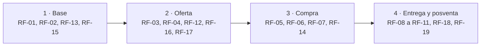

# FOOD4ALL · Especificación de Requisitos (Hito 2)

v0.4 · 22/10/2026 · Sebastián Manuel Mateo Sánchez, Juan Antonio y Miguel

**Índice**

- [0. Control del documento](#0-control-del-documento)
- [1. Resumen ejecutivo](#1-resumen-ejecutivo)
- [2. Fuentes de información](#2-fuentes-de-información)
- [3. Problemas y necesidades identificados](#3-problemas-y-necesidades-identificados)
- [4. Personas y mapa de empatía](#4-personas-y-mapa-de-empatía)
- [5. Procesos principales y orden de construcción](#5-procesos-principales-y-orden-de-construcción)
- [6. Historias de usuario](#6-historias-de-usuario)
- [7. Requisitos funcionales](#7-requisitos-funcionales)
- [8. Requisitos no funcionales](#8-requisitos-no-funcionales)
- [9. Matriz de trazabilidad](#9-matriz-de-trazabilidad)
- [10. Hipótesis, riesgos y decisiones pendientes](#10-hipótesis-riesgos-y-decisiones-pendientes)
- [11. Organización en Asana, fuentes de verdad y glosario](#11-organización-en-asana-fuentes-de-verdad-y-glosario)
- [12. Product Backlog](#12-product-backlog)
- [Anexo A. Ejemplo: inicio de sesión en los tres proyectos](#anexo-a-ejemplo-inicio-de-sesión-en-los-tres-proyectos)
- [Anexo B. Benchmark de requisitos frente a la competencia](#anexo-b-benchmark-de-requisitos-frente-a-la-competencia)

---

## 0. Control del documento

Este documento es la Especificación de Requisitos de FOOD4ALL para el Hito 2. Une lo mejor de los tres grupos y lo ordena en cascada: cada bloque solo usa información de los bloques anteriores.

| Campo | Valor |
| --- | --- |
| Proyecto | FOOD4ALL · Marketplace Local (Grupo B) |
| Entrega | Hito 2 · Requisitos y criterios de aceptación · Sprint 2 (semanas 3–5) |
| Peso en la nota | 15 % |
| Fecha límite | 23/10/2026 |
| Versión | 0.4 (22/10/2026: correcciones de la valoración provisional del 21/10/2026) |
| Autores | Sebastián, Juan Antonio, Miguel |
| Revisor por bloque | Se indica en cada bloque (nadie revisa su propio bloque) |
| Catálogo completo | `FOOD4ALL_requisitos_benchmark.xlsx` (559 requisitos comparados con la competencia) |
| Documentos que lo acompañan | `FOOD4ALL_necesidades.md` (catálogo único de necesidades), `FOOD4ALL_estados_pedido.md` (estados del pedido y reembolso de prueba), `FOOD4ALL_matriz_trazabilidad.md` (matriz completa), `FOOD4ALL_correcciones_hito2.md` (qué se cambió y por qué) |
| En Asana | [Food4All] Hito 2 → [B1] a [B6] |

**Registro de versiones**

| Versión | Fecha | Qué cambia | Quién |
| --- | --- | --- | --- |
| 0.1 | 19/10/2026 | Primera especificación: fuentes, necesidades N-01 a N-08, 19 procesos, 556 requisitos y benchmark | Sebastián |
| 0.2 | 20/10/2026 | Volcado en Asana (B4 y B5) | Sebastián |
| 0.3 | 20/10/2026 | Guía para el equipo y reparto propuesto | Sebastián |
| 0.4 | 22/10/2026 | Catálogo único de necesidades N-<MÓDULO>-NN; regla prioridad/entrega; alcance y dependencias por requisito; máquina de estados del pedido y reembolso de prueba; 3 requisitos nuevos de faltas; fichas completas del MVP; plan de verificación de cada RNF; 6 historias nuevas con criterios Gherkin; matriz generada; glosario v2 | Sebastián (pendiente de revisión por Juan Antonio y Miguel) |

**Leyenda de estado** (se aplica a cada afirmación, necesidad y requisito):

| Estado | Significado |
| --- | --- |
| Decidido | Acordado por el equipo. Es una decisión de producto, no una necesidad validada |
| Hipótesis | Lo creemos, pero falta validarlo con datos o entrevistas |
| Pendiente | Decisión aún no tomada, o propuesta que el equipo debe aprobar en la criba |
| Obligación legal | Solo para necesidades: la impone una norma (F-03) |

**Convención de identificadores** (fijos: un ID nunca se reutiliza aunque se descarte el elemento):

| Prefijo | Elemento | Ejemplo |
| --- | --- | --- |
| F | Fuente de información | F-04 |
| N-<MÓDULO>-NN | Necesidad (catálogo único desde la v0.4) | N-CAR-01 |
| P | Persona o arquetipo | P1 |
| US | Historia de usuario | US-07 |
| RF / RNF | Requisito funcional / no funcional (proceso) | RF-12, RNF-03 |
| RF-xx.y | Subrequisito: una pantalla o un método | RF-01.2 |
| RF-xx.y-zz | Requisito atómico dentro del subrequisito | RF-01.2-08 |
| CA | Criterio de aceptación | RF-01.2.CA1 |
| H / D / R | Hipótesis / decisión pendiente / riesgo | H-03, D-01, R-02 |
| BF | Función de la competencia comparada | BF24 |
| E / V | Entrevista a estudiante / a vendedor | E3, V2 |

Cada relación se escribe con el ID y su nombre (por ejemplo, «N-CAR-01 Comprar a varios vendedores en un solo pedido»): un número suelto no basta.

**Qué tomamos de cada grupo:**

| Origen | Buena práctica incorporada |
| --- | --- |
| INDICONNECT | Base del documento, por indicación del profesor: subtareas que calcan los entregables (necesidades → historias → RF → RNF → matriz); criterios en Gherkin; citar las fuentes de elicitación |
| LearnCode | IDs, prioridad MoSCoW y columna Origen en cada requisito; RNF con métrica, umbral y verificación; «Hecho cuando» y revisor en cada tarea |
| Food4All | Estado decidido / hipótesis / pendiente; fuentes citadas con enlace; marco legal convertido en requisitos; comparativo de competencia |
| Profesor | Cada requisito es un «mini manual de usuario» que describe cada detalle; ninguna tarea se cierra con subtareas abiertas |

## 1. Resumen ejecutivo

FOOD4ALL permite a un estudiante que vive fuera de casa comprar a varios vendedores locales en un solo carrito, pagar una vez y recibirlo todo en una entrega consolidada. Este documento traduce ese objetivo, y lo investigado en el Hito 1, en requisitos verificables.

**Propósito.** Definir qué debe hacer el sistema y con qué calidad, de forma que cada requisito se pueda diseñar en el Sprint 3, modelar en el Sprint 4 y probar en el Sprint 5.

**Alcance de este hito.** Marketplace local con cuatro actores (cliente, vendedor, operador del hub y administrador): catálogo, carrito multi-vendedor, pago único simulado, subpedidos, logística consolidada, seguimiento, incidencias y asistente de IA simulado. Quedan fuera los precios reales, la comisión, la ubicación del hub y los pagos reales (bloque 10).

**Qué es evidencia y qué no.** Ninguna necesidad de usuario está todavía confirmada: las entrevistas F-07 y F-08 se registran el 23/10/2026. Hasta entonces, las necesidades son hipótesis apoyadas en documentación, o bien obligaciones legales. Las personas de B2 son arquetipos documentales, no usuarios observados. Los umbrales de los RNF indican si salen de una norma, de una referencia técnica, de una decisión o de una hipótesis, y se verificarán en el Sprint 5.

**Entregables exigidos en Asana** y dónde se cubren:

| Entregable de Asana | Bloque |
| --- | --- |
| Necesidades de vendedores locales y compradores | 2 y 3 |
| Al menos 2 personas o arquetipos + mapa de empatía | 4 |
| User stories con criterios de aceptación | 6 |
| Requisitos funcionales (catálogo, carrito, pagos, valoraciones) | 7 |
| Requisitos no funcionales | 8 |
| Matriz de trazabilidad inicial | 9 |

**Definición de terminado del documento** (estado a 22/10/2026):

| Criterio | Estado |
| --- | --- |
| Toda necesidad tiene fuente; todo requisito tiene necesidad de origen | Hecho (catálogo único; 0 requisitos sin necesidad) |
| Cada historia y cada requisito tienen al menos un criterio Dado / Cuando / Entonces comprobable | Hecho (19 historias, 559 requisitos) |
| Cada requisito Must tiene su ficha «mini manual» completa | Hecho para los 105 subrequisitos del MVP; pendiente de revisión |
| Cada afirmación está marcada como Decidido, Hipótesis o Pendiente | Hecho |
| La matriz no tiene huecos en las columnas del Sprint 2 | Hecho (`FOOD4ALL_matriz_trazabilidad.md`) |
| Cada bloque está revisado por alguien distinto de su autor | **Pendiente**: lo hacen las personas del equipo con un comentario en Asana |

## 2. Fuentes de información

Todo lo que viene después se apoya en estas fuentes: una necesidad sin fuente no entra en el documento. Las subtareas de investigación del Sprint 2 pasan a ser fuentes, no entregables.

| ID | Fuente | Qué aporta | Responsable | Estado |
| --- | --- | --- | --- | --- |
| F-01 | Mercado (Hito 1): MAPA 2025, EUROSTUDENT 8, cifras de US, UGR y UMA | Tamaño del mercado, hábitos de compra, segmento estimado de 38.500 estudiantes (estimación) | Miguel | Hecho |
| F-02 | Alcance (Hito 1) | Qué entra y qué no | Miguel | Hecho |
| F-03 | Marco legal (Hito 1) | Obligaciones que se convierten en requisitos (análisis orientativo) | Sebastián | Hecho |
| F-04 | Comparativo de 10 empresas del sector | Benchmark exploratorio: brecha del carrito multi-vendedor, pagos, incidencias. Fiabilidad baja: no cita fuentes | Juan Antonio | Hecho |
| F-05 | Investigación de entrega a clientes | Franjas, zonas, entrega fallida | Miguel | En curso |
| F-06 | Investigación de recogida a vendedores | Rutas, ventanas, paradas | Juan Antonio | En curso |
| F-07 | Entrevistas a estudiantes (mínimo 5), códigos E1, E2… | Contrastar las necesidades del cliente | Miguel | Se registran el 23/10/2026 |
| F-08 | Entrevistas a vendedores locales (mínimo 2–3), códigos V1, V2… | Contrastar las necesidades del vendedor | Juan Antonio | Se registran el 23/10/2026 |
| F-09 | Borrador de 211 requisitos (`FOOD4ALL_requisitos.md`, 09/10/2026) | Lista de partida para la criba. Histórico: no es evidencia | Sebastián | Hecho |
| F-10 | Benchmark de competidores (Anexo B y Excel) | Qué hace la competencia en cada requisito | Sebastián | Hecho |
| F-11 | Personas y mapas de empatía (B2) | Arquetipos documentales; no es evidencia independiente | Juan Antonio | Hecho (v2 con IDs corregidos) |
| F-12 | Estudios de food hubs citados en B2 (Wisconsin 2025, Manchester 2025, Red Tomato, Local Line, prensa de Market Wagon) | Problemas reales de recogida y consolidación | Juan Antonio | Hecho |

Por cada entrevista se guarda la fecha, el perfil anonimizado, las preguntas, las respuestas literales y las necesidades que menciona o contradice (plantilla en `FOOD4ALL_necesidades.md`, apartado 6). Cada cita se referencia por su código: E3 o V2.

## 3. Problemas y necesidades identificados

El catálogo único tiene 22 necesidades: 16 de usuario y 6 obligaciones legales. Sustituye a los N-01…N-08 de la v0.3 y a los N-01…N-20 del documento de personas, que usaban los mismos números con significados distintos. Las equivalencias, la regla de evidencia y el plan de contraste con las entrevistas están en `FOOD4ALL_necesidades.md`.

<!-- catalogo:inicio -->
| ID | Necesidad | Quién | Tipo | Estado | Fuentes | Requisitos (MVP) |
| --- | --- | --- | --- | --- | --- | --- |
| N-PLA-01 | Saber qué comprar y qué comer los próximos días, planificando en vez de improvisar | Estudiante (P1) | Usuario | Hipótesis | F-01, F-02 | 21 (12) |
| N-PLA-02 | Controlar cuánto gasta en comida y ajustarse a un presupuesto | Estudiante (P1) | Usuario | Hipótesis | F-01 | 19 (5) |
| N-CAR-01 | Comprar producto local de varios vendedores en un solo pedido y un solo pago, sin ir de tienda en tienda | Estudiante (P1) | Usuario | Hipótesis | F-04, F-10 | 162 (137) |
| N-ENT-01 | Recibir todo en una sola entrega, en una franja conocida | Estudiante (P1) | Usuario | Hipótesis | F-04, F-05 | 33 (27) |
| N-CAD-01 | Gestionar cantidades, conservación y caducidades para no tirar comida | Estudiante (P1) | Usuario | Hipótesis | F-01, F-03 | 8 (3) |
| N-IA-01 | Que el asistente simplifique la decisión sin obligarle a explicar demasiado | Estudiante (P1) | Usuario | Hipótesis | F-02 | 10 (10) |
| N-IA-02 | Saber cuándo habla con una IA y distinguir una recomendación de la publicidad | Estudiante (P1) | Obligación legal | Obligación legal | F-03 (Reglamento de IA 2024/1689; DSA 2022/2065) | 11 (9) |
| N-CAT-01 | Confiar en el origen, la calidad y la trazabilidad de lo que compra | Estudiante (P1) | Usuario | Hipótesis | F-03 (Reglamento 178/2002), F-04 | 36 (14) |
| N-CAT-02 | Conocer ingredientes y alérgenos antes de pagar | Estudiante (P1) | Obligación legal | Obligación legal | F-03 (Reglamento 1169/2011, art. 14) | 14 (14) |
| N-CAT-03 | Recibir información veraz: precio final, costes, condiciones y avisos, sin sorpresas | Estudiante (P1) | Obligación legal | Obligación legal | F-03 (RDL 1/2007; LSSI; P2B 2019/1150) | 35 (18) |
| N-CUE-01 | Que sus datos personales y de salud estén protegidos y solo se usen para lo que aceptó | Estudiante, vendedor (P1, P2) | Obligación legal | Obligación legal | F-03 (RGPD; LOPDGDD) | 61 (53) |
| N-INC-01 | Tener una solución rápida, atendida por personas, si algo llega mal | Estudiante (P1) | Usuario | Hipótesis | F-04 (fiabilidad baja: no cita fuentes) | 34 (17) |
| N-VEN-01 | Llegar a clientes nuevos y ganar visibilidad | Vendedor (P2) | Usuario | Hipótesis | F-01 (comercio tradicional 10,6 %) | 15 (10) |
| N-VEN-02 | Vender online sin montar una web propia ni gestionar envíos | Vendedor (P2) | Usuario | Hipótesis | F-01, F-04 | 16 (9) |
| N-VEN-03 | Reducir la merma del género que no vende a tiempo | Vendedor (P2) | Usuario | Hipótesis | F-03 (Ley 1/2025) | 1 (0) |
| N-VEN-04 | Saber qué preparar y para cuándo: pedido claro y franja de recogida | Vendedor (P2) | Usuario | Hipótesis | F-06, F-12 | 13 (12) |
| N-VEN-05 | Cobrar con transparencia: comisión y liquidación claras | Vendedor (P2) | Usuario | Hipótesis | F-12 (críticas a la tarifa de Market Wagon) | 11 (1) |
| N-VEN-06 | Conocer con claridad los requisitos y los pasos del alta | Vendedor (P2) | Usuario | Hipótesis | F-03 | 24 (22) |
| N-VEN-07 | Admitir solo vendedores con registro sanitario o con una exención justificada | Administrador (P3) | Obligación legal | Obligación legal | F-03 (RD 191/2011; RD 1086/2020) | 9 (9) |
| N-HUB-01 | Tener rutas y franjas de recogida fiables, con aviso de «pedido listo» | Operador (P3) | Usuario | Hipótesis | F-06, F-12 | 6 (3) |
| N-HUB-02 | Mantener la cadena de frío y separar frío y seco | Operador (P3) | Obligación legal | Obligación legal | F-03 (Reglamento 852/2004), F-12 | 4 (2) |
| N-HUB-03 | Verificar cada pedido y resolver las faltas antes de entregar | Operador (P3) | Usuario | Hipótesis | F-06, F-12 | 16 (13) |
<!-- catalogo:fin -->

**Regla de evidencia** (resumen). Una necesidad de usuario pasa a **Confirmada** si la mencionan 3 o más entrevistas independientes del perfil afectado, en respuesta a preguntas abiertas, con cita literal y sin un número igual o mayor que la contradiga. Con 1 o 2 entrevistas queda como **Indicio**. Las personas, el benchmark y los estudios ayudan a formular hipótesis, pero no confirman.

## 4. Personas y mapa de empatía

Las tres personas y sus mapas de empatía completos están en el entregable de B2 (Juan Antonio, `FOOD4ALL_personas_empatia_v2.md`, con los IDs del catálogo único). Son **arquetipos documentales**: se construyeron con la documentación del proyecto, datos de consumo y estudios de food hubs, no con casos individuales. Sus frases son representativas, no citas de entrevistas. Se contrastarán con F-07 y F-08.

| | P1 · Lucía, estudiante | P2 · Antonio, frutero de barrio | P3 · Rafa, operador del hub y repartidor |
| --- | --- | --- | --- |
| Perfil | 20 años, de Jaén, estudia en Granada y comparte piso; unos 40 € a la semana para comida (supuesto) | 54 años, tienda propia en un barrio de Málaga, sin web | 31 años, Sevilla; recoge, verifica, empaqueta y entrega |
| Objetivo | Comer bien varios días sin pasarse del presupuesto | Clientes nuevos y menos merma sin gestionar envíos | Rutas fiables y pedidos completos |
| Mayor miedo | Pagar más o recibir producto en mal estado | Perder margen por la comisión | Esperas y pedidos que no están listos |
| Necesidades | N-PLA-01, N-PLA-02, N-CAR-01, N-ENT-01, N-CAD-01, N-IA-01, N-CAT-01 | N-VEN-01 a N-VEN-06 | N-HUB-01, N-HUB-02, N-HUB-03 |
| Procesos que más le afectan | RF-04, RF-05, RF-06, RF-09, RF-12 | RF-02, RF-03, RF-07, RF-16, RF-17 | RF-07.4, RF-08 |

## 5. Procesos principales y orden de construcción

La app se divide en 19 procesos principales; cada uno es un requisito funcional con ID propio. Se construyen en cuatro fases: una fase usa lo que entrega la anterior, pero cada ficha se redacta sola porque escribe esa entrada como supuesto. Dentro de cada fase el orden es de arriba abajo. Un retraso en una ficha no bloquea a las demás: solo cambia su supuesto de entrada.

| 1 · Base | 2 · Oferta | 3 · Compra | 4 · Entrega y posventa |
| --- | --- | --- | --- |
| RF-01 Registro y roles | RF-03 Catálogo y fichas | **RF-05 Carrito multi-vendedor** | RF-08 Recogida, hub y entrega |
| RF-02 Alta de vendedor | RF-04 Búsqueda | **RF-06 Checkout y pago único** | RF-09 Seguimiento y avisos |
| RF-13 Administración | RF-12 Asistente de IA | **RF-07 Subpedidos por vendedor** | RF-10 Incidencias y reembolsos |
| RF-15 Web pública | RF-16 Panel del vendedor | RF-14 Suscripción | RF-11 Valoraciones |
| | RF-17 Condiciones y liquidación | | RF-18 Comunicación con vendedores |
| | | | RF-19 Soporte y contacto |

En negrita, el núcleo diferencial de FOOD4ALL: un carrito con varios vendedores, un solo pago y la división en subpedidos. Sus estados comunes están en `FOOD4ALL_estados_pedido.md`.



## 6. Historias de usuario

Cada historia nace de una o varias necesidades, pertenece a un proceso y lleva al menos dos criterios Gherkin comprobables. Hay una por proceso, salvo en RF-15 y RF-16, que comparten historia con el resto de su fase. La prioridad sigue MoSCoW referida al MVP: Must, Should, Could y Won't (esta vez no). Desde la v0.4, la prioridad de cada historia coincide con la de los requisitos de su proceso.

| ID | Proceso | Como… | quiero… | para… | Origen | Prioridad |
| --- | --- | --- | --- | --- | --- | --- |
| US-01 | RF-01 | estudiante | registrarme con mi correo y elegir mi zona | comprar a vendedores de mi ciudad | N-CAR-01, N-CUE-01 | Must |
| US-02 | RF-02 | vendedor | darme de alta con mis datos y mi registro sanitario | empezar a vender en FOOD4ALL | N-VEN-02, N-VEN-06, N-VEN-07 | Must |
| US-09 | RF-13 | administrador | aprobar o rechazar las solicitudes de vendedores | que solo vendan negocios con registro sanitario | N-VEN-07 | Must |
| US-14 | RF-15 | visitante | entender en menos de 30 segundos qué es FOOD4ALL y elegir si comprar o vender | decidir si me interesa sin leer de más | N-CAR-01, N-PLA-01 | Must |
| US-10 | RF-03 | vendedor | publicar productos con ficha completa (origen, alérgenos, conservación) | que el cliente compre con confianza | N-CAT-01, N-CAT-02, N-VEN-01 | Must |
| US-03 | RF-04 | estudiante | ver de quién es cada producto y sus alérgenos | comprar con confianza | N-CAT-01, N-CAT-02 | Must |
| US-15 | RF-16 | vendedor | ver en mi panel qué tengo que preparar y para cuándo | no perder ningún pedido | N-VEN-04 | Must |
| US-04 | RF-05 | estudiante | añadir productos de varios vendedores a un solo carrito | no hacer varios pedidos | N-CAR-01 | Must |
| US-05 | RF-06 | estudiante | pagar una sola vez todo el carrito | no repetir el pago con cada vendedor | N-CAR-01, N-CAT-02, N-CAT-03 | Must |
| US-11 | RF-07 | vendedor | ver y confirmar solo la parte del pedido que me corresponde, o avisar de una falta | prepararla a tiempo | N-VEN-04, N-HUB-03 | Must |
| US-12 | RF-08 | operador del hub | comprobar que cada subpedido recibido coincide con el pedido | entregar un único paquete completo | N-HUB-03, N-ENT-01, N-HUB-01, N-HUB-02 | Must |
| US-06 | RF-09 | estudiante | seguir mi pedido hasta la entrega | saber cuándo estar en casa | N-ENT-01 | Must |
| US-07 | RF-10 | estudiante | reclamar un producto en mal estado con una foto | recibir reembolso o sustitución | N-INC-01 | Must |
| US-08 | RF-12 | estudiante | pedir a la IA una cesta para mi presupuesto y mis días | no tener que planificar yo solo | N-PLA-01, N-PLA-02, N-IA-01, N-IA-02, N-CAD-01 | Should |
| US-13 | RF-11 | estudiante | valorar productos y vendedores | ayudar a otros a elegir | N-CAT-01 | Should |
| US-16 | RF-17 | vendedor | consultar mi liquidación con la comisión y los ajustes | saber cuánto cobro | N-VEN-05 | Should |
| US-17 | RF-19 | estudiante | contactar con una persona del equipo | resolver dudas que la web no responde | N-INC-01 | Should |
| US-18 | RF-18 | vendedor | recibir los avisos del equipo y escribirle desde mi panel | coordinarme sin llamadas | N-VEN-02 | Should |
| US-19 | RF-14 | estudiante | suscribirme para tener envío gratis y una cesta semanal propuesta | no planificar cada semana | N-PLA-01, N-PLA-02 | Could |

**Criterios de aceptación de cada historia** (Gherkin). Cada criterio indica entre paréntesis el requisito que lo detalla; los criterios de cada requisito atómico están en su ficha.

```gherkin
US-01 · Registrarme con mi correo y mi zona
Criterio 1 — Dado un visitante en /registro, cuando rellena nombre, un correo nuevo, una contraseña válida, la zona Granada y acepta las condiciones, entonces se crea su cuenta de cliente, entra con sesión y ve «Te hemos enviado un correo para confirmar tu cuenta.» (RF-01.4-11)
Criterio 2 — Dado un correo ya registrado, cuando intenta registrarse, entonces ve «Ya hay una cuenta con este correo. ¿Quieres entrar?» y no se crea otra cuenta (RF-01.4-03)
```

```gherkin
US-02 · Darme de alta como vendedor
Criterio 1 — Dado el formulario de alta completo con número RGSEAA, cuando lo envía, entonces ve «Solicitud recibida. Te escribiremos en un máximo de 5 días hábiles.» y la solicitud queda en Recibida (RF-02.2-09, RF-02.4-01)
Criterio 2 — Dado el formulario sin RGSEAA ni exención declarada, cuando lo envía, entonces la solicitud no se acepta y el campo muestra su error (RF-02.2-05)
```

```gherkin
US-09 · Aprobar o rechazar vendedores
Criterio 1 — Dada una solicitud En revisión con su justificante, cuando el admin pulsa «Verificar», entonces pasa a Verificada y el vendedor recibe el enlace para crear su contraseña (RF-02.4-02, RF-02.5-01)
Criterio 2 — Dado un rechazo sin motivo, cuando el admin guarda, entonces no se permite (RF-02.4-03)
```

```gherkin
US-14 · Entender FOOD4ALL en 30 segundos
Criterio 1 — Dados 5 estudiantes que ven la portada por primera vez, cuando se les pide que elijan qué harían, entonces al menos 4 eligen una de las tres acciones en menos de 30 s (RNF-04.1-01)
Criterio 2 — Dada la portada, cuando se revisa, entonces no hay opiniones, contadores ni cifras de usuarios (RF-15.2-06)
```

```gherkin
US-10 · Publicar productos con ficha completa
Criterio 1 — Dada una ficha sin alérgenos marcados, cuando el vendedor intenta publicarla, entonces «Publicar» está desactivado y la lista dice «Faltan alérgenos» (RF-03.3-01, RF-16.4-03)
Criterio 2 — Dada una ficha completa, cuando pulsa «Publicar», entonces el producto pasa a Publicado y aparece en el catálogo de su zona (RF-03.9-01)
```

```gherkin
US-03 · Ver de quién es cada producto y sus alérgenos
Criterio 1 — Dado un producto con gluten, cuando el cliente ve su tarjeta, entonces ve el vendedor, la ciudad, el origen y «Gluten» con icono y texto (RF-04.4-01, RF-03.3-02)
Criterio 2 — Dado el filtro «sin gluten», cuando filtra, entonces no aparece ningún producto con gluten ni con trazas (RF-04.3-01)
```

```gherkin
US-15 · Ver qué preparar y para cuándo
Criterio 1 — Dado un vendedor con 2 subpedidos sin confirmar, cuando entra en su panel, entonces ve «2 por confirmar» y el plazo de cada uno (RF-16.1-01, RF-16.1-02)
Criterio 2 — Dado un subpedido, cuando el vendedor lo abre, entonces ve productos, cantidades y franja de recogida, pero no el nombre ni la dirección del cliente (RF-07.2-02)
```

```gherkin
US-04 · Añadir productos de varios vendedores al carrito
Criterio 1 — Dado un carrito con un producto del vendedor A, cuando añado un producto del vendedor B, entonces el carrito muestra dos grupos, A y B, y un único total (RF-05.2-01, RF-05.2-04)
Criterio 2 — Dado un producto con stock 0, cuando intento añadirlo, entonces el botón está desactivado y se muestra «Agotado» (RF-04.4-04)
```

```gherkin
US-05 · Pagar una sola vez
Criterio 1 — Dado un carrito con productos de 3 vendedores, cuando paga con la tarjeta de prueba, entonces hay un solo pago de prueba y se crea un único pedido F4A-AAAA-NNNNN (RF-06.4-05, RF-06.5-03)
Criterio 2 — Dado un doble clic en «Pagar», cuando termina el proceso, entonces hay un solo pedido y un solo pago (RF-06.4-06)
Criterio 3 — Dada la tarjeta de prueba 4000 0000 0000 0002, cuando paga, entonces ve «El banco ha rechazado el pago» y no se crea el pedido (RF-06.4-03)
```

```gherkin
US-11 · Confirmar mi parte o avisar de una falta
Criterio 1 — Dado un subpedido de 4 tomates a 1 € con 2 disponibles, cuando el vendedor confirma la falta, entonces solo su subpedido muestra 2 servidas, el total simulado baja 2,00 € una vez y el pedido global se conserva (RF-07.3-05)
Criterio 2 — Dada una línea ya marcada como falta, cuando el vendedor reenvía la misma acción, entonces ve «La falta ya está registrada» y el total no cambia (RF-07.3-07)
```

```gherkin
US-12 · Verificar los subpedidos en el hub
Criterio 1 — Dado un subpedido recibido con una línea en mal estado, cuando el operador la verifica, entonces la línea se retira, se registra su reembolso de prueba y se avisa al admin (RF-08.2-02, RF-08.2-03)
Criterio 2 — Dado un pedido con todos sus subpedidos verificados, cuando se empaqueta, entonces frío y seco van en bultos separados con el mismo número de pedido (RF-08.3-01)
```

```gherkin
US-06 · Seguir mi pedido
Criterio 1 — Dado un pedido con 2 subpedidos en el hub y 1 en Recogida, cuando el cliente lo abre, entonces el estado global es Recogida (RF-09.1-02)
Criterio 2 — Dado un subpedido con una falta, cuando el cliente ve el detalle, entonces muestra «Falta 1 unidad · reembolso de prueba registrado» (RF-09.2-02)
```

```gherkin
US-07 · Reclamar un producto en mal estado
Criterio 1 — Dado un pedido entregado hace 20 h con un yogur en mal estado, cuando abre «Tengo un problema» sin foto, entonces ve «Añade una foto del producto» (RF-10.1-04)
Criterio 2 — Dado un fresco entregado hace 50 h, cuando pulsa «Tengo un problema», entonces ve «El plazo para frescos es de 48 horas» (RF-10.1-02)
```

```gherkin
US-08 · Pedir una cesta a la IA
Criterio 1 — Dado un cliente alérgico al gluten con 25 € y 4 días, cuando pide la cesta, entonces ningún producto contiene gluten ni trazas y el total no pasa de 25 € (RF-12.2-02, RF-12.2-03)
Criterio 2 — Dada una cesta generada, cuando el cliente no pulsa nada, entonces el carrito no cambia y la cesta muestra «Propuesta generada por IA. Revísala antes de comprar.» (RF-12.3-04, RF-12.4-01)
```

```gherkin
US-13 · Valorar productos y vendedores
Criterio 1 — Dado un pedido entregado ayer con 3 vendedores, cuando el cliente valora, entonces ve 3 bloques de estrellas (RF-11.1-02)
Criterio 2 — Dado un producto que no ha comprado, cuando intenta valorarlo, entonces no se permite (RF-11.1-04)
```

```gherkin
US-16 · Consultar mi liquidación
Criterio 1 — Dadas ventas entregadas de 100 €, una comisión del 15 % (valor de ejemplo, D-02) y una incidencia atribuida de 5 €, cuando se liquida la semana, entonces el vendedor ve 80 € a cobrar con el desglose (RF-17.2-01, RF-17.2-02)
Criterio 2 — Dada la comisión todavía sin decidir, cuando el vendedor abre su liquidación, entonces no ve ningún porcentaje (RF-02.1-04, RF-17.2-04)
```

```gherkin
US-17 · Contactar con una persona
Criterio 1 — Dado el formulario de contacto, cuando elige el motivo «pedido», entonces aparece el campo «Número de pedido» (RF-19.1-02)
Criterio 2 — Dado un mensaje enviado, cuando termina, entonces ve «Te respondemos en menos de 24 h laborables» (RF-19.1-01)
```

```gherkin
US-18 · Recibir avisos y escribir al equipo
Criterio 1 — Dado un aviso del admin a la zona de Málaga, cuando se envía, entonces solo lo ven en su panel los vendedores de Málaga (RF-18.1-01, RF-18.1-02)
Criterio 2 — Dado un mensaje del vendedor al equipo, cuando lo envía, entonces llega a la bandeja del admin (RF-18.1-03)
```

```gherkin
US-19 · Suscribirme
Criterio 1 — Dado un suscriptor, cuando paga un pedido, entonces el envío es 0 € (RF-14.1-02)
Criterio 2 — Dado «Cancelar suscripción», cuando confirma, entonces no hay más cobros y recibe la confirmación por correo (RF-14.1-04, RF-14.2-04)
```

**Revisión INVEST** (B5). Sirve para que el revisor marque cada historia; la columna «Riesgo» indica qué tiene que vigilar.

| Historia | Independiente | Negociable | Valiosa | Estimable | Pequeña (≤ 8 puntos) | Testeable | Riesgo |
| --- | --- | --- | --- | --- | --- | --- | --- |
| US-01, US-02, US-09, US-14, US-10, US-03, US-15, US-04 | Sí (cada una escribe sus entradas como supuesto) | Sí | Sí | Sí | Sí | Sí | — |
| US-05 | Sí | Sí | Sí | Sí | Sí (8) | Sí | Es la más grande del núcleo: si crece, se divide en pago y confirmación |
| US-11 | Sí | Sí | Sí | Sí | Sí | Sí | Depende de la máquina de estados común (`FOOD4ALL_estados_pedido.md`) |
| US-12 | Sí | Sí | Sí | Con supuesto (D-03, hub sin decidir) | Sí (8) | Sí | Si cambia el modelo de hub, se reestima |
| US-06, US-07 | Sí | Sí | Sí | Sí | Sí | Sí | US-07 depende de H-04 (plazos) |
| US-08 | Sí | Sí | Hipótesis (N-IA-01 sin validar) | Sí | Sí (8) | Sí | Valor por confirmar con las entrevistas |
| US-13, US-16, US-17, US-18 | Sí | Sí | Sí | US-16 con supuesto (D-02) | Sí | Sí | — |
| US-19 | Sí | Sí | Hipótesis | No hasta decidir precio y planes | Sí | Sí | Se reestima cuando se decida la suscripción |

## 7. Requisitos funcionales

Cada requisito funcional es un proceso principal de la app, con ID propio y una ficha autocontenida: una persona puede redactarlo entera sin esperar a nadie. El número indica el orden de construcción; lo que un proceso necesita de otro se escribe como supuesto, no como espera.

### 7.1 Catálogo de procesos

La prioridad y la entrega de cada proceso son las de su requisito más prioritario. La regla es: Must solo en MVP; el MVP solo lleva Must o Should; V2 lleva Should o Could; V3 solo Could. «MVP simulado» significa que entra en la demo, pero con un servicio simulado (pago, reembolso o IA).

| ID | Proceso principal | Actor | Necesidades | Historias | Prioridad | Responsable | Estado |
| --- | --- | --- | --- | --- | --- | --- | --- |
| RF-01 | Registro, inicio de sesión y roles | Cliente, vendedor | N-CAR-01, N-CUE-01 | US-01 | Must | | Pendiente |
| RF-02 | Alta y verificación de vendedor | Vendedor, admin | N-VEN-06, N-VEN-07, N-VEN-01, N-VEN-05 | US-02 | Must | | Pendiente |
| RF-03 | Gestión del catálogo y ficha de producto | Vendedor | N-CAT-01, N-VEN-02, N-CAT-02, N-CAT-03 | US-10 | Must | | Pendiente |
| RF-04 | Búsqueda y consulta del catálogo | Cliente | N-CAR-01, N-CAT-02, N-CAT-01 | US-03 | Must | | Pendiente |
| RF-05 | Carrito multi-vendedor | Cliente | N-CAR-01, N-ENT-01, N-PLA-02 | US-04 | Must | | Pendiente |
| RF-06 | Checkout y pago único simulado | Cliente | N-CAR-01, N-CAT-03, N-ENT-01, N-CAT-02 | US-05 | Must | | Pendiente |
| RF-07 | División en subpedidos y confirmación del vendedor | Vendedor | N-HUB-03, N-VEN-04, N-CAT-01 | US-11 | Must | | Pendiente |
| RF-08 | Recogida, consolidación en el hub y entrega | Operador, repartidor | N-ENT-01, N-HUB-01, N-HUB-02, N-HUB-03 | US-12 | Must | | Pendiente |
| RF-09 | Seguimiento del pedido y notificaciones | Cliente | N-ENT-01, N-CUE-01 | US-06 | Must | | Pendiente |
| RF-10 | Incidencias, reembolsos y sustituciones | Cliente, admin | N-INC-01 | US-07 | Must | | Pendiente |
| RF-11 | Valoraciones de productos y vendedores | Cliente | N-CAT-01, N-CAT-03 | US-13 | Should | | Pendiente |
| RF-12 | Asistente de IA para generar la cesta | Cliente | N-IA-01, N-IA-02, N-PLA-01, N-PLA-02 | US-08 | Should | | Pendiente |
| RF-13 | Panel de administración | Admin | N-CAT-01, N-CUE-01, N-VEN-07 | US-09 | Must | | Pendiente |
| RF-14 | Suscripción | Cliente | N-PLA-02 | US-19 | Could | | Pendiente |
| RF-15 | Web pública e información | Visitante | N-PLA-01, N-CAT-03, N-CAR-01, N-VEN-01 | US-14 | Must | | Pendiente |
| RF-16 | Panel del vendedor | Vendedor | N-VEN-04, N-VEN-05, N-VEN-02 | US-15 | Must | | Pendiente |
| RF-17 | Condiciones y liquidación del vendedor | Vendedor, admin | N-VEN-05, N-CAT-03 | US-16 | Should | | Pendiente |
| RF-18 | Comunicación con vendedores | Vendedor, admin | N-VEN-02 | US-18 | Should | | Pendiente |
| RF-19 | Soporte y contacto | Cliente, admin | N-INC-01 | US-17 | Should | | Pendiente |

Aquí se listan las necesidades principales de cada proceso; todas, con su recuento, están en la matriz. La columna Responsable se rellena al repartir; nadie lleva dos procesos seguidos, para que el trabajo avance en paralelo.

**Cambios de prioridad en la v0.4.** RF-09 y RF-10 pasan de Should a Must porque sus requisitos ya eran Must del MVP: sin seguimiento no se ve la consolidación y sin incidencias no se atiende un fresco en mal estado. RF-12 pasa a «Should · MVP simulado»: el asistente se enseña simulado en la demo, pero no es imprescindible. RF-18 pasa de Could a Should porque todos sus requisitos son Should·V2. RF-11 y RF-14 quedan fuera del MVP.

Los 19 procesos se desglosan en **559 requisitos atómicos**, cada uno comparado con la competencia, en `FOOD4ALL_requisitos_benchmark.xlsx` (resumen en el Anexo B). RF-14 a RF-19 salieron de ese desglose.

### 7.2 Ficha de cada subrequisito

Cada proceso se divide en subrequisitos, uno por pantalla o por método (RF-05.1, RF-05.2…), y cada uno es una subtarea en Asana con esta ficha como descripción. La regla: **un programador debe poder construirlo con solo leerlo, sin preguntar nada.** El Anexo A muestra el nivel de detalle exigido con el inicio de sesión.

Desde la v0.4, las fichas de los **105 subrequisitos del MVP** (90 RF y 15 RNF) tienen todos sus apartados escritos (fuente: `benchmark/fichas_*.js`). Las del resto (V2, V3 y excluidos) llevan los datos que se generan solos, más una nota de que se completan cuando entren en un sprint. Ninguna ficha del MVP dice ya «Por completar».

```text
RF-05.1 · <nombre del subrequisito>
Responsable: <nombre> · Revisor: <otro miembro> · Prioridad: Must · Entrega: MVP · Alcance: MVP · Estado: Pendiente

1. Descripción
   Qué hace y por qué existe, en 3 líneas.

2. Origen
   Necesidades con ID y nombre · Historias · Fuentes

3. Actores y roles
   Quién lo usa; qué ve cada rol y qué no.

4. Supuestos de entrada y salida (para trabajar sin depender de nadie)
   Supone que existe: … · Entrega a: …

5. Ubicación
   Página o ruta, zona exacta de la pantalla, cómo se llega y comportamiento en móvil.

6. Elementos de la pantalla
   Elemento, texto exacto, tipo, tamaño y orden.

7. Diseño
   Colores, tipografía, radios y estados (normal, foco, ratón encima, desactivado,
   cargando, error), con el token y el valor de la guía de diseño (docs/DISENO.md).

8. Flujo principal (paso a paso, como un manual de usuario)

9. Campos y validaciones
   Tabla: campo · tipo · obligatorio · validación · mensaje de error exacto.

10. Flujos alternativos y errores
    Cada error con su texto exacto y dónde aparece.

11. Reglas de negocio y seguridad
    Límites, caducidades y cálculos; cada uno marcado como Decidido, Hipótesis o Pendiente.

12. Accesibilidad
    Orden de tabulación, etiquetas, anuncios de error, zonas táctiles de 44 px.

13. Criterios de aceptación (Gherkin: uno por requisito atómico)
    RF-05.1-01 · Criterio: Dado… Cuando… Entonces…

14. Requisitos no funcionales que le aplican

15. Competencia
    Qué hacen los competidores (columnas del Excel) y si somos paridad,
    poco extendido, mejora o diferencial.

16. Fuera de alcance
```

**«Hecho cuando» de la ficha:** los 16 apartados están completos, cada regla tiene su criterio y el revisor lo ha aprobado en un comentario de la subtarea. El comentario de aprobación dice: elemento revisado, discrepancias encontradas, decisión tomada, cambio hecho y fecha. **«Hecho cuando» no es un criterio de aceptación:** es la definición de terminado de la ficha. Los criterios de aceptación son los del apartado 13.

## 8. Requisitos no funcionales

Cada requisito no funcional tiene ID propio, una métrica con umbral, el **origen de ese umbral** y una forma de verificarlo. Se agrupan por característica de calidad (ISO/IEC 25010) y cada uno indica a qué procesos afecta. El desglose atómico (74 requisitos) está en el Excel, y el plan de verificación de cada uno (entorno, muestra, método, evidencia y qué haría revisar el umbral), en su ficha. Las pruebas se ejecutan en el Sprint 5; en el Hito 2 solo se planifican.

| ID | Característica | El sistema deberá… | Métrica y umbral | Origen del umbral | Verificación | Origen | Procesos | Estado |
| --- | --- | --- | --- | --- | --- | --- | --- | --- |
| RNF-01 | Seguridad | Autorizar cada acción en el servidor según el rol | 0 accesos fuera de rol | Decisión del equipo; controles de OWASP | Pruebas de la matriz ruta × rol (Sprint 5) | F-03 | Todos | Decidido |
| RNF-02 | Privacidad | Pedir solo datos necesarios y consentimiento explícito para alergias | Datos de salud solo con consentimiento | Ley (RGPD arts. 5, 7 y 9) | Lista de comprobación RGPD | N-CUE-01, F-03 | RF-01, RF-12 | Decidido |
| RNF-03 | Eficiencia | Cargar catálogo y carrito con rapidez en móvil 4G | LCP ≤ 2,5 s | Referencia técnica (Core Web Vitals); que se cumpla en 4G es hipótesis | Lighthouse móvil, 4G simulada, mediana de 5 ejecuciones | N-CAR-01 | RF-04, RF-05 | Hipótesis |
| RNF-04 | Usabilidad | Permitir completar la primera compra sin ayuda | ≥ 4 de 5 usuarios en ≤ 5 min | Hipótesis pedagógica | Prueba moderada con 5 estudiantes ajenos al equipo + SUS | N-CAR-01 | RF-04 a RF-06 | Hipótesis |
| RNF-05 | Accesibilidad | Cumplir WCAG 2.2 nivel AA | Contraste ≥ 4,5:1; uso con teclado | Referencia técnica (W3C); Directiva 2019/882 a confirmar | axe + recorrido con teclado + lector de pantalla | F-03 | Todos | Decidido |
| RNF-06 | Compatibilidad | Funcionar en móvil y en ordenador | Desde 360 px (V2); 2 últimas versiones de 4 navegadores | Decisión del equipo | Playwright en Chromium, Firefox y WebKit | N-CAR-01 | Todos | Decidido |
| RNF-07 | Fiabilidad | No perder un pedido pagado aunque falle un subpedido | 100 % de pedidos conservados | Decisión del equipo (objetivo absoluto) | 20 pedidos con fallos inyectados | N-CAR-01 | RF-06, RF-07 | Decidido |
| RNF-08 | Transparencia | Indicar que la cesta la propone una IA y separar lo patrocinado | 100 % de propuestas etiquetadas | Ley (Reglamento de IA art. 50; DSA art. 26) | Lista de comprobación norma a norma | N-IA-02 | RF-04, RF-12 | Decidido |
| RNF-09 | Trazabilidad alimentaria | Registrar vendedor, lote o caducidad y fecha de cada producto entregado | 100 % de líneas con lote | Ley (Reglamento 178/2002 art. 18) | Auditoría de 10 pedidos de prueba | N-CAT-01, F-03 | RF-03, RF-08 | Decidido |
| RNF-10 | Mantenibilidad | Poder sustituir el motor de IA simulado por uno real sin tocar el resto | Solo cambia la configuración | Decisión del equipo | Revisión de diseño (Sprint 4) | F-02 | RF-12 | Decidido |
| RNF-11 | Sostenibilidad | Usar embalaje reutilizable y medir el desperdicio del hub | kg por semana y destino | Ley 1/2025 (medir); el valor es hipótesis | Registro semanal (V2) | N-CAD-01 | RF-08 | Hipótesis |

Cada RNF es una subtarea con sus subrequisitos (RNF-03.1, RNF-03.2…), igual que un RF. **Una muestra pequeña no es evidencia generalizable:** 20 peticiones para el p95 de la IA o 5 personas en una prueba de usabilidad sirven para detectar problemas, no para afirmar un porcentaje de la población. Las fichas lo dicen expresamente.

## 9. Matriz de trazabilidad

La matriz completa está en `FOOD4ALL_matriz_trazabilidad.md`. Se genera con `npm run asana` a partir del Excel, del catálogo de necesidades y de esta especificación, así que no se edita a mano. Tiene tres partes:

1. **Cobertura por necesidad:** cada necesidad con su estado, sus fuentes, los procesos y subrequisitos que la cubren, sus historias y cuántos requisitos tiene en el MVP.
2. **Una fila por subrequisito** (127): necesidades con nombre, fuente de esas necesidades, historia, prioridad, entrega, alcance, dependencias, criterios de aceptación y RNF. Las columnas Caso de uso (Hito 3), Clase (Hito 4) y Prueba (Hito 5) se dejan vacías para los próximos hitos.
3. **Controles:** necesidades sin cubrir, requisitos sin necesidad y procesos sin historia.

Resumen por proceso:

| Requisito | Fuente | Necesidades | Historia | RNF | Caso de uso (H3) | Clase (H4) | Prueba (H5) |
| --- | --- | --- | --- | --- | --- | --- | --- |
| RF-01 | F-01, F-03, F-10 | N-CAR-01, N-CUE-01 | US-01 | RNF-01, RNF-02 | | | |
| RF-02 | F-03, F-11 | N-VEN-06, N-VEN-07 | US-02 | RNF-01 | | | |
| RF-03 | F-03, F-04 | N-CAT-01, N-CAT-02, N-VEN-02 | US-10 | RNF-09 | | | |
| RF-04 | F-04, F-10 | N-CAR-01, N-CAT-02 | US-03 | RNF-03, RNF-08 | | | |
| RF-05 | F-04, F-10 | N-CAR-01, N-ENT-01 | US-04 | RNF-03, RNF-04 | | | |
| RF-06 | F-03, F-04 | N-CAR-01, N-CAT-03 | US-05 | RNF-07 | | | |
| RF-07 | F-04, F-06, F-12 | N-HUB-03, N-VEN-04 | US-11 | RNF-07 | | | |
| RF-08 | F-05, F-06, F-12 | N-ENT-01, N-HUB-01, N-HUB-02, N-HUB-03 | US-12 | RNF-09, RNF-11 | | | |
| RF-09 | F-05 | N-ENT-01 | US-06 | RNF-06 | | | |
| RF-10 | F-04 | N-INC-01 | US-07 | RNF-01 | | | |
| RF-11 | F-04 | N-CAT-01 | US-13 | RNF-05 | | | |
| RF-12 | F-01, F-03 | N-IA-01, N-IA-02, N-PLA-01 | US-08 | RNF-03, RNF-08, RNF-10 | | | |
| RF-13 | F-03 | N-VEN-07, N-CAT-01 | US-09 | RNF-01 | | | |
| RF-14 | F-10 | N-PLA-02 | US-19 | RNF-02 | | | |
| RF-15 | F-02, F-10 | N-PLA-01, N-CAR-01 | US-14 | RNF-04, RNF-05 | | | |
| RF-16 | F-06, F-10 | N-VEN-04 | US-15 | RNF-04 | | | |
| RF-17 | F-03, F-10 | N-VEN-05 | US-16 | RNF-08 | | | |
| RF-18 | F-10 | N-VEN-02 | US-18 | RNF-01 | | | |
| RF-19 | F-04, F-10 | N-INC-01 | US-17 | RNF-02 | | | |

**Reglas de control:** una necesidad que no aparece en ninguna fila no está cubierta; un requisito sin necesidad sobra o le falta la fuente. **Una relación escrita no demuestra que la fuente sea válida ni que el enlace sea correcto:** eso lo comprueba el revisor de cada bloque, con un comentario que deja constancia en Asana.

## 10. Hipótesis, riesgos y decisiones pendientes

Estos puntos abiertos afectan a los requisitos. Mientras sigan abiertos, cada ficha escribe la regla como Pendiente o Hipótesis con un valor provisional, para no bloquearse. La columna «Depende de» del Excel indica qué requisitos cambian con cada uno.

| ID | Tipo | Descripción | Procesos afectados | Valor provisional | Cómo se cierra |
| --- | --- | --- | --- | --- | --- |
| H-01 | Hipótesis | El estudiante acepta una compra mínima para varios días | RF-05, RF-07, RF-13 | 10–15 € | Entrevistas F-07 |
| H-02 | Hipótesis | El estudiante acepta esperar a una entrega consolidada en una franja | RF-06, RF-08, RF-09 | Franjas de 2 h en los próximos 7 días | Entrevistas F-07 |
| H-03 | Hipótesis | Comprar en FOOD4ALL ahorra frente al supermercado | RF-12, RF-15 | No se promete ahorro | Comparativa de precios |
| H-04 | Hipótesis | Plazos de incidencias aceptables: 48 h en frescos, 14 días en despensa y respuesta humana en 24 h laborables | RF-10, RF-13 | Esos valores | Entrevistas F-07 y capacidad del equipo |
| D-01 | Pendiente | Rol jurídico: intermediario, operador alimentario o mixto | RF-02, RF-08, RF-10, RNF-08, RNF-09 | Mixto | Decisión del equipo con el profesor y revisión profesional |
| D-02 | Pendiente | Porcentaje de comisión por venta | RF-02, RF-07, RF-13, RF-17 | Sin mostrar | Modelo de negocio |
| D-03 | Pendiente | Ubicación del hub, zonas y horas de cierre de cada franja | RF-06, RF-08, RF-13 | Una zona por ciudad; cierre la víspera a las 20:00 | Investigación F-05 y F-06 |
| D-04 | Pendiente | Plazo de confirmación del vendedor | RF-07, RF-16 | Hora de cierre + 12 h | Entrevistas F-08 |
| R-01 | Riesgo | Pocos vendedores por zona hacen inviable la consolidación | RF-08 | Mínimo de vendedores por zona | Entrevistas F-08 |
| R-02 | Riesgo | La IA propone un producto con un alérgeno declarado | RF-12 | Filtro obligatorio por alérgenos | Criterio de aceptación en RF-12.2-03 |
| R-03 | Riesgo | Presentar como validado lo que es hipótesis (personas documentales, benchmark) | Todos | Estado visible en cada necesidad y requisito | Regla de evidencia (bloque 3) |

## 11. Organización en Asana, fuentes de verdad y glosario

La tarea del Hito 2 sigue la estructura de INDICONNECT, que el profesor señaló como la mejor: un bloque por entregable y, dentro de los requisitos, una subtarea por proceso con sus subrequisitos y su ficha. Así cada persona abre su requisito y trabaja sola.

**Fuente de verdad de cada cosa** (si dos sitios no coinciden, manda el de esta tabla):

| Qué | Lo gobierna | En el repositorio |
| --- | --- | --- |
| Necesidades, fuentes y su estado | [B1] Conocer a los usuarios | `benchmark/necesidades.js` → `FOOD4ALL_necesidades.md` |
| Personas y mapas de empatía | [B2] Personas y empatía | `FOOD4ALL_personas_empatia_v2.md` |
| Normas convertidas en requisitos | [B3] Requisitos legales | Bloque 10 del contexto y RNF-02, RNF-08, RNF-09 |
| Procesos, subrequisitos, fichas y requisitos atómicos (RF y RNF) | [B4] Catálogo de requisitos, v0.4 | `benchmark/rf*.js`, `rnf.js`, `fichas_*.js` → Excel |
| Estados del pedido y reembolso de prueba | [B4] (contrato común de RF-06 a RF-10) | `FOOD4ALL_estados_pedido.md` |
| Historias, prioridad y backlog | [B5] User stories | Bloques 6 y 12 de esta especificación |
| Relaciones necesidad–fuente–requisito–historia–prueba | [B6] Trazabilidad | `FOOD4ALL_matriz_trazabilidad.md` (generada) |

Si cambias algo en Asana, cámbialo también en el repositorio y regenera (`npm run build` y `npm run asana`). Los IDs no se renumeran nunca: un elemento descartado conserva su ID con el estado «Excluido».

**Glosario v2**

| Término | Definición |
| --- | --- |
| Carrito multi-vendedor | Un solo carrito con productos de varios vendedores de la misma zona, agrupados por vendedor y con un único total |
| Pedido global | Lo que compra el cliente en un pago. Es la unidad que ve el cliente |
| Pedido consolidado | El pedido global cuando ya se ha reunido en el hub y sale en una sola entrega |
| Subpedido | La parte de un pedido global que corresponde a un vendedor (F4A-…-A, -B…). Es la unidad que ve el vendedor |
| Línea | Un producto y su cantidad dentro de un subpedido |
| Falta | Unidades de una línea que el vendedor no puede servir. Puede ser parcial o total |
| Sustituto | Producto que propone el vendedor en lugar de una falta; el cliente lo acepta o lo rechaza (V2) |
| Hub | Punto donde se reciben, verifican y empaquetan los subpedidos para una sola entrega |
| Entrega consolidada | Una única entrega al cliente con todo lo comprado a varios vendedores |
| Franja de entrega | Intervalo de 2 h en el que se entrega un pedido |
| Capacidad de franja | Número máximo de pedidos que admite una franja en una zona |
| Hora de cierre | Último momento para comprar, modificar o cancelar un pedido de una franja |
| Hora de corte de sustitutos | Inicio de la franja de recogida del vendedor; después, un sustituto sin respuesta se excluye (V2) |
| Plazo de confirmación | Tiempo que tiene el vendedor para confirmar o declarar faltas (hora de cierre + 12 h, propuesta) |
| Vendedor aprobado | Vendedor cuya solicitud está «Verificada» y que ha activado su cuenta |
| Lote | Identificador del lote o fecha de caducidad de un producto entregado, que permite la trazabilidad |
| Cesta IA | Propuesta de productos que genera el asistente; nunca entra en el carrito sin que el cliente lo confirme |
| Pago de prueba | Registro de un pago simulado: no se cobra dinero ni se guardan datos de tarjeta |
| Reembolso de prueba | Registro que resta del pago de prueba por una falta, una retirada, una cancelación o una incidencia. No es una transferencia |
| MVP / MVP simulado | Lo que entra en la demo. «Simulado» indica que usa un servicio de prueba (pago, reembolso o IA) |
| Alcance | MVP, MVP simulado, V2, V3 o Excluido |
| Obligación legal | Necesidad que impone una norma; no necesita entrevistas |
| Indicio / Confirmada | Estados de evidencia de una necesidad según las entrevistas (bloque 3) |
| Gherkin | Formato Dado / Cuando / Entonces para escribir criterios de aceptación comprobables |
| MoSCoW | Prioridad referida al MVP: Must (imprescindible), Should (importante), Could (deseable), Won't (esta vez no) |
| INVEST | Independiente, Negociable, Valiosa, Estimable, Pequeña y Testeable: lista para revisar historias |
| Benchmark | Comparación de cada requisito con lo que hacen los competidores |

## 12. Product Backlog

El backlog tiene 19 historias, una por proceso, ordenadas por prioridad y por la cascada de construcción. Las 14 primeras forman el MVP: 13 Must y una Should con IA simulada (US-08). Es el «Product Backlog actualizado con user stories priorizadas» que pide el Sprint Planning del Sprint 2.

| Orden | Historia | Como… quiero… para… | Proceso | Prioridad | Puntos | Entrega | Responsable | Estado |
| --- | --- | --- | --- | --- | --- | --- | --- | --- |
| 1 | US-01 | Como estudiante, quiero registrarme con mi correo y elegir mi zona, para comprar a vendedores de mi ciudad | RF-01 | Must | 3 | MVP | | Por hacer |
| 2 | US-02 | Como vendedor, quiero darme de alta con mis datos y mi registro sanitario, para empezar a vender | RF-02 | Must | 5 | MVP | | Por hacer |
| 3 | US-09 | Como administrador, quiero aprobar o rechazar las solicitudes de vendedores, para que solo vendan negocios con registro sanitario | RF-13 | Must | 3 | MVP | | Por hacer |
| 4 | US-14 | Como visitante, quiero entender en menos de 30 segundos qué es FOOD4ALL y elegir si comprar o vender, para decidir si me interesa sin leer de más | RF-15 | Must | 3 | MVP | | Por hacer |
| 5 | US-10 | Como vendedor, quiero publicar productos con ficha completa (origen, alérgenos, conservación), para que el cliente compre con confianza | RF-03 | Must | 5 | MVP | | Por hacer |
| 6 | US-03 | Como estudiante, quiero ver de quién es cada producto y sus alérgenos, para comprar con confianza | RF-04 | Must | 3 | MVP | | Por hacer |
| 7 | US-15 | Como vendedor, quiero ver en mi panel qué tengo que preparar y para cuándo, para no perder ningún pedido | RF-16 | Must | 5 | MVP | | Por hacer |
| 8 | US-04 | Como estudiante, quiero añadir productos de varios vendedores a un solo carrito, para no hacer varios pedidos | RF-05 | Must | 5 | MVP | | Por hacer |
| 9 | US-05 | Como estudiante, quiero pagar una sola vez todo el carrito, para no repetir el pago con cada vendedor | RF-06 | Must | 8 | MVP simulado | | Por hacer |
| 10 | US-11 | Como vendedor, quiero ver y confirmar solo la parte del pedido que me corresponde, o avisar de una falta, para prepararla a tiempo | RF-07 | Must | 5 | MVP | | Por hacer |
| 11 | US-12 | Como operador del hub, quiero comprobar que cada subpedido recibido coincide con el pedido, para entregar un único paquete completo | RF-08 | Must | 8 | MVP | | Por hacer |
| 12 | US-06 | Como estudiante, quiero seguir mi pedido hasta la entrega, para saber cuándo estar en casa | RF-09 | Must | 3 | MVP | | Por hacer |
| 13 | US-07 | Como estudiante, quiero reclamar un producto en mal estado con una foto, para recibir reembolso o sustitución | RF-10 | Must | 5 | MVP | | Por hacer |
| 14 | US-08 | Como estudiante, quiero pedir a la IA una cesta para mi presupuesto y mis días, para no tener que planificar yo solo | RF-12 | Should | 8 | MVP simulado | | Por hacer |
| 15 | US-13 | Como estudiante, quiero valorar productos y vendedores, para ayudar a otros a elegir | RF-11 | Should | 2 | Versión 2 | | Por hacer |
| 16 | US-16 | Como vendedor, quiero consultar mi liquidación con la comisión y los ajustes, para saber cuánto cobro | RF-17 | Should | 3 | Versión 2 | | Por hacer |
| 17 | US-17 | Como estudiante, quiero contactar con una persona del equipo, para resolver dudas que la web no responde | RF-19 | Should | 2 | Versión 2 | | Por hacer |
| 18 | US-18 | Como vendedor, quiero recibir los avisos del equipo y escribirle desde mi panel, para coordinarme sin llamadas | RF-18 | Should | 2 | Versión 2 | | Por hacer |
| 19 | US-19 | Como estudiante, quiero suscribirme para tener envío gratis y una cesta semanal propuesta, para no planificar cada semana | RF-14 | Could | 5 | Versión 3 | | Por hacer |

Los puntos son una estimación inicial de esfuerzo relativo (escala 1, 2, 3, 5, 8); se revisan en cada Sprint Planning. Los RNF no son elementos del backlog: entran como criterios de aceptación de las historias a las que afectan (bloque 8). **La prioridad MoSCoW es una propuesta** hasta que el equipo la confirme en la criba («Requisitos temporales → Criba de requisitos»); la propuesta de criba está en `FOOD4ALL_correcciones_hito2.md`.

**Sprint Backlog del Sprint 2** (lo que el equipo se compromete a entregar el 23/10):

| Tarea | Entregable | Responsable | Fecha | Estado |
| --- | --- | --- | --- | --- |
| T1 | Necesidades identificadas, personas y mapa de empatía | Juan Antonio (B2), Sebastián (B1) | 21/10/2026 | Hecho, salvo las entrevistas (23/10) |
| T2 | User stories con criterios de aceptación | Sebastián | 22/10/2026 | Hecho; falta la revisión INVEST de otro miembro |
| T3 | Fichas RF-01 a RF-19 | Por repartir | 22/10/2026 | Fichas del MVP escritas; falta la revisión |
| T4 | Fichas RNF-01 a RNF-11 | Por repartir | 22/10/2026 | Fichas y planes de verificación escritos; falta la revisión |
| T5 | Matriz de trazabilidad y documento final | Miguel | 23/10/2026 | Matriz generada; falta montar y adjuntar el documento |

---

## Anexo A. Ejemplo: inicio de sesión en los tres proyectos

### Cómo leer este ejemplo

Un requisito está completo cuando un programador puede construirlo sin preguntar nada: dónde va, qué se ve, qué se pulsa, qué textos salen, qué pasa si falla y con qué colores. Si una ficha mezcla dos pantallas o dos formas de hacer algo, se divide.

**Regla para dividir:** una ficha por pantalla o por método. El inicio de sesión de cada proyecto se divide en seis subrequisitos con el mismo esquema, así seis personas podrían trabajarlos a la vez:

| Sub-ID | Qué cubre |
| --- | --- |
| RF-01.1 | Punto de entrada: dónde está el botón y cómo es la pantalla de acceso |
| RF-01.2 | Inicio de sesión con cuenta propia (correo y contraseña) |
| RF-01.3 | Inicio de sesión con un proveedor externo (Google o GitHub) |
| RF-01.4 | Registro de una cuenta nueva |
| RF-01.5 | Recuperación de contraseña |
| RF-01.6 | Menú de usuario, sesión y cierre de sesión |

**Qué tiene cada subrequisito:** ubicación en la página, elementos de la pantalla (con textos exactos), diseño (colores, tamaños, tipografía o dónde mirarlo), flujo paso a paso, validaciones y mensajes de error, reglas de negocio y criterios de aceptación en Gherkin.

**Origen de los datos de diseño.** FOOD4ALL usa su guía `docs/DISENO.md` (repositorio al día, commit f40af45). INDICONNECT y LearnCode usan los colores y fuentes de sus landings publicadas, consultadas el 19/10/2026. Las cifras de seguridad (intentos, caducidades) son **propuestas** para que cada equipo las apruebe: se marcan como Pendiente hasta entonces.

> En FOOD4ALL (A.1, el Excel y Asana) el login está desglosado en más subrequisitos (RF-01.1 a RF-01.10, 83 requisitos atómicos), porque separa también verificación de correo, datos personales, preferencias y baja de la cuenta. Por eso en A.1 la recuperación de contraseña es RF-01.6 y el menú RF-01.7; INDICONNECT y LearnCode mantienen la tabla de arriba.

### A.1 FOOD4ALL

Clientes y vendedores entran por la misma pantalla `/entrar`, con correo y contraseña o con Google; el administrador sigue entrando por `/admin` y no se enlaza desde la web pública. Diseño: `docs/DISENO.md`, tokens de `frontend/src/styles/tokens.css`.

#### RF-01.1 · Punto de entrada y pantalla de acceso

**Ubicación.** Enlace «Entrar» en la cabecera verde, a la derecha de los tres botones («Quiero comprar», «Quiero vender», «Cómo funciona»), separado de ellos por 24 px. Va como enlace de texto, no como botón, para no romper la regla de «tres botones y ya». Lleva a la ruta `/entrar`.

**Pantalla `/entrar`:**

| Elemento | Detalle |
| --- | --- |
| Fondo | Crema `--bg` #F6F1E6; cabecera y pie normales de la web |
| Tarjeta | Centrada, 420 px de ancho, fondo `--surface` #FFFFFF, borde 1 px `--border` #DDD0B0, radio `--radius` 10 px, sin sombra, 32 px de relleno |
| Título | «Entra en FOOD4ALL», Fraunces 600, `h2`, color `--green` #2F5233 |
| Subtítulo | «Compra a varios vendedores locales con una sola cuenta.» Figtree 17 px, `--text-soft` #4A5340 |
| Botón Google | Primero, ancho completo, 48 px de alto, fondo blanco, borde 1 px #DDD0B0, logo oficial de Google a la izquierda, texto «Continuar con Google» en `--text` (RF-01.3) |
| Separador | Línea 1 px #DDD0B0 con «o con tu correo» centrado, 0.85rem |
| Formulario | Campos de RF-01.2 |
| Pie de la tarjeta | «¿No tienes cuenta? Crear cuenta» (enlace a `/registro`, RF-01.4). Debajo: «¿Vendes productos locales? Solicita el alta» (enlace a `/vender#alta`, RF-02) |

Si el usuario llega desde una acción que exige sesión (por ejemplo, pagar), la ruta guarda la página de origen (`/entrar?volver=/carrito`) y tras entrar vuelve a ella.

**Criterios:**

- RF-01.1.CA1 — Dado un visitante sin sesión, cuando mira la cabecera, entonces ve «Entrar» a la derecha de los tres botones y al pulsarlo llega a `/entrar`.
- RF-01.1.CA2 — Dado un visitante que pulsa «Pagar» sin sesión, cuando entra correctamente, entonces vuelve a `/carrito` con su carrito intacto.

#### RF-01.2 · Inicio de sesión con correo y contraseña

**Campos** (etiqueta visible encima, Figtree 600; campo de 48 px de alto, borde 1 px #DDD0B0, radio 10 px; al enfocar, borde 2 px `--green`):

| Campo | Tipo | Obligatorio | Validación | Mensaje si falla |
| --- | --- | --- | --- | --- |
| Correo electrónico | email, autocompletar `email` | Sí | Formato nombre@dominio | «Escribe un correo válido, por ejemplo nombre@correo.com» |
| Contraseña | password, autocompletar `current-password` | Sí | No vacía | «Escribe tu contraseña» |

**Controles:**

- Icono de ojo dentro del campo de contraseña para mostrarla u ocultarla (texto alternativo «Mostrar contraseña» / «Ocultar contraseña»).
- Casilla «Mantener la sesión iniciada», desmarcada por defecto.
- Enlace «¿Has olvidado tu contraseña?» alineado a la derecha, encima del botón (RF-01.6).
- Botón «Entrar»: ancho completo, 48 px, forma píldora `--radius-pill`, fondo naranja `--accent` #D9822B, texto `--on-accent` #23301F en Figtree 600. Mientras se comprueba, muestra «Entrando…» y se desactiva.

**Flujo:**

1. El usuario escribe correo y contraseña y pulsa «Entrar» o la tecla Intro.
2. El navegador valida el formato; si falla, el error sale debajo del campo en rojo #C0392B y el foco va a ese campo.
3. El servidor comprueba las credenciales.
4. Si son correctas, abre la sesión y redirige según el rol: cliente → `/comprar/cliente`; vendedor → `/vender/panel`; o a la página guardada en `volver`.
5. Si son incorrectas, muestra encima del formulario un aviso con fondo `--tint-tomato` #F6DCD3: «El correo o la contraseña no son correctos.» El mensaje nunca dice cuál de los dos falla.

**Reglas** (Pendiente: propuestas para aprobar):

- Tras 5 intentos fallidos seguidos con el mismo correo, la cuenta se bloquea 15 minutos y sale: «Has superado los intentos. Prueba de nuevo en 15 minutos o recupera tu contraseña.»
- Sin «Mantener la sesión», la sesión caduca a las 2 horas sin actividad; con ella, a los 30 días.
- Las contraseñas se guardan solo como hash (bcrypt); la comunicación va por HTTPS (RNF-01).
- Un vendedor cuya alta está «en revisión» puede entrar, pero solo ve el estado de su solicitud.

**Accesibilidad:** orden de tabulación Google → correo → contraseña → ojo → casilla → olvidada → Entrar; errores anunciados con `aria-live`; contraste mínimo 4,5:1 (RNF-05).

**Criterios:**

- RF-01.2.CA1 — Dado un cliente registrado, cuando escribe su correo y contraseña correctos y pulsa «Entrar», entonces llega a `/comprar/cliente` y la cabecera muestra su menú (RF-01.7).
- RF-01.2.CA2 — Dada una contraseña incorrecta, cuando pulsa «Entrar», entonces ve «El correo o la contraseña no son correctos.» y el campo contraseña se vacía.
- RF-01.2.CA3 — Dados 5 fallos seguidos, cuando lo intenta por sexta vez, aunque la contraseña sea correcta, entonces no entra y ve el aviso de bloqueo.

#### RF-01.3 · Inicio de sesión con Google

**Ubicación:** botón «Continuar con Google» de RF-01.1, también en `/registro`.

**Flujo:**

1. Al pulsarlo se abre la ventana de Google (OAuth 2.0); solo se piden nombre, correo y foto de perfil.
2. Si el correo ya tiene cuenta en FOOD4ALL, entra directamente con su rol.
3. Si es nuevo, se crea una cuenta de **cliente** y se muestra un paso extra con dos campos obligatorios: zona (desplegable Málaga, Sevilla, Granada) y la casilla de condiciones de RF-01.4. Sin aceptarlas no se crea la cuenta.
4. Si el usuario cierra la ventana de Google, vuelve a `/entrar` sin mensaje de error.

**Reglas:** con Google no se pueden crear cuentas de vendedor (pasan por RF-02). Si el correo de Google ya existe con contraseña, se pide una vez la contraseña para vincular ambas formas de acceso.

**Criterios:**

- RF-01.3.CA1 — Dado un correo de Google sin cuenta, cuando el usuario acepta en Google, entonces ve el paso de zona y condiciones y, al completarlo, entra como cliente.
- RF-01.3.CA2 — Dado que el usuario cierra la ventana de Google, cuando vuelve, entonces sigue en `/entrar` sin error.

#### RF-01.4 · Registro de cuenta de cliente

**Ubicación:** ruta `/registro`, misma tarjeta y estilo que `/entrar`, título «Crea tu cuenta».

| Campo | Tipo | Obligatorio | Validación | Mensaje si falla |
| --- | --- | --- | --- | --- |
| Nombre | texto | Sí | 2 a 40 caracteres | «Escribe tu nombre» |
| Correo electrónico | email | Sí | Formato válido y no registrado | «Ya hay una cuenta con este correo. ¿Quieres entrar?» (con enlace) |
| Contraseña | password, autocompletar `new-password` | Sí | Mínimo 8 caracteres, al menos una letra y un número | «Usa al menos 8 caracteres con letras y números» |
| Zona | desplegable | Sí | Málaga, Sevilla o Granada | «Elige tu zona» |
| Condiciones | casilla | Sí | Marcada | «Para crear la cuenta tienes que aceptar las condiciones» |
| Novedades por correo | casilla | No | Desmarcada por defecto | — |

Texto de la casilla obligatoria: «Acepto las Condiciones de uso y la Política de privacidad», con ambos títulos enlazados. Bajo la contraseña, una barra de 4 tramos indica su fortaleza. Botón «Crear cuenta» con el mismo estilo que «Entrar».

**Flujo:** al crear la cuenta se envía un correo de verificación con un enlace válido 24 horas. Sin verificar, el cliente puede navegar y llenar el carrito, pero al pagar ve: «Confirma tu correo para poder pagar. Reenviar correo».

**Reglas:** el registro no pide alergias ni datos de salud; eso va en Preferencias con consentimiento explícito (RNF-02).

**Criterios:**

- RF-01.4.CA1 — Dado un formulario sin la casilla de condiciones, cuando pulsa «Crear cuenta», entonces no se crea la cuenta y la casilla muestra su error.
- RF-01.4.CA2 — Dado un correo ya registrado, cuando intenta registrarse, entonces ve el aviso con el enlace a `/entrar`.
- RF-01.4.CA3 — Dado un cliente sin verificar, cuando pulsa «Pagar», entonces no puede pagar y ve el aviso para confirmar el correo.

#### RF-01.6 · Recuperación de contraseña

**Flujo:**

1. En `/entrar`, el usuario pulsa «¿Has olvidado tu contraseña?» y llega a `/recuperar`.
2. Ve el título «Recupera tu contraseña», un campo de correo y el botón naranja «Enviar enlace».
3. Al enviarlo, siempre sale el mismo mensaje, exista o no la cuenta: «Si hay una cuenta con ese correo, te hemos enviado un enlace. Revisa también la carpeta de spam.»
4. El correo trae un botón «Cambiar contraseña» con un enlace de un solo uso, válido 60 minutos.
5. El enlace abre `/recuperar/nueva`: campos «Nueva contraseña» y «Repite la contraseña» (mismas reglas que RF-01.4) y botón «Guardar contraseña».
6. Al guardar, se cierran todas las sesiones abiertas y se redirige a `/entrar` con un aviso verde #2F7D4B: «Contraseña cambiada. Ya puedes entrar.»

**Errores:** enlace caducado o usado → «Este enlace ya no sirve. Pide otro.» con botón a `/recuperar`. Contraseñas distintas → «Las contraseñas no coinciden». Máximo 3 peticiones por correo y hora.

**Criterios:**

- RF-01.6.CA1 — Dado un correo no registrado, cuando pide el enlace, entonces ve el mismo mensaje que con uno registrado.
- RF-01.6.CA2 — Dado un enlace de hace más de 60 minutos, cuando lo abre, entonces ve «Este enlace ya no sirve. Pide otro.»

#### RF-01.7 · Menú de usuario y cierre de sesión

**Ubicación:** con sesión iniciada, «Entrar» se sustituye en la cabecera por un círculo de 36 px con las iniciales del usuario (fondo `--saffron` #E3A82B, texto `--text`) y su nombre en crema a la derecha. Al pulsarlo se abre un menú desplegable bajo él: fondo blanco, borde 1 px #DDD0B0, radio 10 px, 240 px de ancho, opciones de 44 px de alto.

| Rol | Opciones del menú, en este orden |
| --- | --- |
| Cliente | Mis pedidos · Mi carrito · Preferencias · Mis datos · Cerrar sesión |
| Vendedor | Mi panel · Mis productos · Pedidos recibidos · Datos del negocio · Cerrar sesión |

«Cerrar sesión» va separado por una línea y en rojo #C0392B. El menú se cierra al pulsar fuera o con Escape.

**Cierre de sesión:** cierra la sesión en el servidor, lleva a la portada y muestra durante 4 s: «Has cerrado la sesión.» El carrito de un cliente se conserva en su cuenta, no en el navegador.

**Criterios:**

- RF-01.7.CA1 — Dado un vendedor con sesión, cuando abre su menú, entonces ve las cinco opciones de vendedor en el orden indicado.
- RF-01.7.CA2 — Dado un cliente con 3 productos en el carrito, cuando cierra sesión y vuelve a entrar, entonces su carrito sigue teniendo los 3 productos.

### A.2 INDICONNECT

El cliente puede ver el catálogo y llenar el carrito unificado sin cuenta; se le pide entrar solo al pagar, y su carrito de invitado se une al de su cuenta. El administrador de plataforma entra por `/admin`; el Sistema de Marca es un actor simulado y no inicia sesión. Diseño tomado de `css/styles.css` de su landing (tema claro; el oscuro usa los valores entre paréntesis).

| Token | Valor | Uso en el login |
| --- | --- | --- |
| `--bg` | #F6F7FB (#0E1026) | Fondo de la página |
| `--surface` | blanco (#171A38) | Panel del formulario |
| `--surface-2` | #ECEEF8 (#20244A) | Fondo del botón secundario y del menú al pasar el ratón |
| `--primary` / `--on-primary` | #3B34B0 / #FFFFFF | Botón principal y enlaces |
| `--accent` | #B53B0B | Contador del carrito |
| `--muted` | #4A4F73 | Textos de ayuda |
| `--border` | #B4B9D9 | Bordes de campos y panel |
| `--focus` | #3B34B0 | Anillo de foco de 2 px |
| `--b-bad-bg` / `--b-bad-fg` | #FEE2E2 / #7F1D1D | Avisos de error |
| `--b-ok-bg` / `--b-ok-fg` | #DCFCE7 / #14532D | Avisos de éxito |
| `--radius` / `--font` | 12 px / fuente del sistema (`system-ui`) | Radios y tipografía |

#### RF-01.1 · Punto de entrada y panel de acceso

**Ubicación.** En la cabecera, a la derecha y en este orden: icono de persona con el texto «Iniciar sesión» y, a su derecha, el icono del carrito unificado con su contador en `--accent`. En pantallas de menos de 768 px se ve solo el icono de persona (44 × 44 px). Al pulsarlo se abre un panel lateral desde la derecha (400 px de ancho; pantalla completa en móvil) que oscurece el resto de la página al 40 %; no cambia de página, para no perder lo que el cliente estaba viendo.

**Contenido del panel:**

| Elemento | Detalle |
| --- | --- |
| Cabecera del panel | «Inicia sesión», 24 px negrita, y botón «✕» para cerrar (texto alternativo «Cerrar») |
| Texto | «Una cuenta para comprar en todas las marcas.» en `--muted` |
| Botón Google | «Continuar con Google», ancho completo, 48 px, fondo `--surface`, borde 1 px `--border` (RF-01.3) |
| Separador | «o» centrado sobre una línea `--border` |
| Formulario | Campos de RF-01.2 |
| Pie | Botón secundario «Crear cuenta», ancho completo, fondo `--surface-2`, texto `--primary` (RF-01.4) |

El panel se cierra con ✕, con Escape o al pulsar fuera. Si se abre desde «Finalizar compra», encima del título aparece: «Inicia sesión para terminar tu compra. Tu carrito se guarda.»

**Criterios:**

- RF-01.1.CA1 — Dado un invitado con productos de Zara y Bershka en el carrito, cuando pulsa «Finalizar compra», entonces se abre el panel con el aviso y el carrito no cambia.
- RF-01.1.CA2 — Dado el panel abierto, cuando el usuario pulsa Escape, entonces el panel se cierra y el foco vuelve al botón «Iniciar sesión».

#### RF-01.2 · Inicio de sesión con correo y contraseña

| Campo | Tipo | Obligatorio | Validación | Mensaje si falla |
| --- | --- | --- | --- | --- |
| Correo electrónico | email, autocompletar `email` | Sí | Formato válido | «Introduce un correo válido» |
| Contraseña | password, autocompletar `current-password` | Sí | No vacía | «Introduce tu contraseña» |

Campos de 48 px, borde 1 px `--border`, radio 12 px, etiqueta encima; al enfocar, anillo 2 px `--focus`. Icono de ojo para mostrar la contraseña, casilla «Recordarme» (desmarcada) y enlace «¿Has olvidado tu contraseña?» (RF-01.5). Botón «Iniciar sesión»: ancho completo, 48 px, fondo `--primary`, texto `--on-primary`, radio 12 px; mientras comprueba, muestra un indicador de carga y se desactiva.

**Flujo:**

1. El cliente escribe sus datos y pulsa «Iniciar sesión».
2. Si son correctos, el panel se cierra, la cabecera muestra su nombre (RF-01.6) y aparece 3 s un aviso `--b-ok`: «Hola, <nombre>».
3. **Unión de carritos:** si el invitado tenía productos y su cuenta también, se suman; si un mismo producto, talla y color está en ambos, se queda la cantidad mayor. Se avisa: «Hemos unido tu carrito con el de tu cuenta.»
4. Si había pulsado «Finalizar compra», continúa directamente al checkout.
5. Si los datos fallan, aviso `--b-bad` encima del formulario: «Correo o contraseña incorrectos.»

**Reglas** (Pendiente: propuestas): bloqueo de 15 minutos tras 5 fallos; sesión de 30 días con «Recordarme» y de 2 horas sin él; contraseñas solo como hash; HTTPS.

**Criterios:**

- RF-01.2.CA1 — Dado un invitado con 2 productos y una cuenta con 1 producto distinto, cuando inicia sesión, entonces el carrito tiene 3 productos y ve el aviso de unión.
- RF-01.2.CA2 — Dados datos incorrectos, cuando pulsa «Iniciar sesión», entonces ve «Correo o contraseña incorrectos.» y el panel sigue abierto.

#### RF-01.3 · Inicio de sesión con Google

Botón «Continuar con Google» del panel y de «Crear cuenta». Abre Google (OAuth 2.0) pidiendo solo nombre y correo. Si el correo ya existe, entra; si es nuevo, crea una cuenta de cliente y muestra un paso para aceptar las condiciones (RF-01.4) antes de terminar. Después aplica la unión de carritos de RF-01.2. Si el usuario cancela en Google, vuelve al panel sin error.

- RF-01.3.CA1 — Dado un correo nuevo de Google, cuando acepta las condiciones, entonces queda con sesión de cliente y su carrito de invitado se conserva.

#### RF-01.4 · Registro de cuenta de cliente

Se abre en el mismo panel al pulsar «Crear cuenta», con título «Crea tu cuenta» y enlace «¿Ya tienes cuenta? Inicia sesión» para volver.

| Campo | Obligatorio | Validación | Mensaje si falla |
| --- | --- | --- | --- |
| Nombre | Sí | 2 a 40 caracteres | «Introduce tu nombre» |
| Apellidos | Sí | 2 a 60 caracteres | «Introduce tus apellidos» |
| Correo electrónico | Sí | Válido y no registrado | «Este correo ya tiene cuenta» con enlace a iniciar sesión |
| Contraseña | Sí | Mínimo 8 caracteres, una mayúscula y un número | «Mínimo 8 caracteres, con una mayúscula y un número» |
| Condiciones y privacidad | Sí | Casilla marcada | «Debes aceptar las condiciones para continuar» |
| Novedades de las marcas | No | Desmarcada | — |

La dirección de envío no se pide aquí, sino en el checkout. Al crear la cuenta se envía un correo de verificación; se puede comprar antes de verificar, pero los correos de seguimiento solo llegan a cuentas verificadas.

- RF-01.4.CA1 — Dada una contraseña sin mayúscula, cuando pulsa «Crear cuenta», entonces la cuenta no se crea y el campo muestra su mensaje.

#### RF-01.5 · Recuperación de contraseña

1. «¿Has olvidado tu contraseña?» cambia el panel a «Recupera tu contraseña» con un campo de correo y el botón «Enviar enlace».
2. Siempre responde: «Si el correo está registrado, recibirás un enlace en unos minutos.»
3. El enlace del correo es de un solo uso y caduca a los 60 minutos; abre `/restablecer` con «Nueva contraseña», «Repite la contraseña» y el botón «Guardar».
4. Al guardar, cierra las demás sesiones, inicia sesión y muestra un aviso `--b-ok`: «Contraseña actualizada».

Errores: enlace caducado → «El enlace ha caducado» con botón «Pedir otro»; contraseñas distintas → «No coinciden».

- RF-01.5.CA1 — Dado un enlace ya usado, cuando se abre otra vez, entonces muestra «El enlace ha caducado».

#### RF-01.6 · Menú de usuario y cierre de sesión

Con sesión, «Iniciar sesión» pasa a «Hola, <nombre>» con una flecha. Al pulsar se abre un menú bajo él: fondo `--surface`, borde 1 px `--border`, radio 12 px, 260 px de ancho, opciones de 44 px que al pasar el ratón toman `--surface-2`.

| Opción | Lleva a |
| --- | --- |
| Mis pedidos | Lista de pedidos globales; cada uno se despliega en sus subpedidos por marca con su estado |
| Mi carrito | Carrito unificado |
| Direcciones | Direcciones de envío guardadas |
| Mis datos | Nombre, correo, contraseña y preferencias de correo |
| Cerrar sesión | Separada por una línea, texto `--b-bad-fg` |

Al cerrar sesión vuelve a la portada; el carrito queda guardado en la cuenta y el carrito de invitado empieza vacío.

- RF-01.6.CA1 — Dado un cliente con un pedido de Zara y Pull&Bear, cuando abre «Mis pedidos», entonces ve un pedido con dos subpedidos, uno por marca.

### A.3 LearnCode

Hay que tener cuenta para practicar, porque el progreso y el nivel se guardan por usuario. Se entra con correo y contraseña o con GitHub, la cuenta habitual de quien programa. Respeta lo que el grupo ya decidió: roles estudiante, creador y administrador (RF-18), sesión de 24 horas (RNF-05) y solo correo, alias, nivel e intentos como datos personales (RNF-06). Diseño tomado de `global.css` de su landing.

| Token | Valor | Uso en el login |
| --- | --- | --- |
| `--color-bg` | #FFFFFF | Fondo de la tarjeta |
| `--color-surface` | #EEF2FF | Fondo de la página de acceso |
| `--color-surface-hover` | #E0E7FF | Opciones del menú al pasar el ratón |
| `--color-primary` / `--color-primary-deep` | #4338CA / #3730A3 | Botón principal / su estado al pasar el ratón |
| `--color-on-primary` | #FFFFFF | Texto sobre el botón principal |
| `--color-accent` | #F59E0B (ámbar) | Solo fondos (avatar); nunca texto sobre blanco: no llega a 4,5:1 |
| `--color-secondary-text` | #0F766E | Avisos de éxito |
| `--color-ink` / `--color-ink-soft` | #1E293B / #475569 | Texto / texto de ayuda |
| `--color-line` | #E2E8F0 | Bordes de campos y tarjeta |
| `--color-error` | #B91C1C | Errores |
| `--radius-m` / `--radius-s` | 12 px / 4 px | Tarjeta y botones / campos |
| `--font-sans` | Bricolage Grotesque | Toda la pantalla de acceso |

#### RF-01.1 · Punto de entrada y pantalla de acceso

**Ubicación.** En la cabecera, a la derecha del menú (Problema, Método, Perfiles, Lenguajes, Curva): enlace «Entrar» en texto `--color-primary` y botón «Empezar gratis» (relleno `--color-primary`, texto blanco, 44 px de alto, radio 12 px). «Entrar» lleva a `/entrar`; «Empezar gratis», a `/registro`. Si alguien sin sesión abre un reto, va a `/entrar?volver=<reto>`.

**Pantalla `/entrar`:** fondo `--color-surface`; tarjeta centrada de 440 px, fondo blanco, borde 1 px `--color-line`, radio 12 px, 32 px de relleno.

| Orden | Elemento | Detalle |
| --- | --- | --- |
| 1 | Logo | LearnCode, 32 px de alto, centrado |
| 2 | Título | «Vuelve a practicar», 28 px, peso 700, `--color-ink` |
| 3 | Botón GitHub | «Continuar con GitHub», ancho completo, 48 px, fondo #24292F (color de marca de GitHub), texto blanco, logo de GitHub (RF-01.3) |
| 4 | Separador | «o con tu correo» sobre línea `--color-line` |
| 5 | Formulario | Campos de RF-01.2 |
| 6 | Pie | «¿Primera vez? Crea tu cuenta» (enlace a `/registro`) |

- RF-01.1.CA1 — Dado un visitante sin sesión, cuando abre un reto, entonces llega a `/entrar` y, tras entrar, vuelve a ese reto.

#### RF-01.2 · Inicio de sesión con correo y contraseña

| Campo | Tipo | Obligatorio | Validación | Mensaje si falla |
| --- | --- | --- | --- | --- |
| Correo electrónico | email | Sí | Formato válido | «Introduce un correo válido» |
| Contraseña | password | Sí | No vacía | «Introduce tu contraseña» |

Campos de 48 px, borde 1 px `--color-line`, radio 4 px; al enfocar, borde 2 px `--color-primary`. Icono para mostrar la contraseña. Enlace «¿La has olvidado?» a la derecha de la etiqueta «Contraseña» (RF-01.5). Botón «Entrar»: ancho completo, 48 px, `--color-primary`, texto blanco, radio 12 px; al pasar el ratón, `--color-primary-deep`. No hay «Recordarme»: la sesión dura siempre 24 horas (RNF-05).

**Redirección tras entrar:**

| Situación | Destino |
| --- | --- |
| Estudiante que aún no ha elegido lenguaje | Elección de lenguaje y test de nivel (RF-06) |
| Estudiante con progreso | Panel de progreso (RF-12) |
| Creador | Mis retos (RF-16) |
| Administrador | Panel de administración |
| Venía de un reto | Ese reto |

Error de credenciales: aviso con borde izquierdo de 4 px `--color-error` y texto «Correo o contraseña incorrectos.»; bloqueo de 15 minutos tras 5 fallos (Pendiente: propuesta). Contraseñas solo con hash y comunicación cifrada (RNF-05).

- RF-01.2.CA1 — Dado un estudiante nuevo sin lenguaje elegido, cuando entra, entonces llega a la elección de lenguaje y no al panel.
- RF-01.2.CA2 — Dada una sesión abierta hace 24 horas, cuando el estudiante envía un reto, entonces se le pide entrar de nuevo y su código no se pierde.

#### RF-01.3 · Inicio de sesión con GitHub

Abre GitHub (OAuth) pidiendo solo el correo y el nombre de usuario, que se propone como alias. Si el correo ya existe, entra; si es nuevo, crea una cuenta de **estudiante** y muestra un paso para confirmar el alias y aceptar la política de privacidad (RF-18: sin aceptarla no se crea la cuenta). No se leen repositorios ni otros datos de GitHub (RNF-06).

- RF-01.3.CA1 — Dado un usuario nuevo de GitHub, cuando no acepta la política de privacidad, entonces no se crea la cuenta y vuelve a `/entrar`.

#### RF-01.4 · Registro de cuenta de estudiante

Ruta `/registro`, misma tarjeta, título «Empieza a programar». El registro público crea solo estudiantes; el rol de creador lo asigna el administrador desde su panel (Pendiente: confirmar con el grupo).

| Campo | Obligatorio | Validación | Mensaje si falla |
| --- | --- | --- | --- |
| Alias | Sí | 3 a 20 caracteres: letras, números y guion bajo; único | «Ese alias ya existe» / «Solo letras, números y _» |
| Correo electrónico | Sí | Válido y no registrado | «Este correo ya tiene cuenta» |
| Contraseña | Sí | Mínimo 8 caracteres con letras y números | «Mínimo 8 caracteres, con letras y números» |
| Política de privacidad | Sí | Casilla marcada | «Necesitamos que aceptes la política para crear la cuenta» |

No se pide nombre real, edad ni otros datos (RNF-06). Botón «Crear cuenta» con el estilo de «Entrar». Al crearla, entra directamente y va a la elección de lenguaje.

- RF-01.4.CA1 — Dado un alias ya usado, cuando pulsa «Crear cuenta», entonces ve «Ese alias ya existe» y no se crea la cuenta.

#### RF-01.5 · Recuperación de contraseña

1. «¿La has olvidado?» lleva a `/recuperar`: campo de correo y botón «Enviar enlace».
2. Respuesta única: «Si el correo está registrado, te llegará un enlace.»
3. Enlace de un solo uso, válido 60 minutos, a `/recuperar/nueva`: «Nueva contraseña», «Repite la contraseña» y «Guardar».
4. Al guardar, cierra todas las sesiones y lleva a `/entrar` con un aviso en `--color-secondary-text`: «Contraseña cambiada.»

Las cuentas creadas con GitHub sin contraseña reciben en su lugar: «Entras con GitHub. Usa el botón Continuar con GitHub.»

- RF-01.5.CA1 — Dado un enlace caducado, cuando se abre, entonces muestra «El enlace ha caducado» y un botón para pedir otro.

#### RF-01.6 · Menú de usuario y cierre de sesión

Con sesión, «Entrar» y «Empezar gratis» se sustituyen por la racha de días (icono de llama de trazo y el número de días) y un avatar circular de 36 px con la inicial del alias, fondo `--color-accent` y letra `--color-ink`. El menú se abre debajo: fondo blanco, borde `--color-line`, radio 12 px, 240 px, opciones de 44 px con `--color-surface-hover` al pasar el ratón.

| Rol | Opciones, en este orden |
| --- | --- |
| Estudiante | Mi progreso · Rutas · Historial de intentos · Perfil y datos · Cerrar sesión |
| Creador | Mis retos · Métricas de retos · Perfil y datos · Cerrar sesión |
| Administrador | Panel · Usuarios y roles · Perfil y datos · Cerrar sesión |

«Perfil y datos» incluye descargar mis datos y eliminar la cuenta (RF-19). «Cerrar sesión» va separada por una línea y en `--color-error`; lleva a la portada.

- RF-01.6.CA1 — Dado un estudiante, cuando abre su menú, entonces no ve «Mis retos» ni «Usuarios y roles».

---

## Anexo B. Benchmark de requisitos frente a la competencia

### Resultado

Los 559 requisitos de FOOD4ALL (485 funcionales y 74 no funcionales) se han comparado con 6 competidores a través de 90 funciones observables. El 20 % es estándar del mercado, el 61 % lo ofrecen solo uno o dos competidores y 18 son diferenciales o mejoras propias. El catálogo completo, filtrable por proceso, prioridad y posición, está en `FOOD4ALL_requisitos_benchmark.xlsx`; el generador está en la carpeta `benchmark/` (`npm install` y `npm run build` para regenerarlo).

| Posición | Requisitos | Qué significa |
| --- | --- | --- |
| Paridad | 111 | Lo ofrecen 3 o más competidores: imprescindible para competir |
| Poco extendido | 340 | Lo ofrecen 1 o 2: nos sitúa por encima de la media |
| Mejora | 8 | Otro lo tiene, pero FOOD4ALL lo hace mejor (motivo en el Excel) |
| Diferencial | 10 | Ningún competidor verificado lo ofrece |
| Sin evidencia | 5 | No se pudo comprobar en ninguno |
| Sin referente | 85 | Interno, legal o técnico: no se ve desde fuera |

**Cómo se ha medido.** Cada requisito se enlaza con una o varias funciones de los competidores. Los detalles de pantalla (colores, textos, validaciones) se comparan con la función de su subrequisito, y el Excel lo indica en la columna «Nivel de comparación». Solo cuenta como «lo tiene» o «no lo tiene» lo que aparece en una página abierta; lo demás queda como «no verificado».

| Prioridad | Requisitos | | Entrega | Requisitos |
| --- | --- | --- | --- | --- |
| Must | 298 | | MVP | 400 (38 de ellos con servicio simulado) |
| Should | 200 | | V2 | 129 |
| Could | 57 | | V3 | 26 |
| Won't | 4 | | Excluido | 4 |

Desde la v0.4 se cumple la regla de prioridad y entrega: Must solo en el MVP, y V3 solo Could. 47 requisitos cambiaron de prioridad o de entrega para cumplirla y 11 más para alinearse con su historia; el detalle está en `benchmark/cambios_v04.json`. Los 4 excluidos son del panel interno de la landing (RF-13.7 y RF-13.4-04), no del marketplace.

El estado de cada requisito: 106 Decidido (ya acordados en el proyecto), 11 Hipótesis y 442 Pendiente (propuestas para que el equipo las apruebe en la criba).

### Competidores comparados

Market Wagon y Glovo son los mejor documentados; Too Good To Go apenas se pudo verificar porque su web bloquea el acceso automático.

| Competidor | Modelo | Funciones verificadas (de 90) | Fuente principal |
| --- | --- | --- | --- |
| Market Wagon | Marketplace local multi-vendedor con entrega consolidada (EE. UU.); el referente más cercano | 41 | Condiciones de uso y orientación al vendedor |
| Glovo | Delivery inmediato multicategoría | 37 | Preguntas frecuentes y ficha de la app |
| Mercadona online | Supermercado online de marca única | 31 | Prensa (Xataka 2018, Genbeta 2025) |
| Open Food Network | Tiendas y hubs de productores locales | 29 | Guía oficial de usuario |
| Wetaca | Suscripción semanal de platos preparados | 25 | Preguntas frecuentes |
| Too Good To Go | Packs de excedentes con recogida en el local | 7 | Solo el comparativo interno F-04 |

Los datos de Mercadona salen de prensa porque su centro de ayuda bloqueó la consulta; los de 2018 pueden estar desactualizados.

### Diferenciales y mejoras

La ventaja de FOOD4ALL se concentra en tres frentes: alérgenos, presupuesto y control de calidad del pedido consolidado. Son los argumentos para defender el proyecto ante el profesor.

| Frente | Requisitos | Frente a quién |
| --- | --- | --- |
| Alérgenos de principio a fin: filtro «sin» alérgeno, filtro automático con las alergias del cliente, aviso en la tarjeta y confirmación antes de pagar | RF-04.3-01, RF-04.3-02, RF-04.9-03, RF-06.3-01, RF-06.3-02 | Solo Open Food Network muestra alérgenos en la ficha; ninguno verificado filtra ni avisa |
| Presupuesto del estudiante: el carrito compara con su presupuesto y la IA arma la cesta por presupuesto y días con varios vendedores | RF-05.5-01, RF-05.5-02, RF-12.1-02 | Wetaca sugiere menú propio, pero nadie compara con un presupuesto |
| Después de comprar: vida útil obligatoria en la ficha y aviso «Consume primero» | RF-03.2-03, RF-12.5-03 | Too Good To Go solo cuenta el impacto |
| Verificación en el hub línea a línea | RF-08.2-02 | Market Wagon declara que no revisa cada caja |
| Sustitutos aprobados por el propio cliente | RF-07.3-04 | Market Wagon solo exige aprobación de la plataforma |
| Registro sanitario comprobado en el alta del vendedor | RF-02.2-05 | Ninguno verificado lo comprueba |
| Compra mínima baja (10–15 €, hipótesis) | RF-05.4-02 | Mercadona exige 50 € |
| Peso variable con tope del 10 % | RF-03.5-03 | Mercadona ajusta sin tope publicado |
| Comisión publicada al vendedor | RF-02.1-04, RF-17.2-04 | Market Wagon no la publica |
| Atención humana en 24 h laborables | RF-10.2-01 | El delivery usa bots (según F-04) |

**Lo que es estándar y no puede faltar** (paridad): registro con correo, pago con tarjeta, elegir día de entrega, estados del pedido, entrega a domicilio, reclamaciones desde la web y preguntas frecuentes.

### Por verificar a mano

Estas comprobaciones necesitan una cuenta o la app y cambian la posición de varios requisitos. Cuando alguien las haga, se actualiza `benchmark/bench.js` y se regenera el Excel.

- [ ] Acceso con Google y con Apple en Glovo, Mercadona y Too Good To Go (BF02, BF03): hoy ningún competidor está verificado
- [ ] Too Good To Go: registro, filtros, alérgenos, valoraciones y reembolsos dentro de la app
- [ ] Mercadona: condiciones actuales en tienda.mercadona.es (sustituciones, alérgenos en la ficha, PayPal o Bizum)
- [ ] Glovo: si muestra alérgenos en supermercados y si permite valorar el pedido
- [ ] Wetaca: pedido mínimo, gastos de envío y alérgenos en la ficha de cada plato
- [ ] Market Wagon: preguntas frecuentes completas (la web solo carga con JavaScript)
- [ ] Revisar con el equipo las 442 propuestas en estado Pendiente y pasarlas a Decidido o descartarlas (criba)

### Fuentes

Consultadas el 19/10/2026. En el Excel, cada valor indica su fuente (S01…S10, F-04).

- S01 [Glovo · Preguntas frecuentes](https://glovoapp.com/docs/es/faq)
- S02 [Glovo · Ficha de la app en App Store](https://apps.apple.com/us/app/-/id951812684)
- S04 [Xataka · La compra en la tienda online de Mercadona (2018)](https://www.xataka.com/servicios/haciendo-la-compra-en-la-nueva-tienda-online-de-mercadona-esta-ha-sido-nuestra-experiencia)
- S05 [Genbeta · Mercadona sube el envío online (2025)](https://www.genbeta.com/actualidad/comprar-mercadona-internet-te-saldra-ahora-caro-compania-sube-precio-sus-envios-online)
- S06 [Wetaca · Preguntas frecuentes](https://wetaca.com/preguntas-frecuentes)
- S07 [Market Wagon · Conditions of Use](https://marketwagon.com/pages/conditions-of-use)
- S08 [Market Wagon · Vendor Orientation](https://admin.marketwagon.com/dev/introduction.php)
- S09 [Open Food Network · Comprar y hacer un pedido](https://guide.openfoodnetwork.org/shopping-with-open-food-network/shopping-and-placing-an-order)
- S10 [Open Food Network · Métodos de pago](https://guide.openfoodnetwork.org/basic-features/shopfront/payment-methods)
- F-04 Comparativo interno de 10 empresas (Juan Antonio, adjunto en Asana): fiabilidad baja porque no cita fuentes

No se pudieron abrir: [Too Good To Go · FAQ](https://toogoodtogo.com/en-ca/blog/faqs) (bloqueo), [Mercadona · Atención al cliente](https://info.mercadona.es/es/atencion-al-cliente/preguntas-frecuentes) (acceso denegado) y la FAQ de Market Wagon (solo carga con JavaScript).
