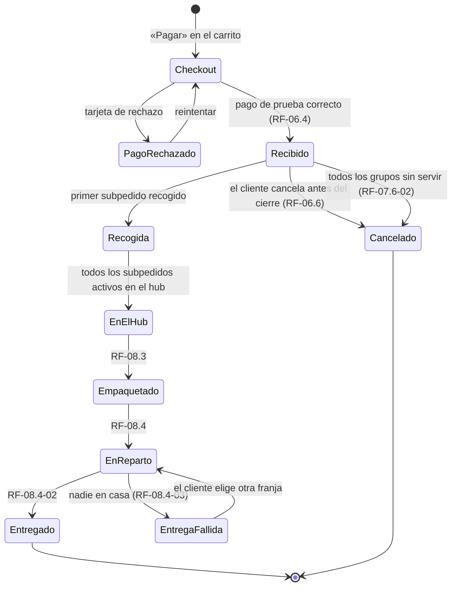
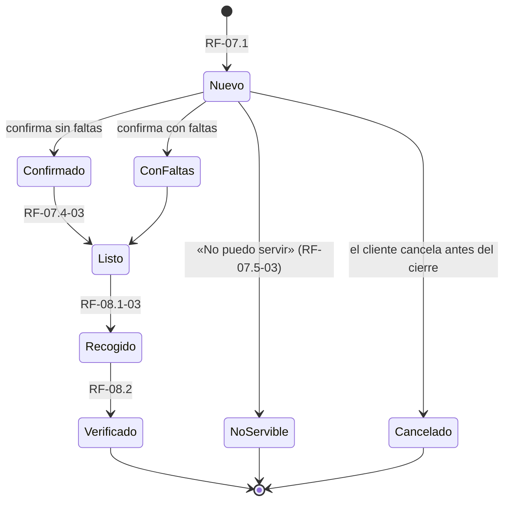

# FOOD4ALL · Estados del pedido, subpedido y reembolso de prueba

v0.4 · 22/10/2026 · Sebastián Manuel Mateo Sánchez · Revisión: pendiente (Juan Antonio o Miguel)

Este documento es el contrato común del núcleo de compra. Las fichas RF-06 (checkout y pago), RF-07 (subpedidos), RF-08 (hub y entrega), RF-09 (seguimiento), RF-10 (incidencias) y RNF-07 (fiabilidad) usan estos estados y reglas, y no pueden contradecirlos. Si una ficha necesita un estado nuevo, se añade aquí primero.

Responde a la valoración provisional del Hito 2 (21/10/2026), que pedía cerrar la máquina de estados común, definir el pago simulado junto con el reembolso y separar las etapas de una falta.

## 1. Tres ideas que lo ordenan todo

1. **Hay un único pago de prueba por pedido.** No se cobra dinero. El pago es un registro con su importe, y un **reembolso de prueba** es otro registro que resta de ese importe. Nunca hay una transferencia bancaria.
2. **El pedido global no se pierde nunca** una vez pagado (RNF-07). Lo que se cae es una línea o el grupo de un vendedor, y el pedido sigue con lo demás. Solo se cancela entero si lo cancela el cliente antes del cierre o si se quedan sin servir todos los grupos.
3. **Cada falta tiene su momento.** Lo que pasa antes de la recogida lo declara el vendedor (RF-07.3). Lo que se ve en el hub lo registra el operador (RF-08.2). Lo que se descubre tras la entrega es una incidencia del cliente (RF-10). Una misma línea no puede descontarse dos veces.

## 2. Momentos de referencia

| Momento | Qué es | Lo fija |
| --- | --- | --- |
| **Hora de cierre** | Último momento para comprar, modificar o cancelar un pedido de esa franja | Configuración de la franja (RF-13.6), visible en el checkout (RF-06.2-03) |
| **Plazo de confirmación** | Hora de cierre + 12 h. El vendedor debe confirmar o declarar faltas antes | RF-07.3-01 (Pendiente: propuesta) |
| **Hora de corte de sustitutos** (V2) | Inicio de la franja de recogida del vendedor. Hasta entonces el cliente puede aceptar un sustituto | RF-07.3-04 |
| **Recogida** | El operador registra la recogida en el vendedor | RF-08.1-03 |
| **Llegada al hub** | El operador registra la llegada | RF-08.2-01 |
| **Entrega** | El repartidor registra la entrega | RF-08.4-02 |
| **Plazo de incidencias** | 48 h tras la entrega para frescos y 14 días para despensa | RF-10.1-02 (Hipótesis, H-04) |

## 3. Pedido global (lo que ve el cliente)

| Estado | Visible para el cliente como | Entra cuando | Puede pasar a |
| --- | --- | --- | --- |
| Checkout | (no es un pedido todavía) | Pulsa «Pagar» | Pago rechazado, Recibido |
| Pago rechazado | «El banco ha rechazado el pago» | Tarjeta de prueba de rechazo | Checkout |
| **Recibido** | Recibido | Pago de prueba correcto; se crean los subpedidos (RF-07.1) | Recogida, Cancelado |
| **Recogida** | Recogida | El primer subpedido activo se recoge | En el hub |
| **En el hub** | En el hub | Todos los subpedidos activos han llegado al hub | Empaquetado |
| **Empaquetado** | Empaquetado | El hub cierra el paquete consolidado | En reparto |
| **En reparto** | En reparto | Se asigna a la ruta de su franja | Entregado, Entrega fallida |
| **Entregado** | Entregado | Entrega registrada | (final; se pueden abrir incidencias) |
| Entrega fallida | «No te encontramos. Elige otra franja» | Nadie en casa | En reparto |
| Cancelado | Cancelado | Lo cancela el cliente antes del cierre, o no queda ningún grupo | (final) |

**Regla de cálculo (RF-09.1-02):** el estado global es el del subpedido activo más atrasado hasta que todos llegan al hub. Los subpedidos cancelados o no servibles no cuentan. Los seis estados centrales están decididos; Pago rechazado, Entrega fallida y Cancelado son propuestas (Pendiente).

## 4. Subpedido (lo que ve cada vendedor)

| Estado | Quién lo cambia | Efecto en el pedido global |
| --- | --- | --- |
| Nuevo | Sistema | Ninguno |
| Confirmado | Vendedor | Ninguno |
| Con faltas | Vendedor | Recalcula el total y registra reembolsos de prueba por línea |
| No servible | Vendedor | Excluye el grupo, registra el reembolso de prueba de su importe y avisa al cliente (RF-07.6-01). Si era el último grupo, el pedido pasa a Cancelado (RF-07.6-02) |
| Listo | Vendedor | El operador lo ve en su ruta |
| Recogido | Operador | El pedido pasa a Recogida (si era el primero) |
| Verificado | Operador del hub | Cuando todos están verificados, el pedido puede empaquetarse |
| Cancelado | Sistema | Solo por cancelación del cliente antes del cierre |

Si el vendedor no confirma dentro del plazo, el subpedido sigue «Nuevo», el admin recibe una alerta y el cliente un aviso de posible retraso (RF-07.3-01, RF-07.5-02). No se cancela solo: lo decide el equipo.

## 5. Línea de pedido

| Estado | Cuándo | Importe que cuenta |
| --- | --- | --- |
| Pedida | Al crear el subpedido | Cantidad pedida × precio |
| Confirmada | El vendedor confirma la cantidad completa | Igual |
| Falta parcial | El vendedor solo puede servir *n* < pedida (RF-07.3-02) | *n* × precio; reembolso de prueba por la diferencia |
| Falta total | El vendedor no puede servir ninguna | 0; reembolso de prueba de la línea |
| Sustituto propuesto (V2) | El vendedor propone otro producto igual o más barato | Pendiente de respuesta del cliente |
| Sustituto aceptado (V2) | El cliente acepta antes de la hora de corte | Precio del sustituto; reembolso de prueba por la diferencia si es más barato |
| Excluida (V2) | Sustituto rechazado o sin respuesta («sin aceptación») | 0; reembolso de prueba de la línea |
| Retirada en el hub | El hub la retira por mal estado, caducidad o falta (RF-08.2-03) | 0; reembolso de prueba de la línea |
| Entregada | Llega al cliente | Importe final |

**Regla de no duplicar.** Cada reembolso de prueba lleva una clave «línea + motivo». Si llega otra vez la misma acción (doble clic, reintento o reenvío), se responde «La falta ya está registrada» y no se descuenta de nuevo (RF-07.3-07). Una línea con falta total o retirada no puede volver a reembolsarse por una incidencia (RF-10.2).

**Regla de etapa.** Hasta la recogida, la falta la declara el vendedor. Después, el vendedor ya no puede (RF-07.3-08) y la diferencia la registra el hub al verificar (RF-08.2-02). Tras la entrega, el cliente abre una incidencia (RF-10.1). Así son compatibles RF-07.3-05 («recalcular y reembolsar una falta») y RNF-07.1-02 («no perder el pedido aunque falle un subpedido»): la falta reduce el pedido, pero no lo anula.

## 6. Pago de prueba y reembolso de prueba

| Registro | Campos | Reglas |
| --- | --- | --- |
| **Pago de prueba** | Pedido, importe, fecha, resultado (aceptado o rechazado), clave de idempotencia del checkout | Uno solo por pedido (RF-06.4-05). Un segundo envío con la misma clave devuelve el mismo pedido (RF-06.4-06). No se guarda ningún dato de tarjeta |
| **Reembolso de prueba** | Pedido, línea o grupo, motivo, importe, fecha, autor (vendedor, operador, admin o sistema), clave «línea + motivo» | Nunca supera lo pagado por esa línea. La suma de reembolsos nunca supera el pago. Se muestra al cliente como «Reembolso de prueba: 2,00 €» |

**Total del pedido** = pago de prueba − suma de reembolsos de prueba. Es lo que muestran el seguimiento (RF-09.2) y «Mis pedidos» (RF-09.4).

**Motivos de reembolso:** falta (vendedor), sustituto sin aceptación (V2), grupo no servible, retirada en el hub, cancelación del cliente, incidencia aprobada y envío (si se cancelan todos los grupos).

**Con pagos reales (V3)** el registro de reembolso daría lugar a una devolución al medio de pago original en un máximo de 5 días hábiles (RF-10.2-02). Eso depende de una pasarela que hoy no existe y queda fuera del Hito 2.

## 7. Ejemplo completo (el recorrido que pide la defensa)

Lucía compra a dos vendedores: Antonio (4 tomates a 1 € = 4 €) y una panadería (pan, 2 €). El envío cuesta 3 € y el total es de 9 €. La franja es el jueves de 18 a 20 h, con cierre el martes a las 20:00.

1. **Pago.** Hay un pago de prueba de 9 €. Se crean el pedido F4A-2026-00001 en «Recibido» y los subpedidos -A (Antonio) y -B (panadería) en «Nuevo». Antonio ve solo sus 4 tomates, sin el nombre ni la dirección de Lucía.
2. **Falta.** El miércoles a las 7:00, antes de su plazo de las 8:00, Antonio indica que puede servir 2 tomates. La línea pasa a «Falta parcial» y el subpedido -A a «Con faltas». Se registra un reembolso de prueba de 2 € con motivo «falta», autor Antonio y la fecha. El total queda en 7 € y Lucía recibe el aviso en menos de 5 min.
3. **Reintento.** Antonio pulsa otra vez por error. Ve «La falta ya está registrada» y el total sigue en 7 €.
4. **Cancelación.** Ya no puede cancelar: el cierre fue el martes a las 20:00 y ve «El pedido ya se está preparando».
5. **Recogida y hub.** Los dos subpedidos se marcan «Listo», se recogen y llegan al hub. El hub verifica línea a línea, empaqueta en una bolsa de seco con «1/1» y lo envía en la franja.
6. **Qué ve cada uno.** Lucía ve «Recogida → En el hub → …» y en el detalle «Falta 2 unidades · reembolso de prueba registrado». Antonio ve su subpedido «Recogido». El operador ve la parada de Antonio con 1 bulto.

## 8. Qué queda abierto

- La hora de cierre por franja y el plazo de 12 h son propuestas (Pendiente). Dependen del hub y de las zonas (D-03).
- Los sustitutos (RF-07.3-03 y RF-07.3-04) quedan para V2.
- Quién asume el coste de una falta en la liquidación del vendedor depende de la comisión (D-02).
- Si FOOD4ALL es operador alimentario (D-01), la retirada en el hub tiene obligaciones de registro adicionales (RNF-09).
